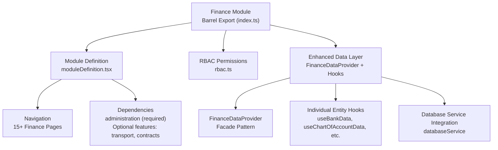
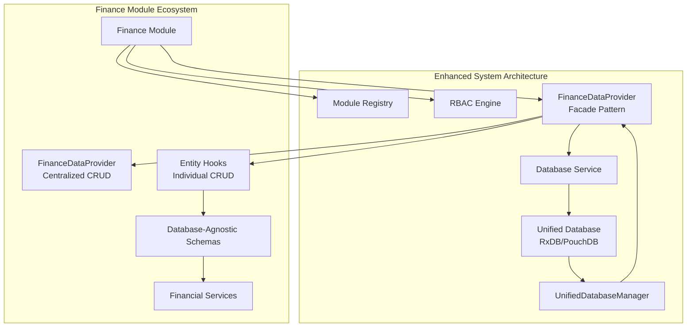
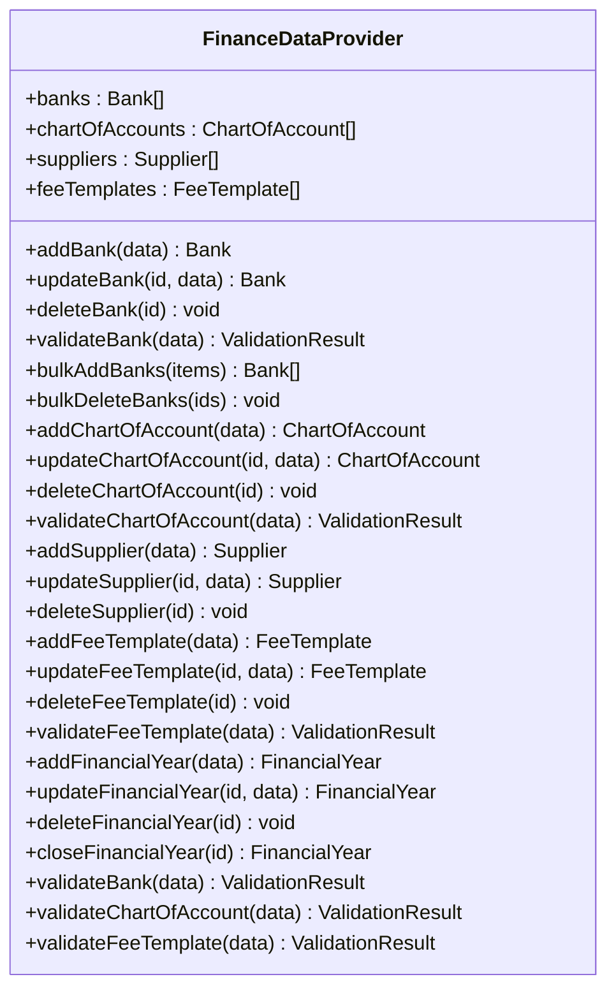
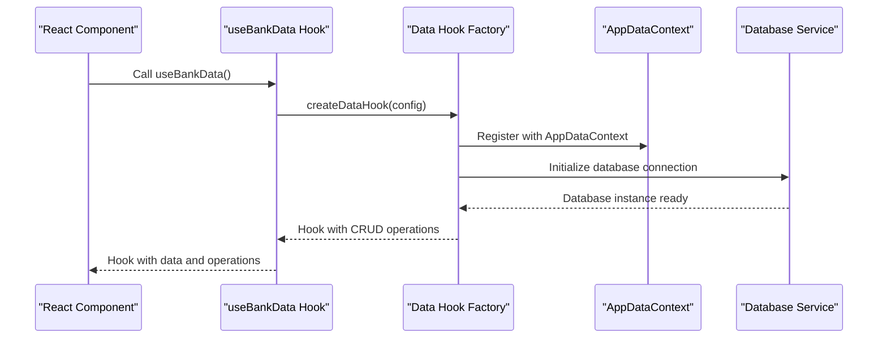
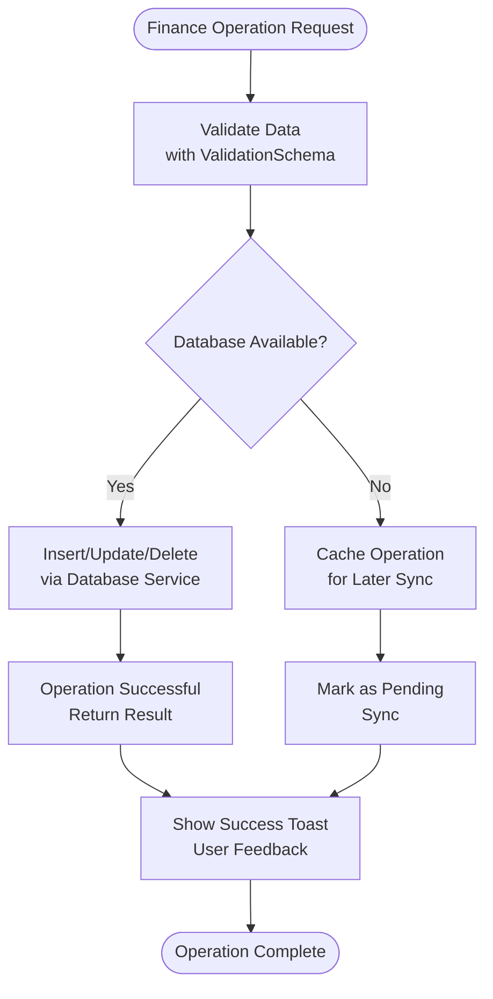
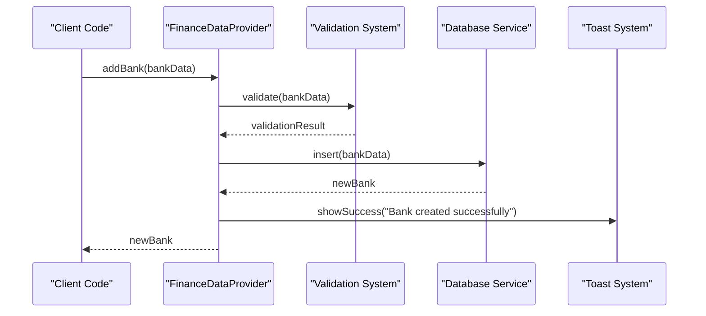
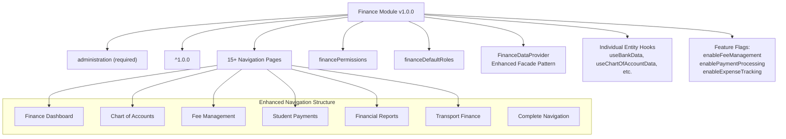

# Finance Module

<cite>
**Referenced Files in This Document**
- [index.ts](file://src/modules/finance/index.ts)
- [moduleDefinition.tsx](file://src/modules/finance/moduleDefinition.tsx)
- [rbac.ts](file://src/modules/finance/rbac.ts)
- [FinanceDataProvider.tsx](file://src/modules/finance/data/FinanceDataProvider.tsx)
- [useFinanceData.ts](file://src/modules/finance/data/useFinanceData.ts)
- [useBankData.ts](file://src/modules/finance/data/useBankData.ts)
- [types.ts](file://src/modules/finance/data/types.ts)
- [schema.ts](file://src/modules/finance/data/schema.ts)
- [useDataHookFactory.ts](file://src/hooks/useDataHookFactory.ts)
- [CONTEXT.md](file://CONTEXT.md)
</cite>

## Update Summary
**Changes Made**
- Updated comprehensive database integration section to reflect new FinanceDataProvider architecture with enhanced facade pattern implementation
- Revised data layer documentation to show unified database-backed approach using useFinanceData hook and individual entity hooks
- Enhanced facade pattern documentation with detailed FinanceDataProvider implementation and database integration
- Updated architecture overview to show new modular data provider pattern with database service integration
- Expanded coverage of new data hook factory implementation with AppDataContext integration
- Updated examples to include new FinanceDataProvider usage patterns and database-backed CRUD operations

## Table of Contents
1. [Introduction](#introduction)
2. [Project Structure](#project-structure)
3. [Core Components](#core-components)
4. [Architecture Overview](#architecture-overview)
5. [Detailed Component Analysis](#detailed-component-analysis)
6. [Comprehensive Database Integration](#comprehensive-database-integration)
7. [Dependency Analysis](#dependency-analysis)
8. [Performance Considerations](#performance-considerations)
9. [Troubleshooting Guide](#troubleshooting-guide)
10. [Conclusion](#conclusion)

## Introduction
This document describes the Finance module functionality within the system, featuring a completely rewritten database-backed approach with enhanced facade pattern implementation. The module now provides comprehensive financial management through a unified database integration system with 15+ collections, featuring the new FinanceDataProvider architecture that maintains full CRUD functionality while providing enhanced database integration. The content reflects the latest database integration improvements with the new FinanceDataProvider pattern, expanded financial ecosystem coverage, and comprehensive collection-driven architecture with database-agnostic schemas.

## Project Structure
The Finance module follows a modernized modular structure with enhanced database integration through the new FinanceDataProvider architecture and comprehensive collection management:

- Module definition and registration with extensive navigation and feature flags
- RBAC permissions and roles for granular access control
- Enhanced data layer with FinanceDataProvider facade pattern and individual entity hooks
- Database-agnostic schemas supporting both RxDB and PouchDB implementations
- Comprehensive CRUD operations through database service integration
- AppDataContext integration for centralized data management

**Diagram sources**
- [index.ts:1-31](file://src/modules/finance/index.ts#L1-L31)
- [moduleDefinition.tsx](file://src/modules/finance/moduleDefinition.tsx)
- [rbac.ts:1-51](file://src/modules/finance/rbac.ts#L1-L51)
- [FinanceDataProvider.tsx:1-612](file://src/modules/finance/data/FinanceDataProvider.tsx#L1-L612)
- [useBankData.ts:1-29](file://src/modules/finance/data/useBankData.ts#L1-L29)

**Section sources**
- [index.ts:1-31](file://src/modules/finance/index.ts#L1-L31)
- [CONTEXT.md:312-356](file://CONTEXT.md#L312-L356)

## Core Components
The Finance module now provides comprehensive financial management through the enhanced FinanceDataProvider architecture with database-backed CRUD operations:

### Module Definition and Registration
- Declares module identity, version, dependencies, 15+ navigation routes, data hooks, and permissions
- Supports both required (administration) and optional dependencies
- Features include fee management, payment processing, accounting, expense tracking, and transport finance
- Includes comprehensive feature flags for enabling/disabling specific financial functionalities

### RBAC Permissions
- Granular permissions for payment processing and financial reporting
- Four payment operation permissions (read, create, update, delete)
- One reporting permission for financial insights
- Default roles include finance officer and administrator

### Enhanced Data Provider Architecture
The module now features a sophisticated FinanceDataProvider facade pattern that encapsulates all financial data operations:

#### FinanceDataProvider Facade Pattern
- Centralized data management through React Context Provider
- Comprehensive CRUD operations for all 15+ financial entities
- Built-in validation using ValidationSchema system
- Database service integration with automatic transaction handling
- Toast notification integration for user feedback
- Loading state management for async operations

#### Individual Entity Hooks
- Modular data hooks using the data hook factory pattern
- Consistent CRUD interface across all financial entities
- Automatic AppDataContext registration and synchronization
- Support for offline operations with caching
- Type-safe entity management with validation

**Section sources**
- [moduleDefinition.tsx](file://src/modules/finance/moduleDefinition.tsx)
- [rbac.ts:1-51](file://src/modules/finance/rbac.ts#L1-L51)
- [FinanceDataProvider.tsx:1-612](file://src/modules/finance/data/FinanceDataProvider.tsx#L1-L612)
- [useBankData.ts:1-29](file://src/modules/finance/data/useBankData.ts#L1-L29)

## Architecture Overview
The Finance module integrates comprehensively with the broader system through the new FinanceDataProvider architecture and enhanced database integration:

**Diagram sources**
- [moduleDefinition.tsx](file://src/modules/finance/moduleDefinition.tsx)
- [rbac.ts:1-51](file://src/modules/finance/rbac.ts#L1-L51)
- [FinanceDataProvider.tsx:1-612](file://src/modules/finance/data/FinanceDataProvider.tsx#L1-L612)
- [useDataHookFactory.ts:1-557](file://src/hooks/useDataHookFactory.ts#L1-L557)

## Detailed Component Analysis

### FinanceDataProvider Facade Pattern
The new FinanceDataProvider implements a comprehensive facade pattern that encapsulates all financial data operations with enhanced database integration:

**Diagram sources**
- [FinanceDataProvider.tsx:11-612](file://src/modules/finance/data/FinanceDataProvider.tsx#L11-L612)

**Section sources**
- [FinanceDataProvider.tsx:1-612](file://src/modules/finance/data/FinanceDataProvider.tsx#L1-L612)

### Enhanced Data Hook Factory Implementation
The individual entity hooks now utilize the enhanced data hook factory pattern for consistent database integration:

**Diagram sources**
- [useBankData.ts:12-28](file://src/modules/finance/data/useBankData.ts#L12-L28)
- [useDataHookFactory.ts:65-557](file://src/hooks/useDataHookFactory.ts#L65-L557)

**Section sources**
- [useBankData.ts:1-29](file://src/modules/finance/data/useBankData.ts#L1-L29)
- [useDataHookFactory.ts:1-557](file://src/hooks/useDataHookFactory.ts#L1-L557)

### Database Service Integration
The Finance module now features comprehensive database service integration with automatic transaction handling and validation:

**Diagram sources**
- [FinanceDataProvider.tsx:126-153](file://src/modules/finance/data/FinanceDataProvider.tsx#L126-L153)
- [FinanceDataProvider.tsx:232-258](file://src/modules/finance/data/FinanceDataProvider.tsx#L232-L258)

**Section sources**
- [FinanceDataProvider.tsx:126-153](file://src/modules/finance/data/FinanceDataProvider.tsx#L126-L153)
- [FinanceDataProvider.tsx:232-258](file://src/modules/finance/data/FinanceDataProvider.tsx#L232-L258)

### Comprehensive CRUD Operations
The enhanced FinanceDataProvider provides comprehensive CRUD operations with validation and error handling:

**Diagram sources**
- [FinanceDataProvider.tsx:126-153](file://src/modules/finance/data/FinanceDataProvider.tsx#L126-L153)

**Section sources**
- [FinanceDataProvider.tsx:126-153](file://src/modules/finance/data/FinanceDataProvider.tsx#L126-L153)

## Comprehensive Database Integration
The Finance module now integrates through the enhanced FinanceDataProvider architecture with comprehensive financial ecosystem coverage:

### Core Finance Collections
- **financial_years**: Financial period boundaries and fiscal year management with status tracking
- **chart_of_accounts**: Complete accounting hierarchy with parent-child relationships and account templates
- **expense_categories**: Expense classification system for operational tracking
- **banks**: Bank account management with cash/bank account integration and GL account linking
- **suppliers**: Supplier directory with contact and payment terms

### Fee and Invoicing Collections
- **fee_templates**: Standard fee structures with component-based pricing and school period associations
- **fee_template_items**: Individual fee components within templates with revenue account linking
- **expense_claims**: Employee expense reimbursement tracking with workflow states
- **student_opening_balances**: Initial student account balances with type categorization
- **fee_adjustments**: Fee modifications and waivers with reason tracking

### Transport Collections
- **transport_routes**: Bus route management with monthly fee calculations and GL revenue account linking
- **student_transport_assignments**: Student route assignments with status tracking and cost overrides

### Student Financial Collections
- **student_invoices**: Student fee invoice generation and management with itemized billing
- **student_payments**: Payment processing for student accounts with method tracking
- **invoice_payment_applications**: Payment allocation to specific invoices with amount tracking

### External Financial Collections
- **customer_invoices**: Revenue recognition from external customers with itemized billing
- **supplier_invoices**: Procurement invoice management with payment tracking
- **general_payments**: Bank payment processing with multi-item support
- **general_ledger_entries**: Consolidated financial posting with source tracking

### Collection Relationships
The enhanced FinanceDataProvider creates a comprehensive financial data model with clear relationships:
- Hierarchical chart of accounts supporting multi-level accounting
- Supplier contract management integrating with purchase processes
- Transport route management connecting to student assignment workflows
- Comprehensive payment application system supporting multiple invoice types
- Financial year boundaries controlling posting periods and reporting cycles

**Section sources**
- [FinanceDataProvider.tsx:11-612](file://src/modules/finance/data/FinanceDataProvider.tsx#L11-L612)
- [types.ts:1-435](file://src/modules/finance/data/types.ts#L1-L435)
- [schema.ts:1-384](file://src/modules/finance/data/schema.ts#L1-L384)

## Dependency Analysis
The Finance module maintains strategic dependencies while expanding functionality through the enhanced FinanceDataProvider architecture:

**Diagram sources**
- [moduleDefinition.tsx](file://src/modules/finance/moduleDefinition.tsx)
- [rbac.ts:1-51](file://src/modules/finance/rbac.ts#L1-L51)
- [FinanceDataProvider.tsx:1-612](file://src/modules/finance/data/FinanceDataProvider.tsx#L1-L612)

**Section sources**
- [moduleDefinition.tsx](file://src/modules/finance/moduleDefinition.tsx)
- [rbac.ts:1-51](file://src/modules/finance/rbac.ts#L1-L51)

## Performance Considerations
Enhanced performance considerations for the new FinanceDataProvider architecture with comprehensive database integration:

- **Database Service Optimization**: The FinanceDataProvider efficiently manages database connections through the database service for optimal performance
- **Validation Caching**: Built-in validation schemas with caching for improved validation performance
- **Toast Integration**: Centralized toast notifications minimize UI overhead while providing user feedback
- **Memory Management**: Enhanced memory-aware caching through the data hook factory for efficient data operations
- **Batch Operations**: Optimized batch processing for financial year closing and period-end activities through FinanceDataProvider
- **Database Connection Pooling**: Unified connection management for concurrent financial operations
- **Schema Validation**: Compile-time schema validation reduces runtime errors and improves performance
- **AppDataContext Integration**: Seamless integration with AppDataContext prevents data synchronization overhead

## Troubleshooting Guide
Comprehensive troubleshooting for the enhanced FinanceDataProvider architecture with database integration:

### Common Issues and Resolutions
- **Database Connection Issues**: Verify database service initialization and connection status
- **Validation Failures**: Check validation schemas and ensure data conforms to schema requirements
- **FinanceDataProvider Not Found**: Ensure FinanceDataProvider is properly wrapped around components
- **Entity Hook Registration**: Verify individual entity hooks are properly registered with AppDataContext
- **Data Synchronization**: Check AppDataContext synchronization and ensure data consistency
- **CRUD Operation Failures**: Review database service logs and error handling in FinanceDataProvider
- **Performance Issues**: Monitor database query performance and optimize entity hook usage
- **Validation Schema Errors**: Ensure all validation schemas are correctly defined and match entity types

### Database Integration Issues
- **FinanceDataProvider Context**: Verify FinanceDataProvider is properly wrapping application components
- **Database Service Initialization**: Ensure database service is properly initialized before FinanceDataProvider usage
- **Entity Hook Factory**: Check data hook factory configuration and ensure proper entity registration
- **AppDataContext Integration**: Verify AppDataContext is properly configured for data synchronization
- **Validation System**: Ensure validation schemas are correctly defined and applied to CRUD operations
- **Transaction Consistency**: Verify atomicity in multi-entity financial transactions through FinanceDataProvider

**Section sources**
- [FinanceDataProvider.tsx:1-612](file://src/modules/finance/data/FinanceDataProvider.tsx#L1-L612)
- [useBankData.ts:1-29](file://src/modules/finance/data/useBankData.ts#L1-L29)
- [useDataHookFactory.ts:1-557](file://src/hooks/useDataHookFactory.ts#L1-L557)

## Conclusion
The Finance module now provides a comprehensive, database-backed financial management system with enhanced FinanceDataProvider architecture featuring the new facade pattern implementation. The enhanced architecture supports fee management, accounting integration, student payment processing, supplier/customer workflows, transport finance, general ledger posting, and advanced reporting capabilities through unified database integration. The modular design with FinanceDataProvider facade pattern, individual entity hooks, and comprehensive collection-driven data model enables scalable and maintainable financial operations across the entire educational institution system. The enhanced database integration ensures robust financial data management, reliable transaction processing, and comprehensive reporting capabilities essential for modern educational finance operations. The unified database approach with database-agnostic schemas and enhanced facade pattern provides flexibility for future database provider changes while maintaining data consistency and performance across all financial entities.