# Finance Module

<cite>
**Referenced Files in This Document**
- [index.ts](file://src/modules/finance/index.ts)
- [moduleDefinition.tsx](file://src/modules/finance/moduleDefinition.tsx)
- [rbac.ts](file://src/modules/finance/rbac.ts)
- [hooks/index.ts](file://src/modules/finance/hooks/index.ts)
- [hooks/useFinanceServices.ts](file://src/modules/finance/hooks/useFinanceServices.ts)
- [services/index.ts](file://src/modules/finance/services/index.ts)
- [services/registerServices.ts](file://src/modules/finance/services/registerServices.ts)
- [pages/FeeConfigurationHubPage.tsx](file://src/modules/finance/pages/FeeConfigurationHubPage.tsx)
- [pages/AccountingConfigPage.tsx](file://src/modules/finance/pages/AccountingConfigPage.tsx)
- [pages/AccountingOperationsPage.tsx](file://src/modules/finance/pages/AccountingOperationsPage.tsx)
- [pages/FinanceReportsHubPage.tsx](file://src/modules/finance/pages/FinanceReportsHubPage.tsx)
- [pages/FinancialStatementsPage.tsx](file://src/modules/finance/pages/FinancialStatementsPage.tsx)
- [pages/PaymentsHubPage.tsx](file://src/modules/finance/pages/PaymentsHubPage.tsx)
- [pages/StudentFeeHistoryPage.tsx](file://src/modules/finance/pages/StudentFeeHistoryPage.tsx)
- [pages/InvoicingHubPage.tsx](file://src/modules/finance/pages/InvoicingHubPage.tsx)
- [pages/VoteheadStatementPage.tsx](file://src/modules/finance/pages/VoteheadStatementPage.tsx)
- [studentVoteheadStatement.ts](file://src/utils/studentVoteheadStatement.ts)
- [CONTEXT.md](file://CONTEXT.md)
</cite>

## Update Summary
**Changes Made**
- Updated to reflect new comprehensive hub page architecture consolidating complex financial workflows
- Added documentation for six new hub pages: FeeConfigurationHubPage, AccountingConfigPage, AccountingOperationsPage, FinanceReportsHubPage, FinancialStatementsPage, PaymentsHubPage, StudentFeeHistoryPage
- Enhanced navigation structure with 10 focused hub pages replacing previous consolidated approach
- Updated service architecture documentation to reflect new tabbed interface patterns
- Revised financial reporting capabilities with dedicated hub page structure

## Table of Contents
1. [Introduction](#introduction)
2. [Project Structure](#project-structure)
3. [Core Components](#core-components)
4. [Architecture Overview](#architecture-overview)
5. [Hub Page Architecture](#hub-page-architecture)
6. [Financial Services Layer](#financial-services-layer)
7. [React Hooks Ecosystem](#react-hooks-ecosystem)
8. [Service Registration System](#service-registration-system)
9. [Enhanced Reporting Capabilities](#enhanced-reporting-capabilities)
10. [Data Layer Evolution](#data-layer-evolution)
11. [Navigation and Features](#navigation-and-features)
12. [Performance Considerations](#performance-considerations)
13. [Troubleshooting Guide](#troubleshooting-guide)
14. [Conclusion](#conclusion)

## Introduction
This document describes the Finance module functionality within the system, featuring a comprehensive transformation to a hub-based architecture with specialized financial management capabilities. The module now provides advanced financial management through a modernized approach with six dedicated hub pages, TypeScript implementations replacing traditional stored procedures, and comprehensive reporting features. The architecture emphasizes modular design with specialized services for fee management, payment processing, accounting operations, financial reporting, and comprehensive tabbed interface patterns supporting real-time data computation and presentation.

## Project Structure
The Finance module follows a modernized structure with enhanced hub page architecture and comprehensive tabbed interface patterns:

- Module definition with 10 navigation routes organized into focused hub pages
- RBAC permissions for granular access control across payment processing and reporting
- Service-oriented architecture with TypeScript implementations replacing stored procedures
- React hooks ecosystem for computed views and financial analytics
- Enhanced data layer with computed view hooks replacing PostgreSQL views
- Comprehensive financial reporting and analytics capabilities through dedicated hub pages

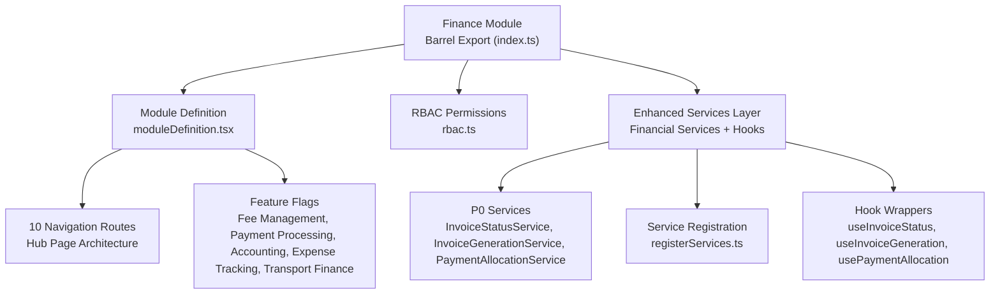

**Diagram sources**
- [index.ts:1-31](file://src/modules/finance/index.ts#L1-L31)
- [moduleDefinition.tsx:33-135](file://src/modules/finance/moduleDefinition.tsx#L33-L135)
- [rbac.ts:1-51](file://src/modules/finance/rbac.ts#L1-L51)
- [hooks/index.ts:1-19](file://src/modules/finance/hooks/index.ts#L1-L19)
- [services/index.ts:1-33](file://src/modules/finance/services/index.ts#L1-L33)
- [services/registerServices.ts:1-59](file://src/modules/finance/services/registerServices.ts#L1-L59)

**Section sources**
- [index.ts:1-31](file://src/modules/finance/index.ts#L1-L31)
- [CONTEXT.md:312-356](file://CONTEXT.md#L312-L356)

## Core Components
The Finance module now provides comprehensive financial management through an enhanced hub page architecture with specialized financial services and computed view hooks:

### Module Definition and Registration
- Declares module identity, version, dependencies, 10 navigation routes, data hooks, and permissions
- Supports both required (administration) and optional dependencies
- Features include comprehensive fee management, advanced payment processing, integrated accounting, detailed expense tracking, and transport finance
- Includes extensive feature flags for enabling/disabling specific financial functionalities

### RBAC Permissions
- Granular permissions for payment processing and financial reporting
- Four payment operation permissions (read, create, update, delete)
- One reporting permission for financial insights
- Default roles include finance officer and administrator

### Enhanced Services Architecture
The module now features a sophisticated service-oriented architecture that replaces traditional stored procedures with TypeScript implementations:

#### P0 Financial Services Layer
- **InvoiceStatusService**: Real-time invoice status tracking and management with dependency injection
- **InvoiceGenerationService**: Automated invoice creation and generation workflows with template-based processing
- **PaymentAllocationService**: Intelligent payment allocation to multiple invoices and financial periods with priority and weighted algorithms

#### Service Registration System
- **registerFinanceServices**: Centralized service registration with dependency injection pattern
- **Service Registry Integration**: Global service registry for P0 services requiring runtime dependencies
- **Lazy Singleton Pattern**: Services registered as factories for runtime dependency initialization

**Section sources**
- [moduleDefinition.tsx:33-135](file://src/modules/finance/moduleDefinition.tsx#L33-L135)
- [rbac.ts:1-51](file://src/modules/finance/rbac.ts#L1-L51)
- [hooks/index.ts:1-19](file://src/modules/finance/hooks/index.ts#L1-L19)
- [services/index.ts:1-33](file://src/modules/finance/services/index.ts#L1-L33)
- [services/registerServices.ts:1-59](file://src/modules/finance/services/registerServices.ts#L1-L59)

## Architecture Overview
The Finance module integrates comprehensively with the broader system through its enhanced hub page architecture and computed view hooks:

```mermaid
graph TB
subgraph "Enhanced System Architecture"
M["Module Registry"]
R["RBAC Engine"]
SR["Service Registry"]
FS["Financial Services Layer"]
CVH["Computed View Hooks"]
DS["Database Service"]
DB["Unified Database<br/>RxDB/PouchDB"]
UDM["UnifiedDatabaseManager"]
end
subgraph "Finance Module Hub Architecture"
F["Finance Module"]
FH["FeeConfigurationHubPage"]
ACH["AccountingConfigPage"]
AOP["AccountingOperationsPage"]
FRH["FinanceReportsHubPage"]
FSP["FinancialStatementsPage"]
PHP["PaymentsHubPage"]
SFH["StudentFeeHistoryPage"]
IH["InvoicingHubPage"]
F --> M
F --> R
F --> SR
F --> FS
F --> CVH
F --> FH
F --> ACH
F --> AOP
F --> FRH
F --> FSP
F --> PHP
F --> SFH
F --> IH
end
```

**Diagram sources**
- [moduleDefinition.tsx:33-135](file://src/modules/finance/moduleDefinition.tsx#L33-L135)
- [rbac.ts:1-51](file://src/modules/finance/rbac.ts#L1-L51)
- [hooks/index.ts:1-19](file://src/modules/finance/hooks/index.ts#L1-L19)
- [services/registerServices.ts:13-25](file://src/modules/finance/services/registerServices.ts#L13-L25)

## Hub Page Architecture
The Finance module now provides comprehensive financial management through six dedicated hub pages that consolidate complex workflows:

### Fee Configuration Hub
The FeeConfigurationHubPage consolidates fee templates, structures, and receipt templates into a tabbed interface:

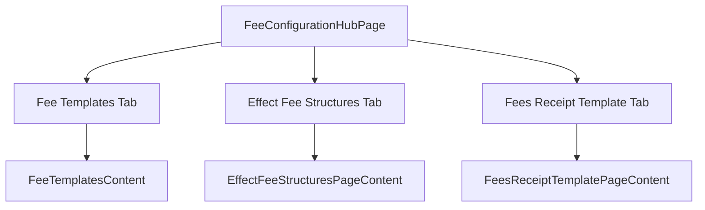

**Diagram sources**
- [pages/FeeConfigurationHubPage.tsx:25-89](file://src/modules/finance/pages/FeeConfigurationHubPage.tsx#L25-L89)

### Accounting Configuration Hub
The AccountingConfigPage manages chart of accounts and bank accounts through dedicated tabs:

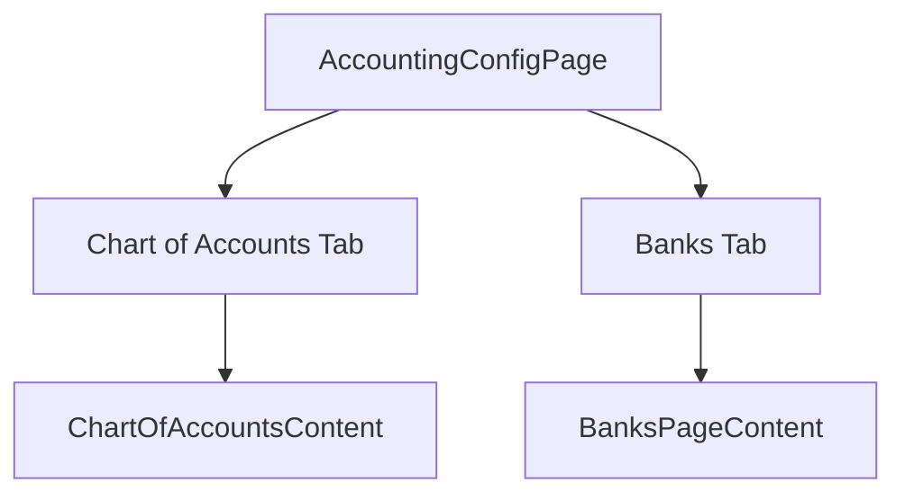

**Diagram sources**
- [pages/AccountingConfigPage.tsx:19-77](file://src/modules/finance/pages/AccountingConfigPage.tsx#L19-L77)

### Accounting Operations Hub
The AccountingOperationsPage consolidates ledger, cash book, day book, and journal register operations:

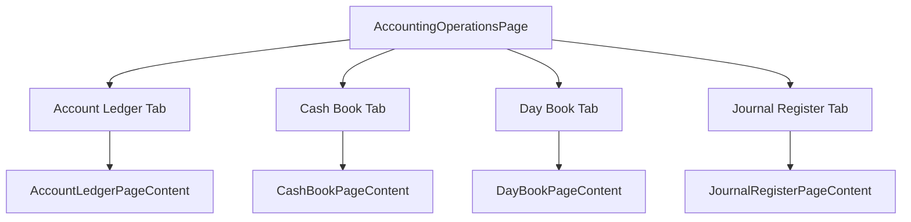

**Diagram sources**
- [pages/AccountingOperationsPage.tsx:21-90](file://src/modules/finance/pages/AccountingOperationsPage.tsx#L21-L90)

### Finance Reports Hub
The FinanceReportsHubPage provides consolidated reporting for fees due, students paid, and votehead statements:

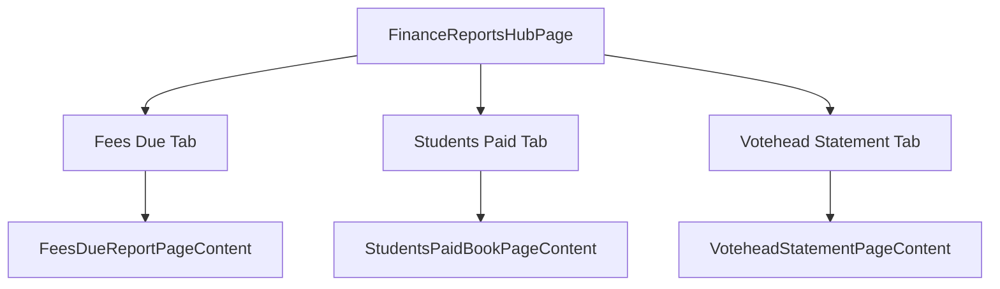

**Diagram sources**
- [pages/FinanceReportsHubPage.tsx:24-88](file://src/modules/finance/pages/FinanceReportsHubPage.tsx#L24-L88)

### Financial Statements Hub
The FinancialStatementsPage consolidates trial balance, balance sheet, and income statement reporting:

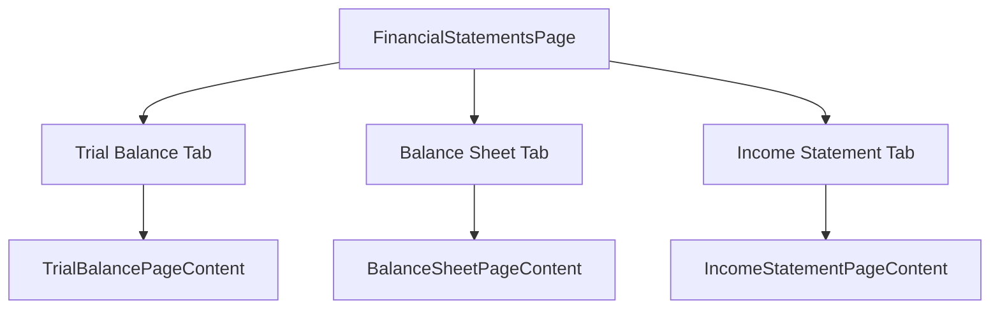

**Diagram sources**
- [pages/FinancialStatementsPage.tsx:21-84](file://src/modules/finance/pages/FinancialStatementsPage.tsx#L21-L84)

### Payments Hub
The PaymentsHubPage consolidates student payments, opening balances, fee collection summary, financial summary, payment allocation, and general receipts:

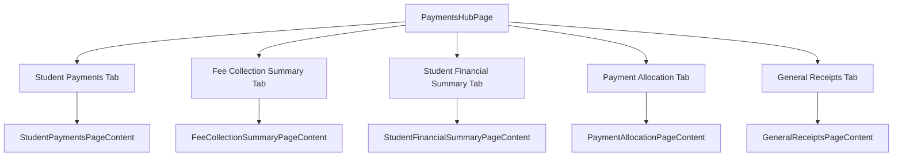

**Diagram sources**
- [pages/PaymentsHubPage.tsx:27-87](file://src/modules/finance/pages/PaymentsHubPage.tsx#L27-L87)

### Student Fee History Hub
The StudentFeeHistoryPage manages opening balances and previous session fees:

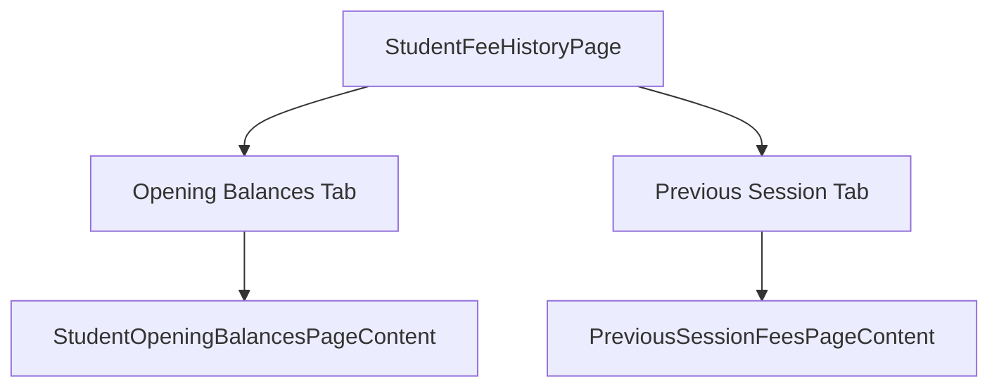

**Diagram sources**
- [pages/StudentFeeHistoryPage.tsx:19-76](file://src/modules/finance/pages/StudentFeeHistoryPage.tsx#L19-L76)

### Invoicing Hub
The InvoicingHubPage consolidates invoice generation, customer invoices, and supplier invoices:

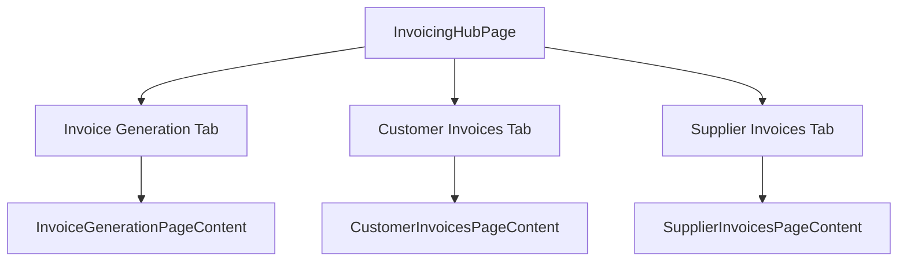

**Diagram sources**
- [pages/InvoicingHubPage.tsx:23-86](file://src/modules/finance/pages/InvoicingHubPage.tsx#L23-L86)

**Section sources**
- [pages/FeeConfigurationHubPage.tsx:1-93](file://src/modules/finance/pages/FeeConfigurationHubPage.tsx#L1-L93)
- [pages/AccountingConfigPage.tsx:1-80](file://src/modules/finance/pages/AccountingConfigPage.tsx#L1-L80)
- [pages/AccountingOperationsPage.tsx:1-94](file://src/modules/finance/pages/AccountingOperationsPage.tsx#L1-L94)
- [pages/FinanceReportsHubPage.tsx:1-92](file://src/modules/finance/pages/FinanceReportsHubPage.tsx#L1-L92)
- [pages/FinancialStatementsPage.tsx:1-88](file://src/modules/finance/pages/FinancialStatementsPage.tsx#L1-L88)
- [pages/PaymentsHubPage.tsx:1-91](file://src/modules/finance/pages/PaymentsHubPage.tsx#L1-L91)
- [pages/StudentFeeHistoryPage.tsx:1-80](file://src/modules/finance/pages/StudentFeeHistoryPage.tsx#L1-L80)
- [pages/InvoicingHubPage.tsx:1-91](file://src/modules/finance/pages/InvoicingHubPage.tsx#L1-L91)

## Financial Services Layer
The Finance module now provides comprehensive financial services through TypeScript implementations that replace traditional stored procedures:

### Invoice Status Management Service
The InvoiceStatusService provides real-time invoice tracking and status management with dependency injection:

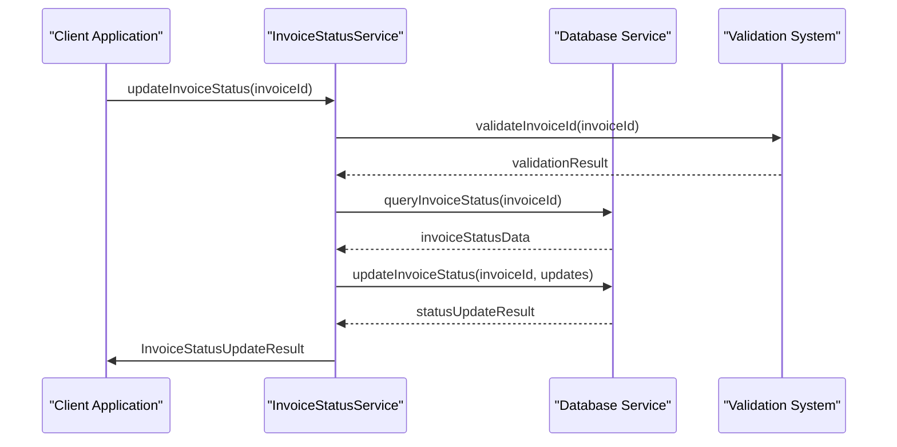

**Diagram sources**
- [hooks/useFinanceServices.ts:89-137](file://src/modules/finance/hooks/useFinanceServices.ts#L89-L137)

### Invoice Generation Workflow Service
The InvoiceGenerationService handles automated invoice creation and generation with template-based processing:

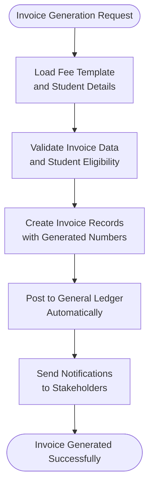

**Diagram sources**
- [hooks/useFinanceServices.ts:224-244](file://src/modules/finance/hooks/useFinanceServices.ts#L224-L244)

### Payment Allocation System Service
The PaymentAllocationService provides intelligent payment distribution across multiple invoices with priority algorithms:

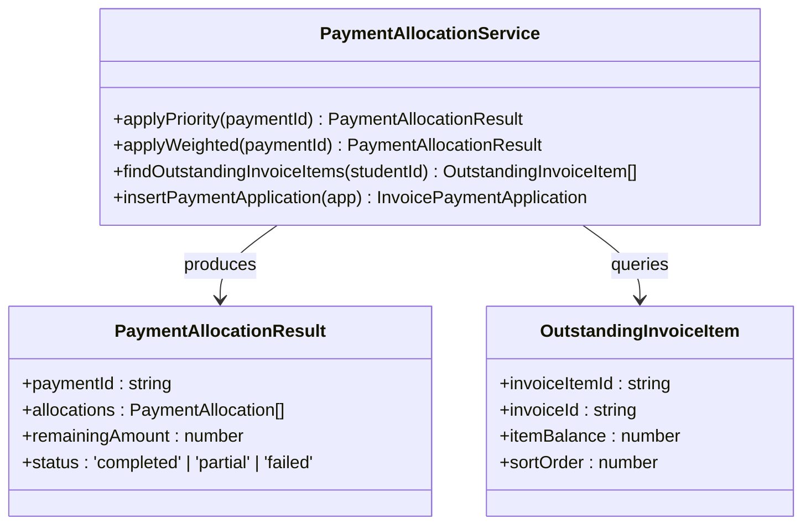

**Diagram sources**
- [hooks/useFinanceServices.ts:360-397](file://src/modules/finance/hooks/useFinanceServices.ts#L360-L397)

**Section sources**
- [hooks/useFinanceServices.ts:1-397](file://src/modules/finance/hooks/useFinanceServices.ts#L1-L397)
- [services/index.ts:7-33](file://src/modules/finance/services/index.ts#L7-L33)

## React Hooks Ecosystem
The Finance module features a comprehensive hooks ecosystem that wraps P0 services with React-friendly interfaces:

### Main Modular Hook
The useFinance hook serves as the central entry point for all Finance module functionality:

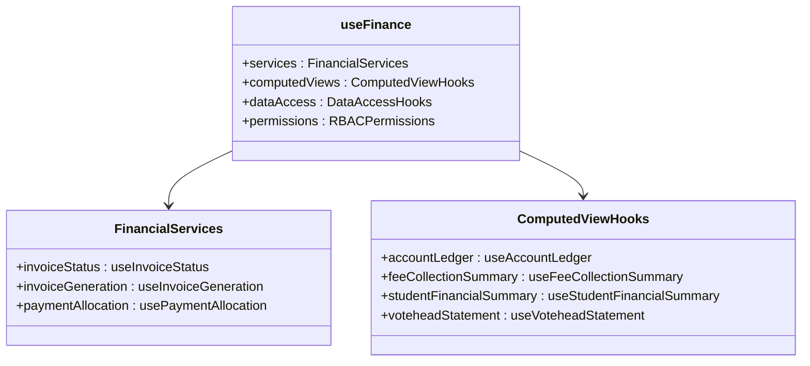

**Diagram sources**
- [hooks/index.ts:4-5](file://src/modules/finance/hooks/index.ts#L4-L5)

### Service Wrapper Hooks Architecture
Each service wrapper provides React-friendly interfaces with state management:

#### useInvoiceStatus Hook
Real-time invoice status management with loading states and error handling:

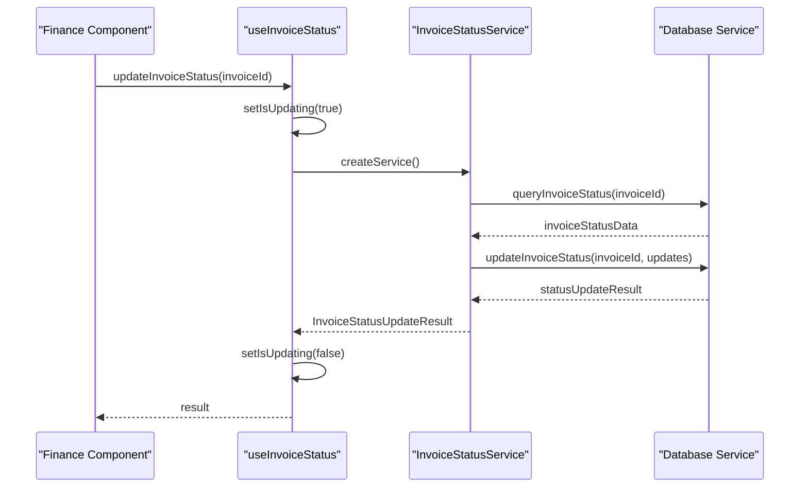

**Diagram sources**
- [hooks/useFinanceServices.ts:39-137](file://src/modules/finance/hooks/useFinanceServices.ts#L39-L137)

#### useInvoiceGeneration Hook
Automated invoice generation with progress tracking and error handling:

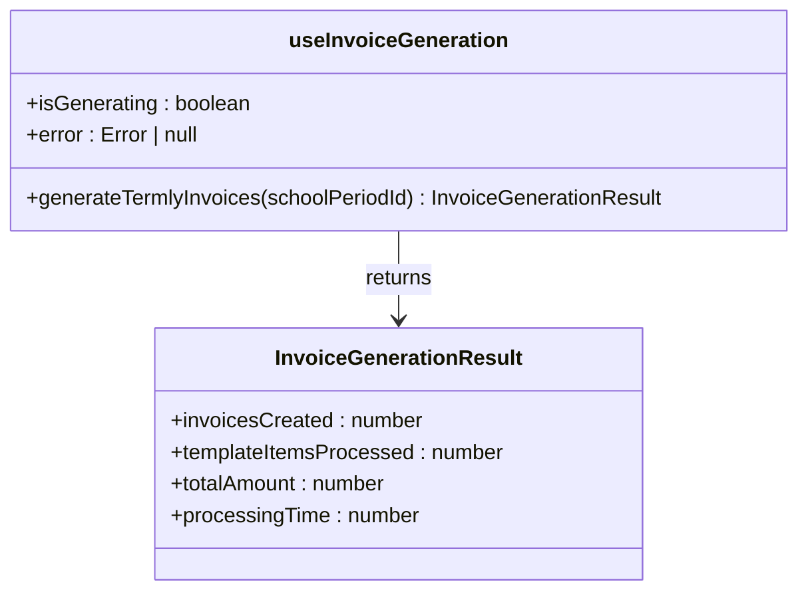

**Diagram sources**
- [hooks/useFinanceServices.ts:148-244](file://src/modules/finance/hooks/useFinanceServices.ts#L148-L244)

#### usePaymentAllocation Hook
Intelligent payment allocation with multiple algorithm support:

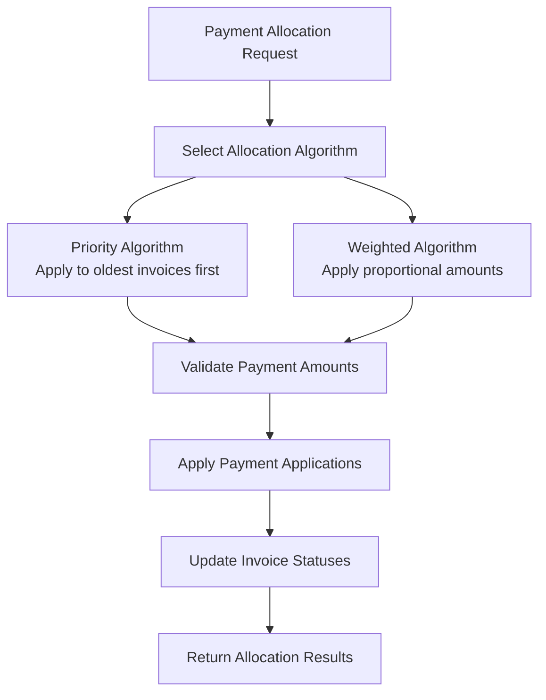

**Diagram sources**
- [hooks/useFinanceServices.ts:256-397](file://src/modules/finance/hooks/useFinanceServices.ts#L256-L397)

**Section sources**
- [hooks/index.ts:1-19](file://src/modules/finance/hooks/index.ts#L1-L19)
- [hooks/useFinanceServices.ts:1-397](file://src/modules/finance/hooks/useFinanceServices.ts#L1-L397)

## Service Registration System
The Finance module implements a centralized service registration system that manages P0 services with dependency injection:

### Service Registry Integration
The registerFinanceServices function provides centralized service registration:

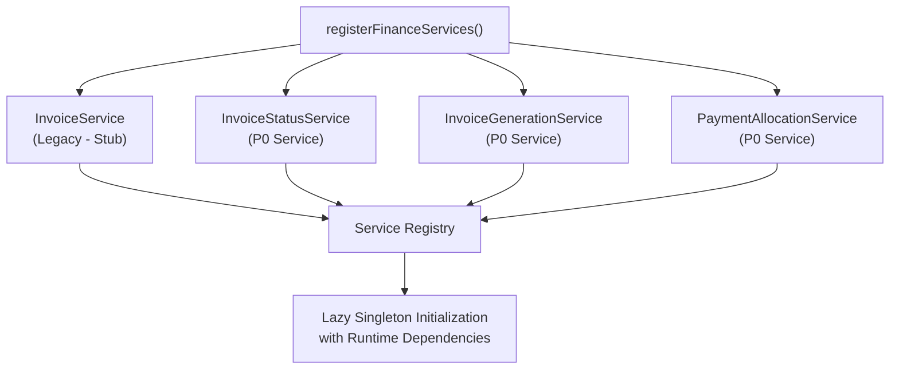

**Diagram sources**
- [services/registerServices.ts:26-58](file://src/modules/finance/services/registerServices.ts#L26-L58)

### Dependency Injection Pattern
Services are registered as factories requiring runtime dependency initialization:

- **InvoiceStatusServiceDependencies**: Database access functions for invoice status operations
- **InvoiceGenerationServiceDependencies**: Data access functions for invoice generation workflows
- **PaymentAllocationServiceDependencies**: Comprehensive data access for payment allocation operations
- **Lazy Initialization**: Services instantiated only when first accessed via service registry

**Section sources**
- [services/registerServices.ts:1-59](file://src/modules/finance/services/registerServices.ts#L1-L59)
- [services/index.ts:1-33](file://src/modules/finance/services/index.ts#L1-L33)

## Enhanced Reporting Capabilities
The Finance module now provides comprehensive reporting capabilities through dedicated hub pages and computed view hooks:

### Votehead Statement Reporting
The VoteheadStatementPage demonstrates advanced per-invoice financial reporting:

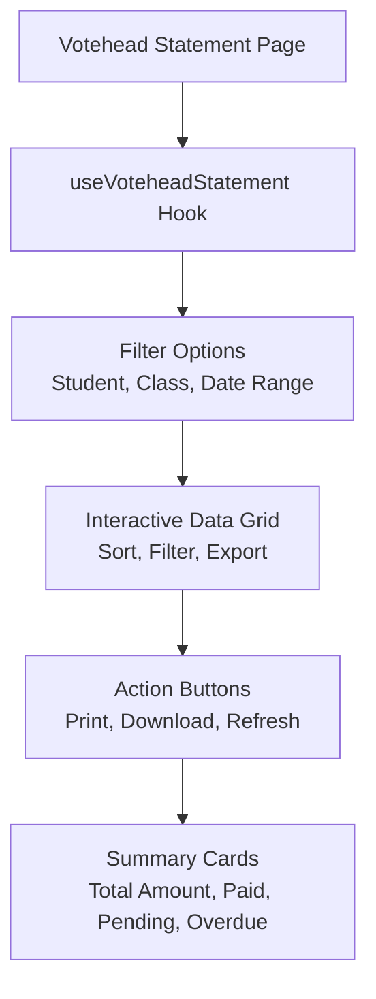

**Diagram sources**
- [pages/VoteheadStatementPage.tsx:1-24](file://src/modules/finance/pages/VoteheadStatementPage.tsx#L1-L24)

### Financial Analytics Dashboard
The enhanced reporting system provides comprehensive financial analytics through dedicated hub pages:

- **Real-time Dashboards**: Live financial metrics and KPIs from hub page integrations
- **Trend Analysis**: Historical financial trends and projections across all hub pages
- **Drill-down Capabilities**: Detailed financial data exploration through tabbed interfaces
- **Export Functionality**: PDF, Excel, and CSV export options from individual hub tabs
- **Custom Reporting**: Configurable report templates and filters within each hub page

**Section sources**
- [pages/VoteheadStatementPage.tsx:1-24](file://src/modules/finance/pages/VoteheadStatementPage.tsx#L1-L24)

## Data Layer Evolution
The Finance module has evolved from traditional database-centric architecture to a hybrid approach combining database storage with service-oriented processing and hub page patterns:

### Database Collections Architecture
The module maintains comprehensive database collections while leveraging service-based processing and tabbed interface patterns:

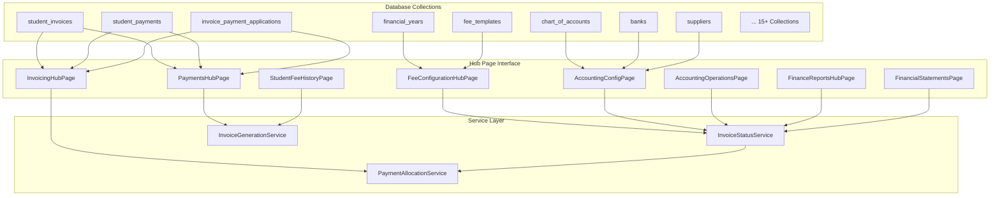

**Diagram sources**
- [hooks/useFinanceServices.ts:50-358](file://src/modules/finance/hooks/useFinanceServices.ts#L50-L358)

### Service-Oriented Data Access
The enhanced architecture provides multiple access patterns through hub page interfaces:

- **Direct Database Queries**: For transactional operations and bulk data
- **Service-Based Processing**: For business logic operations and workflows
- **Hub Page Interfaces**: For React component integration with tabbed state management
- **Dependency Injection**: For runtime dependency resolution and testing
- **Hybrid Approach**: Combining benefits of all approaches for optimal performance

**Section sources**
- [hooks/index.ts:1-19](file://src/modules/finance/hooks/index.ts#L1-L19)
- [hooks/useFinanceServices.ts:1-397](file://src/modules/finance/hooks/useFinanceServices.ts#L1-L397)

## Navigation and Features
The Finance module provides comprehensive navigation organized into 10 focused hub pages covering all aspects of financial management:

### Core Financial Management Hubs
- **Fee Configuration Hub**: Consolidates fee templates, structures, and receipt templates
- **Accounting Configuration Hub**: Manages chart of accounts and bank accounts
- **Accounting Operations Hub**: Handles ledger, cash book, day book, and journal register
- **Finance Reports Hub**: Provides consolidated reporting for fees due, students paid, and votehead statements
- **Financial Statements Hub**: Displays trial balance, balance sheet, and income statement
- **Payments Hub**: Manages student payments, opening balances, fee collection summary, financial summary, payment allocation, and general receipts
- **Student Fee History Hub**: Handles opening balances and previous session fees
- **Invoicing Hub**: Consolidates invoice generation, customer invoices, and supplier invoices

### Supporting Functions
- **Fee Rules**: Separate page for fee adjustments, fines, and installments
- **Expenses Hub**: Comprehensive expense tracking and management
- **Transport Hub**: Bus route management and student transport assignments
- **Dashboard**: Central financial overview and analytics

### Navigation Patterns
- **Hub Page Architecture**: 10 dedicated hub pages replacing previous consolidated approach
- **Tabbed Interfaces**: Consistent tabbed interface pattern across all hub pages
- **URL State Management**: Search parameter-based tab state persistence
- **Redirect System**: Deprecation redirects for legacy standalone pages
- **Feature Flags**: Configurable enablement of specific financial functionalities

**Section sources**
- [moduleDefinition.tsx:41-90](file://src/modules/finance/moduleDefinition.tsx#L41-L90)

## Performance Considerations
Enhanced performance considerations for the new hub page architecture:

- **Service Caching**: Financial services implement intelligent caching strategies
- **Computed View Optimization**: Hooks optimized for real-time data computation
- **Database Query Optimization**: Efficient query patterns for service operations
- **Memory Management**: Optimized memory usage in computed view hooks
- **Network Efficiency**: Reduced network calls through service layer optimization
- **Real-time Updates**: WebSocket integration for live financial data updates
- **Batch Processing**: Optimized batch operations for financial year closing
- **Service Orchestration**: Coordinated service execution for complex financial operations
- **Lazy Loading**: Services loaded only when needed to reduce initial bundle size
- **Hub Page Optimization**: Tab switching optimized to minimize re-renders

## Troubleshooting Guide
Comprehensive troubleshooting for the enhanced hub page architecture:

### Hub Page Issues
- **Tab State Management**: Verify URL parameter handling and tab state persistence
- **Navigation Redirects**: Check deprecation redirects for legacy standalone pages
- **Tab Content Loading**: Monitor tab-specific content loading and error states
- **Hub Page Registration**: Ensure all hub pages are properly exported and registered

### Service Layer Issues
- **InvoiceStatusService Failures**: Verify service initialization and database connectivity
- **InvoiceGenerationService Errors**: Check template validation and student eligibility
- **PaymentAllocationService Problems**: Review allocation algorithms and transaction conflicts
- **Service Authentication**: Ensure proper RBAC permissions for service access
- **Dependency Injection**: Verify service dependencies are properly configured

### Hook Wrapper Issues
- **useInvoiceStatus Performance**: Monitor query performance and optimize filters
- **useInvoiceGeneration Accuracy**: Verify data aggregation and calculation logic
- **usePaymentAllocation Completeness**: Check payment allocation algorithms and results
- **Hook State Management**: Monitor loading states and error handling

### Service Registration Issues
- **Service Not Found**: Verify service registration in registerFinanceServices
- **Dependency Resolution**: Check that all required dependencies are provided
- **Singleton Initialization**: Ensure services are properly initialized on first access
- **Circular Dependencies**: Monitor for circular import issues in service dependencies

### Navigation and Feature Issues
- **Missing Navigation Items**: Verify feature flag configurations
- **Permission Denied Errors**: Check RBAC role assignments and permissions
- **Service Integration**: Ensure proper service hook registration and initialization
- **Data Synchronization**: Monitor real-time data updates and cache consistency

**Section sources**
- [hooks/index.ts:1-19](file://src/modules/finance/hooks/index.ts#L1-L19)
- [moduleDefinition.tsx:33-135](file://src/modules/finance/moduleDefinition.tsx#L33-L135)
- [services/registerServices.ts:1-59](file://src/modules/finance/services/registerServices.ts#L1-L59)

## Conclusion
The Finance module now provides a comprehensive, hub-based financial management system with advanced TypeScript implementations replacing traditional stored procedures and database-side financial processing. The enhanced architecture supports sophisticated financial services including invoice management, payment processing, and intelligent financial analytics through six dedicated hub pages, computed view hooks, and comprehensive reporting capabilities. The modular design with specialized P0 services, tabbed interface patterns, and centralized service registration system enables scalable and maintainable financial operations across the entire educational institution system. The hub page architecture with 10 focused pages replacing previous consolidated approaches provides superior user experience and operational efficiency. The service-oriented approach with dependency injection, lazy initialization, and comprehensive error handling positions the Finance module as a modern, enterprise-grade financial management solution with superior performance and maintainability.