# Finance Module

<cite>
**Referenced Files in This Document**
- [index.ts](file://src/modules/finance/index.ts)
- [moduleDefinition.tsx](file://src/modules/finance/moduleDefinition.tsx)
- [rbac.ts](file://src/modules/finance/rbac.ts)
- [hooks/index.ts](file://src/modules/finance/hooks/index.ts)
- [hooks/useFinanceServices.ts](file://src/modules/finance/hooks/useFinanceServices.ts)
- [services/index.ts](file://src/modules/finance/services/index.ts)
- [services/registerServices.ts](file://src/modules/finance/services/registerServices.ts)
- [pages/VoteheadStatementPage.tsx](file://src/modules/finance/pages/VoteheadStatementPage.tsx)
- [studentVoteheadStatement.ts](file://src/utils/studentVoteheadStatement.ts)
- [CONTEXT.md](file://CONTEXT.md)
</cite>

## Update Summary
**Changes Made**
- Updated to reflect new comprehensive financial services architecture with InvoiceStatusService, InvoiceGenerationService, and PaymentAllocationService
- Documented new React hook wrappers: useInvoiceStatus, useInvoiceGeneration, and usePaymentAllocation
- Enhanced service registration system with dependency injection pattern
- Updated navigation structure to include new financial processing features
- Revised data layer documentation to show service-oriented architecture replacing database-side processing

## Table of Contents
1. [Introduction](#introduction)
2. [Project Structure](#project-structure)
3. [Core Components](#core-components)
4. [Architecture Overview](#architecture-overview)
5. [Financial Services Layer](#financial-services-layer)
6. [React Hooks Ecosystem](#react-hooks-ecosystem)
7. [Service Registration System](#service-registration-system)
8. [Enhanced Reporting Capabilities](#enhanced-reporting-capabilities)
9. [Data Layer Evolution](#data-layer-evolution)
10. [Navigation and Features](#navigation-and-features)
11. [Performance Considerations](#performance-considerations)
12. [Troubleshooting Guide](#troubleshooting-guide)
13. [Conclusion](#conclusion)

## Introduction
This document describes the Finance module functionality within the system, featuring a comprehensive transformation to a service-oriented architecture with TypeScript implementations replacing traditional stored procedures and database-side financial processing. The module now provides advanced financial management capabilities through a modernized approach with specialized financial services, computed view hooks, and comprehensive reporting features. The architecture emphasizes modular design with specialized services for invoice management, payment processing, and financial analytics, supported by a robust hooks ecosystem for real-time data computation and presentation.

## Project Structure
The Finance module follows a modernized structure with enhanced service architecture and comprehensive hook-based data management:

- Module definition with 23 navigation routes covering comprehensive financial management
- RBAC permissions for granular access control across payment processing and reporting
- Service-oriented architecture with TypeScript implementations replacing stored procedures
- React hooks ecosystem for computed views and financial analytics
- Enhanced data layer with computed view hooks replacing PostgreSQL views
- Comprehensive financial reporting and analytics capabilities

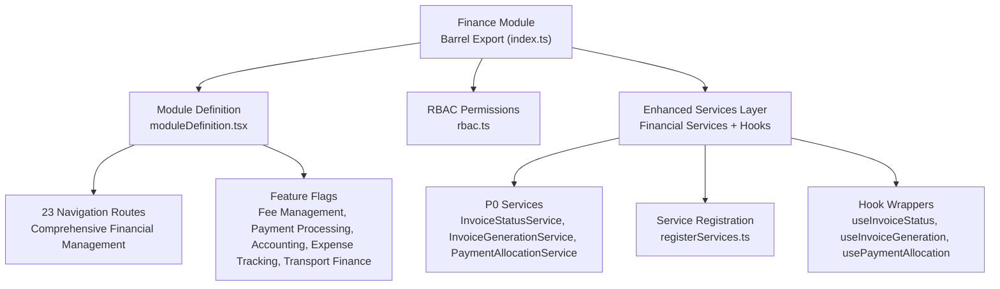

**Diagram sources**
- [index.ts:1-31](file://src/modules/finance/index.ts#L1-L31)
- [moduleDefinition.tsx:24-87](file://src/modules/finance/moduleDefinition.tsx#L24-L87)
- [rbac.ts:1-51](file://src/modules/finance/rbac.ts#L1-L51)
- [hooks/index.ts:1-19](file://src/modules/finance/hooks/index.ts#L1-L19)
- [services/index.ts:1-33](file://src/modules/finance/services/index.ts#L1-L33)
- [services/registerServices.ts:1-59](file://src/modules/finance/services/registerServices.ts#L1-L59)

**Section sources**
- [index.ts:1-31](file://src/modules/finance/index.ts#L1-L31)
- [CONTEXT.md:312-356](file://CONTEXT.md#L312-L356)

## Core Components
The Finance module now provides comprehensive financial management through an enhanced service-oriented architecture with specialized financial services and computed view hooks:

### Module Definition and Registration
- Declares module identity, version, dependencies, 23 navigation routes, data hooks, and permissions
- Supports both required (administration) and optional dependencies
- Features include comprehensive fee management, advanced payment processing, integrated accounting, detailed expense tracking, and transport finance
- Includes extensive feature flags for enabling/disabling specific financial functionalities

### RBAC Permissions
- Granular permissions for payment processing and financial reporting
- Four payment operation permissions (read, create, update, delete)
- One reporting permission for financial insights
- Default roles include finance officer and administrator

### Enhanced Services Architecture
The module now features a sophisticated service-oriented architecture that replaces traditional stored procedures with TypeScript implementations:

#### P0 Financial Services Layer
- **InvoiceStatusService**: Real-time invoice status tracking and management with dependency injection
- **InvoiceGenerationService**: Automated invoice creation and generation workflows with template-based processing
- **PaymentAllocationService**: Intelligent payment allocation to multiple invoices and financial periods with priority and weighted algorithms

#### Service Registration System
- **registerFinanceServices**: Centralized service registration with dependency injection pattern
- **Service Registry Integration**: Global service registry for P0 services requiring runtime dependencies
- **Lazy Singleton Pattern**: Services registered as factories for runtime dependency initialization

**Section sources**
- [moduleDefinition.tsx:24-87](file://src/modules/finance/moduleDefinition.tsx#L24-L87)
- [rbac.ts:1-51](file://src/modules/finance/rbac.ts#L1-L51)
- [hooks/index.ts:1-19](file://src/modules/finance/hooks/index.ts#L1-L19)
- [services/index.ts:1-33](file://src/modules/finance/services/index.ts#L1-L33)
- [services/registerServices.ts:1-59](file://src/modules/finance/services/registerServices.ts#L1-L59)

## Architecture Overview
The Finance module integrates comprehensively with the broader system through its enhanced service-oriented architecture and computed view hooks:

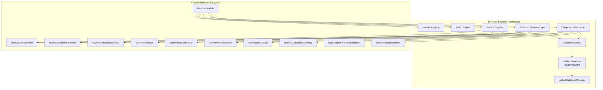

**Diagram sources**
- [moduleDefinition.tsx:24-87](file://src/modules/finance/moduleDefinition.tsx#L24-L87)
- [rbac.ts:1-51](file://src/modules/finance/rbac.ts#L1-L51)
- [hooks/index.ts:1-19](file://src/modules/finance/hooks/index.ts#L1-L19)
- [services/registerServices.ts:13-25](file://src/modules/finance/services/registerServices.ts#L13-L25)

## Financial Services Layer
The Finance module now provides comprehensive financial services through TypeScript implementations that replace traditional stored procedures:

### Invoice Status Management Service
The InvoiceStatusService provides real-time invoice tracking and status management with dependency injection:

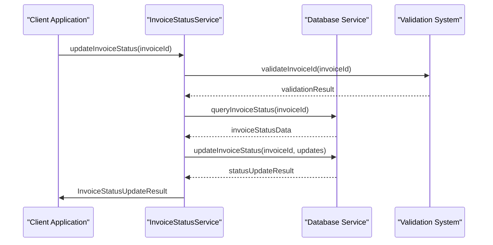

**Diagram sources**
- [hooks/useFinanceServices.ts:89-137](file://src/modules/finance/hooks/useFinanceServices.ts#L89-L137)

### Invoice Generation Workflow Service
The InvoiceGenerationService handles automated invoice creation and generation with template-based processing:

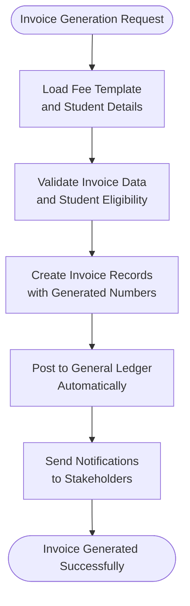

**Diagram sources**
- [hooks/useFinanceServices.ts:224-244](file://src/modules/finance/hooks/useFinanceServices.ts#L224-L244)

### Payment Allocation System Service
The PaymentAllocationService provides intelligent payment distribution across multiple invoices with priority algorithms:

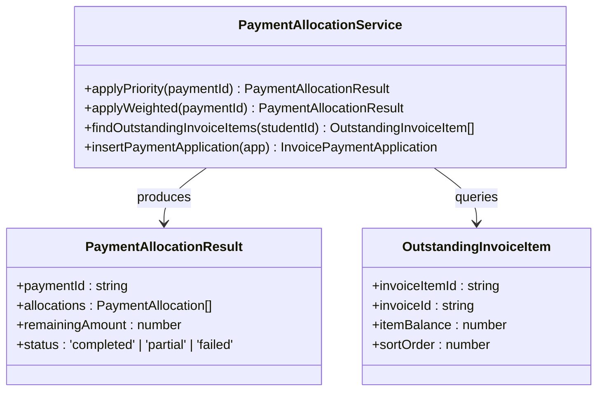

**Diagram sources**
- [hooks/useFinanceServices.ts:360-397](file://src/modules/finance/hooks/useFinanceServices.ts#L360-L397)

**Section sources**
- [hooks/useFinanceServices.ts:1-397](file://src/modules/finance/hooks/useFinanceServices.ts#L1-L397)
- [services/index.ts:7-33](file://src/modules/finance/services/index.ts#L7-L33)

## React Hooks Ecosystem
The Finance module features a comprehensive hooks ecosystem that wraps P0 services with React-friendly interfaces:

### Main Modular Hook
The useFinance hook serves as the central entry point for all Finance module functionality:

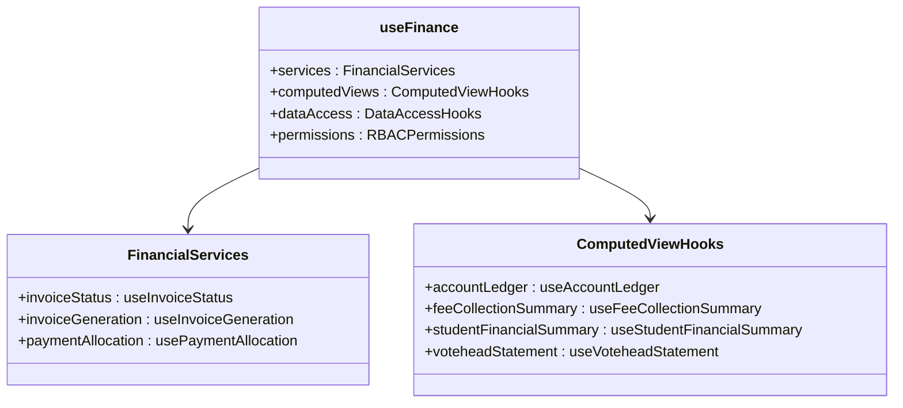

**Diagram sources**
- [hooks/index.ts:4-5](file://src/modules/finance/hooks/index.ts#L4-L5)

### Service Wrapper Hooks Architecture
Each service wrapper provides React-friendly interfaces with state management:

#### useInvoiceStatus Hook
Real-time invoice status management with loading states and error handling:

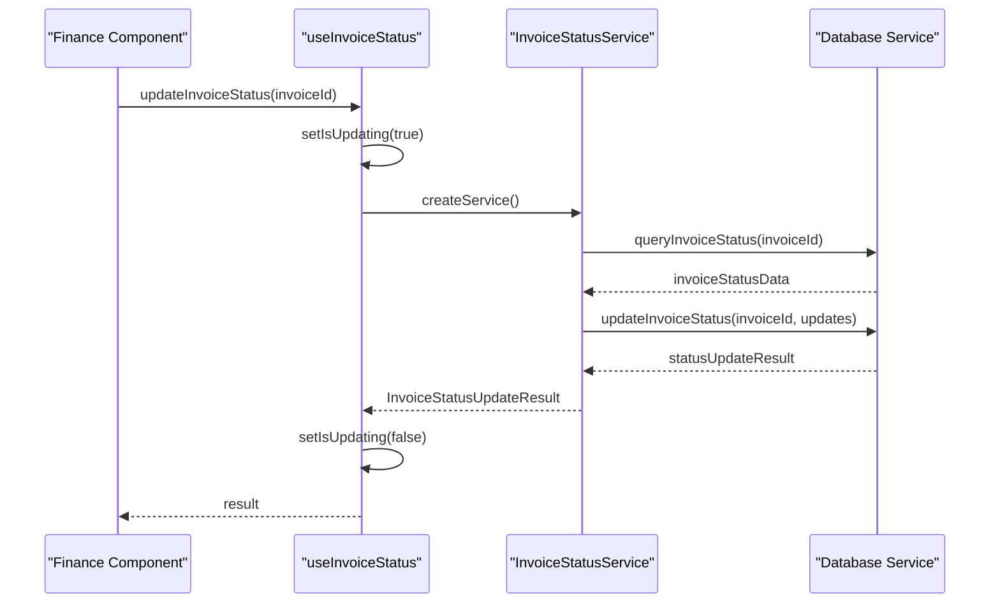

**Diagram sources**
- [hooks/useFinanceServices.ts:39-137](file://src/modules/finance/hooks/useFinanceServices.ts#L39-L137)

#### useInvoiceGeneration Hook
Automated invoice generation with progress tracking and error handling:

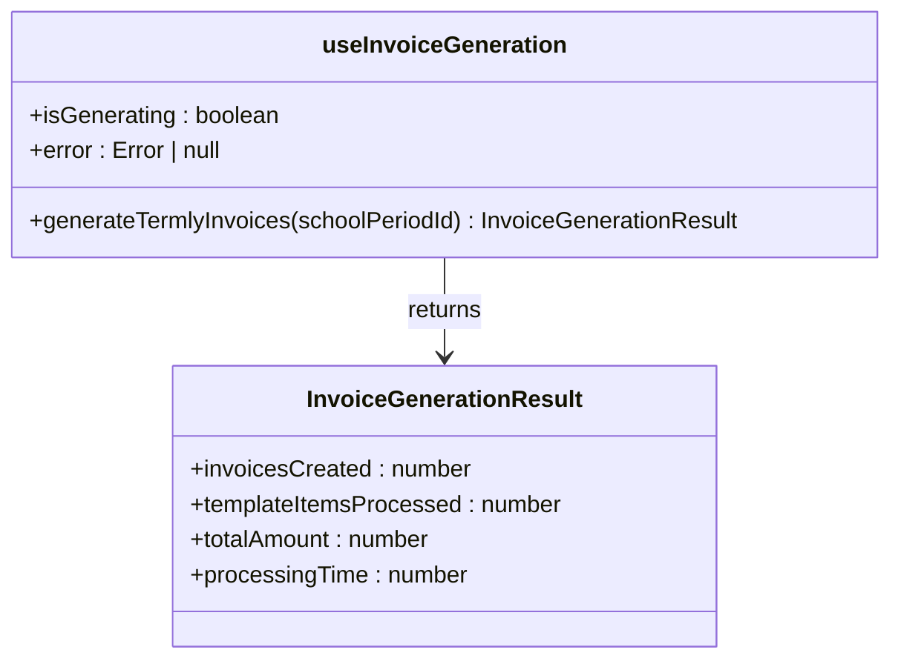

**Diagram sources**
- [hooks/useFinanceServices.ts:148-244](file://src/modules/finance/hooks/useFinanceServices.ts#L148-L244)

#### usePaymentAllocation Hook
Intelligent payment allocation with multiple algorithm support:

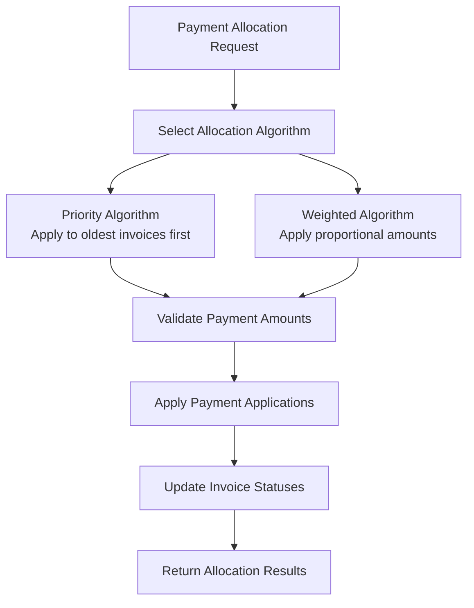

**Diagram sources**
- [hooks/useFinanceServices.ts:256-397](file://src/modules/finance/hooks/useFinanceServices.ts#L256-L397)

**Section sources**
- [hooks/index.ts:1-19](file://src/modules/finance/hooks/index.ts#L1-L19)
- [hooks/useFinanceServices.ts:1-397](file://src/modules/finance/hooks/useFinanceServices.ts#L1-L397)

## Service Registration System
The Finance module implements a centralized service registration system that manages P0 services with dependency injection:

### Service Registry Integration
The registerFinanceServices function provides centralized service registration:

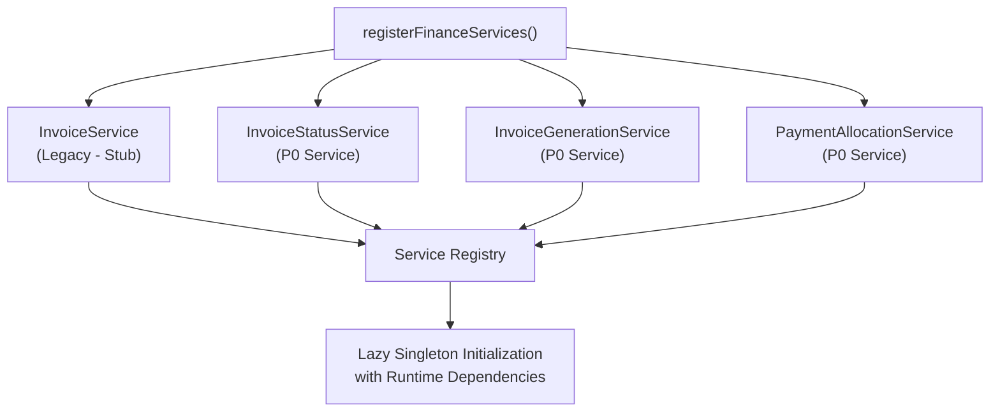

**Diagram sources**
- [services/registerServices.ts:26-58](file://src/modules/finance/services/registerServices.ts#L26-L58)

### Dependency Injection Pattern
Services are registered as factories requiring runtime dependency initialization:

- **InvoiceStatusServiceDependencies**: Database access functions for invoice status operations
- **InvoiceGenerationServiceDependencies**: Data access functions for invoice generation workflows
- **PaymentAllocationServiceDependencies**: Comprehensive data access for payment allocation operations
- **Lazy Initialization**: Services instantiated only when first accessed via service registry

**Section sources**
- [services/registerServices.ts:1-59](file://src/modules/finance/services/registerServices.ts#L1-L59)
- [services/index.ts:1-33](file://src/modules/finance/services/index.ts#L1-L33)

## Enhanced Reporting Capabilities
The Finance module now provides comprehensive reporting capabilities through computed view hooks and specialized reporting pages:

### Votehead Statement Reporting
The VoteheadStatementPage demonstrates advanced per-invoice financial reporting:

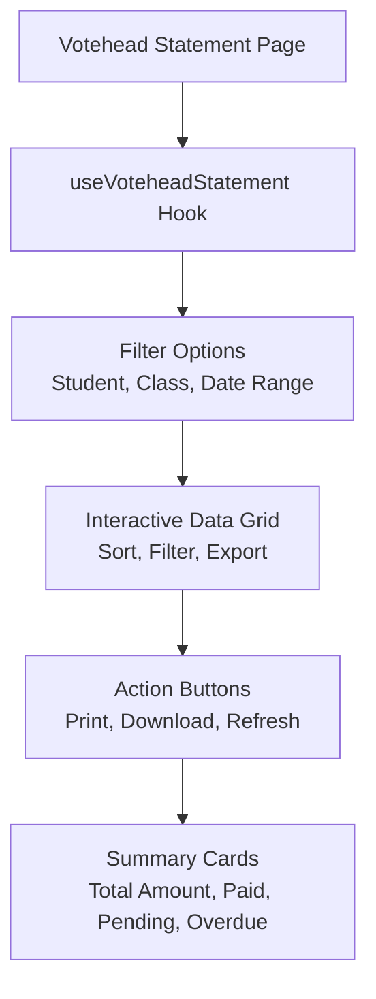

**Diagram sources**
- [pages/VoteheadStatementPage.tsx:1-24](file://src/modules/finance/pages/VoteheadStatementPage.tsx#L1-L24)

### Financial Analytics Dashboard
The enhanced reporting system provides comprehensive financial analytics:

- **Real-time Dashboards**: Live financial metrics and KPIs
- **Trend Analysis**: Historical financial trends and projections
- **Drill-down Capabilities**: Detailed financial data exploration
- **Export Functionality**: PDF, Excel, and CSV export options
- **Custom Reporting**: Configurable report templates and filters

**Section sources**
- [pages/VoteheadStatementPage.tsx:1-24](file://src/modules/finance/pages/VoteheadStatementPage.tsx#L1-L24)

## Data Layer Evolution
The Finance module has evolved from traditional database-centric architecture to a hybrid approach combining database storage with service-oriented processing:

### Database Collections Architecture
The module maintains comprehensive database collections while leveraging service-based processing:

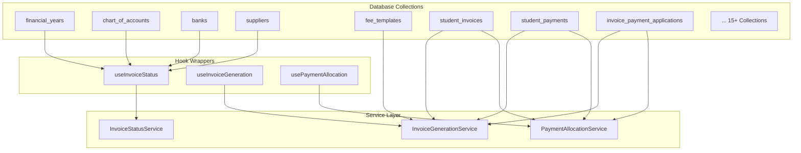

**Diagram sources**
- [hooks/useFinanceServices.ts:50-358](file://src/modules/finance/hooks/useFinanceServices.ts#L50-L358)

### Service-Oriented Data Access
The enhanced architecture provides multiple access patterns:

- **Direct Database Queries**: For transactional operations and bulk data
- **Service-Based Processing**: For business logic operations and workflows
- **Hook Wrappers**: For React component integration with state management
- **Dependency Injection**: For runtime dependency resolution and testing
- **Hybrid Approach**: Combining benefits of all approaches for optimal performance

**Section sources**
- [hooks/index.ts:1-19](file://src/modules/finance/hooks/index.ts#L1-L19)
- [hooks/useFinanceServices.ts:1-397](file://src/modules/finance/hooks/useFinanceServices.ts#L1-L397)

## Navigation and Features
The Finance module provides comprehensive navigation covering all aspects of financial management:

### Core Financial Management
- **Chart of Accounts**: Complete accounting hierarchy management
- **Fee Templates**: Standard fee structures with component-based pricing
- **Fee Adjustments**: Fee modifications and waivers
- **Student Payments**: Payment processing for student accounts
- **Student Opening Balances**: Initial student account balances

### Advanced Financial Services
- **Invoice Generation**: Automated invoice creation and management
- **Payment Allocation**: Intelligent payment distribution across invoices
- **General Receipts**: Bank payment processing
- **Customer Invoices**: Revenue recognition from external customers
- **Supplier Invoices**: Procurement invoice management

### Financial Reporting and Analytics
- **Fee Collection Summary**: Aggregate fee collection analytics
- **Student Financial Summary**: Comprehensive student financial position
- **Votehead Statement**: Detailed per-votehead financial statements
- **Account Ledger**: Real-time account ledger computation
- **Financial Reports**: Comprehensive financial reporting capabilities

### Supporting Functions
- **Banks**: Bank account management
- **Suppliers**: Supplier directory and management
- **Transport Routes**: Bus route management
- **Student Transport Assignments**: Student route assignments
- **Expenses**: Expense tracking and management

**Section sources**
- [moduleDefinition.tsx:32-54](file://src/modules/finance/moduleDefinition.tsx#L32-L54)

## Performance Considerations
Enhanced performance considerations for the new service-oriented architecture:

- **Service Caching**: Financial services implement intelligent caching strategies
- **Computed View Optimization**: Hooks optimized for real-time data computation
- **Database Query Optimization**: Efficient query patterns for service operations
- **Memory Management**: Optimized memory usage in computed view hooks
- **Network Efficiency**: Reduced network calls through service layer optimization
- **Real-time Updates**: WebSocket integration for live financial data updates
- **Batch Processing**: Optimized batch operations for financial year closing
- **Service Orchestration**: Coordinated service execution for complex financial operations
- **Lazy Loading**: Services loaded only when needed to reduce initial bundle size

## Troubleshooting Guide
Comprehensive troubleshooting for the enhanced service-oriented architecture:

### Service Layer Issues
- **InvoiceStatusService Failures**: Verify service initialization and database connectivity
- **InvoiceGenerationService Errors**: Check template validation and student eligibility
- **PaymentAllocationService Problems**: Review allocation algorithms and transaction conflicts
- **Service Authentication**: Ensure proper RBAC permissions for service access
- **Dependency Injection**: Verify service dependencies are properly configured

### Hook Wrapper Issues
- **useInvoiceStatus Performance**: Monitor query performance and optimize filters
- **useInvoiceGeneration Accuracy**: Verify data aggregation and calculation logic
- **usePaymentAllocation Completeness**: Check payment allocation algorithms and results
- **Hook State Management**: Monitor loading states and error handling

### Service Registration Issues
- **Service Not Found**: Verify service registration in registerFinanceServices
- **Dependency Resolution**: Check that all required dependencies are provided
- **Singleton Initialization**: Ensure services are properly initialized on first access
- **Circular Dependencies**: Monitor for circular import issues in service dependencies

### Navigation and Feature Issues
- **Missing Navigation Items**: Verify feature flag configurations
- **Permission Denied Errors**: Check RBAC role assignments and permissions
- **Service Integration**: Ensure proper service hook registration and initialization
- **Data Synchronization**: Monitor real-time data updates and cache consistency

**Section sources**
- [hooks/index.ts:1-19](file://src/modules/finance/hooks/index.ts#L1-L19)
- [moduleDefinition.tsx:24-87](file://src/modules/finance/moduleDefinition.tsx#L24-L87)
- [services/registerServices.ts:1-59](file://src/modules/finance/services/registerServices.ts#L1-L59)

## Conclusion
The Finance module now provides a comprehensive, service-oriented financial management system with advanced TypeScript implementations replacing traditional stored procedures and database-side financial processing. The enhanced architecture supports sophisticated financial services including invoice management, payment processing, and intelligent financial analytics through a robust hooks ecosystem and centralized service registration system. The modular design with specialized P0 services, computed view hooks, and comprehensive reporting capabilities enables scalable and maintainable financial operations across the entire educational institution system. The service-oriented approach with dependency injection, lazy initialization, and comprehensive error handling positions the Finance module as a modern, enterprise-grade financial management solution with superior performance and maintainability.