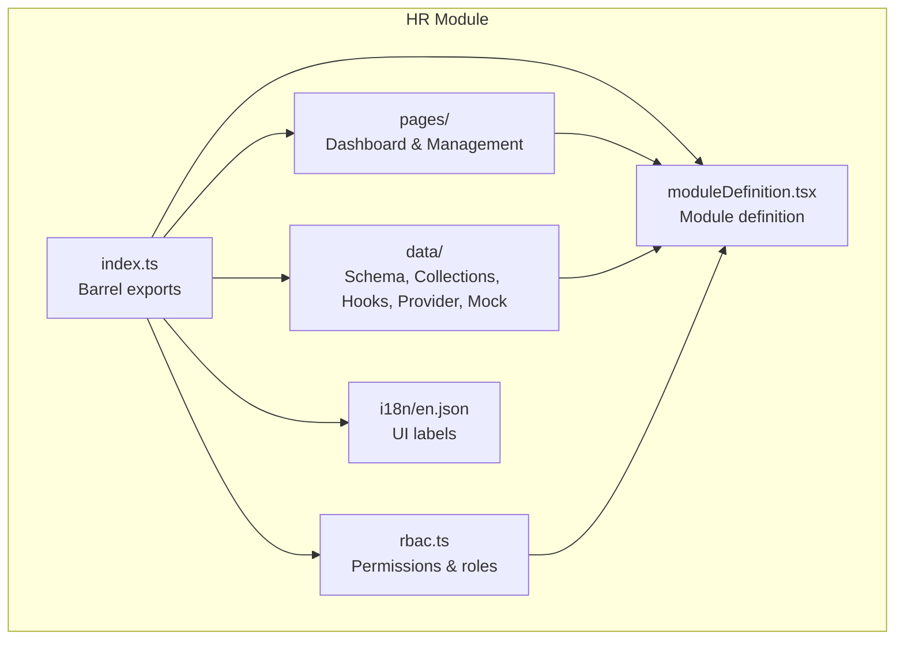
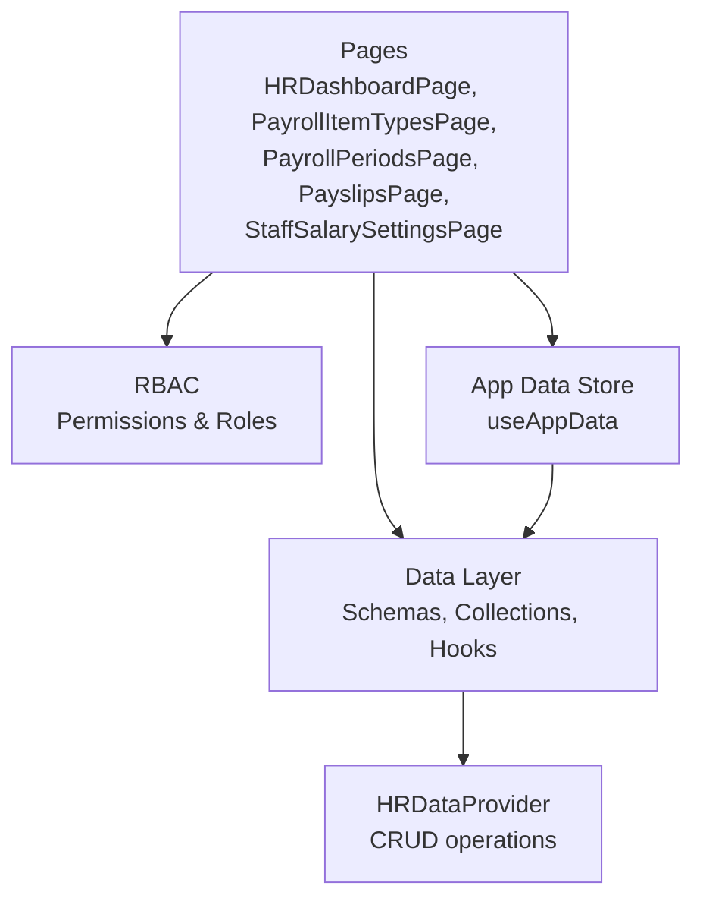
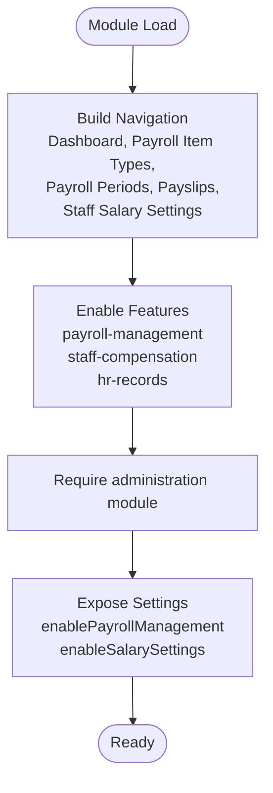
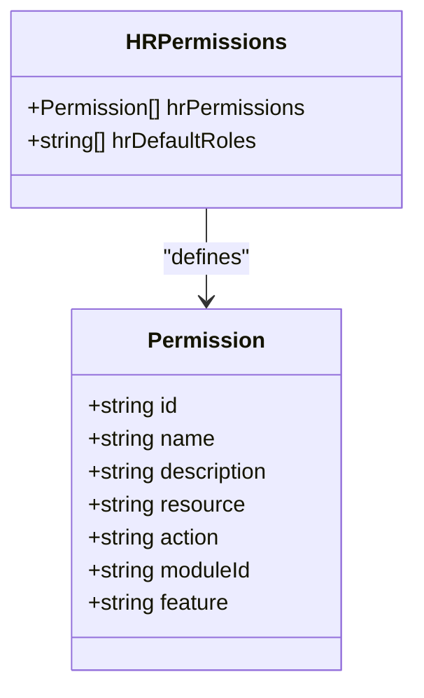
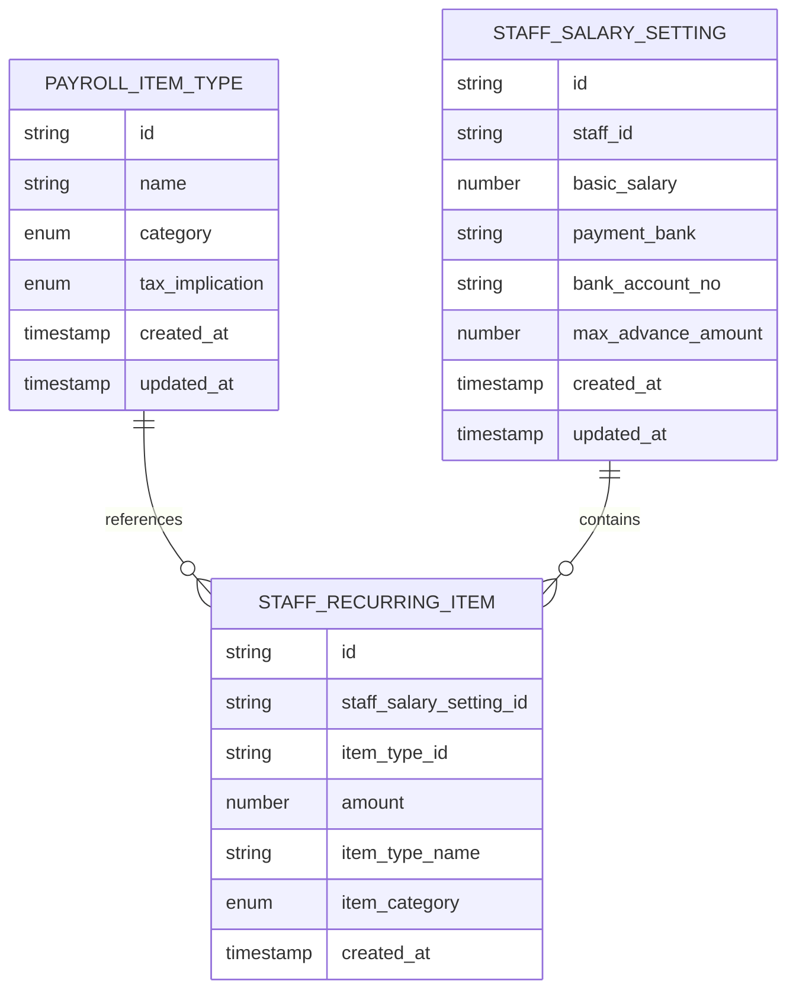
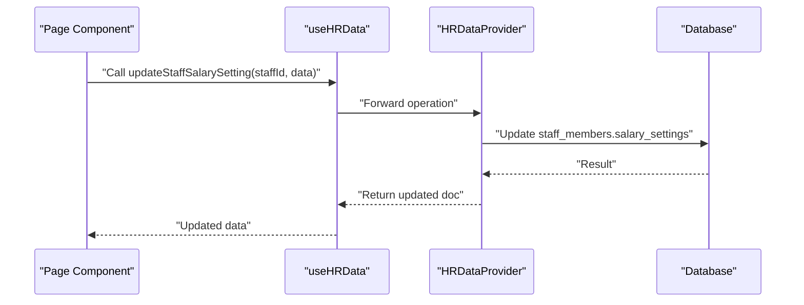
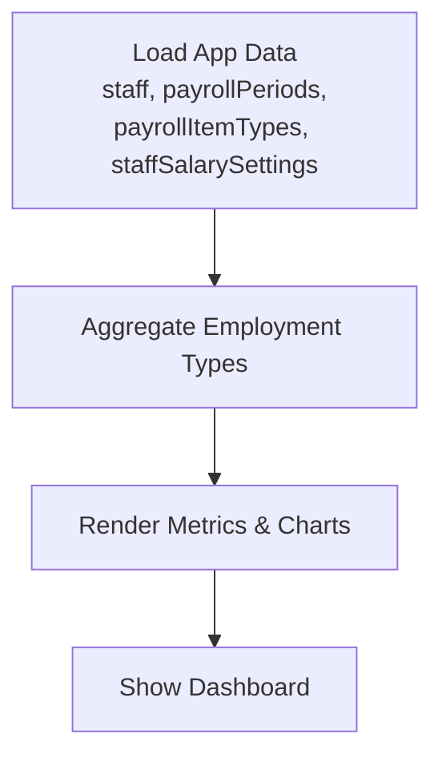
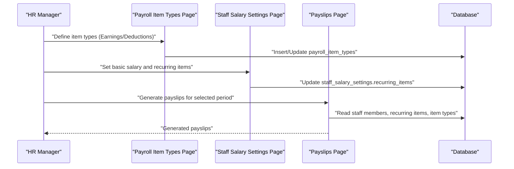
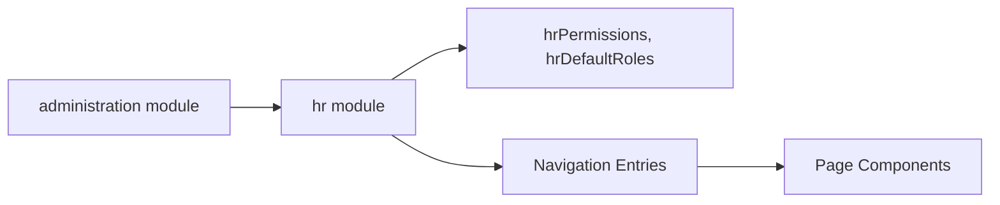

# HR Module

<cite>
**Referenced Files in This Document**
- [index.ts](file://src/modules/hr/index.ts)
- [moduleDefinition.tsx](file://src/modules/hr/moduleDefinition.tsx)
- [rbac.ts](file://src/modules/hr/rbac.ts)
- [HRDashboardPage.tsx](file://src/modules/hr/pages/HRDashboardPage.tsx)
- [index.ts](file://src/modules/hr/pages/index.ts)
- [schema.ts](file://src/modules/hr/data/schema.ts)
- [mockData.ts](file://src/modules/hr/data/mockData.ts)
- [useHRData.ts](file://src/modules/hr/data/useHRData.ts)
- [HRDataProvider.tsx](file://src/modules/hr/data/HRDataProvider.tsx)
- [en.json](file://src/modules/hr/i18n/en.json)
</cite>

## Table of Contents
1. [Introduction](#introduction)
2. [Project Structure](#project-structure)
3. [Core Components](#core-components)
4. [Architecture Overview](#architecture-overview)
5. [Detailed Component Analysis](#detailed-component-analysis)
6. [Dependency Analysis](#dependency-analysis)
7. [Performance Considerations](#performance-considerations)
8. [Troubleshooting Guide](#troubleshooting-guide)
9. [Conclusion](#conclusion)

## Introduction
This document describes the HR module functionality for managing staff records, salary settings, payroll item types, payroll periods, and payslips. It explains the payroll processing system including recurring items, payslip generation, and integration points with the broader data layer. It also covers staff benefits, deductions, and compensation tracking, along with data models, calculation considerations, and reporting features.

## Project Structure
The HR module is organized as a self-contained module with clear separation of concerns:
- Module definition and navigation
- RBAC permissions and roles
- Data schemas, collections, and mock data
- Page components for dashboards and management screens
- Data provider and hooks for data operations
- Internationalization keys for UI labels

**Diagram sources**
- [index.ts:1-28](file://src/modules/hr/index.ts#L1-L28)
- [moduleDefinition.tsx:1-57](file://src/modules/hr/moduleDefinition.tsx#L1-L57)
- [rbac.ts:1-151](file://src/modules/hr/rbac.ts#L1-L151)
- [HRDashboardPage.tsx:1-36](file://src/modules/hr/pages/HRDashboardPage.tsx#L1-L36)
- [schema.ts:36-75](file://src/modules/hr/data/schema.ts#L36-L75)
- [HRDataProvider.tsx:1-120](file://src/modules/hr/data/HRDataProvider.tsx#L1-L120)
- [en.json:1-14](file://src/modules/hr/i18n/en.json#L1-L14)

**Section sources**
- [index.ts:1-28](file://src/modules/hr/index.ts#L1-L28)
- [moduleDefinition.tsx:1-57](file://src/modules/hr/moduleDefinition.tsx#L1-L57)

## Core Components
- Module definition: Defines navigation, features, dependencies, and settings for the HR module.
- RBAC: Provides granular permissions for dashboard, payroll item types, payroll periods, payslips, and staff salary settings.
- Data schemas: Define payroll item types, staff salary settings, staff recurring items, and related indexes.
- Mock data: Provides initial datasets for payroll item types, staff salary settings, recurring items, and payslips.
- Data hooks and provider: Offer CRUD operations and state management for payroll-related entities.
- Pages: Dashboard and management pages for payroll item types, payroll periods, payslips, and staff salary settings.

**Section sources**
- [moduleDefinition.tsx:15-57](file://src/modules/hr/moduleDefinition.tsx#L15-L57)
- [rbac.ts:3-144](file://src/modules/hr/rbac.ts#L3-L144)
- [schema.ts:36-75](file://src/modules/hr/data/schema.ts#L36-L75)
- [mockData.ts:21-47](file://src/modules/hr/data/mockData.ts#L21-L47)
- [useHRData.ts:59-83](file://src/modules/hr/data/useHRData.ts#L59-L83)
- [HRDataProvider.tsx:1-120](file://src/modules/hr/data/HRDataProvider.tsx#L1-L120)
- [HRDashboardPage.tsx:1-36](file://src/modules/hr/pages/HRDashboardPage.tsx#L1-L36)

## Architecture Overview
The HR module integrates with the application's module system and data layer. It exposes navigation entries for payroll item types, payroll periods, payslips, and staff salary settings. Permissions are enforced via RBAC, and data operations are handled through a data provider and hooks.

**Diagram sources**
- [moduleDefinition.tsx:23-29](file://src/modules/hr/moduleDefinition.tsx#L23-L29)
- [rbac.ts:3-144](file://src/modules/hr/rbac.ts#L3-L144)
- [schema.ts:36-75](file://src/modules/hr/data/schema.ts#L36-L75)
- [HRDataProvider.tsx:1-120](file://src/modules/hr/data/HRDataProvider.tsx#L1-L120)
- [HRDashboardPage.tsx:10-36](file://src/modules/hr/pages/HRDashboardPage.tsx#L10-L36)

## Detailed Component Analysis

### Module Definition and Navigation
- Navigation entries include dashboard, payroll item types, payroll periods, payslips, and staff salary settings.
- Features include payroll management, staff compensation, and HR records.
- Dependencies include the administration module.
- Settings define toggles for enabling payroll management and salary settings.

**Diagram sources**
- [moduleDefinition.tsx:23-52](file://src/modules/hr/moduleDefinition.tsx#L23-L52)

**Section sources**
- [moduleDefinition.tsx:15-57](file://src/modules/hr/moduleDefinition.tsx#L15-L57)

### RBAC Permissions
- Dashboard: read permission for viewing the HR dashboard.
- Payroll Item Types: read, create, update, delete permissions.
- Payroll Periods: read, create, update, delete permissions.
- Payslips: read, create, update, delete permissions.
- Staff Salary Settings: read, update permissions.
- Default roles include hr_manager and administrator.

**Diagram sources**
- [rbac.ts:3-144](file://src/modules/hr/rbac.ts#L3-L144)

**Section sources**
- [rbac.ts:3-144](file://src/modules/hr/rbac.ts#L3-L144)

### Data Models and Schemas
- Payroll Item Types: Earnings and deductions with tax implications and categories.
- Staff Salary Settings: Basic salary, payment bank, bank account number, max advance, recurring items, computed staff name.
- Staff Recurring Items: Link to payroll item types, amounts, computed category and name.
- Indexes: Name and category for payroll item types; staff_id for staff salary settings.

**Diagram sources**
- [schema.ts:36-75](file://src/modules/hr/data/schema.ts#L36-L75)

**Section sources**
- [schema.ts:36-75](file://src/modules/hr/data/schema.ts#L36-L75)

### Mock Data
- Initial payroll item types include earnings (Basic Salary, House Allowance, Commuter Allowance) and deductions (PAYE, NHIF, NSSF Tier I) with tax implications.
- Initial staff salary settings include staff_id, basic_salary, payment_bank, bank_account_no, and computed staff_name.
- Initial staff recurring items link salary settings to specific payroll item types with amounts and computed metadata.
- Initial payslips include staff_id, period_id, and generated payslip data.

**Section sources**
- [mockData.ts:21-47](file://src/modules/hr/data/mockData.ts#L21-L47)

### Data Hooks and Provider
- useHRData provides CRUD operations for payroll item types and staff salary settings.
- HRDataProvider encapsulates data operations for payroll item types, staff salary settings, and related entities, including insert, update, and error handling.

**Diagram sources**
- [useHRData.ts:76-83](file://src/modules/hr/data/useHRData.ts#L76-L83)
- [HRDataProvider.tsx:1-120](file://src/modules/hr/data/HRDataProvider.tsx#L1-L120)

**Section sources**
- [useHRData.ts:59-83](file://src/modules/hr/data/useHRData.ts#L59-L83)
- [HRDataProvider.tsx:1-120](file://src/modules/hr/data/HRDataProvider.tsx#L1-L120)

### Dashboard and Reporting
- The HR dashboard aggregates staff counts by employment type and displays metrics and charts.
- It relies on app data hooks to load staff, payroll periods, payroll item types, and staff salary settings.

**Diagram sources**
- [HRDashboardPage.tsx:10-36](file://src/modules/hr/pages/HRDashboardPage.tsx#L10-L36)

**Section sources**
- [HRDashboardPage.tsx:1-36](file://src/modules/hr/pages/HRDashboardPage.tsx#L1-L36)

### Payroll Processing Workflows
- Payroll item types define earnings and deductions with tax implications.
- Staff salary settings define basic salary and recurring items linked to payroll item types.
- Payslips are generated per staff member and period, aggregating earnings and deductions from recurring items and item types.

**Diagram sources**
- [moduleDefinition.tsx:25-28](file://src/modules/hr/moduleDefinition.tsx#L25-L28)
- [schema.ts:36-75](file://src/modules/hr/data/schema.ts#L36-L75)
- [HRDataProvider.tsx:1-120](file://src/modules/hr/data/HRDataProvider.tsx#L1-L120)

## Dependency Analysis
- The HR module depends on the administration module and exposes its own RBAC permissions and default roles.
- Navigation entries reference page components by name, aligning with the pages barrel export.

**Diagram sources**
- [moduleDefinition.tsx:31-37](file://src/modules/hr/moduleDefinition.tsx#L31-L37)
- [rbac.ts:146-151](file://src/modules/hr/rbac.ts#L146-L151)
- [index.ts:1-7](file://src/modules/hr/pages/index.ts#L1-L7)

**Section sources**
- [moduleDefinition.tsx:31-37](file://src/modules/hr/moduleDefinition.tsx#L31-L37)
- [index.ts:1-7](file://src/modules/hr/pages/index.ts#L1-L7)

## Performance Considerations
- Use indexes on frequently queried fields (e.g., payroll item type name/category, staff salary settings staff_id) to optimize reads.
- Batch operations for recurring item updates to minimize database writes.
- Virtualize large lists in payslips and staff salary settings pages to reduce rendering overhead.
- Debounce search/filter operations in payroll item types and payslips listings.

## Troubleshooting Guide
- Permission denied errors: Verify RBAC permissions for the current role and ensure the role includes hr_manager or administrator.
- Data not loading: Confirm that the data provider is connected to the correct database and that collections exist (payroll_item_types, staff_salary_settings, staff_recurring_items).
- CRUD failures: Check for validation errors in staff salary settings (e.g., amount ranges, required fields) and ensure recurring items reference valid payroll item types.
- Dashboard rendering issues: Ensure app data hooks are returning expected shapes for staff, payroll periods, payroll item types, and staff salary settings.

**Section sources**
- [rbac.ts:3-144](file://src/modules/hr/rbac.ts#L3-L144)
- [HRDataProvider.tsx:1-120](file://src/modules/hr/data/HRDataProvider.tsx#L1-L120)
- [HRDashboardPage.tsx:10-36](file://src/modules/hr/pages/HRDashboardPage.tsx#L10-L36)

## Conclusion
The HR module provides a structured foundation for managing staff records, salary settings, payroll item types, payroll periods, and payslips. Its RBAC model ensures secure access, while schemas and mock data support development and testing. The module’s integration with the application’s data layer enables scalable payroll processing and reporting capabilities.