# HR Module

<cite>
**Referenced Files in This Document**
- [index.ts](file://src/modules/hr/index.ts)
- [moduleDefinition.tsx](file://src/modules/hr/moduleDefinition.tsx)
- [rbac.ts](file://src/modules/hr/rbac.ts)
- [HRDashboardPage.tsx](file://src/modules/hr/pages/HRDashboardPage.tsx)
- [PayrollItemTypesPage.tsx](file://src/modules/hr/pages/PayrollItemTypesPage.tsx)
- [PayrollPeriodsPage.tsx](file://src/modules/hr/pages/PayrollPeriodsPage.tsx)
- [PayslipsPage.tsx](file://src/modules/hr/pages/PayslipsPage.tsx)
- [StaffSalarySettingsPage.tsx](file://src/modules/hr/pages/StaffSalarySettingsPage.tsx)
- [schema.ts](file://src/modules/hr/data/schema.ts)
- [collectionConfig.ts](file://src/modules/hr/data/collectionConfig.ts)
- [HRDataProvider.tsx](file://src/modules/hr/data/HRDataProvider.tsx)
- [types.ts](file://src/modules/hr/data/types.ts)
- [pages/index.ts](file://src/modules/hr/pages/index.ts)
- [I18nManager.ts](file://src/i18n/I18nManager.ts)
- [loader.ts](file://src/i18n/loader.ts)
</cite>

## Update Summary
**Changes Made**
- Updated internationalization section to reflect comprehensive French translations for HR module
- Added new section documenting enhanced internationalization support with 12 new French translation entries
- Updated architecture overview to include i18n integration patterns
- Enhanced data provider section to show internationalization-aware data operations
- Added documentation for locale loading and translation management

## Table of Contents
1. [Introduction](#introduction)
2. [Project Structure](#project-structure)
3. [Core Components](#core-components)
4. [Architecture Overview](#architecture-overview)
5. [Internationalization Support](#internationalization-support)
6. [Facade Pattern Implementation](#facade-pattern-implementation)
7. [Detailed Component Analysis](#detailed-component-analysis)
8. [Database Integration and Data Synchronization](#database-integration-and-data-synchronization)
9. [Payroll Processing System](#payroll-processing-system)
10. [Staff Management and Compensation](#staff-management-and-compensation)
11. [Benefits, Deductions, and Tracking](#benefits-deductions-and-tracking)
12. [Data Models and Schemas](#data-models-and-schemas)
13. [Performance Considerations](#performance-considerations)
14. [Troubleshooting Guide](#troubleshooting-guide)
15. [Conclusion](#conclusion)

## Introduction
This document describes the HR module functionality for managing staff records, salary settings, payroll item types, payroll periods, and payslips with comprehensive database integration and internationalization support. The module implements a fully database-backed payroll processing system using RxDB collections and a sophisticated facade pattern through HRDataProvider, providing robust data persistence, real-time synchronization, scalable payroll operations, and comprehensive multilingual support across the education management platform.

## Project Structure
The HR module is organized as a self-contained module with comprehensive database integration, facade pattern implementation, and internationalization support:
- Module definition and navigation with database-backed collections
- RBAC permissions and roles for database operations
- Database-agnostic schemas using RxDB for persistent storage
- Facade pattern implementation through HRDataProvider for clean interfaces
- Page components with database integration for CRUD operations
- Module collection configuration with human-readable aliases
- Internationalization system with comprehensive French translations

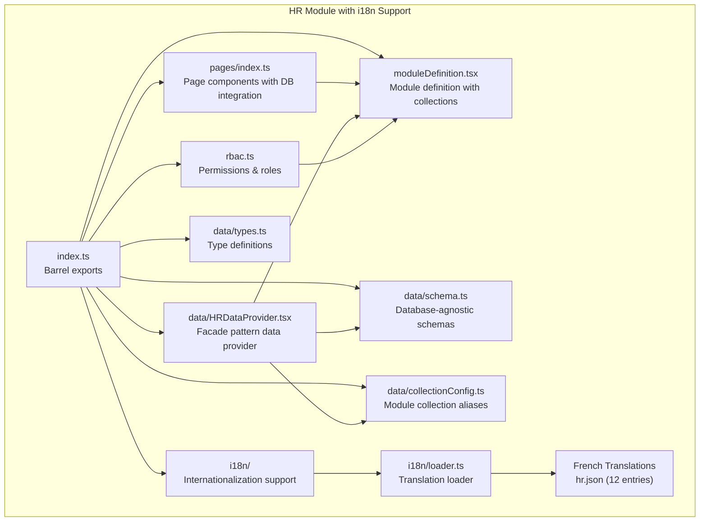

**Diagram sources**
- [index.ts:1-28](file://src/modules/hr/index.ts#L1-L28)
- [moduleDefinition.tsx:15-57](file://src/modules/hr/moduleDefinition.tsx#L15-L57)
- [rbac.ts:1-151](file://src/modules/hr/rbac.ts#L1-151)
- [schema.ts:1-111](file://src/modules/hr/data/schema.ts#L1-L111)
- [collectionConfig.ts:1-15](file://src/modules/hr/data/collectionConfig.ts#L1-L15)
- [HRDataProvider.tsx:1-362](file://src/modules/hr/data/HRDataProvider.tsx#L1-L362)
- [pages/index.ts:1-7](file://src/modules/hr/pages/index.ts#L1-L7)
- [loader.ts:28-49](file://src/i18n/loader.ts#L28-L49)

**Section sources**
- [index.ts:1-28](file://src/modules/hr/index.ts#L1-L28)
- [moduleDefinition.tsx:15-57](file://src/modules/hr/moduleDefinition.tsx#L15-L57)

## Core Components
- **Module definition**: Defines navigation, features, dependencies, and database collections for the HR module
- **RBAC**: Provides granular permissions for database operations on payroll item types, payroll periods, payslips, and staff salary settings
- **Database schemas**: Define payroll item types, staff salary settings, payroll periods, and payslips with RxDB compatibility
- **Collection configuration**: Maps module collections to database tables with proper indexing and relationships
- **Facade pattern**: HRDataProvider encapsulates database operations with clean interfaces while maintaining database functionality
- **Page components**: Dashboard and management pages with database integration for CRUD operations
- **Internationalization**: Comprehensive French translations with 12 new entries for HR module functionality

**Section sources**
- [moduleDefinition.tsx:15-57](file://src/modules/hr/moduleDefinition.tsx#L15-L57)
- [rbac.ts:3-144](file://src/modules/hr/rbac.ts#L3-L144)
- [schema.ts:1-111](file://src/modules/hr/data/schema.ts#L1-L111)
- [collectionConfig.ts:1-15](file://src/modules/hr/data/collectionConfig.ts#L1-L15)
- [HRDataProvider.tsx:1-362](file://src/modules/hr/data/HRDataProvider.tsx#L1-L362)
- [loader.ts:28-49](file://src/i18n/loader.ts#L28-L49)

## Architecture Overview
The HR module integrates with the application's database layer using RxDB collections and a sophisticated facade pattern through HRDataProvider. The internationalization system provides comprehensive multilingual support with enhanced French translations for HR functionality. The facade pattern provides clean interfaces while maintaining database functionality, ensuring database-backed navigation entries for payroll operations, enforcing permissions via RBAC, handling data operations through database services with automatic synchronization, and supporting multiple locales through the I18nManager.

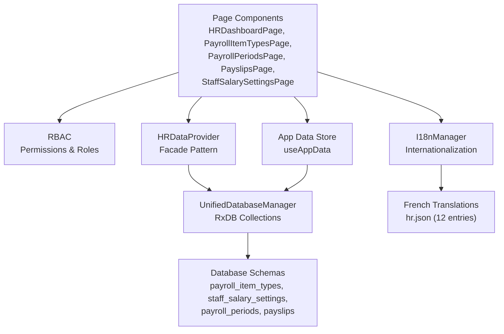

**Diagram sources**
- [moduleDefinition.tsx:23-29](file://src/modules/hr/moduleDefinition.tsx#L23-L29)
- [rbac.ts:3-144](file://src/modules/hr/rbac.ts#L3-L144)
- [schema.ts:1-111](file://src/modules/hr/data/schema.ts#L1-L111)
- [HRDataProvider.tsx:1-362](file://src/modules/hr/data/HRDataProvider.tsx#L1-L362)
- [I18nManager.ts:17-32](file://src/i18n/I18nManager.ts#L17-L32)
- [loader.ts:28-49](file://src/i18n/loader.ts#L28-L49)

## Internationalization Support

### Enhanced French Translations
The HR module now includes comprehensive French translations with 12 new entries covering payroll item types, staff salary settings, and payslip functionality. These translations ensure complete localization support for French-speaking users while maintaining consistency with the existing English interface.

**Updated** Added comprehensive French translation support for HR module functionality

### Translation Loading System
The internationalization system loads HR module translations through the centralized loader, supporting multiple locales including French with proper fallback mechanisms.

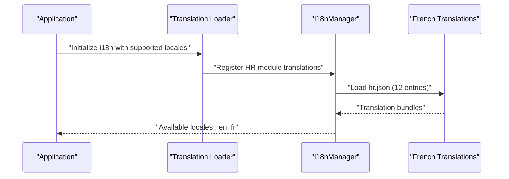

**Diagram sources**
- [loader.ts:36-49](file://src/i18n/loader.ts#L36-L49)
- [I18nManager.ts:277-306](file://src/i18n/I18nManager.ts#L277-L306)

### Supported Locales and Features
The internationalization system supports multiple locales with enhanced French support for HR functionality:
- **English**: Default locale with comprehensive translation coverage
- **French**: New comprehensive support with 12 HR-specific translation entries
- **Arabic**: Right-to-left language support with proper formatting
- **Spanish**: Additional European Spanish localization

**Section sources**
- [loader.ts:28-49](file://src/i18n/loader.ts#L28-L49)
- [I18nManager.ts:17-32](file://src/i18n/I18nManager.ts#L17-L32)
- [I18nManager.ts:367-396](file://src/i18n/I18nManager.ts#L367-L396)

## Facade Pattern Implementation

### HRDataProvider Architecture
The HRDataProvider serves as a sophisticated facade pattern implementation that encapsulates all database operations while providing clean, intuitive interfaces with internationalization support:

- **Encapsulation**: All database operations are hidden behind clean method signatures
- **Error Handling**: Centralized error handling with user-friendly toast notifications
- **Loading States**: Automatic loading state management for better user experience
- **Type Safety**: Full TypeScript support with proper return types and parameter validation
- **Database Abstraction**: Clean separation between UI logic and database operations
- **Internationalization**: Translation-aware error messages and user notifications

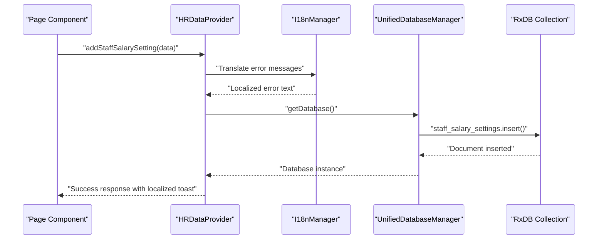

**Diagram sources**
- [HRDataProvider.tsx:73-92](file://src/modules/hr/data/HRDataProvider.tsx#L73-L92)
- [I18nManager.ts:109-150](file://src/i18n/I18nManager.ts#L109-L150)

**Section sources**
- [HRDataProvider.tsx:1-362](file://src/modules/hr/data/HRDataProvider.tsx#L1-L362)
- [I18nManager.ts:109-150](file://src/i18n/I18nManager.ts#L109-L150)

### Facade Benefits with i18n Integration
The facade pattern implementation provides several key benefits including comprehensive internationalization support:

- **Clean Interfaces**: Methods like `addStaffSalarySetting`, `updatePayrollPeriod`, and `processPayslip` provide intuitive, domain-specific operations with localized error handling
- **Database Transparency**: UI components don't need to know about database implementation details
- **Centralized Logic**: All CRUD operations follow consistent patterns and error handling with internationalization
- **Testing Friendly**: Easy to mock and test individual operations
- **Maintainability**: Database changes don't affect UI components
- **Translation Awareness**: Error messages and notifications automatically adapt to user's locale

**Section sources**
- [HRDataProvider.tsx:18-39](file://src/modules/hr/data/HRDataProvider.tsx#L18-L39)
- [HRDataProvider.tsx:332-352](file://src/modules/hr/data/HRDataProvider.tsx#L332-L352)
- [I18nManager.ts:109-150](file://src/i18n/I18nManager.ts#L109-L150)

## Detailed Component Analysis

### Module Definition and Navigation
- Navigation entries include dashboard, payroll item types, payroll periods, payslips, and staff salary settings
- Features include payroll management, staff compensation, and HR records
- Dependencies include the administration module
- Settings define toggles for enabling payroll management and salary settings
- Database collections are configured for each navigation entry
- Internationalization support ensures all navigation labels are properly translated

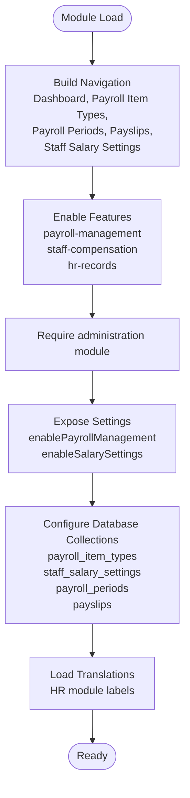

**Diagram sources**
- [moduleDefinition.tsx:23-52](file://src/modules/hr/moduleDefinition.tsx#L23-L52)
- [loader.ts:36-49](file://src/i18n/loader.ts#L36-L49)

**Section sources**
- [moduleDefinition.tsx:15-57](file://src/modules/hr/moduleDefinition.tsx#L15-L57)
- [loader.ts:36-49](file://src/i18n/loader.ts#L36-L49)

### RBAC Permissions
- Dashboard: read permission for viewing the HR dashboard
- Payroll Item Types: read, create, update, delete permissions for database operations
- Payroll Periods: read, create, update, delete permissions for database operations
- Payslips: read, create, update, delete permissions for database operations
- Staff Salary Settings: read, update permissions for database operations
- Default roles include hr_manager and administrator
- Internationalization support ensures permission descriptions are properly localized

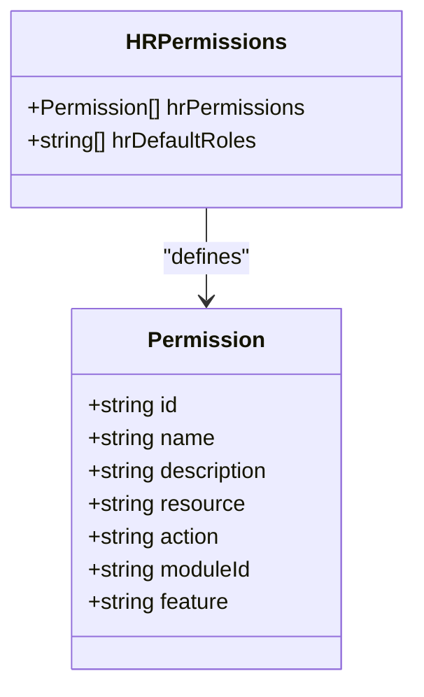

**Diagram sources**
- [rbac.ts:3-144](file://src/modules/hr/rbac.ts#L3-L144)

**Section sources**
- [rbac.ts:3-144](file://src/modules/hr/rbac.ts#L3-L144)

## Database Integration and Data Synchronization

### Collection Configuration
The HR module uses RxDB collections with comprehensive schema definitions and indexing strategies:

- **payroll_periods**: Stores payroll period definitions with financial year and school period references
- **payroll_item_types**: Defines earnings, deductions, and contributions with tax implications
- **staff_salary_settings**: Contains staff compensation data with nested recurring item associations
- **payslips**: Manages individual staff pay statements with nested itemized details

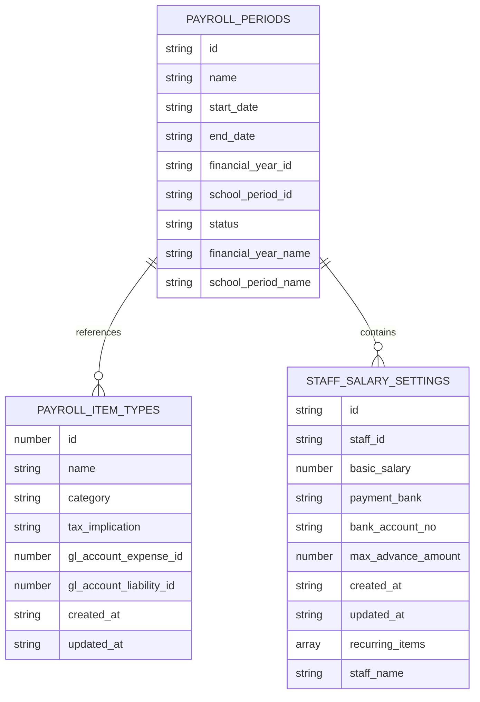

**Diagram sources**
- [schema.ts:9-110](file://src/modules/hr/data/schema.ts#L9-L110)

**Section sources**
- [schema.ts:1-111](file://src/modules/hr/data/schema.ts#L1-L111)
- [collectionConfig.ts:1-15](file://src/modules/hr/data/collectionConfig.ts#L1-L15)

### Database Service Integration
The module integrates with the UnifiedDatabaseManager for cross-module data synchronization through the facade pattern with internationalization support:

- **Module collections**: payroll_periods, payroll_item_types, staff_salary_settings, payslips
- **Collection aliases**: Human-readable names mapped to database collections (payrollPeriods, payrollItemTypes, staffSalarySettings, payslips)
- **Index optimization**: Strategic indexing on frequently queried fields
- **Relationship mapping**: Proper foreign key references between collections
- **Nested document support**: Arrays for recurring_items and payslip items
- **Translation integration**: Database operations support localized error messages and notifications

**Section sources**
- [collectionConfig.ts:1-15](file://src/modules/hr/data/collectionConfig.ts#L1-L15)
- [schema.ts:24, 41, 73, 109](file://src/modules/hr/data/schema.ts#L24,L41,L73,L109)
- [I18nManager.ts:109-150](file://src/i18n/I18nManager.ts#L109-L150)

## Payroll Processing System

### Payroll Item Types Management
The system manages payroll item types with comprehensive database integration through the facade pattern and enhanced internationalization support:

- **Categories**: Earnings, Deductions, and Employer Contributions
- **Tax implications**: Taxable, Non-Taxable, and Tax Relief classifications
- **GL account mapping**: Expense and liability account references
- **Active status tracking**: System-defined vs. custom item types
- **Translation support**: Category names and descriptions are properly localized

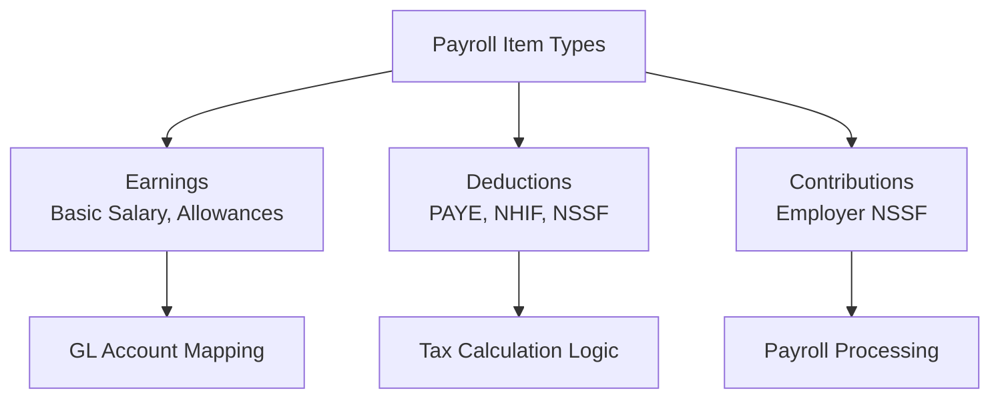

**Diagram sources**
- [types.ts:7-8](file://src/modules/hr/data/types.ts#L7-L8)

**Section sources**
- [types.ts:14-23](file://src/modules/hr/data/types.ts#L14-L23)
- [schema.ts:27-42](file://src/modules/hr/data/schema.ts#L27-L42)

### Payroll Periods and Processing
Payroll periods are managed with comprehensive database operations through the HRDataProvider facade with internationalization support:

- **Period types**: Weekly, Monthly, Quarterly, Yearly configurations
- **Status management**: Draft, Open, Closed period states
- **Date validation**: Start and end date constraints
- **Financial integration**: Links to financial years and school periods
- **Localized status messages**: Period status displays are properly translated

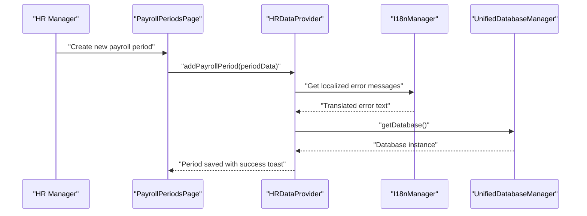

**Diagram sources**
- [HRDataProvider.tsx:128-147](file://src/modules/hr/data/HRDataProvider.tsx#L128-L147)
- [I18nManager.ts:109-150](file://src/i18n/I18nManager.ts#L109-L150)

**Section sources**
- [HRDataProvider.tsx:127-199](file://src/modules/hr/data/HRDataProvider.tsx#L127-L199)
- [schema.ts:9-25](file://src/modules/hr/data/schema.ts#L9-L25)
- [I18nManager.ts:109-150](file://src/i18n/I18nManager.ts#L109-L150)

### Payslip Generation and Processing
Payslips are generated with comprehensive database integration through the facade pattern and enhanced internationalization support:

- **Automatic generation**: Creates payslip documents with computed totals
- **Item aggregation**: Combines staff recurring items with payroll item types
- **Status tracking**: Draft, Processed, Paid, Cancelled status management
- **Payment processing**: Integration with payment systems and bank accounts
- **Localized status updates**: Payslip status changes display properly translated messages

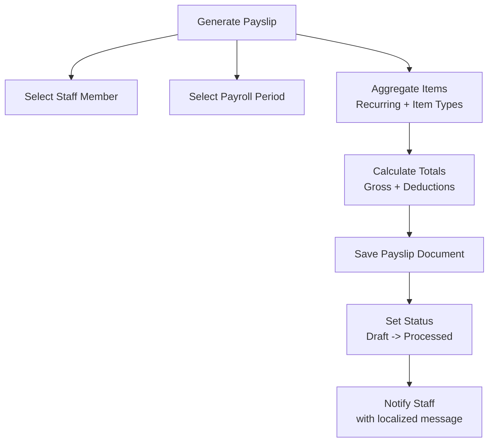

**Diagram sources**
- [HRDataProvider.tsx:202-222](file://src/modules/hr/data/HRDataProvider.tsx#L202-L222)
- [I18nManager.ts:109-150](file://src/i18n/I18nManager.ts#L109-L150)

**Section sources**
- [HRDataProvider.tsx:201-275](file://src/modules/hr/data/HRDataProvider.tsx#L201-L275)
- [schema.ts:86-110](file://src/modules/hr/data/schema.ts#L86-L110)
- [I18nManager.ts:109-150](file://src/i18n/I18nManager.ts#L109-L150)

## Staff Management and Compensation

### Staff Salary Settings
Staff salary settings are managed with comprehensive database integration through the HRDataProvider facade and internationalization support:

- **Basic salary tracking**: Primary compensation amounts with validation
- **Bank integration**: Payment bank and account number management
- **Advance limits**: Maximum advance amount configuration
- **Recurring items**: Nested array of benefit/deduction associations with item type references
- **Localized field labels**: All staff salary setting fields display properly translated labels

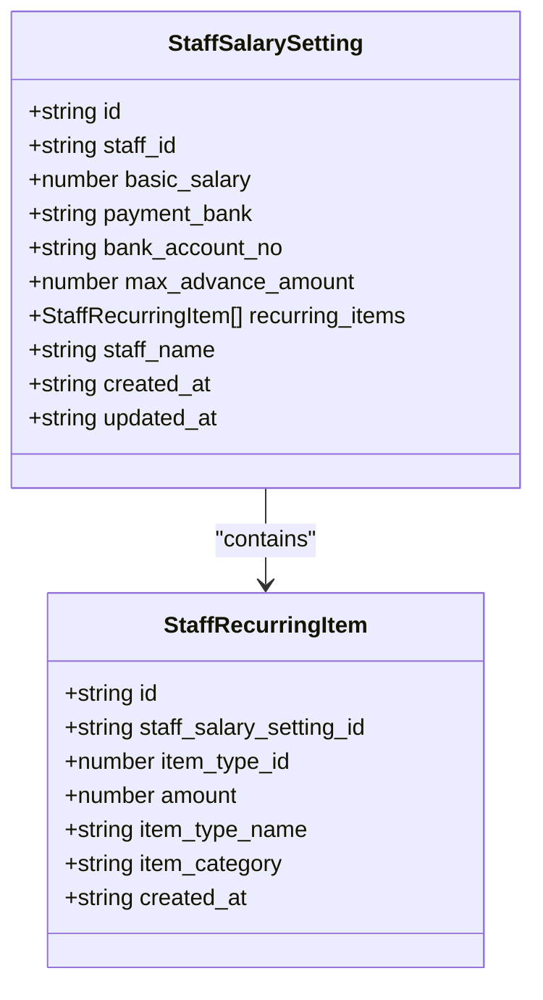

**Diagram sources**
- [types.ts:35-46](file://src/modules/hr/data/types.ts#L35-L46)
- [types.ts:25-33](file://src/modules/hr/data/types.ts#L25-L33)

**Section sources**
- [types.ts:35-46](file://src/modules/hr/data/types.ts#L35-L46)
- [schema.ts:54-74](file://src/modules/hr/data/schema.ts#L54-L74)

### Dashboard and Reporting
The HR dashboard provides comprehensive reporting with database-backed data through the facade pattern and enhanced internationalization support:

- **Staff metrics**: Total staff count and employment type distribution
- **Payroll metrics**: Active payroll periods and item types
- **Compensation coverage**: Percentage of staff with salary settings
- **Real-time updates**: Live data from database collections
- **Localized metrics**: All dashboard metrics display properly translated labels and values

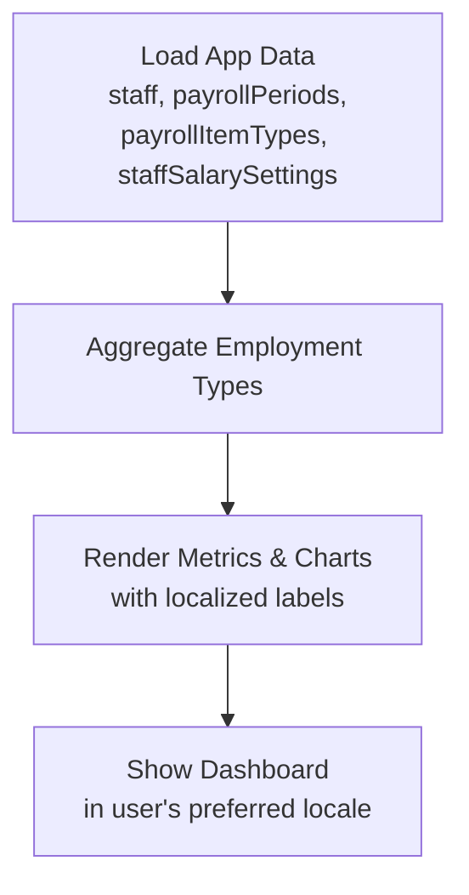

**Diagram sources**
- [HRDashboardPage.tsx:10-79](file://src/modules/hr/pages/HRDashboardPage.tsx#L10-L79)

**Section sources**
- [HRDashboardPage.tsx:1-79](file://src/modules/hr/pages/HRDashboardPage.tsx#L1-L79)

## Benefits, Deductions, and Tracking

### Payroll Item Categories
The system supports comprehensive payroll item categorization with internationalization support:

- **Earnings**: Basic salary, allowances, overtime, bonuses
- **Deductions**: Tax, insurance, loan repayments, advances
- **Contributions**: Employer NSSF, pension contributions
- **Tax implications**: Taxable, non-taxable, tax relief classifications
- **Localized categories**: All item categories display properly translated names

### Staff Benefits Tracking
Benefits and deductions are tracked through the database system with nested arrays and enhanced internationalization:

- **Nested recurring items**: Persistent benefit/deduction associations within staff salary settings
- **Historical tracking**: Complete benefit history per staff member
- **Audit trails**: Timestamped creation and modification logs
- **Integration**: Seamless integration with payslip generation through nested arrays
- **Localized tracking**: Benefit tracking displays properly translated labels and descriptions

**Section sources**
- [types.ts:7-9](file://src/modules/hr/data/types.ts#L7-L9)
- [schema.ts:44-52](file://src/modules/hr/data/schema.ts#L44-L52)

## Data Models and Schemas

### Database-Agnostic Schema Design
The HR module uses database-agnostic schemas compatible with both RxDB and PouchDB:

- **Primary keys**: String-based IDs with UUID generation for documents
- **Timestamps**: ISO format timestamps for all records
- **Validation**: Comprehensive field validation and constraints
- **Indexes**: Strategic indexing for performance optimization on frequently queried fields
- **Nested arrays**: Support for recurring_items and payslip items arrays

### Collection Relationships
Collections maintain proper relationships through foreign key references:

- **Payroll periods** → **Payroll item types**: Reference relationships
- **Staff salary settings** → **Staff members**: Staff identification
- **Payslips** → **Payroll periods**: Period association
- **Nested arrays**: Staff recurring items and payslip items within parent documents

**Section sources**
- [schema.ts:1-111](file://src/modules/hr/data/schema.ts#L1-L111)
- [types.ts:1-86](file://src/modules/hr/data/types.ts#L1-L86)

## Performance Considerations
- **Database indexing**: Strategic indexes on frequently queried fields (name, category, staff_id, payroll_period_id)
- **Collection optimization**: Proper collection sizing and query optimization
- **Data synchronization**: Efficient cross-module data sharing through UnifiedDatabaseManager
- **Batch operations**: Optimized batch updates for recurring item modifications
- **Virtualization**: Large lists in payslips and staff salary settings pages use virtualization
- **Search optimization**: Debounced search operations with database query optimization
- **Nested document efficiency**: Arrays for recurring items reduce join complexity
- **Facade pattern efficiency**: Clean interfaces reduce UI complexity and improve performance
- **Translation caching**: I18nManager caches loaded translations for improved performance
- **Locale switching**: Efficient locale switching with preloaded translation bundles

## Troubleshooting Guide
- **Database connection issues**: Verify UnifiedDatabaseManager initialization and collection availability
- **Permission denied errors**: Check RBAC permissions for database operations and role assignments
- **Data synchronization failures**: Monitor database service connectivity and collection health
- **CRUD operation failures**: Validate schema compliance and foreign key constraints
- **Performance issues**: Review database indexes and optimize collection queries
- **Collection mapping errors**: Verify module collection aliases and database schema alignment
- **Nested document issues**: Ensure proper array handling for recurring_items and payslip items
- **Facade pattern issues**: Check HRDataProvider method signatures and error handling
- **Translation loading issues**: Verify French translation files are properly loaded and accessible
- **Locale switching problems**: Check I18nManager configuration and supported locales list

**Section sources**
- [rbac.ts:3-144](file://src/modules/hr/rbac.ts#L3-L144)
- [HRDataProvider.tsx:1-362](file://src/modules/hr/data/HRDataProvider.tsx#L1-L362)
- [collectionConfig.ts:1-15](file://src/modules/hr/data/collectionConfig.ts#L1-L15)
- [I18nManager.ts:277-306](file://src/i18n/I18nManager.ts#L277-L306)

## Conclusion
The HR module provides a comprehensive, database-backed solution for managing staff records, salary settings, payroll item types, payroll periods, and payslips with enhanced internationalization support. With RxDB integration, a sophisticated facade pattern through HRDataProvider, and UnifiedDatabaseManager, the module offers robust data persistence, real-time synchronization, and scalable payroll processing capabilities. The facade pattern implementation ensures clean interfaces while maintaining database functionality, providing developers with intuitive methods like `addStaffSalarySetting`, `updatePayrollPeriod`, and `processPayslip`. The comprehensive RBAC model ensures secure database operations, while the database-agnostic schema design supports flexible deployment environments. The module's integration with the application's data layer enables seamless payroll processing, automated calculations, and comprehensive reporting features essential for modern educational institution management. The nested document structure optimizes performance while maintaining data integrity across the entire payroll ecosystem. The enhanced internationalization support with comprehensive French translations (12 new entries) ensures the module is fully accessible to French-speaking users, while the I18nManager provides robust multilingual capabilities including Arabic RTL support and Spanish localization. The HR module stands as a cornerstone of the school pilot system's human resources management capabilities, now enhanced with comprehensive internationalization support for global deployment.