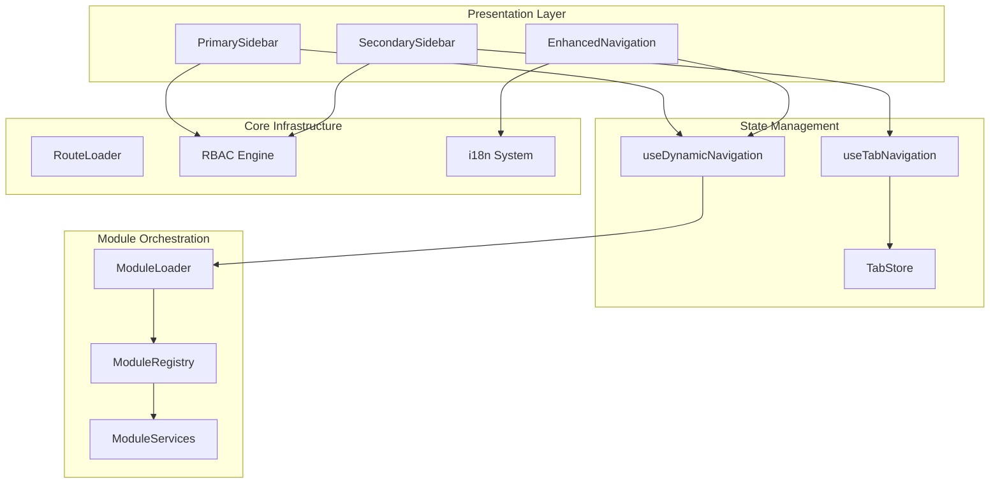
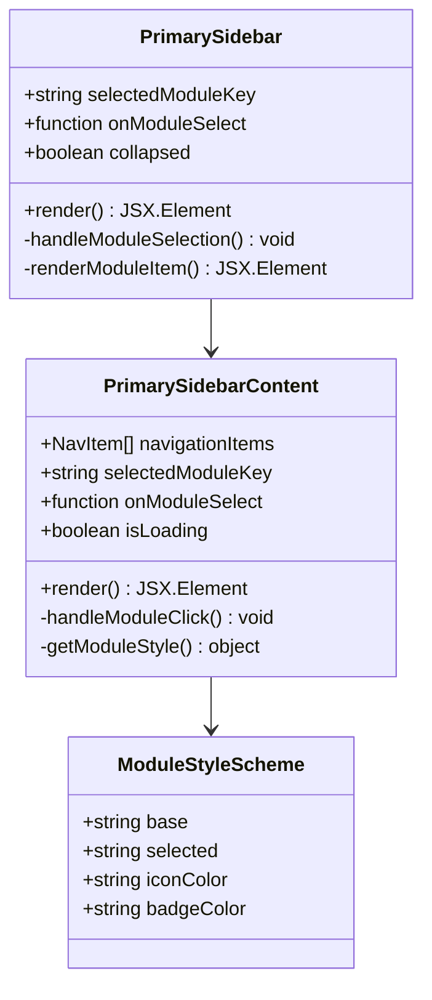
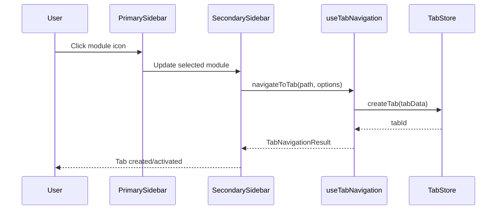
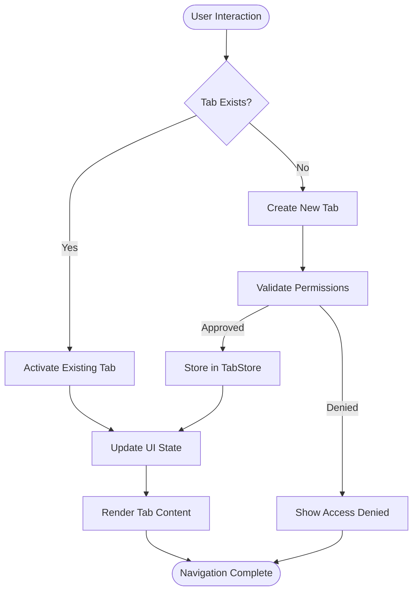
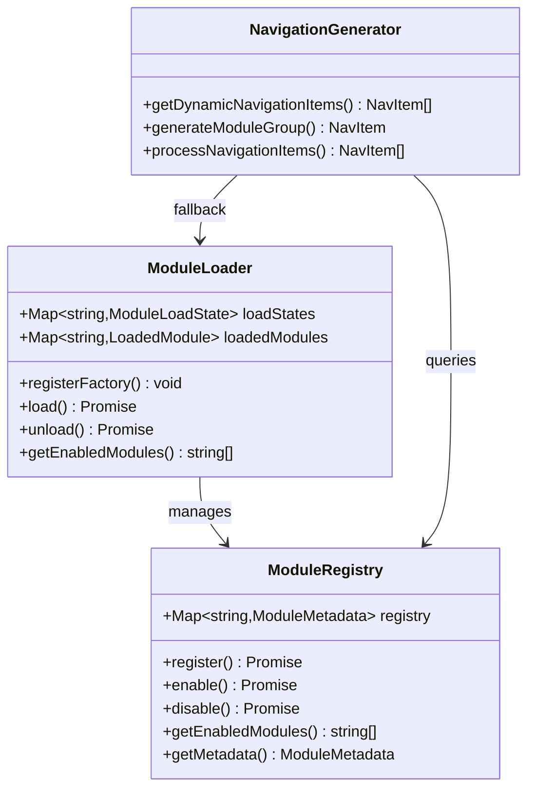
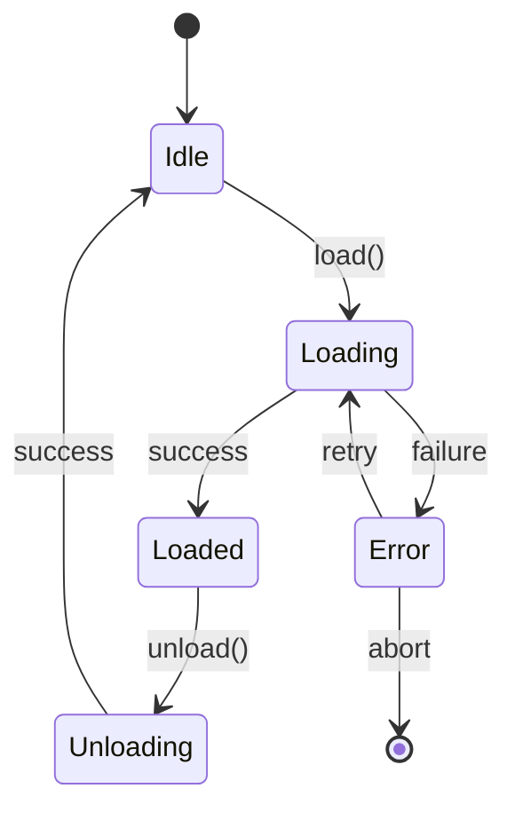
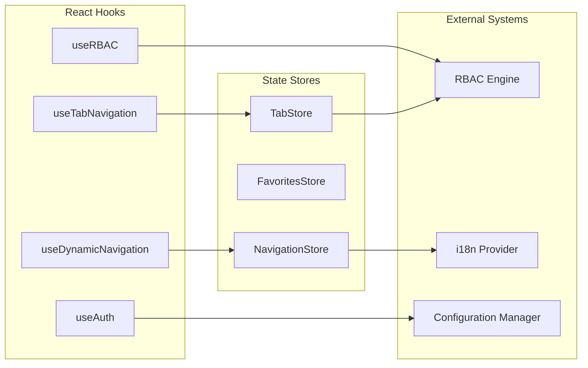
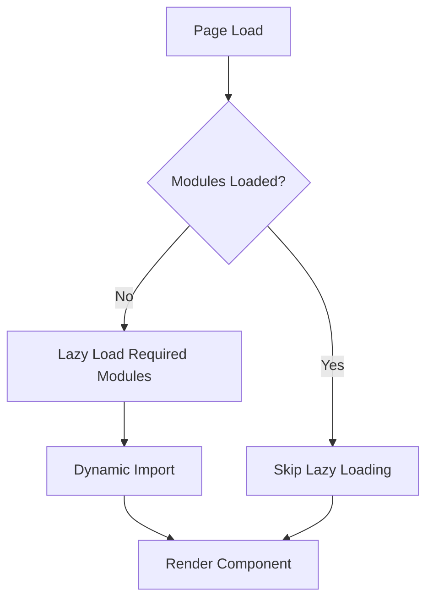
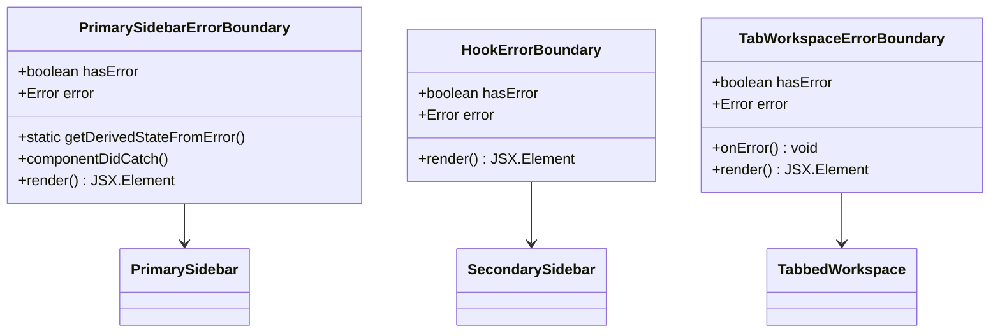

# Hub Navigation System

<cite>
**Referenced Files in This Document**
- [EnhancedNavigation.tsx](file://src/components/EnhancedNavigation.tsx)
- [PrimarySidebar.tsx](file://src/components/PrimarySidebar.tsx)
- [SecondarySidebar.tsx](file://src/components/SecondarySidebar.tsx)
- [useDynamicNavigation.ts](file://src/hooks/useDynamicNavigation.ts)
- [useTabNavigation.ts](file://src/hooks/useTabNavigation.ts)
- [moduleLoader.ts](file://src/core/moduleLoader.ts)
- [TabbedWorkspace.tsx](file://src/components/tabbedWorkspace/TabbedWorkspace.tsx)
- [tab-system.md](file://docs/architecture/tab-system.md)
- [SYSTEM_OVERVIEW.md](file://docs/tabs/SYSTEM_OVERVIEW.md)
- [README_TABBED_WORKSPACE.md](file://docs/tabs/README_TABBED_WORKSPACE.md)
- [DashboardPage.tsx](file://src/modules/dashboard/pages/DashboardPage.tsx)
</cite>

## Table of Contents
1. [Introduction](#introduction)
2. [System Architecture](#system-architecture)
3. [Core Navigation Components](#core-navigation-components)
4. [Tabbed Workspace Integration](#tabbed-workspace-integration)
5. [Dynamic Navigation System](#dynamic-navigation-system)
6. [Module Loading and Registration](#module-loading-and-registration)
7. [Navigation State Management](#navigation-state-management)
8. [Performance Optimization Strategies](#performance-optimization-strategies)
9. [Error Handling and Resilience](#error-handling-and-resilience)
10. [Best Practices and Guidelines](#best-practices-and-guidelines)
11. [Troubleshooting Guide](#troubleshooting-guide)
12. [Conclusion](#conclusion)

## Introduction

The Hub Navigation System represents a sophisticated multi-layered navigation architecture designed for the SchoolPilot educational management platform. This system combines traditional sidebar navigation with a modern tabbed workspace interface, providing users with both hierarchical module access and concurrent task management capabilities.

The system is built around three core pillars: dynamic module discovery, tab-based workspace management, and intelligent navigation state persistence. It supports real-time module loading, permission-based access control, and seamless integration between primary and secondary navigation layers.

## System Architecture

The Hub Navigation System employs a layered architecture that separates concerns between navigation presentation, state management, and module orchestration:

**Diagram sources**
- [PrimarySidebar.tsx:1-457](file://src/components/PrimarySidebar.tsx#L1-L457)
- [SecondarySidebar.tsx:1-800](file://src/components/SecondarySidebar.tsx#L1-L800)
- [useDynamicNavigation.ts:1-169](file://src/hooks/useDynamicNavigation.ts#L1-L169)
- [useTabNavigation.ts:1-630](file://src/hooks/useTabNavigation.ts#L1-L630)
- [moduleLoader.ts:1-563](file://src/core/moduleLoader.ts#L1-L563)

The architecture follows a unidirectional data flow pattern where state changes propagate from hooks to components through React's rendering system, ensuring predictable behavior and easy debugging.

## Core Navigation Components

### Primary Sidebar Navigation

The Primary Sidebar serves as the main navigation hub, providing quick access to major application modules through an intuitive icon-based interface:

**Diagram sources**
- [PrimarySidebar.tsx:152-457](file://src/components/PrimarySidebar.tsx#L152-L457)

The Primary Sidebar implements advanced features including:
- **Dynamic Module Loading**: Real-time module discovery and loading
- **Visual Feedback**: Color-coded status indicators for online/offline states
- **Responsive Design**: Adaptive layouts for different screen sizes
- **Accessibility**: Full keyboard navigation and screen reader support

### Secondary Sidebar Navigation

The Secondary Sidebar provides contextual navigation within selected modules, offering detailed access to sub-features and administrative functions:

**Diagram sources**
- [SecondarySidebar.tsx:213-309](file://src/components/SecondarySidebar.tsx#L213-L309)
- [useTabNavigation.ts:339-386](file://src/hooks/useTabNavigation.ts#L339-L386)

**Section sources**
- [PrimarySidebar.tsx:1-457](file://src/components/PrimarySidebar.tsx#L1-L457)
- [SecondarySidebar.tsx:1-800](file://src/components/SecondarySidebar.tsx#L1-L800)

### Enhanced Navigation Header

The Enhanced Navigation component provides real-time system status information and global controls:

**Section sources**
- [EnhancedNavigation.tsx:1-104](file://src/components/EnhancedNavigation.tsx#L1-L104)

## Tabbed Workspace Integration

The Tabbed Workspace System transforms traditional page navigation into a modern tab-based interface, allowing users to manage multiple tasks simultaneously:

**Diagram sources**
- [useTabNavigation.ts:339-386](file://src/hooks/useTabNavigation.ts#L339-L386)
- [TabbedWorkspace.tsx:344-407](file://src/components/tabbedWorkspace/TabbedWorkspace.tsx#L344-L407)

The tab system implements several advanced features:
- **URL Synchronization**: Tab state mirrors browser URL for deep linking
- **State Persistence**: Automatic saving and restoration of tab configurations
- **Permission Validation**: RBAC integration for tab access control
- **Performance Optimization**: Lazy loading and virtual scrolling for large tab sets

**Section sources**
- [tab-system.md:1-455](file://docs/architecture/tab-system.md#L1-L455)
- [SYSTEM_OVERVIEW.md:1-53](file://docs/tabs/SYSTEM_OVERVIEW.md#L1-L53)
- [README_TABBED_WORKSPACE.md:1-176](file://docs/tabs/README_TABBED_WORKSPACE.md#L1-L176)

## Dynamic Navigation System

The Dynamic Navigation System eliminates hardcoded navigation structures by leveraging the module registry for real-time navigation generation:

**Diagram sources**
- [moduleLoader.ts:43-418](file://src/core/moduleLoader.ts#L43-L418)
- [useDynamicNavigation.ts:29-51](file://src/hooks/useDynamicNavigation.ts#L29-L51)

The system provides:
- **Real-time Module Discovery**: Automatic detection of installed modules
- **Dynamic Navigation Generation**: Runtime construction of navigation hierarchies
- **Module Status Tracking**: Live monitoring of module enablement states
- **Fallback Mechanisms**: Graceful degradation when modules are unavailable

**Section sources**
- [moduleLoader.ts:451-518](file://src/core/moduleLoader.ts#L451-L518)
- [useDynamicNavigation.ts:19-169](file://src/hooks/useDynamicNavigation.ts#L19-L169)

## Module Loading and Registration

The module loading system implements a sophisticated factory pattern with dependency management and lifecycle control:

**Diagram sources**
- [moduleLoader.ts:85-179](file://src/core/moduleLoader.ts#L85-L179)

Key features include:
- **Parallel Loading**: Multiple modules can load simultaneously
- **Retry Logic**: Automatic retry with exponential backoff
- **Dependency Resolution**: Ensures modules load in correct order
- **Memory Management**: Proper cleanup of unloaded modules

**Section sources**
- [moduleLoader.ts:1-563](file://src/core/moduleLoader.ts#L1-L563)

## Navigation State Management

The navigation system employs a comprehensive state management approach combining React hooks with centralized state stores:

**Diagram sources**
- [useDynamicNavigation.ts:19-169](file://src/hooks/useDynamicNavigation.ts#L19-L169)
- [useTabNavigation.ts:107-627](file://src/hooks/useTabNavigation.ts#L107-L627)

**Section sources**
- [useDynamicNavigation.ts:1-169](file://src/hooks/useDynamicNavigation.ts#L1-169)
- [useTabNavigation.ts:1-630](file://src/hooks/useTabNavigation.ts#L1-630)

## Performance Optimization Strategies

The navigation system implements multiple optimization strategies to ensure smooth performance across various scenarios:

### Lazy Loading Implementation

### Memory Management

The system implements aggressive memory management:
- **Component Cleanup**: Proper cleanup of event listeners and subscriptions
- **State Optimization**: Minimizes state updates through selective re-rendering
- **Resource Pooling**: Reuses expensive resources where possible
- **Garbage Collection**: Proactive cleanup of unused references

**Section sources**
- [PrimarySidebar.tsx:217-236](file://src/components/PrimarySidebar.tsx#L217-L236)
- [SecondarySidebar.tsx:392-396](file://src/components/SecondarySidebar.tsx#L392-L396)

## Error Handling and Resilience

The navigation system incorporates comprehensive error handling at multiple levels:

### Component-Level Error Boundaries

### Graceful Degradation

The system provides fallback mechanisms for various failure scenarios:
- **Module Loading Failures**: Graceful degradation to static navigation
- **Network Connectivity Issues**: Local-only mode with offline indicators
- **Permission Denials**: Contextual access denial messaging
- **State Corruption**: Automatic recovery and cleanup procedures

**Section sources**
- [PrimarySidebar.tsx:8-36](file://src/components/PrimarySidebar.tsx#L8-L36)
- [SecondarySidebar.tsx:10](file://src/components/SecondarySidebar.tsx#L10)

## Best Practices and Guidelines

### Navigation Design Principles

The system adheres to established design patterns for optimal user experience:

1. **Consistent Navigation Structure**: Maintain uniform navigation patterns across modules
2. **Accessibility Compliance**: Full ARIA support and keyboard navigation
3. **Mobile Responsiveness**: Adaptive layouts for all screen sizes
4. **Performance Optimization**: Lazy loading and efficient state management
5. **User Preference Support**: Customizable navigation preferences

### Development Guidelines

- **Hook Order Consistency**: Maintain consistent hook invocation order
- **State Immutability**: Treat state as immutable and use proper update patterns
- **Error Boundary Placement**: Strategic placement of error boundaries
- **Performance Monitoring**: Regular performance profiling and optimization
- **Testing Coverage**: Comprehensive unit and integration testing

**Section sources**
- [tab-system.md:417-448](file://docs/architecture/tab-system.md#L417-L448)

## Troubleshooting Guide

### Common Navigation Issues

#### Module Loading Failures

**Symptoms**: Modules appear disabled or fail to load
**Causes**: 
- Network connectivity issues
- Module dependency conflicts
- Factory registration problems
- Configuration errors

**Solutions**:
1. Verify module dependencies are properly resolved
2. Check network connectivity and retry logic
3. Review module factory registration
4. Validate configuration settings

#### Tab Navigation Problems

**Symptoms**: Tabs fail to create or activate properly
**Causes**:
- Permission validation failures
- State corruption
- Memory leaks
- URL synchronization issues

**Solutions**:
1. Reset tab state through error boundaries
2. Clear corrupted tab data
3. Monitor memory usage patterns
4. Validate URL synchronization

#### Performance Degradation

**Symptoms**: Slow navigation response times
**Causes**:
- Excessive state updates
- Memory leaks
- Inefficient rendering
- Network bottlenecks

**Solutions**:
1. Implement proper memoization
2. Optimize rendering performance
3. Monitor memory usage
4. Reduce network requests

**Section sources**
- [tab-system.md:327-374](file://docs/architecture/tab-system.md#L327-L374)

## Conclusion

The Hub Navigation System represents a comprehensive solution for modern educational management platforms, combining traditional navigation patterns with cutting-edge tab-based workspace technology. The system's modular architecture, dynamic module loading, and comprehensive error handling provide a robust foundation for scalable educational applications.

Key strengths of the system include:
- **Flexibility**: Dynamic module discovery and loading
- **Performance**: Optimized rendering and state management
- **Reliability**: Comprehensive error handling and recovery
- **Extensibility**: Modular design supporting future enhancements
- **User Experience**: Intuitive navigation with modern tab interface

The system successfully balances functionality with maintainability, providing a solid foundation for continued development and feature expansion while maintaining excellent user experience standards.