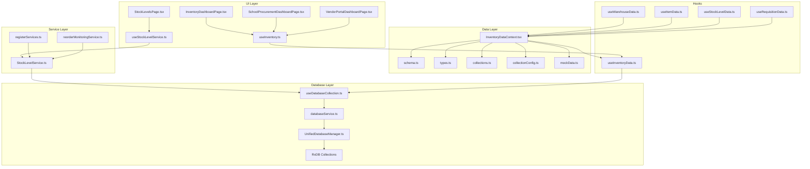
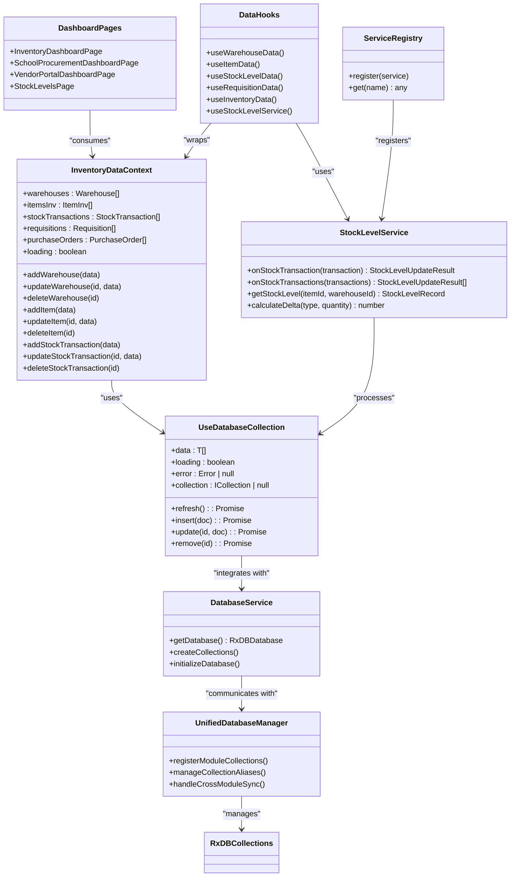
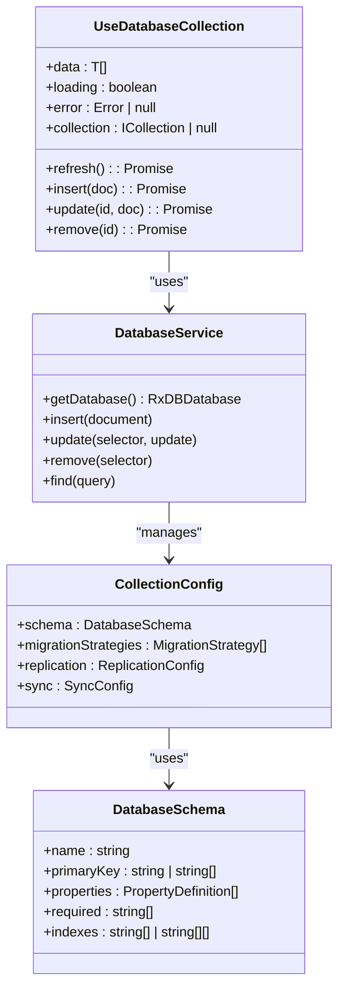
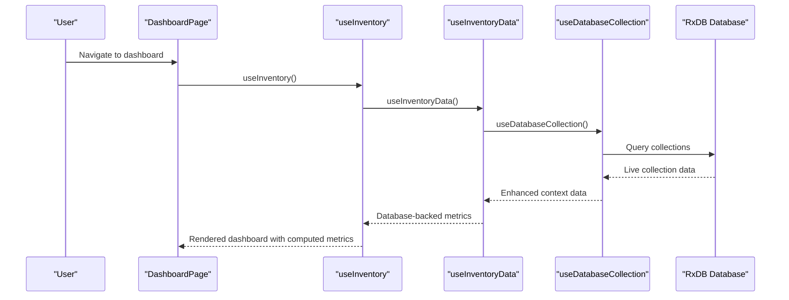
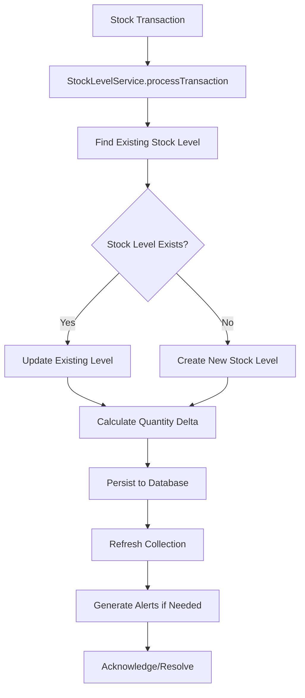
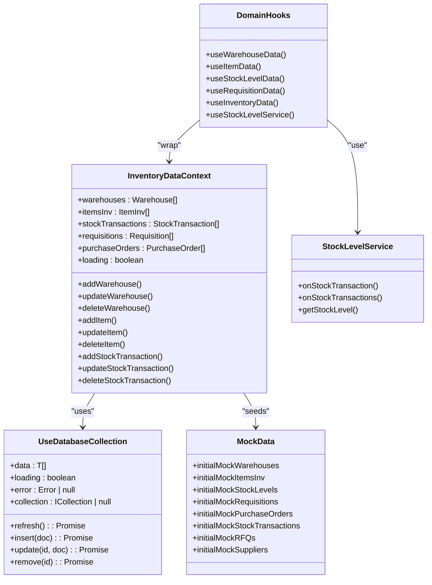
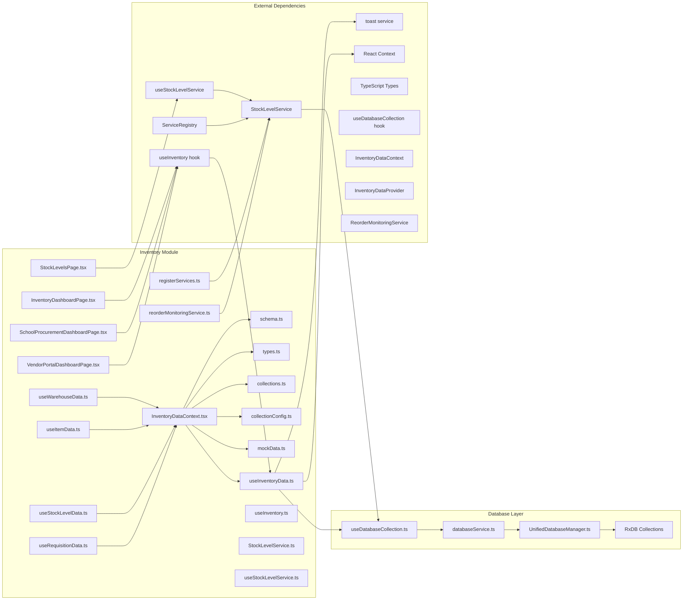

# Inventory Module

<cite>
**Referenced Files in This Document**
- [InventoryDashboardPage.tsx](file://src/modules/inventory/pages/InventoryDashboardPage.tsx)
- [SchoolProcurementDashboardPage.tsx](file://src/modules/inventory/pages/SchoolProcurementDashboardPage.tsx)
- [VendorPortalDashboardPage.tsx](file://src/modules/inventory/pages/VendorPortalDashboardPage.tsx)
- [StockLevelsPage.tsx](file://src/modules/inventory/pages/StockLevelsPage.tsx)
- [useInventory.ts](file://src/modules/inventory/hooks/useInventory.ts)
- [useStockLevelService.ts](file://src/modules/inventory/hooks/useStockLevelService.ts)
- [useInventoryData.ts](file://src/modules/inventory/data/useInventoryData.ts)
- [useStockLevelData.ts](file://src/modules/inventory/data/useStockLevelData.ts)
- [InventoryDataContext.tsx](file://src/modules/inventory/data/InventoryDataContext.tsx)
- [StockLevelService.ts](file://src/modules/inventory/services/StockLevelService.ts)
- [registerServices.ts](file://src/modules/inventory/services/registerServices.ts)
- [reorderMonitoringService.ts](file://src/modules/inventory/services/reorderMonitoringService.ts)
- [useDatabaseCollection.ts](file://src/hooks/useDatabaseCollection.ts)
- [schema.ts](file://src/modules/inventory/data/schema.ts)
- [types.ts](file://src/modules/inventory/data/types.ts)
- [collections.ts](file://src/modules/inventory/data/collections.ts)
- [collectionConfig.ts](file://src/modules/inventory/data/collectionConfig.ts)
- [InventoryDataProvider.tsx](file://src/modules/inventory/data/InventoryDataProvider.tsx)
- [mockData.ts](file://src/modules/inventory/data/mockData.ts)
- [useWarehouseData.ts](file://src/modules/inventory/data/useWarehouseData.ts)
- [useItemData.ts](file://src/modules/inventory/data/useItemData.ts)
- [useRequisitionData.ts](file://src/modules/inventory/data/useRequisitionData.ts)
- [databaseService.ts](file://src/services/database/databaseService.ts)
- [UnifiedDatabaseManager.ts](file://src/services/database/UnifiedDatabaseManager.ts)
</cite>

## Update Summary
**Changes Made**
- Updated documentation to reflect the new StockLevelService replacing database triggers
- Documented the client-side stock level processing architecture
- Added comprehensive coverage of the StockLevelService implementation and dependencies
- Updated stock management workflow to show service-based processing
- Enhanced reorder monitoring documentation with service integration
- Added service registry integration for StockLevelService

## Table of Contents
1. [Introduction](#introduction)
2. [Project Structure](#project-structure)
3. [Core Components](#core-components)
4. [Architecture Overview](#architecture-overview)
5. [Detailed Component Analysis](#detailed-component-analysis)
6. [Database Integration](#database-integration)
7. [Stock Level Service Architecture](#stock-level-service-architecture)
8. [Dependency Analysis](#dependency-analysis)
9. [Performance Considerations](#performance-considerations)
10. [Troubleshooting Guide](#troubleshooting-guide)
11. [Conclusion](#conclusion)
12. [Appendices](#appendices)

## Introduction
The Inventory module provides a comprehensive asset and supply chain management solution for educational institutions with full database backend integration. It encompasses fixed asset tracking, consumable inventory management, warehouse operations, procurement workflows, and vendor collaboration. The module supports end-to-end procurement from requisitions to purchase orders, RFQs, and supplier contracts, while maintaining real-time stock visibility and automated reorder monitoring. The implementation leverages a modern database infrastructure with useDatabaseCollection hooks for centralized CRUD operations and reactive data management.

**Updated** The module now features a sophisticated StockLevelService that replaces traditional database triggers with client-side stock level tracking, providing more reliable and controllable inventory management through dedicated service architecture. This service replaces the PostgreSQL trigger `inv.fn_update_stock_level()` and the trigger `trg_inv_updateStockLevel` which previously maintained the `stock_levels` table in sync with `stock_transactions`.

## Project Structure
The Inventory module follows a modernized architecture with centralized database integration and modular data providers:
- Data layer: database-agnostic schemas, RxDB collections, and provider patterns
- UI layer: dashboard pages and reusable components including dedicated stock level monitoring
- Services: business logic services like StockLevelService for complex operations
- Hooks: domain-specific data access patterns with useDatabaseCollection integration
- Mock data: seed data for development and demonstration modes

**Diagram sources**
- [InventoryDashboardPage.tsx:1-57](file://src/modules/inventory/pages/InventoryDashboardPage.tsx#L1-L57)
- [SchoolProcurementDashboardPage.tsx:1-111](file://src/modules/inventory/pages/SchoolProcurementDashboardPage.tsx#L1-L111)
- [VendorPortalDashboardPage.tsx:1-106](file://src/modules/inventory/pages/VendorPortalDashboardPage.tsx#L1-L106)
- [StockLevelsPage.tsx:1-107](file://src/modules/inventory/pages/StockLevelsPage.tsx#L1-L107)
- [useInventory.ts:1-41](file://src/modules/inventory/hooks/useInventory.ts#L1-L41)
- [useStockLevelService.ts:1-187](file://src/modules/inventory/hooks/useStockLevelService.ts#L1-L187)
- [StockLevelService.ts:1-202](file://src/modules/inventory/services/StockLevelService.ts#L1-L202)
- [registerServices.ts:1-17](file://src/modules/inventory/services/registerServices.ts#L1-L17)
- [reorderMonitoringService.ts:1-138](file://src/modules/inventory/services/reorderMonitoringService.ts#L1-L138)
- [useInventoryData.ts:1-155](file://src/modules/inventory/data/useInventoryData.ts#L1-L155)
- [InventoryDataContext.tsx:1-36](file://src/modules/inventory/data/InventoryDataContext.tsx#L1-L36)
- [schema.ts:1-288](file://src/modules/inventory/data/schema.ts#L1-L288)
- [types.ts:1-294](file://src/modules/inventory/data/types.ts#L1-L294)
- [collections.ts:1-52](file://src/modules/inventory/data/collections.ts#L1-L52)
- [collectionConfig.ts:1-19](file://src/modules/inventory/data/collectionConfig.ts#L1-L19)
- [mockData.ts:1-260](file://src/modules/inventory/data/mockData.ts#L1-L260)
- [useWarehouseData.ts:1-96](file://src/modules/inventory/data/useWarehouseData.ts#L1-L96)
- [useItemData.ts:1-41](file://src/modules/inventory/data/useItemData.ts#L1-L41)
- [useStockLevelData.ts:1-99](file://src/modules/inventory/data/useStockLevelData.ts#L1-L99)
- [useRequisitionData.ts:1-41](file://src/modules/inventory/data/useRequisitionData.ts#L1-L41)
- [useDatabaseCollection.ts:1-228](file://src/hooks/useDatabaseCollection.ts#L1-L228)

**Section sources**
- [InventoryDashboardPage.tsx:1-57](file://src/modules/inventory/pages/InventoryDashboardPage.tsx#L1-L57)
- [SchoolProcurementDashboardPage.tsx:1-111](file://src/modules/inventory/pages/SchoolProcurementDashboardPage.tsx#L1-L111)
- [VendorPortalDashboardPage.tsx:1-106](file://src/modules/inventory/pages/VendorPortalDashboardPage.tsx#L1-L106)
- [StockLevelsPage.tsx:1-107](file://src/modules/inventory/pages/StockLevelsPage.tsx#L1-L107)
- [useInventory.ts:1-41](file://src/modules/inventory/hooks/useInventory.ts#L1-L41)
- [useStockLevelService.ts:1-187](file://src/modules/inventory/hooks/useStockLevelService.ts#L1-L187)
- [StockLevelService.ts:1-202](file://src/modules/inventory/services/StockLevelService.ts#L1-L202)
- [registerServices.ts:1-17](file://src/modules/inventory/services/registerServices.ts#L1-L17)
- [reorderMonitoringService.ts:1-138](file://src/modules/inventory/services/reorderMonitoringService.ts#L1-L138)
- [useInventoryData.ts:1-155](file://src/modules/inventory/data/useInventoryData.ts#L1-L155)
- [InventoryDataContext.tsx:1-36](file://src/modules/inventory/data/InventoryDataContext.tsx#L1-L36)
- [schema.ts:1-288](file://src/modules/inventory/data/schema.ts#L1-L288)
- [types.ts:1-294](file://src/modules/inventory/data/types.ts#L1-L294)
- [collections.ts:1-52](file://src/modules/inventory/data/collections.ts#L1-L52)
- [collectionConfig.ts:1-19](file://src/modules/inventory/data/collectionConfig.ts#L1-L19)
- [mockData.ts:1-260](file://src/modules/inventory/data/mockData.ts#L1-L260)
- [useWarehouseData.ts:1-96](file://src/modules/inventory/data/useWarehouseData.ts#L1-L96)
- [useItemData.ts:1-41](file://src/modules/inventory/data/useItemData.ts#L1-L41)
- [useStockLevelData.ts:1-99](file://src/modules/inventory/data/useStockLevelData.ts#L1-L99)
- [useRequisitionData.ts:1-41](file://src/modules/inventory/data/useRequisitionData.ts#L1-L41)
- [useDatabaseCollection.ts:1-228](file://src/hooks/useDatabaseCollection.ts#L1-L228)

## Core Components
The module centers around seven primary domains with comprehensive database integration through the useDatabaseCollection pattern:

- **Asset Management**
  - Fixed assets with depreciation tracking and lifecycle management
  - Asset lifecycle from acquisition to disposal with audit trails
  - Depreciation logs and valuation updates with historical tracking

- **Item Categories and Catalog**
  - Hierarchical categorization of inventory items with database constraints
  - Support for consumables and fixed assets with type-specific validation
  - Pricing and reorder configuration with real-time updates

- **Warehouse Operations**
  - Multi-location storage management with composite key optimization
  - Batch and expiry tracking for controlled items with indexed queries
  - Composite stock visibility across locations with performance indexing

- **Procurement Lifecycle**
  - Requisitions with approval workflows and nested item management
  - Purchase orders linked to suppliers with line-item detail persistence
  - RFQs for competitive sourcing with status tracking
  - Supplier contracts and performance tracking with version control

- **Stock Management**
  - **Updated** Client-side stock level tracking through StockLevelService replacing database triggers
  - Real-time stock levels with atomic transaction updates and service orchestration
  - Automated reorder monitoring with configurable thresholds and service-based processing
  - Expiry warnings and stock alerts with notification systems and service coordination
  - Issue/receipt tracking and adjustments with audit trails and service validation

- **Database Infrastructure**
  - useDatabaseCollection hook for centralized CRUD operations
  - Reactive data subscriptions with automatic updates
  - Error handling and loading state management
  - Type-safe database interactions

- **Data Provider Architecture**
  - Modular data provider with useInventoryData hook
  - Centralized CRUD operations with toast notifications
  - Reactive data updates through provider context
  - Error handling and loading state management

**Section sources**
- [useInventoryData.ts:10-19](file://src/modules/inventory/data/useInventoryData.ts#L10-L19)
- [useDatabaseCollection.ts:24-227](file://src/hooks/useDatabaseCollection.ts#L24-L227)
- [schema.ts:61-120](file://src/modules/inventory/data/schema.ts#L61-L120)
- [types.ts:122-170](file://src/modules/inventory/data/types.ts#L122-L170)
- [mockData.ts:104-157](file://src/modules/inventory/data/mockData.ts#L104-L157)
- [collections.ts:6-48](file://src/modules/inventory/data/collections.ts#L6-L48)
- [StockLevelService.ts:7-86](file://src/modules/inventory/services/StockLevelService.ts#L7-L86)

## Architecture Overview
The Inventory module employs a modernized layered architecture with centralized database integration and useDatabaseCollection hooks:

**Diagram sources**
- [InventoryDataContext.tsx:10-33](file://src/modules/inventory/data/InventoryDataContext.tsx#L10-L33)
- [StockLevelService.ts:87-200](file://src/modules/inventory/services/StockLevelService.ts#L87-L200)
- [useDatabaseCollection.ts:24-227](file://src/hooks/useDatabaseCollection.ts#L24-L227)
- [useInventoryData.ts:10-154](file://src/modules/inventory/data/useInventoryData.ts#L10-L154)
- [InventoryDashboardPage.tsx:7-12](file://src/modules/inventory/pages/InventoryDashboardPage.tsx#L7-L12)
- [SchoolProcurementDashboardPage.tsx:8-11](file://src/modules/inventory/pages/SchoolProcurementDashboardPage.tsx#L8-L11)
- [VendorPortalDashboardPage.tsx:8-11](file://src/modules/inventory/pages/VendorPortalDashboardPage.tsx#L8-L11)
- [StockLevelsPage.tsx:11-18](file://src/modules/inventory/pages/StockLevelsPage.tsx#L11-L18)
- [useWarehouseData.ts:35-92](file://src/modules/inventory/data/useWarehouseData.ts#L35-L92)
- [useItemData.ts:8-41](file://src/modules/inventory/data/useItemData.ts#L8-L41)
- [useStockLevelData.ts:37-95](file://src/modules/inventory/data/useStockLevelData.ts#L37-L95)
- [useRequisitionData.ts:8-41](file://src/modules/inventory/data/useRequisitionData.ts#L8-L41)
- [useStockLevelService.ts:24-187](file://src/modules/inventory/hooks/useStockLevelService.ts#L24-L187)
- [registerServices.ts:6-16](file://src/modules/inventory/services/registerServices.ts#L6-L16)
- [databaseService.ts](file://src/services/database/databaseService.ts)
- [UnifiedDatabaseManager.ts](file://src/services/database/UnifiedDatabaseManager.ts)

The architecture ensures:
- Centralized database access via useDatabaseCollection hook pattern
- Reactive UI updates through provider and hook patterns
- Strong typing across schemas, interfaces, and database collections
- Extensible collection definitions with automatic indexing
- Seamless offline-first operation with conflict resolution
- Modular data provider architecture for clean separation of concerns
- **Updated** Service-based stock level processing replacing database triggers
- **New** Service registry integration for StockLevelService management

**Section sources**
- [InventoryDataContext.tsx:1-36](file://src/modules/inventory/data/InventoryDataContext.tsx#L1-L36)
- [StockLevelService.ts:1-202](file://src/modules/inventory/services/StockLevelService.ts#L1-L202)
- [useDatabaseCollection.ts:1-228](file://src/hooks/useDatabaseCollection.ts#L1-L228)
- [useInventoryData.ts:1-155](file://src/modules/inventory/data/useInventoryData.ts#L1-L155)
- [collections.ts:1-52](file://src/modules/inventory/data/collections.ts#L1-L52)
- [collectionConfig.ts:1-19](file://src/modules/inventory/data/collectionConfig.ts#L1-L19)
- [registerServices.ts:1-17](file://src/modules/inventory/services/registerServices.ts#L1-L17)

## Detailed Component Analysis

### Database Schema Layer
The database schema layer defines the canonical structure for all inventory entities with comprehensive RxDB integration:

**Diagram sources**
- [schema.ts:8-288](file://src/modules/inventory/data/schema.ts#L8-L288)
- [types.ts:44-281](file://src/modules/inventory/data/types.ts#L44-L281)

Key design principles:
- Composite primary keys for stock levels (item_id|warehouse_id) with optimized indexing
- Nested arrays for line items within requisitions and purchase orders with schema validation
- Computed fields for denormalized display values with automatic updates
- Enumerations for standardized statuses and types with database constraint enforcement
- Indexes optimized for common query patterns (name, status, date ranges, composite keys)

**Section sources**
- [schema.ts:1-288](file://src/modules/inventory/data/schema.ts#L1-L288)
- [types.ts:1-294](file://src/modules/inventory/data/types.ts#L1-L294)

### useDatabaseCollection Infrastructure
The module implements a centralized database collection management system through the useDatabaseCollection hook:

**Diagram sources**
- [useDatabaseCollection.ts:24-227](file://src/hooks/useDatabaseCollection.ts#L24-L227)
- [databaseService.ts](file://src/services/database/databaseService.ts)
- [collections.ts:6-48](file://src/modules/inventory/data/collections.ts#L6-L48)
- [collectionConfig.ts:4-17](file://src/modules/inventory/data/collectionConfig.ts#L4-L17)
- [schema.ts:8-288](file://src/modules/inventory/data/schema.ts#L8-L288)

**Section sources**
- [useDatabaseCollection.ts:1-228](file://src/hooks/useDatabaseCollection.ts#L1-L228)
- [collections.ts:1-52](file://src/modules/inventory/data/collections.ts#L1-L52)
- [collectionConfig.ts:1-19](file://src/modules/inventory/data/collectionConfig.ts#L1-L19)

### Dashboard Components
The module provides four specialized dashboards with comprehensive database integration through the useInventory hook:

#### Inventory Dashboard
Focuses on operational stock readiness and procurement pipeline with real-time database updates:
- Metrics: inventory items, stock records, open requisitions, active purchase orders with live collection data
- Notifications: low stock alerts with severity-based messaging and automatic database-driven updates
- Quick actions: direct navigation to core inventory screens with database-backed filtering

#### School Procurement Dashboard
Enables procurement oversight and budget utilization tracking with comprehensive data aggregation:
- Metrics: open requisitions, approved orders, active suppliers, committed spend with real-time calculation
- Utilization ratio: commitment vs. requested value percentage with database-driven precision
- Recent requisitions panel for visibility with live collection updates
- Procurement pipeline visualization with cross-collection data integration

#### Vendor Portal Dashboard
Supports external supplier engagement with comprehensive opportunity tracking:
- Metrics: open RFQs, active orders, pending invoices, invoice value with real-time database synchronization
- Supplier snapshot: top performing suppliers with performance ratings from database collections
- Order and invoice queue monitoring with automatic status updates
- RFQ opportunities and invoice processing status with live data refresh

#### **Updated** Stock Levels Dashboard
Provides dedicated monitoring of current stock levels across all warehouses:
- Real-time stock level visualization with filtering by warehouse and item category
- Current quantities on hand with item and warehouse identification
- Interactive data grid with sorting and filtering capabilities
- Loading states and empty state handling for better user experience

**Diagram sources**
- [InventoryDashboardPage.tsx:7-53](file://src/modules/inventory/pages/InventoryDashboardPage.tsx#L7-L53)
- [SchoolProcurementDashboardPage.tsx:8-107](file://src/modules/inventory/pages/SchoolProcurementDashboardPage.tsx#L8-L107)
- [VendorPortalDashboardPage.tsx:8-102](file://src/modules/inventory/pages/VendorPortalDashboardPage.tsx#L8-L102)
- [StockLevelsPage.tsx:11-107](file://src/modules/inventory/pages/StockLevelsPage.tsx#L11-L107)
- [useInventory.ts:7-41](file://src/modules/inventory/hooks/useInventory.ts#L7-L41)
- [useInventoryData.ts:10-154](file://src/modules/inventory/data/useInventoryData.ts#L10-L154)
- [useDatabaseCollection.ts:24-227](file://src/hooks/useDatabaseCollection.ts#L24-L227)

**Section sources**
- [InventoryDashboardPage.tsx:1-57](file://src/modules/inventory/pages/InventoryDashboardPage.tsx#L1-L57)
- [SchoolProcurementDashboardPage.tsx:1-111](file://src/modules/inventory/pages/SchoolProcurementDashboardPage.tsx#L1-L111)
- [VendorPortalDashboardPage.tsx:1-106](file://src/modules/inventory/pages/VendorPortalDashboardPage.tsx#L1-L106)
- [StockLevelsPage.tsx:1-107](file://src/modules/inventory/pages/StockLevelsPage.tsx#L1-L107)
- [useInventory.ts:1-41](file://src/modules/inventory/hooks/useInventory.ts#L1-L41)

### Procurement Workflows
The module supports end-to-end procurement from requisition to fulfillment with comprehensive database integration:

Procurement entities and relationships with database persistence:
- Requisitions capture departmental needs with approval workflows and nested item persistence
- Purchase orders formalize supplier commitments with line-item details and status tracking
- RFQs enable competitive bidding for significant procurements with opportunity management
- Supplier contracts establish long-term vendor agreements with performance monitoring
- Stock transactions track physical movement and valuation with audit trails

**Section sources**
- [schema.ts:155-204](file://src/modules/inventory/data/schema.ts#L155-L204)
- [schema.ts:206-221](file://src/modules/inventory/data/schema.ts#L206-L221)
- [schema.ts:223-266](file://src/modules/inventory/data/schema.ts#L223-L266)
- [types.ts:184-220](file://src/modules/inventory/data/types.ts#L184-L220)

### Stock Management and Alerts
**Updated** Stock management now operates through a sophisticated service-based approach replacing database triggers:

Stock alert types with database-driven automation:
- LOW_STOCK: below configured reorder point with automatic threshold checking
- OVERSTOCK: exceeding maximum stock thresholds with capacity monitoring
- EXPIRY_WARNING: approaching expiry dates with date-based expiration tracking
- EXPIRED: past expiry with potential write-off through automated alerts

**Section sources**
- [StockLevelService.ts:94-146](file://src/modules/inventory/services/StockLevelService.ts#L94-L146)
- [StockLevelService.ts:178-199](file://src/modules/inventory/services/StockLevelService.ts#L178-L199)
- [schema.ts:101-142](file://src/modules/inventory/data/schema.ts#L101-L142)
- [schema.ts:268-287](file://src/modules/inventory/data/schema.ts#L268-L287)
- [mockData.ts:126-181](file://src/modules/inventory/data/mockData.ts#L126-L181)

### Data Access Patterns
The module implements flexible data access through specialized hooks with comprehensive database service integration:

**Diagram sources**
- [InventoryDataContext.tsx:10-33](file://src/modules/inventory/data/InventoryDataContext.tsx#L10-L33)
- [StockLevelService.ts:87-200](file://src/modules/inventory/services/StockLevelService.ts#L87-L200)
- [useDatabaseCollection.ts:24-227](file://src/hooks/useDatabaseCollection.ts#L24-L227)
- [useWarehouseData.ts:35-92](file://src/modules/inventory/data/useWarehouseData.ts#L35-L92)
- [useItemData.ts:8-41](file://src/modules/inventory/data/useItemData.ts#L8-L41)
- [useStockLevelData.ts:37-95](file://src/modules/inventory/data/useStockLevelData.ts#L37-L95)
- [useRequisitionData.ts:8-41](file://src/modules/inventory/data/useRequisitionData.ts#L8-L41)
- [useStockLevelService.ts:24-187](file://src/modules/inventory/hooks/useStockLevelService.ts#L24-L187)
- [mockData.ts:45-260](file://src/modules/inventory/data/mockData.ts#L45-L260)

**Section sources**
- [InventoryDataContext.tsx:1-36](file://src/modules/inventory/data/InventoryDataContext.tsx#L1-L36)
- [StockLevelService.ts:1-202](file://src/modules/inventory/services/StockLevelService.ts#L1-L202)
- [useDatabaseCollection.ts:1-228](file://src/hooks/useDatabaseCollection.ts#L1-L228)
- [useWarehouseData.ts:1-96](file://src/modules/inventory/data/useWarehouseData.ts#L1-L96)
- [useItemData.ts:1-41](file://src/modules/inventory/data/useItemData.ts#L1-L41)
- [useStockLevelData.ts:1-99](file://src/modules/inventory/data/useStockLevelData.ts#L1-L99)
- [useRequisitionData.ts:1-41](file://src/modules/inventory/data/useRequisitionData.ts#L1-L41)
- [useStockLevelService.ts:1-187](file://src/modules/inventory/hooks/useStockLevelService.ts#L1-L187)
- [mockData.ts:1-260](file://src/modules/inventory/data/mockData.ts#L1-L260)

## Database Integration
The Inventory module implements comprehensive database integration through the useDatabaseCollection hook pattern with the following key components:

### useDatabaseCollection Hook Pattern
The module uses a centralized hook pattern that provides database-agnostic CRUD operations with automatic subscription management:

- **Centralized Access**: Single hook pattern for all collection operations
- **Automatic Subscriptions**: Reactive updates through collection change subscriptions
- **Error Handling**: Comprehensive error handling with user-friendly error messages
- **Loading States**: Automatic loading state management during database operations
- **Type Safety**: Full TypeScript integration with database schemas

### Collection Configuration
RxDB collections are configured with comprehensive metadata and validation:

- **Collection Registration**: Each entity type gets its own collection with schema validation
- **Alias Mapping**: Human-readable aliases for programmatic access
- **Index Management**: Automatic index creation for performance optimization
- **Migration Support**: Built-in migration strategies for schema evolution

### Database Service Integration
The database service provides centralized access to all inventory collections:

- **Database Initialization**: Unified initialization through `UnifiedDatabaseManager`
- **Collection Access**: Direct access to RxDB collections with type safety
- **CRUD Operations**: Standardized CRUD operations with error handling
- **Offline-First**: Built-in support for offline operation with eventual consistency

**Section sources**
- [useDatabaseCollection.ts:1-228](file://src/hooks/useDatabaseCollection.ts#L1-L228)
- [schema.ts:1-288](file://src/modules/inventory/data/schema.ts#L1-L288)
- [collections.ts:1-52](file://src/modules/inventory/data/collections.ts#L1-L52)
- [collectionConfig.ts:1-19](file://src/modules/inventory/data/collectionConfig.ts#L1-L19)
- [databaseService.ts](file://src/services/database/databaseService.ts)
- [UnifiedDatabaseManager.ts](file://src/services/database/UnifiedDatabaseManager.ts)

## Stock Level Service Architecture
**New** The module introduces a sophisticated StockLevelService that replaces traditional database triggers with client-side processing:

### Service Design Principles
The StockLevelService provides a clean separation of concerns for stock level management:

- **Dependency Injection**: Clean architecture with injectable dependencies for testability
- **Business Logic Encapsulation**: Centralized stock level calculation and validation
- **Transaction Processing**: Atomic stock level updates synchronized with database operations
- **Error Handling**: Comprehensive error handling with graceful degradation

### Core Service Methods
The service provides essential stock level operations:

- **onStockTransaction**: Processes individual stock transactions with delta calculation
- **onStockTransactions**: Handles batch processing of multiple transactions
- **getStockLevel**: Retrieves current stock levels for items and warehouses
- **calculateDelta**: Determines quantity changes based on transaction types

### Transaction Type Handling
The service intelligently handles different transaction types:

- **Receipt/Return to Store**: Adds quantities to stock levels
- **Issue/Return to Supplier**: Subtracts quantities from stock levels
- **Stock Adjustment**: Applies custom quantity adjustments with validation

### Database Integration
The service integrates seamlessly with the existing database infrastructure:

- **Collection Access**: Uses useDatabaseCollection for reactive data access
- **CRUD Operations**: Performs insert/update operations through database service
- **State Management**: Manages loading states and error conditions
- **Real-time Updates**: Automatically refreshes collections after operations

### Service Registry Integration
The StockLevelService is registered with the service registry for centralized management:

- **Singleton Pattern**: Registered as a singleton service for consistent access
- **Factory Pattern**: Uses factory pattern to create instances with runtime dependencies
- **Module Integration**: Integrated into the inventory module namespace

**Section sources**
- [StockLevelService.ts:25-86](file://src/modules/inventory/services/StockLevelService.ts#L25-L86)
- [StockLevelService.ts:94-146](file://src/modules/inventory/services/StockLevelService.ts#L94-L146)
- [StockLevelService.ts:178-199](file://src/modules/inventory/services/StockLevelService.ts#L178-L199)
- [useStockLevelService.ts:31-187](file://src/modules/inventory/hooks/useStockLevelService.ts#L31-L187)
- [registerServices.ts:6-16](file://src/modules/inventory/services/registerServices.ts#L6-L16)

## Dependency Analysis
The module exhibits clean dependency boundaries with comprehensive database service integration and minimal cross-module coupling:

**Diagram sources**
- [schema.ts:1-7](file://src/modules/inventory/data/schema.ts#L1-L7)
- [types.ts:1-7](file://src/modules/inventory/data/types.ts#L1-L7)
- [collections.ts:1-5](file://src/modules/inventory/data/collections.ts#L1-L5)
- [collectionConfig.ts:1-3](file://src/modules/inventory/data/collectionConfig.ts#L1-L3)
- [InventoryDataContext.tsx:4-8](file://src/modules/inventory/data/InventoryDataContext.tsx#L4-L8)
- [mockData.ts:1-3](file://src/modules/inventory/data/mockData.ts#L1-L3)
- [useWarehouseData.ts:1-3](file://src/modules/inventory/data/useWarehouseData.ts#L1-L3)
- [useItemData.ts:1-3](file://src/modules/inventory/data/useItemData.ts#L1-L3)
- [useStockLevelData.ts:1-3](file://src/modules/inventory/data/useStockLevelData.ts#L1-L3)
- [useRequisitionData.ts:1-3](file://src/modules/inventory/data/useRequisitionData.ts#L1-L3)
- [useInventoryData.ts:5-7](file://src/modules/inventory/data/useInventoryData.ts#L5-L7)
- [useInventory.ts:5](file://src/modules/inventory/hooks/useInventory.ts#L5)
- [InventoryDashboardPage.tsx:1-3](file://src/modules/inventory/pages/InventoryDashboardPage.tsx#L1-L3)
- [SchoolProcurementDashboardPage.tsx:1-3](file://src/modules/inventory/pages/SchoolProcurementDashboardPage.tsx#L1-L3)
- [VendorPortalDashboardPage.tsx:1-3](file://src/modules/inventory/pages/VendorPortalDashboardPage.tsx#L1-L3)
- [StockLevelsPage.tsx:1-3](file://src/modules/inventory/pages/StockLevelsPage.tsx#L1-L3)
- [StockLevelService.ts:1-3](file://src/modules/inventory/services/StockLevelService.ts#L1-L3)
- [useStockLevelService.ts:1-3](file://src/modules/inventory/hooks/useStockLevelService.ts#L1-L3)
- [registerServices.ts:1-3](file://src/modules/inventory/services/registerServices.ts#L1-L3)
- [reorderMonitoringService.ts:1-3](file://src/modules/inventory/services/reorderMonitoringService.ts#L1-L3)
- [useDatabaseCollection.ts:4-6](file://src/hooks/useDatabaseCollection.ts#L4-L6)
- [databaseService.ts](file://src/services/database/databaseService.ts)
- [UnifiedDatabaseManager.ts](file://src/services/database/UnifiedDatabaseManager.ts)

Key observations:
- All internal dependencies flow inward toward the provider with database service integration
- UI components depend on the shared useInventory hook with database-backed data
- useInventoryData encapsulates useDatabaseCollection interactions with comprehensive error handling
- **Updated** useStockLevelService provides specialized stock level processing through StockLevelService
- StockLevelService depends on useDatabaseCollection for database operations
- **New** registerServices provides centralized service registration with factory pattern
- **New** reorderMonitoringService integrates with StockLevelService for alert generation
- Mock data serves as the default data source in demo mode with seamless database switching
- useDatabaseCollection provides centralized access to all collection types with type safety

**Section sources**
- [collections.ts:1-52](file://src/modules/inventory/data/collections.ts#L1-L52)
- [collectionConfig.ts:1-19](file://src/modules/inventory/data/collectionConfig.ts#L1-L19)
- [InventoryDataContext.tsx:1-36](file://src/modules/inventory/data/InventoryDataContext.tsx#L1-L36)
- [StockLevelService.ts:1-202](file://src/modules/inventory/services/StockLevelService.ts#L1-L202)
- [useDatabaseCollection.ts:1-228](file://src/hooks/useDatabaseCollection.ts#L1-L228)
- [useStockLevelService.ts:1-187](file://src/modules/inventory/hooks/useStockLevelService.ts#L1-L187)
- [registerServices.ts:1-17](file://src/modules/inventory/services/registerServices.ts#L1-L17)
- [reorderMonitoringService.ts:1-138](file://src/modules/inventory/services/reorderMonitoringService.ts#L1-L138)

## Performance Considerations
- **Database indexing**: schemas define indexes on frequently queried fields (status, dates, names, composite keys)
- **Composite keys**: stock levels use composite primary keys to optimize join-free queries with RxDB
- **Computed fields**: denormalized display fields reduce runtime joins in dashboards with automatic updates
- **Batch operations**: purchase order items and requisition items are stored as arrays to minimize joins with schema validation
- **Lazy loading**: dashboard components conditionally load data to avoid blocking UI with database-backed loading states
- **Toast notifications**: centralized error handling prevents cascading failures with database error propagation
- **Offline-first**: RxDB provides seamless offline operation with automatic synchronization
- **Collection caching**: RxDB collections provide in-memory caching for frequently accessed data
- **Query optimization**: database service optimizes queries with appropriate indexes and filters
- **Reactive updates**: useDatabaseCollection provides automatic UI updates through collection subscriptions
- **Service-based processing**: StockLevelService reduces database trigger overhead through client-side computation
- **Dependency injection**: Service-based architecture improves testability and reduces coupling

## Troubleshooting Guide
Common issues and resolutions with database-specific guidance:

### Database Connectivity Issues
- **Verify database service availability** before CRUD operations through `databaseService.getDatabase()`
- **Check RxDB initialization** in `UnifiedDatabaseManager` for collection registration
- **Monitor collection health** through useDatabaseCollection hook
- **Validate schema compatibility** when upgrading between versions

### Data Provider Errors
- **Verify database service availability** before CRUD operations
- **Check toast messages** for specific failure reasons from database operations
- **Ensure proper context wrapping** for data hooks with database service integration
- **Validate collection existence** before querying through database service

### Dashboard Rendering Issues
- **Confirm useInventory hook** is used within InventoryDataProvider with database-backed context
- **Validate loading states** prevent premature rendering with database query completion
- **Check metric calculations** for null values from database collection queries
- **Monitor collection synchronization** status for real-time data updates

### **Updated** Stock Level Service Issues
- **Verify StockLevelService dependencies** are properly injected through useStockLevelService
- **Check transaction processing** through onStockTransaction method for proper delta calculation
- **Monitor service error states** through useStockLevelService error handling
- **Validate collection refresh** after stock level updates through useDatabaseCollection.refresh()
- **Confirm service registration** in service registry for proper dependency management

### Stock Alert Discrepancies
- **Verify reorder point configuration** in item definitions with database constraints
- **Confirm stock transaction timestamps** with database time zone handling
- **Review alert acknowledgment workflows** with database transaction consistency
- **Check composite key generation** for stock levels with database primary key management

### Procurement Workflow Bottlenecks
- **Monitor requisition approval timelines** with database audit trail
- **Track purchase order status transitions** with database state management
- **Validate RFQ closing dates** and award processes with database date handling
- **Check collection relationships** between nested documents in database

### useDatabaseCollection Hook Issues
- **Verify collection name parameter** matches actual collection names
- **Check subscription setup** for automatic data refresh
- **Monitor loading states** during database operations
- **Validate error handling** for database connection failures

### **New** Service Registry Issues
- **Verify StockLevelService registration** in registerServices.ts
- **Check service factory pattern** for proper instantiation
- **Monitor service lifecycle** through service registry
- **Validate singleton pattern** for consistent service access

**Section sources**
- [InventoryDataContext.tsx:58-75](file://src/modules/inventory/data/InventoryDataContext.tsx#L58-L75)
- [InventoryDashboardPage.tsx:10-12](file://src/modules/inventory/pages/InventoryDashboardPage.tsx#L10-L12)
- [StockLevelService.ts:25-86](file://src/modules/inventory/services/StockLevelService.ts#L25-L86)
- [schema.ts:268-287](file://src/modules/inventory/data/schema.ts#L268-L287)
- [useDatabaseCollection.ts:72-83](file://src/hooks/useDatabaseCollection.ts#L72-L83)
- [useStockLevelService.ts:24-187](file://src/modules/inventory/hooks/useStockLevelService.ts#L24-L187)
- [registerServices.ts:6-16](file://src/modules/inventory/services/registerServices.ts#L6-L16)
- [databaseService.ts](file://src/services/database/databaseService.ts)
- [UnifiedDatabaseManager.ts](file://src/services/database/UnifiedDatabaseManager.ts)

## Conclusion
The Inventory module delivers a robust, database-backed foundation for institutional asset and supply chain management with comprehensive useDatabaseCollection integration. Its modular design, centralized database infrastructure, and specialized dashboards support efficient day-to-day operations while enabling strategic oversight with real-time data synchronization. The implementation demonstrates strong separation of concerns, reactive data patterns, and scalable collection definitions that accommodate future enhancements with seamless database abstraction.

**Updated** The introduction of StockLevelService significantly enhances the module's capabilities by replacing database triggers with client-side processing, providing more reliable stock level management, improved error handling, and better performance characteristics through service-based architecture. The service registry integration ensures proper service lifecycle management and dependency injection for maintainable code.

## Appendices

### API Definitions
The module exposes comprehensive CRUD operations through the useInventoryData hook with useDatabaseCollection integration:

- **Warehouse operations**: create, update, delete with toast notifications and database persistence
- **Item operations**: create, update, delete with timestamp management and schema validation
- **Stock transaction operations**: create, update, delete with validation and audit trails
- **Stock level service operations**: process transactions, get stock levels with service-based processing
- **Data hooks**: domain-specific access patterns for UI components with database integration
- **Database service operations**: centralized access to RxDB collections with type safety
- **useDatabaseCollection**: standardized CRUD operations with automatic subscriptions
- **StockLevelService**: business logic operations for stock level management
- **Service registry**: centralized service management and dependency injection

**Section sources**
- [useInventoryData.ts:22-32](file://src/modules/inventory/data/useInventoryData.ts#L22-L32)
- [useDatabaseCollection.ts:145-215](file://src/hooks/useDatabaseCollection.ts#L145-L215)
- [useWarehouseData.ts:22-29](file://src/modules/inventory/data/useWarehouseData.ts#L22-L29)
- [useItemData.ts:8-41](file://src/modules/inventory/data/useItemData.ts#L8-L41)
- [useStockLevelData.ts:24-31](file://src/modules/inventory/data/useStockLevelData.ts#L24-L31)
- [useRequisitionData.ts:8-41](file://src/modules/inventory/data/useRequisitionData.ts#L8-L41)
- [StockLevelService.ts:87-200](file://src/modules/inventory/services/StockLevelService.ts#L87-L200)
- [useStockLevelService.ts:24-187](file://src/modules/inventory/hooks/useStockLevelService.ts#L24-L187)
- [registerServices.ts:6-16](file://src/modules/inventory/services/registerServices.ts#L6-L16)

### Reporting Capabilities
The dashboards provide built-in reporting through comprehensive database integration:
- **Procurement pipeline metrics** and utilization ratios with real-time calculation
- **Stock alert summaries** with severity classification and database-driven updates
- **Supplier performance snapshots** and invoice queues with live data synchronization
- **Recent activity panels** for trend analysis with database query optimization
- **Stock levels dashboard** with filtering and real-time monitoring capabilities
- **Cross-collection reporting** with database relationship management

**Section sources**
- [SchoolProcurementDashboardPage.tsx:17-43](file://src/modules/inventory/pages/SchoolProcurementDashboardPage.tsx#L17-L43)
- [VendorPortalDashboardPage.tsx:16-42](file://src/modules/inventory/pages/VendorPortalDashboardPage.tsx#L16-L42)
- [InventoryDashboardPage.tsx:21-42](file://src/modules/inventory/pages/InventoryDashboardPage.tsx#L21-L42)
- [StockLevelsPage.tsx:66-107](file://src/modules/inventory/pages/StockLevelsPage.tsx#L66-L107)

### Database Schema Reference
Comprehensive schema definitions with RxDB integration:
- **Entity schemas**: Complete field definitions with validation rules and indexes
- **Relationship mappings**: Foreign key relationships with referential integrity
- **Index specifications**: Performance-optimized indexes for common query patterns
- **Collection configurations**: RxDB-specific collection settings and options

**Section sources**
- [schema.ts:1-288](file://src/modules/inventory/data/schema.ts#L1-L288)
- [collections.ts:1-52](file://src/modules/inventory/data/collections.ts#L1-L52)
- [collectionConfig.ts:1-19](file://src/modules/inventory/data/collectionConfig.ts#L1-L19)