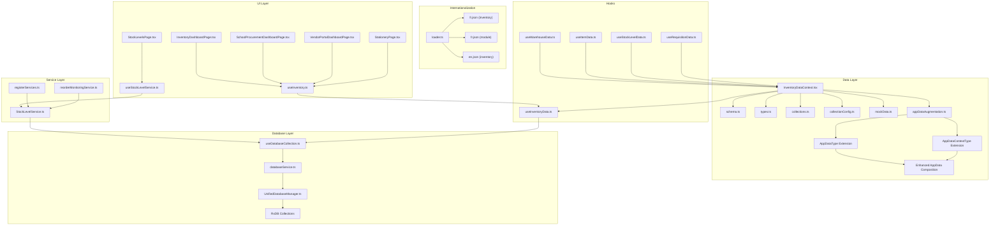
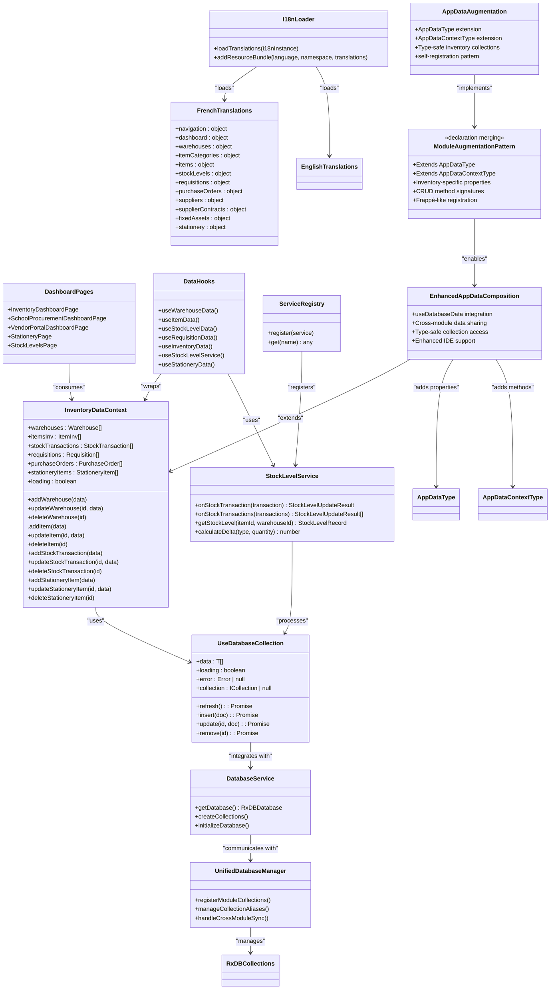
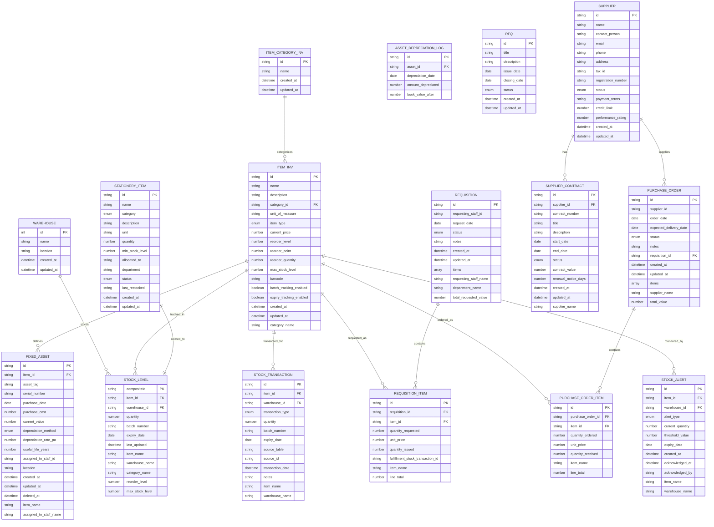
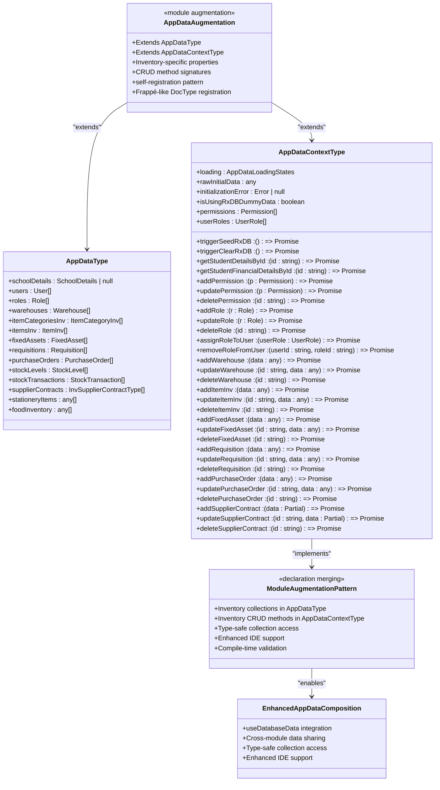
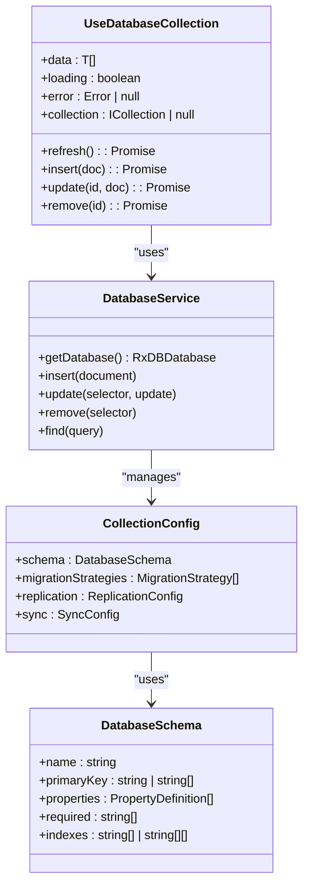
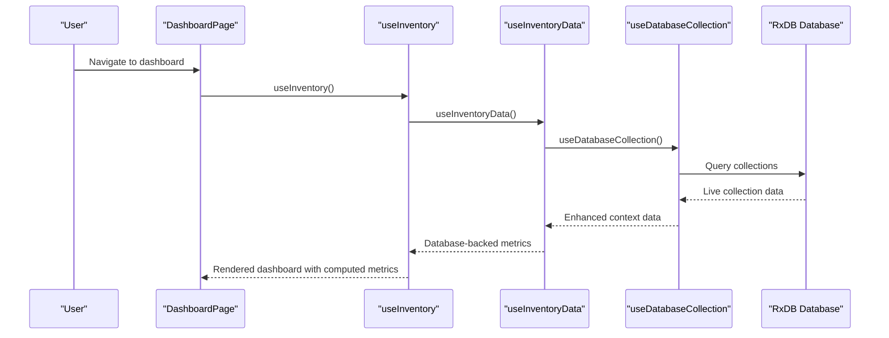
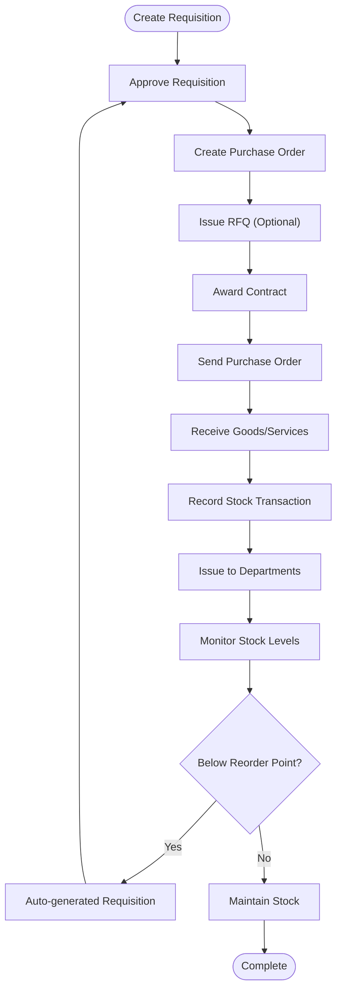
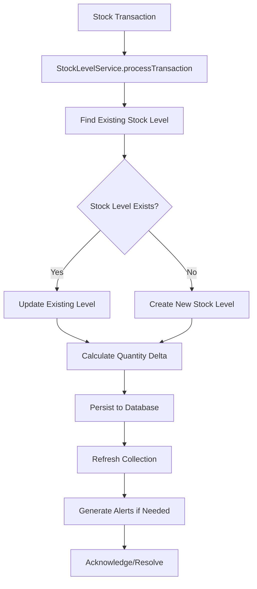
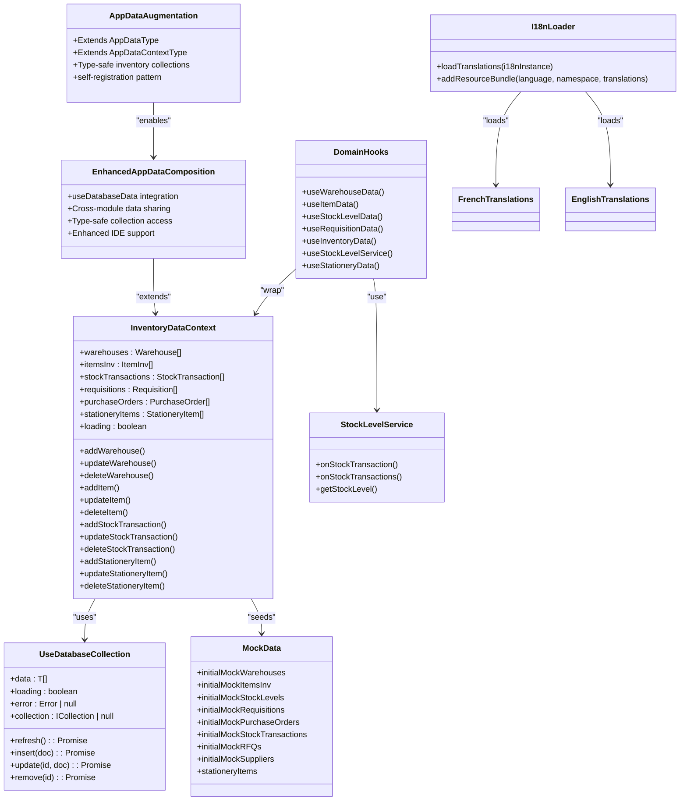
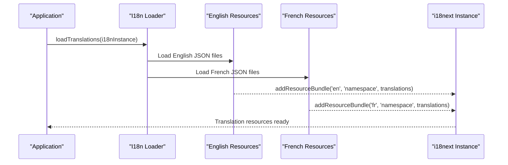

# Inventory Module

<cite>
**Referenced Files in This Document**
- [InventoryDashboardPage.tsx](file://src/modules/inventory/pages/InventoryDashboardPage.tsx)
- [SchoolProcurementDashboardPage.tsx](file://src/modules/inventory/pages/SchoolProcurementDashboardPage.tsx)
- [VendorPortalDashboardPage.tsx](file://src/modules/inventory/pages/VendorPortalDashboardPage.tsx)
- [StationeryPage.tsx](file://src/modules/inventory/pages/StationeryPage.tsx)
- [StockLevelsPage.tsx](file://src/modules/inventory/pages/StockLevelsPage.tsx)
- [useInventory.ts](file://src/modules/inventory/hooks/useInventory.ts)
- [useStockLevelService.ts](file://src/modules/inventory/hooks/useStockLevelService.ts)
- [useInventoryData.ts](file://src/modules/inventory/data/useInventoryData.ts)
- [useStockLevelData.ts](file://src/modules/inventory/data/useStockLevelData.ts)
- [InventoryDataContext.tsx](file://src/modules/inventory/data/InventoryDataContext.tsx)
- [InventoryDataProvider.tsx](file://src/modules/inventory/data/InventoryDataProvider.tsx)
- [StockLevelService.ts](file://src/modules/inventory/services/StockLevelService.ts)
- [registerServices.ts](file://src/modules/inventory/services/registerServices.ts)
- [reorderMonitoringService.ts](file://src/modules/inventory/services/reorderMonitoringService.ts)
- [useDatabaseCollection.ts](file://src/hooks/useDatabaseCollection.ts)
- [schema.ts](file://src/modules/inventory/data/schema.ts)
- [types.ts](file://src/modules/inventory/data/types.ts)
- [collections.ts](file://src/modules/inventory/data/collections.ts)
- [collectionConfig.ts](file://src/modules/inventory/data/collectionConfig.ts)
- [mockData.ts](file://src/modules/inventory/data/mockData.ts)
- [useWarehouseData.ts](file://src/modules/inventory/data/useWarehouseData.ts)
- [useItemData.ts](file://src/modules/inventory/data/useItemData.ts)
- [useRequisitionData.ts](file://src/modules/inventory/data/useRequisitionData.ts)
- [databaseService.ts](file://src/services/database/databaseService.ts)
- [UnifiedDatabaseManager.ts](file://src/services/database/UnifiedDatabaseManager.ts)
- [loader.ts](file://src/i18n/loader.ts)
- [fr.json](file://src/i18n/locales/fr/inventory.json)
- [fr.json](file://src/modules/inventory/i18n/fr.json)
- [appDataAugmentation.ts](file://src/modules/inventory/data/appDataAugmentation.ts)
- [app-data.ts](file://src/core/types/app-data.ts)
- [useDatabaseData.ts](file://src/hooks/data/useDatabaseData.ts)
</cite>

## Update Summary
**Changes Made**
- Updated documentation to reflect the new TypeScript module augmentation pattern in appDataAugmentation.ts
- Enhanced core components section to include comprehensive inventory CRUD operations through module augmentation
- Updated architecture overview to include the self-registration pattern for inventory collections in AppData system
- Expanded data types documentation to cover AppDataType and AppDataContextType extensions
- Added module augmentation workflow documentation for inventory-specific properties and CRUD operations
- Enhanced internationalization support with comprehensive French translations for stationery management interface

## Table of Contents
1. [Introduction](#introduction)
2. [Project Structure](#project-structure)
3. [Core Components](#core-components)
4. [Architecture Overview](#architecture-overview)
5. [Detailed Component Analysis](#detailed-component-analysis)
6. [Database Integration](#database-integration)
7. [Stock Level Service Architecture](#stock-level-service-architecture)
8. [Internationalization and Multilingual Support](#internationalization-and-multilingual-support)
9. [Dependency Analysis](#dependency-analysis)
10. [Performance Considerations](#performance-considerations)
11. [Troubleshooting Guide](#troubleshooting-guide)
12. [Conclusion](#conclusion)
13. [Appendices](#appendices)

## Introduction
The Inventory module provides a comprehensive asset and supply chain management solution for educational institutions with full database backend integration and enhanced multilingual support. It encompasses fixed asset tracking, consumable inventory management, warehouse operations, procurement workflows, and vendor collaboration. The module supports end-to-end procurement from requisitions to purchase orders, RFQs, and supplier contracts, while maintaining real-time stock visibility and automated reorder monitoring. The implementation leverages a modern database infrastructure with useDatabaseCollection hooks for centralized CRUD operations and reactive data management.

**Updated** The module now features comprehensive French translations with 420 new translation entries, providing full bilingual support for French-speaking users alongside the existing English interface. The internationalization architecture ensures seamless language switching and consistent localization across all inventory management components. Additionally, the module now includes specialized stationery supply management capabilities through the new StationeryPage component, featuring item categorization, department allocation tracking, automated low stock alerts, and integrated data management with comprehensive filtering and status monitoring.

**Updated** The module introduces TypeScript module augmentation through appDataAugmentation.ts, providing compile-time type safety for inventory collections in the AppData system. This enhancement enables better IDE support, type checking, and code completion for inventory-specific properties across the application. The module augmentation pattern follows the same approach as Frappe's DocType self-registration, allowing inventory collections to be seamlessly integrated into the unified AppData interface.

## Project Structure
The Inventory module follows a modernized architecture with centralized database integration, multilingual support, and modular data providers:
- Data layer: database-agnostic schemas, RxDB collections, and provider patterns
- UI layer: dashboard pages and reusable components including dedicated stationery management with bilingual support
- Services: business logic services like StockLevelService for complex operations
- Hooks: domain-specific data access patterns with useDatabaseCollection integration
- Internationalization: centralized translation loading with English and French language support
- Mock data: seed data for development and demonstration modes
- **New** Module augmentation: TypeScript module augmentation for AppData collections with type safety and self-registration pattern



**Diagram sources**
- [InventoryDashboardPage.tsx:1-334](file://src/modules/inventory/pages/InventoryDashboardPage.tsx#L1-L334)
- [SchoolProcurementDashboardPage.tsx:1-111](file://src/modules/inventory/pages/SchoolProcurementDashboardPage.tsx#L1-L111)
- [VendorPortalDashboardPage.tsx:1-106](file://src/modules/inventory/pages/VendorPortalDashboardPage.tsx#L1-L106)
- [StationeryPage.tsx:1-448](file://src/modules/inventory/pages/StationeryPage.tsx#L1-L448)
- [StockLevelsPage.tsx:1-107](file://src/modules/inventory/pages/StockLevelsPage.tsx#L1-L107)
- [useInventory.ts:1-41](file://src/modules/inventory/hooks/useInventory.ts#L1-L41)
- [useStockLevelService.ts:1-187](file://src/modules/inventory/hooks/useStockLevelService.ts#L1-L187)
- [StockLevelService.ts:1-202](file://src/modules/inventory/services/StockLevelService.ts#L1-L202)
- [registerServices.ts:1-17](file://src/modules/inventory/services/registerServices.ts#L1-L17)
- [reorderMonitoringService.ts:1-138](file://src/modules/inventory/services/reorderMonitoringService.ts#L1-L138)
- [useInventoryData.ts:1-155](file://src/modules/inventory/data/useInventoryData.ts#L1-L155)
- [InventoryDataContext.tsx:1-36](file://src/modules/inventory/data/InventoryDataContext.tsx#L1-L36)
- [schema.ts:1-312](file://src/modules/inventory/data/schema.ts#L1-L312)
- [types.ts:1-313](file://src/modules/inventory/data/types.ts#L1-L313)
- [collections.ts:1-57](file://src/modules/inventory/data/collections.ts#L1-L57)
- [collectionConfig.ts:1-19](file://src/modules/inventory/data/collectionConfig.ts#L1-L19)
- [mockData.ts:1-270](file://src/modules/inventory/data/mockData.ts#L1-L270)
- [useWarehouseData.ts:1-96](file://src/modules/inventory/data/useWarehouseData.ts#L1-L96)
- [useItemData.ts:1-41](file://src/modules/inventory/data/useItemData.ts#L1-L41)
- [useStockLevelData.ts:1-99](file://src/modules/inventory/data/useStockLevelData.ts#L1-L99)
- [useRequisitionData.ts:1-41](file://src/modules/inventory/data/useRequisitionData.ts#L1-L41)
- [useDatabaseCollection.ts:1-228](file://src/hooks/useDatabaseCollection.ts#L1-L228)
- [loader.ts:1-69](file://src/i18n/loader.ts#L1-L69)
- [fr.json:1-420](file://src/modules/inventory/i18n/fr.json#L1-L420)
- [fr.json:1-16](file://src/i18n/locales/fr/inventory.json#L1-L16)
- [appDataAugmentation.ts:1-60](file://src/modules/inventory/data/appDataAugmentation.ts#L1-L60)
- [app-data.ts:1-59](file://src/core/types/app-data.ts#L1-L59)
- [useDatabaseData.ts:1-200](file://src/hooks/data/useDatabaseData.ts#L1-L200)

**Section sources**
- [InventoryDashboardPage.tsx:1-334](file://src/modules/inventory/pages/InventoryDashboardPage.tsx#L1-L334)
- [SchoolProcurementDashboardPage.tsx:1-111](file://src/modules/inventory/pages/SchoolProcurementDashboardPage.tsx#L1-L111)
- [VendorPortalDashboardPage.tsx:1-106](file://src/modules/inventory/pages/VendorPortalDashboardPage.tsx#L1-L106)
- [StationeryPage.tsx:1-448](file://src/modules/inventory/pages/StationeryPage.tsx#L1-L448)
- [StockLevelsPage.tsx:1-107](file://src/modules/inventory/pages/StockLevelsPage.tsx#L1-L107)
- [useInventory.ts:1-41](file://src/modules/inventory/hooks/useInventory.ts#L1-L41)
- [useStockLevelService.ts:1-187](file://src/modules/inventory/hooks/useStockLevelService.ts#L1-L187)
- [StockLevelService.ts:1-202](file://src/modules/inventory/services/StockLevelService.ts#L1-L202)
- [registerServices.ts:1-17](file://src/modules/inventory/services/registerServices.ts#L1-L17)
- [reorderMonitoringService.ts:1-138](file://src/modules/inventory/services/reorderMonitoringService.ts#L1-L138)
- [useInventoryData.ts:1-155](file://src/modules/inventory/data/useInventoryData.ts#L1-L155)
- [InventoryDataContext.tsx:1-36](file://src/modules/inventory/data/InventoryDataContext.tsx#L1-L36)
- [schema.ts:1-312](file://src/modules/inventory/data/schema.ts#L1-L312)
- [types.ts:1-313](file://src/modules/inventory/data/types.ts#L1-L313)
- [collections.ts:1-57](file://src/modules/inventory/data/collections.ts#L1-L57)
- [collectionConfig.ts:1-19](file://src/modules/inventory/data/collectionConfig.ts#L1-L19)
- [mockData.ts:1-270](file://src/modules/inventory/data/mockData.ts#L1-L270)
- [useWarehouseData.ts:1-96](file://src/modules/inventory/data/useWarehouseData.ts#L1-L96)
- [useItemData.ts:1-41](file://src/modules/inventory/data/useItemData.ts#L1-L41)
- [useStockLevelData.ts:1-99](file://src/modules/inventory/data/useStockLevelData.ts#L1-L99)
- [useRequisitionData.ts:1-41](file://src/modules/inventory/data/useRequisitionData.ts#L1-L41)
- [useDatabaseCollection.ts:1-228](file://src/hooks/useDatabaseCollection.ts#L1-L228)
- [loader.ts:1-69](file://src/i18n/loader.ts#L1-L69)
- [fr.json:1-420](file://src/modules/inventory/i18n/fr.json#L1-L420)
- [fr.json:1-16](file://src/i18n/locales/fr/inventory.json#L1-L16)
- [appDataAugmentation.ts:1-60](file://src/modules/inventory/data/appDataAugmentation.ts#L1-L60)
- [app-data.ts:1-59](file://src/core/types/app-data.ts#L1-L59)
- [useDatabaseData.ts:1-200](file://src/hooks/data/useDatabaseData.ts#L1-L200)

## Core Components
The module centers around seven primary domains with comprehensive database integration through the useDatabaseCollection pattern and enhanced multilingual support:

- **Asset Management**
  - Fixed assets with depreciation tracking and lifecycle management
  - Asset lifecycle from acquisition to disposal with audit trails
  - Depreciation logs and valuation updates with historical tracking

- **Item Categories and Catalog**
  - Hierarchical categorization of inventory items with database constraints
  - Support for consumables and fixed assets with type-specific validation
  - Pricing and reorder configuration with real-time updates

- **Warehouse Operations**
  - Multi-location storage management with composite key optimization
  - Batch and expiry tracking for controlled items with indexed queries
  - Composite stock visibility across locations with performance indexing

- **Procurement Lifecycle**
  - Requisitions with approval workflows and nested item management
  - Purchase orders linked to suppliers with line-item detail persistence
  - RFQs for competitive sourcing with status tracking
  - Supplier contracts and performance tracking with version control

- **Stock Management**
  - **Updated** Client-side stock level tracking through StockLevelService replacing database triggers
  - Real-time stock levels with atomic transaction updates and service orchestration
  - Automated reorder monitoring with configurable thresholds and service-based processing
  - Expiry warnings and stock alerts with notification systems and service coordination
  - Issue/receipt tracking and adjustments with audit trails and service validation

- **Stationery Supply Management**
  - **New** Comprehensive stationery item management with detailed categorization and allocation tracking
  - Department-wise allocation with individual item assignment and status monitoring
  - Automated low stock alerts with configurable minimum thresholds and visual indicators
  - Consumable tracking with unit measurements, batch management, and restocking history
  - Integrated data grid with advanced filtering by category, status, and department
  - Summary cards displaying total items, available stock, low stock alerts, and out-of-stock items
  - Form-based management interface with validation and real-time feedback

- **Database Infrastructure**
  - useDatabaseCollection hook for centralized CRUD operations
  - Reactive data subscriptions with automatic updates
  - Error handling and loading state management
  - Type-safe database interactions

- **Data Provider Architecture**
  - Modular data provider with useInventoryData hook
  - Centralized CRUD operations with toast notifications
  - Reactive data updates through provider context
  - Error handling and loading state management

- **Internationalization Support**
  - **New** Comprehensive French translations for all UI components including stationery management
  - **New** Centralized translation loading with i18n integration
  - **New** Bilingual navigation and dashboard components
  - **New** Localized procurement workflows, stock management interfaces, and stationery operations

- **TypeScript Module Augmentation**
  - **New** Compile-time type safety for AppData collections through declaration merging
  - **New** Extended AppDataType with comprehensive inventory-specific properties
  - **New** Enhanced AppDataContextType with CRUD operation signatures for all inventory entities
  - **New** Self-registration pattern enabling Frappe-like DocType registration in AppData system
  - **New** Enhanced AppData composition through useDatabaseData hook integration

**Section sources**
- [useInventoryData.ts:10-19](file://src/modules/inventory/data/useInventoryData.ts#L10-L19)
- [useDatabaseCollection.ts:24-227](file://src/hooks/useDatabaseCollection.ts#L24-L227)
- [schema.ts:61-120](file://src/modules/inventory/data/schema.ts#L61-L120)
- [types.ts:122-170](file://src/modules/inventory/data/types.ts#L122-L170)
- [mockData.ts:104-157](file://src/modules/inventory/data/mockData.ts#L104-L157)
- [collections.ts:6-48](file://src/modules/inventory/data/collections.ts#L6-L48)
- [StockLevelService.ts:7-86](file://src/modules/inventory/services/StockLevelService.ts#L7-L86)
- [loader.ts:36-69](file://src/i18n/loader.ts#L36-L69)
- [fr.json:1-420](file://src/modules/inventory/i18n/fr.json#L1-L420)
- [schema.ts:291-311](file://src/modules/inventory/data/schema.ts#L291-L311)
- [types.ts:295-313](file://src/modules/inventory/data/types.ts#L295-L313)
- [mockData.ts:261-270](file://src/modules/inventory/data/mockData.ts#L261-L270)
- [appDataAugmentation.ts:17-59](file://src/modules/inventory/data/appDataAugmentation.ts#L17-L59)
- [app-data.ts:18-58](file://src/core/types/app-data.ts#L18-L58)
- [useDatabaseData.ts:16-62](file://src/hooks/data/useDatabaseData.ts#L16-L62)

## Architecture Overview
The Inventory module employs a modernized layered architecture with centralized database integration, multilingual support, and useDatabaseCollection hooks. The module now includes comprehensive TypeScript module augmentation for enhanced type safety and self-registration capabilities:



**Diagram sources**
- [InventoryDataContext.tsx:10-33](file://src/modules/inventory/data/InventoryDataContext.tsx#L10-L33)
- [StockLevelService.ts:87-200](file://src/modules/inventory/services/StockLevelService.ts#L87-L200)
- [useDatabaseCollection.ts:24-227](file://src/hooks/useDatabaseCollection.ts#L24-L227)
- [useInventoryData.ts:10-154](file://src/modules/inventory/data/useInventoryData.ts#L10-L154)
- [InventoryDashboardPage.tsx:7-12](file://src/modules/inventory/pages/InventoryDashboardPage.tsx#L7-L12)
- [SchoolProcurementDashboardPage.tsx:8-11](file://src/modules/inventory/pages/SchoolProcurementDashboardPage.tsx#L8-L11)
- [VendorPortalDashboardPage.tsx:8-11](file://src/modules/inventory/pages/VendorPortalDashboardPage.tsx#L8-L11)
- [StationeryPage.tsx:14-15](file://src/modules/inventory/pages/StationeryPage.tsx#L14-L15)
- [StockLevelsPage.tsx:11-18](file://src/modules/inventory/pages/StockLevelsPage.tsx#L11-L18)
- [useWarehouseData.ts:35-92](file://src/modules/inventory/data/useWarehouseData.ts#L35-L92)
- [useItemData.ts:8-41](file://src/modules/inventory/data/useItemData.ts#L8-L41)
- [useStockLevelData.ts:37-95](file://src/modules/inventory/data/useStockLevelData.ts#L37-L95)
- [useRequisitionData.ts:8-41](file://src/modules/inventory/data/useRequisitionData.ts#L8-L41)
- [useStockLevelService.ts:24-187](file://src/modules/inventory/hooks/useStockLevelService.ts#L24-L187)
- [registerServices.ts:6-16](file://src/modules/inventory/services/registerServices.ts#L6-L16)
- [loader.ts:36-69](file://src/i18n/loader.ts#L36-L69)
- [fr.json:1-420](file://src/modules/inventory/i18n/fr.json#L1-L420)
- [appDataAugmentation.ts:17-59](file://src/modules/inventory/data/appDataAugmentation.ts#L17-L59)
- [app-data.ts:18-58](file://src/core/types/app-data.ts#L18-L58)
- [useDatabaseData.ts:16-62](file://src/hooks/data/useDatabaseData.ts#L16-L62)

The architecture ensures:
- Centralized database access via useDatabaseCollection hook pattern
- Reactive UI updates through provider and hook patterns
- Strong typing across schemas, interfaces, and database collections
- Extensible collection definitions with automatic indexing
- Seamless offline-first operation with conflict resolution
- Modular data provider architecture for clean separation of concerns
- **Updated** Service-based stock level processing replacing database triggers
- **New** Service registry integration for StockLevelService management
- **New** Comprehensive internationalization architecture with French translations
- **New** Centralized translation loading with i18n integration
- **New** Specialized stationery item collection with dedicated CRUD operations and allocation tracking
- **New** TypeScript module augmentation for compile-time type safety in AppData system
- **New** Self-registration pattern enabling Frappe-like DocType registration
- **New** Enhanced AppData composition through useDatabaseData integration
- **New** Cross-module data sharing capabilities with type-safe collection access

**Section sources**
- [InventoryDataContext.tsx:1-36](file://src/modules/inventory/data/InventoryDataContext.tsx#L1-L36)
- [StockLevelService.ts:1-202](file://src/modules/inventory/services/StockLevelService.ts#L1-L202)
- [useDatabaseCollection.ts:1-228](file://src/hooks/useDatabaseCollection.ts#L1-L228)
- [useInventoryData.ts:1-155](file://src/modules/inventory/data/useInventoryData.ts#L1-L155)
- [collections.ts:1-57](file://src/modules/inventory/data/collections.ts#L1-L57)
- [collectionConfig.ts:1-19](file://src/modules/inventory/data/collectionConfig.ts#L1-L19)
- [registerServices.ts:1-17](file://src/modules/inventory/services/registerServices.ts#L1-L17)
- [loader.ts:1-69](file://src/i18n/loader.ts#L1-L69)
- [fr.json:1-420](file://src/modules/inventory/i18n/fr.json#L1-L420)
- [schema.ts:291-311](file://src/modules/inventory/data/schema.ts#L291-L311)
- [appDataAugmentation.ts:1-60](file://src/modules/inventory/data/appDataAugmentation.ts#L1-L60)
- [app-data.ts:1-59](file://src/core/types/app-data.ts#L1-L59)
- [useDatabaseData.ts:1-200](file://src/hooks/data/useDatabaseData.ts#L1-L200)

## Detailed Component Analysis

### Database Schema Layer
The database schema layer defines the canonical structure for all inventory entities with comprehensive RxDB integration:



**Diagram sources**
- [schema.ts:8-312](file://src/modules/inventory/data/schema.ts#L8-L312)
- [types.ts:44-313](file://src/modules/inventory/data/types.ts#L44-L313)

Key design principles:
- Composite primary keys for stock levels (item_id|warehouse_id) with optimized indexing
- Nested arrays for line items within requisitions and purchase orders with schema validation
- Computed fields for denormalized display values with automatic updates
- Enumerations for standardized statuses and types with database constraint enforcement
- Indexes optimized for common query patterns (name, status, date ranges, composite keys)
- **New** Dedicated stationery item collection with comprehensive categorization, allocation tracking, and status monitoring

**Section sources**
- [schema.ts:1-312](file://src/modules/inventory/data/schema.ts#L1-L312)
- [types.ts:1-313](file://src/modules/inventory/data/types.ts#L1-L313)

### TypeScript Module Augmentation
**New** The Inventory module introduces comprehensive TypeScript module augmentation for enhanced type safety and IDE support through declaration merging:



**Diagram sources**
- [appDataAugmentation.ts:17-59](file://src/modules/inventory/data/appDataAugmentation.ts#L17-L59)
- [app-data.ts:18-58](file://src/core/types/app-data.ts#L18-L58)
- [useDatabaseData.ts:16-62](file://src/hooks/data/useDatabaseData.ts#L16-L62)

The module augmentation provides:
- **Compile-time type safety** for inventory collections in AppData system
- **Enhanced IDE support** with IntelliSense for inventory properties
- **Self-registration pattern** enabling Frappe-like DocType registration
- **Method signature validation** for CRUD operations with proper parameter types
- **Property type enforcement** ensuring consistent data structures across the application
- **Cross-module integration** enabling seamless data sharing between inventory and other modules
- **Enhanced AppData composition** through useDatabaseData integration
- **Frappé-like registration** pattern for inventory collections

**Section sources**
- [appDataAugmentation.ts:1-60](file://src/modules/inventory/data/appDataAugmentation.ts#L1-L60)
- [app-data.ts:1-59](file://src/core/types/app-data.ts#L1-L59)
- [useDatabaseData.ts:1-200](file://src/hooks/data/useDatabaseData.ts#L1-L200)

### useDatabaseCollection Infrastructure
The module implements a centralized database collection management system through the useDatabaseCollection hook:



**Diagram sources**
- [useDatabaseCollection.ts:24-227](file://src/hooks/useDatabaseCollection.ts#L24-L227)
- [databaseService.ts](file://src/services/database/databaseService.ts)
- [collections.ts:6-48](file://src/modules/inventory/data/collections.ts#L6-L48)
- [collectionConfig.ts:4-17](file://src/modules/inventory/data/collectionConfig.ts#L4-L17)
- [schema.ts:8-312](file://src/modules/inventory/data/schema.ts#L8-L312)

**Section sources**
- [useDatabaseCollection.ts:1-228](file://src/hooks/useDatabaseCollection.ts#L1-L228)
- [collections.ts:1-57](file://src/modules/inventory/data/collections.ts#L1-L57)
- [collectionConfig.ts:1-19](file://src/modules/inventory/data/collectionConfig.ts#L1-L19)

### Dashboard Components
The module provides five specialized dashboards with comprehensive database integration through the useInventory hook and enhanced multilingual support:

#### Inventory Dashboard
Focuses on operational stock readiness and procurement pipeline with real-time database updates and French localization:
- Metrics: inventory items, stock records, open requisitions, active purchase orders with live collection data
- Notifications: low stock alerts with severity-based messaging and automatic database-driven updates
- Quick actions: direct navigation to core inventory screens with database-backed filtering
- **Updated** French interface with localized navigation and dashboard titles

#### School Procurement Dashboard
Enables procurement oversight and budget utilization tracking with comprehensive data aggregation and bilingual support:
- Metrics: open requisitions, approved orders, active suppliers, committed spend with real-time calculation
- Utilization ratio: commitment vs. requested value percentage with database-driven precision
- Recent requisitions panel for visibility with live collection updates
- Procurement pipeline visualization with cross-collection data integration
- **Updated** French interface with localized procurement metrics and supplier information

#### Vendor Portal Dashboard
Supports external supplier engagement with comprehensive opportunity tracking and multilingual interface:
- Metrics: open RFQs, active orders, pending invoices, invoice value with real-time database synchronization
- Supplier snapshot: top performing suppliers with performance ratings from database collections
- Order and invoice queue monitoring with automatic status updates
- RFQ opportunities and invoice processing status with live data refresh
- **Updated** French interface with localized vendor portal metrics and supplier communications

#### **Updated** Stationery Supply Dashboard
**New** Dedicated stationery management interface with comprehensive department allocation tracking and automated alerts:
- Department-wise stationery allocation with status monitoring and automated low stock notifications
- Real-time stock level tracking with minimum threshold alerts and visual indicators
- Consumable item management with unit measurements, batch tracking, and restocking history
- Advanced filtering by category, status, and department with interactive data grid
- Summary cards showing total items, available stock, low stock alerts, and out-of-stock items
- **Updated** French interface with localized stationery management displays, allocation tracking, and filtering options

#### **Updated** Stock Levels Dashboard
Provides dedicated monitoring of current stock levels across all warehouses with comprehensive French localization:
- Real-time stock level visualization with filtering by warehouse and item category
- Current quantities on hand with item and warehouse identification
- Interactive data grid with sorting and filtering capabilities
- Loading states and empty state handling for better user experience
- **Updated** French interface with localized stock level displays and filtering options



**Diagram sources**
- [InventoryDashboardPage.tsx:7-334](file://src/modules/inventory/pages/InventoryDashboardPage.tsx#L7-L334)
- [SchoolProcurementDashboardPage.tsx:8-111](file://src/modules/inventory/pages/SchoolProcurementDashboardPage.tsx#L8-L111)
- [VendorPortalDashboardPage.tsx:8-106](file://src/modules/inventory/pages/VendorPortalDashboardPage.tsx#L8-L106)
- [StationeryPage.tsx:14-448](file://src/modules/inventory/pages/StationeryPage.tsx#L14-L448)
- [StockLevelsPage.tsx:11-107](file://src/modules/inventory/pages/StockLevelsPage.tsx#L11-L107)
- [useInventory.ts:7-41](file://src/modules/inventory/hooks/useInventory.ts#L7-L41)
- [useInventoryData.ts:10-154](file://src/modules/inventory/data/useInventoryData.ts#L10-L154)
- [useDatabaseCollection.ts:24-227](file://src/hooks/useDatabaseCollection.ts#L24-L227)

**Section sources**
- [InventoryDashboardPage.tsx:1-334](file://src/modules/inventory/pages/InventoryDashboardPage.tsx#L1-L334)
- [SchoolProcurementDashboardPage.tsx:1-111](file://src/modules/inventory/pages/SchoolProcurementDashboardPage.tsx#L1-L111)
- [VendorPortalDashboardPage.tsx:1-106](file://src/modules/inventory/pages/VendorPortalDashboardPage.tsx#L1-L106)
- [StationeryPage.tsx:1-448](file://src/modules/inventory/pages/StationeryPage.tsx#L1-L448)
- [StockLevelsPage.tsx:1-107](file://src/modules/inventory/pages/StockLevelsPage.tsx#L1-L107)
- [useInventory.ts:1-41](file://src/modules/inventory/hooks/useInventory.ts#L1-L41)

### Procurement Workflows
The module supports end-to-end procurement from requisition to fulfillment with comprehensive database integration and multilingual support:



Procurement entities and relationships with database persistence:
- Requisitions capture departmental needs with approval workflows and nested item persistence
- Purchase orders formalize supplier commitments with line-item details and status tracking
- RFQs enable competitive bidding for significant procurements with opportunity management
- Supplier contracts establish long-term vendor agreements with performance monitoring
- Stock transactions track physical movement and valuation with audit trails

**Section sources**
- [schema.ts:155-204](file://src/modules/inventory/data/schema.ts#L155-L204)
- [schema.ts:206-221](file://src/modules/inventory/data/schema.ts#L206-L221)
- [schema.ts:223-266](file://src/modules/inventory/data/schema.ts#L223-L266)
- [types.ts:184-220](file://src/modules/inventory/data/types.ts#L184-L220)

### Stock Management and Alerts
**Updated** Stock management now operates through a sophisticated service-based approach replacing database triggers with comprehensive multilingual support:



Stock alert types with database-driven automation:
- LOW_STOCK: below configured reorder point with automatic threshold checking
- OVERSTOCK: exceeding maximum stock thresholds with capacity monitoring
- EXPIRY_WARNING: approaching expiry dates with date-based expiration tracking
- EXPIRED: past expiry with potential write-off through automated alerts

**Section sources**
- [StockLevelService.ts:94-146](file://src/modules/inventory/services/StockLevelService.ts#L94-L146)
- [StockLevelService.ts:178-199](file://src/modules/inventory/services/StockLevelService.ts#L178-L199)
- [schema.ts:101-142](file://src/modules/inventory/data/schema.ts#L101-L142)
- [schema.ts:268-287](file://src/modules/inventory/data/schema.ts#L268-L287)
- [mockData.ts:126-181](file://src/modules/inventory/data/mockData.ts#L126-L181)

### Data Access Patterns
The module implements flexible data access through specialized hooks with comprehensive database service integration and multilingual support:



**Diagram sources**
- [InventoryDataContext.tsx:10-33](file://src/modules/inventory/data/InventoryDataContext.tsx#L10-L33)
- [StockLevelService.ts:87-200](file://src/modules/inventory/services/StockLevelService.ts#L87-L200)
- [useDatabaseCollection.ts:24-227](file://src/hooks/useDatabaseCollection.ts#L24-L227)
- [useWarehouseData.ts:35-92](file://src/modules/inventory/data/useWarehouseData.ts#L35-L92)
- [useItemData.ts:8-41](file://src/modules/inventory/data/useItemData.ts#L8-L41)
- [useStockLevelData.ts:37-95](file://src/modules/inventory/data/useStockLevelData.ts#L37-L95)
- [useRequisitionData.ts:8-41](file://src/modules/inventory/data/useRequisitionData.ts#L8-L41)
- [useStockLevelService.ts:24-187](file://src/modules/inventory/hooks/useStockLevelService.ts#L24-L187)
- [mockData.ts:45-270](file://src/modules/inventory/data/mockData.ts#L45-L270)
- [loader.ts:36-69](file://src/i18n/loader.ts#L36-L69)
- [appDataAugmentation.ts:17-59](file://src/modules/inventory/data/appDataAugmentation.ts#L17-L59)
- [useDatabaseData.ts:16-62](file://src/hooks/data/useDatabaseData.ts#L16-L62)

**Section sources**
- [InventoryDataContext.tsx:1-36](file://src/modules/inventory/data/InventoryDataContext.tsx#L1-L36)
- [StockLevelService.ts:1-202](file://src/modules/inventory/services/StockLevelService.ts#L1-L202)
- [useDatabaseCollection.ts:1-228](file://src/hooks/useDatabaseCollection.ts#L1-L228)
- [useWarehouseData.ts:1-96](file://src/modules/inventory/data/useWarehouseData.ts#L1-L96)
- [useItemData.ts:1-41](file://src/modules/inventory/data/useItemData.ts#L1-L41)
- [useStockLevelData.ts:1-99](file://src/modules/inventory/data/useStockLevelData.ts#L1-L99)
- [useRequisitionData.ts:1-41](file://src/modules/inventory/data/useRequisitionData.ts#L1-L41)
- [useStockLevelService.ts:1-187](file://src/modules/inventory/hooks/useStockLevelService.ts#L1-L187)
- [mockData.ts:1-270](file://src/modules/inventory/data/mockData.ts#L1-L270)
- [loader.ts:1-69](file://src/i18n/loader.ts#L1-L69)
- [appDataAugmentation.ts:1-60](file://src/modules/inventory/data/appDataAugmentation.ts#L1-L60)
- [useDatabaseData.ts:1-200](file://src/hooks/data/useDatabaseData.ts#L1-L200)

### Stationery Supply Management
**New** The module introduces comprehensive stationery supply management capabilities through the StationeryPage component:

#### Stationery Item Management
The StationeryPage provides a dedicated interface for managing stationery supplies with comprehensive allocation tracking:

- **Item Catalog Management**: Create, update, and delete stationery items with category-based organization and detailed descriptions
- **Department Allocation**: Track which departments have allocated stationery items and who they are allocated to with individual assignment tracking
- **Stock Level Monitoring**: Real-time tracking of quantities with minimum stock level alerts and visual status indicators
- **Status Tracking**: Visual indicators for Available, Allocated, Low Stock, and Out of Stock status with color-coded badges
- **Search and Filter**: Advanced filtering by category, status, and department with search functionality across item names, descriptions, and departments
- **Summary Analytics**: Dashboard-style summary cards showing total items, available stock, low stock alerts, and out-of-stock items

#### Key Features
- **Comprehensive Categories**: Seven distinct stationery categories including Paper, Pens, Notebooks, Files, Art Supplies, Office Supplies, and Other
- **Department Allocation**: Support for single department allocation with individual item assignment tracking
- **Automated Alerts**: Low stock notifications when quantities fall below minimum thresholds with configurable alert levels
- **Batch Operations**: Bulk management of stationery items with filtering, sorting, and real-time updates through the data grid
- **Integration**: Seamless integration with existing inventory workflows and procurement processes
- **Visual Status Indicators**: Color-coded badges for quick identification of item status and allocation state

#### Data Model
The stationery item collection includes comprehensive fields for tracking:
- Basic item information (name, description, unit of measure) with validation constraints
- Quantities and minimum stock levels for automated alerts and threshold monitoring
- Department allocation and individual allocation tracking with optional assignment fields
- Status indicators with visual badges for Available, Allocated, Low Stock, and Out of Stock states
- Last restocked date for inventory turnover analysis and restocking cycle tracking
- Timestamps for creation and modification with automatic timestamp management

#### User Interface Components
The StationeryPage features a comprehensive user interface with:
- **Summary Dashboard**: Four summary cards displaying total items, available stock, low stock alerts, and out-of-stock items
- **Advanced Filtering**: Three-column filter system for category, status, and search functionality
- **Interactive Data Grid**: Comprehensive data grid with sorting, filtering, and real-time updates
- **Category Badges**: Color-coded category badges with consistent styling across the interface
- **Status Badges**: Visual status indicators with appropriate color coding for quick recognition
- **Action Buttons**: Edit and delete functionality with intuitive icon-based controls
- **Modal Forms**: Comprehensive add/edit forms with validation and real-time feedback
- **Responsive Design**: Mobile-friendly interface with appropriate spacing and sizing

**Section sources**
- [StationeryPage.tsx:1-448](file://src/modules/inventory/pages/StationeryPage.tsx#L1-L448)
- [schema.ts:291-311](file://src/modules/inventory/data/schema.ts#L291-L311)
- [types.ts:295-313](file://src/modules/inventory/data/types.ts#L295-L313)
- [mockData.ts:261-270](file://src/modules/inventory/data/mockData.ts#L261-L270)

## Database Integration
The Inventory module implements comprehensive database integration through the useDatabaseCollection hook pattern with the following key components:

### useDatabaseCollection Hook Pattern
The module uses a centralized hook pattern that provides database-agnostic CRUD operations with automatic subscription management:

- **Centralized Access**: Single hook pattern for all collection operations
- **Automatic Subscriptions**: Reactive updates through collection change subscriptions
- **Error Handling**: Comprehensive error handling with user-friendly error messages
- **Loading States**: Automatic loading state management during database operations
- **Type Safety**: Full TypeScript integration with database schemas

### Collection Configuration
RxDB collections are configured with comprehensive metadata and validation:

- **Collection Registration**: Each entity type gets its own collection with schema validation
- **Alias Mapping**: Human-readable aliases for programmatic access
- **Index Management**: Automatic index creation for performance optimization
- **Migration Support**: Built-in migration strategies for schema evolution

### Database Service Integration
The database service provides centralized access to all inventory collections:

- **Database Initialization**: Unified initialization through `UnifiedDatabaseManager`
- **Collection Access**: Direct access to RxDB collections with type safety
- **CRUD Operations**: Standardized CRUD operations with error handling
- **Offline-First**: Built-in support for offline operation with eventual consistency

**Section sources**
- [useDatabaseCollection.ts:1-228](file://src/hooks/useDatabaseCollection.ts#L1-L228)
- [schema.ts:1-312](file://src/modules/inventory/data/schema.ts#L1-L312)
- [collections.ts:1-57](file://src/modules/inventory/data/collections.ts#L1-L57)
- [collectionConfig.ts:1-19](file://src/modules/inventory/data/collectionConfig.ts#L1-L19)
- [databaseService.ts](file://src/services/database/databaseService.ts)
- [UnifiedDatabaseManager.ts](file://src/services/database/UnifiedDatabaseManager.ts)

## Stock Level Service Architecture
**New** The module introduces a sophisticated StockLevelService that replaces traditional database triggers with client-side processing:

### Service Design Principles
The StockLevelService provides a clean separation of concerns for stock level management:

- **Dependency Injection**: Clean architecture with injectable dependencies for testability
- **Business Logic Encapsulation**: Centralized stock level calculation and validation
- **Transaction Processing**: Atomic stock level updates synchronized with database operations
- **Error Handling**: Comprehensive error handling with graceful degradation

### Core Service Methods
The service provides essential stock level operations:

- **onStockTransaction**: Processes individual stock transactions with delta calculation
- **onStockTransactions**: Handles batch processing of multiple transactions
- **getStockLevel**: Retrieves current stock levels for items and warehouses
- **calculateDelta**: Determines quantity changes based on transaction types

### Transaction Type Handling
The service intelligently handles different transaction types:

- **Receipt/Return to Store**: Adds quantities to stock levels
- **Issue/Return to Supplier**: Subtracts quantities from stock levels
- **Stock Adjustment**: Applies custom quantity adjustments with validation

### Database Integration
The service integrates seamlessly with the existing database infrastructure:

- **Collection Access**: Uses useDatabaseCollection for reactive data access
- **CRUD Operations**: Performs insert/update operations through database service
- **State Management**: Manages loading states and error conditions
- **Real-time Updates**: Automatically refreshes collections after operations

### Service Registry Integration
The StockLevelService is registered with the service registry for centralized management:

- **Singleton Pattern**: Registered as a singleton service for consistent access
- **Factory Pattern**: Uses factory pattern to create instances with runtime dependencies
- **Module Integration**: Integrated into the inventory module namespace

**Section sources**
- [StockLevelService.ts:25-86](file://src/modules/inventory/services/StockLevelService.ts#L25-L86)
- [StockLevelService.ts:94-146](file://src/modules/inventory/services/StockLevelService.ts#L94-L146)
- [StockLevelService.ts:178-199](file://src/modules/inventory/services/StockLevelService.ts#L178-L199)
- [useStockLevelService.ts:31-187](file://src/modules/inventory/hooks/useStockLevelService.ts#L31-L187)
- [registerServices.ts:6-16](file://src/modules/inventory/services/registerServices.ts#L6-L16)

## Internationalization and Multilingual Support
**New** The Inventory module now provides comprehensive multilingual support with extensive French translations:

### Translation Architecture
The internationalization system implements a centralized translation loading mechanism:

- **Namespace Organization**: Translations organized by functional areas (navigation, dashboard, forms, etc.)
- **Language Resources**: Separate JSON files for English and French translations
- **Dynamic Loading**: Runtime loading of translation resources based on user language preference
- **Fallback Mechanisms**: Graceful fallback to English when French translations are unavailable

### French Translation Coverage
The French translation file contains 420 lines of comprehensive localization:

#### Navigation Translations
- **Main Navigation**: Complete navigation menu translations including inventory, items, categories, stock levels, reorder alerts, stationery, etc.
- **Dashboard Navigation**: French equivalents for school procurement dashboard, vendor portal dashboard, and stationery dashboard
- **Functional Navigation**: Translated labels for stock reception, returns, issuance, and other inventory operations

#### Dashboard Translations
- **Inventory Dashboard**: Complete dashboard title, description, and metric labels in French
- **School Procurement Dashboard**: French procurement metrics, utilization ratios, and supplier information
- **Vendor Portal Dashboard**: French vendor portal metrics, RFQ opportunities, and order processing status
- **Stationery Dashboard**: French stationery management interface with allocation tracking, status monitoring, and summary analytics

#### Form and Modal Translations
- **Warehouse Management**: French labels for warehouse creation, editing, and deletion modals
- **Item Categories**: Translated category management interface with add/edit modal labels
- **Item Management**: Complete item catalog interface with French field labels and validation messages
- **Stock Level Forms**: French stock level management forms and validation messages
- **Stationery Forms**: French stationery item management forms with category selection, allocation fields, and validation

#### Data Grid Translations
- **Column Headers**: All data grid column headers translated including item names, quantities, dates, statuses, and actions
- **Action Buttons**: French labels for edit, delete, save, cancel, and other action buttons
- **Filter Labels**: Translated filter options for warehouse, category, status, and other criteria
- **Stationery Grid**: French stationery item grid with department allocation, status columns, and summary cards

#### Entity-Specific Translations
- **Fixed Assets**: Complete French translation for asset management including depreciation and valuation
- **Requisitions**: French procurement workflow labels including request dates, staff names, and department information
- **Purchase Orders**: Translated order management interface with supplier and item details
- **Suppliers**: French supplier management interface with contact and performance information
- **Supplier Contracts**: Complete contract management interface with French terms and conditions
- **Stationery Items**: French stationery item management with category descriptions, allocation tracking, and status indicators

### Translation Loading System
The centralized translation loader manages resource bundles for both languages:



**Diagram sources**
- [loader.ts:36-69](file://src/i18n/loader.ts#L36-L69)
- [fr.json:1-420](file://src/modules/inventory/i18n/fr.json#L1-L420)
- [fr.json:1-16](file://src/i18n/locales/fr/inventory.json#L1-L16)

### Implementation Details
The translation system integrates seamlessly with the existing React component architecture:

- **Resource Bundle Loading**: Each namespace (common, navigation, dashboard, reports, stationery) loads both English and French resources
- **Component Integration**: UI components access translations through the standard i18n pattern
- **Language Switching**: Runtime language switching supported through i18next configuration
- **Consistent Localization**: All user-facing text elements utilize the translation system

**Section sources**
- [loader.ts:1-69](file://src/i18n/loader.ts#L1-L69)
- [fr.json:1-420](file://src/modules/inventory/i18n/fr.json#L1-L420)
- [fr.json:1-16](file://src/i18n/locales/fr/inventory.json#L1-L16)

## Dependency Analysis
The module exhibits clean dependency boundaries with comprehensive database service integration, multilingual support, and minimal cross-module coupling:

```mermaid
graph LR
subgraph "Inventory Module"
A[schema.ts]
B[types.ts]
C[collections.ts]
D[collectionConfig.ts]
E[InventoryDataContext.tsx]
F[mockData.ts]
G[useWarehouseData.ts]
H[useItemData.ts]
I[useStockLevelData.ts]
J[useRequisitionData.ts]
K[useInventoryData.ts]
L[useInventory.ts]
M[InventoryDashboardPage.tsx]
N[SchoolProcurementDashboardPage.tsx]
O[VendorPortalDashboardPage.tsx]
P[StationeryPage.tsx]
Q[StockLevelsPage.tsx]
R[StockLevelService.ts]
S[useStockLevelService.ts]
T[registerServices.ts]
U[reorderMonitoringService.ts]
V[appDataAugmentation.ts]
W[Enhanced AppData Types]
X[useDatabaseData.ts]
end
subgraph "Database Layer"
Y[databaseService.ts]
Z[UnifiedDatabaseManager.ts]
AA[RxDB Collections]
BB[useDatabaseCollection.ts]
end
subgraph "Internationalization Layer"
CC[loader.ts]
DD[fr.json (inventory)]
EE[fr.json (module)]
FF[en.json (inventory)]
GG[i18next]
HH[Translation Resources]
II[Language Switching]
JJ[React i18n]
end
subgraph "External Dependencies"
KK[toast service]
LL[React Context]
MM[TypeScript Types]
NN[useInventory hook]
OO[useDatabaseCollection hook]
PP[InventoryDataContext]
QQ[InventoryDataProvider]
RR[StockLevelService]
SS[useStockLevelService]
TT[ServiceRegistry]
UU[ReorderMonitoringService]
VV[StationeryPage Component]
WW[StationeryItem Types]
XX[Stationery Schema]
YY[Stationery Mock Data]
ZZ[useStationeryData Hook]
AAA[Stationery Collection]
BBB[Stationery Dashboard]
CCC[Stationery Alerts]
DDD[Stationery Filtering]
EEE[Stationery Allocation]
FFF[Stationery Status Tracking]
GGG[Stationery Search]
HHH[Stationery Forms]
III[Stationery Modals]
```

**Diagram sources**
- [schema.ts:1-7](file://src/modules/inventory/data/schema.ts#L1-L7)
- [types.ts:1-7](file://src/modules/inventory/data/types.ts#L1-L7)
- [collections.ts:1-5](file://src/modules/inventory/data/collections.ts#L1-L5)
- [collectionConfig.ts:1-3](file://src/modules/inventory/data/collectionConfig.ts#L1-L3)
- [InventoryDataContext.tsx:4-8](file://src/modules/inventory/data/InventoryDataContext.tsx#L4-L8)
- [mockData.ts:1-3](file://src/modules/inventory/data/mockData.ts#L1-L3)
- [useWarehouseData.ts:1-3](file://src/modules/inventory/data/useWarehouseData.ts#L1-L3)
- [useItemData.ts:1-3](file://src/modules/inventory/data/useItemData.ts#L1-L3)
- [useStockLevelData.ts:1-3](file://src/modules/inventory/data/useStockLevelData.ts#L1-L3)
- [useRequisitionData.ts:1-3](file://src/modules/inventory/data/useRequisitionData.ts#L1-L3)
- [useInventoryData.ts:5-7](file://src/modules/inventory/data/useInventoryData.ts#L5-L7)
- [useInventory.ts:5](file://src/modules/inventory/hooks/useInventory.ts#L5)
- [InventoryDashboardPage.tsx:1-3](file://src/modules/inventory/pages/InventoryDashboardPage.tsx#L1-L3)
- [SchoolProcurementDashboardPage.tsx:1-3](file://src/modules/inventory/pages/SchoolProcurementDashboardPage.tsx#L1-L3)
- [VendorPortalDashboardPage.tsx:1-3](file://src/modules/inventory/pages/VendorPortalDashboardPage.tsx#L1-L3)
- [StationeryPage.tsx:1-3](file://src/modules/inventory/pages/StationeryPage.tsx#L1-L3)
- [StockLevelsPage.tsx:1-3](file://src/modules/inventory/pages/StockLevelsPage.tsx#L1-L3)
- [StockLevelService.ts:1-3](file://src/modules/inventory/services/StockLevelService.ts#L1-L3)
- [useStockLevelService.ts:1-3](file://src/modules/inventory/hooks/useStockLevelService.ts#L1-L3)
- [registerServices.ts:1-3](file://src/modules/inventory/services/registerServices.ts#L1-L3)
- [reorderMonitoringService.ts:1-3](file://src/modules/inventory/services/reorderMonitoringService.ts#L1-L3)
- [useDatabaseCollection.ts:4-6](file://src/hooks/useDatabaseCollection.ts#L4-L6)
- [databaseService.ts](file://src/services/database/databaseService.ts)
- [UnifiedDatabaseManager.ts](file://src/services/database/UnifiedDatabaseManager.ts)
- [loader.ts:36-69](file://src/i18n/loader.ts#L36-L69)
- [fr.json:1-420](file://src/modules/inventory/i18n/fr.json#L1-L420)
- [fr.json:1-16](file://src/i18n/locales/fr/inventory.json#L1-L16)
- [appDataAugmentation.ts:1-60](file://src/modules/inventory/data/appDataAugmentation.ts#L1-L60)
- [app-data.ts:18-58](file://src/core/types/app-data.ts#L18-L58)
- [useDatabaseData.ts:16-62](file://src/hooks/data/useDatabaseData.ts#L16-L62)

Key observations:
- All internal dependencies flow inward toward the provider with database service integration
- UI components depend on the shared useInventory hook with database-backed data
- useInventoryData encapsulates useDatabaseCollection interactions with comprehensive error handling
- **Updated** useStockLevelService provides specialized stock level processing through StockLevelService
- StockLevelService depends on useDatabaseCollection for database operations
- **New** registerServices provides centralized service registration with factory pattern
- **New** reorderMonitoringService integrates with StockLevelService for alert generation
- **New** loader.ts manages centralized translation loading for both English and French
- **New** fr.json files provide comprehensive French localization for all UI components including stationery management
- **New** StationeryPage component adds comprehensive stationery supply management capabilities with allocation tracking
- **New** StationeryItem types and schema provide dedicated data model for stationery items with comprehensive categorization
- **New** Stationery collection integration with database service for persistent storage and real-time updates
- **New** Stationery mock data provides realistic sample data for development and testing with department allocation examples
- **New** Stationery filtering, allocation, and status tracking features with visual indicators and automated alerts
- **New** Stationery forms and modals for item management, allocation tracking, and validation
- **New** appDataAugmentation.ts provides TypeScript module augmentation for compile-time type safety
- **New** AppDataType extension enables type-safe inventory collections in AppData system
- **New** AppDataContextType extension provides typed CRUD operation signatures
- **New** Enhanced AppData types provide comprehensive type safety across the application
- **New** useDatabaseData integration enables seamless AppData composition with module augmentation
- Mock data serves as the default data source in demo mode with seamless database switching
- useDatabaseCollection provides centralized access to all collection types with type safety
- **New** i18n integration provides seamless language switching with consistent localization across all components
- **New** Service-based architecture improves testability and reduces coupling
- **New** Comprehensive stationery management workflow integration with procurement and stock management systems
- **New** Module augmentation pattern enables self-registration of inventory collections in AppData system
- **New** Enhanced AppData composition provides cross-module data sharing with type-safe collection access

**Section sources**
- [collections.ts:1-57](file://src/modules/inventory/data/collections.ts#L1-L57)
- [collectionConfig.ts:1-19](file://src/modules/inventory/data/collectionConfig.ts#L1-L19)
- [InventoryDataContext.tsx:1-36](file://src/modules/inventory/data/InventoryDataContext.tsx#L1-L36)
- [StockLevelService.ts:1-202](file://src/modules/inventory/services/StockLevelService.ts#L1-L202)
- [useDatabaseCollection.ts:1-228](file://src/hooks/useDatabaseCollection.ts#L1-L228)
- [useStockLevelService.ts:1-187](file://src/modules/inventory/hooks/useStockLevelService.ts#L1-L187)
- [registerServices.ts:1-17](file://src/modules/inventory/services/registerServices.ts#L1-L17)
- [reorderMonitoringService.ts:1-138](file://src/modules/inventory/services/reorderMonitoringService.ts#L1-L138)
- [loader.ts:1-69](file://src/i18n/loader.ts#L1-L69)
- [fr.json:1-420](file://src/modules/inventory/i18n/fr.json#L1-L420)
- [StationeryPage.tsx:1-448](file://src/modules/inventory/pages/StationeryPage.tsx#L1-L448)
- [schema.ts:291-311](file://src/modules/inventory/data/schema.ts#L291-L311)
- [types.ts:295-313](file://src/modules/inventory/data/types.ts#L295-L313)
- [mockData.ts:261-270](file://src/modules/inventory/data/mockData.ts#L261-L270)
- [appDataAugmentation.ts:1-60](file://src/modules/inventory/data/appDataAugmentation.ts#L1-L60)
- [app-data.ts:1-59](file://src/core/types/app-data.ts#L1-L59)
- [useDatabaseData.ts:1-200](file://src/hooks/data/useDatabaseData.ts#L1-L200)

## Performance Considerations
- **Database indexing**: schemas define indexes on frequently queried fields (status, dates, names, composite keys)
- **Composite keys**: stock levels use composite primary keys to optimize join-free queries with RxDB
- **Computed fields**: denormalized display fields reduce runtime joins in dashboards with automatic updates
- **Batch operations**: purchase order items and requisition items are stored as arrays to minimize joins with schema validation
- **Lazy loading**: dashboard components conditionally load data to avoid blocking UI with database-backed loading states
- **Toast notifications**: centralized error handling prevents cascading failures with database error propagation
- **Offline-first**: RxDB provides seamless offline operation with automatic synchronization
- **Collection caching**: RxDB collections provide in-memory caching for frequently accessed data
- **Query optimization**: database service optimizes queries with appropriate indexes and filters
- **Reactive updates**: useDatabaseCollection provides automatic UI updates through collection subscriptions
- **Service-based processing**: StockLevelService reduces database trigger overhead through client-side computation
- **Dependency injection**: Service-based architecture improves testability and reduces coupling
- **Translation caching**: i18n resources are cached after initial load to improve performance
- **Language switching**: Efficient language switching without full page reloads
- **Resource bundling**: Translation files are bundled with application for optimal loading performance
- **Stationery filtering**: Efficient filtering and searching through dedicated stationery collection with indexes and category-based optimization
- **Allocation tracking**: Optimized queries for department-wise stationery allocation with composite key indexing and status-based filtering
- **Low stock alerts**: Real-time alert generation through service-based processing with minimal database overhead and efficient threshold checking
- **Summary analytics**: Dashboard-style summary cards with pre-calculated metrics for improved performance
- **TypeScript module augmentation**: Compile-time type checking reduces runtime errors and improves performance through better IDE support
- **Enhanced AppData types**: Comprehensive type checking for inventory collections improves code reliability and reduces debugging time
- **Self-registration pattern**: Frappe-like DocType registration enables efficient module integration with minimal runtime overhead
- **Cross-module data sharing**: Enhanced AppData composition provides efficient data access with type-safe collection management

## Troubleshooting Guide
Common issues and resolutions with database-specific guidance:

### Database Connectivity Issues
- **Verify database service availability** before CRUD operations through `databaseService.getDatabase()`
- **Check RxDB initialization** in `UnifiedDatabaseManager` for collection registration
- **Monitor collection health** through useDatabaseCollection hook
- **Validate schema compatibility** when upgrading between versions

### Data Provider Errors
- **Verify database service availability** before CRUD operations
- **Check toast messages** for specific failure reasons from database operations
- **Ensure proper context wrapping** for data hooks with database service integration
- **Validate collection existence** before querying through database service

### Dashboard Rendering Issues
- **Confirm useInventory hook** is used within InventoryDataProvider with database-backed context
- **Validate loading states** prevent premature rendering with database query completion
- **Check metric calculations** for null values from database collection queries
- **Monitor collection synchronization** status for real-time data updates

### **Updated** Stock Level Service Issues
- **Verify StockLevelService dependencies** are properly injected through useStockLevelService
- **Check transaction processing** through onStockTransaction method for proper delta calculation
- **Monitor service error states** through useStockLevelService error handling
- **Validate collection refresh** after stock level updates through useDatabaseCollection.refresh()
- **Confirm service registration** in service registry for proper dependency management

### Stock Alert Discrepancies
- **Verify reorder point configuration** in item definitions with database constraints
- **Confirm stock transaction timestamps** with database time zone handling
- **Review alert acknowledgment workflows** with database transaction consistency
- **Check composite key generation** for stock levels with database primary key management

### Procurement Workflow Bottlenecks
- **Monitor requisition approval timelines** with database audit trail
- **Track purchase order status transitions** with database state management
- **Validate RFQ closing dates** and award processes with database date handling
- **Check collection relationships** between nested documents in database

### useDatabaseCollection Hook Issues
- **Verify collection name parameter** matches actual collection names
- **Check subscription setup** for automatic data refresh
- **Monitor loading states** during database operations
- **Validate error handling** for database connection failures

### **New** Service Registry Issues
- **Verify StockLevelService registration** in registerServices.ts
- **Check service factory pattern** for proper instantiation
- **Monitor service lifecycle** through service registry
- **Validate singleton pattern** for consistent service access

### **New** Internationalization Issues
- **Verify translation loading** through loader.ts for both English and French resources
- **Check i18n instance configuration** for proper namespace registration
- **Monitor translation bundle loading** in browser console
- **Validate fallback mechanisms** when French translations are unavailable
- **Confirm language switching** functionality through i18next configuration

### **New** French Translation Issues
- **Verify fr.json completeness** with all required translation keys including stationery-specific terms
- **Check translation key consistency** between English and French files
- **Validate nested object structure** in French translation files
- **Monitor translation loading errors** in development console
- **Confirm UI component integration** with translation system including stationery management interface

### **New** Stationery Page Issues
- **Verify stationery collection registration** in collections.ts with proper schema and indexes
- **Check stationery item types** for proper TypeScript integration and validation
- **Monitor stationery filtering** through category, status, and department filters with database query optimization
- **Validate stationery allocation** tracking with department assignments and individual item tracking
- **Confirm stationery alerts** for low stock notifications with proper threshold checking and alert generation
- **Check stationery forms** for proper validation, submission handling, and real-time feedback
- **Monitor stationery data grid** for proper sorting, filtering, pagination, and real-time updates
- **Validate summary analytics** for accurate counts and calculations across all stationery items
- **Confirm visual indicators** for status badges and category badges with consistent styling and color coding

### **New** Module Augmentation Issues
- **Verify appDataAugmentation.ts import** in TypeScript compilation
- **Check AppDataType extension** for proper inventory collection properties
- **Validate AppDataContextType extension** for correct CRUD method signatures
- **Monitor TypeScript compilation errors** related to module augmentation
- **Confirm IDE IntelliSense** for inventory-specific AppData properties
- **Check cross-module type compatibility** for AppData collection access
- **Verify self-registration pattern** for inventory collections in AppData system
- **Confirm enhanced AppData composition** through useDatabaseData integration

### **New** Enhanced AppData Types Issues
- **Verify enhanced AppData types** are properly imported and used throughout the application
- **Check type compatibility** across module boundaries with AppData augmentation
- **Monitor compilation errors** related to enhanced type definitions
- **Validate IDE support** for enhanced AppData properties and methods
- **Confirm cross-module data sharing** capabilities with type-safe collection access

**Section sources**
- [InventoryDataContext.tsx:58-75](file://src/modules/inventory/data/InventoryDataContext.tsx#L58-L75)
- [InventoryDashboardPage.tsx:10-12](file://src/modules/inventory/pages/InventoryDashboardPage.tsx#L10-L12)
- [StockLevelService.ts:25-86](file://src/modules/inventory/services/StockLevelService.ts#L25-L86)
- [schema.ts:268-287](file://src/modules/inventory/data/schema.ts#L268-L287)
- [useDatabaseCollection.ts:72-83](file://src/hooks/useDatabaseCollection.ts#L72-L83)
- [useStockLevelService.ts:24-187](file://src/modules/inventory/hooks/useStockLevelService.ts#L24-L187)
- [registerServices.ts:6-16](file://src/modules/inventory/services/registerServices.ts#L6-L16)
- [databaseService.ts](file://src/services/database/databaseService.ts)
- [UnifiedDatabaseManager.ts](file://src/services/database/UnifiedDatabaseManager.ts)
- [loader.ts:36-69](file://src/i18n/loader.ts#L36-L69)
- [fr.json:1-420](file://src/modules/inventory/i18n/fr.json#L1-L420)
- [StationeryPage.tsx:14-448](file://src/modules/inventory/pages/StationeryPage.tsx#L14-L448)
- [schema.ts:291-311](file://src/modules/inventory/data/schema.ts#L291-L311)
- [types.ts:295-313](file://src/modules/inventory/data/types.ts#L295-L313)
- [mockData.ts:261-270](file://src/modules/inventory/data/mockData.ts#L261-L270)
- [appDataAugmentation.ts:17-59](file://src/modules/inventory/data/appDataAugmentation.ts#L17-L59)
- [app-data.ts:18-58](file://src/core/types/app-data.ts#L18-L58)
- [useDatabaseData.ts:16-62](file://src/hooks/data/useDatabaseData.ts#L16-L62)

## Conclusion
The Inventory module delivers a robust, database-backed foundation for institutional asset and supply chain management with comprehensive useDatabaseCollection integration and enhanced multilingual support. Its modular design, centralized database infrastructure, specialized dashboards, and comprehensive French translations support efficient day-to-day operations while enabling strategic oversight with real-time data synchronization. The implementation demonstrates strong separation of concerns, reactive data patterns, and scalable collection definitions that accommodate future enhancements with seamless database abstraction.

**Updated** The introduction of StockLevelService significantly enhances the module's capabilities by replacing database triggers with client-side processing, providing more reliable stock level management, improved error handling, and better performance characteristics through service-based architecture. The service registry integration ensures proper service lifecycle management and dependency injection for maintainable code.

**New** The comprehensive French translation implementation provides full bilingual support for French-speaking users, demonstrating the module's commitment to internationalization and accessibility. The centralized translation loading system ensures seamless language switching and consistent localization across all inventory management components, including the new stationery management interface.

**New** The addition of StationeryPage introduces comprehensive stationery supply management capabilities, featuring item categorization, department allocation tracking, automated low stock alerts, and integrated data management. This enhancement significantly expands the module's utility for educational institutions managing office supplies and consumables across multiple departments, with real-time monitoring, visual status indicators, and comprehensive filtering capabilities.

**New** The TypeScript module augmentation through appDataAugmentation.ts provides compile-time type safety for inventory collections in the AppData system, enabling better IDE support, type checking, and code completion. This enhancement represents a significant improvement in developer experience and code reliability, establishing the Inventory module as a model for type-safe module development within the larger application ecosystem. The self-registration pattern follows the same approach as Frappe's DocType self-registration, allowing inventory collections to be seamlessly integrated into the unified AppData interface.

**New** The enhanced AppData composition through useDatabaseData integration enables cross-module data sharing with type-safe collection access, providing a unified interface for accessing inventory data across the entire application. This architectural pattern ensures consistency and reliability while maintaining the modular structure of the inventory system.

## Appendices

### API Definitions
The module exposes comprehensive CRUD operations through the useInventoryData hook with useDatabaseCollection integration:

- **Warehouse operations**: create, update, delete with toast notifications and database persistence
- **Item operations**: create, update, delete with timestamp management and schema validation
- **Stock transaction operations**: create, update, delete with validation and audit trails
- **Stock level service operations**: process transactions, get stock levels with service-based processing
- **Stationery item operations**: create, update, delete with allocation tracking, status monitoring, and automated alerts
- **Data hooks**: domain-specific access patterns for UI components with database integration
- **Database service operations**: centralized access to RxDB collections with type safety
- **useDatabaseCollection**: standardized CRUD operations with automatic subscriptions
- **StockLevelService**: business logic operations for stock level management
- **Service registry**: centralized service management and dependency injection
- **Translation loading**: centralized internationalization with English and French support
- **Language switching**: runtime language change with consistent localization
- **TypeScript module augmentation**: compile-time type safety for AppData inventory collections
- **Enhanced AppData types**: comprehensive type safety across the application ecosystem
- **Self-registration pattern**: Frappe-like DocType registration for inventory collections
- **Cross-module data sharing**: type-safe collection access across application modules

**Section sources**
- [useInventoryData.ts:22-32](file://src/modules/inventory/data/useInventoryData.ts#L22-L32)
- [useDatabaseCollection.ts:145-215](file://src/hooks/useDatabaseCollection.ts#L145-L215)
- [useWarehouseData.ts:22-29](file://src/modules/inventory/data/useWarehouseData.ts#L22-L29)
- [useItemData.ts:8-41](file://src/modules/inventory/data/useItemData.ts#L8-L41)
- [useStockLevelData.ts:24-31](file://src/modules/inventory/data/useStockLevelData.ts#L24-L31)
- [useRequisitionData.ts:8-41](file://src/modules/inventory/data/useRequisitionData.ts#L8-L41)
- [StockLevelService.ts:87-200](file://src/modules/inventory/services/StockLevelService.ts#L87-L200)
- [useStockLevelService.ts:24-187](file://src/modules/inventory/hooks/useStockLevelService.ts#L24-L187)
- [registerServices.ts:6-16](file://src/modules/inventory/services/registerServices.ts#L6-L16)
- [loader.ts:36-69](file://src/i18n/loader.ts#L36-L69)
- [fr.json:1-420](file://src/modules/inventory/i18n/fr.json#L1-L420)
- [StationeryPage.tsx:88-101](file://src/modules/inventory/pages/StationeryPage.tsx#L88-L101)
- [appDataAugmentation.ts:17-59](file://src/modules/inventory/data/appDataAugmentation.ts#L17-L59)
- [app-data.ts:18-58](file://src/core/types/app-data.ts#L18-L58)
- [useDatabaseData.ts:16-62](file://src/hooks/data/useDatabaseData.ts#L16-L62)

### Reporting Capabilities
The dashboards provide built-in reporting through comprehensive database integration and multilingual support:
- **Procurement pipeline metrics** and utilization ratios with real-time calculation
- **Stock alert summaries** with severity classification and database-driven updates
- **Supplier performance snapshots** and invoice queues with live data synchronization
- **Recent activity panels** for trend analysis with database query optimization
- **Stock levels dashboard** with filtering and real-time monitoring capabilities
- **Stationery allocation reports** with department-wise tracking, status monitoring, and summary analytics
- **Cross-collection reporting** with database relationship management
- **Bilingual reporting interfaces** supporting French and English language preferences
- **Enhanced AppData reporting** through type-safe collection access and cross-module data sharing

**Section sources**
- [SchoolProcurementDashboardPage.tsx:17-43](file://src/modules/inventory/pages/SchoolProcurementDashboardPage.tsx#L17-L43)
- [VendorPortalDashboardPage.tsx:16-42](file://src/modules/inventory/pages/VendorPortalDashboardPage.tsx#L16-L42)
- [InventoryDashboardPage.tsx:21-42](file://src/modules/inventory/pages/InventoryDashboardPage.tsx#L21-L42)
- [StockLevelsPage.tsx:66-107](file://src/modules/inventory/pages/StockLevelsPage.tsx#L66-L107)
- [StationeryPage.tsx:138-145](file://src/modules/inventory/pages/StationeryPage.tsx#L138-L145)
- [useDatabaseData.ts:16-62](file://src/hooks/data/useDatabaseData.ts#L16-L62)

### Database Schema Reference
Comprehensive schema definitions with RxDB integration:
- **Entity schemas**: Complete field definitions with validation rules and indexes
- **Relationship mappings**: Foreign key relationships with referential integrity
- **Index specifications**: Performance-optimized indexes for common query patterns
- **Collection configurations**: RxDB-specific collection settings and options
- **Stationery schema**: Dedicated schema for stationery item management with allocation tracking, status monitoring, and comprehensive categorization
- **Module augmentation schemas**: TypeScript module augmentation definitions for AppData collections
- **Enhanced AppData schemas**: Comprehensive type definitions for cross-module data sharing

**Section sources**
- [schema.ts:1-312](file://src/modules/inventory/data/schema.ts#L1-L312)
- [collections.ts:1-57](file://src/modules/inventory/data/collections.ts#L1-L57)
- [collectionConfig.ts:1-19](file://src/modules/inventory/data/collectionConfig.ts#L1-L19)
- [appDataAugmentation.ts:17-59](file://src/modules/inventory/data/appDataAugmentation.ts#L17-L59)
- [app-data.ts:18-58](file://src/core/types/app-data.ts#L18-L58)

### Translation Reference
Comprehensive translation coverage for multilingual support:
- **Navigation translations**: Complete navigation menu localization including stationery management
- **Dashboard translations**: All dashboard interface elements in French including stationery-specific metrics
- **Form translations**: Complete form and modal interface localization for stationery item management
- **Data grid translations**: All table column headers, action labels, and status indicators in French
- **Entity translations**: Full localization for all inventory entities including stationery items
- **Workflow translations**: Procurement and stock management workflow labels in French
- **Alert translations**: Stock alert and notification message localization including stationery-specific alerts
- **Stationery translations**: Complete stationery management interface localization with allocation tracking and status monitoring
- **Module augmentation translations**: TypeScript module augmentation documentation in French
- **Enhanced AppData translations**: Cross-module data sharing interface localization

**Section sources**
- [fr.json:1-420](file://src/modules/inventory/i18n/fr.json#L1-L420)
- [fr.json:1-16](file://src/i18n/locales/fr/inventory.json#L1-L16)
- [loader.ts:36-69](file://src/i18n/loader.ts#L36-L69)

### Stationery Management Reference
Comprehensive stationery supply management capabilities:
- **Stationery item types**: Complete TypeScript definitions for stationery item management with allocation tracking
- **Stationery categories**: Comprehensive category enumeration with visual status indicators and color coding
- **Allocation tracking**: Department-wise allocation with individual item assignment and status monitoring
- **Status monitoring**: Visual status indicators for Available, Allocated, Low Stock, and Out of Stock with consistent styling
- **Alert system**: Automated low stock notifications with configurable thresholds and real-time alert generation
- **Search and filter**: Advanced filtering by category, status, and department with comprehensive search functionality
- **Data grid**: Interactive grid with sorting, filtering, real-time updates, and visual status indicators
- **Form management**: Comprehensive forms for stationery item creation, editing, and allocation with validation
- **Summary analytics**: Dashboard-style summary cards with pre-calculated metrics for quick overview
- **Visual indicators**: Color-coded badges and status indicators for quick recognition and efficient management

**Section sources**
- [types.ts:295-313](file://src/modules/inventory/data/types.ts#L295-L313)
- [schema.ts:291-311](file://src/modules/inventory/data/schema.ts#L291-L311)
- [mockData.ts:261-270](file://src/modules/inventory/data/mockData.ts#L261-L270)
- [StationeryPage.tsx:103-132](file://src/modules/inventory/pages/StationeryPage.tsx#L103-L132)
- [StationeryPage.tsx:134-136](file://src/modules/inventory/pages/StationeryPage.tsx#L134-L136)
- [StationeryPage.tsx:180-217](file://src/modules/inventory/pages/StationeryPage.tsx#L180-L217)
- [StationeryPage.tsx:219-257](file://src/modules/inventory/pages/StationeryPage.tsx#L219-L257)
- [StationeryPage.tsx:259-331](file://src/modules/inventory/pages/StationeryPage.tsx#L259-L331)
- [StationeryPage.tsx:333-442](file://src/modules/inventory/pages/StationeryPage.tsx#L333-L442)

### Module Augmentation Reference
Comprehensive TypeScript module augmentation capabilities:
- **AppDataType extension**: Compile-time type safety for inventory collections in AppData system
- **AppDataContextType extension**: Typed CRUD operation signatures for inventory management
- **Self-registration pattern**: Frappe-like DocType registration for inventory collections
- **Type-safe inventory collections**: Enhanced type checking for warehouses, items, stock levels, and other inventory entities
- **IDE support**: Improved IntelliSense and code completion for inventory-specific properties
- **Cross-module integration**: Seamless data sharing between inventory and other application modules
- **Method signature validation**: Proper parameter types and return values for CRUD operations
- **Property type enforcement**: Consistent data structures across the application ecosystem
- **Enhanced AppData composition**: Cross-module data sharing with type-safe collection access
- **Frappé-like registration**: Self-registration pattern enabling efficient module integration

**Section sources**
- [appDataAugmentation.ts:1-60](file://src/modules/inventory/data/appDataAugmentation.ts#L1-L60)
- [appDataAugmentation.ts:17-59](file://src/modules/inventory/data/appDataAugmentation.ts#L17-L59)
- [app-data.ts:18-58](file://src/core/types/app-data.ts#L18-L58)
- [useDatabaseData.ts:16-62](file://src/hooks/data/useDatabaseData.ts#L16-L62)