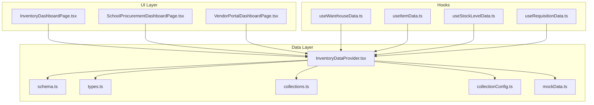
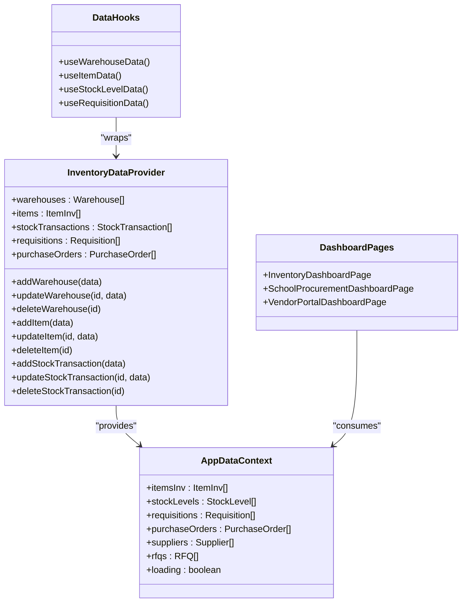
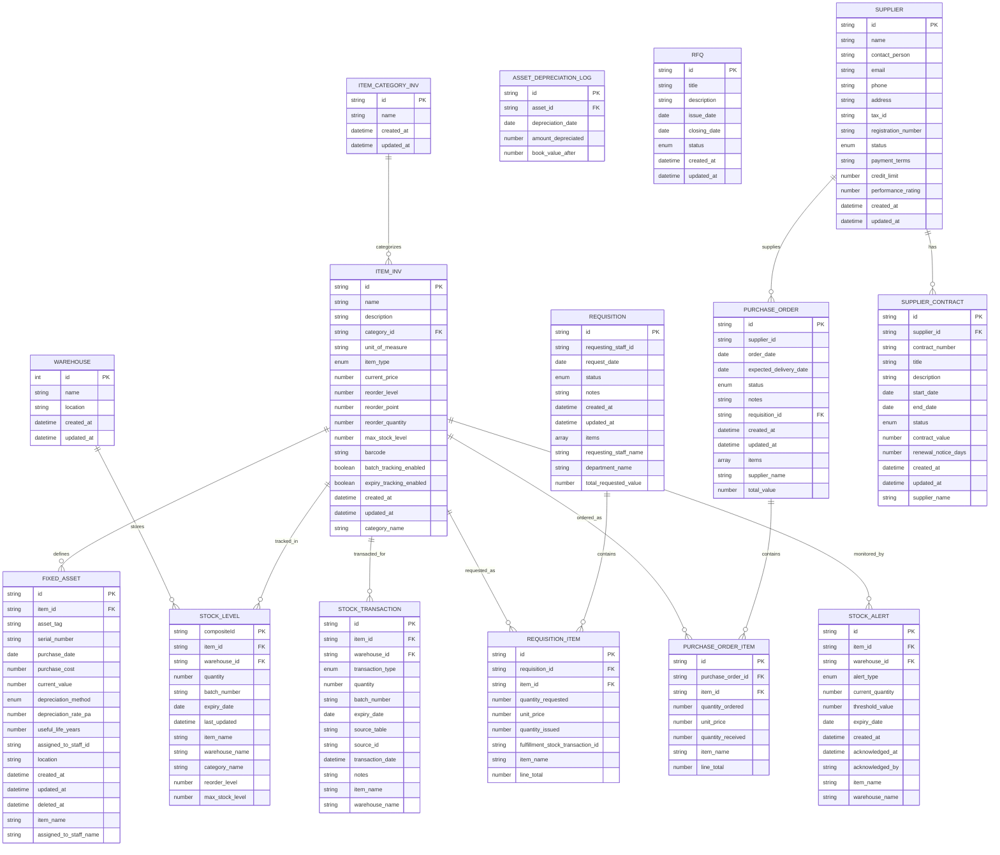
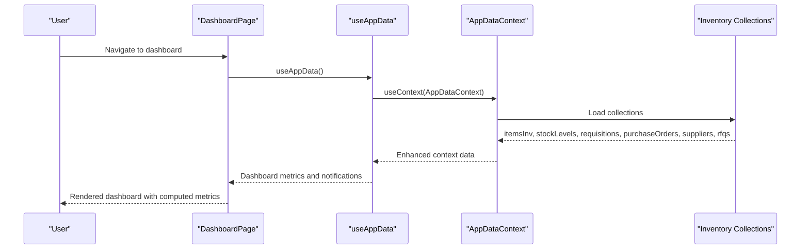
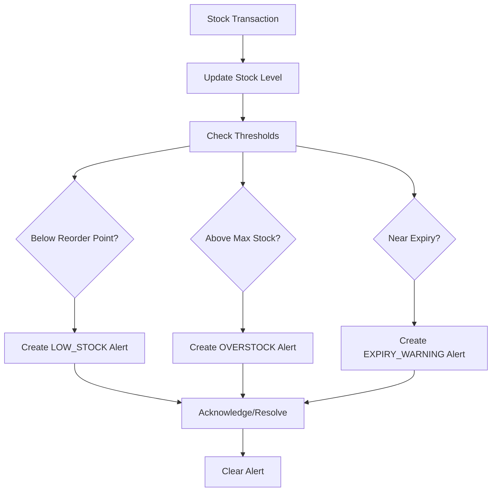
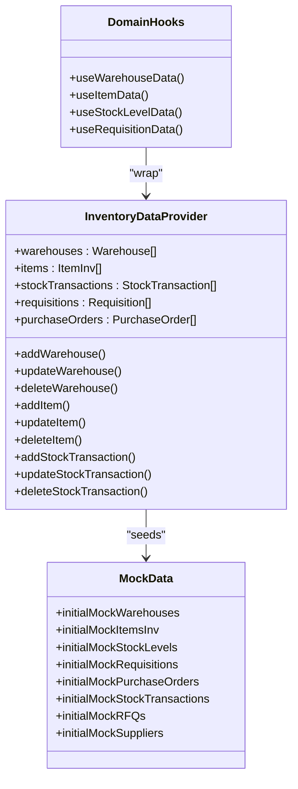
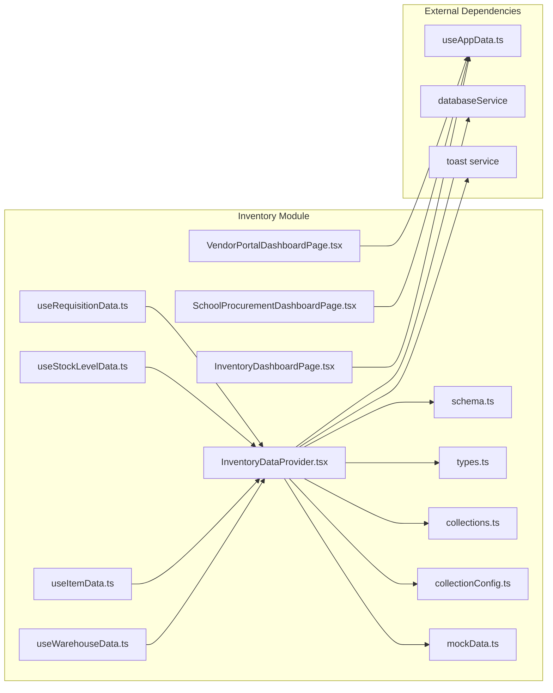

# Inventory Module

<cite>
**Referenced Files in This Document**
- [InventoryDashboardPage.tsx](file://src/modules/inventory/pages/InventoryDashboardPage.tsx)
- [SchoolProcurementDashboardPage.tsx](file://src/modules/inventory/pages/SchoolProcurementDashboardPage.tsx)
- [VendorPortalDashboardPage.tsx](file://src/modules/inventory/pages/VendorPortalDashboardPage.tsx)
- [useAppData.ts](file://src/hooks/useAppData.ts)
- [schema.ts](file://src/modules/inventory/data/schema.ts)
- [types.ts](file://src/modules/inventory/data/types.ts)
- [collections.ts](file://src/modules/inventory/data/collections.ts)
- [collectionConfig.ts](file://src/modules/inventory/data/collectionConfig.ts)
- [InventoryDataProvider.tsx](file://src/modules/inventory/data/InventoryDataProvider.tsx)
- [mockData.ts](file://src/modules/inventory/data/mockData.ts)
- [useWarehouseData.ts](file://src/modules/inventory/data/useWarehouseData.ts)
- [useItemData.ts](file://src/modules/inventory/data/useItemData.ts)
- [useStockLevelData.ts](file://src/modules/inventory/data/useStockLevelData.ts)
- [useRequisitionData.ts](file://src/modules/inventory/data/useRequisitionData.ts)
</cite>

## Table of Contents
1. [Introduction](#introduction)
2. [Project Structure](#project-structure)
3. [Core Components](#core-components)
4. [Architecture Overview](#architecture-overview)
5. [Detailed Component Analysis](#detailed-component-analysis)
6. [Dependency Analysis](#dependency-analysis)
7. [Performance Considerations](#performance-considerations)
8. [Troubleshooting Guide](#troubleshooting-guide)
9. [Conclusion](#conclusion)
10. [Appendices](#appendices)

## Introduction
The Inventory module provides a comprehensive asset and supply chain management solution for educational institutions. It encompasses fixed asset tracking, consumable inventory management, warehouse operations, procurement workflows, and vendor collaboration. The module supports end-to-end procurement from requisitions to purchase orders, RFQs, and supplier contracts, while maintaining real-time stock visibility and automated reorder monitoring. It also delivers actionable dashboards for school procurement oversight and vendor portal engagement.

## Project Structure
The Inventory module follows a modular architecture with clear separation of concerns:
- Data layer: schemas, types, collections, and providers
- UI layer: dashboard pages and reusable components
- Hooks: domain-specific data access patterns
- Mock data: seed data for development and demonstration

**Diagram sources**
- [InventoryDashboardPage.tsx:1-57](file://src/modules/inventory/pages/InventoryDashboardPage.tsx#L1-L57)
- [SchoolProcurementDashboardPage.tsx:1-111](file://src/modules/inventory/pages/SchoolProcurementDashboardPage.tsx#L1-L111)
- [VendorPortalDashboardPage.tsx:1-106](file://src/modules/inventory/pages/VendorPortalDashboardPage.tsx#L1-L106)
- [schema.ts:1-288](file://src/modules/inventory/data/schema.ts#L1-L288)
- [types.ts:1-294](file://src/modules/inventory/data/types.ts#L1-L294)
- [collections.ts:1-52](file://src/modules/inventory/data/collections.ts#L1-L52)
- [collectionConfig.ts:1-19](file://src/modules/inventory/data/collectionConfig.ts#L1-L19)
- [InventoryDataProvider.tsx:1-172](file://src/modules/inventory/data/InventoryDataProvider.tsx#L1-L172)
- [mockData.ts:1-260](file://src/modules/inventory/data/mockData.ts#L1-L260)
- [useWarehouseData.ts:1-96](file://src/modules/inventory/data/useWarehouseData.ts#L1-L96)
- [useItemData.ts:1-41](file://src/modules/inventory/data/useItemData.ts#L1-L41)
- [useStockLevelData.ts:1-99](file://src/modules/inventory/data/useStockLevelData.ts#L1-L99)
- [useRequisitionData.ts:1-41](file://src/modules/inventory/data/useRequisitionData.ts#L1-L41)

**Section sources**
- [InventoryDashboardPage.tsx:1-57](file://src/modules/inventory/pages/InventoryDashboardPage.tsx#L1-L57)
- [SchoolProcurementDashboardPage.tsx:1-111](file://src/modules/inventory/pages/SchoolProcurementDashboardPage.tsx#L1-L111)
- [VendorPortalDashboardPage.tsx:1-106](file://src/modules/inventory/pages/VendorPortalDashboardPage.tsx#L1-L106)
- [schema.ts:1-288](file://src/modules/inventory/data/schema.ts#L1-L288)
- [types.ts:1-294](file://src/modules/inventory/data/types.ts#L1-L294)
- [collections.ts:1-52](file://src/modules/inventory/data/collections.ts#L1-L52)
- [collectionConfig.ts:1-19](file://src/modules/inventory/data/collectionConfig.ts#L1-L19)
- [InventoryDataProvider.tsx:1-172](file://src/modules/inventory/data/InventoryDataProvider.tsx#L1-L172)
- [mockData.ts:1-260](file://src/modules/inventory/data/mockData.ts#L1-L260)
- [useWarehouseData.ts:1-96](file://src/modules/inventory/data/useWarehouseData.ts#L1-L96)
- [useItemData.ts:1-41](file://src/modules/inventory/data/useItemData.ts#L1-L41)
- [useStockLevelData.ts:1-99](file://src/modules/inventory/data/useStockLevelData.ts#L1-L99)
- [useRequisitionData.ts:1-41](file://src/modules/inventory/data/useRequisitionData.ts#L1-L41)

## Core Components
The module centers around five primary domains:

- Asset Management
  - Fixed assets with depreciation tracking
  - Asset lifecycle from acquisition to disposal
  - Depreciation logs and valuation updates

- Item Categories and Catalog
  - Hierarchical categorization of inventory items
  - Support for consumables and fixed assets
  - Pricing and reorder configuration

- Warehouse Operations
  - Multi-location storage management
  - Batch and expiry tracking for controlled items
  - Composite stock visibility across locations

- Procurement Lifecycle
  - Requisitions with approval workflows
  - Purchase orders linked to suppliers
  - RFQs for competitive sourcing
  - Supplier contracts and performance tracking

- Stock Management
  - Real-time stock levels and transactions
  - Automated reorder monitoring
  - Expiry warnings and stock alerts
  - Issue/receipt tracking and adjustments

**Section sources**
- [schema.ts:61-120](file://src/modules/inventory/data/schema.ts#L61-L120)
- [types.ts:122-170](file://src/modules/inventory/data/types.ts#L122-L170)
- [mockData.ts:104-157](file://src/modules/inventory/data/mockData.ts#L104-L157)

## Architecture Overview
The Inventory module employs a layered architecture with a reactive data provider pattern:

**Diagram sources**
- [InventoryDataProvider.tsx:9-31](file://src/modules/inventory/data/InventoryDataProvider.tsx#L9-L31)
- [useAppData.ts:9-15](file://src/hooks/useAppData.ts#L9-L15)
- [InventoryDashboardPage.tsx:7-12](file://src/modules/inventory/pages/InventoryDashboardPage.tsx#L7-L12)
- [SchoolProcurementDashboardPage.tsx:8-11](file://src/modules/inventory/pages/SchoolProcurementDashboardPage.tsx#L8-L11)
- [VendorPortalDashboardPage.tsx:8-11](file://src/modules/inventory/pages/VendorPortalDashboardPage.tsx#L8-L11)
- [useWarehouseData.ts:35-92](file://src/modules/inventory/data/useWarehouseData.ts#L35-L92)
- [useItemData.ts:8-41](file://src/modules/inventory/data/useItemData.ts#L8-L41)
- [useStockLevelData.ts:37-95](file://src/modules/inventory/data/useStockLevelData.ts#L37-L95)
- [useRequisitionData.ts:8-41](file://src/modules/inventory/data/useRequisitionData.ts#L8-L41)

The architecture ensures:
- Centralized data access via the provider
- Reactive UI updates through hooks
- Strong typing across schemas and interfaces
- Extensible collection definitions for future growth

**Section sources**
- [InventoryDataProvider.tsx:1-172](file://src/modules/inventory/data/InventoryDataProvider.tsx#L1-L172)
- [useAppData.ts:1-21](file://src/hooks/useAppData.ts#L1-L21)

## Detailed Component Analysis

### Data Model Layer
The data model defines the canonical structure for all inventory entities:

**Diagram sources**
- [schema.ts:8-288](file://src/modules/inventory/data/schema.ts#L8-L288)
- [types.ts:44-281](file://src/modules/inventory/data/types.ts#L44-L281)

Key design principles:
- Composite primary keys for stock levels (item_id|warehouse_id)
- Nested arrays for line items within requisitions and purchase orders
- Computed fields for denormalized display values
- Enumerations for standardized statuses and types
- Indexes optimized for common query patterns

**Section sources**
- [schema.ts:1-288](file://src/modules/inventory/data/schema.ts#L1-L288)
- [types.ts:1-294](file://src/modules/inventory/data/types.ts#L1-L294)

### Dashboard Components
The module provides three specialized dashboards:

#### Inventory Dashboard
Focuses on operational stock readiness and procurement pipeline:
- Metrics: inventory items, stock records, open requisitions, active purchase orders
- Notifications: low stock alerts with severity-based messaging
- Quick actions: direct navigation to core inventory screens

#### School Procurement Dashboard
Enables procurement oversight and budget utilization tracking:
- Metrics: open requisitions, approved orders, active suppliers, committed spend
- Utilization ratio: commitment vs. requested value percentage
- Recent requisitions panel for visibility
- Procurement pipeline visualization

#### Vendor Portal Dashboard
Supports external supplier engagement:
- Metrics: open RFQs, active orders, pending invoices, invoice value
- Supplier snapshot: top performing suppliers
- Order and invoice queue monitoring
- RFQ opportunities and invoice processing status

**Diagram sources**
- [InventoryDashboardPage.tsx:7-53](file://src/modules/inventory/pages/InventoryDashboardPage.tsx#L7-L53)
- [SchoolProcurementDashboardPage.tsx:8-107](file://src/modules/inventory/pages/SchoolProcurementDashboardPage.tsx#L8-L107)
- [VendorPortalDashboardPage.tsx:8-102](file://src/modules/inventory/pages/VendorPortalDashboardPage.tsx#L8-L102)
- [useAppData.ts:9-15](file://src/hooks/useAppData.ts#L9-L15)

**Section sources**
- [InventoryDashboardPage.tsx:1-57](file://src/modules/inventory/pages/InventoryDashboardPage.tsx#L1-L57)
- [SchoolProcurementDashboardPage.tsx:1-111](file://src/modules/inventory/pages/SchoolProcurementDashboardPage.tsx#L1-L111)
- [VendorPortalDashboardPage.tsx:1-106](file://src/modules/inventory/pages/VendorPortalDashboardPage.tsx#L1-L106)
- [useAppData.ts:1-21](file://src/hooks/useAppData.ts#L1-L21)

### Procurement Workflows
The module supports end-to-end procurement from requisition to fulfillment:

Procurement entities and relationships:
- Requisitions capture departmental needs with approval workflows
- Purchase orders formalize supplier commitments with line-item details
- RFQs enable competitive bidding for significant procurements
- Supplier contracts establish long-term vendor agreements
- Stock transactions track physical movement and valuation

**Section sources**
- [schema.ts:155-204](file://src/modules/inventory/data/schema.ts#L155-L204)
- [schema.ts:206-221](file://src/modules/inventory/data/schema.ts#L206-L221)
- [schema.ts:223-266](file://src/modules/inventory/data/schema.ts#L223-L266)
- [types.ts:184-220](file://src/modules/inventory/data/types.ts#L184-L220)

### Stock Management and Alerts
Stock management encompasses real-time tracking and automated monitoring:

Stock alert types:
- LOW_STOCK: below configured reorder point
- OVERSTOCK: exceeding maximum stock thresholds
- EXPIRY_WARNING: approaching expiry dates
- EXPIRED: past expiry with potential write-off

**Section sources**
- [schema.ts:101-142](file://src/modules/inventory/data/schema.ts#L101-L142)
- [schema.ts:268-287](file://src/modules/inventory/data/schema.ts#L268-L287)
- [mockData.ts:126-181](file://src/modules/inventory/data/mockData.ts#L126-L181)

### Data Access Patterns
The module implements flexible data access through specialized hooks:

**Diagram sources**
- [InventoryDataProvider.tsx:9-31](file://src/modules/inventory/data/InventoryDataProvider.tsx#L9-L31)
- [useWarehouseData.ts:35-92](file://src/modules/inventory/data/useWarehouseData.ts#L35-L92)
- [useItemData.ts:8-41](file://src/modules/inventory/data/useItemData.ts#L8-L41)
- [useStockLevelData.ts:37-95](file://src/modules/inventory/data/useStockLevelData.ts#L37-L95)
- [useRequisitionData.ts:8-41](file://src/modules/inventory/data/useRequisitionData.ts#L8-L41)
- [mockData.ts:45-260](file://src/modules/inventory/data/mockData.ts#L45-L260)

**Section sources**
- [InventoryDataProvider.tsx:1-172](file://src/modules/inventory/data/InventoryDataProvider.tsx#L1-L172)
- [useWarehouseData.ts:1-96](file://src/modules/inventory/data/useWarehouseData.ts#L1-L96)
- [useItemData.ts:1-41](file://src/modules/inventory/data/useItemData.ts#L1-L41)
- [useStockLevelData.ts:1-99](file://src/modules/inventory/data/useStockLevelData.ts#L1-L99)
- [useRequisitionData.ts:1-41](file://src/modules/inventory/data/useRequisitionData.ts#L1-L41)
- [mockData.ts:1-260](file://src/modules/inventory/data/mockData.ts#L1-L260)

## Dependency Analysis
The module exhibits clean dependency boundaries with minimal cross-module coupling:

**Diagram sources**
- [schema.ts:1-7](file://src/modules/inventory/data/schema.ts#L1-L7)
- [types.ts:1-7](file://src/modules/inventory/data/types.ts#L1-L7)
- [collections.ts:1-5](file://src/modules/inventory/data/collections.ts#L1-L5)
- [collectionConfig.ts:1-3](file://src/modules/inventory/data/collectionConfig.ts#L1-L3)
- [InventoryDataProvider.tsx:4-8](file://src/modules/inventory/data/InventoryDataProvider.tsx#L4-L8)
- [mockData.ts:1-3](file://src/modules/inventory/data/mockData.ts#L1-L3)
- [useWarehouseData.ts:1-3](file://src/modules/inventory/data/useWarehouseData.ts#L1-L3)
- [useItemData.ts:1-3](file://src/modules/inventory/data/useItemData.ts#L1-L3)
- [useStockLevelData.ts:1-3](file://src/modules/inventory/data/useStockLevelData.ts#L1-L3)
- [useRequisitionData.ts:1-3](file://src/modules/inventory/data/useRequisitionData.ts#L1-L3)
- [InventoryDashboardPage.tsx:1-3](file://src/modules/inventory/pages/InventoryDashboardPage.tsx#L1-L3)
- [SchoolProcurementDashboardPage.tsx:1-3](file://src/modules/inventory/pages/SchoolProcurementDashboardPage.tsx#L1-L3)
- [VendorPortalDashboardPage.tsx:1-3](file://src/modules/inventory/pages/VendorPortalDashboardPage.tsx#L1-L3)
- [useAppData.ts:1-3](file://src/hooks/useAppData.ts#L1-L3)

Key observations:
- All internal dependencies flow inward toward the provider
- UI components depend on the shared AppDataContext hook
- Data provider encapsulates database service interactions
- Mock data serves as the default data source in demo mode

**Section sources**
- [collections.ts:1-52](file://src/modules/inventory/data/collections.ts#L1-L52)
- [collectionConfig.ts:1-19](file://src/modules/inventory/data/collectionConfig.ts#L1-L19)
- [InventoryDataProvider.tsx:1-172](file://src/modules/inventory/data/InventoryDataProvider.tsx#L1-L172)
- [useAppData.ts:1-21](file://src/hooks/useAppData.ts#L1-L21)

## Performance Considerations
- Database indexing: schemas define indexes on frequently queried fields (status, dates, names)
- Composite keys: stock levels use composite primary keys to optimize join-free queries
- Computed fields: denormalized display fields reduce runtime joins in dashboards
- Batch operations: purchase order items and requisition items are stored as arrays to minimize joins
- Lazy loading: dashboard components conditionally load data to avoid blocking UI
- Toast notifications: centralized error handling prevents cascading failures

## Troubleshooting Guide
Common issues and resolutions:

- Data provider errors
  - Verify database service availability before CRUD operations
  - Check toast messages for specific failure reasons
  - Ensure proper context wrapping for data hooks

- Dashboard rendering issues
  - Confirm useAppData hook is used within AppDataProvider
  - Validate loading states prevent premature rendering
  - Check metric calculations for null values

- Stock alert discrepancies
  - Verify reorder point configuration in item definitions
  - Confirm stock transaction timestamps
  - Review alert acknowledgment workflows

- Procurement workflow bottlenecks
  - Monitor requisition approval timelines
  - Track purchase order status transitions
  - Validate RFQ closing dates and award processes

**Section sources**
- [InventoryDataProvider.tsx:58-75](file://src/modules/inventory/data/InventoryDataProvider.tsx#L58-L75)
- [InventoryDashboardPage.tsx:10-12](file://src/modules/inventory/pages/InventoryDashboardPage.tsx#L10-L12)
- [schema.ts:268-287](file://src/modules/inventory/data/schema.ts#L268-L287)

## Conclusion
The Inventory module delivers a robust, extensible foundation for institutional asset and supply chain management. Its modular design, comprehensive data models, and specialized dashboards support efficient day-to-day operations while enabling strategic oversight. The implementation demonstrates strong separation of concerns, reactive data patterns, and scalable collection definitions that accommodate future enhancements.

## Appendices

### API Definitions
The module exposes CRUD operations through the InventoryDataProvider:

- Warehouse operations: create, update, delete with toast notifications
- Item operations: create, update, delete with timestamp management
- Stock transaction operations: create, update, delete with validation
- Data hooks: domain-specific access patterns for UI components

**Section sources**
- [InventoryDataProvider.tsx:17-31](file://src/modules/inventory/data/InventoryDataProvider.tsx#L17-L31)
- [useWarehouseData.ts:22-29](file://src/modules/inventory/data/useWarehouseData.ts#L22-L29)
- [useItemData.ts:8-41](file://src/modules/inventory/data/useItemData.ts#L8-L41)
- [useStockLevelData.ts:24-31](file://src/modules/inventory/data/useStockLevelData.ts#L24-L31)
- [useRequisitionData.ts:8-41](file://src/modules/inventory/data/useRequisitionData.ts#L8-L41)

### Reporting Capabilities
The dashboards provide built-in reporting through:
- Procurement pipeline metrics and utilization ratios
- Stock alert summaries with severity classification
- Supplier performance snapshots and invoice queues
- Recent activity panels for trend analysis

**Section sources**
- [SchoolProcurementDashboardPage.tsx:17-43](file://src/modules/inventory/pages/SchoolProcurementDashboardPage.tsx#L17-L43)
- [VendorPortalDashboardPage.tsx:16-42](file://src/modules/inventory/pages/VendorPortalDashboardPage.tsx#L16-L42)
- [InventoryDashboardPage.tsx:21-42](file://src/modules/inventory/pages/InventoryDashboardPage.tsx#L21-L42)