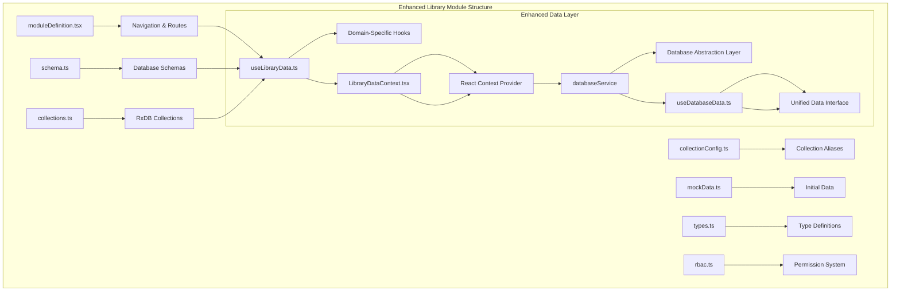
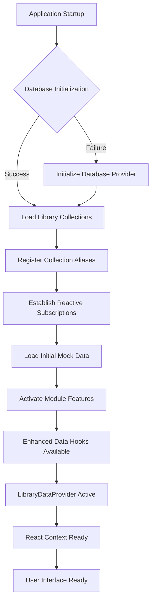
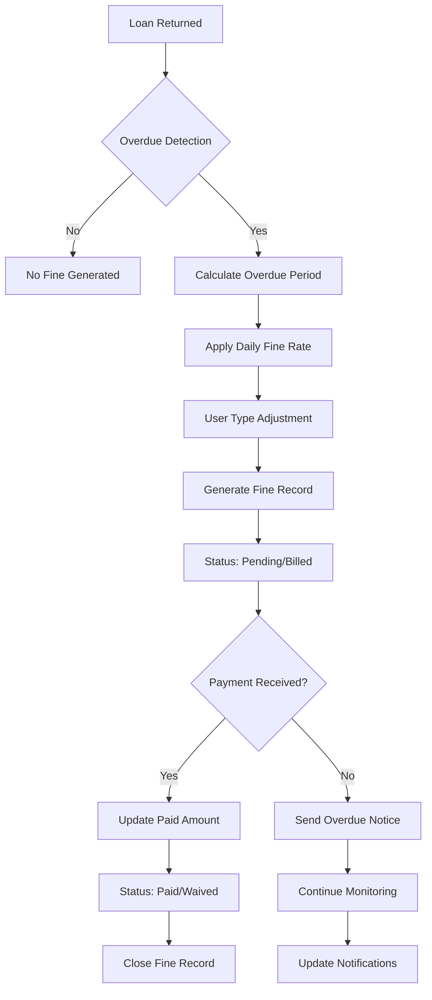
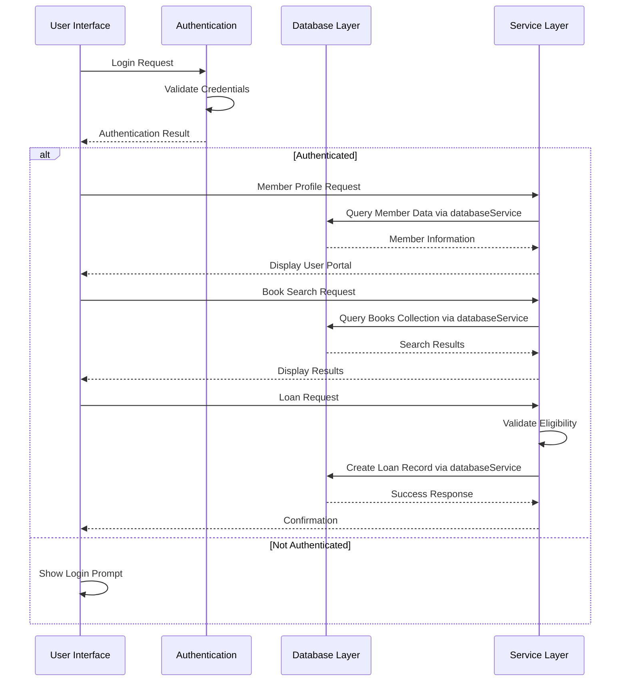
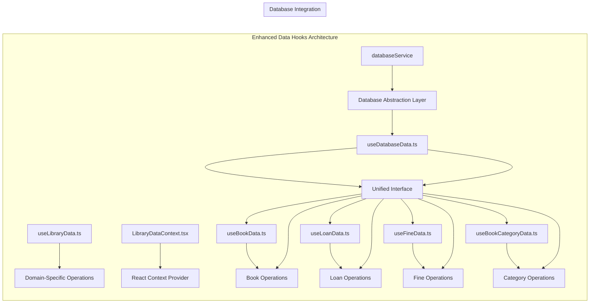
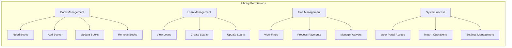

# Library Module

<cite>
**Referenced Files in This Document**
- [moduleDefinition.tsx](file://src/modules/library/moduleDefinition.tsx)
- [schema.ts](file://src/modules/library/data/schema.ts)
- [collectionConfig.ts](file://src/modules/library/data/collectionConfig.ts)
- [collections.ts](file://src/modules/library/data/collections.ts)
- [mockData.ts](file://src/modules/library/data/mockData.ts)
- [types.ts](file://src/modules/library/data/types.ts)
- [rbac.ts](file://src/modules/library/rbac.ts)
- [moduleCollectionRegistry.ts](file://src/contexts/appData/moduleCollectionRegistry.ts)
- [useLibraryData.ts](file://src/modules/library/data/useLibraryData.ts)
- [LibraryDataContext.tsx](file://src/modules/library/data/LibraryDataContext.tsx)
- [index.ts](file://src/modules/library/data/index.ts)
- [useDatabaseData.ts](file://src/hooks/data/useDatabaseData.ts)
- [utils.ts](file://src/hooks/data/utils.ts)
</cite>

## Update Summary
**Changes Made**
- Updated data hooks architecture to use database-backed operations with new modular data provider pattern
- Enhanced integration with unified database abstraction layer through databaseService
- Added new LibraryDataProvider and useLibraryDataContext for improved data management
- Updated data hook structure to support domain-specific operations while maintaining backward compatibility
- Integrated with enhanced database abstraction layer while preserving existing functionality

## Table of Contents
1. [Introduction](#introduction)
2. [Project Structure](#project-structure)
3. [Core Components](#core-components)
4. [Architecture Overview](#architecture-overview)
5. [Detailed Component Analysis](#detailed-component-analysis)
6. [Database Implementation](#database-implementation)
7. [Data Hooks Architecture](#data-hooks-architecture)
8. [RBAC and Permissions](#rbac-and-permissions)
9. [Performance Considerations](#performance-considerations)
10. [Troubleshooting Guide](#troubleshooting-guide)
11. [Conclusion](#conclusion)

## Introduction
The Library module provides a comprehensive database-backed library management system with integrated book cataloging, loan processing, fine management, and reporting capabilities. Built on an enhanced database abstraction layer with modular data hooks architecture, it supports both physical and digital resources, offers user portal access, and includes import functionality for bulk data operations. The module follows a modern, scalable architecture with self-contained data schemas, navigation, and RBAC permissions, providing enterprise-grade data persistence and real-time synchronization capabilities through an enhanced database service layer.

## Project Structure
The Library module has evolved to use a modular architecture with enhanced data hooks and database abstraction layer integration:



**Diagram sources**
- [moduleDefinition.tsx:16-81](file://src/modules/library/moduleDefinition.tsx#L16-L81)
- [schema.ts:11-109](file://src/modules/library/data/schema.ts#L11-L109)
- [collections.ts:6-19](file://src/modules/library/data/collections.ts#L6-L19)
- [useLibraryData.ts](file://src/modules/library/data/useLibraryData.ts)
- [LibraryDataContext.tsx:1-34](file://src/modules/library/data/LibraryDataContext.tsx#L1-L34)
- [useDatabaseData.ts:1-381](file://src/hooks/data/useDatabaseData.ts#L1-L381)

**Section sources**
- [moduleDefinition.tsx:16-81](file://src/modules/library/moduleDefinition.tsx#L16-L81)
- [collectionConfig.ts:4-13](file://src/modules/library/data/collectionConfig.ts#L4-L13)
- [LibraryDataContext.tsx:1-34](file://src/modules/library/data/LibraryDataContext.tsx#L1-L34)

## Core Components

### Database-Backed Data Model Architecture
The module implements a robust, database-agnostic data model with four primary entities managed through RxDB collections and enhanced by the database abstraction layer:

```mermaid
erDiagram
BOOK_CATEGORY {
string id PK
string name
}
BOOK {
string id PK
number category_id FK
string title
string author
string publisher
string isbn
string accession_no
number publication_year
string edition
number purchase_cost
string status
string location_shelf
boolean is_digital
string digital_access_url
string digital_format
string availability_status
boolean damaged_status
boolean lost_status
string branch_id
datetime created_at
datetime updated_at
datetime deleted_at
string category_name
}
LOAN {
string id PK
string book_id FK
string user_id FK
string userType
date loan_date
date due_date
date return_date
date extended_due_date
string branch_id
datetime created_at
datetime updated_at
string book_title
string user_name
}
FINE {
string id PK
string loan_id FK
string user_id FK
number fine_amount
number paid_amount
string status
string reason
date fine_date
date paid_date
date waived_date
string waived_by
string notes
string branch_id
datetime created_at
datetime updated_at
string user_name
string book_title
}
BOOK_CATEGORY ||--o{ BOOK : contains
BOOK ||--o{ LOAN : involves
LOAN ||--o{ FINE : generates
```



**Diagram sources**
- [schema.ts:11-109](file://src/modules/library/data/schema.ts#L11-L109)
- [types.ts:40-87](file://src/modules/library/data/types.ts#L40-L87)

### Enhanced Navigation and Features
The module provides comprehensive navigation with eleven distinct pages covering all library management aspects:

| Feature Area | Pages | Purpose |
|--------------|-------|---------|
| **Catalog Management** | BooksPage, BookCategoriesPage | Book catalog maintenance and categorization |
| **Circulation** | BookLoansPage, UserLibraryPortalPage | Book lending, returns, and user self-service |
| **Financial Management** | FinesPage, LibrarySettingsPage | Fine assessment, payment tracking, and system configuration |
| **Resource Management** | DigitalResourcesPage, DamagedLostBooksPage | Digital access and asset condition tracking |
| **Operations** | ImportBooksPage | Bulk book import and data operations |
| **Analytics** | LibraryDashboardPage | Performance metrics and reporting |

**Section sources**
- [moduleDefinition.tsx:24-47](file://src/modules/library/moduleDefinition.tsx#L24-L47)
- [moduleDefinition.tsx:48-78](file://src/modules/library/moduleDefinition.tsx#L48-L78)

## Architecture Overview

```mermaid
graph TB
subgraph "Enhanced Library Module Architecture"
A[Module Definition] --> B[Navigation System]
C[Database Schemas] --> D[RxDB Collections]
E[Enhanced Data Hooks] --> F[Domain-Specific Operations]
G[React Context] --> H[LibraryDataProvider]
I[Database Abstraction] --> J[databaseService]
K[Unified Interface] --> L[useDatabaseData]
subgraph "Data Layer"
I --> J
J --> K
K --> L
end
subgraph "Business Logic"
N[Book Management]
O[Loan Processing]
P[Fine Calculation]
Q[Report Generation]
R[User Portal]
end
subgraph "User Interface"
S[Catalog Management]
T[Circulation Desk]
U[Financial Tracking]
V[Analytics Dashboard]
W[User Portal]
X[Import Operations]
end
I --> N
J --> O
K --> P
L --> Q
M --> R
N --> S
O --> T
P --> U
Q --> V
R --> W
X --> S
H --> F
F --> G
G --> I
I --> J
J --> K
K --> L
L --> M
M --> N
M --> O
M --> P
M --> Q
M --> R
```

**Diagram sources**
- [moduleDefinition.tsx:16-81](file://src/modules/library/moduleDefinition.tsx#L16-L81)
- [schema.ts:11-109](file://src/modules/library/data/schema.ts#L11-L109)
- [useLibraryData.ts](file://src/modules/library/data/useLibraryData.ts)
- [LibraryDataContext.tsx:1-34](file://src/modules/library/data/LibraryDataContext.tsx#L1-L34)
- [useDatabaseData.ts:1-381](file://src/hooks/data/useDatabaseData.ts#L1-L381)

## Detailed Component Analysis

### Database Implementation

The library module leverages a sophisticated database architecture built on RxDB with comprehensive collection management and enhanced database abstraction layer integration:



**Diagram sources**
- [collections.ts:6-19](file://src/modules/library/data/collections.ts#L6-L19)
- [collectionConfig.ts:4-13](file://src/modules/library/data/collectionConfig.ts#L4-L13)
- [LibraryDataContext.tsx:11-24](file://src/modules/library/data/LibraryDataContext.tsx#L11-L24)

**Section sources**
- [collections.ts:6-19](file://src/modules/library/data/collections.ts#L6-L19)
- [collectionConfig.ts:4-13](file://src/modules/library/data/collectionConfig.ts#L4-L13)
- [LibraryDataContext.tsx:11-24](file://src/modules/library/data/LibraryDataContext.tsx#L11-L24)

### Enhanced Fine Management System

The FinesPage implements a comprehensive financial tracking system with detailed status management and automated calculations through the enhanced database abstraction layer:



**Diagram sources**
- [schema.ts:82-108](file://src/modules/library/data/schema.ts#L82-L108)
- [types.ts:75-87](file://src/modules/library/data/types.ts#L75-L87)

**Section sources**
- [schema.ts:82-108](file://src/modules/library/data/schema.ts#L82-L108)
- [types.ts:75-87](file://src/modules/library/data/types.ts#L75-L87)

### User Portal and Member Management

The UserLibraryPortalPage provides self-service functionality for library members with comprehensive access controls through the enhanced data context system:



**Diagram sources**
- [moduleDefinition.tsx:30](file://src/modules/library/moduleDefinition.tsx#L30)
- [collectionConfig.ts:10](file://src/modules/library/data/collectionConfig.ts#L10)
- [useDatabaseData.ts:34-46](file://src/hooks/data/useDatabaseData.ts#L34-L46)

**Section sources**
- [moduleDefinition.tsx:30](file://src/modules/library/moduleDefinition.tsx#L30)
- [collectionConfig.ts:10](file://src/modules/library/data/collectionConfig.ts#L10)
- [useDatabaseData.ts:34-46](file://src/hooks/data/useDatabaseData.ts#L34-L46)

## Database Implementation

### RxDB Collection Configuration

The library module implements a comprehensive collection system with proper indexing and relationship management through the enhanced database abstraction layer:

| Collection | Primary Key | Indexes | Relationships | Purpose |
|------------|-------------|---------|---------------|---------|
| book_categories | id | name | None | Category taxonomy management |
| books | id | title, author, isbn, accession_no, status, category_id, branch_id, damaged_status, lost_status, is_digital | book_categories.category_id | Book catalog and inventory |
| loans | id | book_id, user_id, due_date, return_date, branch_id | books.id, users.id | Loan transaction tracking |
| fines | id | loan_id, user_id, status, fine_date, paid_date, branch_id | loans.id, users.id | Financial obligation management |

**Section sources**
- [collections.ts:6-19](file://src/modules/library/data/collections.ts#L6-L19)
- [schema.ts:24-108](file://src/modules/library/data/schema.ts#L24-L108)

### Database Schema Design

The schema implementation follows best practices for library management with comprehensive field definitions and constraints through the database abstraction layer:

**Book Schema Fields:**
- Unique identifiers and foreign key relationships
- Comprehensive metadata (title, author, publisher, ISBN)
- Physical and digital resource tracking
- Status management (available, on loan, damaged, lost)
- Branch association and location tracking

**Loan Schema Fields:**
- User type classification (Staff, Student, Parent, Supplier)
- Date tracking (loan, due, return, extended due)
- Denormalized user and book information for performance
- Branch association for multi-location support

**Fine Schema Fields:**
- Amount tracking with separate paid/waived amounts
- Comprehensive status lifecycle management
- Reason codes and administrative tracking
- Audit trail with timestamps and user attribution

**Section sources**
- [schema.ts:24-108](file://src/modules/library/data/schema.ts#L24-L108)
- [types.ts:46-87](file://src/modules/library/data/types.ts#L46-L87)

## Data Hooks Architecture

### Enhanced Domain-Specific Data Hooks

The library module now implements a modular data hooks architecture with enhanced database abstraction layer integration:



**Diagram sources**
- [useLibraryData.ts](file://src/modules/library/data/useLibraryData.ts)
- [LibraryDataContext.tsx:1-34](file://src/modules/library/data/LibraryDataContext.tsx#L1-L34)
- [useDatabaseData.ts:1-381](file://src/hooks/data/useDatabaseData.ts#L1-L381)
- [utils.ts:1-24](file://src/hooks/data/utils.ts#L1-L24)

**Section sources**
- [useLibraryData.ts](file://src/modules/library/data/useLibraryData.ts)
- [LibraryDataContext.tsx:1-34](file://src/modules/library/data/LibraryDataContext.tsx#L1-L34)
- [useDatabaseData.ts:1-381](file://src/hooks/data/useDatabaseData.ts#L1-L381)
- [utils.ts:1-24](file://src/hooks/data/utils.ts#L1-L24)

### Database Abstraction Layer Integration

The enhanced architecture integrates seamlessly with the unified database abstraction layer:

**Database Service Integration:**
- Centralized databaseService reference for all domain hooks
- Consistent database operations across all library modules
- Enhanced error handling and logging through databaseService
- Support for both RxDB and alternative database providers

**Backward Compatibility:**
- Maintained compatibility with existing useDatabaseData interface
- Gradual migration path from legacy hooks to domain-specific hooks
- Shared utilities (unimplementedAsync, unimplementedSync) for pending operations
- Seamless integration with unified AppDataContextType

**Section sources**
- [useDatabaseData.ts:1-381](file://src/hooks/data/useDatabaseData.ts#L1-L381)
- [utils.ts:1-24](file://src/hooks/data/utils.ts#L1-L24)

## RBAC and Permissions

### Comprehensive Permission System

The library module implements a granular RBAC system with permissions covering all functional areas:



**Diagram sources**
- [rbac.ts:3-67](file://src/modules/library/rbac.ts#L3-L67)

**Section sources**
- [rbac.ts:3-67](file://src/modules/library/rbac.ts#L3-L67)

### Role-Based Access Control

The module defines default roles with appropriate permission sets:

**Librarian Role:**
- Full access to book management
- Complete loan processing capabilities
- Fine management permissions
- User portal access

**Administrator Role:**
- All librarian permissions plus
- System settings management
- Import/export operations
- Advanced reporting access

**Section sources**
- [rbac.ts:69](file://src/modules/library/rbac.ts#L69)

## Performance Considerations

### Database Optimization Strategies

The library module implements several optimization strategies for database performance through the enhanced database abstraction layer:

**Indexing Strategy:**
- Multi-field indexes on frequently queried combinations
- Composite indexes for common filter patterns
- Proper index selection for search operations

**Query Optimization:**
- Denormalized fields for frequently accessed data
- Efficient join patterns through foreign key relationships
- Optimized search algorithms for book catalogs

**Caching Mechanisms:**
- Reactive data binding for real-time updates
- Local state caching for improved user experience
- Intelligent query debouncing to reduce database load

**Database Abstraction Benefits:**
- Consistent performance optimization across all database providers
- Centralized query optimization through databaseService
- Enhanced connection pooling and resource management

### Scalability Features

**Horizontal Scaling:**
- Multi-branch support through branch_id fields
- Distributed data architecture
- Load balancing across database instances

**Performance Monitoring:**
- Query performance tracking
- Index utilization monitoring
- Database connection pool usage

**Enhanced Monitoring:**
- Database abstraction layer performance metrics
- Unified monitoring through databaseService
- Cross-database provider performance comparison

**Section sources**
- [schema.ts:21](file://src/modules/library/data/schema.ts#L21)
- [schema.ts:55](file://src/modules/library/data/schema.ts#L55)
- [schema.ts:79](file://src/modules/library/data/schema.ts#L79)
- [schema.ts:107](file://src/modules/library/data/schema.ts#L107)
- [useDatabaseData.ts:34-46](file://src/hooks/data/useDatabaseData.ts#L34-L46)

## Troubleshooting Guide

### Database-Related Issues

**Collection Initialization Failures**
- Verify database provider configuration
- Check collection schema compatibility
- Ensure proper indexing on required fields
- Validate databaseService initialization

**Data Synchronization Problems**
- Monitor RxDB replication status
- Check network connectivity for sync operations
- Validate collection aliases and relationships
- Verify databaseService connection health

**Performance Degradation**
- Analyze query execution plans
- Review index utilization statistics
- Monitor database connection pool usage
- Check databaseService performance metrics

**Database Abstraction Issues**
- Verify databaseService configuration
- Check database provider compatibility
- Validate unified interface implementation
- Monitor cross-database provider performance

### Module Integration Issues

**Navigation Problems**
- Verify module registration in registry
- Check route configuration completeness
- Ensure proper dependency resolution
- Validate LibraryDataProvider setup

**Permission Denied Errors**
- Validate user role assignments
- Check permission inheritance
- Review RBAC policy configuration
- Verify databaseService access permissions

**Data Hook Issues**
- Check useLibraryData hook implementation
- Verify LibraryDataContext provider setup
- Validate databaseService integration
- Ensure backward compatibility with useDatabaseData

**Section sources**
- [moduleCollectionRegistry.ts:15](file://src/contexts/appData/moduleCollectionRegistry.ts#L15)
- [moduleCollectionRegistry.ts:29](file://src/contexts/appData/moduleCollectionRegistry.ts#L29)
- [LibraryDataContext.tsx:26-32](file://src/modules/library/data/LibraryDataContext.tsx#L26-L32)
- [useDatabaseData.ts:16-381](file://src/hooks/data/useDatabaseData.ts#L16-L381)

## Conclusion

The Library module represents a comprehensive, database-backed solution for educational institution library management with enhanced architectural improvements. Its modern database abstraction layer integration ensures scalability, reliability, and real-time data synchronization capabilities while maintaining backward compatibility. The implementation demonstrates enterprise-grade design with comprehensive data models, robust business logic, and extensive operational features through an enhanced modular data hooks architecture.

Key strengths of the enhanced implementation include:
- **Database-First Approach**: Built on RxDB with enhanced database abstraction layer for reliable data persistence and synchronization
- **Modular Architecture**: Domain-specific data hooks with LibraryDataProvider for improved organization and maintainability
- **Comprehensive Functionality**: Full lifecycle management from cataloging to fine collection with enhanced database operations
- **Scalable Architecture**: Designed for multi-branch operations and high-volume data through databaseService abstraction
- **Security-First Design**: Complete RBAC system with granular permission control and databaseService access management
- **Modern Development Practices**: TypeScript-first implementation with comprehensive type safety and enhanced database integration
- **Backward Compatibility**: Seamless integration with existing useDatabaseData interface while supporting new modular approach

The module's enhanced design supports future growth through its extensible schema system, modular service architecture, comprehensive testing framework, and unified database abstraction layer. It provides a solid foundation for library management operations while maintaining performance and reliability standards essential for educational environments. The integration with databaseService ensures consistent performance optimization and cross-database provider compatibility, making the system adaptable to future technology changes.