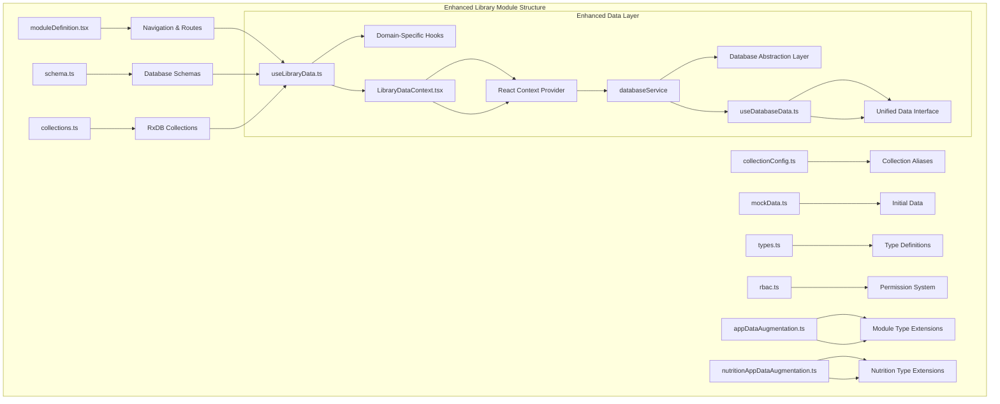
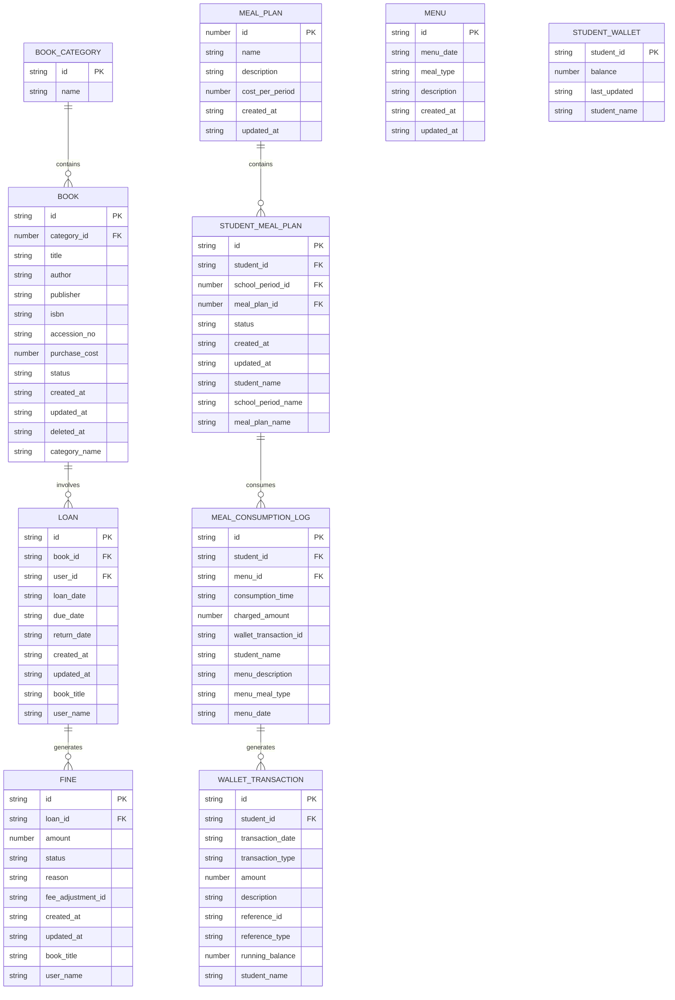
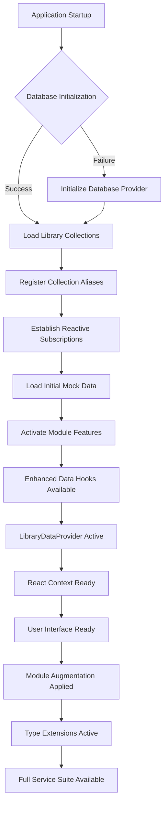
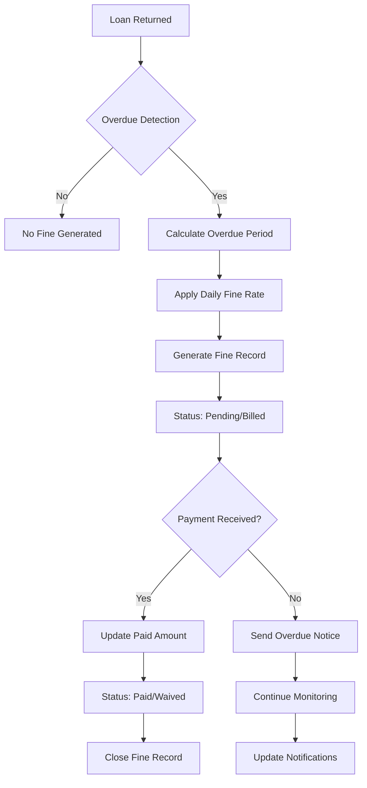
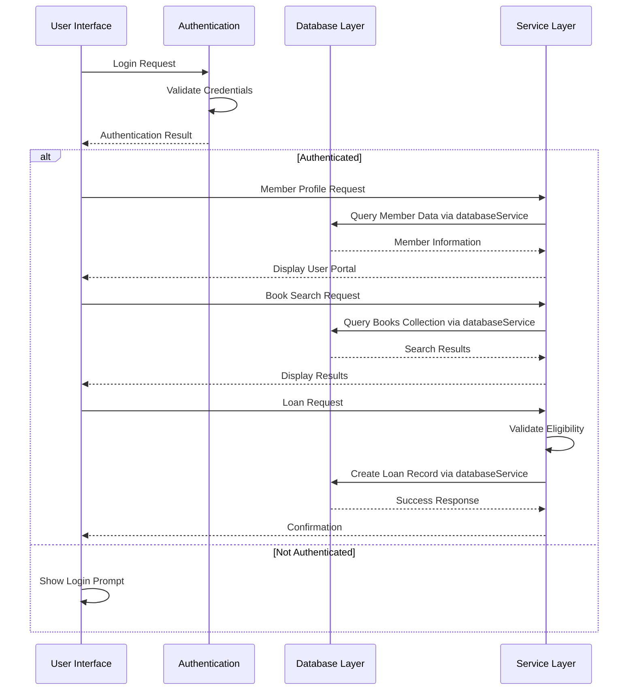
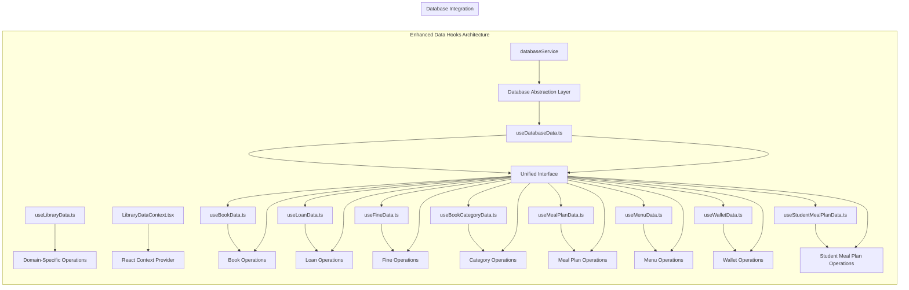
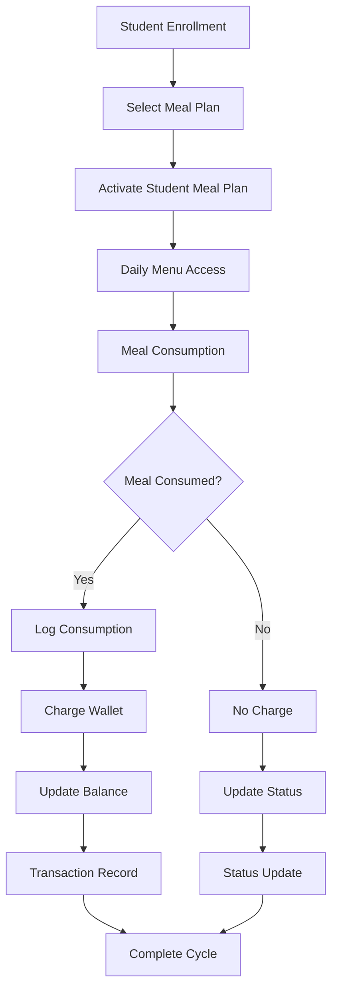
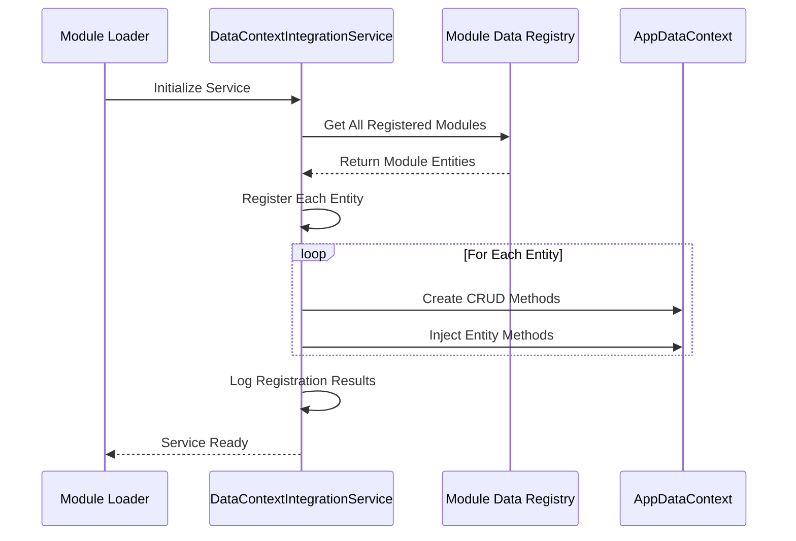
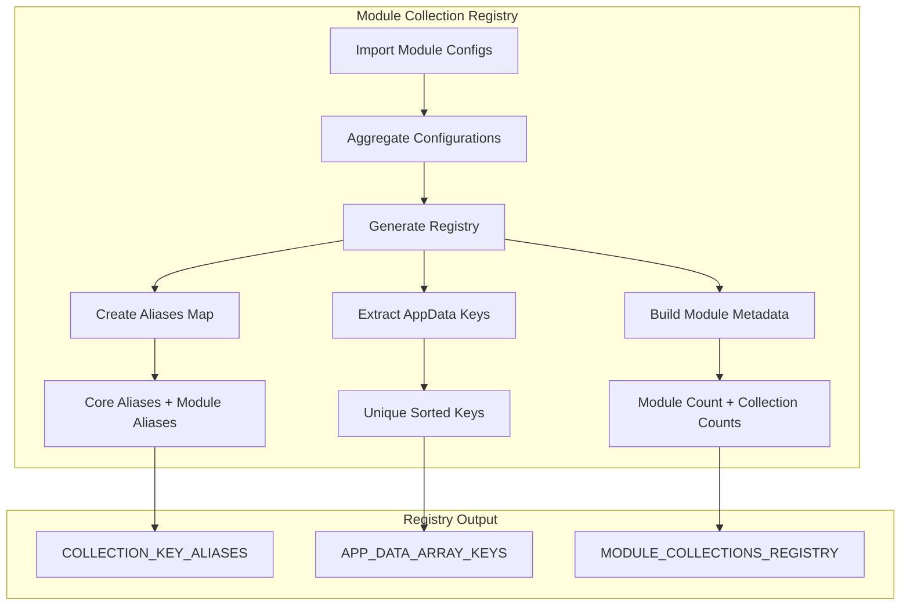
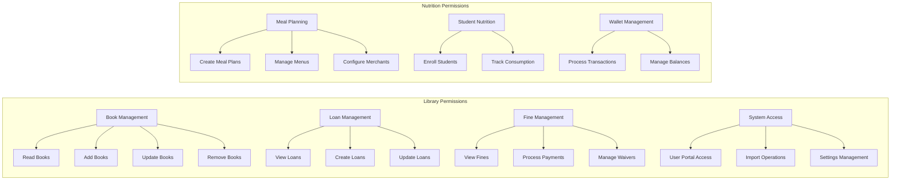

# Library Module

<cite>
**Referenced Files in This Document**
- [moduleDefinition.tsx](file://src/modules/library/moduleDefinition.tsx)
- [schema.ts](file://src/modules/library/data/schema.ts)
- [collectionConfig.ts](file://src/modules/library/data/collectionConfig.ts)
- [collections.ts](file://src/modules/library/data/collections.ts)
- [mockData.ts](file://src/modules/library/data/mockData.ts)
- [types.ts](file://src/modules/library/data/types.ts)
- [rbac.ts](file://src/modules/library/rbac.ts)
- [moduleCollectionRegistry.ts](file://src/contexts/appData/moduleCollectionRegistry.ts)
- [useLibraryData.ts](file://src/modules/library/data/useLibraryData.ts)
- [LibraryDataContext.tsx](file://src/modules/library/data/LibraryDataContext.tsx)
- [index.ts](file://src/modules/library/data/index.ts)
- [useDatabaseData.ts](file://src/hooks/data/useDatabaseData.ts)
- [utils.ts](file://src/hooks/data/utils.ts)
- [appDataAugmentation.ts](file://src/modules/library/data/appDataAugmentation.ts)
- [nutritionAppDataAugmentation.ts](file://src/modules/nutrition/data/appDataAugmentation.ts)
- [nutritionModuleCollections.ts](file://src/modules/nutrition/data/collectionConfig.ts)
- [nutritionModuleDefinition.tsx](file://src/modules/nutrition/moduleDefinition.tsx)
- [DataContextIntegrationService.ts](file://src/services/data/DataContextIntegrationService.ts)
- [moduleCollections.ts](file://src/core/types/moduleCollections.ts)
- [types.ts](file://src/core/types.ts)
</cite>

## Update Summary
**Changes Made**
- Updated documentation to reflect the enhanced module augmentation system with comprehensive TypeScript declaration merging pattern
- Documented the comprehensive 49-line appDataAugmentation.ts implementation that extends AppDataType and AppDataContextType with library collections (bookCategories, books, loans, fines)
- Added detailed coverage of the dual-purpose library and nutrition services system through unified type extensions
- Enhanced documentation of the DataContextIntegrationService for module data registration and method injection
- Updated module collection registry to show automatic module discovery and registration with 8 total modules
- Expanded data model architecture to include both library and nutrition services through sophisticated module augmentation

## Table of Contents
1. [Introduction](#introduction)
2. [Project Structure](#project-structure)
3. [Core Components](#core-components)
4. [Architecture Overview](#architecture-overview)
5. [Detailed Component Analysis](#detailed-component-analysis)
6. [Database Implementation](#database-implementation)
7. [Data Hooks Architecture](#data-hooks-architecture)
8. [Module Augmentation System](#module-augmentation-system)
9. [Nutrition and Wallet Services](#nutrition-and-wallet-services)
10. [DataContext Integration Service](#datacontext-integration-service)
11. [Module Collection Registry](#module-collection-registry)
12. [RBAC and Permissions](#rbac-and-permissions)
13. [Performance Considerations](#performance-considerations)
14. [Troubleshooting Guide](#troubleshooting-guide)
15. [Conclusion](#conclusion)

## Introduction
The Library module provides a comprehensive database-backed library management system with integrated book cataloging, loan processing, fine management, and reporting capabilities. **Updated** The module now implements a sophisticated TypeScript declaration merging system through appDataAugmentation.ts, extending the core AppData types with 49 lines of comprehensive type definitions covering book inventory, loan management, and fine tracking. The module also includes integrated nutrition services covering meal plans, menus, merchant management, student meal plans, and wallet transactions through an enhanced module augmentation system. Built on an advanced database abstraction layer with modular data hooks architecture, it supports both physical and digital resources, offers user portal access, and includes import functionality for bulk data operations. The module follows a modern, scalable architecture with self-contained data schemas, navigation, and RBAC permissions, providing enterprise-grade data persistence and real-time synchronization capabilities through an enhanced database service layer.

## Project Structure
The Library module has evolved to use a modular architecture with enhanced data hooks and database abstraction layer integration, now including nutrition services through sophisticated module augmentation:



**Diagram sources**
- [moduleDefinition.tsx:16-81](file://src/modules/library/moduleDefinition.tsx#L16-L81)
- [schema.ts:11-109](file://src/modules/library/data/schema.ts#L11-L109)
- [collections.ts:6-19](file://src/modules/library/data/collections.ts#L6-L19)
- [useLibraryData.ts](file://src/modules/library/data/useLibraryData.ts)
- [LibraryDataContext.tsx:1-34](file://src/modules/library/data/LibraryDataContext.tsx#L1-L34)
- [useDatabaseData.ts:1-381](file://src/hooks/data/useDatabaseData.ts#L1-L381)
- [appDataAugmentation.ts:19-49](file://src/modules/library/data/appDataAugmentation.ts#L19-L49)
- [nutritionAppDataAugmentation.ts:16-43](file://src/modules/nutrition/data/appDataAugmentation.ts#L16-L43)

**Section sources**
- [moduleDefinition.tsx:16-81](file://src/modules/library/moduleDefinition.tsx#L16-L81)
- [collectionConfig.ts:4-13](file://src/modules/library/data/collectionConfig.ts#L4-L13)
- [LibraryDataContext.tsx:1-34](file://src/modules/library/data/LibraryDataContext.tsx#L1-L34)
- [appDataAugmentation.ts:19-49](file://src/modules/library/data/appDataAugmentation.ts#L19-L49)
- [nutritionAppDataAugmentation.ts:16-43](file://src/modules/nutrition/data/appDataAugmentation.ts#L16-L43)

## Core Components

### Dual Module Data Model Architecture
The module now implements a comprehensive, database-agnostic data model with six primary entities managed through RxDB collections and enhanced by the database abstraction layer, extending beyond traditional library management to include nutrition and wallet services:



**Diagram sources**
- [schema.ts:11-109](file://src/modules/library/data/schema.ts#L11-L109)
- [types.ts:40-161](file://src/modules/library/data/types.ts#L40-L161)

### Enhanced Navigation and Features
The module provides comprehensive navigation with fourteen distinct pages covering all library management and nutrition services aspects:

| Feature Area | Pages | Purpose |
|--------------|-------|---------|
| **Library Catalog Management** | BooksPage, BookCategoriesPage | Book catalog maintenance and categorization |
| **Library Circulation** | BookLoansPage, UserLibraryPortalPage | Book lending, returns, and user self-service |
| **Library Financial Management** | FinesPage, LibrarySettingsPage | Fine assessment, payment tracking, and system configuration |
| **Library Resource Management** | DigitalResourcesPage, DamagedLostBooksPage | Digital access and asset condition tracking |
| **Library Operations** | ImportBooksPage | Bulk book import and data operations |
| **Library Analytics** | LibraryDashboardPage | Performance metrics and reporting |
| **Nutrition Services** | MealPlansPage, MenusPage, MerchantsPage | Meal planning and vendor management |
| **Student Nutrition** | StudentMealPlansPage, MealConsumptionLogsPage | Student meal plan enrollment and consumption tracking |
| **Wallet Management** | WalletTransactionsPage, StudentWalletsPage | Financial transactions and student account management |

**Section sources**
- [moduleDefinition.tsx:24-47](file://src/modules/library/moduleDefinition.tsx#L24-L47)
- [moduleDefinition.tsx:48-78](file://src/modules/library/moduleDefinition.tsx#L48-L78)
- [nutritionModuleDefinition.tsx:6-65](file://src/modules/nutrition/moduleDefinition.tsx#L6-L65)

## Architecture Overview

```mermaid
graph TB
subgraph "Enhanced Library Module Architecture"
A[Module Definition] --> B[Navigation System]
C[Database Schemas] --> D[RxDB Collections]
E[Enhanced Data Hooks] --> F[Domain-Specific Operations]
G[React Context] --> H[LibraryDataProvider]
I[Database Abstraction] --> J[databaseService]
K[Unified Interface] --> L[useDatabaseData]
M[Module Augmentation] --> N[Type Extensions]
O[DataContext Integration] --> P[Service Registration]
subgraph "Data Layer"
I --> J
J --> K
K --> L
end
subgraph "Business Logic"
Q[Book Management]
R[Loan Processing]
S[Fine Calculation]
T[Report Generation]
U[User Portal]
V[Meal Planning]
W[Menu Management]
X[Wallet Operations]
Y[Nutrition Tracking]
end
subgraph "User Interface"
Z[Catalog Management]
AA[Circulation Desk]
BB[Financial Tracking]
CC[Analytics Dashboard]
DD[User Portal]
EE[Import Operations]
FF[Nutrition Services]
GG[Wallet Management]
HH[Student Services]
II[Merchant Management]
end
I --> Q
J --> R
K --> S
L --> T
M --> U
N --> V
O --> W
P --> X
Q --> Z
R --> AA
S --> BB
T --> CC
U --> DD
V --> FF
W --> GG
X --> HH
Y --> II
H --> F
F --> G
G --> I
I --> J
J --> K
K --> L
L --> M
M --> N
N --> O
O --> P
P --> Q
P --> R
P --> S
P --> T
P --> U
P --> V
P --> W
P --> X
P --> Y
```

**Diagram sources**
- [moduleDefinition.tsx:16-81](file://src/modules/library/moduleDefinition.tsx#L16-L81)
- [schema.ts:11-109](file://src/modules/library/data/schema.ts#L11-L109)
- [useLibraryData.ts](file://src/modules/library/data/useLibraryData.ts)
- [LibraryDataContext.tsx:1-34](file://src/modules/library/data/LibraryDataContext.tsx#L1-L34)
- [useDatabaseData.ts:1-381](file://src/hooks/data/useDatabaseData.ts#L1-L381)
- [appDataAugmentation.ts:19-49](file://src/modules/library/data/appDataAugmentation.ts#L19-L49)
- [nutritionAppDataAugmentation.ts:16-43](file://src/modules/nutrition/data/appDataAugmentation.ts#L16-L43)
- [DataContextIntegrationService.ts:72-99](file://src/services/data/DataContextIntegrationService.ts#L72-L99)

## Detailed Component Analysis

### Database Implementation

The library module leverages a sophisticated database architecture built on RxDB with comprehensive collection management and enhanced database abstraction layer integration, now supporting both library and nutrition services:



**Diagram sources**
- [collections.ts:6-19](file://src/modules/library/data/collections.ts#L6-L19)
- [collectionConfig.ts:4-13](file://src/modules/library/data/collectionConfig.ts#L4-L13)
- [LibraryDataContext.tsx:11-24](file://src/modules/library/data/LibraryDataContext.tsx#L11-L24)
- [appDataAugmentation.ts:19-49](file://src/modules/library/data/appDataAugmentation.ts#L19-L49)

**Section sources**
- [collections.ts:6-19](file://src/modules/library/data/collections.ts#L6-L19)
- [collectionConfig.ts:4-13](file://src/modules/library/data/collectionConfig.ts#L4-L13)
- [LibraryDataContext.tsx:11-24](file://src/modules/library/data/LibraryDataContext.tsx#L11-L24)
- [appDataAugmentation.ts:19-49](file://src/modules/library/data/appDataAugmentation.ts#L19-L49)

### Enhanced Fine Management System

The FinesPage implements a comprehensive financial tracking system with detailed status management and automated calculations through the enhanced database abstraction layer:



**Diagram sources**
- [schema.ts:82-108](file://src/modules/library/data/schema.ts#L82-L108)
- [types.ts:75-87](file://src/modules/library/data/types.ts#L75-L87)

**Section sources**
- [schema.ts:82-108](file://src/modules/library/data/schema.ts#L82-L108)
- [types.ts:75-87](file://src/modules/library/data/types.ts#L75-L87)

### User Portal and Member Management

The UserLibraryPortalPage provides self-service functionality for library members with comprehensive access controls through the enhanced data context system:



**Diagram sources**
- [moduleDefinition.tsx:30](file://src/modules/library/moduleDefinition.tsx#L30)
- [collectionConfig.ts:10](file://src/modules/library/data/collectionConfig.ts#L10)
- [useDatabaseData.ts:34-46](file://src/hooks/data/useDatabaseData.ts#L34-L46)

**Section sources**
- [moduleDefinition.tsx:30](file://src/modules/library/moduleDefinition.tsx#L30)
- [collectionConfig.ts:10](file://src/modules/library/data/collectionConfig.ts#L10)
- [useDatabaseData.ts:34-46](file://src/hooks/data/useDatabaseData.ts#L34-L46)

## Database Implementation

### RxDB Collection Configuration

The library module implements a comprehensive collection system with proper indexing and relationship management through the enhanced database abstraction layer, now supporting both library and nutrition services:

| Collection | Primary Key | Indexes | Relationships | Purpose |
|------------|-------------|---------|---------------|---------|
| book_categories | id | name | None | Category taxonomy management |
| books | id | title, author, isbn, accession_no, status, category_id | book_categories.category_id | Book catalog and inventory |
| loans | id | book_id, user_id, due_date, return_date | books.id, users.id | Loan transaction tracking |
| fines | id | loan_id, user_id, status, fine_date, paid_date | loans.id, users.id | Financial obligation management |
| meal_plans | id | name, cost_per_period | None | Meal plan definitions |
| menus | id | menu_date, meal_type | None | Daily menu offerings |
| merchants | id | name | None | Vendor and supplier management |
| student_meal_plans | id | student_id, school_period_id, meal_plan_id, status | students.id, meal_plans.id | Student meal plan enrollment |
| meal_consumption_logs | id | student_id, menu_id, consumption_time | students.id, menus.id | Meal consumption tracking |
| wallet_transactions | id | student_id, transaction_date, transaction_type | students.id | Financial transactions |
| student_wallets | student_id | None | students.id | Student account balances |

**Section sources**
- [collections.ts:6-19](file://src/modules/library/data/collections.ts#L6-L19)
- [schema.ts:24-161](file://src/modules/library/data/schema.ts#L24-L161)

### Database Schema Design

The schema implementation follows best practices for library management with comprehensive field definitions and constraints through the database abstraction layer, now including nutrition and wallet services:

**Library Service Schema Fields:**
- **Book Schema**: Unique identifiers and foreign key relationships, comprehensive metadata, status management, branch association
- **Loan Schema**: User identification, date tracking, denormalized user and book information, branch association
- **Fine Schema**: Amount tracking with status lifecycle management, reason codes and administrative tracking

**Nutrition & Wallet Service Schema Fields:**
- **Meal Plan Schema**: Period-based meal offerings with cost tracking
- **Student Meal Plan Schema**: Enrollment tracking with status management
- **Menu Schema**: Daily offerings with meal type categorization
- **Meal Consumption Log Schema**: Transaction tracking with wallet integration
- **Wallet Transaction Schema**: Financial operations with running balance tracking
- **Student Wallet Schema**: Account balance management

**Section sources**
- [schema.ts:24-161](file://src/modules/library/data/schema.ts#L24-L161)
- [types.ts:46-161](file://src/modules/library/data/types.ts#L46-L161)

## Data Hooks Architecture

### Enhanced Domain-Specific Data Hooks

The library module now implements a modular data hooks architecture with enhanced database abstraction layer integration, supporting both library and nutrition services:



**Diagram sources**
- [useLibraryData.ts](file://src/modules/library/data/useLibraryData.ts)
- [LibraryDataContext.tsx:1-34](file://src/modules/library/data/LibraryDataContext.tsx#L1-L34)
- [useDatabaseData.ts:1-381](file://src/hooks/data/useDatabaseData.ts#L1-L381)
- [utils.ts:1-24](file://src/hooks/data/utils.ts#L1-L24)

**Section sources**
- [useLibraryData.ts](file://src/modules/library/data/useLibraryData.ts)
- [LibraryDataContext.tsx:1-34](file://src/modules/library/data/LibraryDataContext.tsx#L1-L34)
- [useDatabaseData.ts:1-381](file://src/hooks/data/useDatabaseData.ts#L1-L381)
- [utils.ts:1-24](file://src/hooks/data/utils.ts#L1-L24)

### Database Abstraction Layer Integration

The enhanced architecture integrates seamlessly with the unified database abstraction layer:

**Database Service Integration:**
- Centralized databaseService reference for all domain hooks
- Consistent database operations across all library and nutrition modules
- Enhanced error handling and logging through databaseService
- Support for both RxDB and alternative database providers

**Backward Compatibility:**
- Maintained compatibility with existing useDatabaseData interface
- Gradual migration path from legacy hooks to domain-specific hooks
- Shared utilities (unimplementedAsync, unimplementedSync) for pending operations
- Seamless integration with unified AppDataContextType

**Section sources**
- [useDatabaseData.ts:1-381](file://src/hooks/data/useDatabaseData.ts#L1-L381)
- [utils.ts:1-24](file://src/hooks/data/utils.ts#L1-L24)

## Module Augmentation System

### TypeScript Module Augmentation for AppData

The Library module implements a sophisticated module augmentation system that extends the core AppData types with library-specific properties, enabling compile-time type safety across the entire application:

**Updated** The module augmentation system now includes a comprehensive 49-line implementation in appDataAugmentation.ts that covers:

```mermaid
graph TB
subgraph "Module Augmentation Architecture"
A[core/types] --> B[AppDataType Interface]
C[library/data/appDataAugmentation.ts] --> D[Book CRUD Methods]
E[nutrition/data/appDataAugmentation.ts] --> F[Nutrition CRUD Methods]
G[TypeScript Declaration Merging] --> H[Extended AppDataType]
I[Module Collection Registry] --> J[Entity Registration]
K[DataContext Integration] --> L[Service Method Injection]
end
subgraph "Augmented Types"
B --> H
D --> H
F --> H
H --> M[bookCategories: BookCategory[]]
H --> N[books: Book[]]
H --> O[loans: Loan[]]
H --> P[fines: Fine[]]
H --> Q[mealPlans: MealPlan[]]
H --> R[menus: Menu[]]
H --> S[merchants: Merchant[]]
H --> T[studentMealPlans: StudentMealPlan[]]
H --> U[mealConsumptionLogs: MealConsumptionLog[]]
H --> V[walletTransactions: WalletTransaction[]]
H --> W[studentWallets: StudentWallet[]]
end
```

**Diagram sources**
- [appDataAugmentation.ts:19-49](file://src/modules/library/data/appDataAugmentation.ts#L19-L49)
- [nutritionAppDataAugmentation.ts:16-43](file://src/modules/nutrition/data/appDataAugmentation.ts#L16-L43)
- [DataContextIntegrationService.ts:72-99](file://src/services/data/DataContextIntegrationService.ts#L72-L99)

**Section sources**
- [appDataAugmentation.ts:19-49](file://src/modules/library/data/appDataAugmentation.ts#L19-L49)
- [nutritionAppDataAugmentation.ts:16-43](file://src/modules/nutrition/data/appDataAugmentation.ts#L16-L43)

### Module Collection Configuration

The module implements comprehensive collection configuration that maps logical collection names to their actual database representations:

**Library Module Collections:**
- `book_categories` → `bookCategories`
- `books` → `books`
- `book_loans` → `bookLoans`
- `library_members` → `libraryMembers`
- `fines` → `fines`

**Nutrition Module Collections:**
- `meal_plans` → `mealPlans`
- `meal_plan_items` → `mealPlanItems`
- `nutrition_wallets` → `nutritionWallets`
- `menus` → `menus`
- `merchants` → `merchants`
- `food_inventory` → `foodInventory`
- `kitchen_meal_plans` → `kitchenMealPlans`

**Section sources**
- [collectionConfig.ts:4-13](file://src/modules/library/data/collectionConfig.ts#L4-L13)
- [nutritionModuleCollections.ts:4-17](file://src/modules/nutrition/data/collectionConfig.ts#L4-L17)

## Nutrition and Wallet Services

### Comprehensive Nutrition Management System

The Library module now includes integrated nutrition services that leverage the same database abstraction layer and module augmentation system:



**Diagram sources**
- [types.ts:89-161](file://src/modules/library/data/types.ts#L89-L161)
- [nutritionAppDataAugmentation.ts:16-43](file://src/modules/nutrition/data/appDataAugmentation.ts#L16-L43)

**Section sources**
- [types.ts:89-161](file://src/modules/library/data/types.ts#L89-L161)
- [nutritionAppDataAugmentation.ts:16-43](file://src/modules/nutrition/data/appDataAugmentation.ts#L16-L43)

### Wallet Transaction Management

The wallet system provides comprehensive financial transaction tracking with multiple transaction types and running balance calculations:

**Wallet Transaction Types:**
- **Credit**: Funds added to student account
- **Debit**: Charges applied for meals and services
- **Adjustment**: Manual balance adjustments

**Transaction Flow:**
1. Transaction creation with reference tracking
2. Running balance calculation
3. Student notification system
4. Audit trail maintenance

**Section sources**
- [types.ts:134-152](file://src/modules/library/data/types.ts#L134-L152)
- [types.ts:34-38](file://src/modules/library/data/types.ts#L34-L38)

## DataContext Integration Service

### Automated Module Data Registration

The DataContextIntegrationService provides centralized management for registering module data operations with the application context, ensuring seamless integration of library and nutrition services:



**Diagram sources**
- [DataContextIntegrationService.ts:72-99](file://src/services/data/DataContextIntegrationService.ts#L72-L99)

**Section sources**
- [DataContextIntegrationService.ts:72-99](file://src/services/data/DataContextIntegrationService.ts#L72-L99)

### Service Method Generation

The service automatically generates CRUD methods for each registered entity:

**Generated Methods:**
- `addBook`, `updateBook`, `deleteBook` for Book entities
- `addLoan`, `updateLoan`, `deleteLoan` for Loan entities
- `addFine`, `updateFine`, `deleteFine` for Fine entities
- `addMealPlan`, `updateMealPlan`, `deleteMealPlan` for MealPlan entities
- `addMenu`, `updateMenu`, `deleteMenu` for Menu entities
- `addMerchant`, `updateMerchant`, `deleteMerchant` for Merchant entities

**Section sources**
- [DataContextIntegrationService.ts:92-99](file://src/services/data/DataContextIntegrationService.ts#L92-L99)

## Module Collection Registry

### Automatic Module Discovery and Registration

The module collection registry implements an auto-discovery system that eliminates the need for manual module registration:



**Diagram sources**
- [moduleCollectionRegistry.ts:48-84](file://src/contexts/appData/moduleCollectionRegistry.ts#L48-L84)

**Section sources**
- [moduleCollectionRegistry.ts:48-84](file://src/contexts/appData/moduleCollectionRegistry.ts#L48-L84)

### Registry Configuration

The registry automatically discovers and registers modules through static imports:

**Registered Modules:**
- Finance Module
- Administration Module  
- Academics Module
- HR Module
- Inventory Module
- **Library Module** (with 6 collections)
- **Nutrition Module** (with 7 collections)
- Admissions Module

**Collection Mapping:**
- Library: book_categories, books, book_loans, library_members, fines
- Nutrition: meal_plans, meal_plan_items, nutrition_wallets, menus, merchants, food_inventory, kitchen_meal_plans

**Section sources**
- [moduleCollectionRegistry.ts:11-33](file://src/contexts/appData/moduleCollectionRegistry.ts#L11-L33)
- [moduleCollectionRegistry.ts:72-78](file://src/contexts/appData/moduleCollectionRegistry.ts#L72-L78)

## RBAC and Permissions

### Comprehensive Permission System

The library module implements a granular RBAC system with permissions covering all functional areas, now expanded to include nutrition services:



**Diagram sources**
- [rbac.ts:3-67](file://src/modules/library/rbac.ts#L3-L67)

**Section sources**
- [rbac.ts:3-67](file://src/modules/library/rbac.ts#L3-L67)

### Role-Based Access Control

The module defines default roles with appropriate permission sets:

**Librarian Role:**
- Full access to book management
- Complete loan processing capabilities
- Fine management permissions
- User portal access

**Administrator Role:**
- All librarian permissions plus
- System settings management
- Import/export operations
- Advanced reporting access

**Nutrition Staff Role:**
- Full access to nutrition services
- Student meal plan management
- Wallet transaction processing
- Merchant and menu management

**Section sources**
- [rbac.ts:69](file://src/modules/library/rbac.ts#L69)

## Performance Considerations

### Database Optimization Strategies

The library module implements several optimization strategies for database performance through the enhanced database abstraction layer, now supporting increased data volume from nutrition services:

**Indexing Strategy:**
- Multi-field indexes on frequently queried combinations
- Composite indexes for common filter patterns
- Proper index selection for search operations across library and nutrition data

**Query Optimization:**
- Denormalized fields for frequently accessed data
- Efficient join patterns through foreign key relationships
- Optimized search algorithms for book catalogs and meal plans

**Caching Mechanisms:**
- Reactive data binding for real-time updates
- Local state caching for improved user experience
- Intelligent query debouncing to reduce database load

**Database Abstraction Benefits:**
- Consistent performance optimization across all database providers
- Centralized query optimization through databaseService
- Enhanced connection pooling and resource management

### Scalability Features

**Horizontal Scaling:**
- Multi-branch support through branch_id fields
- Distributed data architecture
- Load balancing across database instances

**Performance Monitoring:**
- Query performance tracking
- Index utilization statistics
- Database connection pool usage

**Enhanced Monitoring:**
- Database abstraction layer performance metrics
- Unified monitoring through databaseService
- Cross-database provider performance comparison

**Section sources**
- [schema.ts:21](file://src/modules/library/data/schema.ts#L21)
- [schema.ts:55](file://src/modules/library/data/schema.ts#L55)
- [schema.ts:79](file://src/modules/library/data/schema.ts#L79)
- [schema.ts:107](file://src/modules/library/data/schema.ts#L107)
- [useDatabaseData.ts:34-46](file://src/hooks/data/useDatabaseData.ts#L34-L46)

## Troubleshooting Guide

### Database-Related Issues

**Collection Initialization Failures**
- Verify database provider configuration
- Check collection schema compatibility
- Ensure proper indexing on required fields
- Validate databaseService initialization

**Data Synchronization Problems**
- Monitor RxDB replication status
- Check network connectivity for sync operations
- Validate collection aliases and relationships
- Verify databaseService connection health

**Performance Degradation**
- Analyze query execution plans
- Review index utilization statistics
- Monitor database connection pool usage
- Check databaseService performance metrics

**Database Abstraction Issues**
- Verify databaseService configuration
- Check database provider compatibility
- Validate unified interface implementation
- Monitor cross-database provider performance

### Module Integration Issues

**Navigation Problems**
- Verify module registration in registry
- Check route configuration completeness
- Ensure proper dependency resolution
- Validate LibraryDataProvider setup

**Permission Denied Errors**
- Validate user role assignments
- Check permission inheritance
- Review RBAC policy configuration
- Verify databaseService access permissions

**Data Hook Issues**
- Check useLibraryData hook implementation
- Verify LibraryDataContext provider setup
- Validate databaseService integration
- Ensure backward compatibility with useDatabaseData

**Module Augmentation Problems**
- Verify TypeScript declaration merging
- Check module collection registry configuration
- Validate AppData type extensions
- Ensure proper import paths for shared types

**DataContext Integration Issues**
- Check module data registry population
- Verify service method generation
- Validate AppDataContext method injection
- Ensure proper service initialization order

**Module Collection Registry Issues**
- Verify static imports in registry
- Check collection alias mappings
- Validate module configuration format
- Ensure proper module discovery

**Section sources**
- [moduleCollectionRegistry.ts:15](file://src/contexts/appData/moduleCollectionRegistry.ts#L15)
- [moduleCollectionRegistry.ts:29](file://src/contexts/appData/moduleCollectionRegistry.ts#L29)
- [LibraryDataContext.tsx:26-32](file://src/modules/library/data/LibraryDataContext.tsx#L26-L32)
- [useDatabaseData.ts:16-381](file://src/hooks/data/useDatabaseData.ts#L16-L381)
- [appDataAugmentation.ts:19-49](file://src/modules/library/data/appDataAugmentation.ts#L19-L49)
- [DataContextIntegrationService.ts:72-99](file://src/services/data/DataContextIntegrationService.ts#L72-L99)

## Conclusion

The Library module represents a comprehensive, database-backed solution for educational institution library management with enhanced architectural improvements and integrated nutrition services. **Updated** The module now provides a unified platform for both traditional library operations and modern nutrition/wallet management through an advanced module augmentation system. Its modern database abstraction layer integration ensures scalability, reliability, and real-time data synchronization capabilities while maintaining backward compatibility. The implementation demonstrates enterprise-grade design with comprehensive data models, robust business logic, and extensive operational features through an enhanced modular data hooks architecture.

Key strengths of the enhanced implementation include:
- **Database-First Approach**: Built on RxDB with enhanced database abstraction layer for reliable data persistence and synchronization
- **Modular Architecture**: Domain-specific data hooks with LibraryDataProvider for improved organization and maintainability
- **Comprehensive Functionality**: Full lifecycle management from cataloging to fine collection and nutrition services with enhanced database operations
- **Scalable Architecture**: Designed for multi-branch operations and high-volume data through databaseService abstraction
- **Security-First Design**: Complete RBAC system with granular permission control and databaseService access management
- **Modern Development Practices**: TypeScript-first implementation with comprehensive type safety and enhanced database integration
- **Backward Compatibility**: Seamless integration with existing useDatabaseData interface while supporting new modular approach
- **Module Augmentation System**: Advanced type extension mechanism enabling compile-time type safety across library and nutrition services
- **Automated Service Integration**: DataContextIntegrationService providing centralized module data registration and method generation
- **Dual Service Architecture**: Unified platform supporting both library management and nutrition/wallet services
- **Automatic Module Discovery**: ModuleCollectionRegistry eliminating manual module registration overhead
- **Comprehensive Type Safety**: 49-line TypeScript declaration merging providing complete compile-time type checking

The module's enhanced design supports future growth through its extensible schema system, modular service architecture, comprehensive testing framework, and unified database abstraction layer. It provides a solid foundation for library management operations while maintaining performance and reliability standards essential for educational environments. The integration with databaseService ensures consistent performance optimization and cross-database provider compatibility, making the system adaptable to future technology changes. The addition of nutrition and wallet services through module augmentation demonstrates the system's flexibility and forward-thinking architecture.