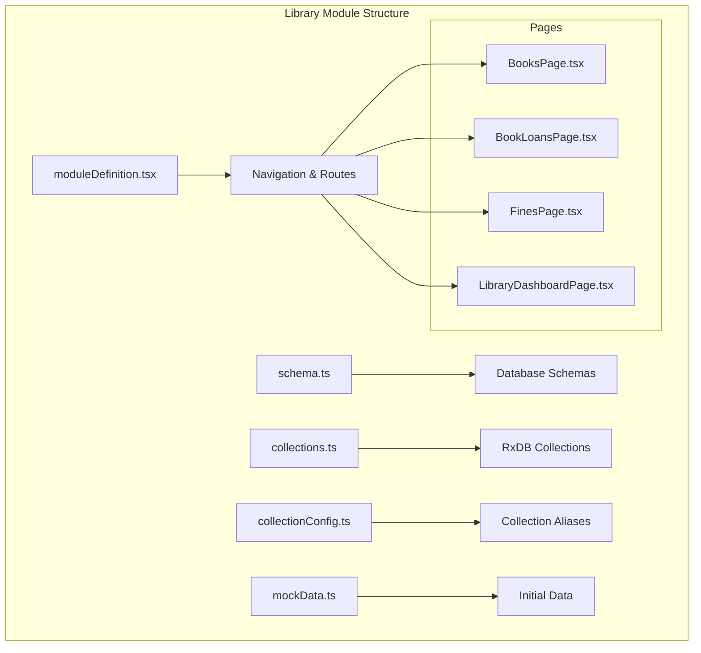
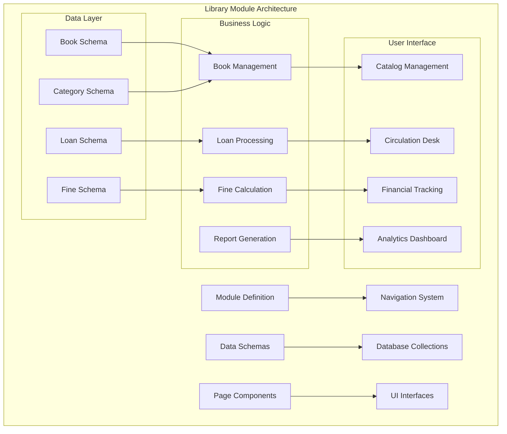
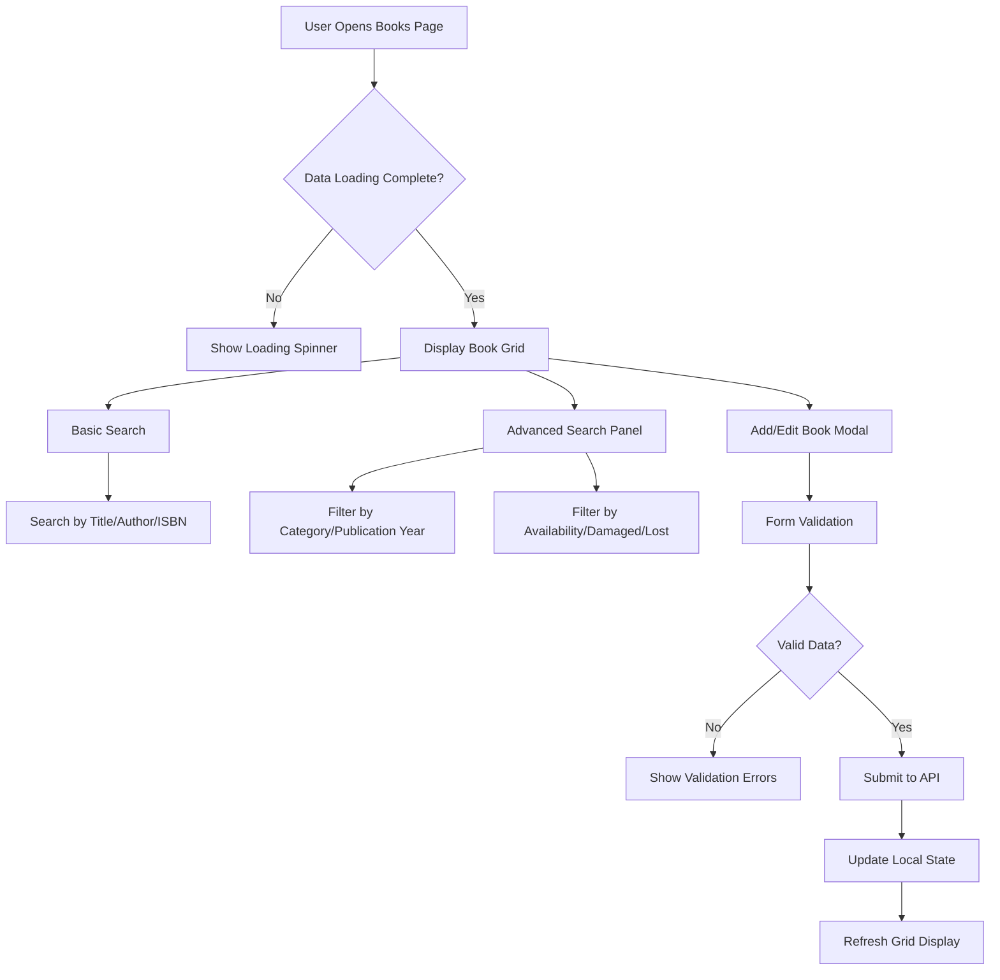
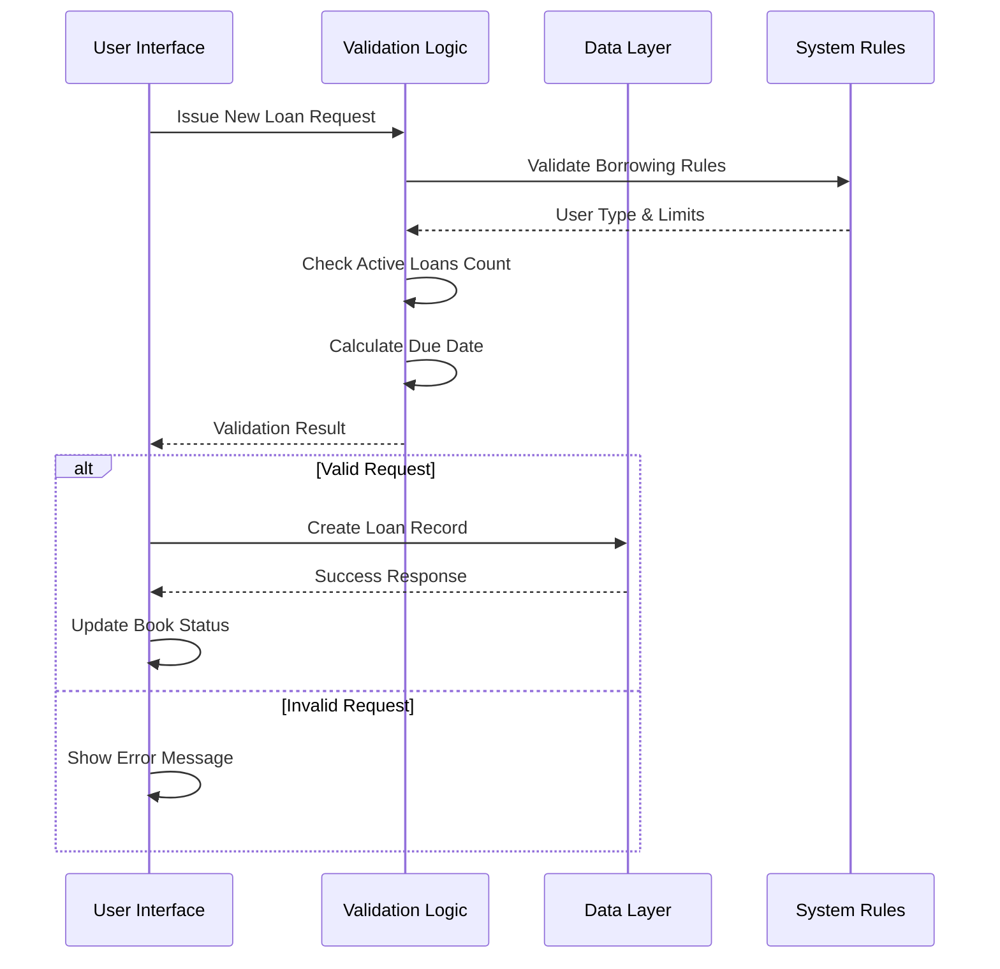
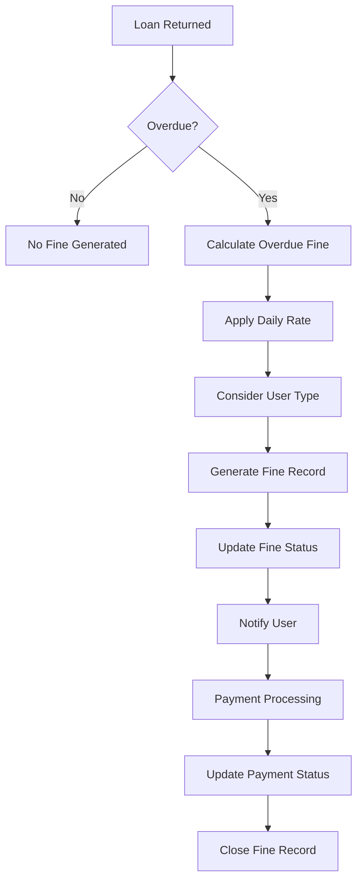
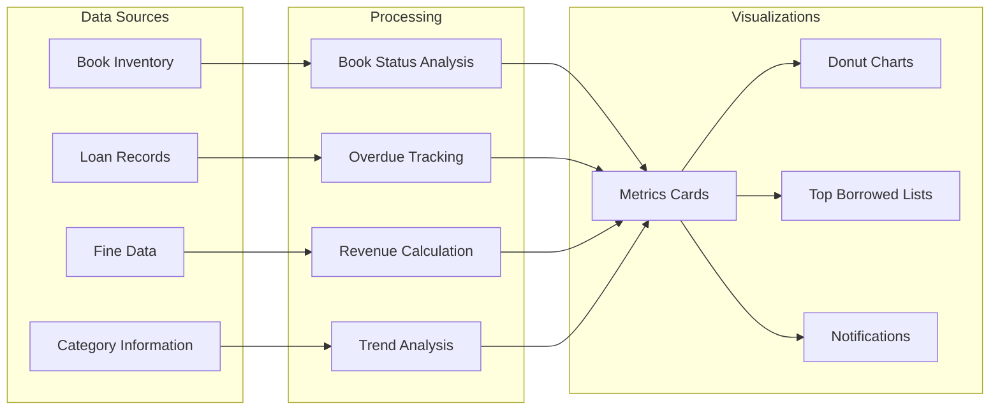
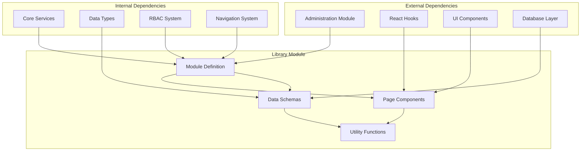

# Library Module

<cite>
**Referenced Files in This Document**
- [moduleDefinition.tsx](file://src/modules/library/moduleDefinition.tsx)
- [schema.ts](file://src/modules/library/data/schema.ts)
- [collectionConfig.ts](file://src/modules/library/data/collectionConfig.ts)
- [collections.ts](file://src/modules/library/data/collections.ts)
- [mockData.ts](file://src/modules/library/data/mockData.ts)
- [BooksPage.tsx](file://src/modules/library/pages/BooksPage.tsx)
- [BookLoansPage.tsx](file://src/modules/library/pages/BookLoansPage.tsx)
- [FinesPage.tsx](file://src/modules/library/pages/FinesPage.tsx)
- [LibraryDashboardPage.tsx](file://src/modules/library/pages/LibraryDashboardPage.tsx)
- [index.ts](file://src/modules/library/pages/index.ts)
</cite>

## Table of Contents
1. [Introduction](#introduction)
2. [Project Structure](#project-structure)
3. [Core Components](#core-components)
4. [Architecture Overview](#architecture-overview)
5. [Detailed Component Analysis](#detailed-component-analysis)
6. [Dependency Analysis](#dependency-analysis)
7. [Performance Considerations](#performance-considerations)
8. [Troubleshooting Guide](#troubleshooting-guide)
9. [Conclusion](#conclusion)

## Introduction
The Library module provides a comprehensive library management system with integrated book cataloging, loan processing, fine management, and reporting capabilities. It supports both physical and digital resources, offers user portal access, and includes import functionality for bulk data operations. The module follows a modular architecture with self-contained data schemas, navigation, and RBAC permissions.

## Project Structure
The Library module is organized into several key areas:

**Diagram sources**
- [moduleDefinition.tsx:16-81](file://src/modules/library/moduleDefinition.tsx#L16-L81)
- [schema.ts:11-109](file://src/modules/library/data/schema.ts#L11-L109)
- [collections.ts:6-19](file://src/modules/library/data/collections.ts#L6-L19)

**Section sources**
- [moduleDefinition.tsx:16-81](file://src/modules/library/moduleDefinition.tsx#L16-L81)
- [index.ts:1-13](file://src/modules/library/pages/index.ts#L1-L13)

## Core Components

### Data Model Architecture
The module implements a robust data model with three primary entities:

**Diagram sources**
- [schema.ts:11-109](file://src/modules/library/data/schema.ts#L11-L109)

### Navigation and Features
The module provides comprehensive navigation with ten distinct pages covering all library management aspects:

| Feature Area | Pages | Purpose |
|--------------|-------|---------|
| **Catalog Management** | BooksPage, BookCategoriesPage | Book catalog maintenance and categorization |
| **Circulation** | BookLoansPage | Book lending and return processing |
| **Financial Management** | FinesPage | Fine assessment and payment tracking |
| **Resource Management** | DigitalResourcesPage, DamagedLostBooksPage | Digital access and asset condition tracking |
| **Operations** | ImportBooksPage, LibrarySettingsPage | Bulk operations and system configuration |
| **Analytics** | LibraryDashboardPage | Performance metrics and reporting |

**Section sources**
- [moduleDefinition.tsx:24-47](file://src/modules/library/moduleDefinition.tsx#L24-L47)
- [moduleDefinition.tsx:48-78](file://src/modules/library/moduleDefinition.tsx#L48-L78)

## Architecture Overview

**Diagram sources**
- [moduleDefinition.tsx:16-81](file://src/modules/library/moduleDefinition.tsx#L16-L81)
- [schema.ts:11-109](file://src/modules/library/data/schema.ts#L11-L109)

## Detailed Component Analysis

### Book Catalog Management System

The BooksPage component provides comprehensive book catalog management with advanced search capabilities:

**Diagram sources**
- [BooksPage.tsx:59-581](file://src/modules/library/pages/BooksPage.tsx#L59-L581)

**Section sources**
- [BooksPage.tsx:59-581](file://src/modules/library/pages/BooksPage.tsx#L59-L581)

### Loan Processing System

The BookLoansPage implements sophisticated loan processing with user-type based borrowing rules:

**Diagram sources**
- [BookLoansPage.tsx:24-335](file://src/modules/library/pages/BookLoansPage.tsx#L24-L335)

**Section sources**
- [BookLoansPage.tsx:44-141](file://src/modules/library/pages/BookLoansPage.tsx#L44-L141)

### Fine Management and Overdue Tracking

The FinesPage provides comprehensive financial tracking with automated and manual fine processing:

**Diagram sources**
- [FinesPage.tsx:22-255](file://src/modules/library/pages/FinesPage.tsx#L22-L255)

**Section sources**
- [FinesPage.tsx:73-92](file://src/modules/library/pages/FinesPage.tsx#L73-L92)

### Library Dashboard Analytics

The LibraryDashboardPage provides comprehensive analytics and reporting:

**Diagram sources**
- [LibraryDashboardPage.tsx:10-119](file://src/modules/library/pages/LibraryDashboardPage.tsx#L10-L119)

**Section sources**
- [LibraryDashboardPage.tsx:23-86](file://src/modules/library/pages/LibraryDashboardPage.tsx#L23-L86)

## Dependency Analysis

**Diagram sources**
- [moduleDefinition.tsx:49-55](file://src/modules/library/moduleDefinition.tsx#L49-L55)

**Section sources**
- [moduleDefinition.tsx:14-14](file://src/modules/library/moduleDefinition.tsx#L14-L14)

## Performance Considerations

### Data Indexing Strategy
The module implements strategic indexing on frequently queried fields:
- Book searches on title, author, ISBN, and accession number
- Loan queries on due dates and return status
- Fine tracking on status and user associations

### Caching and State Management
- Real-time updates through reactive data binding
- Local state caching for improved user experience
- Debounced search operations to reduce API calls

### Scalability Features
- Pagination support for large datasets
- Efficient filtering mechanisms
- Lazy loading for resource-intensive operations

## Troubleshooting Guide

### Common Issues and Solutions

**Book Search Not Working**
- Verify search terms meet minimum length requirements
- Check database connectivity for search operations
- Ensure proper indexing on searchable fields

**Loan Processing Failures**
- Confirm borrower has available borrowing capacity
- Verify book is marked as available in the catalog
- Check user account status and permissions

**Fine Calculation Errors**
- Validate daily fine rates in library settings
- Confirm overdue period calculations
- Review user type specific borrowing rules

**Dashboard Performance Issues**
- Monitor database query performance
- Check for missing indexes on frequently filtered fields
- Optimize chart rendering for large datasets

**Section sources**
- [BooksPage.tsx:214-251](file://src/modules/library/pages/BooksPage.tsx#L214-L251)
- [BookLoansPage.tsx:111-141](file://src/modules/library/pages/BookLoansPage.tsx#L111-L141)
- [FinesPage.tsx:73-92](file://src/modules/library/pages/FinesPage.tsx#L73-L92)

## Conclusion

The Library module provides a comprehensive, scalable solution for educational institution library management. Its modular architecture ensures maintainability while supporting complex workflows including book cataloging, sophisticated loan processing with user-type based rules, comprehensive fine management, and robust analytics. The implementation demonstrates strong separation of concerns with clear data models, intuitive user interfaces, and efficient data processing capabilities.

The module's design supports future enhancements through its extensible schema system and modular structure, making it adaptable to evolving library management requirements while maintaining performance and reliability standards.