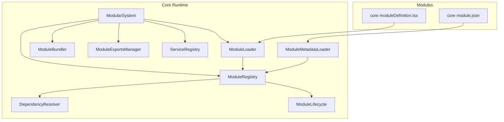
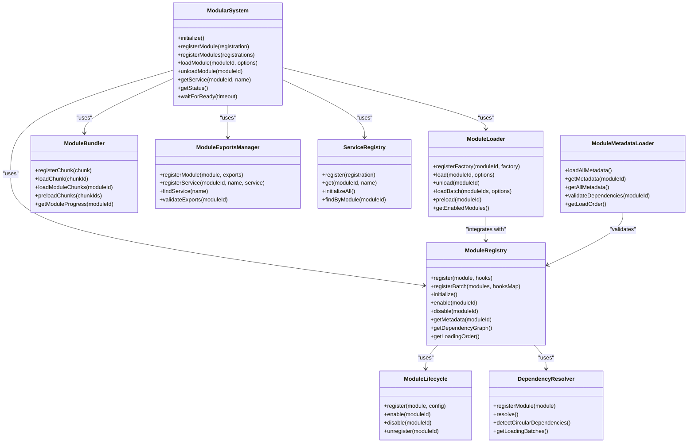
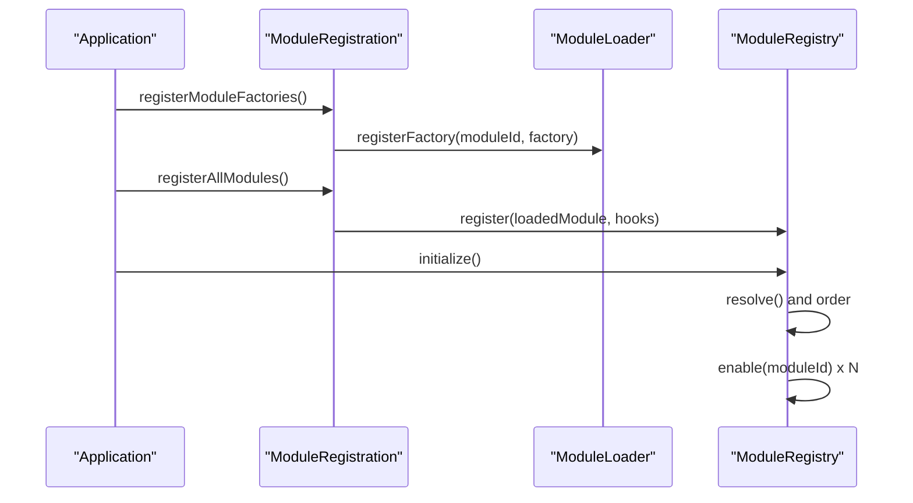
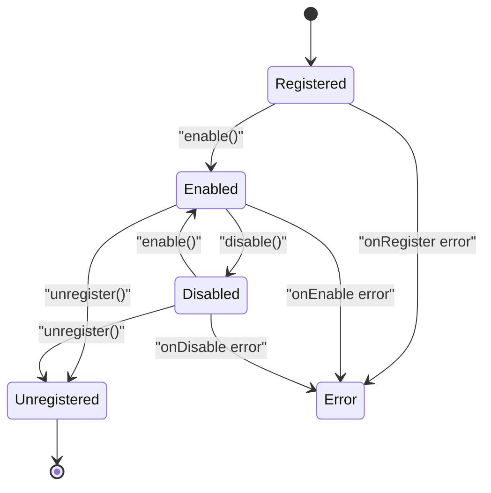
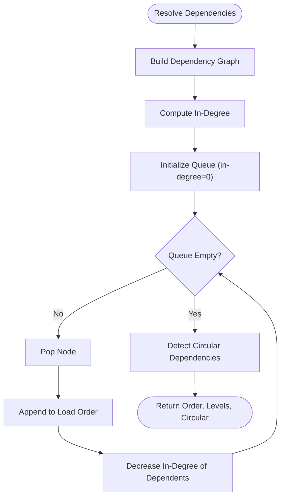
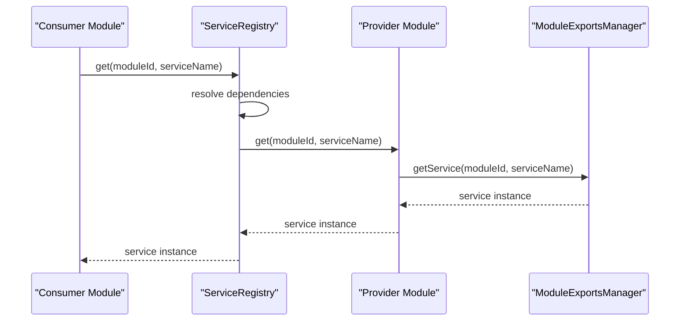
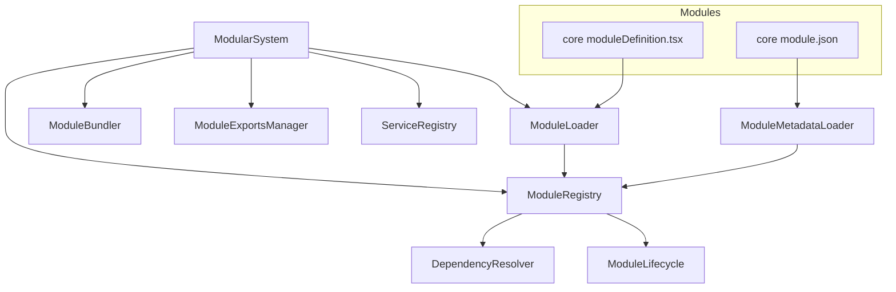

# Module Overview

<cite>
**Referenced Files in This Document**
- [ModularSystem.ts](file://src/core/ModularSystem.ts)
- [moduleRegistration.ts](file://src/core/moduleRegistration.ts)
- [moduleRegistry.ts](file://src/core/moduleRegistry.ts)
- [moduleLoader.ts](file://src/core/moduleLoader.ts)
- [ModuleLifecycle.ts](file://src/core/ModuleLifecycle.ts)
- [ModuleBundler.ts](file://src/core/ModuleBundler.ts)
- [ModuleExports.ts](file://src/core/ModuleExports.ts)
- [ModuleMetadataLoader.ts](file://src/core/ModuleMetadataLoader.ts)
- [DependencyResolver.ts](file://src/core/DependencyResolver.ts)
- [ServiceRegistry.ts](file://src/core/ServiceRegistry.ts)
- [module.ts](file://src/core/types/module.ts)
- [MODULE_STRUCTURE_STANDARD.md](file://docs/architecture/MODULE_STRUCTURE_STANDARD.md)
- [core moduleDefinition.tsx](file://src/modules/core/moduleDefinition.tsx)
- [core module.json](file://src/modules/core/module.json)
</cite>

## Table of Contents
1. [Introduction](#introduction)
2. [Project Structure](#project-structure)
3. [Core Components](#core-components)
4. [Architecture Overview](#architecture-overview)
5. [Detailed Component Analysis](#detailed-component-analysis)
6. [Dependency Analysis](#dependency-analysis)
7. [Performance Considerations](#performance-considerations)
8. [Troubleshooting Guide](#troubleshooting-guide)
9. [Conclusion](#conclusion)
10. [Appendices](#appendices)

## Introduction
This document provides a comprehensive overview of the SchoolPilot3 modules system, a domain-driven, modular architecture that organizes business functionality into cohesive modules. Each module encapsulates a functional domain (e.g., academics, administration, finance) and contributes to a unified data layer through a module federation pattern. The system emphasizes type safety across module boundaries, robust lifecycle management, and explicit dependency resolution to ensure reliable startup, runtime orchestration, and maintainability.

## Project Structure
The modular system is implemented in the core layer and orchestrated by a central integration point. Modules themselves live under src/modules and declare their identity, capabilities, and dependencies via module.json and moduleDefinition.tsx. The core layer defines the runtime contracts and infrastructure for registration, lifecycle, loading, bundling, exports, and service management.

**Diagram sources**
- [ModularSystem.ts:59-384](file://src/core/ModularSystem.ts#L59-L384)
- [moduleRegistry.ts:24-348](file://src/core/moduleRegistry.ts#L24-L348)
- [moduleLoader.ts:43-560](file://src/core/moduleLoader.ts#L43-L560)
- [ModuleBundler.ts:41-401](file://src/core/ModuleBundler.ts#L41-L401)
- [ModuleExports.ts:31-309](file://src/core/ModuleExports.ts#L31-L309)
- [ServiceRegistry.ts:32-277](file://src/core/ServiceRegistry.ts#L32-L277)
- [ModuleMetadataLoader.ts:23-544](file://src/core/ModuleMetadataLoader.ts#L23-L544)
- [DependencyResolver.ts:19-252](file://src/core/DependencyResolver.ts#L19-L252)
- [ModuleLifecycle.ts:37-295](file://src/core/ModuleLifecycle.ts#L37-L295)
- [core moduleDefinition.tsx:1-44](file://src/modules/core/moduleDefinition.tsx#L1-L44)
- [core module.json:1-63](file://src/modules/core/module.json#L1-L63)

**Section sources**
- [ModularSystem.ts:59-384](file://src/core/ModularSystem.ts#L59-L384)
- [moduleRegistration.ts:11-230](file://src/core/moduleRegistration.ts#L11-L230)
- [MODULE_STRUCTURE_STANDARD.md:1-109](file://docs/architecture/MODULE_STRUCTURE_STANDARD.md#L1-L109)

## Core Components
- ModularSystem: Central integration point combining registry, loader, bundler, exports, and service management. It emits system-wide readiness and error events and exposes APIs to register, load, and manage modules.
- ModuleRegistry: Manages module registration, lifecycle transitions, and dependency resolution. It orchestrates enable/disable/unregister sequences and forwards lifecycle events.
- ModuleLoader: Handles dynamic module loading, retries, timeouts, and unload operations. It integrates with ModuleRegistry and supports ordered/batch loading.
- ModuleBundler: Manages chunk-level loading with prioritization, dependency ordering, and progress tracking for optimized delivery.
- ModuleExportsManager: Registers and validates module-provided services, entities, hooks, components, and utilities against declared contracts.
- ServiceRegistry: Provides cross-module service discovery, dependency injection, and lifecycle-aware initialization.
- ModuleMetadataLoader: Discovers and validates module.json metadata, computes dependency graphs, and aggregates RBAC and feature flags.
- DependencyResolver: Performs topological sorting and detects circular dependencies to determine safe loading and enable/disable orders.
- ModuleLifecycle: Implements the module lifecycle (register → enable → disable → unregister) with hooks and event emission.

**Section sources**
- [ModularSystem.ts:59-384](file://src/core/ModularSystem.ts#L59-L384)
- [moduleRegistry.ts:24-348](file://src/core/moduleRegistry.ts#L24-L348)
- [moduleLoader.ts:43-560](file://src/core/moduleLoader.ts#L43-L560)
- [ModuleBundler.ts:41-401](file://src/core/ModuleBundler.ts#L41-L401)
- [ModuleExports.ts:31-309](file://src/core/ModuleExports.ts#L31-L309)
- [ServiceRegistry.ts:32-277](file://src/core/ServiceRegistry.ts#L32-L277)
- [ModuleMetadataLoader.ts:23-544](file://src/core/ModuleMetadataLoader.ts#L23-L544)
- [DependencyResolver.ts:19-252](file://src/core/DependencyResolver.ts#L19-L252)
- [ModuleLifecycle.ts:37-295](file://src/core/ModuleLifecycle.ts#L37-L295)

## Architecture Overview
The system follows a domain-driven modular architecture where each module encapsulates a functional area and declares its capabilities, dependencies, and exports. The core runtime coordinates module discovery, registration, lifecycle, and service integration.

**Diagram sources**
- [ModularSystem.ts:59-384](file://src/core/ModularSystem.ts#L59-L384)
- [moduleRegistry.ts:24-348](file://src/core/moduleRegistry.ts#L24-L348)
- [moduleLoader.ts:43-560](file://src/core/moduleLoader.ts#L43-L560)
- [ModuleBundler.ts:41-401](file://src/core/ModuleBundler.ts#L41-L401)
- [ModuleExports.ts:31-309](file://src/core/ModuleExports.ts#L31-L309)
- [ServiceRegistry.ts:32-277](file://src/core/ServiceRegistry.ts#L32-L277)
- [ModuleMetadataLoader.ts:23-544](file://src/core/ModuleMetadataLoader.ts#L23-L544)
- [DependencyResolver.ts:19-252](file://src/core/DependencyResolver.ts#L19-L252)
- [ModuleLifecycle.ts:37-295](file://src/core/ModuleLifecycle.ts#L37-L295)

## Detailed Component Analysis

### Module Registration and Discovery
- Dynamic Factories: Module factories are registered per module ID, enabling dynamic discovery and loading without static imports. This supports the module federation pattern by deferring module instantiation until needed.
- Batch Registration: Modules can be registered in batches with dependency resolution applied before enabling. This ensures correct ordering and prevents partial initialization.
- Metadata Validation: Module metadata is validated for structure, versioning, and dependency compatibility. Aggregates RBAC permissions and feature flags across modules.

**Diagram sources**
- [moduleRegistration.ts:129-230](file://src/core/moduleRegistration.ts#L129-L230)
- [moduleLoader.ts:71-73](file://src/core/moduleLoader.ts#L71-L73)
- [moduleRegistry.ts:108-134](file://src/core/moduleRegistry.ts#L108-L134)

**Section sources**
- [moduleRegistration.ts:11-230](file://src/core/moduleRegistration.ts#L11-L230)
- [ModuleMetadataLoader.ts:32-102](file://src/core/ModuleMetadataLoader.ts#L32-L102)
- [module.ts:138-252](file://src/core/types/module.ts#L138-L252)

### Lifecycle Management
- Lifecycle Phases: Modules move through register → enable → disable → unregister with hooks invoked at each stage. Errors during lifecycle transitions are captured and emitted as events.
- Parallel Initialization: Modules can be initialized in parallel batches based on dependency levels, improving startup performance.
- Graceful Shutdown: Lifecycle supports disabling and unregistering modules, ensuring cleanup and resource release.

**Diagram sources**
- [ModuleLifecycle.ts:58-96](file://src/core/ModuleLifecycle.ts#L58-L96)
- [ModuleLifecycle.ts:101-137](file://src/core/ModuleLifecycle.ts#L101-L137)
- [ModuleLifecycle.ts:142-175](file://src/core/ModuleLifecycle.ts#L142-L175)
- [ModuleLifecycle.ts:180-211](file://src/core/ModuleLifecycle.ts#L180-L211)

**Section sources**
- [ModuleLifecycle.ts:37-295](file://src/core/ModuleLifecycle.ts#L37-L295)
- [moduleRegistry.ts:122-171](file://src/core/moduleRegistry.ts#L122-L171)

### Dependency Resolution and Graph
- Topological Sorting: Uses Kahn’s algorithm to compute load order and detect circular dependencies. Provides batching for parallel loading.
- Dependency Graph: Builds a directed graph of required dependencies and supports queries for dependents and transitive dependencies.
- Safety Checks: Prevents enabling modules with unresolved dependencies and disallows disabling modules that are depended upon.

**Diagram sources**
- [DependencyResolver.ts:54-117](file://src/core/DependencyResolver.ts#L54-L117)
- [DependencyResolver.ts:122-158](file://src/core/DependencyResolver.ts#L122-L158)
- [moduleRegistry.ts:108-134](file://src/core/moduleRegistry.ts#L108-L134)

**Section sources**
- [DependencyResolver.ts:19-252](file://src/core/DependencyResolver.ts#L19-L252)
- [moduleRegistry.ts:24-348](file://src/core/moduleRegistry.ts#L24-L348)

### Module Federation and Unified Data Layer
- Federation Pattern: Modules are dynamically loaded and can expose services, entities, hooks, and components. Consumers access these through typed APIs and shared registries.
- Type Safety Across Boundaries: Strongly-typed interfaces define module metadata, lifecycle hooks, and exports. Validation ensures declared exports match actual exports.
- Cross-Module Access: Services are accessed via ServiceRegistry with dependency injection. Shared data is coordinated through shared contexts and hooks.

**Diagram sources**
- [ServiceRegistry.ts:67-114](file://src/core/ServiceRegistry.ts#L67-L114)
- [ModuleExports.ts:111-113](file://src/core/ModuleExports.ts#L111-L113)

**Section sources**
- [ModuleExports.ts:31-309](file://src/core/ModuleExports.ts#L31-L309)
- [ServiceRegistry.ts:32-277](file://src/core/ServiceRegistry.ts#L32-L277)

### Module Structure Conventions and Naming Patterns
- Standard Structure: Modules follow a consistent layout with components/, data/, hooks/, i18n/, pages/, services/, strategies/, index.ts, lifecycle.ts, moduleDefinition.tsx, module.json, and rbac.ts.
- Naming Conventions: Data layer files use types.ts, DataContext.tsx, useXData.ts, schema.ts, collections.ts, mockData.ts; pages use {Feature}Page.tsx; services use {Feature}Service.ts.
- Cross-Module Guidance: Avoid direct imports; use shared hooks and barrel exports for data and contexts.

**Section sources**
- [MODULE_STRUCTURE_STANDARD.md:1-109](file://docs/architecture/MODULE_STRUCTURE_STANDARD.md#L1-L109)

### Integration Points with the Core System
- Core Module Example: The core module demonstrates minimal, essential system modules and RBAC definitions. It also illustrates moduleDefinition.tsx exporting a single module definition with navigation and permissions.
- Module Metadata: The core module.json declares schemas, provides services/hooks/routes, capabilities, and default configuration.

**Section sources**
- [core moduleDefinition.tsx:1-44](file://src/modules/core/moduleDefinition.tsx#L1-L44)
- [core module.json:1-63](file://src/modules/core/module.json#L1-L63)

## Dependency Analysis
The modular system couples tightly to core runtime components while maintaining loose coupling between modules. The following diagram highlights key dependencies:

**Diagram sources**
- [ModularSystem.ts:59-384](file://src/core/ModularSystem.ts#L59-L384)
- [moduleRegistry.ts:24-348](file://src/core/moduleRegistry.ts#L24-L348)
- [moduleLoader.ts:43-560](file://src/core/moduleLoader.ts#L43-L560)
- [ModuleBundler.ts:41-401](file://src/core/ModuleBundler.ts#L41-L401)
- [ModuleExports.ts:31-309](file://src/core/ModuleExports.ts#L31-L309)
- [ServiceRegistry.ts:32-277](file://src/core/ServiceRegistry.ts#L32-L277)
- [ModuleMetadataLoader.ts:23-544](file://src/core/ModuleMetadataLoader.ts#L23-L544)
- [DependencyResolver.ts:19-252](file://src/core/DependencyResolver.ts#L19-L252)
- [ModuleLifecycle.ts:37-295](file://src/core/ModuleLifecycle.ts#L37-L295)
- [core moduleDefinition.tsx:1-44](file://src/modules/core/moduleDefinition.tsx#L1-L44)
- [core module.json:1-63](file://src/modules/core/module.json#L1-L63)

**Section sources**
- [ModularSystem.ts:59-384](file://src/core/ModularSystem.ts#L59-L384)
- [moduleRegistry.ts:24-348](file://src/core/moduleRegistry.ts#L24-L348)
- [moduleLoader.ts:43-560](file://src/core/moduleLoader.ts#L43-L560)
- [ModuleBundler.ts:41-401](file://src/core/ModuleBundler.ts#L41-L401)
- [ModuleExports.ts:31-309](file://src/core/ModuleExports.ts#L31-L309)
- [ServiceRegistry.ts:32-277](file://src/core/ServiceRegistry.ts#L32-L277)
- [ModuleMetadataLoader.ts:23-544](file://src/core/ModuleMetadataLoader.ts#L23-L544)
- [DependencyResolver.ts:19-252](file://src/core/DependencyResolver.ts#L19-L252)
- [ModuleLifecycle.ts:37-295](file://src/core/ModuleLifecycle.ts#L37-L295)

## Performance Considerations
- Parallel Loading: DependencyResolver computes loading batches to maximize throughput while respecting dependency constraints.
- Chunk Prioritization: ModuleBundler loads critical chunks first and batches high/normal priority chunks for concurrency, minimizing perceived latency.
- Lazy Loading: ModuleLoader supports preloading and controlled enablement to reduce initial payload and improve startup time.
- Retry and Timeout Strategies: ModuleLoader retries failed loads with exponential backoff-like delays and enforces timeouts to prevent stalls.

[No sources needed since this section provides general guidance]

## Troubleshooting Guide
- Circular Dependencies: Detected during dependency resolution; the system throws errors with cycle traces. Review module.json dependencies and adjust to eliminate cycles.
- Module Not Loaded: Verify factory registration and that the module is included in the dynamic import map. Confirm ModuleLoader.canLoad(moduleId) and ModuleRegistry.isRegistered(moduleId).
- Service Not Found: Ensure the service is registered via ServiceRegistry.register and that dependencies are resolved before access. Use ServiceRegistry.findByModule to enumerate module services.
- Export Validation Failures: Use ModuleExportsManager.validateExports to identify undeclared or missing exports. Align module.json provides with actual exports.
- Lifecycle Errors: Inspect ModuleLifecycle events for error emissions and review hook implementations for exceptions.

**Section sources**
- [DependencyResolver.ts:122-158](file://src/core/DependencyResolver.ts#L122-L158)
- [moduleLoader.ts:78-80](file://src/core/moduleLoader.ts#L78-L80)
- [moduleRegistry.ts:51-67](file://src/core/moduleRegistry.ts#L51-L67)
- [ServiceRegistry.ts:47-62](file://src/core/ServiceRegistry.ts#L47-L62)
- [ModuleExports.ts:210-270](file://src/core/ModuleExports.ts#L210-L270)
- [ModuleLifecycle.ts:84-93](file://src/core/ModuleLifecycle.ts#L84-L93)

## Conclusion
SchoolPilot3’s modular architecture delivers a scalable, type-safe, and maintainable system where each module encapsulates a cohesive functional domain. Through dynamic registration, robust lifecycle management, explicit dependency resolution, and a module federation pattern, the system ensures reliable startup, efficient runtime orchestration, and consistent cross-module integration. The documented standards and integration points provide a clear path for extending the platform with new modules while preserving type safety and operational reliability.

[No sources needed since this section summarizes without analyzing specific files]

## Appendices

### Module Initialization and Configuration Examples
- Initialization: Use ModularSystem.initialize to bootstrap the system and forward subsystem events. Configure autoEnable, parallelLoading, and preloadDelay via ModularSystemConfig.
- Module Registration: Register a single module via ModularSystem.registerModule or multiple modules via ModularSystem.registerModules. Provide services and exports for cross-module consumption.
- Dynamic Loading: Use ModuleLoader.load to dynamically load modules with retry and timeout controls. Preload modules with ModuleLoader.preload for improved UX.

**Section sources**
- [ModularSystem.ts:66-95](file://src/core/ModularSystem.ts#L66-L95)
- [ModularSystem.ts:100-161](file://src/core/ModularSystem.ts#L100-L161)
- [moduleLoader.ts:85-179](file://src/core/moduleLoader.ts#L85-L179)

### Inter-Module Communication Patterns
- Service Injection: Register services via ServiceRegistry.register and consume them with ModuleExportsManager.getService or ServiceRegistry.get. Define dependencies to ensure proper initialization order.
- Shared Data Access: Use shared hooks and contexts to coordinate data across modules without tight coupling.
- Navigation Composition: Dynamic navigation items are aggregated from enabled modules’ metadata, forming grouped navigation entries.

**Section sources**
- [ServiceRegistry.ts:47-114](file://src/core/ServiceRegistry.ts#L47-L114)
- [ModuleExports.ts:111-141](file://src/core/ModuleExports.ts#L111-L141)
- [moduleLoader.ts:451-515](file://src/core/moduleLoader.ts#L451-L515)