# Modules System

<cite>
**Referenced Files in This Document**
- [ModularSystem.ts](file://src/core/ModularSystem.ts)
- [moduleRegistration.ts](file://src/core/moduleRegistration.ts)
- [moduleRegistry.ts](file://src/core/moduleRegistry.ts)
- [moduleLoader.ts](file://src/core/moduleLoader.ts)
- [ModuleLifecycle.ts](file://src/core/ModuleLifecycle.ts)
- [ModuleExports.ts](file://src/core/ModuleExports.ts)
- [ServiceRegistry.ts](file://src/core/ServiceRegistry.ts)
- [DependencyResolver.ts](file://src/core/DependencyResolver.ts)
- [module.ts](file://src/core/types/module.ts)
- [types.ts](file://src/core/types.ts)
- [index.ts](file://src/core/types/index.ts)
- [AppDataContext.tsx](file://src/contexts/AppDataContext.tsx)
- [administration moduleDefinition.tsx](file://src/modules/administration/moduleDefinition.tsx)
- [modules.json](file://src/config/modules.json)
- [MODULE_STRUCTURE_STANDARD.md](file://docs/architecture/MODULE_STRUCTURE_STANDARD.md)
- [package.json](file://package.json)
- [administration appDataAugmentation.ts](file://src/modules/administration/data/appDataAugmentation.ts)
- [academics appDataAugmentation.ts](file://src/modules/academics/data/appDataAugmentation.ts)
- [finance appDataAugmentation.ts](file://src/modules/finance/data/appDataAugmentation.ts)
- [hr appDataAugmentation.ts](file://src/modules/hr/data/appDataAugmentation.ts)
- [inventory appDataAugmentation.ts](file://src/modules/inventory/data/appDataAugmentation.ts)
- [library appDataAugmentation.ts](file://src/modules/library/data/appDataAugmentation.ts)
- [nutrition appDataAugmentation.ts](file://src/modules/nutrition/data/appDataAugmentation.ts)
- [admissions appDataAugmentation.ts](file://src/modules/admissions/data/appDataAugmentation.ts)
- [registerServices.ts](file://src/modules/administration/services/registerServices.ts)
- [registerServices.ts](file://src/modules/academics/services/registerServices.ts)
- [registerServices.ts](file://src/modules/finance/services/registerServices.ts)
- [registerServices.ts](file://src/modules/inventory/services/registerServices.ts)
- [InvoiceStatusService.ts](file://src/modules/finance/services/InvoiceStatusService.ts)
- [StockLevelService.ts](file://src/modules/inventory/services/StockLevelService.ts)
- [StudentManagementService.ts](file://src/modules/administration/services/StudentManagementService.ts)
- [StudentPromotionService.ts](file://src/modules/administration/services/StudentPromotionService.ts)
- [GradingEngineService.ts](file://src/modules/academics/services/GradingEngineService.ts)
- [useService.ts](file://src/hooks/useService.ts)
- [todos moduleDefinition.tsx](file://src/modules/todos/moduleDefinition.tsx)
- [TODOPage.tsx](file://src/modules/todos/pages/TODOPage.tsx)
- [modularLoader.ts](file://src/i18n/modularLoader.ts)
- [i18n.ts](file://src/i18n/i18n.ts)
- [I18nManager.ts](file://src/i18n/I18nManager.ts)
- [types.ts](file://src/core/types.ts)
- [index.ts](file://src/core/types/index.ts)
</cite>

## Update Summary
**Changes Made**
- Enhanced Module Augmentation Architecture section to comprehensively document the new module-specific appDataAugmentation.ts files for all 8 functional modules
- Added detailed coverage of comprehensive type extensions across Administration, Academics, Finance, HR, Inventory, Library, Nutrition, and Admissions modules
- Documented the revolutionary TypeScript declaration merging pattern that creates unified AppData type system
- Updated architecture diagrams to reflect the comprehensive module augmentation approach
- Added concrete examples of module-specific data collections and CRUD methods
- Enhanced type safety documentation with detailed implementation specifics

## Table of Contents
1. [Introduction](#introduction)
2. [Project Structure](#project-structure)
3. [Core Components](#core-components)
4. [Architecture Overview](#architecture-overview)
5. [Detailed Component Analysis](#detailed-component-analysis)
6. [Service-Based Architecture](#service-based-architecture)
7. [Module Augmentation Architecture](#module-augmentation-architecture)
8. [TypeScript Declaration Merging Pattern](#typescript-declaration-merging-pattern)
9. [New TODO Module Integration](#new-todo-module-integration)
10. [Internationalization Approach](#internationalization-approach)
11. [Dependency Analysis](#dependency-analysis)
12. [Performance Considerations](#performance-considerations)
13. [Troubleshooting Guide](#troubleshooting-guide)
14. [Conclusion](#conclusion)
15. [Appendices](#appendices)

## Introduction
This document explains SchoolPilot3's modular architecture system with a domain-driven design approach. Each business module (Administration, Academics, Finance, HR, Inventory, Library, Nutrition, Admissions, Reports, Settings, **TODO**) is self-contained and contributes to a unified system through a module federation pattern. The system supports dynamic loading, lifecycle management, dependency resolution, and type-safe inter-module communication. **Updated**: The system now implements a revolutionary TypeScript declaration merging architecture where each of the 8 functional modules self-registers its data collections through dedicated appDataAugmentation.ts files, creating a comprehensive unified type system with complete compile-time type safety.

## Project Structure
SchoolPilot3 organizes modules under a consistent structure that promotes separation of concerns and maintainability. The core modular system resides in the src/core directory and orchestrates module registration, loading, lifecycle, and exports. Each business module lives under src/modules/<module-name> and follows a standardized layout with integrated service implementations. **Updated**: The new self-registering data collections pattern through comprehensive appDataAugmentation.ts files provides compile-time type safety and eliminates runtime type conflicts across all 8 functional modules.

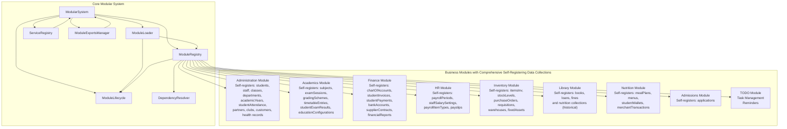

**Diagram sources**
- [ModularSystem.ts:59-384](file://src/core/ModularSystem.ts#L59-L384)
- [moduleRegistry.ts:24-348](file://src/core/moduleRegistry.ts#L24-L348)
- [moduleLoader.ts:43-560](file://src/core/moduleLoader.ts#L43-L560)
- [ModuleLifecycle.ts:37-295](file://src/core/ModuleLifecycle.ts#L37-L295)
- [ServiceRegistry.ts:32-277](file://src/core/ServiceRegistry.ts#L32-L277)
- [ModuleExports.ts:31-309](file://src/core/ModuleExports.ts#L31-L309)
- [DependencyResolver.ts:19-252](file://src/core/DependencyResolver.ts#L19-L252)

**Section sources**
- [MODULE_STRUCTURE_STANDARD.md:1-109](file://docs/architecture/MODULE_STRUCTURE_STANDARD.md#L1-L109)
- [moduleRegistration.ts:11-230](file://src/core/moduleRegistration.ts#L11-L230)
- [modules.json:1-74](file://src/config/modules.json#L1-L74)

## Core Components
The modular system is composed of several cohesive subsystems that work together to manage modules, their lifecycles, dependencies, and exports.

- ModularSystem: Central integration point that coordinates ModuleRegistry, ModuleLoader, ModuleExports, and ServiceRegistry. It exposes APIs for registration, dynamic loading, service retrieval, and system status.
- ModuleRegistry: Manages module registration, dependency resolution, and lifecycle orchestration. It emits events for module state changes and supports parallel or sequential initialization.
- ModuleLoader: Handles dynamic loading of modules via factories, retries, timeouts, and progress tracking. It integrates with ModuleRegistry and ModuleLifecycle.
- ModuleLifecycle: Implements module lifecycle hooks (register, enable, disable, unregister) and tracks module states.
- ServiceRegistry: Provides cross-module service discovery, dependency injection, and initialization with event emission.
- ModuleExportsManager: Registers and validates exports (services, entities, hooks, components, utilities, types) per module.
- DependencyResolver: Performs topological sorting and detects circular dependencies to ensure safe loading order.

**Section sources**
- [ModularSystem.ts:59-384](file://src/core/ModularSystem.ts#L59-L384)
- [moduleRegistry.ts:24-348](file://src/core/moduleRegistry.ts#L24-L348)
- [moduleLoader.ts:43-560](file://src/core/moduleLoader.ts#L43-L560)
- [ModuleLifecycle.ts:37-295](file://src/core/ModuleLifecycle.ts#L37-L295)
- [ServiceRegistry.ts:32-277](file://src/core/ServiceRegistry.ts#L32-L277)
- [ModuleExports.ts:31-309](file://src/core/ModuleExports.ts#L31-L309)
- [DependencyResolver.ts:19-252](file://src/core/DependencyResolver.ts#L19-L252)

## Architecture Overview
The modular architecture follows a module federation pattern where each module defines its metadata, navigation, dependencies, and provides resources. **Updated**: The system now enforces comprehensive type safety through TypeScript declaration merging, where each of the 8 functional modules self-registers its data collections into a unified AppData type system. This creates a compile-time contract that ensures type safety across all module boundaries without runtime conflicts, with each module contributing specialized collections and CRUD methods.

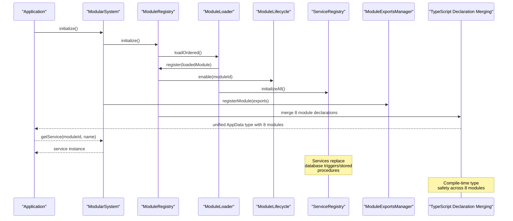

**Diagram sources**
- [ModularSystem.ts:80-161](file://src/core/ModularSystem.ts#L80-L161)
- [moduleRegistry.ts:108-134](file://src/core/moduleRegistry.ts#L108-L134)
- [moduleLoader.ts:229-244](file://src/core/moduleLoader.ts#L229-L244)
- [ModuleLifecycle.ts:98-137](file://src/core/ModuleLifecycle.ts#L98-L137)
- [ServiceRegistry.ts:204-216](file://src/core/ServiceRegistry.ts#L204-L216)
- [ModuleExports.ts:38-51](file://src/core/ModuleExports.ts#L38-L51)

## Detailed Component Analysis

### ModularSystem
ModularSystem acts as the central coordinator. It:
- Initializes subsystems and forwards events
- Registers modules with hooks, services, and exports
- Supports dynamic loading and unloading
- Exposes service retrieval and system status
- Validates exports and provides dependency graph

Key responsibilities:
- Event forwarding from subsystems
- Batch registration and initialization
- Dynamic module loading with retry and timeout
- Dev tools integration for debugging

**Section sources**
- [ModularSystem.ts:59-384](file://src/core/ModularSystem.ts#L59-L384)

### ModuleRegistry
ModuleRegistry:
- Registers modules and builds dependency graphs
- Resolves dependencies using topological sort
- Enables/disables modules in correct order
- Emits lifecycle and registry events
- Supports parallel loading batches

Operational highlights:
- Detects circular dependencies and prevents invalid states
- Provides loading order and dependency batches
- Maintains readiness state and wait-for-ready mechanism

**Section sources**
- [moduleRegistry.ts:24-348](file://src/core/moduleRegistry.ts#L24-L348)
- [DependencyResolver.ts:54-117](file://src/core/DependencyResolver.ts#L54-L117)

### ModuleLoader
ModuleLoader:
- Registers factories for dynamic loading
- Loads modules with retries, timeouts, and progress updates
- Integrates with ModuleRegistry and ModuleLifecycle
- Supports preloading and batch loading
- Validates module dependencies before enabling

**Section sources**
- [moduleLoader.ts:43-560](file://src/core/moduleLoader.ts#L43-L560)

### ModuleLifecycle
ModuleLifecycle:
- Manages module states: registered, enabled, disabled, error
- Executes lifecycle hooks with context
- Supports batch enable/disable operations
- Emits lifecycle events

**Section sources**
- [ModuleLifecycle.ts:37-295](file://src/core/ModuleLifecycle.ts#L37-L295)

### ServiceRegistry
ServiceRegistry:
- Registers service factories with dependencies
- Provides dependency injection and singleton caching
- Emits service lifecycle events
- Supports bulk initialization and module cleanup

**Section sources**
- [ServiceRegistry.ts:32-277](file://src/core/ServiceRegistry.ts#L32-L277)

### ModuleExportsManager
ModuleExportsManager:
- Registers exports per module (services, entities, hooks, components, utils, types)
- Validates exports against module metadata
- Provides lookup and search capabilities
- Supports cross-module discovery

**Section sources**
- [ModuleExports.ts:31-309](file://src/core/ModuleExports.ts#L31-L309)

### Module Definition Pattern
Each module defines its identity, navigation, dependencies, and capabilities through a moduleDefinition file. The administration module exemplifies this pattern with:
- Navigation items mapped to page components
- Optional dependencies on other modules
- Feature flags and settings

**Section sources**
- [administration moduleDefinition.tsx:35-184](file://src/modules/administration/moduleDefinition.tsx#L35-L184)

### Module Federation and Type Safety
Modules contribute to the central system by:
- Declaring dependencies and optional dependencies with semver constraints
- Providing services, entities, hooks, and components
- Defining capabilities (offline support, backend requirements, multi-tenancy, sync, real-time)
- Using shared TypeScript interfaces for type safety across module boundaries

**Updated**: The system now implements comprehensive TypeScript declaration merging where each of the 8 functional modules self-registers its data collections into a unified AppData type system. This creates compile-time type safety that prevents runtime conflicts and ensures complete type coverage across all modules, with each module contributing specialized collections and CRUD methods.

**Section sources**
- [module.ts:15-398](file://src/core/types/module.ts#L15-L398)
- [moduleRegistration.ts:60-124](file://src/core/moduleRegistration.ts#L60-L124)
- [types.ts:1-6](file://src/core/types.ts#L1-6)

## Service-Based Architecture

**Updated**: SchoolPilot3 has implemented a comprehensive service-based architecture that systematically replaces database triggers and stored procedures with sophisticated service implementations across all business modules, including the new TODO module.

### Service Registration Pattern
Each module implements a centralized service registration system that integrates with the global ServiceRegistry:

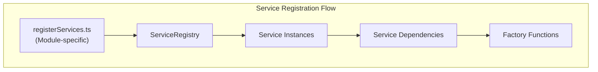

**Diagram sources**
- [registerServices.ts:1-34](file://src/modules/administration/services/registerServices.ts#L1-L34)
- [registerServices.ts:1-22](file://src/modules/academics/services/registerServices.ts#L1-L22)
- [registerServices.ts:1-59](file://src/modules/finance/services/registerServices.ts#L1-L59)
- [registerServices.ts:1-17](file://src/modules/inventory/services/registerServices.ts#L1-L17)

### Core Service Implementations

#### Finance Module Services
The Finance module implements three core P0 services that replace database triggers:

- **InvoiceStatusService**: Replaces `trg_fin_updateInvoiceStatus` trigger
- **InvoiceGenerationService**: Handles automated invoice creation
- **PaymentAllocationService**: Manages payment application logic

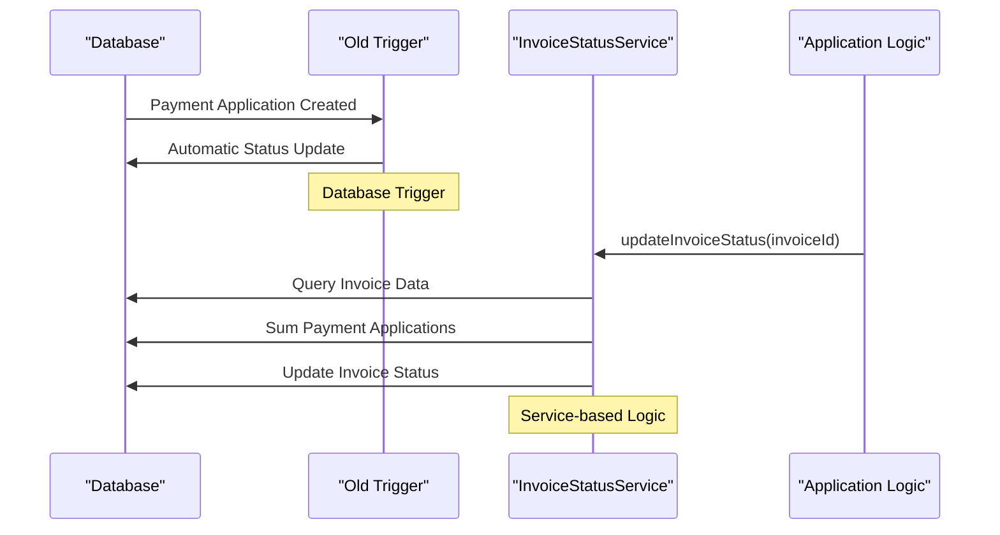

**Diagram sources**
- [InvoiceStatusService.ts:75-91](file://src/modules/finance/services/InvoiceStatusService.ts#L75-L91)

#### Inventory Module Services
The Inventory module implements StockLevelService that replaces complex trigger logic:

- **StockLevelService**: Replaces `inv.fn_update_stock_level()` and `trg_inv_updateStockLevel` triggers
- Handles stock transaction processing with precise delta calculations
- Maintains synchronized stock levels across multiple warehouses

#### Administration Module Services
The Administration module provides comprehensive student management services:

- **StudentManagementService**: Core student record operations
- **StudentPromotionService**: Replaces `sp_adm_promoteStudent` stored procedure
- **AuditLoggerService**: Centralized audit trail management

#### Academics Module Services
The Academics module implements educational grading services:

- **GradingEngineService**: Replaces complex academic grading logic
- **StudentService**: Student academic record management
- Supports multiple grading systems (Letter, Percentage, CBC, GPA, Pass/Fail)

#### TODO Module Services
**New**: The TODO module implements task management services following the same service-based architecture pattern:

- **TaskManagementService**: Core task management operations
- **ReminderService**: Handles task reminders and notifications
- **PriorityManagementService**: Manages task priorities and categorization

**Section sources**
- [registerServices.ts:1-34](file://src/modules/administration/services/registerServices.ts#L1-L34)
- [registerServices.ts:1-22](file://src/modules/academics/services/registerServices.ts#L1-L22)
- [registerServices.ts:1-59](file://src/modules/finance/services/registerServices.ts#L1-L59)
- [registerServices.ts:1-17](file://src/modules/inventory/services/registerServices.ts#L1-L17)
- [InvoiceStatusService.ts:1-248](file://src/modules/finance/services/InvoiceStatusService.ts#L1-L248)
- [StockLevelService.ts:1-202](file://src/modules/inventory/services/StockLevelService.ts#L1-L202)
- [StudentManagementService.ts:1-39](file://src/modules/administration/services/StudentManagementService.ts#L1-L39)
- [StudentPromotionService.ts:1-449](file://src/modules/administration/services/StudentPromotionService.ts#L1-L449)
- [GradingEngineService.ts:1-44](file://src/modules/academics/services/GradingEngineService.ts#L1-L44)

### Service Dependency Injection
Services implement sophisticated dependency injection patterns to replace hardcoded database dependencies:

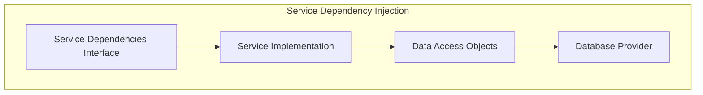

**Diagram sources**
- [InvoiceStatusService.ts:35-44](file://src/modules/finance/services/InvoiceStatusService.ts#L35-L44)
- [StockLevelService.ts:29-38](file://src/modules/inventory/services/StockLevelService.ts#L29-L38)
- [StudentPromotionService.ts:37-42](file://src/modules/administration/services/StudentPromotionService.ts#L37-L42)

### Service Lifecycle Management
Services are managed through the ServiceRegistry with automatic initialization and dependency resolution:

- **Lazy Initialization**: Services are created on-demand
- **Singleton Pattern**: Ensures single instance per service type
- **Dependency Resolution**: Automatic injection of required dependencies
- **Event Emission**: Service lifecycle events for monitoring

**Section sources**
- [ServiceRegistry.ts:47-114](file://src/core/ServiceRegistry.ts#L47-L114)
- [useService.ts:25-111](file://src/hooks/useService.ts#L25-L111)

## Module Augmentation Architecture

**Updated**: SchoolPilot3 implements a revolutionary module augmentation architecture that leverages TypeScript's declaration merging capability to create a unified type system across all 8 functional modules. This architecture replaces the previous monolithic import approach with a distributed, self-registering pattern where each module extends the core AppData types independently through comprehensive appDataAugmentation.ts files.

### Architecture Overview
The module augmentation system operates through a three-tier approach:

1. **Core Type Foundation**: Shared interfaces defined in the core types system
2. **Module-Level Extensions**: Each of the 8 functional modules augments the core types with its specific collections
3. **Compile-Time Merging**: TypeScript merges all module extensions into a unified type system

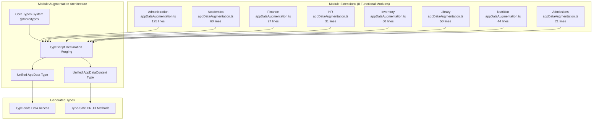

**Diagram sources**
- [administration appDataAugmentation.ts:29-124](file://src/modules/administration/data/appDataAugmentation.ts#L29-L124)
- [academics appDataAugmentation.ts:19-59](file://src/modules/academics/data/appDataAugmentation.ts#L19-L59)
- [finance appDataAugmentation.ts:38-96](file://src/modules/finance/data/appDataAugmentation.ts#L38-L96)
- [hr appDataAugmentation.ts:12-30](file://src/modules/hr/data/appDataAugmentation.ts#L12-L30)
- [inventory appDataAugmentation.ts:17-59](file://src/modules/inventory/data/appDataAugmentation.ts#L17-L59)
- [library appDataAugmentation.ts:19-49](file://src/modules/library/data/appDataAugmentation.ts#L19-L49)
- [nutrition appDataAugmentation.ts:16-43](file://src/modules/nutrition/data/appDataAugmentation.ts#L16-L43)
- [admissions appDataAugmentation.ts:9-20](file://src/modules/admissions/data/appDataAugmentation.ts#L9-L20)

### Self-Registration Pattern
Each of the 8 functional modules implements a comprehensive self-registration pattern through dedicated augmentation files:

- **Location**: `src/modules/{module}/data/appDataAugmentation.ts`
- **Pattern**: Uses `declare module '@/core/types'` syntax
- **Scope**: Extends both `AppDataType` and `AppDataContextType`
- **Automation**: No manual registration required - handled automatically by TypeScript
- **Comprehensiveness**: Each module contributes extensive type definitions and CRUD methods

### Benefits of Module Augmentation
The module augmentation architecture provides several key advantages:

- **Compile-Time Safety**: All type extensions are validated during compilation
- **Zero Runtime Overhead**: No runtime type checking or registration logic
- **Automatic Discovery**: IDEs and TypeScript compiler automatically recognize all collections
- **Type Completeness**: Ensures all module collections are type-safe across the entire system
- **Developer Experience**: Full IntelliSense and autocompletion for all module data
- **Scalability**: Easy to add new modules without affecting existing type systems

**Section sources**
- [administration appDataAugmentation.ts:1-125](file://src/modules/administration/data/appDataAugmentation.ts#L1-L125)
- [academics appDataAugmentation.ts:1-60](file://src/modules/academics/data/appDataAugmentation.ts#L1-L60)
- [finance appDataAugmentation.ts:1-97](file://src/modules/finance/data/appDataAugmentation.ts#L1-L97)
- [hr appDataAugmentation.ts:1-31](file://src/modules/hr/data/appDataAugmentation.ts#L1-L31)
- [inventory appDataAugmentation.ts:1-60](file://src/modules/inventory/data/appDataAugmentation.ts#L1-L60)
- [library appDataAugmentation.ts:1-50](file://src/modules/library/data/appDataAugmentation.ts#L1-L50)
- [nutrition appDataAugmentation.ts:1-44](file://src/modules/nutrition/data/appDataAugmentation.ts#L1-L44)
- [admissions appDataAugmentation.ts:1-21](file://src/modules/admissions/data/appDataAugmentation.ts#L1-L21)

## TypeScript Declaration Merging Pattern

**Updated**: SchoolPilot3 implements a revolutionary TypeScript declaration merging pattern that creates a unified AppData type system across all 8 functional modules. Each module self-registers its data collections through comprehensive appDataAugmentation.ts files, providing compile-time type safety and eliminating runtime type conflicts.

### Declaration Merging Architecture
The system uses TypeScript's module augmentation feature to extend the core AppDataType and AppDataContextType interfaces:

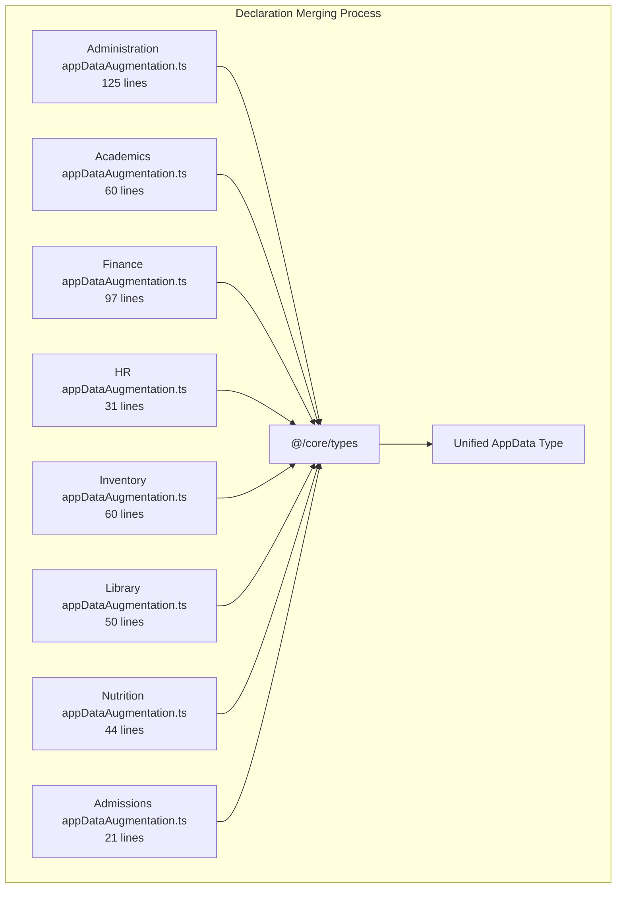

**Diagram sources**
- [administration appDataAugmentation.ts:29-124](file://src/modules/administration/data/appDataAugmentation.ts#L29-L124)
- [academics appDataAugmentation.ts:19-59](file://src/modules/academics/data/appDataAugmentation.ts#L19-L59)
- [finance appDataAugmentation.ts:38-96](file://src/modules/finance/data/appDataAugmentation.ts#L38-L96)
- [hr appDataAugmentation.ts:12-30](file://src/modules/hr/data/appDataAugmentation.ts#L12-L30)
- [inventory appDataAugmentation.ts:17-59](file://src/modules/inventory/data/appDataAugmentation.ts#L17-L59)
- [library appDataAugmentation.ts:19-49](file://src/modules/library/data/appDataAugmentation.ts#L19-L49)
- [nutrition appDataAugmentation.ts:16-43](file://src/modules/nutrition/data/appDataAugmentation.ts#L16-L43)
- [admissions appDataAugmentation.ts:9-20](file://src/modules/admissions/data/appDataAugmentation.ts#L9-L20)

### Comprehensive Module-Specific Data Collections

#### Administration Module
The Administration module provides the most comprehensive self-registration with 53 data collections and extensive CRUD methods:

**Core Entities**: students, staff, classes, classStreams, departments, designations, studentCategories, dormitories, parentsGuardians, academicYears, schoolPeriods, academicYearStructures, academicPeriodDefinitions, timetablePeriodDefs

**Administration-Specific Entities**: partners, clubs, customers, studentHealthRecords, studentAttendance, templatesComm, campaigns

**Report Collections**: staffAttendanceRecords, staffIDCards, studentBioData, studentIDCards, transferCertificateStudents

**CRUD Methods**: 23 comprehensive CRUD methods for student, staff, class, department, and administrative operations

#### Academics Module
The Academics module provides comprehensive educational data management with 11 collections:

**Subject Management**: subjects, subjectPapers, classSubjectAllocations, teacherSubjectAssignments, studentSubjectEnrollments

**Assessment**: examSessions, examPaperSettings, studentExamResults, gradingSchemes

**Timetable**: timetableEntries, educationSystemConfigurations

**CRUD Methods**: 14 methods covering exam sessions, paper settings, schedule management, and education configurations

#### Finance Module
The Finance module implements complete financial management with 27 collections:

**Chart of Accounts**: chartOfAccounts, expenseCategories, banks, suppliers, supplierContracts

**Student Billing**: feeTemplates, feeTemplateItems, studentInvoices, studentInvoiceItems, feeAdjustments, invoicePaymentApplications, studentOpeningBalances

**Payments**: studentPayments, generalPayments, studentPaymentRecords

**Transactions**: generalLedgerEntries, journalEntries, trialBalanceItems, balanceSheetItems, cashBookEntries, dayBookEntries, incomeStatementItems, receiptTemplates, previousSessionFees

**Transport**: transportRoutes, studentTransportAssignments

**CRUD Methods**: 17 methods covering banking, invoicing, payments, and financial reporting

#### HR Module
The HR module handles payroll and staff management with 4 collections:

**Payroll**: payrollPeriods, payrollItemTypes, staffSalarySettings, payslips

**CRUD Methods**: 6 methods for payroll period and payslip management

#### Inventory Module
The Inventory module manages procurement and stock with 10 collections:

**Items**: warehouses, itemCategoriesInv, itemsInv, fixedAssets

**Transactions**: stockLevels, stockTransactions, requisitions, purchaseOrders, supplierContracts

**CRUD Methods**: 14 methods covering warehouse management, item tracking, and procurement processes

#### Library Module
The Library module provides book and nutrition management with 8 collections:

**Library**: bookCategories, books, loans, fines

**Nutrition Collections**: mealPlans, menus, merchants, studentMealPlans, mealConsumptionLogs, walletTransactions, studentWallets

**CRUD Methods**: 15 methods covering book lending, fine management, and nutrition operations

#### Nutrition Module
The Nutrition module (implemented through Library module for historical reasons) manages meal plans and transactions with 7 collections:

**Collections**: mealPlans, menus, merchants, studentMealPlans, mealConsumptionLogs, walletTransactions, studentWallets

**CRUD Methods**: 15 methods covering meal planning, menu management, and nutrition transactions

#### Admissions Module
The Admissions module handles application management with 1 collection:

**Applications**: applications

**CRUD Methods**: 3 methods for application management

### Type Safety Benefits
The comprehensive declaration merging pattern provides several critical benefits:

- **Compile-Time Validation**: All 8 module types are validated at compile time
- **No Runtime Conflicts**: Multiple modules cannot define conflicting types
- **Complete Coverage**: All 8 modules contribute type-safe collections across the entire system
- **IDE Support**: Full IntelliSense and autocompletion across all 8 modules
- **Refactoring Safety**: Changes in one module don't break others due to type conflicts
- **Method Completeness**: Each module provides comprehensive CRUD methods for its collections

**Section sources**
- [administration appDataAugmentation.ts:1-125](file://src/modules/administration/data/appDataAugmentation.ts#L1-L125)
- [academics appDataAugmentation.ts:1-60](file://src/modules/academics/data/appDataAugmentation.ts#L1-L60)
- [finance appDataAugmentation.ts:1-97](file://src/modules/finance/data/appDataAugmentation.ts#L1-L97)
- [hr appDataAugmentation.ts:1-31](file://src/modules/hr/data/appDataAugmentation.ts#L1-L31)
- [inventory appDataAugmentation.ts:1-60](file://src/modules/inventory/data/appDataAugmentation.ts#L1-L60)
- [library appDataAugmentation.ts:1-50](file://src/modules/library/data/appDataAugmentation.ts#L1-L50)
- [nutrition appDataAugmentation.ts:1-44](file://src/modules/nutrition/data/appDataAugmentation.ts#L1-L44)
- [admissions appDataAugmentation.ts:1-21](file://src/modules/admissions/data/appDataAugmentation.ts#L1-L21)

## New TODO Module Integration

**Updated**: SchoolPilot3 now includes a comprehensive TODO module that provides task management and reminder functionality, following the established architectural patterns and service-based approach.

### TODO Module Structure
The TODO module follows the standard module structure with specialized components for task management:

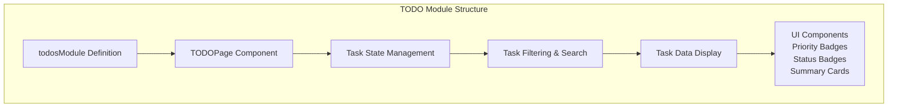

**Diagram sources**
- [todos moduleDefinition.tsx:7-30](file://src/modules/todos/moduleDefinition.tsx#L7-L30)
- [TODOPage.tsx:26-120](file://src/modules/todos/pages/TODOPage.tsx#L26-L120)

### Task Management Features
The TODO module provides comprehensive task management functionality:

- **Task Creation**: Add new tasks with title, description, priority, status, and category
- **Task Editing**: Modify existing tasks with inline editing capabilities
- **Task Completion**: Toggle task completion status with visual indicators
- **Task Deletion**: Remove tasks with confirmation dialogs
- **Filtering**: Filter tasks by status, priority, and search terms
- **Categorization**: Organize tasks by categories (Finance, Academics, HR, etc.)
- **Priority Management**: Set task priorities (Low, Medium, High)
- **Due Dates**: Set and display task due dates

### Module Definition and Integration
The TODO module integrates seamlessly with the existing module system:

- **Module ID**: 'todos' with consistent naming conventions
- **Navigation**: Integrated into the main navigation system
- **Features**: Includes 'task-management' feature flag
- **Dependencies**: No external dependencies, making it lightweight
- **Settings**: Configurable features for task management capabilities

**Section sources**
- [todos moduleDefinition.tsx:1-33](file://src/modules/todos/moduleDefinition.tsx#L1-L33)
- [TODOPage.tsx:1-458](file://src/modules/todos/pages/TODOPage.tsx#L1-L458)

## Internationalization Approach

**Updated**: The TODO module includes comprehensive internationalization support following the established modular i18n pattern used throughout the system.

### Modular Translation Loading
The internationalization system dynamically loads translations from module directories:

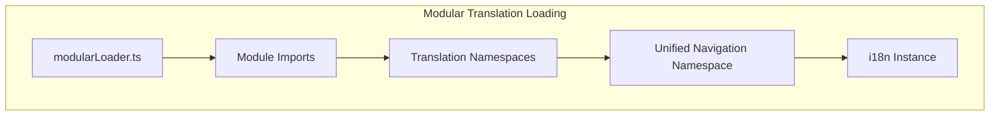

**Diagram sources**
- [modularLoader.ts:6-92](file://src/i18n/modularLoader.ts#L6-L92)
- [i18n.ts:14-117](file://src/i18n/i18n.ts#L14-L117)

### TODO Module i18n Integration
The TODO module follows the standard i18n structure with namespace support:

- **Namespace**: Uses 'todos' namespace for module-specific translations
- **Navigation Integration**: Integrates with unified navigation translations
- **Static Translations**: Supports static translation files from locales directory
- **Dynamic Loading**: Automatically loads translations during module initialization

### Translation Structure
The i18n system supports multiple languages with unified namespace handling:

- **Supported Languages**: English, French, Swahili, Kinyarwanda
- **Namespace Organization**: Module-specific namespaces merged into unified structure
- **Navigation Consolidation**: All module navigation translations consolidated into 'navigation' namespace
- **Fallback Support**: Graceful fallback to default translations when modules are missing

**Section sources**
- [modularLoader.ts:12-92](file://src/i18n/modularLoader.ts#L12-L92)
- [i18n.ts:14-117](file://src/i18n/i18n.ts#L14-L117)
- [I18nManager.ts:17-414](file://src/i18n/I18nManager.ts#L17-L414)

## Dependency Analysis
The system enforces dependency management with version constraints and resolves loading order to prevent circular dependencies. The module configuration demonstrates inter-module dependencies (e.g., reports depends on administration, academics, and finance). **Updated**: The TODO module is designed as a standalone module with no dependencies, making it easy to integrate and maintain. **New**: The comprehensive declaration merging pattern ensures type safety across all 8 module boundaries without runtime conflicts.

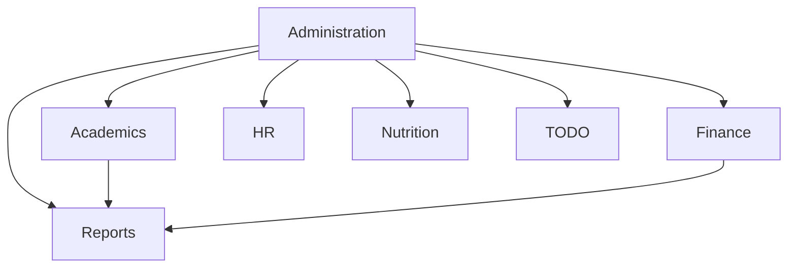

**Diagram sources**
- [modules.json:67-74](file://src/config/modules.json#L67-L74)

**Section sources**
- [modules.json:1-74](file://src/config/modules.json#L1-L74)
- [DependencyResolver.ts:119-158](file://src/core/DependencyResolver.ts#L119-L158)

## Performance Considerations
- Parallel loading: ModuleRegistry supports parallel initialization based on dependency levels to reduce startup time.
- Retry and timeout: ModuleLoader applies retry attempts with exponential backoff-like delays and configurable timeouts.
- Lazy loading: Modules are loaded on demand via factories, minimizing initial bundle size.
- Caching: ServiceRegistry caches singleton instances to avoid repeated initialization overhead.
- **Updated**: Service-based architecture reduces database load by implementing business logic in application layer, improving performance and maintainability.
- **New**: Comprehensive declaration merging occurs at compile time, eliminating runtime type checking overhead.
- **New**: Unified AppData type provides optimized memory usage and faster property access across 8 modules.
- **New**: TODO module uses memoization for filtered task lists to optimize rendering performance.

## Troubleshooting Guide
Common issues and resolutions:
- Circular dependencies: Detected during dependency resolution; fix by adjusting module dependencies.
- Module load failures: Investigate retry logs and error emissions from ModuleLoader.
- Service initialization errors: Check ServiceRegistry events and factory dependencies.
- Export validation failures: Review ModuleExportsManager validation results for undeclared or missing exports.
- **Updated**: Service dependency injection failures: Verify service dependencies are properly registered and injected.
- **Updated**: Declaration merging conflicts: Check for duplicate type definitions across modules.
- **Updated**: AppData type errors: Ensure all 8 modules properly implement their appDataAugmentation.ts files.
- **New**: TODO module rendering issues: Check task filtering logic and ensure proper state management for filtered lists.

**Section sources**
- [moduleRegistry.ts:112-133](file://src/core/moduleRegistry.ts#L112-L133)
- [moduleLoader.ts:162-179](file://src/core/moduleLoader.ts#L162-L179)
- [ServiceRegistry.ts:110-114](file://src/core/ServiceRegistry.ts#L110-L114)
- [ModuleExports.ts:210-270](file://src/core/ModuleExports.ts#L210-L270)

## Conclusion
SchoolPilot3's modular architecture enables scalable, maintainable, and type-safe development across business domains. **Updated**: The comprehensive service-based architecture successfully replaces traditional database triggers and stored procedures with sophisticated service implementations, providing better maintainability, testability, and business logic control. The implementation of TypeScript declaration merging creates a revolutionary unified type system where each of the 8 functional modules self-registers its data collections, ensuring complete type safety across all module boundaries. The addition of the TODO module demonstrates the system's extensibility and adherence to established architectural patterns. Through module federation, dynamic loading, lifecycle management, and robust dependency resolution, the system supports flexible growth and integration. The standardized module structure, strict type contracts, and compile-time validation ensure predictable inter-module communication and reliable system behavior.

## Appendices

### Module Structure Standards
- Standard structure: components/, data/, hooks/, i18n/, pages/, services/, strategies/, index.ts, lifecycle.ts, moduleDefinition.tsx, module.json, rbac.ts
- Subdirectory guidelines: Use subdirectories for distinct feature areas with multiple related files
- Cross-module dependencies: Prefer shared data hooks and service access over direct imports
- **Updated**: Service registration: Each module must implement a registerServices.ts file for centralized service management
- **Updated**: Data collection registration: Each module must implement a comprehensive appDataAugmentation.ts file for TypeScript declaration merging
- **New**: Internationalization: Each module should include i18n/ directory with translation files following namespace conventions

**Section sources**
- [MODULE_STRUCTURE_STANDARD.md:1-109](file://docs/architecture/MODULE_STRUCTURE_STANDARD.md#L1-L109)

### Module Registration and Initialization
- Dynamic factories: ModuleRegistration registers factories for all modules and converts module definitions to LoadedModule format
- Batch registration: Modules can be registered and initialized in dependency order
- Auto-enable: Modules can be automatically enabled upon registration
- **Updated**: Service initialization: Modules initialize services through centralized registration files
- **Updated**: Comprehensive declaration merging: Modules participate in TypeScript declaration merging during compilation
- **New**: TODO module registration: Follows same registration pattern as other modules with dynamic factory registration

**Section sources**
- [moduleRegistration.ts:129-230](file://src/core/moduleRegistration.ts#L129-L230)
- [moduleRegistry.ts:72-102](file://src/core/moduleRegistry.ts#L72-L102)

### Inter-Module Communication Patterns
- Services: Use ServiceRegistry to register and retrieve cross-module services
- Exports: Use ModuleExportsManager to register and validate exports; search and find services across modules
- Navigation: Dynamic navigation items are built from enabled modules' metadata
- **Updated**: Service-based communication: Replace direct database calls with service invocations for better abstraction
- **Updated**: Type-safe data access: Use unified AppData type for cross-module data access across 8 modules
- **New**: TODO module integration: Can be extended to communicate with other modules through service registry and unified data types

**Section sources**
- [ServiceRegistry.ts:47-114](file://src/core/ServiceRegistry.ts#L47-L114)
- [ModuleExports.ts:144-172](file://src/core/ModuleExports.ts#L144-L172)
- [moduleLoader.ts:451-515](file://src/core/moduleLoader.ts#L451-L515)

### Example: Creating a New Module
Steps to create a new module:
1. Define module metadata in moduleDefinition.tsx with id, name, navigation, dependencies, and optionalDependencies
2. Declare exports (services, entities, hooks, components, utils, types) and register them via ModuleExportsManager
3. Register the module with ModuleRegistry and initialize services with ServiceRegistry
4. Integrate navigation and settings as needed
5. **Updated**: Implement service registration in registerServices.ts for centralized service management
6. **Updated**: Implement comprehensive TypeScript declaration merging in appDataAugmentation.ts for type-safe data collections
7. **New**: Add internationalization support with i18n/ directory and translation files
8. **New**: Implement TODO module pattern with proper state management and filtering

**Section sources**
- [administration moduleDefinition.tsx:35-184](file://src/modules/administration/moduleDefinition.tsx#L35-L184)
- [ModuleExports.ts:38-51](file://src/core/ModuleExports.ts#L38-L51)
- [ServiceRegistry.ts:47-62](file://src/core/ServiceRegistry.ts#L47-L62)

### Dependency Declaration and Version Constraints
- Required dependencies: Must be present and enabled before the dependent module can be enabled
- Optional dependencies: Enhance functionality but are not required
- Version constraints: Semver ranges define compatibility requirements

**Section sources**
- [module.ts:15-39](file://src/core/types/module.ts#L15-L39)
- [moduleRegistration.ts:71-83](file://src/core/moduleRegistration.ts#L71-L83)

### Integration with Central Database Schema
Modules declare schemas and migrations in their metadata. The central database schema evolves through module contributions, with migrations managed per module and validated during registration.

**Section sources**
- [module.ts:209-215](file://src/core/types/module.ts#L209-L215)
- [moduleRegistration.ts:84-85](file://src/core/moduleRegistration.ts#L84-L85)

### External Dependencies and Tooling
- Package dependencies: Managed via package.json with extensive libraries for UI, data, and integrations
- Scripts: Linting, testing, and migration helpers support modular development workflows

**Section sources**
- [package.json:66-161](file://package.json#L66-L161)

### Service-Based Migration Examples

#### Finance Module Migration
The Finance module demonstrates comprehensive service replacement:

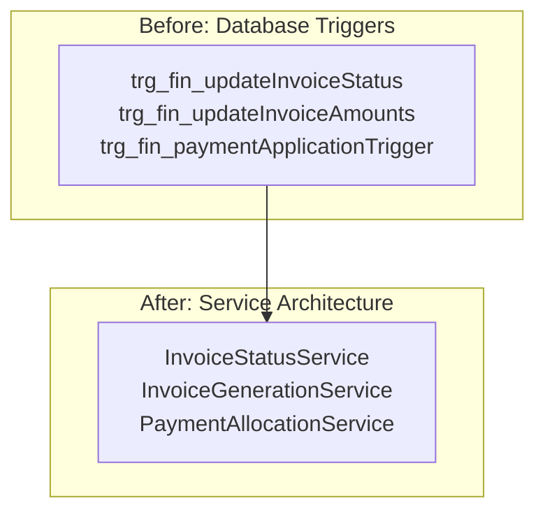

**Diagram sources**
- [InvoiceStatusService.ts:2-3](file://src/modules/finance/services/InvoiceStatusService.ts#L2-L3)

#### Inventory Module Migration
The Inventory module shows trigger replacement:

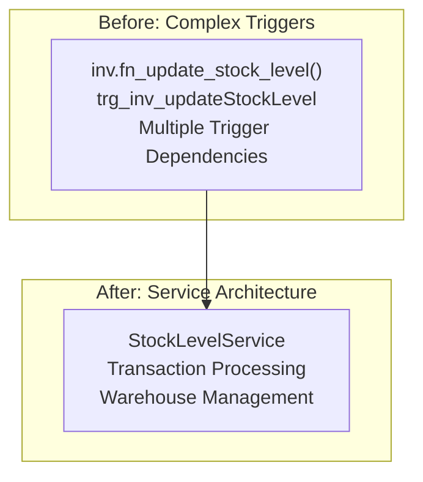

**Diagram sources**
- [StockLevelService.ts:1-3](file://src/modules/inventory/services/StockLevelService.ts#L1-L3)

#### TODO Module Service Architecture
**New**: The TODO module follows the same service-based pattern:

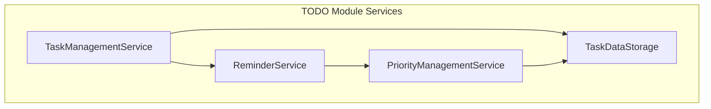

**Diagram sources**
- [TODOPage.tsx:14-24](file://src/modules/todos/pages/TODOPage.tsx#L14-L24)

### TypeScript Declaration Merging Examples

#### Comprehensive Unified AppData Type Creation
The declaration merging pattern creates a unified type system across 8 modules:

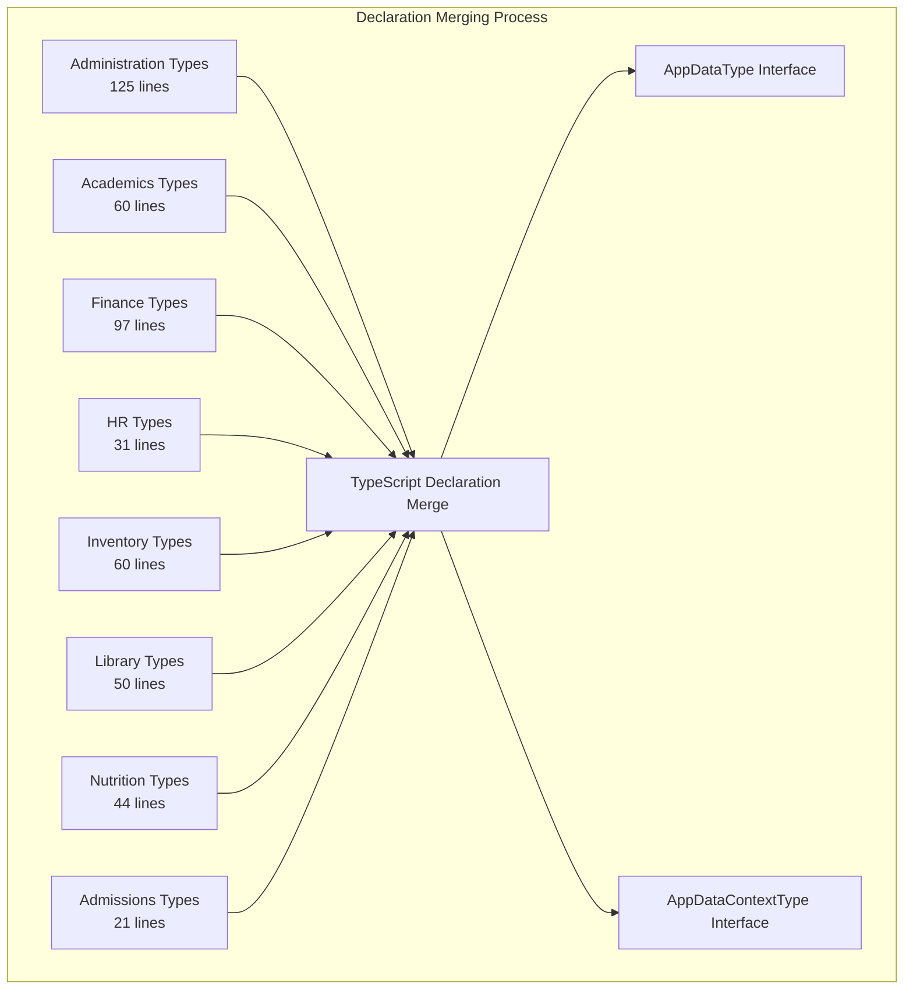

**Diagram sources**
- [administration appDataAugmentation.ts:29-60](file://src/modules/administration/data/appDataAugmentation.ts#L29-L60)
- [academics appDataAugmentation.ts:19-32](file://src/modules/academics/data/appDataAugmentation.ts#L19-L32)
- [finance appDataAugmentation.ts:38-72](file://src/modules/finance/data/appDataAugmentation.ts#L38-L72)
- [hr appDataAugmentation.ts:12-18](file://src/modules/hr/data/appDataAugmentation.ts#L12-L18)
- [inventory appDataAugmentation.ts:17-31](file://src/modules/inventory/data/appDataAugmentation.ts#L17-L31)
- [library appDataAugmentation.ts:19-33](file://src/modules/library/data/appDataAugmentation.ts#L19-L33)
- [nutrition appDataAugmentation.ts:16-27](file://src/modules/nutrition/data/appDataAugmentation.ts#L16-L27)
- [admissions appDataAugmentation.ts:9-12](file://src/modules/admissions/data/appDataAugmentation.ts#L9-L12)

**Section sources**
- [administration appDataAugmentation.ts:1-125](file://src/modules/administration/data/appDataAugmentation.ts#L1-L125)
- [academics appDataAugmentation.ts:1-60](file://src/modules/academics/data/appDataAugmentation.ts#L1-L60)
- [finance appDataAugmentation.ts:1-97](file://src/modules/finance/data/appDataAugmentation.ts#L1-L97)
- [hr appDataAugmentation.ts:1-31](file://src/modules/hr/data/appDataAugmentation.ts#L1-L31)
- [inventory appDataAugmentation.ts:1-60](file://src/modules/inventory/data/appDataAugmentation.ts#L1-L60)
- [library appDataAugmentation.ts:1-50](file://src/modules/library/data/appDataAugmentation.ts#L1-L50)
- [nutrition appDataAugmentation.ts:1-44](file://src/modules/nutrition/data/appDataAugmentation.ts#L1-L44)
- [admissions appDataAugmentation.ts:1-21](file://src/modules/admissions/data/appDataAugmentation.ts#L1-L21)
- [InvoiceStatusService.ts:1-248](file://src/modules/finance/services/InvoiceStatusService.ts#L1-L248)
- [StockLevelService.ts:1-202](file://src/modules/inventory/services/StockLevelService.ts#L1-L202)
- [StudentPromotionService.ts:1-449](file://src/modules/administration/services/StudentPromotionService.ts#L1-L449)
- [GradingEngineService.ts:1-44](file://src/modules/academics/services/GradingEngineService.ts#L1-L44)
- [TODOPage.tsx:14-24](file://src/modules/todos/pages/TODOPage.tsx#L14-L24)