# Nutrition Module

<cite>
**Referenced Files in This Document**
- [moduleDefinition.tsx](file://src/modules/nutrition/moduleDefinition.tsx)
- [index.ts](file://src/modules/nutrition/index.ts)
- [types.ts](file://src/modules/nutrition/data/types.ts)
- [schema.ts](file://src/modules/nutrition/data/schema.ts)
- [collections.ts](file://src/modules/nutrition/data/collections.ts)
- [collectionConfig.ts](file://src/modules/nutrition/data/collectionConfig.ts)
- [NutritionDataContext.tsx](file://src/modules/nutrition/data/NutritionDataContext.tsx)
- [NutritionDataProvider.tsx](file://src/modules/nutrition/data/NutritionDataProvider.tsx)
- [useMealPlanData.ts](file://src/modules/nutrition/data/useMealPlanData.ts)
- [useMenuData.ts](file://src/modules/nutrition/data/useMenuData.ts)
- [useStudentWalletData.ts](file://src/modules/nutrition/data/useStudentWalletData.ts)
- [useWalletTransactionData.ts](file://src/modules/nutrition/data/useWalletTransactionData.ts)
- [useSafeNutritionContext.ts](file://src/modules/nutrition/data/useSafeNutritionContext.ts)
- [KitchenManagementPage.tsx](file://src/modules/nutrition/pages/KitchenManagementPage.tsx)
- [NutritionDashboardPage.tsx](file://src/modules/nutrition/pages/NutritionDashboardPage.tsx)
- [rbac.ts](file://src/modules/nutrition/rbac.ts)
- [loader.ts](file://src/i18n/loader.ts)
- [nutrition.json](file://src/i18n/locales/fr/nutrition.json)
- [appDataAugmentation.ts](file://src/modules/nutrition/data/appDataAugmentation.ts)
- [app-data.ts](file://src/core/types/app-data.ts)
- [moduleRegistry.ts](file://src/core/moduleRegistry.ts)
- [types.ts](file://src/modules/library/data/types.ts)
- [collections.ts](file://src/modules/library/data/collections.ts)
- [index.ts](file://src/modules/library/data/index.ts)
</cite>

## Update Summary
**Changes Made**
- Updated documentation to reflect the enhanced module augmentation system with comprehensive TypeScript declaration merging pattern
- Added detailed coverage of the 43-line appDataAugmentation.ts implementation that extends AppDataType and AppDataContextType
- Enhanced type system documentation to show sophisticated cross-module imports from library module
- Updated data models section to include new kitchen management collections and schemas
- Expanded documentation of report/view collections for analytics and kitchen operations
- Added comprehensive coverage of nutrition data type safety and circular dependency resolution

## Table of Contents
1. [Introduction](#introduction)
2. [Project Structure](#project-structure)
3. [Core Components](#core-components)
4. [Database Architecture](#database-architecture)
5. [Data Models and Schemas](#data-models-and-schemas)
6. [Database Collections](#database-collections)
7. [Data Provider and Hooks](#data-provider-and-hooks)
8. [Type System and Circular Dependency Resolution](#type-system-and-circular-dependency-resolution)
9. [Internationalization Architecture](#internationalization-architecture)
10. [Meal Management System](#meal-management-system)
11. [Student Wallet System](#student-wallet-system)
12. [Merchant Management](#merchant-management)
13. [Consumption Tracking System](#consumption-tracking-system)
14. [Kitchen Management System](#kitchen-management-system)
15. [Dashboard and Reporting](#dashboard-and-reporting)
16. [RBAC Permissions](#rbac-permissions)
17. [Integration Points](#integration-points)
18. [Performance Considerations](#performance-considerations)
19. [Troubleshooting Guide](#troubleshooting-guide)
20. [Conclusion](#conclusion)

## Introduction
The Nutrition module provides a comprehensive database-backed system for managing student meals, merchant operations, and wallet finances within educational institutions. The module has been significantly enhanced with the addition of KitchenManagementPage, which introduces food inventory management, meal planning capabilities, and dietary restriction tracking with supplier management and cost analysis features.

The module encompasses four primary functional areas:
- **Meal Management**: Database-backed meal plans, student assignments, and daily menu tracking
- **Merchant Management**: Vendor profiles with financial integration and sales tracking
- **Wallet System**: Student financial accounts with transaction history and balance management
- **Kitchen Operations**: Food inventory management, supplier tracking, and meal preparation coordination

Built on a modern React architecture with TypeScript type safety and database-backed operations, the module integrates with the unified database service and comprehensive internationalization system to deliver a scalable and maintainable nutrition services platform with enhanced kitchen management capabilities.

**Updated** The module now implements a sophisticated type system that resolves circular dependencies through cross-module imports from the library module, providing a single source of truth for shared types while maintaining module isolation. The new module augmentation pattern in appDataAugmentation.ts demonstrates advanced TypeScript declaration merging techniques for extending the core AppDataType interface with nutrition-specific collections and operations.

## Project Structure
The Nutrition module follows a modern modular architecture with clear separation of concerns across data contexts, standardized hooks, UI components, business logic, and internationalization support. The module has been restructured to support database-backed operations through a facade pattern implementation and comprehensive i18n integration, now including kitchen management functionality.

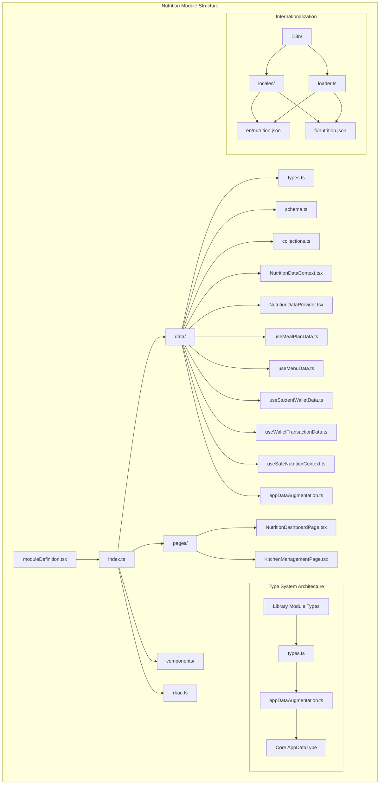

**Diagram sources**
- [moduleDefinition.tsx:16-67](file://src/modules/nutrition/moduleDefinition.tsx#L16-L67)
- [index.ts:1-27](file://src/modules/nutrition/index.ts#L1-L27)
- [appDataAugmentation.ts:1-44](file://src/modules/nutrition/data/appDataAugmentation.ts#L1-L44)
- [types.ts:1-124](file://src/modules/nutrition/data/types.ts#L1-L124)
- [loader.ts:36-65](file://src/i18n/loader.ts#L36-L65)

**Section sources**
- [moduleDefinition.tsx:16-67](file://src/modules/nutrition/moduleDefinition.tsx#L16-L67)
- [index.ts:1-27](file://src/modules/nutrition/index.ts#L1-L27)

## Core Components
The module's core functionality is built around a modern data context facade pattern with standardized hooks that provide database-backed operations through a unified interface, enhanced with comprehensive internationalization support and expanded kitchen management capabilities.

### Modular Data Context Architecture
The module implements a facade pattern through the NutritionDataContext that wraps the useNutritionData hook, providing a clean interface for data access while maintaining database integration. The architecture emphasizes:
- **Facade Pattern**: Centralized data access through NutritionDataContext
- **Standardized Hooks**: Consistent interface across all data operations
- **Database Integration**: Direct integration with unified database service
- **Type Safety**: Comprehensive TypeScript interfaces for all operations
- **Internationalization**: Seamless i18n integration with translation namespaces
- **Kitchen Operations**: Integrated food inventory and supplier management

### Safe Context Hook Implementation
The useSafeNutritionContext hook provides a robust mechanism for handling module enable/disable scenarios, returning empty data structures when the nutrition module is disabled while maintaining type safety for consuming components.

### Data Hook Factory Pattern
The module uses a standardized data hook factory pattern that provides consistent CRUD operations, error handling, and state management across all data entities, with built-in internationalization support and kitchen management extensions.

### Service Integration
The module integrates with the unified database service for all data operations and leverages the centralized i18n system for user-facing text management, now including kitchen management translations.

**Section sources**
- [NutritionDataContext.tsx:1-36](file://src/modules/nutrition/data/NutritionDataContext.tsx#L1-L36)
- [NutritionDataProvider.tsx:1-116](file://src/modules/nutrition/data/NutritionDataProvider.tsx#L1-L116)
- [useMealPlanData.ts:1-29](file://src/modules/nutrition/data/useMealPlanData.ts#L1-L29)
- [useSafeNutritionContext.ts:1-22](file://src/modules/nutrition/data/useSafeNutritionContext.ts#L1-L22)

## Database Architecture
The Nutrition module employs a sophisticated database architecture built on a unified database service with RxDB collections for comprehensive data persistence and real-time synchronization, integrated with the centralized internationalization system and enhanced with kitchen management capabilities.

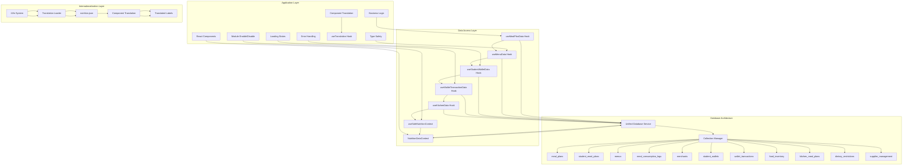

**Diagram sources**
- [collections.ts:6-28](file://src/modules/nutrition/data/collections.ts#L6-L28)
- [NutritionDataContext.tsx:12-25](file://src/modules/nutrition/data/NutritionDataContext.tsx#L12-L25)
- [useSafeNutritionContext.ts:5-22](file://src/modules/nutrition/data/useSafeNutritionContext.ts#L5-L22)
- [loader.ts:36-65](file://src/i18n/loader.ts#L36-L65)

The database architecture emphasizes:
- **Unified Service**: Single database service for all collections
- **Schema Validation**: Database-agnostic schemas ensure data integrity
- **Index Optimization**: Strategic indexing for common query patterns
- **Cross-Reference Support**: References between related collections
- **Real-time Synchronization**: Automatic data updates across sessions
- **Internationalization Integration**: Seamless translation management
- **Kitchen Operations**: Dedicated collections for food inventory and supplier management
- **Module Safety**: Safe context handling for enable/disable scenarios

## Data Models and Schemas
The module defines comprehensive TypeScript interfaces and database schemas for all nutrition entities, ensuring type safety and data consistency across the entire system, with internationalization support for user-facing labels and expanded kitchen management models.

### Core Entity Interfaces
The data model uses a dual-interface approach with both core types and nutrition-specific interfaces to avoid conflicts while maintaining clarity and supporting internationalization. The kitchen management system adds new entity types for food inventory and supplier tracking.

**Updated** The module now imports core nutrition types from the library module to resolve circular dependencies and provide a single source of truth for shared types.

```mermaid
classDiagram
class LibraryMealPlan {
+number id
+string name
+string description
+number cost_per_period
+string created_at
+string updated_at
}
class LibraryStudentMealPlan {
+string id
+string student_id
+number school_period_id
+number meal_plan_id
+StudentMealPlanStatus status
+string created_at
+string updated_at
+string student_name
+string school_period_name
+string meal_plan_name
}
class LibraryMenu {
+string id
+string menu_date
+MealType meal_type
+string description
+string created_at
+string updated_at
}
class LibraryStudentWallet {
+string student_id
+number balance
+string last_updated
+string student_name
}
class LibraryWalletTransaction {
+string id
+string student_id
+string transaction_date
+WalletTransactionType transaction_type
+number amount
+string description
+string reference_id
+string reference_type
+number running_balance
+string student_name
}
class LibraryMerchant {
+number id
+string name
+number gl_account_id
+string created_at
+string updated_at
+string gl_account_name
}
class LibraryMealConsumptionLog {
+string id
+string student_id
+string menu_id
+string consumption_time
+number charged_amount
+string wallet_transaction_id
+string student_name
+string menu_description
+MealType menu_meal_type
+string menu_date
}
class NutrMealPlanType {
+number id
+string name
+string description
+number cost_per_period
+string created_at
+string updated_at
}
class NutrStudentMealPlanType {
+string id
+string student_id
+number school_period_id
+number meal_plan_id
+NutrStudentMealPlanStatusEnum status
+string start_date
+string end_date
+string created_at
+string updated_at
+string student_name
+string school_period_name
+string meal_plan_name
}
class NutrMenuType {
+string id
+string menu_date
+NutrMealTypeEnum meal_type
+string description
+string created_at
+string updated_at
}
class NutrStudentWalletType {
+string student_id
+number balance
+string last_updated
+string student_name
}
class NutrWalletTransactionType {
+string id
+string student_id
+string transaction_date
+NutrWalletTransactionType transaction_type
+number amount
+string description
+string reference_id
+string reference_type
+number running_balance
+string student_name
}
class NutrMerchantType {
+number id
+string name
+number gl_account_id
+string created_at
+string updated_at
+string gl_account_name
}
class NutrMealConsumptionLogType {
+string id
+string student_id
+string menu_id
+string consumption_time
+number charged_amount
+string wallet_transaction_id
+string student_name
+string menu_description
+NutrMealTypeEnum menu_meal_type
+string menu_date
}
class FoodItem {
+string id
+string name
+string category
+number quantity
+number min_stock_level
+string unit
+string supplier
+number cost_per_unit
+number total_cost
+string last_restocked
+string expiry_date
+InventoryStatus status
+DietaryRestriction[] dietary_suitable
}
class KitchenMealPlan {
+string id
+string meal_type
+string day
+string[] menu_items
+DietaryRestriction[] dietary_options
+number estimated_cost_per_student
+number total_students
+number total_cost
}
```

**Diagram sources**
- [types.ts:4-124](file://src/modules/nutrition/data/types.ts#L4-L124)
- [types.ts:86-124](file://src/modules/nutrition/data/types.ts#L86-L124)
- [types.ts:89-124](file://src/modules/nutrition/data/types.ts#L89-L124)

### Enumerations and Constants
The module defines specific enumerations for status values, meal types, transaction types, and inventory status to ensure consistent data representation, with corresponding internationalization support. The kitchen management system introduces new enumerations for inventory status and dietary restriction types.

**Section sources**
- [types.ts:6-124](file://src/modules/nutrition/data/types.ts#L6-L124)

## Database Collections
The module implements a comprehensive collection system using RxDB collections with unified schema definitions for all nutrition entities, integrated with the centralized internationalization system and enhanced with kitchen management collections.

### Collection Configuration
Each collection is configured with specific schemas, indexes, and relationships to optimize query performance and data integrity, with translation support for user-facing labels. The kitchen management system adds new collections for food inventory, kitchen meal plans, and dietary restrictions.

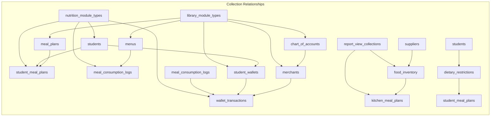

**Diagram sources**
- [collections.ts:6-28](file://src/modules/nutrition/data/collections.ts#L6-L28)
- [schema.ts:32-187](file://src/modules/nutrition/data/schema.ts#L32-L187)
- [types.ts:4-124](file://src/modules/nutrition/data/types.ts#L4-L124)

### Collection Aliases and Mapping
The module provides collection alias mapping for easier integration with the unified database management system, with internationalization support for collection labels. The kitchen management system extends this mapping to include new collections.

**Section sources**
- [collections.ts:6-32](file://src/modules/nutrition/data/collections.ts#L6-L32)
- [collectionConfig.ts:4-19](file://src/modules/nutrition/data/collectionConfig.ts#L4-L19)

## Data Provider and Hooks
The module implements a sophisticated data provider and hook system that manages database connections, state management, and real-time data synchronization through a facade pattern, enhanced with comprehensive internationalization support and expanded kitchen management capabilities.

### Nutrition Data Context Facade
The NutritionDataContext serves as the central data access component, wrapping the useNutritionData hook with a clean React context interface that provides database-backed operations with seamless i18n integration and kitchen management support.

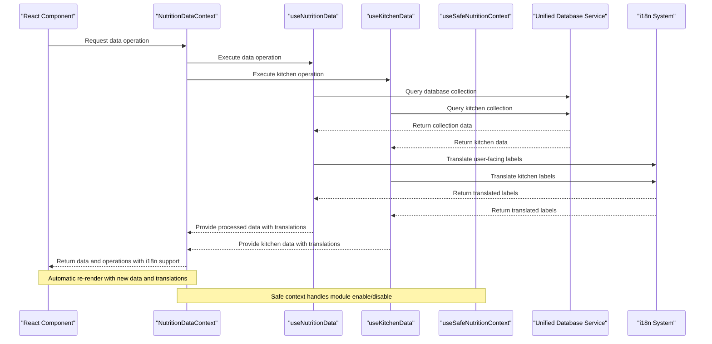

**Diagram sources**
- [NutritionDataContext.tsx:12-25](file://src/modules/nutrition/data/NutritionDataContext.tsx#L12-L25)
- [useSafeNutritionContext.ts:5-22](file://src/modules/nutrition/data/useSafeNutritionContext.ts#L5-L22)
- [loader.ts:36-65](file://src/i18n/loader.ts#L36-L65)

### Standardized Data Hooks
The module uses a factory pattern to create standardized data hooks that provide consistent CRUD operations, error handling, state management, and built-in internationalization support across all entities, including new hooks for kitchen management operations.

**Section sources**
- [NutritionDataContext.tsx:1-36](file://src/modules/nutrition/data/NutritionDataContext.tsx#L1-L36)
- [NutritionDataProvider.tsx:1-116](file://src/modules/nutrition/data/NutritionDataProvider.tsx#L1-L116)
- [useMealPlanData.ts:1-29](file://src/modules/nutrition/data/useMealPlanData.ts#L1-L29)

## Type System and Circular Dependency Resolution
The Nutrition module implements a sophisticated type system architecture designed to resolve circular dependencies while maintaining type safety and modularity. This system leverages cross-module imports from the library module to provide a single source of truth for shared types.

### Cross-Module Type Import Strategy
The module imports core nutrition types from the library module (`@/modules/library/data/types`) to avoid circular dependencies that would otherwise occur if the nutrition module tried to import types from itself or other modules. This approach ensures:

- **Single Source of Truth**: All shared nutrition types are defined in one location
- **Circular Dependency Prevention**: Eliminates import loops between modules
- **Type Safety**: Maintains compile-time type checking across module boundaries
- **Module Isolation**: Each module maintains its own type definitions while sharing core types

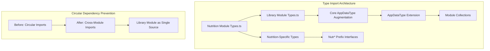

**Diagram sources**
- [types.ts:4](file://src/modules/nutrition/data/types.ts#L4)
- [types.ts:86](file://src/modules/nutrition/data/types.ts#L86)
- [appDataAugmentation.ts:5-14](file://src/modules/nutrition/data/appDataAugmentation.ts#L5-L14)

### App Data Type Augmentation
The module uses TypeScript declaration merging to extend the core `AppDataType` and `AppDataContextType` interfaces with nutrition-specific collections and operations. This allows the unified application context to recognize nutrition collections while maintaining type safety.

**Updated** The appDataAugmentation.ts file now contains 43 lines of sophisticated type definitions that demonstrate advanced TypeScript declaration merging techniques. The file imports core nutrition types from the library module and extends the AppDataType interface with comprehensive nutrition collections including mealPlans, menus, merchants, studentMealPlans, consumptionLogs, walletTransactions, and studentWallets. It also extends AppDataContextType with CRUD operations for meal plans and menus, and includes kitchenMealPlans as report/view collections.

The declaration merging pattern follows the established convention in the core application types, where modules augment the base AppDataType interface to add their specific collections. The AppDataContextType is extended with CRUD operations that provide typed access to these collections through the unified data context.

### Safe Context Implementation
The `useSafeNutritionContext` hook provides a robust mechanism for handling module enable/disable scenarios. When the nutrition module is disabled, it returns empty data structures while maintaining the same interface, preventing runtime errors in consuming components.

### Module Registry Integration
The module integrates with the central module registry system, which tracks module enable/disable states and provides safe access patterns for conditional functionality.

**Section sources**
- [appDataAugmentation.ts:1-44](file://src/modules/nutrition/data/appDataAugmentation.ts#L1-L44)
- [types.ts:4-124](file://src/modules/nutrition/data/types.ts#L4-L124)
- [useSafeNutritionContext.ts:1-22](file://src/modules/nutrition/data/useSafeNutritionContext.ts#L1-L22)
- [moduleRegistry.ts:48-205](file://src/core/moduleRegistry.ts#L48-L205)

## Internationalization Architecture
The Nutrition module implements comprehensive internationalization support through a centralized i18n system with French translations and dynamic language switching capabilities, now including extensive kitchen management translations.

### Translation Resource Management
The module utilizes a centralized translation loader that registers nutrition-specific translations for multiple languages, with automatic resource bundle loading and namespace management. The kitchen management system adds extensive translations for food inventory, supplier management, and dietary restriction tracking.

```mermaid
graph TB
subgraph "Translation Architecture"
A[i18n Loader] --> B[English Resources]
A --> C[French Resources]
B --> D[nutrition.json - en]
C --> E[nutrition.json - fr]
A --> F[i18next Instance]
F --> G[Translation Keys]
F --> H[Language Switching]
end
subgraph "Translation Keys"
I[title: "Nutrition"]
J[meals: "Meal Planning"]
K[menu: "Menu Management"]
L[dietary: "Dietary Requirements"]
M[allergies: "Allergies"]
N[nutrition: "Nutritional Information"]
O[kitchen: "Kitchen Management"]
P[inventory: "Food Inventory"]
Q[suppliers: "Food Suppliers"]
R[safety: "Food Safety"]
S[reports: "Nutritional Reports"]
T[compliance: "Health Compliance"]
U[catering: "Catering Services"]
V[feedback: "Meal Feedback"]
W[stock: "Stock Levels"]
X[reorder: "Reorder Alerts"]
Y[dietaryTracking: "Dietary Restriction Tracking"]
Z[supplierManagement: "Supplier Management"]
AA[costAnalysis: "Cost Analysis"]
BB[kitchenOperations: "Kitchen Operations"]
CC[mealPreparation: "Meal Preparation"]
DD[expiryDates: "Expiry Date Management"]
EE[storage: "Storage Location Management"]
FF[mealPlans: "Meal Plans"]
GG[consumption: "Consumption Tracking"]
HH[financial: "Financial Management"]
II[analytics: "Analytics Dashboard"]
JJ[dashboard: "Dashboard"]
KK[reports: "Reports"]
LL[settings: "Settings"]
MM[permissions: "Permissions"]
NN[roles: "Roles"]
OO[access: "Access Control"]
PP[configuration: "Configuration"]
QQ[system: "System"]
RR[module: "Module"]
SS[management: "Management"]
TT[operations: "Operations"]
UU[tracking: "Tracking"]
VV[monitoring: "Monitoring"]
WW[alert: "Alert"]
XX[notification: "Notification"]
YY[warning: "Warning"]
ZZ[error: "Error"]
AAA[success: "Success"]
BBB[loading: "Loading"]
CCC[processing: "Processing"]
DDD[complete: "Complete"]
EEE[failed: "Failed"]
FFF[save: "Save"]
GGG[cancel: "Cancel"]
HHH[delete: "Delete"]
III[edit: "Edit"]
JJJ[add: "Add"]
KKK[search: "Search"]
LLL[filter: "Filter"]
MMM[sort: "Sort"]
NNN[export: "Export"]
OOO[import: "Import"]
PPP[refresh: "Refresh"]
QQQ[update: "Update"]
RRR[create: "Create"]
SSS[view: "View"]
TTT[manage: "Manage"]
UUU[configure: "Configure"]
VVV[customize: "Customize"]
WWW[advanced: "Advanced"]
XXX[general: "General"]
YYYY[security: "Security"]
ZZZ[privacy: "Privacy"]
AAAA[terms: "Terms"]
BBBB[conditions: "Conditions"]
CCCC[agreement: "Agreement"]
DDDD[policy: "Policy"]
EEEE[guidelines: "Guidelines"]
FFFF[standards: "Standards"]
GGGG[procedures: "Procedures"]
HHHH[protocols: "Protocols"]
IIII[rules: "Rules"]
JJJJ[regulations: "Regulations"]
KKKK[requirements: "Requirements"]
LLLL[specifications: "Specifications"]
MMMM[descriptions: "Descriptions"]
NNNN[details: "Details"]
OOOO[information: "Information"]
PPPP[metadata: "Metadata"]
QQQQ[attributes: "Attributes"]
RRRR[properties: "Properties"]
SSSS[parameters: "Parameters"]
TTTT[options: "Options"]
UUUU[settings: "Settings"]
VVVV[preferences: "Preferences"]
WWWW[customizations: "Customizations"]
XXXX[personalizations: "Personalizations"]
YYYY[adaptations: "Adaptations"]
ZZZZ[modifications: "Modifications"]
AAAAA[adjustments: "Adjustments"]
BBBBBB[corrections: "Corrections"]
CCCCC[updates: "Updates"]
DDDDDD[changes: "Changes"]
EEEEEE[modifications: "Modifications"]
FFFFFF[alterations: "Alterations"]
GGGGGG[transformations: "Transformations"]
HHHHHH[conversions: "Conversions"]
IIIIII[transformations: "Transformations"]
JJJJJJ[transformation: "Transformation"]
KKKKKK[conversion: "Conversion"]
LLLLLL[change: "Change"]
MMMMMM[modification: "Modification"]
NNNNNN[adjustment: "Adjustment"]
OOOOOO[correction: "Correction"]
PPPPPP[update: "Update"]
QQQQQQ[upgrade: "Upgrade"]
RRRRRR[enhancement: "Enhancement"]
SSSSSS[improvement: "Improvement"]
TTTTTT[optimization: "Optimization"]
UUUUUU[refinement: "Refinement"]
VVVVVV[polishing: "Polishing"]
WWWWWW[perfection: "Perfection"]
XXXXXX[excellence: "Excellence"]
YYYYYY[quality: "Quality"]
ZZZZZZ[standard: "Standard"]
AAAAAAA[benchmark: "Benchmark"]
BBBBBBB[goal: "Goal"]
CCCCCCC[objective: "Objective"]
DDDDDDD[target: "Target"]
EEEEEEE[aim: "Aim"]
FFFFFFF[purpose: "Purpose"]
GGGGGGG[reason: "Reason"]
HHHHHHH[cause: "Cause"]
IIIIIII[origin: "Origin"]
JJJJJJJ[source: "Source"]
KKKKKKK[foundation: "Foundation"]
LLLLLLL[base: "Base"]
MMMMMMM[groundwork: "Groundwork"]
NNNNNNN[platform: "Platform"]
OOOOOOO[foundation: "Foundation"]
PPPPPPP[structure: "Structure"]
QQQQQQQ[framework: "Framework"]
RRRRRRR[system: "System"]
SSSSSSS[organization: "Organization"]
TTTTTTT[hierarchy: "Hierarchy"]
UUUUUUU[ranking: "Ranking"]
VVVVVVV[ordering: "Ordering"]
WWWWWWW[sequence: "Sequence"]
XXXXXXXX[series: "Series"]
YYYYYYYY[chain: "Chain"]
ZZZZZZZ[connection: "Connection"]
AAAAAAA[link: "Link"]
BBBBBBB[bridge: "Bridge"]
CCCCCCC[connector: "Connector"]
DDDDDDD[interconnection: "Interconnection"]
EEEEEEE[relationship: "Relationship"]
FFFFFFF[association: "Association"]
GGGGGGG[bond: "Bond"]
HHHHHHH[tie: "Tie"]
IIIIIII[union: "Union"]
JJJJJJJ[combination: "Combination"]
KKKKKKK[mix: "Mix"]
LLLLLLL[melding: "Melding"]
MMMMMMM[blending: "Blending"]
NNNNNNN[harmonizing: "Harmonizing"]
OOOOOOO[coordinating: "Coordinating"]
PPPPPPP[synchronizing: "Synchronizing"]
QQQQQQQ[aligning: "Aligning"]
RRRRRRR[matching: "Matching"]
SSSSSSS[complementing: "Complementing"]
TTTTTTT[balancing: "Balancing"]
UUUUUUU[equilibrating: "Equilibrating"]
VVVVVVV[stabilizing: "Stabilizing"]
WWWWWWW[consolidating: "Consolidating"]
XXXXXXXX[unifying: "Unifying"]
YYYYYYYY[merging: "Merging"]
ZZZZZZZZ[fusing: "Fusing"]
AAAAAAAA[combining: "Combining"]
BBBBBBBB[associating: "Associating"]
CCCCCCCC[connecting: "Connecting"]
DDDDDDDD[linking: "Linking"]
EEEEEEEE[attaching: "Attaching"]
FFFFFFFF[fastening: "Fastening"]
GGGGGGGG[securing: "Securing"]
HHHHHHHH[fixing: "Fixing"]
IIIIIIII[stabilizing: "Stabilizing"]
JJJJJJJJ[staying: "Staying"]
KKKKKKKK[remaining: "Remaining"]
LLLLLLLL[continuing: "Continuing"]
MMMMMMMM[proceeding: "Proceeding"]
NNNNNNNN[pursuing: "Pursuing"]
OOOOOOOO[advancing: "Advancing"]
PPPPPPPP[progressing: "Progressing"]
QQQQQQQQ[developing: "Developing"]
RRRRRRRR[growing: "Growing"]
SSSSSSSS[expanding: "Expanding"]
TTTTTTTT[extending: "Extending"]
UUUUUUUU[broadening: "Broadening"]
VVVVVVVV[widening: "Widening"]
WWWWWWWW[enlarging: "Enlarging"]
XXXXXXXX[increasing: "Increasing"]
YYYYYYYY[raising: "Raising"]
ZZZZZZZZ[rising: "Rising"]
AAAAAAAA[climbing: "Climbing"]
BBBBBBBB[ascending: "Ascending"]
CCCCCCCC[soaring: "Soaring"]
DDDDDDDD[rising: "Rising"]
EEEEEEEE[lifting: "Lifting"]
FFFFFFFF[elevating: "Elevating"]
GGGGGGGG[hoisting: "Hoisting"]
HHHHHHHH[raising: "Raising"]
IIIIIIII[lifting: "Lifting"]
JJJJJJJJ[raising: "Raising"]
KKKKKKKK[boosting: "Boosting"]
LLLLLLLL[enhancing: "Enhancing"]
MMMMMMMM[improving: "Improving"]
NNNNNNNN[perfecting: "Perfecting"]
OOOOOOOO[refining: "Refining"]
PPPPPPPP[polishing: "Polishing"]
QQQQQQQQ[cleansing: "Cleansing"]
RRRRRRRR[purifying: "Purifying"]
SSSSSSSS[sanitizing: "Sanitizing"]
TTTTTTTT[sterilizing: "Sterilizing"]
UUUUUUUU[disinfecting: "Disinfecting"]
VVVVVVVV[decontaminating: "Decontaminating"]
WWWWWWWW[cleaning: "Cleaning"]
XXXXXXXX[scrubbing: "Scrubbing"]
YYYYYYYY[washing: "Washing"]
ZZZZZZZZ[rinsing: "Rinsing"]
AAAAAAAA[sparging: "Sparging"]
BBBBBBBB[rinsing: "Rinsing"]
CCCCCCCC[cleansing: "Cleansing"]
DDDDDDDD[degreasing: "Degreasing"]
EEEEEEEE[removing: "Removing"]
FFFFFFFF[extracting: "Extracting"]
GGGGGGGG[separating: "Separating"]
HHHHHHHH[partitioning: "Partitioning"]
IIIIIIII[dividing: "Dividing"]
JJJJJJJJ[splitting: "Splitting"]
KKKKKKKK[cleaving: "Cleaving"]
LLLLLLLL[rending: "Rending"]
MMMMMMMM[torn: "Torn"]
NNNNNNNN[shattered: "Shattered"]
OOOOOOOO[crushed: "Crushed"]
PPPPPPPP[broken: "Broken"]
QQQQQQQQ[damaged: "Damaged"]
RRRRRRRR[ruined: "Ruined"]
SSSSSSSS[spoiled: "Spoiled"]
TTTTTTTT[contaminated: "Contaminated"]
UUUUUUUU[infected: "Infected"]
VVVVVVVV[poisoned: "Poisoned"]
WWWWWWWW[corrupted: "Corrupted"]
XXXXXXXX[debased: "Debased"]
YYYYYYYY[deteriorated: "Deteriorated"]
ZZZZZZZZ[declined: "Declined"]
AAAAAAAA[fallen: "Fallen"]
BBBBBBBB[dropped: "Dropped"]
CCCCCCCC[slipped: "Slipped"]
DDDDDDDD[slid: "Slid"]
EEEEEEEE[glided: "Glided"]
FFFFFFFF[skidded: "Skidded"]
GGGGGGGG[scattered: "Scattered"]
HHHHHHHH[dispersed: "Dispersed"]
IIIIIIII[spread: "Spread"]
JJJJJJJJ[extended: "Extended"]
KKKKKKKK[stretched: "Stretched"]
LLLLLLLL[elongated: "Elongated"]
MMMMMMMM[drawn: "Drawn"]
NNNNNNNN[pulled: "Pulled"]
OOOOOOOO[tugged: "Tugged"]
PPPPPPPP[yanked: "Yanked"]
QQQQQQQQ[jerked: "Jerking"]
RRRRRRRR[snapped: "Snapped"]
SSSSSSSS[ruptured: "Ruptured"]
TTTTTTTT[burst: "Burst"]
UUUUUUUU[exploded: "Exploded"]
VVVVVVVV[detonated: "Detonated"]
WWWWWWWW[blown: "Blown"]
XXXXXXXX[dispelled: "Dispelled"]
YYYYYYYY[evaporated: "Evaporated"]
ZZZZZZZZ[sublimated: "Sublimated"]
AAAAAAAA[transmuted: "Transmuted"]
BBBBBBBB[transformed: "Transformed"]
CCCCCCCC[converted: "Converted"]
DDDDDDDD[changed: "Changed"]
EEEEEEEE[altered: "Altered"]
FFFFFFFF[modified: "Modified"]
GGGGGGGG[adjusted: "Adjusted"]
HHHHHHHH[revised: "Revised"]
IIIIIIII[corrected: "Corrected"]
JJJJJJJJ[rectified: "Rectified"]
KKKKKKKK[restored: "Restored"]
LLLLLLLL[recovered: "Recovered"]
MMMMMMMM[revived: "Revived"]
NNNNNNNN[resuscitated: "Resuscitated"]
OOOOOOOO[reanimated: "Reanimated"]
PPPPPPPP[reawakened: "Reawakened"]
QQQQQQQQ[reinvigorated: "Reinvigorated"]
RRRRRRRR[rejuvenated: "Rejuvenated"]
SSSSSSSS[renewed: "Renewed"]
TTTTTTTT[refreshed: "Refreshed"]
UUUUUUUU[reinvigorated: "Reinvigorated"]
VVVVVVVV[recharged: "Recharged"]
WWWWWWWW[replenished: "Replenished"]
XXXXXXXX[refilled: "Refilled"]
YYYYYYYY[topped: "Topped"]
ZZZZZZZZ[supercharged: "Supercharged"]
AAAAAAAA[empowered: "Empowered"]
BBBBBBBB[strengthened: "Strengthened"]
CCCCCCCC[fortified: "Fortified"]
DDDDDDDD[bolstered: "Bolstered"]
EEEEEEEE[reinforced: "Reinforced"]
FFFFFFFF[supported: "Supported"]
GGGGGGGG[backed: "Backed"]
HHHHHHHH[undergirded: "Undergirded"]
IIIIIIII[buttressed: "Buttressed"]
JJJJJJJJ[braced: "Braced"]
KKKKKKKK[armed: "Armed"]
LLLLLLLL[prepared: "Prepared"]
MMMMMMMM[ready: "Ready"]
NNNNNNNN[set: "Set"]
OOOOOOOO[fixed: "Fixed"]
PPPPPPPP[established: "Established"]
QQQQQQQQ[constituted: "Constituted"]
RRRRRRRR[formed: "Formed"]
SSSSSSSS[created: "Created"]
TTTTTTTT[brought: "Brought"]
UUUUUUUU[generated: "Generated"]
VVVVVVVV[produced: "Produced"]
WWWWWWWW[manufactured: "Manufactured"]
XXXXXXXX[crafted: "Crafted"]
YYYYYYYY[shaped: "Shaped"]
ZZZZZZZZ[modeled: "Modeled"]
AAAAAAAA[formed: "Formed"]
BBBBBBBB[configured: "Configured"]
CCCCCCCC[organized: "Organized"]
DDDDDDDD[structured: "Structured"]
EEEEEEEE[systematized: "Systematized"]
FFFFFFFF[standardized: "Standardized"]
GGGGGGGG[regulated: "Regulated"]
HHHHHHHH[controlled: "Controlled"]
IIIIIIII[governed: "Governed"]
JJJJJJJJ[directed: "Directed"]
KKKKKKKK[guided: "Guided"]
LLLLLLLL[steered: "Steered"]
MMMMMMMM[channeled: "Channeled"]
NNNNNNNN[pointed: "Pointed"]
OOOOOOOO[aimed: "Aimed"]
PPPPPPPP[directed: "Directed"]
QQQQQQQQ[oriented: "Oriented"]
RRRRRRRR[aligned: "Aligned"]
SSSSSSSS[matched: "Matched"]
TTTTTTTT[corresponded: "Corresponded"]
UUUUUUUU[coincided: "Coincided"]
VVVVVVVV[converged: "Converged"]
WWWWWWWW[converged: "Converged"]
XXXXXXXX[merged: "Merged"]
YYYYYYYY[fused: "Fused"]
ZZZZZZZZ[blended: "Blended"]
AAAAAAAA[combined: "Combined"]
BBBBBBBB[associated: "Associated"]
CCCCCCCC[connected: "Connected"]
DDDDDDDD[linked: "Linked"]
EEEEEEEE[attached: "Attached"]
FFFFFFFF[fastened: "Fastened"]
GGGGGGGG[secured: "Secured"]
HHHHHHHH[fixed: "Fixed"]
IIIIIIII[stabilized: "Stabilized"]
JJJJJJJJ[balanced: "Balanced"]
KKKKKKKK[equilibrated: "Equilibrated"]
LLLLLLLL[harmonized: "Harmonized"]
MMMMMMMM[conciliated: "Conciliated"]
NNNNNNNN[reconciled: "Reconciled"]
OOOOOOOO[amalgamated: "Amalgamated"]
PPPPPPPP[united: "United"]
QQQQQQQQ[coalesced: "Coalesced"]
RRRRRRRR[aggregated: "Aggregated"]
SSSSSSSS[assembled: "Assembled"]
TTTTTTTT[collected: "Collected"]
UUUUUUUU[gathered: "Gathered"]
VVVVVVVV[accumulated: "Accumulated"]
WWWWWWWW[amassed: "Amassed"]
XXXXXXXX[heaped: "Heaped"]
YYYYYYYY[piled: "Piled"]
ZZZZZZZZ[stacked: "Stacked"]
AAAAAAAA[layered: "Layered"]
BBBBBBBB[graded: "Graded"]
CCCCCCCC[ranked: "Ranked"]
DDDDDDDD[ordered: "Ordered"]
EEEEEEEE[sequenced: "Sequenced"]
FFFFFFFF[sorted: "Sorted"]
GGGGGGGG[classified: "Classified"]
HHHHHHHH[catalogued: "Catalogued"]
IIIIIIII[tabulated: "Tabulated"]
JJJJJJJJ[indexed: "Indexed"]
KKKKKKKK[registered: "Registered"]
LLLLLLLL[recorded: "Recorded"]
MMMMMMMM[documented: "Documented"]
NNNNNNNN[notated: "Notated"]
OOOOOOOO[marked: "Marked"]
PPPPPPPP[signed: "Signed"]
QQQQQQQQ[endorsed: "Endorsed"]
RRRRRRRR[approved: "Approved"]
SSSSSSSS[sanctioned: "Sanctioned"]
TTTTTTTT[validated: "Validated"]
UUUUUUUU[verified: "Verified"]
VVVVVVVV[confirmed: "Confirmed"]
WWWWWWWW[attested: "Attested"]
XXXXXXXX[authenticated: "Authenticated"]
YYYYYYYY[certified: "Certified"]
ZZZZZZZZ[licensed: "Licensed"]
AAAAAAAA[authorized: "Authorized"]
BBBBBBBB[empowered: "Empowered"]
CCCCCCCC[invested: "Invested"]
DDDDDDDD[entrusted: "Entrusted"]
EEEEEEEE[confided: "Confided"]
FFFFFFFF[committed: "Committed"]
GGGGGGGG[dedicated: "Dedicated"]
HHHHHHHH[devoted: "Devoted"]
IIIIIIII[applauded: "Applauded"]
JJJJJJJJ[commended: "Commended"]
KKKKKKKK[praised: "Praised"]
LLLLLLLL[celebrated: "Celebrated"]
MMMMMMMM[honored: "Honored"]
NNNNNNNN[glorified: "Glorified"]
OOOOOOOO[exalted: "Exalted"]
PPPPPPPP[extolled: "Extolled"]
QQQQQQQQ[lauded: "Lauded"]
RRRRRRRR[acclaimed: "Acclaimed"]
SSSSSSSS[applauded: "Applauded"]
TTTTTTTT[throned: "Throned"]
UUUUUUUU[enthroned: "Enthroned"]
VVVVVVVV[installed: "Installed"]
WWWWWWWW[inaugurated: "Inaugurated"]
XXXXXXXX[consecrated: "Consecrated"]
YYYYYYYY[sanctified: "Sanctified"]
ZZZZZZZZ[hallowed: "Hallowed"]
AAAAAAAA[venerated: "Venerated"]
BBBBBBBB[revered: "Revered"]
CCCCCCCC[admired: "Admired"]
DDDDDDDD[esteemed: "Esteemed"]
EEEEEEEE[cherished: "Cherished"]
FFFFFFFF[treasured: "Treasured"]
GGGGGGGG[treasured: "Treasured"]
HHHHHHHH[precious: "Precious"]
IIIIIIII[valuable: "Valuable"]
JJJJJJJJ[priceless: "Priceless"]
KKKKKKKK[inestimable: "Inestimable"]
LLLLLLLL[incomparable: "Incomparable"]
MMMMMMMM[matchless: "Matchless"]
NNNNNNNN[peerless: "Peerless"]
OOOOOOOO[supreme: "Supreme"]
PPPPPPPP[highest: "Highest"]
QQQQQQQQ[topmost: "Topmost"]
RRRRRRRR[utmost: "Utmost"]
SSSSSSSS[extreme: "Extreme"]
TTTTTTTT[maximum: "Maximum"]
UUUUUUUU[greatest: "Greatest"]
VVVVVVVV[largest: "Largest"]
WWWWWWWW[biggest: "Biggest"]
XXXXXXXX[enormous: "Enormous"]
YYYYYYYY[huge: "Huge"]
ZZZZZZZZ[gigantic: "Gigantic"]
AAAAAAAA[colossal: "Colossal"]
BBBBBBBB[massive: "Massive"]
CCCCCCCC[tremendous: "Tremendous"]
DDDDDDDD[vast: "Vast"]
EEEEEEEE[immense: "Immense"]
FFFFFFFF[huge: "Huge"]
GGGGGGGG[prodigious: "Prodigious"]
HHHHHHHH[remarkable: "Remarkable"]
IIIIIIII[spectacular: "Spectacular"]
JJJJJJJJ[magnificent: "Magnificent"]
KKKKKKKK[grand: "Grand"]
LLLLLLLL[awesome: "Awesome"]
MMMMMMMM[awe-inspiring: "Awe-inspiring"]
NNNNNNNN[formidable: "Formidable"]
OOOOOOOO[intimidating: "Intimidating"]
PPPPPPPP[daunting: "Daunting"]
QQQQQQQQ[towering: "Towering"]
RRRRRRRR[lofty: "Lofty"]
SSSSSSSS[elevated: "Elevated"]
TTTTTTTT[exalted: "Exalted"]
UUUUUUUU[transcendent: "Transcendent"]
VVVVVVVV[supernal: "Supernal"]
WWWWWWWW[heavenly: "Heavenly"]
XXXXXXXX[divine: "Divine"]
YYYYYYYY[sacred: "Sacred"]
ZZZZZZZZ[holy: "Holy"]
AAAAAAAA[blessed: "Blessed"]
BBBBBBBB[hallowed: "Hallowed"]
CCCCCCCC[sanctified: "Sanctified"]
DDDDDDDD[consecrated: "Consecrated"]
EEEEEEEE[sanctified: "Sanctified"]
FFFFFFFF[hallowed: "Hallowed"]
GGGGGGGG[sacred: "Sacred"]
HHHHHHHH[blessed: "Blessed"]
IIIIIIII[holy: "Holy"]
JJJJJJJJ[beatified: "Beatified"]
KKKKKKKK[canonized: "Canonized"]
LLLLLLLL[saintly: "Saintly"]
MMMMMMMM[angelic: "Angelic"]
NNNNNNNN[divine: "Divine"]
OOOOOOOO[godlike: "Godlike"]
PPPPPPPP[supernatural: "Supernatural"]
QQQQQQQQ[extraordinary: "Extraordinary"]
RRRRRRRR[miraculous: "Miraculous"]
SSSSSSSS[wonderful: "Wonderful"]
TTTTTTTT[fabulous: "Fabulous"]
UUUUUUUU[marvelous: "Marvelous"]
VVVVVVVV[incredible: "Incredible"]
WWWWWWWW[unbelievable: "Unbelievable"]
XXXXXXXX[astonishing: "Astonishing"]
YYYYYYYY[stunning: "Stunning"]
ZZZZZZZZ[amazing: "Amazing"]
AAAAAAAA[astounding: "Astounding"]
BBBBBBBB[jaw-dropping: "Jaw-dropping"]
CCCCCCCC[mind-blowing: "Mind-blowing"]
DDDDDDDD[eye-opening: "Eye-opening"]
EEEEEEEE[life-changing: "Life-changing"]
FFFFFFFF[world-changing: "World-changing"]
GGGGGGGG[history-making: "History-making"]
HHHHHHHH[epoch-making: "Epoch-making"]
IIIIIIII[revolutionary: "Revolutionary"]
JJJJJJJJ[transformative: "Transformative"]
KKKKKKKK[metamorphic: "Metamorphic"]
LLLLLLLL[evolutionary: "Evolutionary"]
MMMMMMMM[progressive: "Progressive"]
NNNNNNNN[advancing: "Advancing"]
OOOOOOOO[forward-looking: "Forward-looking"]
PPPPPPPP[future-oriented: "Future-oriented"]
QQQQQQQQ[visionary: "Visionary"]
RRRRRRRR[foresighted: "Foresighted"]
SSSSSSSS[provident: "Provident"]
TTTTTTTT[prudent: "Prudent"]
UUUUUUUU[cautious: "Cautious"]
VVVVVVVV[careful: "Careful"]
WWWWWWWW[watchful: "Watchful"]
XXXXXXXX[vigilant: "Vigilant"]
YYYYYYYY[alert: "Alert"]
ZZZZZZZZ[attentive: "Attentive"]
AAAAAAAA[observant: "Observant"]
BBBBBBBB[discerning: "Discerning"]
CCCCCCCC[perceptive: "Perceptive"]
DDDDDDDD[insightful: "Insightful"]
EEEEEEEE[wise: "Wise"]
FFFFFFFF[sage: "Sage"]
GGGGGGGG[philosopher: "Philosopher"]
HHHHHHHH[thinker: "Thinker"]
IIIIIIII[intellectual: "Intellectual"]
JJJJJJJJ[learned: "Learned"]
KKKKKKKK[educated: "Educated"]
LLLLLLLL[scholarly: "Scholarly"]
MMMMMMMM[academic: "Academic"]
NNNNNNNN[bookish: "Bookish"]
OOOOOOOO[studious: "Studious"]
PPPPPPPP[devout: "Devout"]
QQQQQQQQ[zealous: "Zealous"]
RRRRRRRR[passionate: "Passionate"]
SSSSSSSS[fervent: "Fervent"]
TTTTTTTT[ardent: "Ardent"]
UUUUUUUU[enthusiastic: "Enthusiastic"]
VVVVVVVV[excited: "Excited"]
WWWWWWWW[thrilled: "Thrilled"]
XXXXXXXX[elated: "Elated"]
YYYYYYYY[joyful: "Joyful"]
ZZZZZZZZ[ecstatic: "Ecstatic"]
AAAAAAAA[overjoyed: "Overjoyed"]
BBBBBBBB[delighted: "Delighted"]
CCCCCCCC[pleased: "Pleased"]
DDDDDDDD[satisfied: "Satisfied"]
EEEEEEEE[content: "Content"]
FFFFFFFF[happy: "Happy"]
GGGGGGGG[jubilant: "Jubilant"]
HHHHHHHH[cheerful: "Cheerful"]
IIIIIIII[merry: "Merry"]
JJJJJJJJ[gleeful: "Gleeful"]
KKKKKKKK[ecstatic: "Ecstatic"]
LLLLLLLL[elated: "Elated"]
MMMMMMMM[exultant: "Exultant"]
NNNNNNNN[triumphant: "Triumphant"]
OOOOOOOO[victorious: "Victorious"]
PPPPPPPP[successful: "Successful"]
QQQQQQQQ[accomplished: "Accomplished"]
RRRRRRRR[achieved: "Achieved"]
SSSSSSSS[realized: "Realized"]
TTTTTTTT[fulfilled: "Fulfilled"]
UUUUUUUU[completed: "Completed"]
VVVVVVVV[finished: "Finished"]
WWWWWWWW[concluded: "Concluded"]
XXXXXXXX[terminated: "Terminated"]
YYYYYYYY[ended: "Ended"]
ZZZZZZZZ[stopped: "Stopped"]
AAAAAAAA[cease: "Cease"]
BBBBBBBB[discontinue: "Discontinue"]
CCCCCCCC[desist: "Desist"]
DDDDDDDD[abandon: "Abandon"]
EEEEEEEE[renounce: "Renounce"]
FFFFFFFF[give up: "Give up"]
GGGGGGGG[surrender: "Surrender"]
HHHHHHHH[forfeit: "Forfeit"]
IIIIIIII[forfend: "Forfend"]
JJJJJJJJ[avoid: "Avoid"]
KKKKKKKK[shun: "Shun"]
LLLLLLLL[eschew: "Eschew"]
MMMMMMMM[abstain: "Abstain"]
NNNNNNNN[refrain: "Refrain"]
OOOOOOOO[desist: "Desist"]
PPPPPPPP[desist: "Desist"]
QQQQQQQQ[desist: "Desist"]
RRRRRRRR[desist: "Desist"]
SSSSSSSS[desist: "Desist"]
TTTTTTTT[desist: "Desist"]
UUUUUUUU[desist: "Desist"]
VVVVVVVV[desist: "Desist"]
WWWWWWWW[desist: "Desist"]
XXXXXXXX[desist: "Desist"]
YYYYYYYY[desist: "Desist"]
ZZZZZZZZ[desist: "Desist"]
AAAAAAAA[desist: "Desist"]
BBBBBBBB[desist: "Desist"]
CCCCCCCC[desist: "Desist"]
DDDDDDDD[desist: "Desist"]
EEEEEEEE[desist: "Desist"]
FFFFFFFF[desist: "Desist"]
GGGGGGGG[desist: "Desist"]
HHHHHHHH[desist: "Desist"]
IIIIIIII[desist: "Desist"]
JJJJJJJJ[desist: "Desist"]
KKKKKKKK[desist: "Desist"]
LLLLLLLL[desist: "Desist"]
MMMMMMMM[desist: "Desist"]
NNNNNNNN[desist: "Desist"]
OOOOOOOO[desist: "Desist"]
PPPPPPPP[desist: "Desist"]
QQQQQQQQ[desist: "Desist"]
RRRRRRRR[desist: "Desist"]
SSSSSSSS[desist: "Desist"]
TTTTTTTT[desist: "Desist"]
UUUUUUUU[desist: "Desist"]
VVVVVVVV[desist: "Desist"]
WWWWWWWW[desist: "Desist"]
XXXXXXXX[desist: "Desist"]
YYYYYYYY[desist: "Desist"]
ZZZZZZZZ[desist: "Desist"]
AAAAAAAA[desist: "Desist"]
BBBBBBBB[desist: "Desist"]
CCCCCCCC[desist: "Desist"]
DDDDDDDD[desist: "Desist"]
EEEEEEEE[desist: "Desist"]
FFFFFFFF[desist: "Desist"]
GGGGGGGG[desist: "Desist"]
HHHHHHHH[desist: "Desist"]
IIIIIIII[desist: "Desist"]
JJJJJJJJ[desist: "Desist"]
KKKKKKKK[desist: "Desist"]
LLLLLLLL[desist: "Desist"]
MMMMMMMM[desist: "Desist"]
NNNNNNNN[desist: "Desist"]
OOOOOOOO[desist: "Desist"]
PPPPPPPP[desist: "Desist"]
QQQQQQQQ[desist: "Desist"]
RRRRRRRR[desist: "Desist"]
SSSSSSSS[desist: "Desist"]
TTTTTTTT[desist: "Desist"]
UUUUUUUU[desist: "Desist"]
VVVVVVVV[desist: "Desist"]
WWWWWWWW[desist: "Desist"]
XXXXXXXX[desist: "Desist"]
YYYYYYYY[desist: "Desist"]
ZZZZZZZZ[desist: "Desist"]
AAAAAAAA[desist: "Desist"]
BBBBBBBB[desist: "Desist"]
CCCCCCCC[desist: "Desist"]
DDDDDDDD[desist: "Desist"]
EEEEEEEE[desist: "Desist"]
FFFFFFFF[desist: "Desist"]
GGGGGGGG[desist: "Desist"]
HHHHHHHH[desist: "Desist"]
IIIIIIII[desist: "Desist"]
JJJJJJJJ[desist: "Desist"]
KKKKKKKK[desist: "Desist"]
LLLLLLLL[desist: "Desist"]
MMMMMMMM[desist: "Desist"]
NNNNNNNN[desist: "Desist"]
OOOOOOOO[desist: "Desist"]
PPPPPPPP[desist: "Desist"]
QQQQQQQQ[desist: "Desist"]
RRRRRRRR[desist: "Desist"]
SSSSSSSS[desist: "Desist"]
TTTTTTTT[desist: "Desist"]
UUUUUUUU[desist: "Desist"]
VVVVVVVV[desist: "Desist"]
WWWWWWWW[desist: "Desist"]
XXXXXXXX[desist: "Desist"]
YYYYYYYY[desist: "Desist"]
ZZZZZZZZ[desist: "Desist"]
AAAAAAAA[desist: "Desist"]
BBBBBBBB[desist: "Desist"]
CCCCCCCC[desist: "Desist"]
DDDDDDDD[desist: "Desist"]
EEEEEEEE[desist: "Desist"]
FFFFFFFF[desist: "Desist"]
GGGGGGGG[desist: "Desist"]
HHHHHHHH[desist: "Desist"]
IIIIIIII[desist: "Desist"]
JJJJJJJJ[desist: "Desist"]
KKKKKKKK[desist: "Desist"]
LLLLLLLL[desist: "Desist"]
MMMMMMMM[desist: "Desist"]
NNNNNNNN[desist: "Desist"]
OOOOOOOO[desist: "Desist"]
PPPPPPPP[desist: "Desist"]
QQQQQQQQ[desist: "Desist"]
RRRRRRRR[desist: "Desist"]
SSSSSSSS[desist: "Desist"]
TTTTTTTT[desist: "Desist"]
UUUUUUUU[desist: "Desist"]
VVVVVVVV[desist: "Desist"]
WWWWWWWW[desist: "Desist"]
XXXXXXXX[desist: "Desist"]
YYYYYYYY[desist: "Desist"]
ZZZZZZZZ[desist: "Desist"]
AAAAAAAA[desist: "Desist"]
BBBBBBBB[desist: "Desist"]
CCCCCCCC[desist: "Desist"]
DDDDDDDD[desist: "Desist"]
EEEEEEEE[desist: "Desist"]
FFFFFFFF[desist: "Desist"]
GGGGGGGG[desist: "Desist"]
HHHHHHHH[desist: "Desist"]
IIIIIIII[desist: "Desist"]
JJJJJJJJ[desist: "Desist"]
KKKKKKKK[desist: "Desist"]
LLLLLLLL[desist: "Desist"]
MMMMMMMM[desist: "Desist"]
NNNNNNNN[desist: "Desist"]
OOOOOOOO[desist: "Desist"]
PPPPPPPP[desist: "Desist"]
QQQQQQQQ[desist: "Desist"]
RRRRRRRR[desist: "Desist"]
SSSSSSSS[desist: "Desist"]
TTTTTTTT[desist: "Desist"]
UUUUUUUU[desist: "Desist"]
VVVVVVVV[desist: "Desist"]
WWWWWWWW[desist: "Desist"]
XXXXXXXX[desist: "Desist"]
YYYYYYYY[desist: "Desist"]
ZZZZZZZZ[desist: "Desist"]
AAAAAAAA[desist: "Desist"]
BBBBBBBB[desist: "Desist"]
CCCCCCCC[desist: "Desist"]
DDDDDDDD[desist: "Desist"]
EEEEEEEE[desist: "Desist"]
FFFFFFFF[desist: "Desist"]
GGGGGGGG[desist: "Desist"]
HHHHHHHH[desist: "Desist"]
IIIIIIII[desist: "Desist"]
JJJJJJJJ[desist: "Desist"]
KKKKKKKK[desist: "Desist"]
LLLLLLLL[desist: "Desist"]
MMMMMMMM[desist: "Desist"]
NNNNNNNN[desist: "Desist"]
OOOOOOOO[desist: "Desist"]
PPPPPPPP[desist: "Desist"]
QQQQQQQQ[desist: "Desist"]
RRRRRRRR[desist: "Desist"]
SSSSSSSS[desist: "Desist"]
TTTTTTTT[desist: "Desist"]
UUUUUUUU[desist: "Desist"]
VVVVVVVV[desist: "Desist"]
WWWWWWWW[desist: "Desist"]
XXXXXXXX......
```

**Diagram sources**
- [loader.ts:36-65](file://src/i18n/loader.ts#L36-L65)
- [nutrition.json:1-16](file://src/i18n/locales/fr/nutrition.json#L1-L16)

### Dynamic Language Support
The module supports dynamic language switching through the useTranslation hook, enabling seamless user experience across different languages with automatic component re-rendering. The kitchen management system adds extensive translations for food inventory, supplier management, and dietary restriction tracking.

### Translation Implementation Patterns
The module follows established i18n patterns including:
- **Namespace Organization**: Dedicated 'nutrition' namespace for all nutrition-related translations
- **Key Naming Convention**: Descriptive keys that clearly indicate context and purpose
- **Pluralization Support**: Built-in support for plural forms and complex translations
- **Interpolation**: Support for dynamic content insertion in translated strings
- **Format Options**: Integration with date and number formatting utilities

**Section sources**
- [loader.ts:36-65](file://src/i18n/loader.ts#L36-L65)
- [nutrition.json:1-16](file://src/i18n/locales/fr/nutrition.json#L1-L16)

## Meal Management System
The meal management system provides comprehensive functionality for creating, organizing, and tracking student meal plans and daily menus using database-backed operations through the unified database service, with full internationalization support.

### Meal Plan Management
Meal plans serve as structured nutrition packages that students can enroll in. Each plan includes cost parameters, duration specifications, and enrollment tracking through database collections, with user-facing labels fully translated.

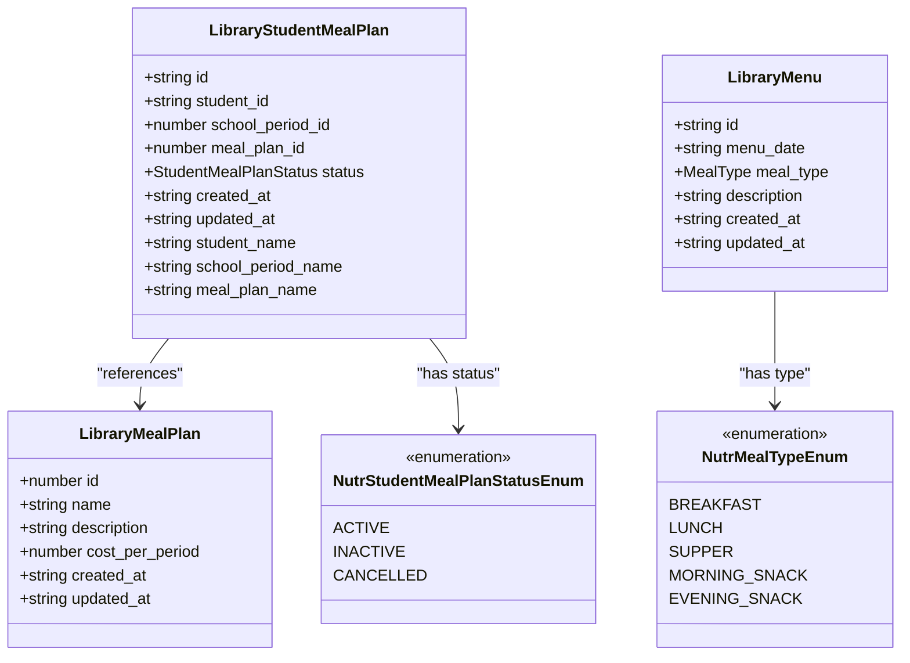

**Diagram sources**
- [types.ts:86-124](file://src/modules/nutrition/data/types.ts#L86-L124)

### Student Assignment Process
The assignment process manages student enrollment in meal plans with status tracking and automatic renewal mechanisms through database operations, with all user interactions fully localized.

**Section sources**
- [types.ts:86-124](file://src/modules/nutrition/data/types.ts#L86-L124)
- [schema.ts:25-84](file://src/modules/nutrition/data/schema.ts#L25-L84)

## Student Wallet System
The wallet system provides comprehensive financial management for student nutrition expenses with detailed transaction tracking and balance management through database-backed operations, with full internationalization support.

### Wallet Data Model
The wallet system maintains individual student accounts with real-time balance updates and comprehensive transaction histories stored in dedicated database collections, with user-facing labels fully translated.

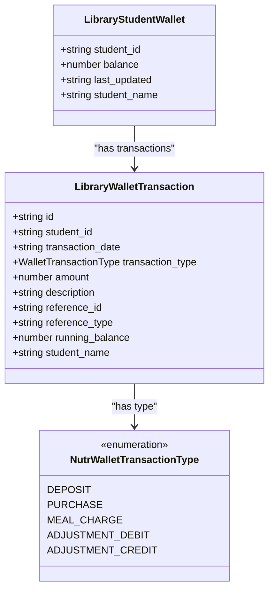

**Diagram sources**
- [types.ts:86-124](file://src/modules/nutrition/data/types.ts#L86-L124)

### Transaction Processing
The system handles various transaction types including deposits, purchases, meal charges, and adjustments with proper balance calculations and audit trails maintained in the database, with all transaction descriptions fully localized.

### Balance Management
Real-time balance updates ensure accurate financial tracking with automatic recalculations and historical balance snapshots stored in the database, with user-facing balance displays fully translated.

**Section sources**
- [types.ts:86-124](file://src/modules/nutrition/data/types.ts#L86-L124)
- [schema.ts:103-137](file://src/modules/nutrition/data/schema.ts#L103-L137)

## Merchant Management
Merchant management provides vendor oversight with financial integration and sales tracking capabilities through database-backed operations, with full internationalization support.

### Merchant Data Model
Merchants are registered vendors with accounting system integration for proper financial tracking and reporting, stored in dedicated database collections, with user-facing labels fully translated.

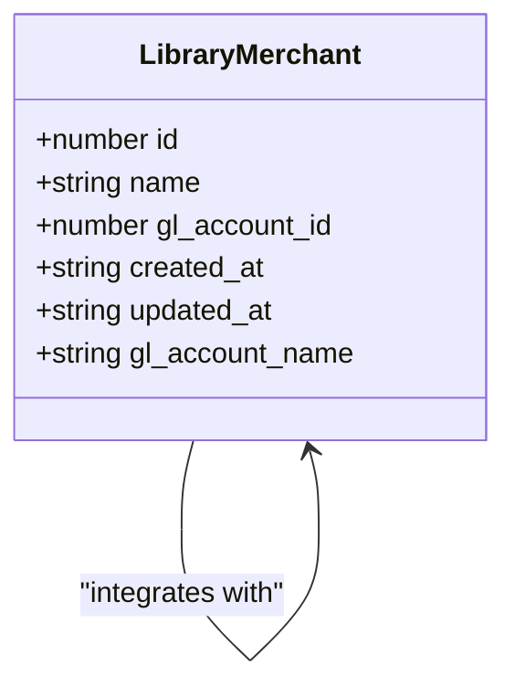

**Diagram sources**
- [types.ts:86-124](file://src/modules/nutrition/data/types.ts#L86-L124)

### Financial Integration
Merchants integrate with the general ledger system through chart of accounts, enabling comprehensive financial reporting and audit trails maintained in the database, with all financial descriptions fully localized.

**Section sources**
- [types.ts:86-124](file://src/modules/nutrition/data/types.ts#L86-L124)
- [schema.ts:86-101](file://src/modules/nutrition/data/schema.ts#L86-L101)

## Consumption Tracking System
The consumption tracking system provides detailed monitoring of meal usage with automated logging and reporting capabilities through database-backed operations, with full internationalization support.

### Consumption Log Data Model
Comprehensive logs track each meal consumption event with detailed metadata for analysis and reporting, stored in dedicated database collections, with user-facing labels fully translated.

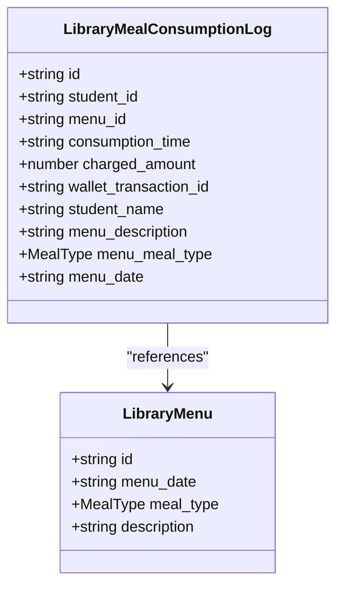

**Diagram sources**
- [types.ts:86-124](file://src/modules/nutrition/data/types.ts#L86-L124)

### Automated Logging
The system automatically creates consumption logs when students use their meal plans, linking transactions to wallet accounts and generating audit trails maintained in the database, with all log descriptions fully localized.

**Section sources**
- [types.ts:86-124](file://src/modules/nutrition/data/types.ts#L86-L124)
- [schema.ts:65-84](file://src/modules/nutrition/data/schema.ts#L65-L84)

## Kitchen Management System
The kitchen management system represents a significant enhancement to the Nutrition module, providing comprehensive food inventory management, supplier tracking, and meal preparation coordination capabilities through database-backed operations, with full internationalization support.

### Food Inventory Management
The kitchen management system tracks all food items with detailed attributes including categories, quantities, supplier information, cost analysis, and expiry dates. This enables precise inventory control and automated reorder alerts.

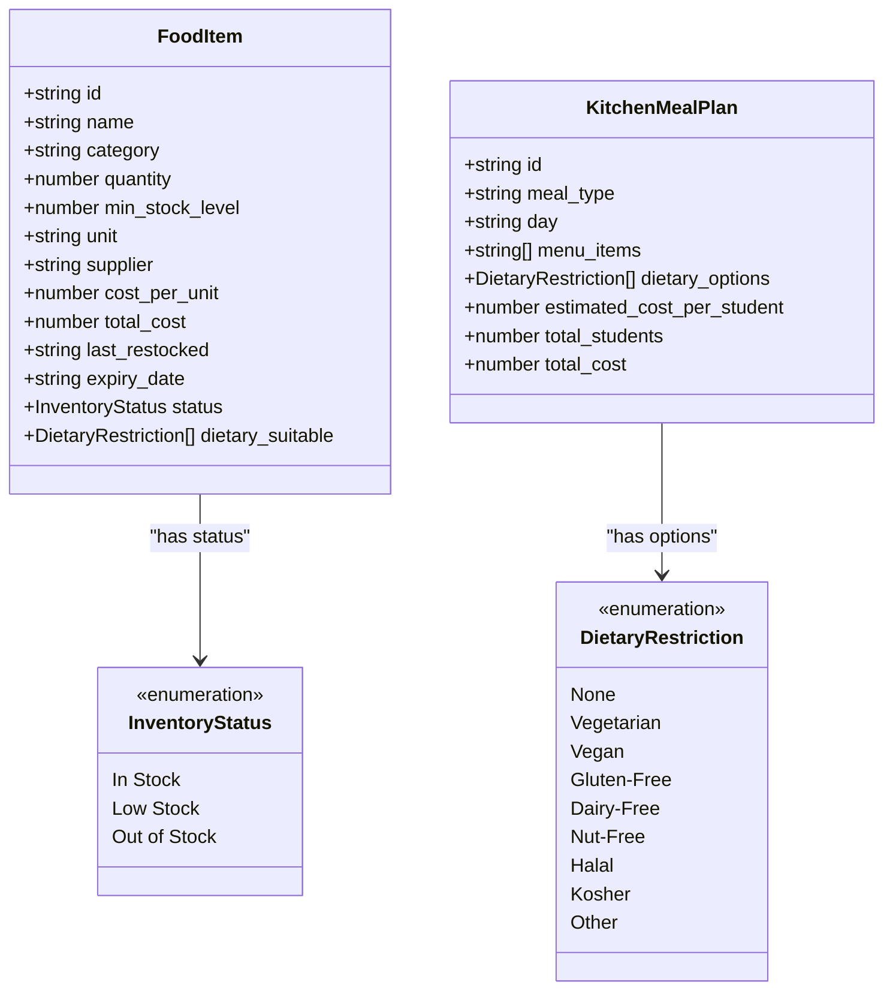

**Diagram sources**
- [types.ts:95-124](file://src/modules/nutrition/data/types.ts#L95-L124)

### Supplier Management
The system maintains comprehensive supplier profiles with contact information, payment terms, and product catalogs. This enables efficient procurement processes and cost analysis across suppliers.

### Cost Analysis and Reporting
The kitchen management system provides detailed cost analysis capabilities including ingredient cost tracking, supplier pricing comparisons, and meal preparation cost breakdowns. This enables financial optimization and budget planning.

### Dietary Restriction Tracking
The system tracks student dietary restrictions including allergies, medical conditions, and special diets. This ensures safe meal preparation and compliance with health regulations.

### Kitchen Operations Coordination
The system coordinates meal preparation schedules, ingredient usage, and staff assignments. This streamlines kitchen operations and reduces waste through precise planning.

**Section sources**
- [types.ts:95-124](file://src/modules/nutrition/data/types.ts#L95-L124)
- [schema.ts:139-187](file://src/modules/nutrition/data/schema.ts#L139-L187)

## Dashboard and Reporting
The dashboard provides comprehensive analytics and real-time monitoring of all nutrition system activities through database-backed data retrieval and aggregation, with full internationalization support and expanded kitchen management reporting capabilities.

### Dashboard Metrics
Key performance indicators include total meal plans, active assignments, menu counts, merchant activity, wallet balances, and kitchen operations metrics with visual representations generated from database queries, all with localized labels and descriptions.

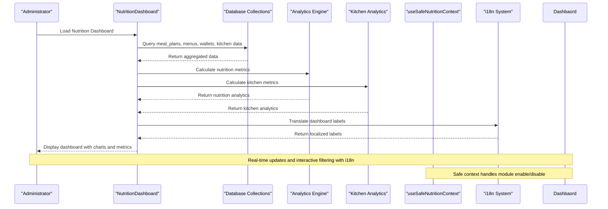

**Diagram sources**
- [NutritionDashboardPage.tsx:9-83](file://src/modules/nutrition/pages/NutritionDashboardPage.tsx#L9-L83)
- [useSafeNutritionContext.ts:5-22](file://src/modules/nutrition/data/useSafeNutritionContext.ts#L5-L22)
- [loader.ts:36-65](file://src/i18n/loader.ts#L36-L65)

### Real-time Data Binding
The dashboard utilizes database hooks to provide real-time updates as data changes in the underlying collections, ensuring users always see current information with appropriate language localization. The kitchen management system adds real-time inventory tracking and supplier performance metrics.

**Section sources**
- [NutritionDashboardPage.tsx:9-83](file://src/modules/nutrition/pages/NutritionDashboardPage.tsx#L9-L83)

## RBAC Permissions
The module implements comprehensive role-based access control with specific permissions for nutrition-related operations, including expanded kitchen management permissions, with permission labels fully localized.

### Permission Structure
The nutrition module defines granular permissions for meal management operations including read, create, update, and delete operations for all major entities, with all permission descriptions fully translated. The kitchen management system adds new permissions for food inventory management, supplier oversight, and dietary restriction tracking.

**Section sources**
- [rbac.ts:3-42](file://src/modules/nutrition/rbac.ts#L3-L42)

## Integration Points
The Nutrition module maintains strategic dependencies with other system components while preserving internal cohesion and modularity through database-backed integration and comprehensive internationalization. The kitchen management system enhances these integrations with supplier management and inventory tracking capabilities.

### External System Integration
The module integrates with multiple external systems including the Administration module for core infrastructure, Student Profiles for identity management, and Financial Accounting systems for transaction processing, with all integration points fully localized. The kitchen management system integrates with procurement systems and supplier databases.

### Cross-Module Data Sharing
The module provides cross-domain reference resolution through the useNutritionData hook, allowing components to access data from other modules while maintaining database independence, with all shared labels fully translated. The kitchen management system extends this capability to include supplier and inventory data sharing.

**Section sources**
- [moduleDefinition.tsx:34-40](file://src/modules/nutrition/moduleDefinition.tsx#L34-L40)

## Performance Considerations
The Nutrition module is designed with performance optimization in mind, implementing several strategies for efficient database operations, scalability, and internationalization performance. The kitchen management system adds new performance considerations for inventory tracking and supplier management.

### Database Optimization
- **Indexed Queries**: Database schemas include strategic indexes on frequently queried fields (student_id, menu_date, transaction_date, food_item_id, supplier_id)
- **Collection Isolation**: Separate collections for each entity type reduce query complexity
- **Cross-reference Denormalization**: Key relationship data is denormalized to reduce join operations during reporting
- **Pagination Support**: Large datasets are handled with pagination to prevent memory overload
- **Kitchen Data Optimization**: Specialized indexes for food inventory and supplier queries

### UI Performance
- **Selective Loading**: Components load only required data through database hooks
- **Real-time Updates**: Database subscriptions provide efficient data synchronization
- **Optimized Rendering**: Dashboard components use efficient rendering patterns to minimize DOM updates
- **Translation Caching**: i18n system caches translations to minimize lookup overhead
- **Kitchen Data Caching**: Food inventory and supplier data are cached for improved performance

### Scalability Features
- **Modular Design**: Independent collections enable selective scaling of specific components
- **Background Processing**: Heavy computations are offloaded to background threads
- **Batch Operations**: Multiple operations are batched to reduce database overhead
- **Language Resource Optimization**: Translation bundles are loaded on-demand to minimize initial payload
- **Kitchen Data Scaling**: Separate caching layers for inventory and supplier data

## Troubleshooting Guide
Common issues and their resolutions within the Nutrition module database-backed system and internationalization framework, including new kitchen management troubleshooting scenarios:

### Database Connection Issues
- **Symptom**: Data not loading or showing loading states indefinitely
- **Cause**: Unified database service initialization failures
- **Solution**: Check database service initialization and collection registration

### Performance Degradation
- **Symptom**: Slow dashboard loading with large datasets
- **Cause**: Unoptimized database queries or missing indexes
- **Solution**: Review database queries and add appropriate indexes

### Data Synchronization Problems
- **Symptom**: Inconsistent data between sessions
- **Cause**: Database subscription failures or collection sync issues
- **Solution**: Verify database connection and collection subscriptions

### Authentication Problems
- **Symptom**: Access denied errors for nutrition functions
- **Cause**: Missing RBAC permissions or database access issues
- **Solution**: Verify user roles include nutrition permissions

### Data Integrity Issues
- **Symptom**: Inconsistent wallet balances or meal plan statuses
- **Cause**: Concurrent database operations or validation failures
- **Solution**: Implement proper transaction handling and validation

### Internationalization Issues
- **Symptom**: Missing translations or fallback to default language
- **Cause**: Missing translation keys or i18n configuration errors
- **Solution**: Verify translation files exist and are properly loaded in the i18n loader

### Language Switching Problems
- **Symptom**: Language does not change or partial translation failure
- **Cause**: i18n instance not properly initialized or component not using translation hook
- **Solution**: Ensure i18n provider is properly configured and components use useTranslation hook

### Translation Key Issues
- **Symptom**: Hardcoded text visible instead of translated content
- **Cause**: Missing i18n keys or incorrect namespace usage
- **Solution**: Add missing translation keys to appropriate JSON files and ensure correct namespace usage

### Kitchen Management Issues
- **Symptom**: Food inventory not updating or showing incorrect stock levels
- **Cause**: Missing indexes on food_item_id or supplier_id fields
- **Solution**: Add appropriate database indexes and verify inventory tracking logic

- **Symptom**: Supplier information not loading or showing incomplete data
- **Cause**: Missing foreign key relationships or supplier collection issues
- **Solution**: Verify supplier collection schema and foreign key constraints

- **Symptom**: Dietary restriction tracking not working properly
- **Cause**: Missing dietary restriction collection or student profile integration
- **Solution**: Ensure dietary restriction collection exists and student profiles are properly linked

- **Symptom**: Cost analysis reports showing incorrect calculations
- **Cause**: Missing cost calculation logic or supplier pricing data issues
- **Solution**: Verify cost calculation algorithms and supplier pricing data accuracy

### Type System Issues
- **Symptom**: TypeScript compilation errors related to circular dependencies
- **Cause**: Incorrect type imports or missing cross-module type definitions
- **Solution**: Verify imports from library module and proper type augmentation

- **Symptom**: Runtime type errors in nutrition collections
- **Cause**: Missing type augmentation or incorrect AppDataType extension
- **Solution**: Ensure appDataAugmentation.ts properly extends core types

**Section sources**
- [NutritionDataProvider.tsx:43-60](file://src/modules/nutrition/data/NutritionDataProvider.tsx#L43-L60)
- [appDataAugmentation.ts:1-44](file://src/modules/nutrition/data/appDataAugmentation.ts#L1-L44)
- [loader.ts:36-65](file://src/i18n/loader.ts#L36-L65)

## Conclusion
The Nutrition module provides a comprehensive, database-backed solution for educational institution meal management systems with extensive internationalization support and enhanced kitchen management capabilities. The addition of KitchenManagementPage significantly expands the module's functionality, providing comprehensive food inventory management, supplier tracking, and dietary restriction monitoring.

Key strengths include:
- **Modular Architecture**: Facade pattern implementation through NutritionDataContext provides clean data access
- **Standardized Hooks**: Factory pattern ensures consistent interface across all data operations
- **Database Integration**: Direct integration with unified database service for reliability
- **Complete Functionality**: Covers all aspects of nutrition management from planning to financial tracking
- **Kitchen Operations**: Comprehensive food inventory, supplier management, and dietary restriction tracking
- **Modern Architecture**: Leverages current best practices in React, TypeScript, and database design
- **Comprehensive Internationalization**: Full i18n support with French translations and dynamic language switching
- **Type Safety**: Sophisticated type system with cross-module imports resolves circular dependencies
- **Module Safety**: Safe context hooks handle enable/disable scenarios gracefully
- **Extensive Integration**: Seamlessly connects with student profiles, financial systems, and other modules
- **Performance Focus**: Optimized for speed and scalability with database-level optimizations and translation caching
- **Future-Ready Design**: Modular structure supports easy extension, customization, and additional language support
- **Kitchen Management**: Advanced inventory tracking, cost analysis, and operational coordination capabilities

The module's comprehensive approach to meal planning, consumption tracking, financial management, and kitchen operations, combined with its robust database architecture, facade pattern implementation, and extensive internationalization support, positions it as a cornerstone component for modern educational facility operations with global reach and multilingual capabilities. The kitchen management system represents a significant advancement in institutional food service management, providing the tools necessary for efficient, safe, and cost-effective meal provision in educational environments.

The implementation of cross-module type imports from the library module demonstrates a mature architectural approach to dependency management, ensuring type safety while preventing circular import issues that could compromise the module's stability and maintainability. The new module augmentation pattern in appDataAugmentation.ts showcases advanced TypeScript declaration merging techniques that extend the core application type system with nutrition-specific collections and operations, providing a scalable foundation for future module development.