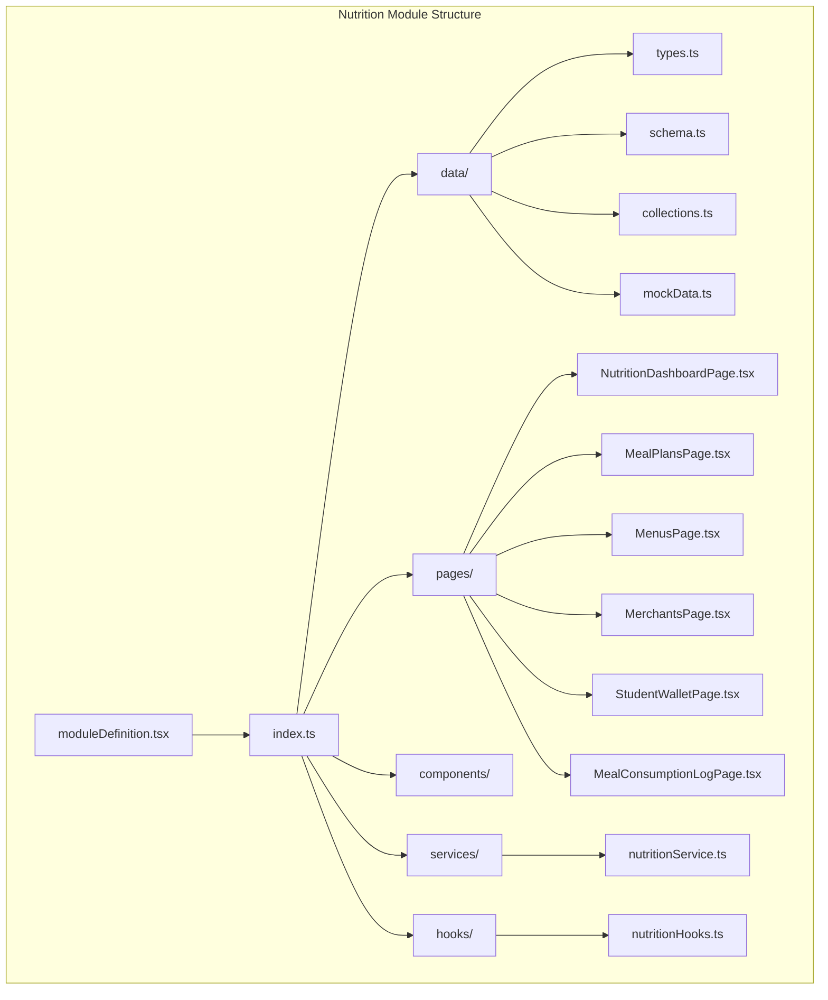
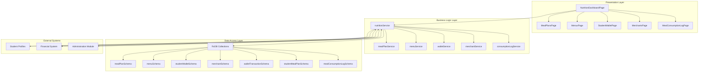
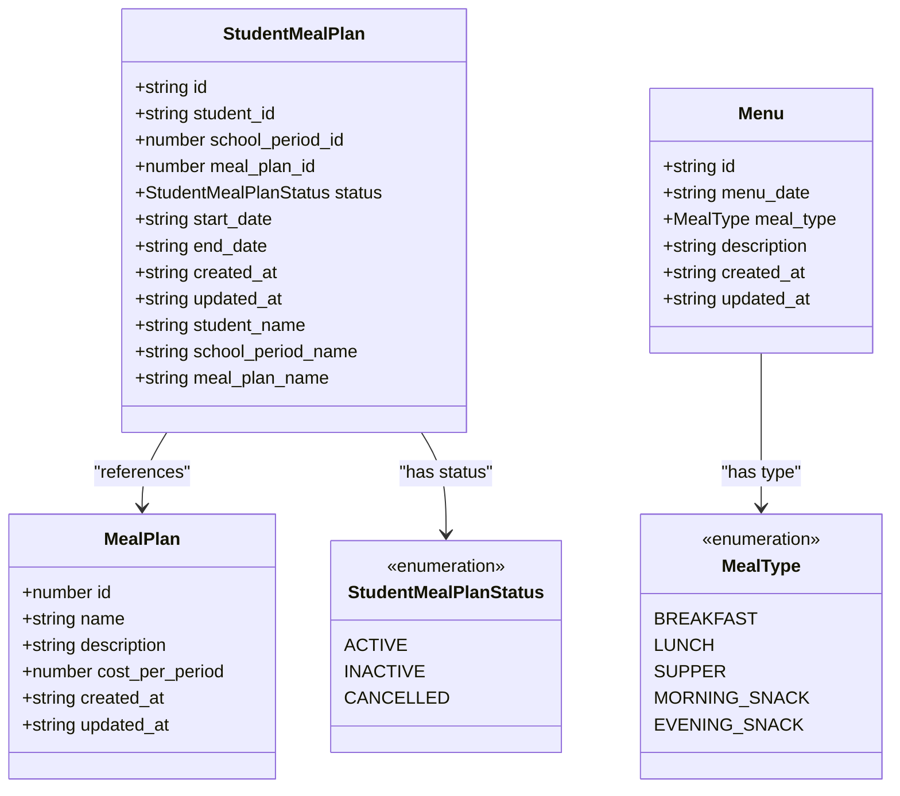
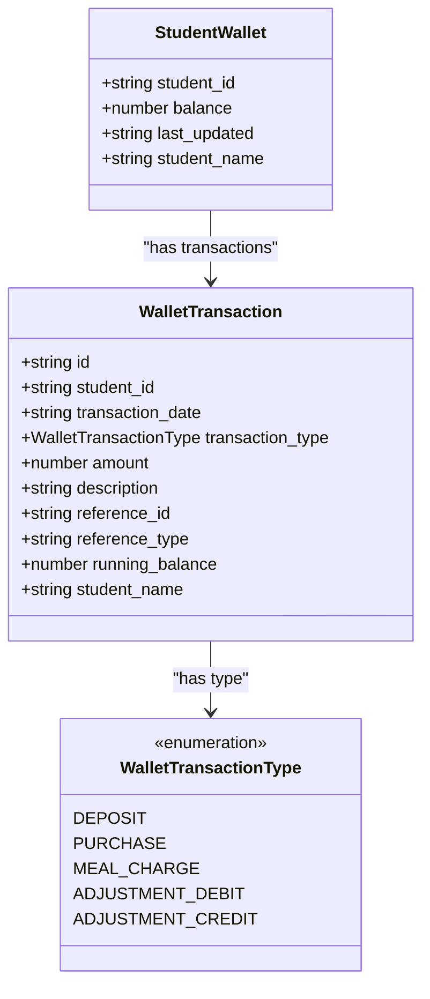
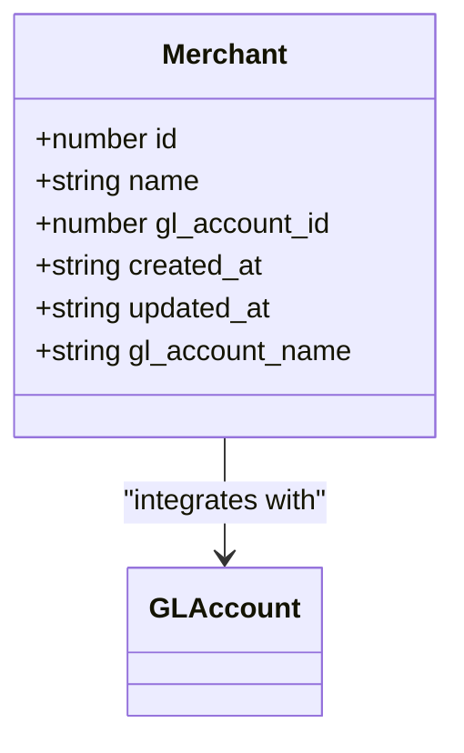
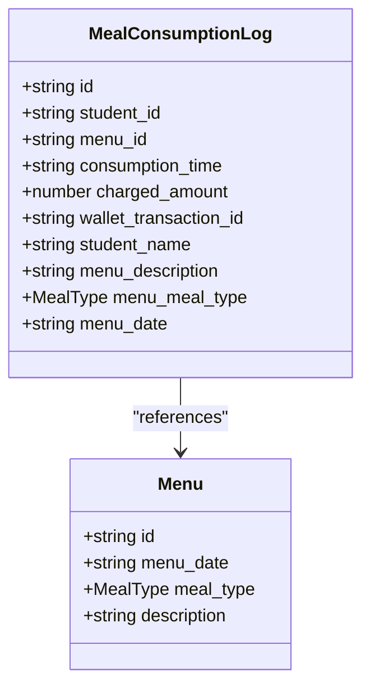
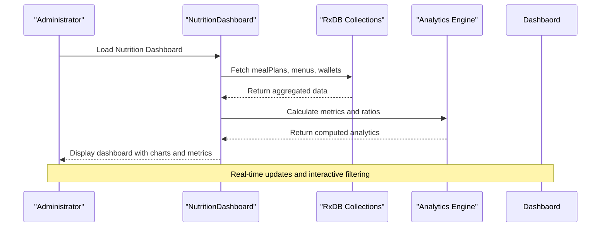
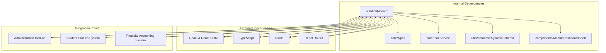

# Nutrition Module

<cite>
**Referenced Files in This Document**
- [moduleDefinition.tsx](file://src/modules/nutrition/moduleDefinition.tsx)
- [index.ts](file://src/modules/nutrition/index.ts)
- [types.ts](file://src/modules/nutrition/data/types.ts)
- [schema.ts](file://src/modules/nutrition/data/schema.ts)
- [NutritionDashboardPage.tsx](file://src/modules/nutrition/pages/NutritionDashboardPage.tsx)
- [rbac.ts](file://src/modules/nutrition/rbac.ts)
</cite>

## Table of Contents
1. [Introduction](#introduction)
2. [Project Structure](#project-structure)
3. [Core Components](#core-components)
4. [Architecture Overview](#architecture-overview)
5. [Detailed Component Analysis](#detailed-component-analysis)
6. [Dependency Analysis](#dependency-analysis)
7. [Performance Considerations](#performance-considerations)
8. [Troubleshooting Guide](#troubleshooting-guide)
9. [Conclusion](#conclusion)

## Introduction
The Nutrition module provides a comprehensive system for managing student meals, merchant operations, and wallet finances within the educational institution. It encompasses three primary functional areas:
- Meal Management: Planning, assigning, and tracking student meal plans and daily menus
- Merchant Management: Managing vendors and their sales transactions
- Wallet System: Student financial accounts with transaction history and balance tracking

The module integrates with student profiles and financial systems to provide a unified platform for nutrition services administration. It supports real-time dashboards, automated consumption logging, and detailed reporting capabilities.

## Project Structure
The Nutrition module follows a structured organization pattern with clear separation of concerns across data models, schemas, UI components, and business logic.

**Diagram sources**
- [moduleDefinition.tsx:16-63](file://src/modules/nutrition/moduleDefinition.tsx#L16-L63)
- [index.ts:4-28](file://src/modules/nutrition/index.ts#L4-L28)

**Section sources**
- [moduleDefinition.tsx:16-63](file://src/modules/nutrition/moduleDefinition.tsx#L16-L63)
- [index.ts:1-28](file://src/modules/nutrition/index.ts#L1-L28)

## Core Components
The module's core functionality is built around several interconnected data models and services that handle the complete nutrition lifecycle from planning to consumption tracking.

### Data Model Foundation
The module establishes a robust data model foundation using TypeScript interfaces and database-agnostic schemas. The core entities include:

- **Meal Plans**: Structured nutrition packages with cost and duration parameters
- **Student Meal Assignments**: Individual student plan enrollments with status tracking
- **Daily Menus**: Meal offerings organized by date and meal type
- **Student Wallets**: Financial accounts with transaction histories
- **Merchant Records**: Vendor profiles with accounting integrations
- **Consumption Logs**: Detailed records of meal consumption events

### Service Architecture
The module implements a service-oriented architecture with clear separation between data access, business logic, and presentation layers. Services handle CRUD operations, validation, and integration with external systems.

### UI Integration
The module provides comprehensive dashboard views with real-time metrics, interactive charts, and streamlined workflows for all major functions. The dashboard aggregates key performance indicators and provides quick access to administrative functions.

**Section sources**
- [types.ts:11-93](file://src/modules/nutrition/data/types.ts#L11-L93)
- [schema.ts:8-138](file://src/modules/nutrition/data/schema.ts#L8-L138)
- [moduleDefinition.tsx:24-32](file://src/modules/nutrition/moduleDefinition.tsx#L24-L32)

## Architecture Overview
The Nutrition module employs a layered architecture that separates concerns while maintaining tight integration between components. The system follows modern React patterns with TypeScript for type safety and RxDB for local data persistence.

**Diagram sources**
- [moduleDefinition.tsx:16-63](file://src/modules/nutrition/moduleDefinition.tsx#L16-L63)
- [schema.ts:8-138](file://src/modules/nutrition/data/schema.ts#L8-L138)

The architecture emphasizes:
- **Separation of Concerns**: Clear boundaries between presentation, business logic, and data layers
- **Type Safety**: Comprehensive TypeScript interfaces for all data structures
- **Data Persistence**: Local-first approach with RxDB for offline capability
- **Integration Points**: Well-defined interfaces for external system communication
- **Scalability**: Modular design supporting future feature expansion

## Detailed Component Analysis

### Meal Management System
The meal management system provides comprehensive functionality for creating, organizing, and tracking student meal plans and daily menus.

#### Meal Plan Management
Meal plans serve as structured nutrition packages that students can enroll in. Each plan includes cost parameters, duration specifications, and enrollment tracking.

**Diagram sources**
- [types.ts:11-55](file://src/modules/nutrition/data/types.ts#L11-L55)

#### Menu Creation and Organization
Menus are organized by date and meal type, providing structured meal offerings for students. The system supports multiple meal types including breakfast, lunch, supper, and snacks.

#### Student Assignment Process
The assignment process manages student enrollment in meal plans with status tracking and automatic renewal mechanisms.

**Section sources**
- [types.ts:11-55](file://src/modules/nutrition/data/types.ts#L11-L55)
- [schema.ts:25-84](file://src/modules/nutrition/data/schema.ts#L25-L84)

### Student Wallet System
The wallet system provides comprehensive financial management for student nutrition expenses with detailed transaction tracking and balance management.

#### Wallet Data Model
The wallet system maintains individual student accounts with real-time balance updates and comprehensive transaction histories.

**Diagram sources**
- [types.ts:66-84](file://src/modules/nutrition/data/types.ts#L66-L84)

#### Transaction Processing
The system handles various transaction types including deposits, purchases, meal charges, and adjustments with proper balance calculations and audit trails.

#### Balance Management
Real-time balance updates ensure accurate financial tracking with automatic recalculations and historical balance snapshots.

**Section sources**
- [types.ts:66-84](file://src/modules/nutrition/data/types.ts#L66-L84)
- [schema.ts:103-137](file://src/modules/nutrition/data/schema.ts#L103-L137)

### Merchant Management
Merchant management provides vendor oversight with financial integration and sales tracking capabilities.

#### Merchant Data Model
Merchants are registered vendors with accounting system integration for proper financial tracking and reporting.

**Diagram sources**
- [types.ts:57-64](file://src/modules/nutrition/data/types.ts#L57-L64)

#### Financial Integration
Merchants integrate with the general ledger system through chart of accounts, enabling comprehensive financial reporting and audit trails.

**Section sources**
- [types.ts:57-64](file://src/modules/nutrition/data/types.ts#L57-L64)
- [schema.ts:86-101](file://src/modules/nutrition/data/schema.ts#L86-L101)

### Consumption Tracking System
The consumption tracking system provides detailed monitoring of meal usage with automated logging and reporting capabilities.

#### Consumption Log Data Model
Comprehensive logs track each meal consumption event with detailed metadata for analysis and reporting.

**Diagram sources**
- [types.ts:44-55](file://src/modules/nutrition/data/types.ts#L44-L55)

#### Automated Logging
The system automatically creates consumption logs when students use their meal plans, linking transactions to wallet accounts and generating audit trails.

**Section sources**
- [types.ts:44-55](file://src/modules/nutrition/data/types.ts#L44-L55)
- [schema.ts:65-84](file://src/modules/nutrition/data/schema.ts#L65-L84)

### Dashboard and Reporting
The dashboard provides comprehensive analytics and real-time monitoring of all nutrition system activities.

#### Dashboard Metrics
Key performance indicators include total meal plans, active assignments, menu counts, merchant activity, and wallet balances with visual representations.

**Diagram sources**
- [NutritionDashboardPage.tsx:9-83](file://src/modules/nutrition/pages/NutritionDashboardPage.tsx#L9-L83)

**Section sources**
- [NutritionDashboardPage.tsx:9-83](file://src/modules/nutrition/pages/NutritionDashboardPage.tsx#L9-L83)

## Dependency Analysis
The Nutrition module maintains strategic dependencies with other system components while preserving internal cohesion and modularity.

**Diagram sources**
- [moduleDefinition.tsx:34-40](file://src/modules/nutrition/moduleDefinition.tsx#L34-L40)
- [index.ts:4-28](file://src/modules/nutrition/index.ts#L4-L28)

### Module Dependencies
The Nutrition module depends on the Administration module for core infrastructure and integrates with Student Profiles for identity management. The dependency structure ensures proper separation of concerns while enabling necessary cross-module functionality.

### Data Dependencies
The module relies on RxDB for local data persistence, providing offline capability and synchronization with central systems. Database schemas are designed for optimal query performance and data integrity.

**Section sources**
- [moduleDefinition.tsx:34-40](file://src/modules/nutrition/moduleDefinition.tsx#L34-L40)
- [schema.ts:8-138](file://src/modules/nutrition/data/schema.ts#L8-L138)

## Performance Considerations
The Nutrition module is designed with performance optimization in mind, implementing several strategies for efficient operation and scalability.

### Data Access Patterns
- **Indexed Queries**: Database schemas include strategic indexes on frequently queried fields (student_id, menu_date, transaction_date)
- **Denormalization**: Key relationship data is denormalized to reduce join operations during reporting
- **Pagination**: Large datasets are handled with pagination to prevent memory overload
- **Caching**: Frequently accessed data is cached locally for improved response times

### UI Performance
- **Lazy Loading**: Non-critical components are loaded on demand to minimize initial bundle size
- **Virtualization**: Large data grids use virtualization to render only visible rows
- **Optimized Rendering**: Dashboard components use efficient rendering patterns to minimize DOM updates

### Scalability Features
- **Modular Design**: Independent services enable selective scaling of specific components
- **Background Processing**: Heavy computations are offloaded to background threads
- **Batch Operations**: Multiple operations are batched to reduce database overhead

## Troubleshooting Guide
Common issues and their resolutions within the Nutrition module:

### Data Synchronization Issues
- **Symptom**: Outdated information in dashboard metrics
- **Cause**: RxDB synchronization delays
- **Solution**: Implement manual refresh triggers and optimistic updates

### Performance Degradation
- **Symptom**: Slow dashboard loading with large datasets
- **Cause**: Unoptimized queries or missing indexes
- **Solution**: Review database queries and add appropriate indexes

### Authentication Problems
- **Symptom**: Access denied errors for nutrition functions
- **Cause**: Missing RBAC permissions
- **Solution**: Verify user roles include nutrition permissions

### Data Integrity Issues
- **Symptom**: Inconsistent wallet balances
- **Cause**: Concurrent transaction processing
- **Solution**: Implement transaction locking and validation

**Section sources**
- [rbac.ts:3-42](file://src/modules/nutrition/rbac.ts#L3-L42)

## Conclusion
The Nutrition module provides a comprehensive, scalable solution for educational institution meal management systems. Its modular architecture, robust data models, and integrated dashboard capabilities make it suitable for institutions of all sizes.

Key strengths include:
- **Complete Functionality**: Covers all aspects of nutrition management from planning to financial tracking
- **Modern Architecture**: Leverages current best practices in React, TypeScript, and database design
- **Extensive Integration**: Seamlessly connects with student profiles and financial systems
- **Performance Focus**: Optimized for speed and scalability from the ground up
- **Future-Ready Design**: Modular structure supports easy extension and customization

The module's comprehensive approach to meal planning, consumption tracking, and financial management positions it as a cornerstone component for modern educational facility operations.