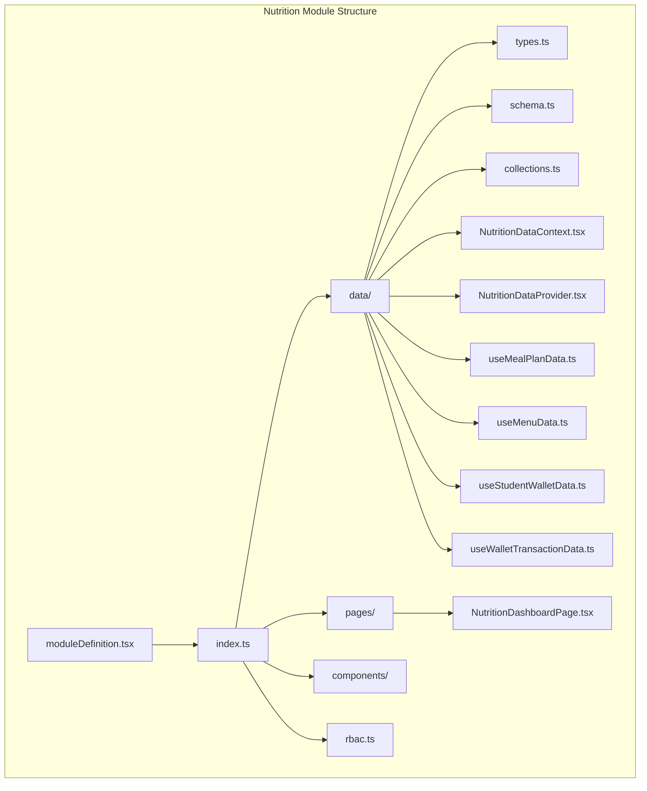
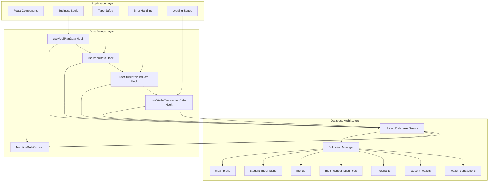
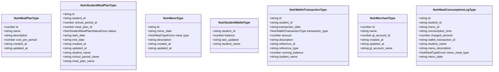
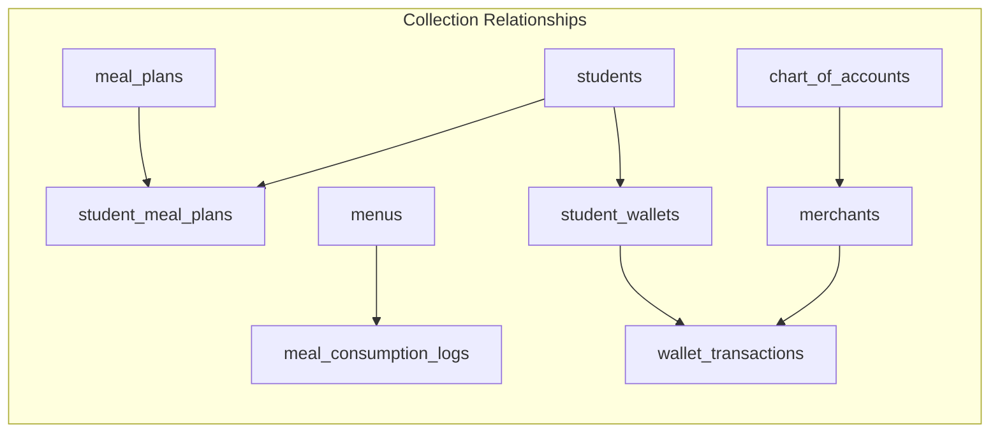
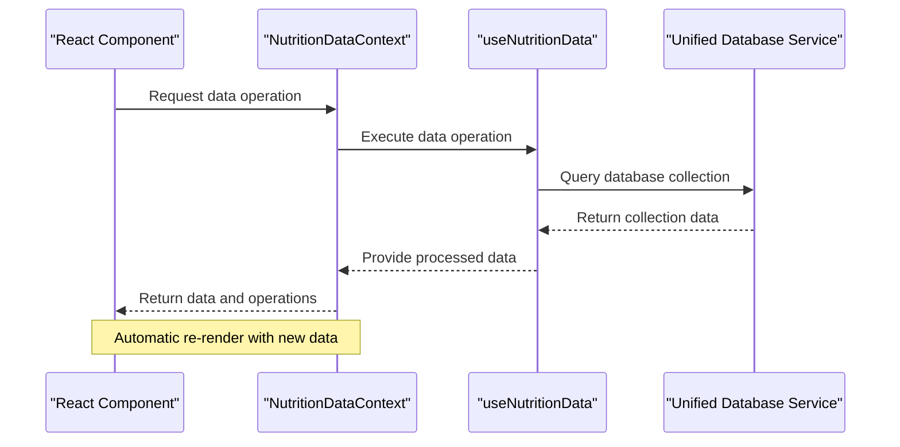
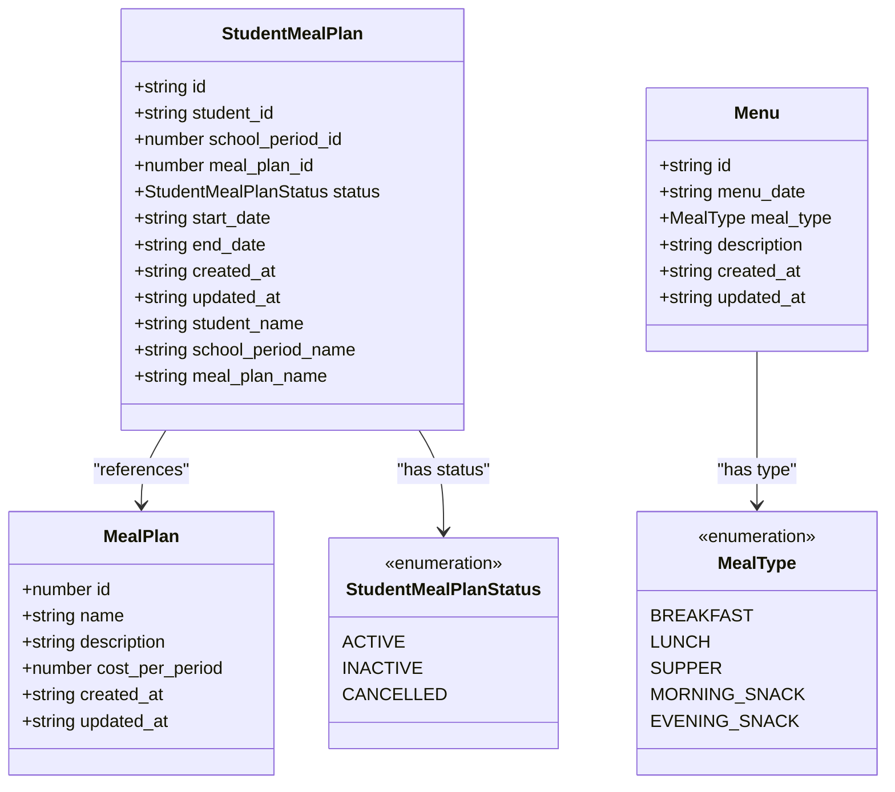
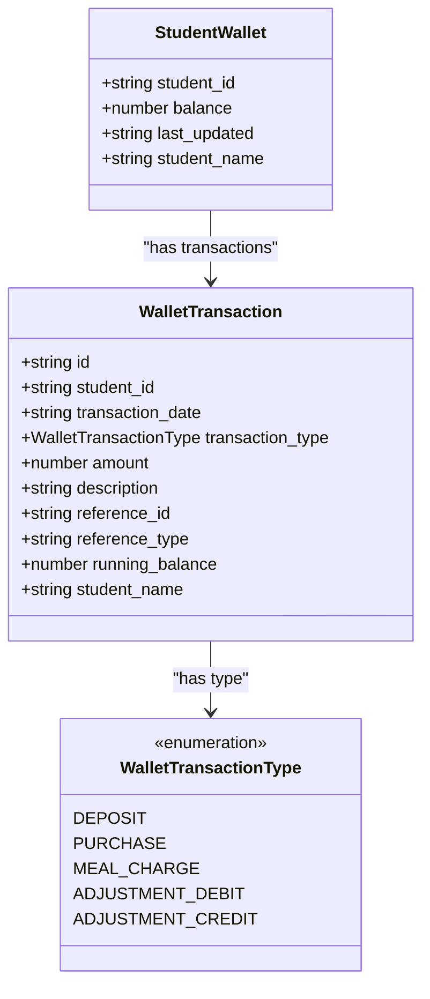
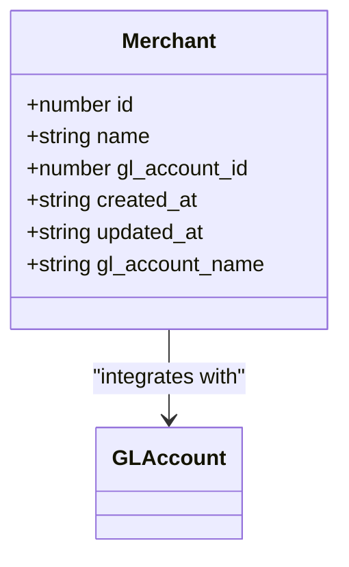
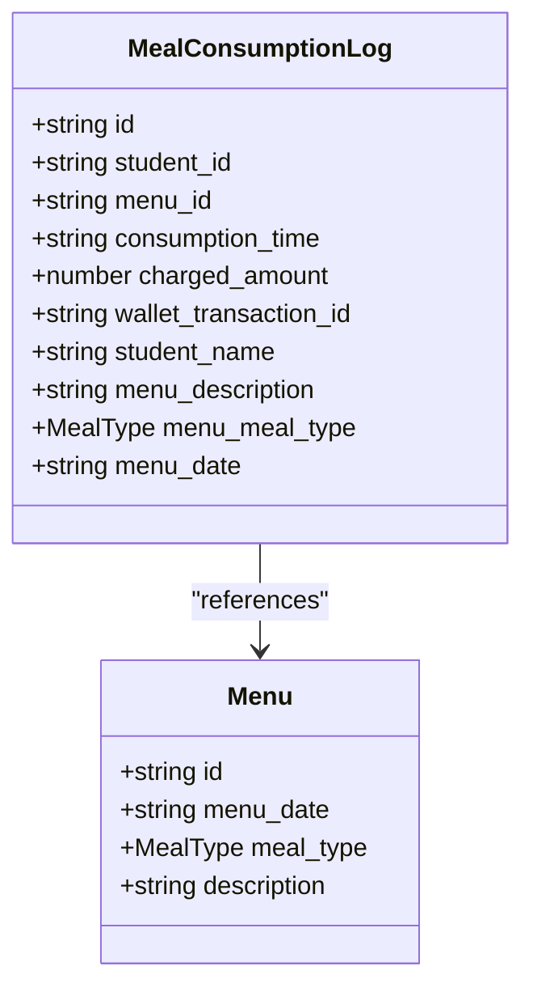
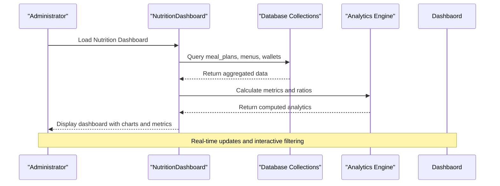

# Nutrition Module

<cite>
**Referenced Files in This Document**
- [moduleDefinition.tsx](file://src/modules/nutrition/moduleDefinition.tsx)
- [index.ts](file://src/modules/nutrition/data/index.ts)
- [types.ts](file://src/modules/nutrition/data/types.ts)
- [schema.ts](file://src/modules/nutrition/data/schema.ts)
- [collections.ts](file://src/modules/nutrition/data/collections.ts)
- [collectionConfig.ts](file://src/modules/nutrition/data/collectionConfig.ts)
- [NutritionDataContext.tsx](file://src/modules/nutrition/data/NutritionDataContext.tsx)
- [NutritionDataProvider.tsx](file://src/modules/nutrition/data/NutritionDataProvider.tsx)
- [useMealPlanData.ts](file://src/modules/nutrition/data/useMealPlanData.ts)
- [useMenuData.ts](file://src/modules/nutrition/data/useMenuData.ts)
- [useStudentWalletData.ts](file://src/modules/nutrition/data/useStudentWalletData.ts)
- [useWalletTransactionData.ts](file://src/modules/nutrition/data/useWalletTransactionData.ts)
- [NutritionDashboardPage.tsx](file://src/modules/nutrition/pages/NutritionDashboardPage.tsx)
- [rbac.ts](file://src/modules/nutrition/rbac.ts)
</cite>

## Update Summary
**Changes Made**
- Updated data architecture section to reflect new modular data context and hooks approach
- Added documentation for the new NutritionDataContext and facade pattern implementation
- Enhanced data hook documentation with standardized factory pattern and registration system
- Updated database-backed operations to show integration with database service
- Added new section on modular data provider architecture
- Revised data provider and hooks section to reflect facade pattern changes

## Table of Contents
1. [Introduction](#introduction)
2. [Project Structure](#project-structure)
3. [Core Components](#core-components)
4. [Database Architecture](#database-architecture)
5. [Data Models and Schemas](#data-models-and-schemas)
6. [Database Collections](#database-collections)
7. [Data Provider and Hooks](#data-provider-and-hooks)
8. [Meal Management System](#meal-management-system)
9. [Student Wallet System](#student-wallet-system)
10. [Merchant Management](#merchant-management)
11. [Consumption Tracking System](#consumption-tracking-system)
12. [Dashboard and Reporting](#dashboard-and-reporting)
13. [RBAC Permissions](#rbac-permissions)
14. [Integration Points](#integration-points)
15. [Performance Considerations](#performance-considerations)
16. [Troubleshooting Guide](#troubleshooting-guide)
17. [Conclusion](#conclusion)

## Introduction
The Nutrition module provides a comprehensive database-backed system for managing student meals, merchant operations, and wallet finances within educational institutions. The module has been enhanced with a modern modular architecture featuring a data context facade pattern and standardized data hooks that integrate seamlessly with the unified database service.

The module encompasses three primary functional areas:
- **Meal Management**: Database-backed meal plans, student assignments, and daily menu tracking
- **Merchant Management**: Vendor profiles with financial integration and sales tracking
- **Wallet System**: Student financial accounts with transaction history and balance management

Built on a modern React architecture with TypeScript type safety and database-backed operations, the module integrates with the unified database service to deliver a scalable and maintainable nutrition services platform.

## Project Structure
The Nutrition module follows a modern modular architecture with clear separation of concerns across data contexts, standardized hooks, UI components, and business logic. The module has been restructured to support database-backed operations through a facade pattern implementation.

**Diagram sources**
- [moduleDefinition.tsx:16-63](file://src/modules/nutrition/moduleDefinition.tsx#L16-L63)
- [index.ts:1-34](file://src/modules/nutrition/data/index.ts#L1-L34)

**Section sources**
- [moduleDefinition.tsx:16-63](file://src/modules/nutrition/moduleDefinition.tsx#L16-L63)
- [index.ts:1-34](file://src/modules/nutrition/data/index.ts#L1-L34)

## Core Components
The module's core functionality is built around a modern data context facade pattern with standardized hooks that provide database-backed operations through a unified interface.

### Modular Data Context Architecture
The module implements a facade pattern through the NutritionDataContext that wraps the useNutritionData hook, providing a clean interface for data access while maintaining database integration. The architecture emphasizes:
- **Facade Pattern**: Centralized data access through NutritionDataContext
- **Standardized Hooks**: Consistent interface across all data operations
- **Database Integration**: Direct integration with unified database service
- **Type Safety**: Comprehensive TypeScript interfaces for all operations

### Data Hook Factory Pattern
The module uses a standardized data hook factory pattern that provides consistent CRUD operations, error handling, and state management across all data entities. The factory pattern ensures:
- **Consistent Interface**: Same API across all data hooks
- **Automatic Registration**: Hooks register themselves with global context
- **Offline Support**: Built-in offline capability with sync priority
- **Mock Data Integration**: Seamless switching between mock and real data

### Service Integration
The module integrates with the unified database service for all data operations, providing:
- **Centralized Database Access**: Single point of database interaction
- **Real-time Updates**: Automatic data synchronization
- **Error Handling**: Consistent error handling across all operations
- **Loading States**: Automatic loading state management

**Section sources**
- [NutritionDataContext.tsx:1-36](file://src/modules/nutrition/data/NutritionDataContext.tsx#L1-L36)
- [NutritionDataProvider.tsx:1-116](file://src/modules/nutrition/data/NutritionDataProvider.tsx#L1-L116)
- [useMealPlanData.ts:1-29](file://src/modules/nutrition/data/useMealPlanData.ts#L1-L29)

## Database Architecture
The Nutrition module employs a sophisticated database architecture built on a unified database service with RxDB collections for comprehensive data persistence and real-time synchronization.

**Diagram sources**
- [collections.ts:6-28](file://src/modules/nutrition/data/collections.ts#L6-L28)
- [NutritionDataContext.tsx:12-25](file://src/modules/nutrition/data/NutritionDataContext.tsx#L12-L25)

The database architecture emphasizes:
- **Unified Service**: Single database service for all collections
- **Schema Validation**: Database-agnostic schemas ensure data integrity
- **Index Optimization**: Strategic indexing for common query patterns
- **Cross-Reference Support**: References between related collections
- **Real-time Synchronization**: Automatic data updates across sessions

## Data Models and Schemas
The module defines comprehensive TypeScript interfaces and database schemas for all nutrition entities, ensuring type safety and data consistency across the entire system.

### Core Entity Interfaces
The data model uses a dual-interface approach with both core types and nutrition-specific interfaces to avoid conflicts while maintaining clarity.

**Diagram sources**
- [types.ts:11-84](file://src/modules/nutrition/data/types.ts#L11-L84)

### Enumerations and Constants
The module defines specific enumerations for status values, meal types, and transaction types to ensure consistent data representation.

**Section sources**
- [types.ts:6-88](file://src/modules/nutrition/data/types.ts#L6-L88)

## Database Collections
The module implements a comprehensive collection system using RxDB collections with unified schema definitions for all nutrition entities.

### Collection Configuration
Each collection is configured with specific schemas, indexes, and relationships to optimize query performance and data integrity.

**Diagram sources**
- [collections.ts:6-28](file://src/modules/nutrition/data/collections.ts#L6-L28)
- [schema.ts:32-136](file://src/modules/nutrition/data/schema.ts#L32-L136)

### Collection Aliases and Mapping
The module provides collection alias mapping for easier integration with the unified database management system.

**Section sources**
- [collections.ts:6-32](file://src/modules/nutrition/data/collections.ts#L6-L32)
- [collectionConfig.ts:4-16](file://src/modules/nutrition/data/collectionConfig.ts#L4-L16)

## Data Provider and Hooks
The module implements a sophisticated data provider and hook system that manages database connections, state management, and real-time data synchronization through a facade pattern.

### Nutrition Data Context Facade
The NutritionDataContext serves as the central data access component, wrapping the useNutritionData hook with a clean React context interface that provides database-backed operations.

**Diagram sources**
- [NutritionDataContext.tsx:12-25](file://src/modules/nutrition/data/NutritionDataContext.tsx#L12-L25)

### Standardized Data Hooks
The module uses a factory pattern to create standardized data hooks that provide consistent CRUD operations, error handling, and state management across all entities.

**Section sources**
- [NutritionDataContext.tsx:1-36](file://src/modules/nutrition/data/NutritionDataContext.tsx#L1-L36)
- [NutritionDataProvider.tsx:1-116](file://src/modules/nutrition/data/NutritionDataProvider.tsx#L1-L116)
- [useMealPlanData.ts:1-29](file://src/modules/nutrition/data/useMealPlanData.ts#L1-L29)

## Meal Management System
The meal management system provides comprehensive functionality for creating, organizing, and tracking student meal plans and daily menus using database-backed operations through the unified database service.

### Meal Plan Management
Meal plans serve as structured nutrition packages that students can enroll in. Each plan includes cost parameters, duration specifications, and enrollment tracking through database collections.

**Diagram sources**
- [types.ts:11-55](file://src/modules/nutrition/data/types.ts#L11-L55)

### Student Assignment Process
The assignment process manages student enrollment in meal plans with status tracking and automatic renewal mechanisms through database operations.

**Section sources**
- [types.ts:11-55](file://src/modules/nutrition/data/types.ts#L11-L55)
- [schema.ts:25-84](file://src/modules/nutrition/data/schema.ts#L25-L84)

## Student Wallet System
The wallet system provides comprehensive financial management for student nutrition expenses with detailed transaction tracking and balance management through database-backed operations.

### Wallet Data Model
The wallet system maintains individual student accounts with real-time balance updates and comprehensive transaction histories stored in dedicated database collections.

**Diagram sources**
- [types.ts:66-84](file://src/modules/nutrition/data/types.ts#L66-L84)

### Transaction Processing
The system handles various transaction types including deposits, purchases, meal charges, and adjustments with proper balance calculations and audit trails maintained in the database.

### Balance Management
Real-time balance updates ensure accurate financial tracking with automatic recalculations and historical balance snapshots stored in the database.

**Section sources**
- [types.ts:66-84](file://src/modules/nutrition/data/types.ts#L66-L84)
- [schema.ts:103-137](file://src/modules/nutrition/data/schema.ts#L103-L137)

## Merchant Management
Merchant management provides vendor oversight with financial integration and sales tracking capabilities through database-backed operations.

### Merchant Data Model
Merchants are registered vendors with accounting system integration for proper financial tracking and reporting, stored in dedicated database collections.

**Diagram sources**
- [types.ts:57-64](file://src/modules/nutrition/data/types.ts#L57-L64)

### Financial Integration
Merchants integrate with the general ledger system through chart of accounts, enabling comprehensive financial reporting and audit trails maintained in the database.

**Section sources**
- [types.ts:57-64](file://src/modules/nutrition/data/types.ts#L57-L64)
- [schema.ts:86-101](file://src/modules/nutrition/data/schema.ts#L86-L101)

## Consumption Tracking System
The consumption tracking system provides detailed monitoring of meal usage with automated logging and reporting capabilities through database-backed operations.

### Consumption Log Data Model
Comprehensive logs track each meal consumption event with detailed metadata for analysis and reporting, stored in dedicated database collections.

**Diagram sources**
- [types.ts:44-55](file://src/modules/nutrition/data/types.ts#L44-L55)

### Automated Logging
The system automatically creates consumption logs when students use their meal plans, linking transactions to wallet accounts and generating audit trails maintained in the database.

**Section sources**
- [types.ts:44-55](file://src/modules/nutrition/data/types.ts#L44-L55)
- [schema.ts:65-84](file://src/modules/nutrition/data/schema.ts#L65-L84)

## Dashboard and Reporting
The dashboard provides comprehensive analytics and real-time monitoring of all nutrition system activities through database-backed data retrieval and aggregation.

### Dashboard Metrics
Key performance indicators include total meal plans, active assignments, menu counts, merchant activity, and wallet balances with visual representations generated from database queries.

**Diagram sources**
- [NutritionDashboardPage.tsx:9-83](file://src/modules/nutrition/pages/NutritionDashboardPage.tsx#L9-L83)

### Real-time Data Binding
The dashboard utilizes database hooks to provide real-time updates as data changes in the underlying collections, ensuring users always see current information.

**Section sources**
- [NutritionDashboardPage.tsx:9-83](file://src/modules/nutrition/pages/NutritionDashboardPage.tsx#L9-L83)

## RBAC Permissions
The module implements comprehensive role-based access control with specific permissions for nutrition-related operations.

### Permission Structure
The nutrition module defines granular permissions for meal management operations including read, create, update, and delete operations for all major entities.

**Section sources**
- [rbac.ts:3-42](file://src/modules/nutrition/rbac.ts#L3-L42)

## Integration Points
The Nutrition module maintains strategic dependencies with other system components while preserving internal cohesion and modularity through database-backed integration.

### External System Integration
The module integrates with multiple external systems including the Administration module for core infrastructure, Student Profiles for identity management, and Financial Accounting systems for transaction processing.

### Cross-Module Data Sharing
The module provides cross-domain reference resolution through the useNutritionData hook, allowing components to access data from other modules while maintaining database independence.

**Section sources**
- [moduleDefinition.tsx:34-40](file://src/modules/nutrition/moduleDefinition.tsx#L34-L40)

## Performance Considerations
The Nutrition module is designed with performance optimization in mind, implementing several strategies for efficient database operations and scalability.

### Database Optimization
- **Indexed Queries**: Database schemas include strategic indexes on frequently queried fields (student_id, menu_date, transaction_date)
- **Collection Isolation**: Separate collections for each entity type reduce query complexity
- **Cross-reference Denormalization**: Key relationship data is denormalized to reduce join operations during reporting
- **Pagination Support**: Large datasets are handled with pagination to prevent memory overload

### UI Performance
- **Selective Loading**: Components load only required data through database hooks
- **Real-time Updates**: Database subscriptions provide efficient data synchronization
- **Optimized Rendering**: Dashboard components use efficient rendering patterns to minimize DOM updates

### Scalability Features
- **Modular Design**: Independent collections enable selective scaling of specific components
- **Background Processing**: Heavy computations are offloaded to background threads
- **Batch Operations**: Multiple operations are batched to reduce database overhead

## Troubleshooting Guide
Common issues and their resolutions within the Nutrition module database-backed system:

### Database Connection Issues
- **Symptom**: Data not loading or showing loading states indefinitely
- **Cause**: Unified database service initialization failures
- **Solution**: Check database service initialization and collection registration

### Performance Degradation
- **Symptom**: Slow dashboard loading with large datasets
- **Cause**: Unoptimized database queries or missing indexes
- **Solution**: Review database queries and add appropriate indexes

### Data Synchronization Problems
- **Symptom**: Inconsistent data between sessions
- **Cause**: Database subscription failures or collection sync issues
- **Solution**: Verify database connection and collection subscriptions

### Authentication Problems
- **Symptom**: Access denied errors for nutrition functions
- **Cause**: Missing RBAC permissions or database access issues
- **Solution**: Verify user roles include nutrition permissions

### Data Integrity Issues
- **Symptom**: Inconsistent wallet balances or meal plan statuses
- **Cause**: Concurrent database operations or validation failures
- **Solution**: Implement proper transaction handling and validation

**Section sources**
- [NutritionDataProvider.tsx:43-60](file://src/modules/nutrition/data/NutritionDataProvider.tsx#L43-L60)

## Conclusion
The Nutrition module provides a comprehensive, database-backed solution for educational institution meal management systems. Its modern architecture, robust data models, and integrated dashboard capabilities make it suitable for institutions of all sizes.

Key strengths include:
- **Modular Architecture**: Facade pattern implementation through NutritionDataContext provides clean data access
- **Standardized Hooks**: Factory pattern ensures consistent interface across all data operations
- **Database Integration**: Direct integration with unified database service for reliability
- **Complete Functionality**: Covers all aspects of nutrition management from planning to financial tracking
- **Modern Architecture**: Leverages current best practices in React, TypeScript, and database design
- **Extensive Integration**: Seamlessly connects with student profiles and financial systems
- **Performance Focus**: Optimized for speed and scalability with database-level optimizations
- **Future-Ready Design**: Modular structure supports easy extension and customization

The module's comprehensive approach to meal planning, consumption tracking, and financial management, combined with its robust database architecture and facade pattern implementation, positions it as a cornerstone component for modern educational facility operations.