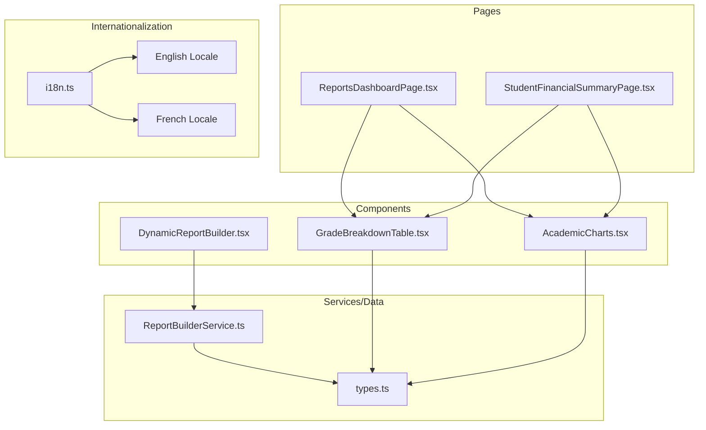
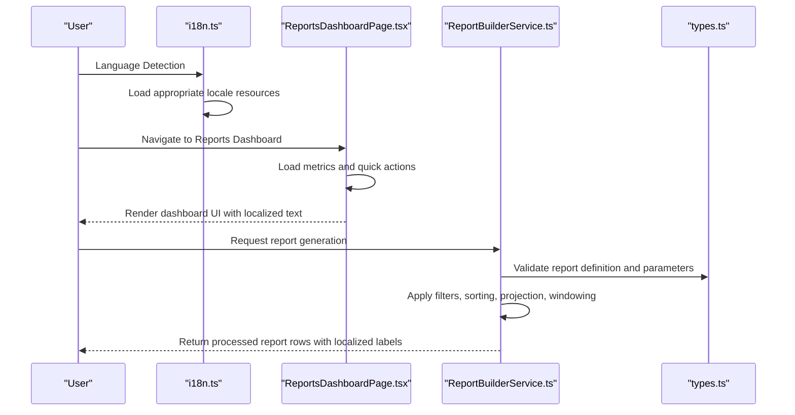
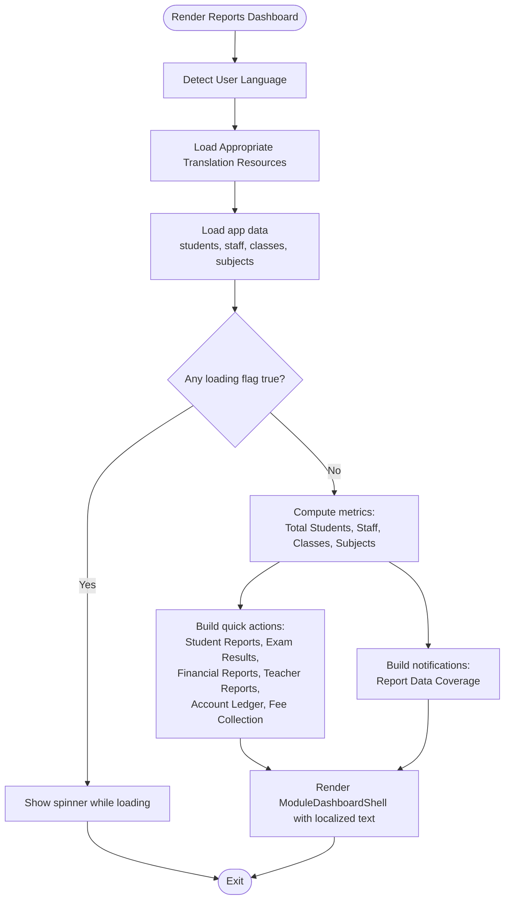
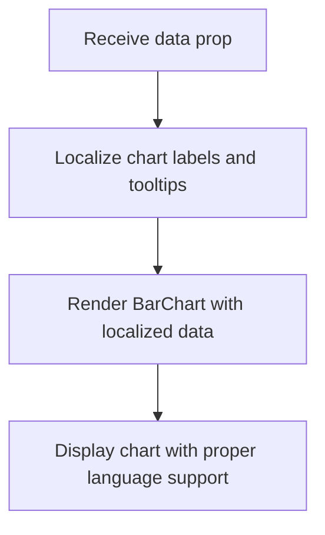
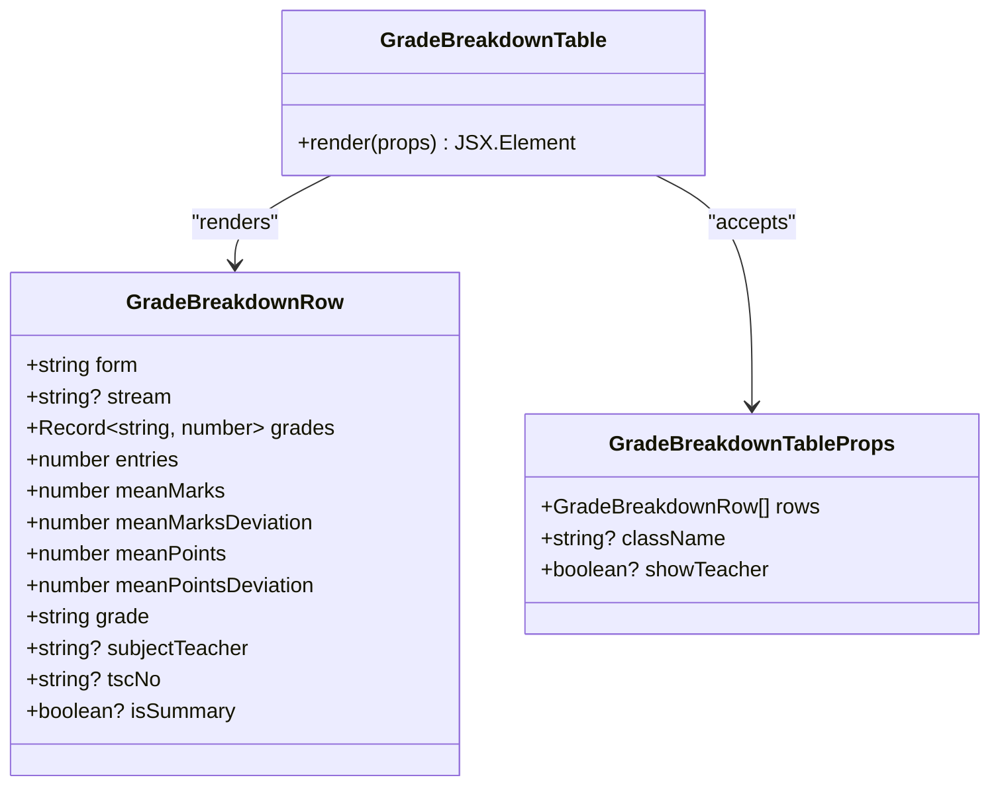
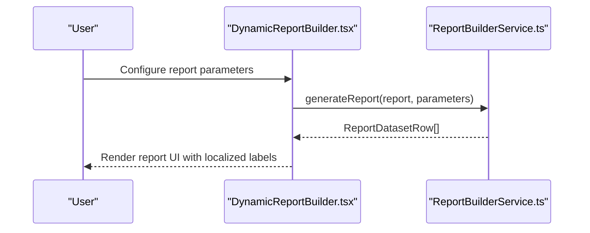
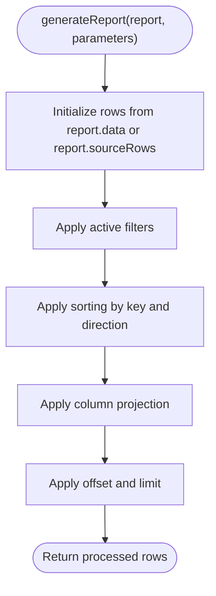
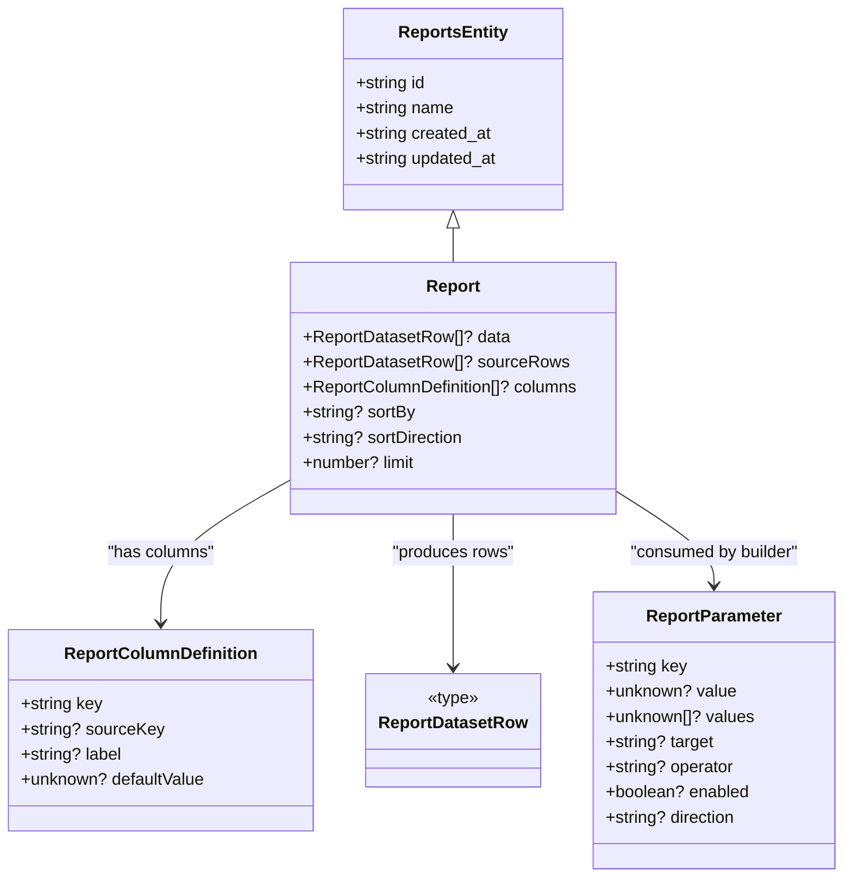
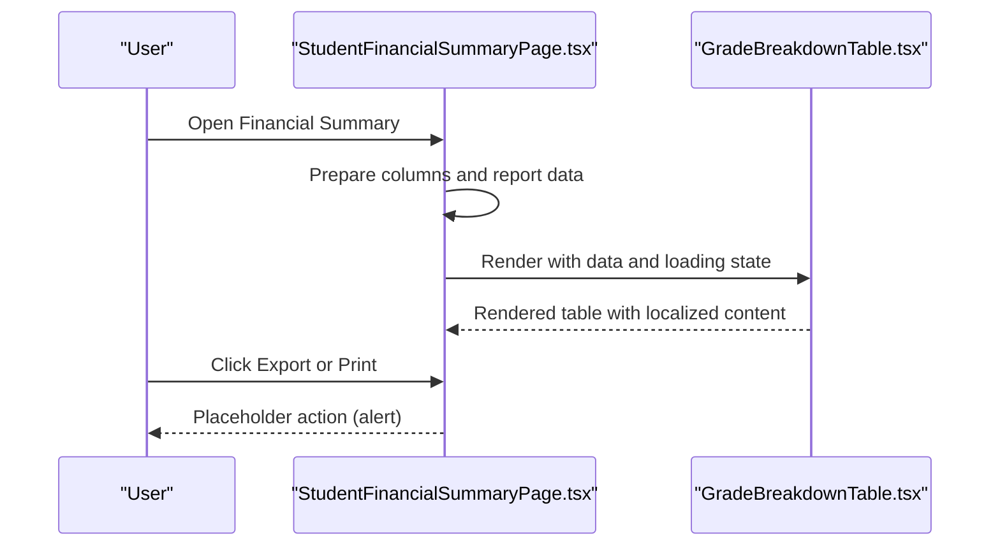
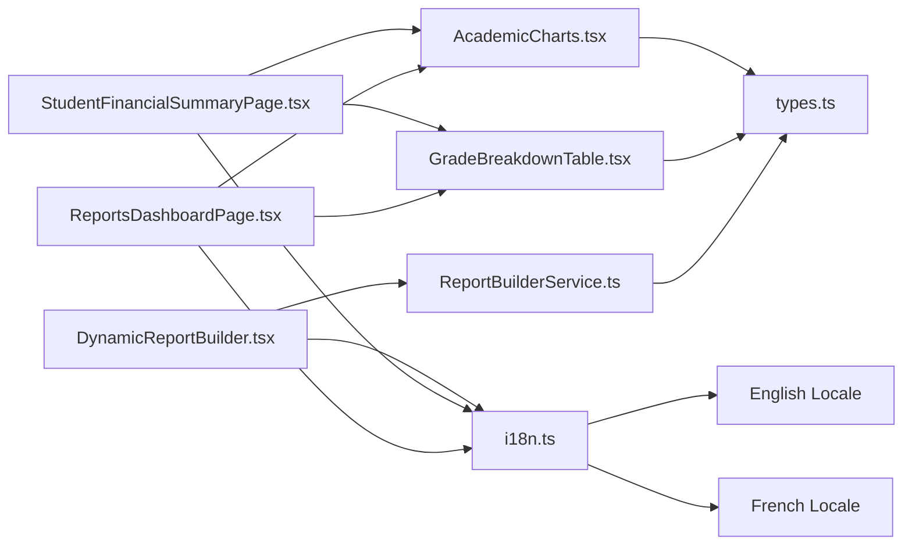

# Reports Module

<cite>
**Referenced Files in This Document**
- [ReportsDashboardPage.tsx](file://src/modules/reports/pages/ReportsDashboardPage.tsx)
- [types.ts](file://src/modules/reports/data/types.ts)
- [ReportBuilderService.ts](file://src/modules/reports/services/ReportBuilderService.ts)
- [AcademicCharts.tsx](file://src/modules/reports/components/AcademicCharts.tsx)
- [GradeBreakdownTable.tsx](file://src/modules/reports/components/GradeBreakdownTable.tsx)
- [StudentFinancialSummaryPage.tsx](file://src/modules/reports/pages/StudentFinancialSummaryPage.tsx)
- [DynamicReportBuilder.tsx](file://src/modules/reports/components/DynamicReportBuilder.tsx)
- [index.ts](file://src/modules/reports/components/index.ts)
- [i18n.ts](file://src/i18n/i18n.ts)
- [common.json](file://src/i18n/locales/en/common.json)
- [common.json](file://src/i18n/locales/fr/common.json)
</cite>

## Update Summary
**Changes Made**
- Added multilingual support documentation for French translations
- Updated internationalization architecture overview
- Enhanced translation management section with new locale files
- Added language detection and fallback mechanisms documentation

## Table of Contents
1. [Introduction](#introduction)
2. [Project Structure](#project-structure)
3. [Core Components](#core-components)
4. [Architecture Overview](#architecture-overview)
5. [Internationalization and Multilingual Support](#internationalization-and-multilingual-support)
6. [Detailed Component Analysis](#detailed-component-analysis)
7. [Dependency Analysis](#dependency-analysis)
8. [Performance Considerations](#performance-considerations)
9. [Troubleshooting Guide](#troubleshooting-guide)
10. [Conclusion](#conclusion)

## Introduction
The Reports module provides a unified analytics and reporting system for the school pilot application. It enables users to access academic performance reports, financial summaries, teacher assignments, account ledgers, and fee collections through a centralized dashboard. The module includes a dynamic report builder, visualization components, and export capabilities to support data-driven decision-making across academic, administrative, and financial domains. The module now features enhanced multilingual support with comprehensive French translations and refined English translations.

## Project Structure
The Reports module is organized around three primary layers:
- Pages: Dashboard and report-specific pages that orchestrate data fetching and rendering.
- Components: Reusable UI components for charts, tables, and the dynamic report builder.
- Services/Data: Shared data types and a report builder service for filtering, sorting, projection, and pagination.

**Diagram sources**
- [ReportsDashboardPage.tsx:1-69](file://src/modules/reports/pages/ReportsDashboardPage.tsx#L1-L69)
- [StudentFinancialSummaryPage.tsx:152-163](file://src/modules/reports/pages/StudentFinancialSummaryPage.tsx#L152-L163)
- [GradeBreakdownTable.tsx:1-205](file://src/modules/reports/components/GradeBreakdownTable.tsx#L1-L205)
- [AcademicCharts.tsx:1-22](file://src/modules/reports/components/AcademicCharts.tsx#L1-L22)
- [DynamicReportBuilder.tsx:1-14](file://src/modules/reports/components/DynamicReportBuilder.tsx#L1-L14)
- [types.ts:1-42](file://src/modules/reports/data/types.ts#L1-L42)
- [ReportBuilderService.ts:1-117](file://src/modules/reports/services/ReportBuilderService.ts#L1-L117)
- [i18n.ts:1-117](file://src/i18n/i18n.ts#L1-L117)
- [common.json:1-41](file://src/i18n/locales/en/common.json#L1-L41)
- [common.json:1-19](file://src/i18n/locales/fr/common.json#L1-L19)

**Section sources**
- [ReportsDashboardPage.tsx:1-69](file://src/modules/reports/pages/ReportsDashboardPage.tsx#L1-L69)
- [StudentFinancialSummaryPage.tsx:152-163](file://src/modules/reports/pages/StudentFinancialSummaryPage.tsx#L152-L163)
- [types.ts:1-42](file://src/modules/reports/data/types.ts#L1-L42)
- [ReportBuilderService.ts:1-117](file://src/modules/reports/services/ReportBuilderService.ts#L1-L117)
- [AcademicCharts.tsx:1-22](file://src/modules/reports/components/AcademicCharts.tsx#L1-L22)
- [GradeBreakdownTable.tsx:1-205](file://src/modules/reports/components/GradeBreakdownTable.tsx#L1-L205)
- [DynamicReportBuilder.tsx:1-14](file://src/modules/reports/components/DynamicReportBuilder.tsx#L1-L14)
- [index.ts:1-8](file://src/modules/reports/components/index.ts#L1-L8)

## Core Components
- Reports Dashboard: Presents key metrics, quick actions, and notifications for report access.
- Academic Charts: Renders bar charts for academic data visualization.
- Grade Breakdown Table: Displays grade distributions, means, and deviations across forms/streams.
- Dynamic Report Builder: Provides a framework for building reports from in-memory definitions.
- Report Builder Service: Implements filtering, sorting, projection, and pagination for report datasets.
- Report Types: Defines shared interfaces for reports, columns, parameters, and dataset rows.
- Internationalization System: Manages multilingual support with automatic language detection and fallback mechanisms.

**Section sources**
- [ReportsDashboardPage.tsx:10-65](file://src/modules/reports/pages/ReportsDashboardPage.tsx#L10-L65)
- [AcademicCharts.tsx:6-17](file://src/modules/reports/components/AcademicCharts.tsx#L6-L17)
- [GradeBreakdownTable.tsx:77-202](file://src/modules/reports/components/GradeBreakdownTable.tsx#L77-L202)
- [DynamicReportBuilder.tsx:5-11](file://src/modules/reports/components/DynamicReportBuilder.tsx#L5-L11)
- [ReportBuilderService.ts:6-13](file://src/modules/reports/services/ReportBuilderService.ts#L6-L13)
- [types.ts:4-42](file://src/modules/reports/data/types.ts#L4-L42)
- [i18n.ts:14-113](file://src/i18n/i18n.ts#L14-L113)

## Architecture Overview
The Reports module follows a layered architecture with integrated internationalization:
- Presentation Layer: Pages and components handle rendering and user interactions.
- Business Logic Layer: The report builder service encapsulates report generation logic.
- Data Contracts Layer: Shared types define report structures and parameters.
- Internationalization Layer: Centralized i18n system manages language detection, resource loading, and fallback mechanisms.

**Diagram sources**
- [i18n.ts:14-113](file://src/i18n/i18n.ts#L14-L113)
- [ReportsDashboardPage.tsx:10-65](file://src/modules/reports/pages/ReportsDashboardPage.tsx#L10-L65)
- [ReportBuilderService.ts:6-13](file://src/modules/reports/services/ReportBuilderService.ts#L6-L13)
- [types.ts:24-41](file://src/modules/reports/data/types.ts#L24-L41)

## Internationalization and Multilingual Support

### Language Detection and Resource Management
The Reports module utilizes a sophisticated internationalization system that automatically detects user language preferences and loads appropriate translation resources. The system supports both English and French languages with comprehensive coverage of report-related terminology.

### Translation Resources
The internationalization system manages translation resources through:
- Automatic language detection using browser preferences and localStorage
- Modular translation loading for efficient resource management
- Fallback mechanisms ensuring graceful degradation when translations are unavailable
- Support for nested translation objects and parameter interpolation

### Supported Languages
- English: Default fallback language with comprehensive academic and administrative terminology
- French: Enhanced French translations covering all report components, charts, tables, and user interface elements

### Translation Key Categories
The translation system covers several key categories relevant to the Reports module:
- Academic terminology: grades, subjects, forms, streams, and performance metrics
- Financial reporting: fee collections, account ledgers, and payment summaries
- Administrative functions: report generation, data export, and dashboard navigation
- User interface elements: buttons, labels, tooltips, and status messages

**Section sources**
- [i18n.ts:14-113](file://src/i18n/i18n.ts#L14-L113)
- [common.json:1-41](file://src/i18n/locales/en/common.json#L1-L41)
- [common.json:1-19](file://src/i18n/locales/fr/common.json#L1-L19)

## Detailed Component Analysis

### Reports Dashboard
The dashboard aggregates core counts and offers quick navigation to report categories. It also surfaces a health notification indicating whether essential datasets are populated. The dashboard now supports multilingual content with automatic language switching based on user preferences.

**Diagram sources**
- [ReportsDashboardPage.tsx:10-65](file://src/modules/reports/pages/ReportsDashboardPage.tsx#L10-L65)
- [i18n.ts:65-68](file://src/i18n/i18n.ts#L65-L68)

**Section sources**
- [ReportsDashboardPage.tsx:10-65](file://src/modules/reports/pages/ReportsDashboardPage.tsx#L10-L65)

### Academic Charts
A lightweight chart component leveraging a charting library to visualize academic metrics. It accepts arbitrary data and renders a bar chart with axes, grid, tooltip, and legend. The component now supports localized axis labels, tooltips, and legends based on the detected language.

**Diagram sources**
- [AcademicCharts.tsx:6-17](file://src/modules/reports/components/AcademicCharts.tsx#L6-L17)

**Section sources**
- [AcademicCharts.tsx:1-22](file://src/modules/reports/components/AcademicCharts.tsx#L1-L22)

### Grade Breakdown Table
The grade breakdown table presents grade distributions, totals, means, and deviations across forms and optional streams. It supports teacher columns and highlights values with color-coded classes. The table now includes comprehensive French translations for all column headers, grade labels, and statistical indicators.

**Diagram sources**
- [GradeBreakdownTable.tsx:7-41](file://src/modules/reports/components/GradeBreakdownTable.tsx#L7-L41)
- [GradeBreakdownTable.tsx:77-202](file://src/modules/reports/components/GradeBreakdownTable.tsx#L77-L202)

**Section sources**
- [GradeBreakdownTable.tsx:1-205](file://src/modules/reports/components/GradeBreakdownTable.tsx#L1-L205)

### Dynamic Report Builder
The dynamic report builder serves as a placeholder for a UI that allows users to construct reports from in-memory definitions. It integrates with the report builder service for processing. The builder now supports localized field names, operator labels, and validation messages.

**Diagram sources**
- [DynamicReportBuilder.tsx:5-11](file://src/modules/reports/components/DynamicReportBuilder.tsx#L5-L11)
- [ReportBuilderService.ts:6-13](file://src/modules/reports/services/ReportBuilderService.ts#L6-L13)

**Section sources**
- [DynamicReportBuilder.tsx:1-14](file://src/modules/reports/components/DynamicReportBuilder.tsx#L1-L14)
- [ReportBuilderService.ts:1-117](file://src/modules/reports/services/ReportBuilderService.ts#L1-L117)

### Report Builder Service
The report builder service performs:
- Filtering: Applies operators such as equality, inequality, greater-than, less-than, containment, inclusion, and between ranges.
- Sorting: Resolves sort keys and normalizes values for numeric and string comparisons.
- Projection: Selects and renames columns based on report definitions and selection parameters.
- Windowing: Supports offset and limit for pagination.

**Diagram sources**
- [ReportBuilderService.ts:6-13](file://src/modules/reports/services/ReportBuilderService.ts#L6-L13)
- [ReportBuilderService.ts:15-21](file://src/modules/reports/services/ReportBuilderService.ts#L15-L21)
- [ReportBuilderService.ts:40-56](file://src/modules/reports/services/ReportBuilderService.ts#L40-L56)
- [ReportBuilderService.ts:23-38](file://src/modules/reports/services/ReportBuilderService.ts#L23-L38)
- [ReportBuilderService.ts:70-76](file://src/modules/reports/services/ReportBuilderService.ts#L70-L76)

**Section sources**
- [ReportBuilderService.ts:1-117](file://src/modules/reports/services/ReportBuilderService.ts#L1-L117)

### Report Data Models
The module defines shared types for reports, columns, parameters, and dataset rows. These types ensure consistency across services and UI components.

**Diagram sources**
- [types.ts:4-42](file://src/modules/reports/data/types.ts#L4-L42)

**Section sources**
- [types.ts:1-42](file://src/modules/reports/data/types.ts#L1-L42)

### Financial Summary Reporting
The financial summary page demonstrates report rendering and export/print placeholders. It uses the shared table component and includes quick actions for print and export. The page now supports comprehensive French translations for all financial terminology and report elements.

**Diagram sources**
- [StudentFinancialSummaryPage.tsx:152-163](file://src/modules/reports/pages/StudentFinancialSummaryPage.tsx#L152-L163)
- [GradeBreakdownTable.tsx:77-202](file://src/modules/reports/components/GradeBreakdownTable.tsx#L77-L202)

**Section sources**
- [StudentFinancialSummaryPage.tsx:152-163](file://src/modules/reports/pages/StudentFinancialSummaryPage.tsx#L152-L163)
- [GradeBreakdownTable.tsx:1-205](file://src/modules/reports/components/GradeBreakdownTable.tsx#L1-L205)

## Dependency Analysis
The Reports module exhibits low coupling and high cohesion with integrated internationalization:
- Pages depend on shared components, types, and translation resources.
- The report builder service depends on shared types and leverages the i18n system for localized operations.
- Components are self-contained and rely on props for data and translation keys.
- Internationalization system provides centralized language management across all modules.

**Diagram sources**
- [ReportsDashboardPage.tsx:1-69](file://src/modules/reports/pages/ReportsDashboardPage.tsx#L1-L69)
- [StudentFinancialSummaryPage.tsx:152-163](file://src/modules/reports/pages/StudentFinancialSummaryPage.tsx#L152-L163)
- [GradeBreakdownTable.tsx:1-205](file://src/modules/reports/components/GradeBreakdownTable.tsx#L1-L205)
- [AcademicCharts.tsx:1-22](file://src/modules/reports/components/AcademicCharts.tsx#L1-L22)
- [DynamicReportBuilder.tsx:1-14](file://src/modules/reports/components/DynamicReportBuilder.tsx#L1-L14)
- [ReportBuilderService.ts:1-117](file://src/modules/reports/services/ReportBuilderService.ts#L1-L117)
- [types.ts:1-42](file://src/modules/reports/data/types.ts#L1-L42)
- [i18n.ts:1-117](file://src/i18n/i18n.ts#L1-L117)

**Section sources**
- [index.ts:1-8](file://src/modules/reports/components/index.ts#L1-L8)
- [ReportBuilderService.ts:1-117](file://src/modules/reports/services/ReportBuilderService.ts#L1-L117)
- [types.ts:1-42](file://src/modules/reports/data/types.ts#L1-L42)

## Performance Considerations
- Filtering and sorting operate on in-memory arrays; performance scales linearly with dataset size.
- Pagination via offset and limit reduces rendering overhead for large datasets.
- Internationalization resources are loaded asynchronously to minimize initial bundle size.
- Language detection uses caching mechanisms to avoid repeated detection operations.
- Consider virtualizing large tables and deferring heavy computations to background threads if datasets grow substantially.

## Troubleshooting Guide
- Empty datasets: The dashboard displays a warning notification when core datasets are missing, reducing report depth.
- Report generation errors: Validate report definitions and parameters against shared types to prevent runtime mismatches.
- Rendering issues: Ensure columns and keys align with report definitions; mismatched keys can lead to missing or null values.
- Translation issues: Verify that translation keys exist in the appropriate locale files; missing translations fall back to English.
- Language detection problems: Check browser language settings and localStorage configuration for proper language preference detection.

**Section sources**
- [ReportsDashboardPage.tsx:47-54](file://src/modules/reports/pages/ReportsDashboardPage.tsx#L47-L54)
- [i18n.ts:65-68](file://src/i18n/i18n.ts#L65-L68)

## Conclusion
The Reports module provides a robust foundation for analytics and reporting, with a clear separation of concerns across pages, components, and services. Its dynamic report builder and shared data models enable flexible report generation, while visualization components enhance interpretability. The enhanced multilingual support with comprehensive French translations and refined English translations ensures accessibility for diverse user bases. The integrated internationalization system provides seamless language switching and fallback mechanisms. Future enhancements can focus on expanding the dynamic builder UI, implementing export functionality, integrating backend data sources for scalable reporting, and extending support to additional languages.