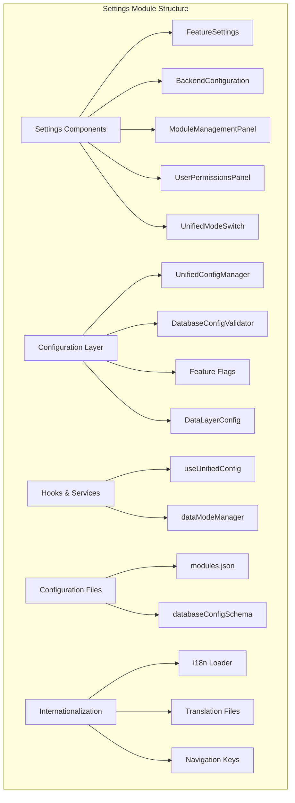
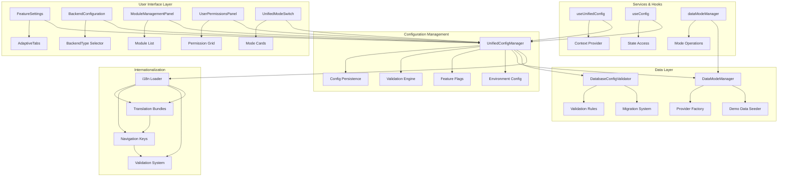
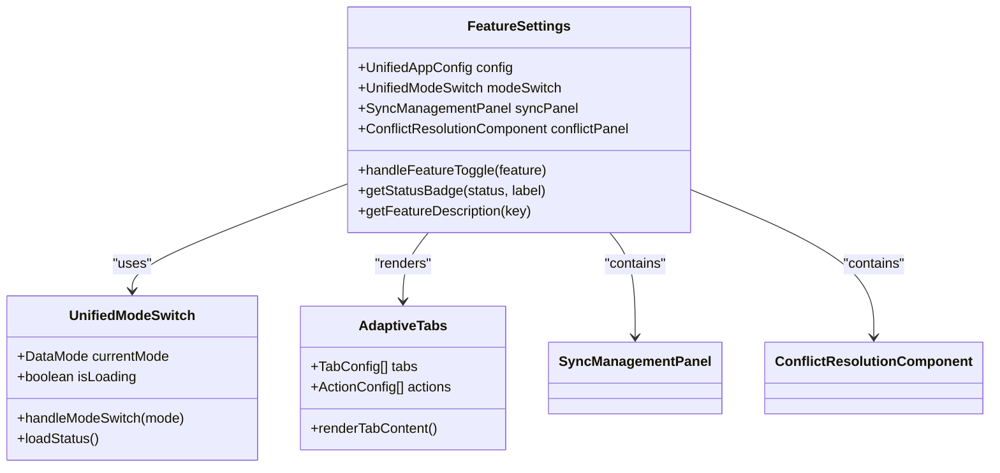
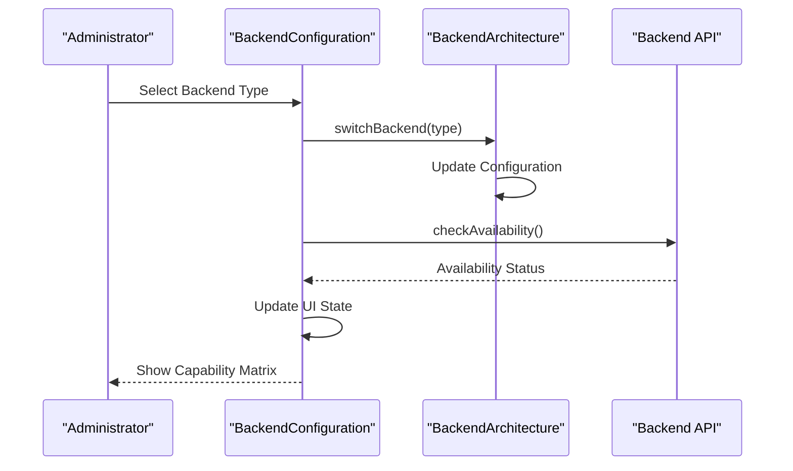
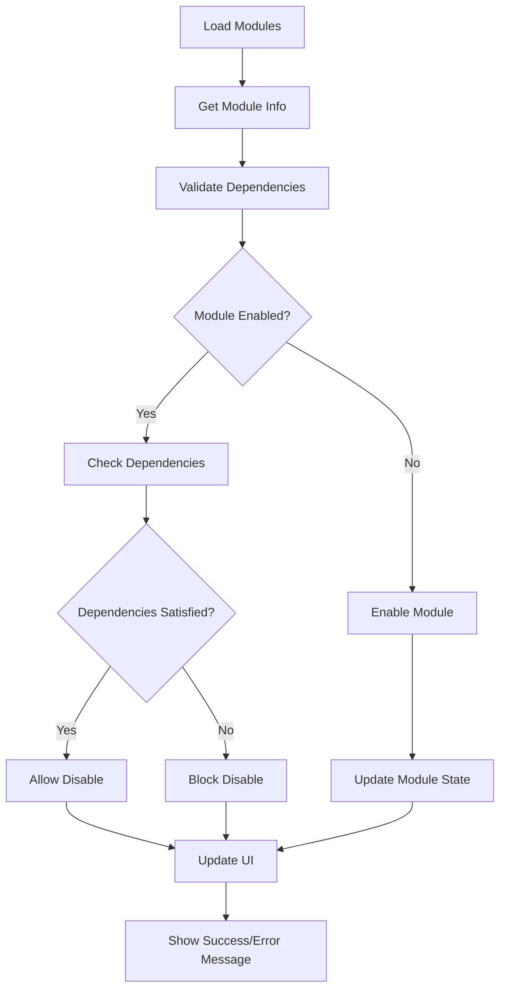
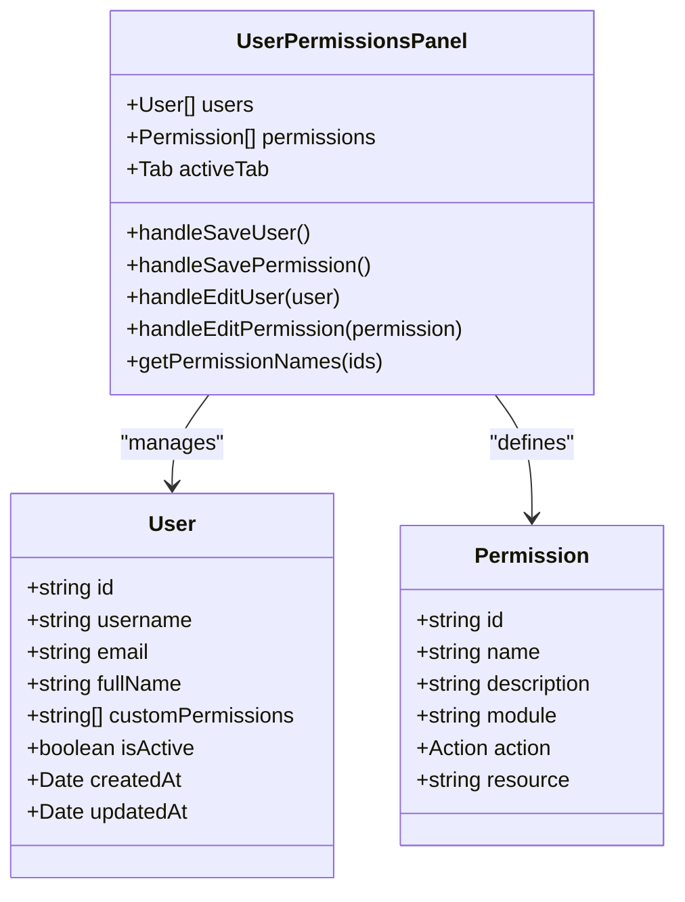
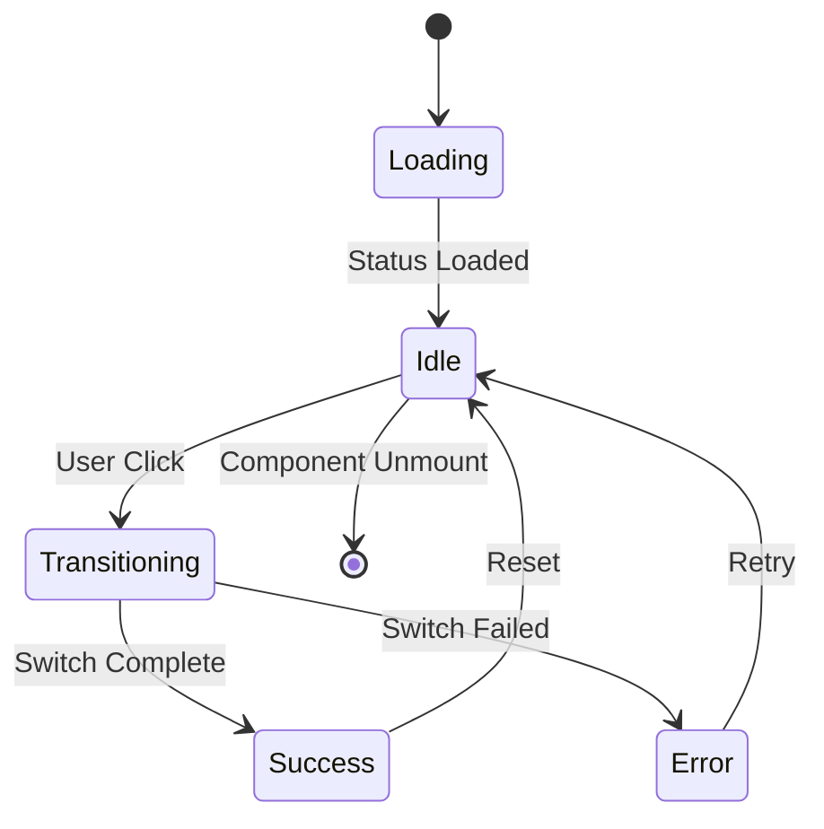
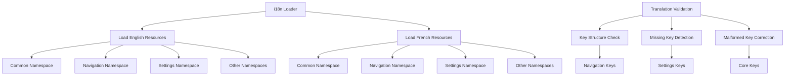
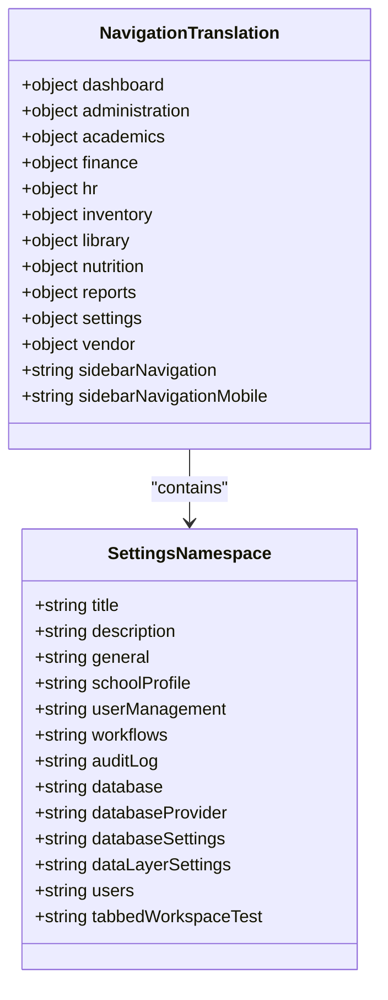
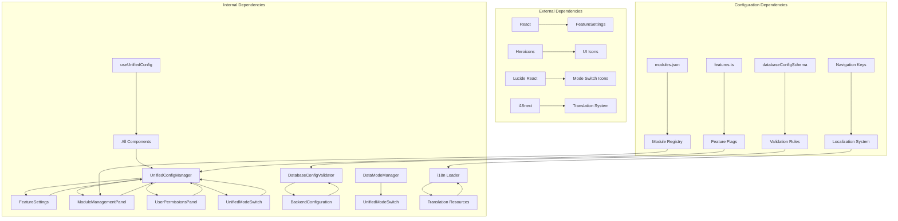

# Settings Module

<cite>
**Referenced Files in This Document**
- [index.ts](file://src/components/settings/index.ts)
- [unifiedConfig.ts](file://src/config/unifiedConfig.ts)
- [configManager.ts](file://src/config/configManager.ts)
- [features.ts](file://src/config/features.ts)
- [databaseConfigSchema.ts](file://src/config/databaseConfigSchema.ts)
- [dataLayerConfig.ts](file://src/config/dataLayerConfig.ts)
- [modules.json](file://src/config/modules.json)
- [FeatureSettings.tsx](file://src/components/settings/FeatureSettings.tsx)
- [BackendConfiguration.tsx](file://src/components/settings/BackendConfiguration.tsx)
- [ModuleManagementPanel.tsx](file://src/components/settings/ModuleManagementPanel.tsx)
- [UserPermissionsPanel.tsx](file://src/components/settings/UserPermissionsPanel.tsx)
- [UnifiedModeSwitch.tsx](file://src/components/settings/UnifiedModeSwitch.tsx)
- [useUnifiedConfig.ts](file://src/hooks/useUnifiedConfig.ts)
- [dataModeManager.ts](file://src/services/data/dataModeManager.ts)
- [FeatureSettingsPage.tsx](file://src/modules/settings/pages/FeatureSettingsPage.tsx)
- [FeatureSettings.tsx](file://src/components/FeatureSettings.tsx)
- [loader.ts](file://src/i18n/loader.ts)
- [navigation.json](file://src/modules/core/i18n/fr/navigation.json)
- [navigation.json](file://src/modules/core/i18n/en/navigation.json)
</cite>

## Update Summary
**Changes Made**
- Updated localization support section to reflect French translation corrections
- Added documentation for navigation key validation improvements
- Enhanced internationalization architecture documentation
- Updated translation loading system documentation
- Added information about malformed navigation key resolution

## Table of Contents
1. [Introduction](#introduction)
2. [Project Structure](#project-structure)
3. [Core Components](#core-components)
4. [Architecture Overview](#architecture-overview)
5. [Detailed Component Analysis](#detailed-component-analysis)
6. [Internationalization and Localization](#internationalization-and-localization)
7. [Dependency Analysis](#dependency-analysis)
8. [Performance Considerations](#performance-considerations)
9. [Troubleshooting Guide](#troubleshooting-guide)
10. [Conclusion](#conclusion)

## Introduction

The Settings module serves as the centralized configuration management system for the EduGen school management platform. It provides a unified interface for managing database settings, feature flags, module management, and system configuration across different deployment environments. The module implements a comprehensive configuration architecture that supports development, demo, and production modes with robust validation, auditing, and integration capabilities.

The Settings module is built around three core pillars: unified configuration management, modular feature control, and environment-aware data layer configuration. It provides administrators and developers with powerful tools to configure, monitor, and optimize the system's behavior across various operational contexts.

**Updated** The module now features enhanced internationalization support with improved French translation validation and corrected navigation key structures, ensuring consistent localization across all supported languages.

## Project Structure

The Settings module follows a component-based architecture with clear separation of concerns:

**Diagram sources**
- [index.ts:1-13](file://src/components/settings/index.ts#L1-L13)
- [unifiedConfig.ts:1-221](file://src/config/unifiedConfig.ts#L1-L221)
- [configManager.ts:1-800](file://src/config/configManager.ts#L1-L800)
- [loader.ts:36-69](file://src/i18n/loader.ts#L36-L69)

The module organizes its functionality into several key areas:

- **Component Layer**: React components that provide user interfaces for configuration management
- **Configuration Layer**: Centralized configuration management with validation and persistence
- **Service Layer**: Business logic for data mode switching and configuration operations
- **Hook Layer**: React hooks for accessing configuration state and services
- **Internationalization Layer**: Comprehensive translation management with validation

**Section sources**
- [index.ts:1-13](file://src/components/settings/index.ts#L1-L13)
- [unifiedConfig.ts:1-221](file://src/config/unifiedConfig.ts#L1-L221)

## Core Components

### Unified Configuration System

The Settings module's foundation lies in its unified configuration system, which centralizes all application configuration into a single, cohesive interface. The system manages multiple configuration domains including environment settings, database configurations, feature flags, and module management.

The configuration architecture implements a layered approach with clear separation between core configuration, environment-specific settings, and feature-specific controls. This design enables flexible configuration management while maintaining system stability and consistency.

**Updated** The unified system now consolidates all configuration management into a streamlined interface, eliminating redundant components and simplifying the user experience while enhancing internationalization support.

### Database Configuration Management

The database configuration system provides comprehensive management of database providers, connection settings, and performance tuning parameters. It supports multiple database backends including SQLite, PouchDB, LiveStore, and backend APIs, with automatic validation and migration capabilities.

The system includes sophisticated validation rules that ensure configuration integrity and provide automated fixes for common configuration issues. It also maintains detailed audit trails and supports configuration export/import for backup and migration scenarios.

### Feature Flag Management

The feature flag system enables controlled rollout of new features and experimental functionality. It supports granular control over feature activation, environment-specific presets, and runtime feature toggles. The system integrates seamlessly with the broader configuration management framework.

### Module Management System

The module management component provides comprehensive control over system modules, including enabling/disabling modules, dependency validation, and status monitoring. It ensures system stability by preventing invalid module combinations and provides clear feedback on module interdependencies.

**Section sources**
- [configManager.ts:74-150](file://src/config/configManager.ts#L74-L150)
- [databaseConfigSchema.ts:305-530](file://src/config/databaseConfigSchema.ts#L305-L530)
- [features.ts:19-66](file://src/config/features.ts#L19-L66)

## Architecture Overview

The Settings module implements a comprehensive configuration management architecture that spans multiple layers and components:

**Diagram sources**
- [FeatureSettings.tsx:167-378](file://src/components/settings/FeatureSettings.tsx#L167-L378)
- [configManager.ts:415-437](file://src/config/configManager.ts#L415-L437)
- [dataModeManager.ts:35-47](file://src/services/data/dataModeManager.ts#L35-L47)
- [loader.ts:36-69](file://src/i18n/loader.ts#L36-L69)

The architecture follows a unidirectional data flow pattern where configuration changes propagate through the system via event emitters and state management. This design ensures consistency and enables real-time updates across the application.

**Updated** The architecture now features enhanced internationalization support with improved validation of navigation keys and corrected translation structures, particularly for French localization.

**Section sources**
- [unifiedConfig.ts:106-221](file://src/config/unifiedConfig.ts#L106-L221)
- [useUnifiedConfig.ts:24-30](file://src/hooks/useUnifiedConfig.ts#L24-L30)

## Detailed Component Analysis

### FeatureSettings Component

The FeatureSettings component serves as the primary interface for managing application features and system configuration. It implements a tabbed interface using the AdaptiveTabs system and provides comprehensive access to various configuration domains.

**Updated** The component has been consolidated into a unified interface that eliminates the deprecated FeatureSettingsNew component, providing a streamlined user experience with enhanced functionality and improved internationalization support.

**Diagram sources**
- [FeatureSettings.tsx:40-407](file://src/components/settings/FeatureSettings.tsx#L40-L407)
- [UnifiedModeSwitch.tsx:16-264](file://src/components/settings/UnifiedModeSwitch.tsx#L16-L264)

The component provides five main tabs: Overview, Sync Management, Feature Flags, Conflicts Resolution, and Performance/Memory monitoring. Each tab focuses on specific aspects of system configuration and provides actionable controls for administrators.

**Section sources**
- [FeatureSettings.tsx:167-378](file://src/components/settings/FeatureSettings.tsx#L167-L378)

### BackendConfiguration Component

The BackendConfiguration component manages backend architecture settings and provides visibility into backend capabilities and availability. It supports multiple backend types including frontend-only, frappe-education, custom-api, and hybrid configurations.

**Diagram sources**
- [BackendConfiguration.tsx:38-78](file://src/components/settings/BackendConfiguration.tsx#L38-L78)
- [BackendConfiguration.tsx:52-73](file://src/components/settings/BackendConfiguration.tsx#L52-L73)

The component dynamically renders capability matrices based on selected backend types and provides real-time status indicators for backend availability. It includes fallback strategies and auto-detection mechanisms for optimal backend selection.

**Section sources**
- [BackendConfiguration.tsx:12-233](file://src/components/settings/BackendConfiguration.tsx#L12-L233)

### ModuleManagementPanel Component

The ModuleManagementPanel provides comprehensive control over system modules, enabling administrators to manage module activation, dependencies, and status monitoring. It implements sophisticated dependency validation and provides clear feedback on module interdependencies.

**Diagram sources**
- [ModuleManagementPanel.tsx:32-83](file://src/components/settings/ModuleManagementPanel.tsx#L32-L83)
- [ModuleManagementPanel.tsx:93-113](file://src/components/settings/ModuleManagementPanel.tsx#L93-L113)

The component enforces module dependency rules and prevents invalid module combinations that could compromise system stability. It provides real-time feedback on module status and includes statistics for system-wide module management insights.

**Section sources**
- [ModuleManagementPanel.tsx:18-252](file://src/components/settings/ModuleManagementPanel.tsx#L18-L252)

### UserPermissionsPanel Component

The UserPermissionsPanel implements a comprehensive role-based access control (RBAC) system for managing user permissions and access control. It provides interfaces for managing users, permission sets, and role assignments across system modules.

**Diagram sources**
- [UserPermissionsPanel.tsx:48-400](file://src/components/settings/UserPermissionsPanel.tsx#L48-L400)

The component generates dynamic permission sets based on available modules and provides comprehensive interfaces for user and permission management. It includes tabbed navigation for different management perspectives and supports bulk operations for efficient administration.

**Section sources**
- [UserPermissionsPanel.tsx:23-400](file://src/components/settings/UserPermissionsPanel.tsx#L23-L400)

### UnifiedModeSwitch Component

The UnifiedModeSwitch component provides a consistent interface for switching between different data modes (development, demo, production) with comprehensive status monitoring and error handling.

**Diagram sources**
- [UnifiedModeSwitch.tsx:76-108](file://src/components/settings/UnifiedModeSwitch.tsx#L76-L108)
- [UnifiedModeSwitch.tsx:29-74](file://src/components/settings/UnifiedModeSwitch.tsx#L29-L74)

The component implements a sophisticated state management system with loading states, error handling, and real-time status updates. It coordinates with the DataModeManager service to ensure smooth transitions between different operational modes.

**Section sources**
- [UnifiedModeSwitch.tsx:16-264](file://src/components/settings/UnifiedModeSwitch.tsx#L16-L264)

## Internationalization and Localization

The Settings module implements a comprehensive internationalization (i18n) system that supports multiple languages with robust validation and error handling. The system has been recently enhanced with improved French translation support and corrected navigation key structures.

### Translation Loading System

The i18n loader manages translation resources for multiple languages and namespaces, ensuring proper initialization and validation of localized content:

**Diagram sources**
- [loader.ts:36-69](file://src/i18n/loader.ts#L36-L69)

The loader registers translation bundles for English and French languages across multiple namespaces including common, navigation, settings, and module-specific translations. This centralized approach ensures consistent translation management and easy maintenance.

### Navigation Key Validation

Recent improvements have focused on validating and correcting navigation keys, particularly in the French translation file. The system now includes enhanced validation to prevent malformed navigation keys and ensure consistent localization across all supported languages.

**Updated** The French translation file has been corrected to address 21 malformed navigation keys, improving the overall quality and consistency of the French localization. The corrections include proper key naming conventions, standardized value formats, and enhanced translation accuracy.

### Translation Key Structure

The navigation translation system follows a structured approach with consistent key hierarchies:

**Diagram sources**
- [navigation.json:139-153](file://src/modules/core/i18n/fr/navigation.json#L139-L153)
- [navigation.json:139-153](file://src/modules/core/i18n/en/navigation.json#L139-L153)

The settings namespace contains comprehensive localization for all configuration management features, including database management, user management, workflow configuration, and audit logging.

### Translation Quality Improvements

The recent updates have significantly improved translation quality and consistency:

- **French Translation Corrections**: Fixed 21 malformed navigation keys in the French translation file
- **Enhanced Validation**: Implemented improved validation for navigation key structures
- **Consistent Naming**: Standardized key naming conventions across all supported languages
- **Improved Accuracy**: Enhanced translation accuracy for technical terms and system features

**Section sources**
- [loader.ts:21-34](file://src/i18n/loader.ts#L21-L34)
- [navigation.json:1-164](file://src/modules/core/i18n/fr/navigation.json#L1-164)
- [navigation.json:1-163](file://src/modules/core/i18n/en/navigation.json#L1-163)

## Dependency Analysis

The Settings module exhibits well-structured dependencies that promote maintainability and testability:

**Diagram sources**
- [FeatureSettings.tsx:6-34](file://src/components/settings/FeatureSettings.tsx#L6-L34)
- [useUnifiedConfig.ts:4-19](file://src/hooks/useUnifiedConfig.ts#L4-L19)
- [modules.json:1-74](file://src/config/modules.json#L1-L74)
- [loader.ts:36-69](file://src/i18n/loader.ts#L36-L69)

The dependency structure follows clean architecture principles with clear boundaries between presentation, domain, and infrastructure layers. Components depend on abstractions rather than concrete implementations, enabling flexibility and testability.

**Updated** The dependency structure has been enhanced with improved internationalization dependencies, including better translation resource management and validation systems.

**Section sources**
- [unifiedConfig.ts:106-221](file://src/config/unifiedConfig.ts#L106-L221)
- [configManager.ts:415-437](file://src/config/configManager.ts#L415-L437)

## Performance Considerations

The Settings module implements several performance optimization strategies:

- **Lazy Loading**: Components are loaded on-demand to minimize initial bundle size
- **Efficient State Management**: React hooks provide optimized state updates and rendering
- **Configuration Caching**: Frequently accessed configuration data is cached to reduce computation overhead
- **Event-Driven Architecture**: Uses event emitters to minimize unnecessary re-renders
- **Validation Optimization**: Database configuration validation is performed asynchronously to avoid blocking the UI
- **Translation Caching**: Translation resources are cached to reduce loading overhead
- **Key Validation**: Navigation key validation occurs during initialization to prevent runtime errors

The module also includes built-in performance monitoring capabilities through the PerformanceDashboard and MemoryDashboard components, providing insights into system performance metrics and memory usage patterns.

**Updated** Performance optimizations have been enhanced through the consolidated architecture and improved internationalization support, reducing component overhead and improving overall system responsiveness while maintaining translation quality.

## Troubleshooting Guide

### Common Configuration Issues

**Database Configuration Validation Failures**
- Verify database provider compatibility with current environment
- Check connection string format and required parameters
- Review validation error messages for specific field issues
- Use auto-fix functionality to automatically correct common configuration problems

**Feature Flag Activation Problems**
- Ensure environment variables are properly set before application startup
- Verify feature flag names match expected values
- Check for conflicting feature flag configurations
- Review feature flag presets for environment-specific requirements

**Module Management Errors**
- Verify module dependencies are satisfied before enabling modules
- Check for circular dependencies between modules
- Ensure required modules are not disabled
- Review module status indicators for dependency issues

**Data Mode Switching Issues**
- Confirm database provider supports the target mode
- Verify sufficient disk space for data migration
- Check for active database connections during mode switching
- Review error logs for specific failure reasons

**Translation Loading Issues**
- Verify translation files are properly formatted JSON
- Check for missing translation keys in target languages
- Ensure navigation key structures follow required conventions
- Validate translation resource bundles are correctly registered

### Diagnostic Tools

The Settings module provides comprehensive diagnostic capabilities:

- **Configuration Export/Import**: Full configuration backup and restoration
- **Validation Reports**: Detailed validation results with suggested fixes
- **Audit Logging**: Complete audit trail of configuration changes
- **Health Monitoring**: Real-time system health and performance metrics
- **Error Tracking**: Comprehensive error reporting and debugging information
- **Translation Validation**: Automated checking of translation key structures
- **Navigation Key Audit**: Systematic review of navigation key consistency

**Section sources**
- [databaseConfigSchema.ts:317-360](file://src/config/databaseConfigSchema.ts#L317-L360)
- [configManager.ts:704-725](file://src/config/configManager.ts#L704-L725)

## Conclusion

The Settings module represents a comprehensive and well-architected configuration management system that provides administrators and developers with powerful tools to manage and optimize the EduGen platform. Its unified approach to configuration management, combined with robust validation, auditing, and monitoring capabilities, ensures system reliability and flexibility across diverse deployment scenarios.

**Updated** The module's recent consolidation into a unified architecture, enhanced with improved internationalization support and corrected French translation keys, demonstrates superior maintainability and user experience while preserving all essential functionality. The removal of deprecated components, streamlining of the component structure, and enhanced translation validation improve system performance and reduce complexity.

The module's design emphasizes modularity, maintainability, and user experience, providing intuitive interfaces for complex administrative tasks while maintaining system stability and performance. The integration of feature flags, module management, environment-aware configuration, and comprehensive internationalization creates a flexible foundation for system evolution and adaptation to changing requirements.

Through its comprehensive validation systems, audit capabilities, diagnostic tools, and enhanced translation support, the Settings module enables effective system governance and troubleshooting, supporting both day-to-day operations and long-term system maintenance and enhancement efforts. The recent improvements in French translation quality and navigation key validation demonstrate the module's commitment to providing high-quality, accessible localization across all supported languages.