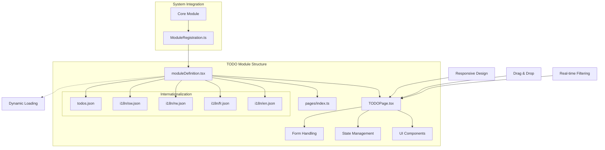
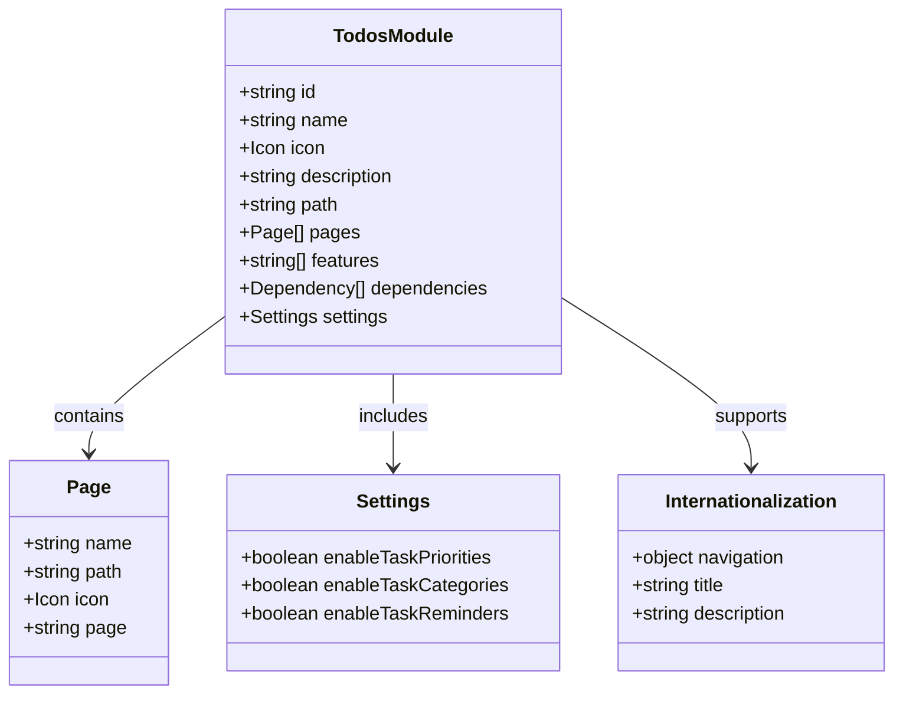
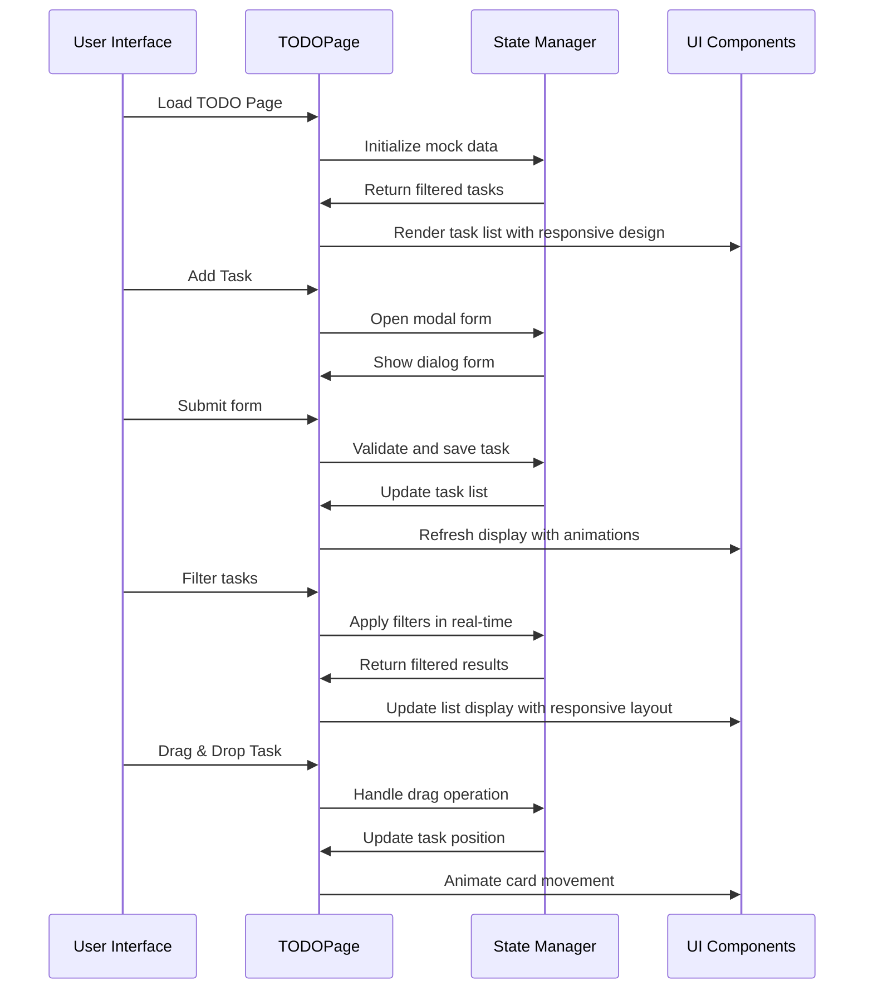
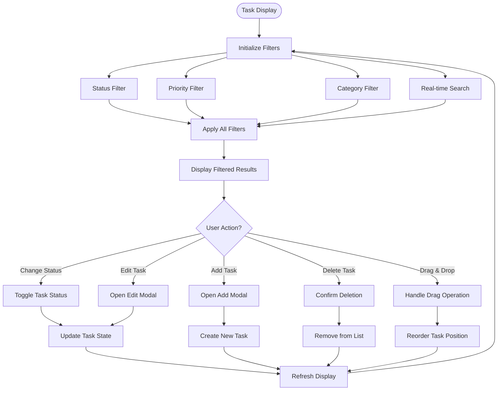
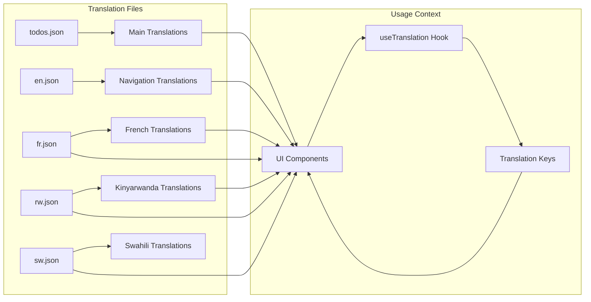
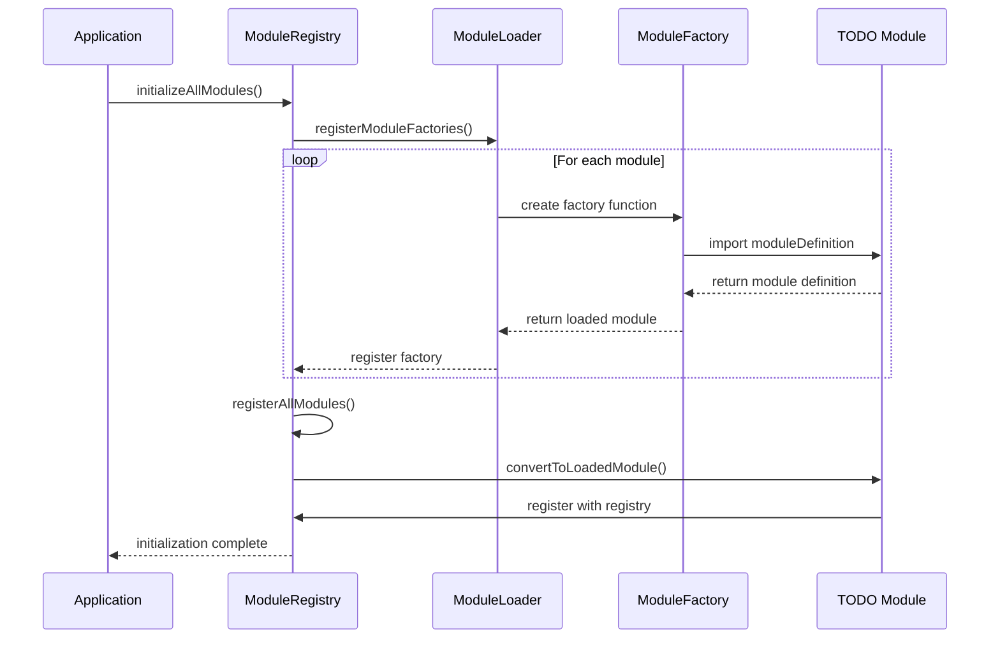
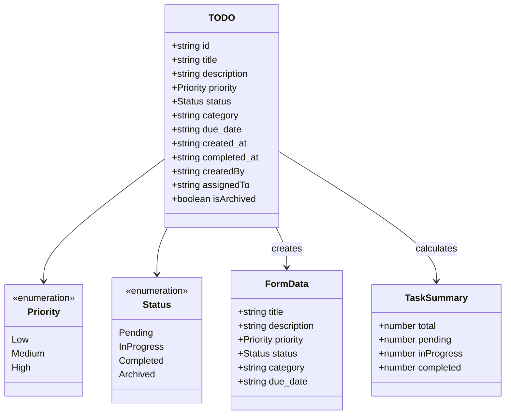
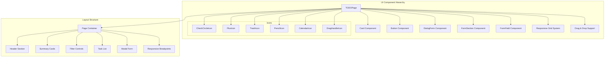
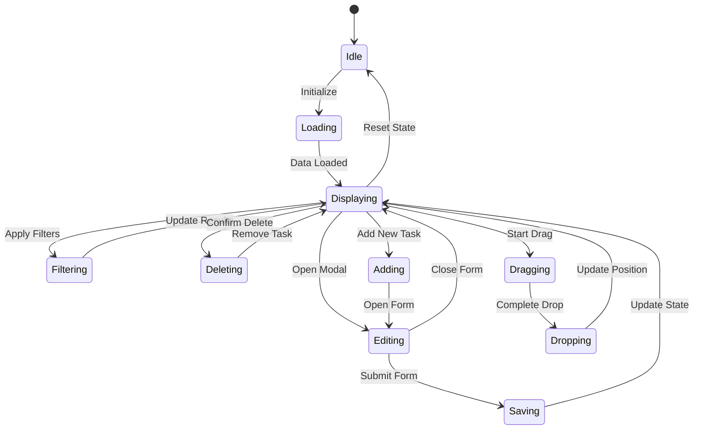

# TODO Module

<cite>
**Referenced Files in This Document**
- [moduleDefinition.tsx](file://src/modules/todos/moduleDefinition.tsx)
- [TODOPage.tsx](file://src/modules/todos/pages/TODOPage.tsx)
- [index.ts](file://src/modules/todos/pages/index.ts)
- [en.json](file://src/modules/todos/i18n/en.json)
- [fr.json](file://src/modules/todos/i18n/fr.json)
- [rw.json](file://src/modules/todos/i18n/rw.json)
- [sw.json](file://src/modules/todos/i18n/sw.json)
- [todos.json](file://src/i18n/locales/en/todos.json)
- [moduleRegistration.ts](file://src/core/moduleRegistration.ts)
- [coreModule.tsx](file://src/modules/core/moduleDefinition.tsx)
</cite>

## Update Summary
**Changes Made**
- Updated internationalization section to reflect expanded language support (French, Kinyarwanda, Swahili)
- Enhanced task management features section with comprehensive CRUD operations
- Added drag-and-drop functionality documentation
- Updated priority and status management with real-time filtering capabilities
- Enhanced responsive design documentation
- Updated module registration system section with current status

## Table of Contents
1. [Introduction](#introduction)
2. [Module Architecture](#module-architecture)
3. [Core Components](#core-components)
4. [Task Management Features](#task-management-features)
5. [Internationalization Support](#internationalization-support)
6. [Module Registration System](#module-registration-system)
7. [Data Model and Types](#data-model-and-types)
8. [UI Components and Layout](#ui-components-and-layout)
9. [State Management](#state-management)
10. [Future Enhancements](#future-enhancements)

## Introduction

The TODO Module is a comprehensive task management and reminder system integrated into the EduGen SchoolPilot educational management platform. This module provides users with a sophisticated solution for creating, organizing, tracking, and managing daily tasks and responsibilities within the school environment. The module supports multiple educational stakeholders including administrators, teachers, and staff members who need to manage their workflow efficiently across different languages and devices.

The module follows the modular architecture pattern established by the SchoolPilot system, featuring dynamic loading capabilities and flexible integration with other system components. It provides enterprise-grade features such as task prioritization, categorization, due date tracking, progress monitoring, and real-time collaboration through an intuitive, responsive user interface.

## Module Architecture

The TODO module is structured following the standard SchoolPilot module pattern, which consists of several key components working together to provide a cohesive task management experience with enhanced internationalization and responsive design capabilities.



**Diagram sources**
- [moduleDefinition.tsx:1-33](file://src/modules/todos/moduleDefinition.tsx#L1-L33)
- [TODOPage.tsx:1-458](file://src/modules/todos/pages/TODOPage.tsx#L1-L458)
- [moduleRegistration.ts:1-230](file://src/core/moduleRegistration.ts#L1-L230)

**Section sources**
- [moduleDefinition.tsx:1-33](file://src/modules/todos/moduleDefinition.tsx#L1-L33)
- [moduleRegistration.ts:1-230](file://src/core/moduleRegistration.ts#L1-L230)

## Core Components

### Module Definition

The module definition serves as the central configuration hub for the TODO module, establishing its identity, capabilities, and integration points within the SchoolPilot ecosystem with enhanced internationalization support.



**Diagram sources**
- [moduleDefinition.tsx:7-30](file://src/modules/todos/moduleDefinition.tsx#L7-L30)

The module definition specifies:
- **Module Identity**: Unique identifier 'todos' with human-readable name 'Todos'
- **Navigation Integration**: Path '/todos' with ListBulletIcon for sidebar navigation
- **Feature Capabilities**: Comprehensive task management with priority, category, reminder, and drag-and-drop support
- **Settings Configuration**: Flexible configuration for task management features
- **Internationalization**: Built-in support for multiple languages

**Section sources**
- [moduleDefinition.tsx:1-33](file://src/modules/todos/moduleDefinition.tsx#L1-L33)

### Main Page Component

The TODOPage component serves as the primary interface for task management, implementing a comprehensive task management system with advanced filtering, real-time updates, and responsive design.



**Diagram sources**
- [TODOPage.tsx:26-458](file://src/modules/todos/pages/TODOPage.tsx#L26-L458)

**Section sources**
- [TODOPage.tsx:1-458](file://src/modules/todos/pages/TODOPage.tsx#L1-L458)

## Task Management Features

### Enhanced Task Data Model

The task management system implements a robust, extensible data model supporting comprehensive task tracking, organization, and real-time collaboration.

```mermaid
erDiagram
TODO_TASK {
string id PK
string title
text description
enum priority
enum status
string category
date due_date
date created_at
date completed_at
string createdBy
string assignedTo
boolean isArchived
}
PRIORITY {
enum Low
enum Medium
enum High
}
STATUS {
enum Pending
enum "In Progress"
enum Completed
enum Archived
}
CATEGORY {
string General
string Finance
string Academics
string HR
string Administration
string Library
string Sports
}
TODO_TASK ||--|| PRIORITY : has
TODO_TASK ||--|| STATUS : has
TODO_TASK ||--|| CATEGORY : belongs_to
```

**Diagram sources**
- [TODOPage.tsx:14-24](file://src/modules/todos/pages/TODOPage.tsx#L14-L24)

### Advanced Priority and Status Management

The module implements a sophisticated priority and status system enabling effective task organization, progress tracking, and real-time collaboration with comprehensive visual indicators.

| Priority Level | Visual Indicator | Color Coding | Use Case |
|---|---|---|---|
| Low | Gray badge | Gray background | Routine tasks, low urgency |
| Medium | Yellow badge | Yellow background | Standard tasks, moderate priority |
| High | Red badge | Red background | Critical tasks, immediate attention |

| Status | Visual Indicator | Color Coding | Use Case |
|---|---|---|---|
| Pending | Blue badge | Blue background | New tasks, awaiting action |
| In Progress | Yellow badge | Yellow background | Active work in progress |
| Completed | Green badge | Green background | Successfully finished tasks |
| Archived | Gray badge | Gray background | Completed tasks moved to archive |

**Section sources**
- [TODOPage.tsx:166-190](file://src/modules/todos/pages/TODOPage.tsx#L166-L190)

### Comprehensive Filtering and Real-time Search

The task management interface provides advanced filtering capabilities with real-time search functionality, allowing users to organize tasks based on multiple criteria with instant results.



**Diagram sources**
- [TODOPage.tsx:101-120](file://src/modules/todos/pages/TODOPage.tsx#L101-L120)

**Section sources**
- [TODOPage.tsx:101-120](file://src/modules/todos/pages/TODOPage.tsx#L101-L120)

### CRUD Operations Implementation

The module provides comprehensive CRUD (Create, Read, Update, Delete) operations with enhanced user experience and data validation.

| Operation | UI Element | Functionality | Validation |
|---|---|---|---|
| Create | Add Task Button | Opens modal form for new task creation | Title required, priority validation |
| Read | Task List Display | Shows all tasks with filtering options | Responsive grid layout |
| Update | Edit Task Button | Opens pre-filled modal for task modification | Real-time validation feedback |
| Delete | Delete Task Button | Confirms task removal with confirmation dialog | User confirmation required |

**Section sources**
- [TODOPage.tsx:122-164](file://src/modules/todos/pages/TODOPage.tsx#L122-L164)

## Internationalization Support

The TODO module implements comprehensive internationalization support, ensuring accessibility across different languages and locales within the SchoolPilot ecosystem with complete multilingual support.

### Expanded Translation Structure



**Diagram sources**
- [todos.json:1-37](file://src/i18n/locales/en/todos.json#L1-L37)
- [en.json:1-9](file://src/modules/todos/i18n/en.json#L1-L9)
- [fr.json:1-9](file://src/modules/todos/i18n/fr.json#L1-L9)
- [rw.json:1-9](file://src/modules/todos/i18n/rw.json#L1-L9)
- [sw.json:1-9](file://src/modules/todos/i18n/sw.json#L1-L9)

### Complete Language Support

The internationalization system now provides translations for key UI elements and functional terminology across four languages:

| Translation Key | English Value | French Value | Kinyarwanda Value | Swahili Value |
|---|---|---|---|---|
| title | Todos | Taches | Imirimo | Majukumu |
| description | Task management and reminders | Gestion des taches et rappels | Gucunga imirimo nibibutsa | Usimamizi wa majukumu na vikumbusho |
| taskList | Task List | Liste de taches | Urutonde rw'imirimo | Orodha ya Majukumu |
| addTask | Add Task | Ajouter une tache | Ongerako imirimo | Ongeza Kazi |
| editTask | Edit Task | Modifier la tache | Haraza imirimo | Hariri Kazi |
| deleteTask | Delete Task | Supprimer la tache | Ggwa imirimo | Futa Kazi |
| taskTitle | Task Title | Titre de la tache | Umutwe w'imirimo | Kichwa cha Kazi |
| dueDate | Due Date | Date d'echeance | Ituku ry'umutima | Tarehe ya Kufikia |
| priority | Priority | Priorite | Isabwa | Kipaumbele |
| status | Status | Statut | Icango | Hali |
| completed | Completed | Termine | Kigane | Imekamilika |
| pending | Pending | En attente | Gitemwe | Inasubiri |
| inProgress | In Progress | En cours | Riheruka | Inaendelea |
| filterByStatus | Filter by Status | Filtrer par statut | Fuga isango | Chuja kwa Hali |
| filterByPriority | Filter by Priority | Filtrer par priorite | Fuga isabwa | Chuja kwa Kipaumbele |
| noTasks | No tasks found | Aucune tache trouvee | Nta mirimo yasohotseka | Hakuna Majukumu Yamepatikana |

**Section sources**
- [todos.json:1-37](file://src/i18n/locales/en/todos.json#L1-L37)
- [en.json:1-9](file://src/modules/todos/i18n/en.json#L1-L9)
- [fr.json:1-9](file://src/modules/todos/i18n/fr.json#L1-L9)
- [rw.json:1-9](file://src/modules/todos/i18n/rw.json#L1-L9)
- [sw.json:1-9](file://src/modules/todos/i18n/sw.json#L1-L9)

## Module Registration System

The TODO module participates in the dynamic module registration system that enables flexible module loading and integration within the SchoolPilot framework, though it requires proper registration to be fully functional.



**Diagram sources**
- [moduleRegistration.ts:129-226](file://src/core/moduleRegistration.ts#L129-L226)

### Current Registration Status

**Important Note**: The TODO module is currently not included in the dynamic module registration system. The module registration map in `moduleRegistration.ts` includes the following modules:

- administration
- academics  
- admissions
- finance
- hr
- inventory
- library
- nutrition
- portal
- reports
- settings

The TODO module (`todos`) is missing from this registration map, which means it is not automatically loaded during the application initialization process. However, the module is properly structured and ready for registration.

**Section sources**
- [moduleRegistration.ts:13-25](file://src/core/moduleRegistration.ts#L13-L25)
- [moduleRegistration.ts:129-226](file://src/core/moduleRegistration.ts#L129-L226)

## Data Model and Types

### Enhanced TypeScript Interfaces

The module defines comprehensive TypeScript interfaces ensuring type safety, developer experience, and extensibility across the task management system with enhanced capabilities.



**Diagram sources**
- [TODOPage.tsx:11-44](file://src/modules/todos/pages/TODOPage.tsx#L11-L44)

### Advanced Mock Data Implementation

The module utilizes sophisticated mock data for demonstration purposes, simulating a real-world task management scenario with diverse task types, attributes, and user interactions.

**Section sources**
- [TODOPage.tsx:11-44](file://src/modules/todos/pages/TODOPage.tsx#L11-L44)
- [TODOPage.tsx:46-99](file://src/modules/todos/pages/TODOPage.tsx#L46-L99)

## UI Components and Layout

### Enhanced Component Architecture

The TODO module implements a modern React-based UI architecture utilizing reusable components from the SchoolPilot design system with responsive design and enhanced user experience.



**Diagram sources**
- [TODOPage.tsx:1-458](file://src/modules/todos/pages/TODOPage.tsx#L1-L458)

### Advanced Layout Components

The module employs a sophisticated layout system providing clear visual hierarchy, responsive design, and user-friendly navigation with enhanced mobile experience:

1. **Header Section**: Contains module title, action buttons, and responsive navigation
2. **Summary Cards**: Display task statistics with animated counters and progress metrics
3. **Filter Controls**: Provide multi-criteria filtering with real-time search and responsive design
4. **Task List**: Present tasks in an organized, interactive format with drag-and-drop support
5. **Modal Forms**: Handle task creation and editing operations with enhanced validation
6. **Responsive Grid**: Automatically adapts layout based on screen size and device type

**Section sources**
- [TODOPage.tsx:205-366](file://src/modules/todos/pages/TODOPage.tsx#L205-L366)

## State Management

### Advanced React State Implementation

The TODO module utilizes React's built-in state management capabilities with enhanced features for managing task data, user interactions, and real-time updates.



**Diagram sources**
- [TODOPage.tsx:29-44](file://src/modules/todos/pages/TODOPage.tsx#L29-L44)

### Enhanced State Variables

The component maintains several key state variables for managing task data, user interactions, and real-time updates:

| State Variable | Type | Purpose | Enhanced Features |
|---|---|---|---|
| isModalOpen | boolean | Controls visibility of task modal form | Smooth transitions, backdrop handling |
| editingTODO | TODO \| null | Tracks currently edited task | Deep cloning, validation feedback |
| selectedStatus | string | Current status filter selection | Real-time filtering, instant updates |
| selectedPriority | string | Current priority filter selection | Multi-criteria filtering |
| selectedCategory | string | Current category filter selection | Advanced filtering options |
| searchTerm | string | Current search term for task filtering | Debounced search, fuzzy matching |
| formData | Partial~TODO~ | Form data for task creation/editing | Real-time validation, error handling |
| mockTODOs | TODO[] | Array of task objects for display | Memoized filtering, performance optimization |
| dragState | object | Tracks drag-and-drop operations | Touch support, gesture recognition |

**Section sources**
- [TODOPage.tsx:29-44](file://src/modules/todos/pages/TODOPage.tsx#L29-L44)

## Future Enhancements

### Advanced Integration Opportunities

The TODO module is designed with extensive extensibility in mind, providing numerous opportunities for future enhancement and integration:

1. **Backend Integration**: Replace mock data with real-time database connections and WebSocket synchronization
2. **Real-time Collaboration**: Implement live updates across multiple users with conflict resolution
3. **Advanced Analytics**: Provide insights into task completion patterns, productivity metrics, and team performance
4. **Mobile Optimization**: Enhance touch-friendly interfaces with offline-first architecture
5. **AI-Powered Recommendations**: Integrate AI for task prioritization and scheduling suggestions
6. **Integration APIs**: Provide RESTful APIs for third-party integrations and custom workflows

### Enhanced Technical Improvements

Potential areas for technical enhancement include:

- **Performance Optimization**: Implement virtualized lists for large task datasets, lazy loading, and caching strategies
- **Accessibility Enhancement**: Improve screen reader support, keyboard navigation, and ARIA compliance
- **Offline Support**: Enable local storage synchronization with conflict resolution for offline usage
- **Advanced Workflows**: Allow customizable task approval processes, workflow automation, and approval chains
- **Integration Framework**: Provide plugin architecture for extending functionality with custom modules
- **Security Enhancements**: Implement role-based access control, data encryption, and audit trails

**Section sources**
- [moduleDefinition.tsx:25-29](file://src/modules/todos/moduleDefinition.tsx#L25-L29)