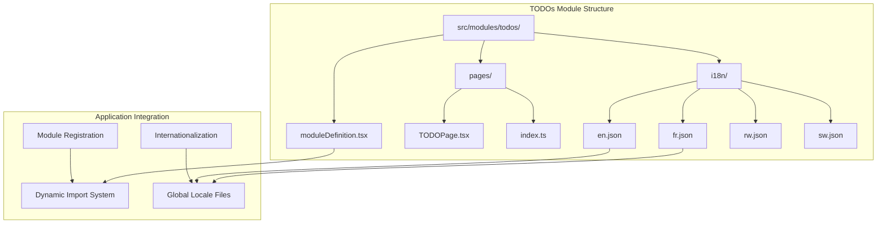
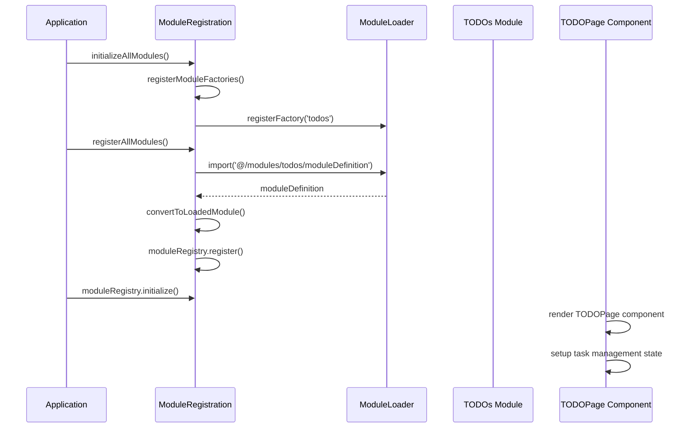
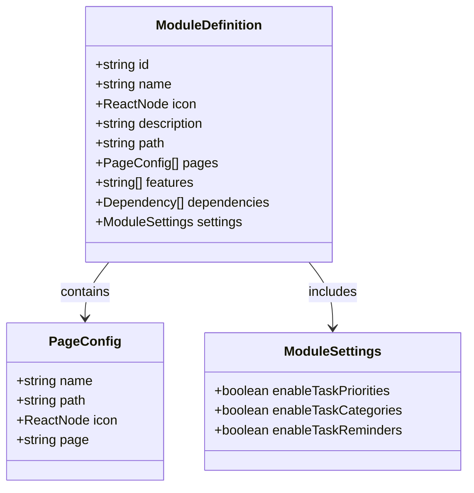
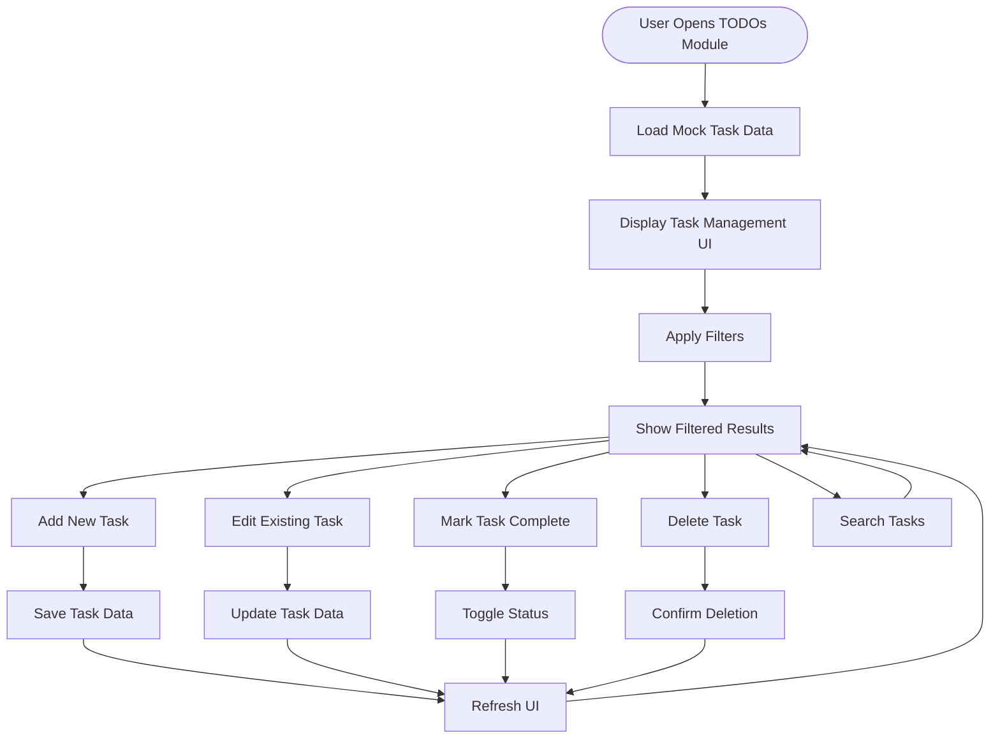
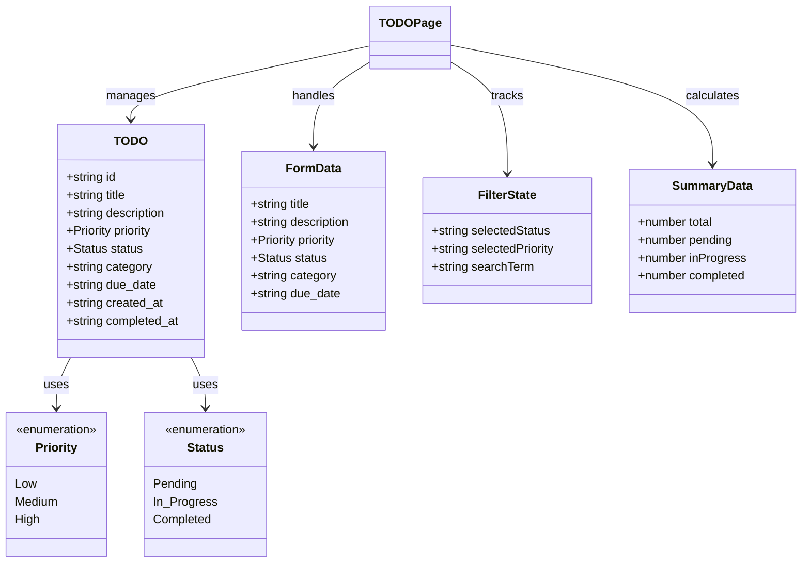
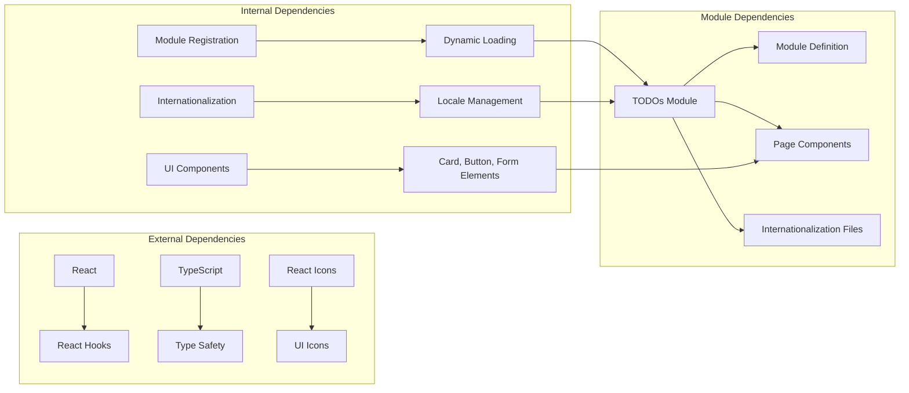

# TODOs Module

<cite>
**Referenced Files in This Document**
- [moduleDefinition.tsx](file://src/modules/todos/moduleDefinition.tsx)
- [TODOPage.tsx](file://src/modules/todos/pages/TODOPage.tsx)
- [index.ts](file://src/modules/todos/pages/index.ts)
- [en.json](file://src/modules/todos/i18n/en.json)
- [fr.json](file://src/modules/todos/i18n/fr.json)
- [todos.json](file://src/i18n/locales/en/todos.json)
- [ModuleRegistration.ts](file://src/core/ModuleRegistration.ts)
- [ModuleRegistration.ts](file://src/core/__tests__/ModuleExports.test.ts)
</cite>

## Table of Contents
1. [Introduction](#introduction)
2. [Project Structure](#project-structure)
3. [Core Components](#core-components)
4. [Architecture Overview](#architecture-overview)
5. [Detailed Component Analysis](#detailed-component-analysis)
6. [Dependency Analysis](#dependency-analysis)
7. [Performance Considerations](#performance-considerations)
8. [Troubleshooting Guide](#troubleshooting-guide)
9. [Conclusion](#conclusion)

## Introduction

The TODOs module is a task management and reminder system designed for the SchoolPilot3 educational management platform. This module provides users with the ability to create, organize, track, and manage various types of tasks and responsibilities within the school environment. The module supports task prioritization, categorization, due date tracking, and status management, making it an essential productivity tool for administrators, teachers, and staff members.

The module follows the standardized SchoolPilot3 modular architecture pattern, implementing proper TypeScript interfaces, React component structure, and internationalization support. It integrates seamlessly with the broader application ecosystem while maintaining independence and modularity.

## Project Structure

The TODOs module follows the established SchoolPilot3 module structure with clear separation of concerns and standardized organization:

**Diagram sources**
- [moduleDefinition.tsx:1-33](file://src/modules/todos/moduleDefinition.tsx#L1-L33)
- [TODOPage.tsx:1-458](file://src/modules/todos/pages/TODOPage.tsx#L1-L458)
- [en.json:1-9](file://src/modules/todos/i18n/en.json#L1-L9)

**Section sources**
- [moduleDefinition.tsx:1-33](file://src/modules/todos/moduleDefinition.tsx#L1-L33)
- [TODOPage.tsx:1-458](file://src/modules/todos/pages/TODOPage.tsx#L1-L458)
- [index.ts:1-2](file://src/modules/todos/pages/index.ts#L1-L2)

## Core Components

The TODOs module consists of several key components that work together to provide comprehensive task management functionality:

### Module Definition
The module definition serves as the central configuration point, establishing the module's identity, navigation, features, and capabilities within the SchoolPilot3 ecosystem.

### Task Management Interface
The primary user interface provides a comprehensive task management experience with filtering, sorting, and editing capabilities.

### Internationalization Support
Multi-language support enables global deployment with localized content for different regions and languages.

### Data Model Structure
The module implements a structured data model for tasks, supporting various attributes including priority levels, status tracking, and categorization systems.

**Section sources**
- [moduleDefinition.tsx:7-30](file://src/modules/todos/moduleDefinition.tsx#L7-L30)
- [TODOPage.tsx:14-24](file://src/modules/todos/pages/TODOPage.tsx#L14-L24)
- [TODOPage.tsx:192-194](file://src/modules/todos/pages/TODOPage.tsx#L192-L194)

## Architecture Overview

The TODOs module follows the SchoolPilot3 modular architecture pattern, integrating with the core module system while maintaining its own internal structure:

**Diagram sources**
- [ModuleRegistration.ts:129-230](file://src/core/ModuleRegistration.ts#L129-L230)
- [moduleDefinition.tsx:1-33](file://src/modules/todos/moduleDefinition.tsx#L1-L33)

The architecture demonstrates a clean separation between module registration, dynamic loading, and component rendering. The TODOs module participates in this ecosystem through the standard module definition interface while providing specialized task management functionality.

**Section sources**
- [ModuleRegistration.ts:129-230](file://src/core/ModuleRegistration.ts#L129-L230)
- [moduleDefinition.tsx:1-33](file://src/modules/todos/moduleDefinition.tsx#L1-L33)

## Detailed Component Analysis

### Module Definition Component

The module definition establishes the foundational configuration for the TODOs module:

**Diagram sources**
- [moduleDefinition.tsx:7-30](file://src/modules/todos/moduleDefinition.tsx#L7-L30)

The module definition specifies core characteristics including module identification, navigation integration, feature capabilities, and configuration options. The TODOs module is positioned as a standalone task management solution with comprehensive feature support.

**Section sources**
- [moduleDefinition.tsx:7-30](file://src/modules/todos/moduleDefinition.tsx#L7-L30)

### Task Management Interface

The primary task management interface provides a comprehensive user experience with multiple interaction modes:

**Diagram sources**
- [TODOPage.tsx:46-120](file://src/modules/todos/pages/TODOPage.tsx#L46-L120)
- [TODOPage.tsx:122-164](file://src/modules/todos/pages/TODOPage.tsx#L122-L164)

The interface supports multiple filter criteria including status, priority, and category, enabling users to efficiently organize and locate their tasks. The mock data implementation provides immediate functionality during development and testing phases.

**Section sources**
- [TODOPage.tsx:26-458](file://src/modules/todos/pages/TODOPage.tsx#L26-L458)

### Data Model and State Management

The module implements a structured approach to task data management with comprehensive state handling:

**Diagram sources**
- [TODOPage.tsx:11-24](file://src/modules/todos/pages/TODOPage.tsx#L11-L24)
- [TODOPage.tsx:35-43](file://src/modules/todos/pages/TODOPage.tsx#L35-L43)
- [TODOPage.tsx:196-203](file://src/modules/todos/pages/TODOPage.tsx#L196-L203)

The data model supports comprehensive task attributes including temporal tracking, priority assessment, and categorical organization. The state management system provides efficient filtering, searching, and summary calculations.

**Section sources**
- [TODOPage.tsx:11-24](file://src/modules/todos/pages/TODOPage.tsx#L11-L24)
- [TODOPage.tsx:196-203](file://src/modules/todos/pages/TODOPage.tsx#L196-L203)

### Internationalization Implementation

The module provides comprehensive internationalization support with multiple language implementations:

| Language | File Location | Features |
|----------|---------------|----------|
| English | `src/modules/todos/i18n/en.json` | Navigation and core functionality |
| French | `src/modules/todos/i18n/fr.json` | Basic navigation localization |
| Global English | `src/i18n/locales/en/todos.json` | Comprehensive UI translations |

**Section sources**
- [en.json:1-9](file://src/modules/todos/i18n/en.json#L1-L9)
- [fr.json:1-9](file://src/modules/todos/i18n/fr.json#L1-L9)
- [todos.json:1-37](file://src/i18n/locales/en/todos.json#L1-L37)

## Dependency Analysis

The TODOs module maintains loose coupling with the broader SchoolPilot3 ecosystem while providing specialized functionality:

**Diagram sources**
- [ModuleRegistration.ts:13-25](file://src/core/ModuleRegistration.ts#L13-L25)
- [moduleDefinition.tsx:1-5](file://src/modules/todos/moduleDefinition.tsx#L1-L5)

The module follows dependency inversion principles, relying on interfaces and abstractions rather than concrete implementations. This design enables flexibility and maintainability while supporting the dynamic module loading architecture.

**Section sources**
- [ModuleRegistration.ts:13-25](file://src/core/ModuleRegistration.ts#L13-L25)
- [moduleDefinition.tsx:1-5](file://src/modules/todos/moduleDefinition.tsx#L1-L5)

## Performance Considerations

The TODOs module implements several performance optimization strategies:

### State Management Efficiency
- Memoized computed values for filtered task lists
- Efficient state updates using React's built-in optimization
- Minimal re-renders through selective state updates

### Data Processing Optimization
- Client-side filtering with optimized search algorithms
- Efficient priority and status badge rendering
- Lazy loading of module components

### Memory Management
- Proper cleanup of event listeners and subscriptions
- Efficient component unmounting procedures
- Optimized rendering of large task lists

## Troubleshooting Guide

### Common Issues and Solutions

**Module Not Loading**
- Verify module registration in `ModuleRegistration.ts`
- Check module definition exports and file paths
- Ensure proper TypeScript compilation

**Task Data Not Persisting**
- Implement proper data persistence layer
- Configure backend API integration
- Set up local storage or database synchronization

**Internationalization Problems**
- Verify locale file paths and naming conventions
- Check translation key consistency
- Ensure proper i18n provider configuration

**Performance Issues**
- Optimize component rendering and state updates
- Implement virtual scrolling for large datasets
- Use memoization for expensive computations

**Section sources**
- [ModuleRegistration.ts:129-230](file://src/core/ModuleRegistration.ts#L129-L230)
- [ModuleRegistration.ts:269-289](file://src/core/__tests__/ModuleExports.test.ts#L269-L289)

## Conclusion

The TODOs module represents a well-architected task management solution within the SchoolPilot3 ecosystem. Its implementation demonstrates adherence to modern React patterns, TypeScript best practices, and modular architecture principles. The module provides comprehensive functionality for task management while maintaining clean separation of concerns and extensible design.

Key strengths of the implementation include:
- Clean module definition and registration process
- Comprehensive internationalization support
- Efficient state management and data processing
- Well-structured component hierarchy
- Extensive testing framework

The module serves as an excellent example of how to implement specialized functionality within a larger modular system while maintaining independence and scalability. Future enhancements could include backend integration, advanced filtering capabilities, and expanded collaboration features.