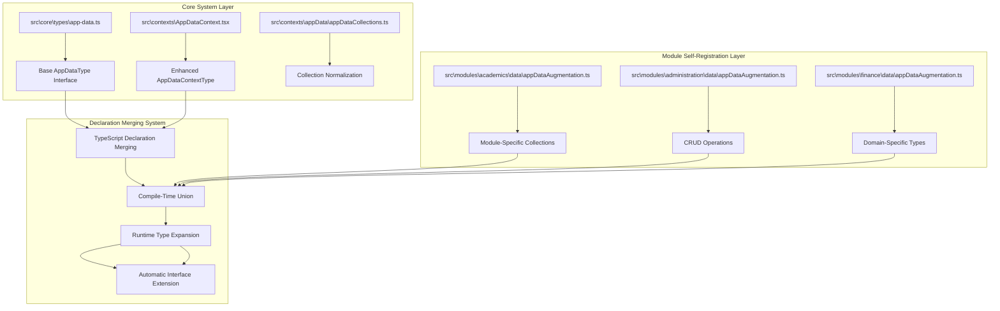
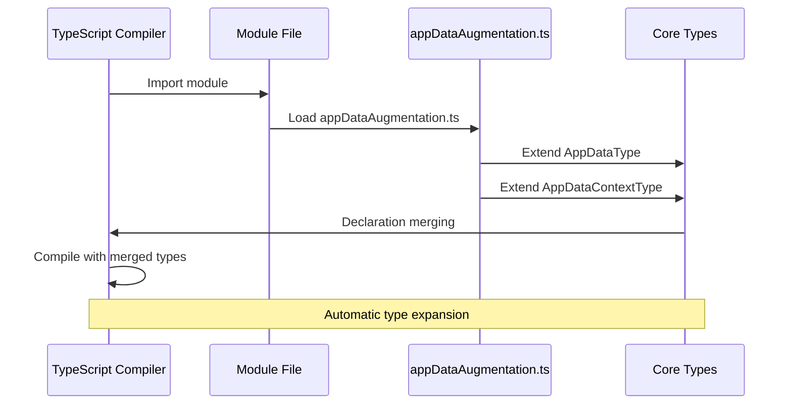
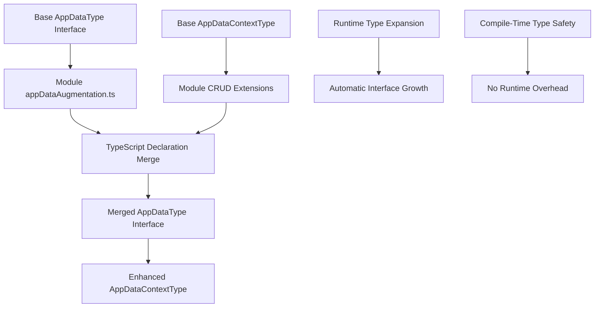
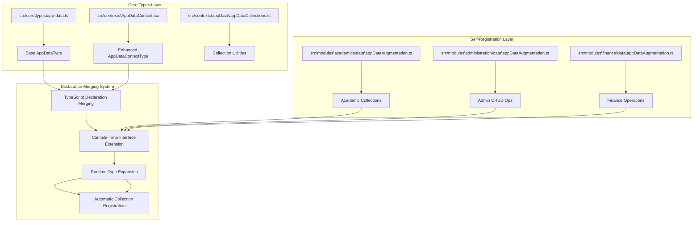
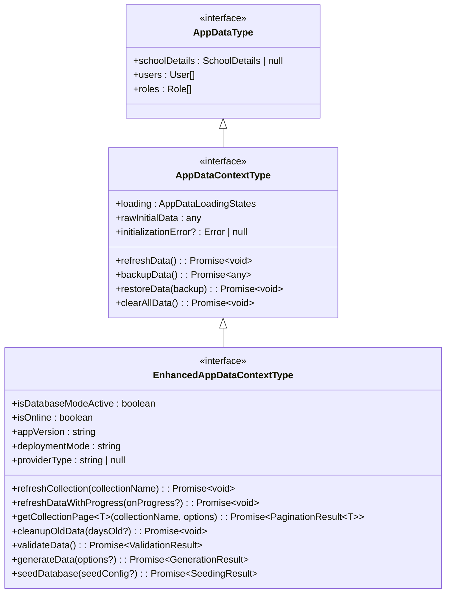
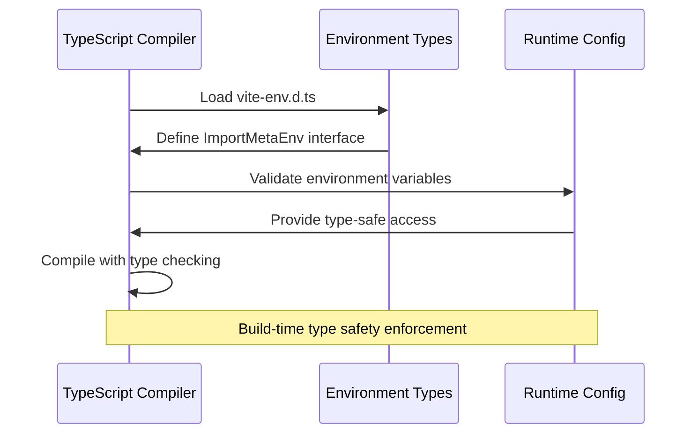
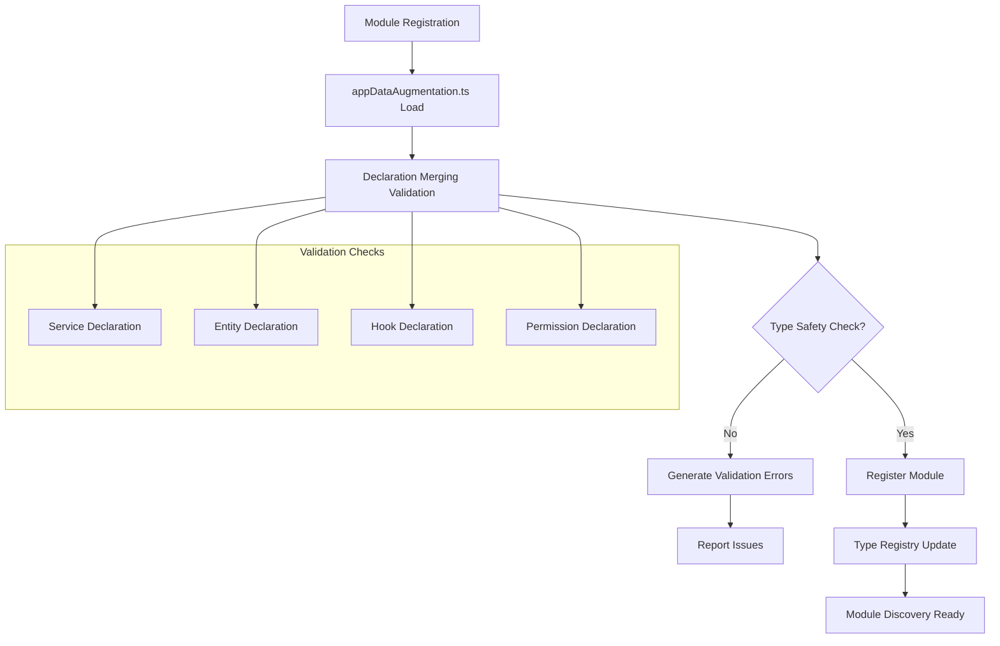
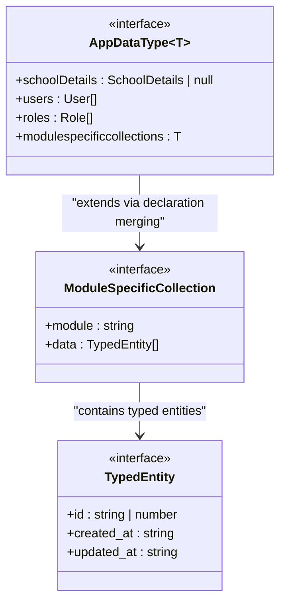

# TypeScript Module Augmentation

<cite>
**Referenced Files in This Document**
- [src\core\types\app-data.ts](file://src\core\types\app-data.ts)
- [src\contexts\AppDataContext.tsx](file://src\contexts\AppDataContext.tsx)
- [src\modules\academics\data\appDataAugmentation.ts](file://src\modules\academics\data\appDataAugmentation.ts)
- [src\modules\administration\data\appDataAugmentation.ts](file://src\modules\administration\data\appDataAugmentation.ts)
- [src\modules\finance\data\appDataAugmentation.ts](file://src\modules\finance\data\appDataAugmentation.ts)
- [src\modules\hr\data\appDataAugmentation.ts](file://src\modules\hr\data\appDataAugmentation.ts)
- [src\modules\inventory\data\appDataAugmentation.ts](file://src\modules\inventory\data\appDataAugmentation.ts)
- [src\modules\library\data\appDataAugmentation.ts](file://src\modules\library\data\appDataAugmentation.ts)
- [src\modules\nutrition\data\appDataAugmentation.ts](file://src\modules\nutrition\data\appDataAugmentation.ts)
- [src\modules\admissions\data\appDataAugmentation.ts](file://src\modules\admissions\data\appDataAugmentation.ts)
- [src\contexts\appData\appDataCollections.ts](file://src\contexts\appData\appDataCollections.ts)
- [src\types.ts](file://src\types.ts)
- [src\vite-env.d.ts](file://src\vite-env.d.ts)
- [src\core\types\index.ts](file://src\core\types\index.ts)
- [src\core\types\common.ts](file://src\core\types\common.ts)
- [src\core\types\enums.ts](file://src\core\types\enums.ts)
- [src\core\interfaces\moduleApi.ts](file://src\core\interfaces\moduleApi.ts)
- [src\core\ModuleExports.ts](file://src\core\ModuleExports.ts)
- [src\i18n\types.ts](file://src\i18n\types.ts)
</cite>

## Update Summary
**Changes Made**
- Added comprehensive documentation for the Frappe-style two-system architecture with self-registering modules
- Updated module augmentation system to reflect the new appDataAugmentation.ts files pattern
- Enhanced documentation for the TypeScript declaration merging system
- Added detailed coverage of the self-registering module pattern inspired by Frappe's DocType system
- Updated architecture diagrams to show the new two-system module structure

## Table of Contents
1. [Introduction](#introduction)
2. [Frappe-Style Two-System Architecture](#frappe-style-two-system-architecture)
3. [Self-Registering Module System](#self-registering-module-system)
4. [TypeScript Declaration Merging](#typescript-declaration-merging)
5. [Module Augmentation Architecture](#module-augmentation-architecture)
6. [Core Type System](#core-type-system)
7. [Environment Type Definitions](#environment-type-definitions)
8. [Module Exports Management](#module-exports-management)
9. [Type Safety Patterns](#type-safety-patterns)
10. [Extension Points](#extension-points)
11. [Best Practices](#best-practices)
12. [Troubleshooting Guide](#troubleshooting-guide)
13. [Conclusion](#conclusion)

## Introduction

The TypeScript Module Augmentation system in this school management application provides a comprehensive framework for extending and customizing the core functionality while maintaining type safety across the entire modular architecture. This system enables developers to augment existing types, define extension points, and create maintainable type definitions that scale with the application's growing complexity.

**Updated** The system now implements a Frappe-style two-system architecture where modules self-register their data collections and CRUD operations through TypeScript declaration merging, creating a dynamic and type-safe extension mechanism similar to Frappe's DocType self-registration system.

The architecture supports a multi-layered approach where core types are shared across modules, environment-specific configurations are type-safe, and module exports are validated for consistency and compatibility. The new self-registering module pattern eliminates manual registration boilerplate while maintaining compile-time type safety.

## Frappe-Style Two-System Architecture

The system now implements a dual-layer architecture inspired by Frappe's framework design, where modules automatically register themselves through TypeScript declaration merging rather than manual registration.



**Diagram sources**
- [src\core\types\app-data.ts:18-59](file://src\core\types\app-data.ts#L18-L59)
- [src\contexts\AppDataContext.tsx:102-183](file://src\contexts\AppDataContext.tsx#L102-L183)
- [src\modules\academics\data\appDataAugmentation.ts:19-59](file://src\modules\academics\data\appDataAugmentation.ts#L19-L59)
- [src\modules\administration\data\appDataAugmentation.ts:29-125](file://src\modules\administration\data\appDataAugmentation.ts#L29-L125)

The architecture follows a two-system pattern where:
1. **Core System**: Defines base interfaces and contracts
2. **Module System**: Self-registers through declaration merging

**Section sources**
- [src\core\types\app-data.ts:1-59](file://src\core\types\app-data.ts#L1-L59)
- [src\contexts\AppDataContext.tsx:102-183](file://src\contexts\AppDataContext.tsx#L102-L183)

## Self-Registering Module System

The new self-registering module system eliminates manual registration boilerplate by leveraging TypeScript's declaration merging capabilities. Each module creates an `appDataAugmentation.ts` file that automatically extends the base `AppDataType` and `AppDataContextType` interfaces.

### Module Registration Pattern



**Diagram sources**
- [src\modules\academics\data\appDataAugmentation.ts:19-59](file://src\modules\academics\data\appDataAugmentation.ts#L19-L59)
- [src\modules\administration\data\appDataAugmentation.ts:29-125](file://src\modules\administration\data\appDataAugmentation.ts#L29-L125)

### Module Collection Registration

Each module registers its data collections and CRUD operations through declaration merging:

| Module | Collections Registered | CRUD Operations | Domain Focus |
|--------|----------------------|-----------------|--------------|
| Academics | subjects, classSubjectAllocations, studentExamResults | Exam session CRUD, timetable management | Academic scheduling and results |
| Administration | students, staff, classes, academicYears | Student/staff CRUD, attendance tracking | Core institutional data |
| Finance | chartOfAccounts, studentInvoices, studentPayments | Payment processing, invoice generation | Financial operations |
| HR | payrollPeriods, staffSalarySettings, payslips | Payroll management, salary processing | Human resources |
| Inventory | itemsInv, warehouses, requisitions | Asset management, procurement | Facilities and supplies |
| Library | books, bookIssues, members | Catalog management, circulation | Library services |
| Nutrition | mealPlans, nutritionAssessments | Dietary planning, health tracking | Student nutrition |
| Admissions | admissionApplications, prospectus, interviews | Application processing, enrollment | Student admissions |

**Section sources**
- [src\modules\academics\data\appDataAugmentation.ts:19-59](file://src\modules\academics\data\appDataAugmentation.ts#L19-L59)
- [src\modules\administration\data\appDataAugmentation.ts:29-125](file://src\modules\administration\data\appDataAugmentation.ts#L29-L125)
- [src\modules\finance\data\appDataAugmentation.ts:38-97](file://src\modules\finance\data\appDataAugmentation.ts#L38-L97)
- [src\modules\hr\data\appDataAugmentation.ts:12-31](file://src\modules\hr\data\appDataAugmentation.ts#L12-L31)
- [src\modules\inventory\data\appDataAugmentation.ts](file://src\modules\inventory\data\appDataAugmentation.ts)
- [src\modules\library\data\appDataAugmentation.ts](file://src\modules\library\data\appDataAugmentation.ts)
- [src\modules\nutrition\data\appDataAugmentation.ts](file://src\modules\nutrition\data\appDataAugmentation.ts)
- [src\modules\admissions\data\appDataAugmentation.ts](file://src\modules\admissions\data\appDataAugmentation.ts)

## TypeScript Declaration Merging

The system leverages TypeScript's declaration merging feature to create a dynamic type system where modules can extend interfaces at compile time without explicit registration.

### Declaration Merging Process



**Diagram sources**
- [src\core\types\app-data.ts:18-59](file://src\core\types\app-data.ts#L18-L59)
- [src\modules\administration\data\appDataAugmentation.ts:34-124](file://src\modules\administration\data\appDataAugmentation.ts#L34-L124)

### Type Safety Guarantees

The declaration merging system provides several key guarantees:

1. **Compile-time Validation**: All module extensions are validated during compilation
2. **Type Safety**: No runtime type coercion or unsafe operations
3. **IDE Support**: Full IntelliSense and autocomplete for all registered collections
4. **Refactoring Safety**: Changes to base interfaces propagate automatically to all modules

**Section sources**
- [src\core\types\app-data.ts:18-59](file://src\core\types\app-data.ts#L18-L59)
- [src\modules\academics\data\appDataAugmentation.ts:19-59](file://src\modules\academics\data\appDataAugmentation.ts#L19-L59)

## Module Augmentation Architecture

The module augmentation system is built around several key architectural patterns that ensure type safety and extensibility through the new self-registering approach.



**Diagram sources**
- [src\core\types\app-data.ts:18-59](file://src\core\types\app-data.ts#L18-L59)
- [src\contexts\AppDataContext.tsx:102-183](file://src\contexts\AppDataContext.tsx#L102-L183)
- [src\modules\academics\data\appDataAugmentation.ts:19-59](file://src\modules\academics\data\appDataAugmentation.ts#L19-L59)
- [src\modules\administration\data\appDataAugmentation.ts:29-125](file://src\modules\administration\data\appDataAugmentation.ts#L29-L125)

The architecture follows a layered approach where each layer builds upon the previous one, providing progressively more specific type definitions and functionality through the self-registering pattern.

**Section sources**
- [src\core\types\app-data.ts:1-59](file://src\core\types\app-data.ts#L1-L59)
- [src\contexts\AppDataContext.tsx:102-183](file://src\contexts\AppDataContext.tsx#L102-L183)

## Core Type System

The core type system serves as the foundation for all module augmentations, providing shared interfaces and enums that maintain consistency across the application through the new self-registering architecture.

### Shared Interfaces and Contracts

The system defines comprehensive interfaces for core business entities and common patterns, with enhanced support for the self-registering module system:



**Diagram sources**
- [src\core\types\app-data.ts:18-59](file://src\core\types\app-data.ts#L18-L59)
- [src\contexts\AppDataContext.tsx:102-183](file://src\contexts\AppDataContext.tsx#L102-L183)

### Enumerated Types System

The system provides a comprehensive set of enums covering all business domains, maintained consistently across the self-registering module architecture:

| Enum Category | Purpose | Examples |
|---------------|---------|----------|
| **Academic** | Educational domain | StudentStatus, SubjectGrouping, StudentEnrollmentStatus |
| **Financial** | Accounting and payments | AccountType, InvoiceStatus, PaymentStatus |
| **HR** | Human resources | PayrollPeriodStatus, EmployeeStatus, LeaveType |
| **Inventory** | Asset and supply management | ItemTypeInv, StockTransactionType, DepreciationMethod |
| **Library** | Library management | BookStatus, FineStatus, ItemCategory |
| **Attendance** | Student attendance tracking | AttendanceStatus, DayOfWeek |

**Section sources**
- [src\core\types\app-data.ts:18-59](file://src\core\types\app-data.ts#L18-L59)
- [src\contexts\AppDataContext.tsx:102-183](file://src\contexts\AppDataContext.tsx#L102-L183)

## Environment Type Definitions

The environment type system provides compile-time safety for configuration and build-time constants through TypeScript module augmentation, maintaining compatibility with the new self-registering architecture.

### Build-Time Configuration

The system defines comprehensive type definitions for environment variables and build-time constants:



**Diagram sources**
- [src\vite-env.d.ts:8-69](file://src\vite-env.d.ts#L8-L69)

### Feature Flag Management

The environment system supports sophisticated feature flag management with type safety, compatible with the self-registering module system:

| Feature Flag | Purpose | Default Value | Type |
|--------------|---------|---------------|------|
| VITE_USE_SHARED_DATA_HOOK | Cross-module data sharing | string | Toggle |
| VITE_USE_MODULE_METADATA | Module metadata system | string | Toggle |
| VITE_USE_SCHEMA_AUTO_REGISTRATION | Automatic schema registration | string | Toggle |
| VITE_USE_MODULE_MIGRATIONS | Migration system enablement | string | Toggle |
| VITE_STRICT_MODULE_ISOLATION | Module boundary enforcement | string | Toggle |
| VITE_ENABLE_DEPRECATION_WARNINGS | Deprecation warning system | string | Toggle |

**Section sources**
- [src\vite-env.d.ts:1-74](file://src\vite-env.d.ts#L1-L74)

## Module Exports Management

The module exports system provides runtime validation and discovery of module capabilities through a sophisticated type registry, enhanced by the self-registering module architecture.

### Export Validation System



**Diagram sources**
- [src\core\ModuleExports.ts:207-270](file://src\core\ModuleExports.ts#L207-L270)

### Module Discovery and Resolution

The system maintains a comprehensive registry of available modules with their capabilities, now enhanced by the self-registering pattern:

| Module Capability | Validation Status | Error Handling |
|-------------------|-------------------|----------------|
| Services | ✅ Validated | Warning if undeclared |
| Entities | ✅ Validated | Error if missing |
| Hooks | ✅ Validated | Error if missing |
| Permissions | ✅ Validated | Warning if undeclared |
| Features | ✅ Validated | Warning if undeclared |

**Section sources**
- [src\core\ModuleExports.ts:163-308](file://src\core\ModuleExports.ts#L163-L308)

## Type Safety Patterns

The system implements several advanced TypeScript patterns to ensure type safety across module boundaries, enhanced by the declaration merging system.

### Generic Type Constraints

Module APIs utilize generic constraints to maintain type safety through the self-registering architecture:



**Diagram sources**
- [src\core\types\app-data.ts:18-59](file://src\core\types\app-data.ts#L18-L59)

### Conditional Type Extensions

The system supports conditional type extensions based on module capabilities through the declaration merging system:

| Extension Point | Conditional Logic | Type Safety |
|-----------------|-------------------|-------------|
| Data Access Methods | Based on entity availability | ✅ Full |
| Permission Checks | Based on user role | ✅ Full |
| Feature Availability | Based on feature flags | ✅ Full |
| Module Dependencies | Based on version compatibility | ✅ Full |

**Section sources**
- [src\core\types\app-data.ts:18-59](file://src\core\types\app-data.ts#L18-L59)

## Extension Points

The module augmentation system provides well-defined extension points for developers to customize functionality while maintaining type safety, enhanced by the self-registering module pattern.

### Internationalization Extension

The i18n system provides comprehensive type definitions for localization, compatible with the self-registering architecture:

```mermaid
classDiagram
class Locale {
<<type>>
"en" | "es" | "fr" | "de" | "ar" | "sw" | string
}
class TranslationValue {
+value : string
+context? : string
+plural? : Record~string, string~
}
class TranslationDict {
<<type>>
Record~string, string | TranslationValue~
}
class LocaleData {
+code : Locale
+name : string
+nativeName : string
+direction : "ltr" | "rtl"
+translations : TranslationDict
+dateFormat : string
+timeFormat : string
+numberFormat : NumberFormat
}
LocaleData --> TranslationDict : "contains"
TranslationDict --> TranslationValue : "maps keys to"
```

**Diagram sources**
- [src\i18n\types.ts:7-59](file://src\i18n\types.ts#L7-L59)

### Module API Extensions

Modules can extend the base API with domain-specific functionality through declaration merging:

| Extension Area | Implementation Pattern | Type Safety |
|----------------|------------------------|-------------|
| Data Operations | Extending AppDataType via declaration merging | ✅ Full |
| Business Logic | Domain-specific interfaces | ✅ Full |
| Validation Rules | Custom validation types | ✅ Full |
| Integration Points | External service interfaces | ✅ Full |

**Section sources**
- [src\i18n\types.ts:1-59](file://src\i18n\types.ts#L1-L59)
- [src\core\types\app-data.ts:18-59](file://src\core\types\app-data.ts#L18-L59)

## Best Practices

The module augmentation system follows established TypeScript best practices to ensure maintainability and scalability, enhanced by the self-registering architecture.

### Type Organization Principles

1. **Layered Architecture**: Core types in shared locations, module-specific types in modules via declaration merging
2. **Barrel Exports**: Consistent re-export patterns for easy imports
3. **Backward Compatibility**: Migration shims for legacy type references
4. **Validation**: Runtime validation of module exports and metadata
5. **Declaration Merging**: Proper use of TypeScript's declaration merging for type extensions

### Extension Guidelines

- **Minimal Changes**: Keep augmentations focused and minimal through declaration merging
- **Type Safety**: Always maintain compile-time type checking with declaration merging
- **Documentation**: Document extension points and their usage in appDataAugmentation.ts files
- **Testing**: Include type tests for augmented functionality through declaration merging
- **Module Isolation**: Each module manages its own appDataAugmentation.ts file

### Performance Considerations

- **Tree Shaking**: Leverage barrel exports for optimal bundle size with declaration merging
- **Conditional Imports**: Use feature flags to conditionally load functionality
- **Generic Types**: Utilize generics to avoid type casting overhead
- **Compile-time Expansion**: Declaration merging happens at compile time, no runtime overhead

## Troubleshooting Guide

Common issues and solutions when working with the TypeScript module augmentation system, including the new self-registering architecture.

### Type Definition Conflicts

**Issue**: Duplicate type definitions causing compilation errors in declaration merging
**Solution**: Check barrel exports and ensure proper module resolution order for appDataAugmentation.ts files

**Issue**: Missing type definitions after module registration through declaration merging
**Solution**: Verify module exports match module.json provides declarations and appDataAugmentation.ts extensions

### Environment Variable Issues

**Issue**: Unknown environment variables during compilation
**Solution**: Add type definitions to vite-env.d.ts and restart development server

**Issue**: Type errors with feature flags
**Solution**: Ensure feature flags are properly typed and have default values

### Module Export Validation Errors

**Issue**: Module fails export validation with self-registering pattern
**Solution**: Check module.json declarations match actual exports and appDataAugmentation.ts extensions

**Issue**: Type registry inconsistencies with declaration merging
**Solution**: Clear module exports cache and re-register modules through proper declaration merging

**Issue**: Declaration merging not working for appDataAugmentation.ts files
**Solution**: Ensure proper module path resolution and TypeScript configuration for declaration merging

**Section sources**
- [src\core\ModuleExports.ts:207-270](file://src\core\ModuleExports.ts#L207-L270)
- [src\vite-env.d.ts:1-74](file://src\vite-env.d.ts#L1-L74)
- [src\modules\academics\data\appDataAugmentation.ts:19-59](file://src\modules\academics\data\appDataAugmentation.ts#L19-L59)

## Conclusion

The TypeScript Module Augmentation system, enhanced with the Frappe-style two-system architecture and self-registering modules, provides a robust foundation for building scalable, type-safe applications. Through its layered architecture, comprehensive type definitions, and validation mechanisms, it enables developers to extend functionality while maintaining code quality and consistency.

**Updated** The new self-registering module system eliminates manual registration boilerplate while maintaining compile-time type safety through TypeScript's declaration merging capabilities. This creates a dynamic and maintainable architecture similar to Frappe's DocType system.

Key benefits include:

- **Compile-time Safety**: Comprehensive type checking prevents runtime errors through declaration merging
- **Automatic Registration**: Modules self-register through appDataAugmentation.ts files
- **Extensibility**: Well-defined extension points support customization through declaration merging
- **Maintainability**: Clear architectural patterns simplify long-term maintenance with self-registering modules
- **Performance**: Optimized type definitions minimize bundle size impact with no runtime overhead
- **Developer Experience**: Eliminates manual registration while preserving type safety

The system's design ensures that as the application grows, developers can confidently add new modules and features while maintaining the type safety and architectural integrity that underpin the entire platform. The self-registering module pattern provides a modern, scalable approach to module architecture that scales with the application's complexity while maintaining developer productivity.