# Pickup Module Overview

<cite>
**Referenced Files in This Document**
- [collections.ts](file://src/modules/administration/data/pickup/collections.ts)
- [schema.ts](file://src/modules/administration/data/pickup/schema.ts)
- [types.ts](file://src/modules/administration/data/pickup/types.ts)
- [usePickupData.ts](file://src/modules/administration/data/pickup/usePickupData.ts)
- [mockData.ts](file://src/modules/administration/data/pickup/mockData.ts)
- [PickupDashboardPage.tsx](file://src/modules/administration/pages/pickup/PickupDashboardPage.tsx)
- [PickupAuthorizedPersonsPage.tsx](file://src/modules/administration/pages/pickup/PickupAuthorizedPersonsPage.tsx)
- [PickupCodesPage.tsx](file://src/modules/administration/pages/pickup/PickupCodesPage.tsx)
- [PickupLogsPage.tsx](file://src/modules/administration/pages/pickup/PickupLogsPage.tsx)
- [PickupReportsPage.tsx](file://src/modules/administration/pages/pickup/PickupReportsPage.tsx)
</cite>

## Update Summary
**Changes Made**
- Updated to reflect comprehensive pickup module implementation with six core pages
- Added complete data layer implementation with collections, schemas, types, and mock data
- Enhanced documentation to cover the full module architecture and QR code generation system
- Updated all component analyses to reflect the complete implementation

## Table of Contents
1. [Introduction](#introduction)
2. [Project Structure](#project-structure)
3. [Core Components](#core-components)
4. [Architecture Overview](#architecture-overview)
5. [Detailed Component Analysis](#detailed-component-analysis)
6. [Data Management](#data-management)
7. [User Interface Components](#user-interface-components)
8. [Database Integration](#database-integration)
9. [Security and Verification](#security-and-verification)
10. [Performance Considerations](#performance-considerations)
11. [Troubleshooting Guide](#troubleshooting-guide)
12. [Conclusion](#conclusion)

## Introduction

The Pickup Module is a comprehensive student release verification system designed to enhance child safety through QR-code based authentication and secure pickup procedures. This module provides a complete solution for managing authorized persons, generating pickup codes, recording pickup activities, and maintaining detailed audit trails for school transportation and student dismissal processes.

The system implements a multi-layered verification approach combining QR code scanning, numeric code entry, and manual verification methods to ensure robust security while maintaining operational efficiency. It supports real-time monitoring, automated expiration handling, and comprehensive reporting capabilities for administrative oversight.

**Updated** Enhanced with QR code generation system and comprehensive reporting dashboard

## Project Structure

The Pickup Module follows a well-organized structure that separates concerns across data management, user interface, and business logic layers:

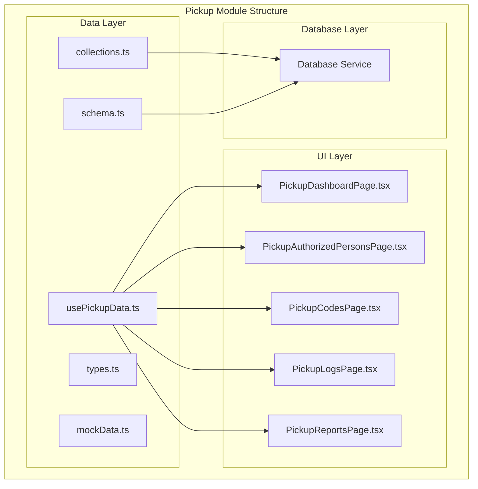

**Diagram sources**
- [collections.ts:1-22](file://src/modules/administration/data/pickup/collections.ts#L1-L22)
- [usePickupData.ts:1-256](file://src/modules/administration/data/pickup/usePickupData.ts#L1-L256)

**Section sources**
- [collections.ts:1-22](file://src/modules/administration/data/pickup/collections.ts#L1-L22)
- [schema.ts:1-101](file://src/modules/administration/data/pickup/schema.ts#L1-L101)
- [types.ts:1-98](file://src/modules/administration/data/pickup/types.ts#L1-L98)

## Core Components

The Pickup Module consists of six interconnected components that work together to provide a comprehensive student pickup management system:

### Data Management Layer
- **Collection Definitions**: Centralized database collection configurations
- **Schema Definitions**: Database-agnostic schema specifications for all entities
- **Type Definitions**: TypeScript interfaces ensuring type safety across the module
- **Mock Data**: Comprehensive seed data for development and testing
- **Data Hooks**: React hooks for state management and data operations

### User Interface Layer
- **Dashboard**: Real-time monitoring and overview of pickup activities
- **Authorized Persons Management**: Complete CRUD operations for authorized pickup individuals
- **Pickup Codes Generation**: Secure code generation with expiration handling and QR data
- **Pickup Logs**: Comprehensive audit trail of all pickup activities
- **Reporting System**: Advanced analytics and reporting capabilities

### Business Logic Layer
- **Verification Engine**: Multi-method verification (QR scan, code entry, manual)
- **Authorization Management**: Student-person authorization relationships
- **Security Controls**: Expiration handling, revocation, and audit trails
- **Integration Points**: Seamless integration with the broader school management system

**Updated** Added comprehensive QR code generation and reporting capabilities

**Section sources**
- [usePickupData.ts:17-255](file://src/modules/administration/data/pickup/usePickupData.ts#L17-L255)
- [PickupDashboardPage.tsx:24-178](file://src/modules/administration/pages/pickup/PickupDashboardPage.tsx#L24-L178)

## Architecture Overview

The Pickup Module implements a layered architecture that ensures separation of concerns and maintainable code organization:

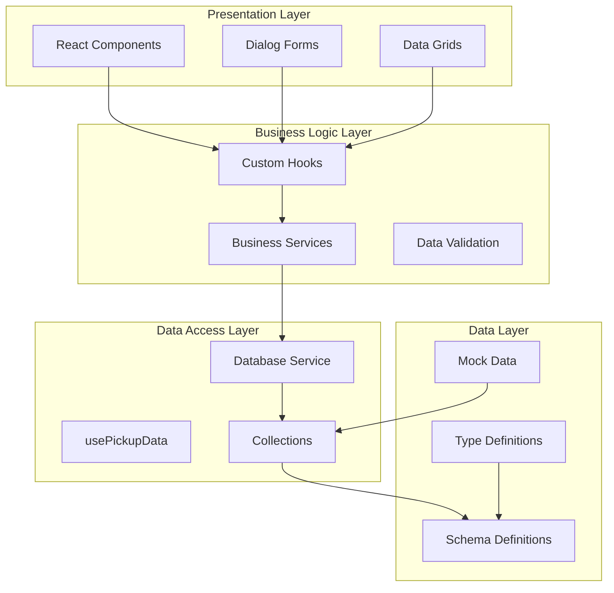

**Diagram sources**
- [usePickupData.ts:17-255](file://src/modules/administration/data/pickup/usePickupData.ts#L17-L255)
- [schema.ts:10-101](file://src/modules/administration/data/pickup/schema.ts#L10-L101)

The architecture follows these key principles:
- **Separation of Concerns**: Clear boundaries between presentation, business logic, and data layers
- **Type Safety**: Comprehensive TypeScript definitions prevent runtime errors
- **Database Abstraction**: Schema-based approach allows for flexible database backend
- **Mock Data Support**: Development-friendly mock data enables rapid prototyping
- **Extensibility**: Modular design facilitates easy addition of new features

## Detailed Component Analysis

### Data Collection Management

The module defines four primary data collections that form the foundation of the pickup system:

#### Pickup Codes Collection
Handles the generation, validation, and lifecycle management of pickup codes:

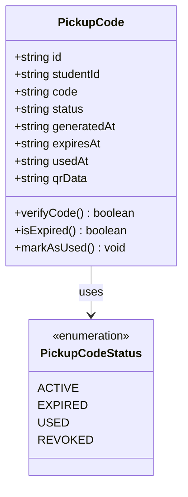

**Diagram sources**
- [types.ts:14-31](file://src/modules/administration/data/pickup/types.ts#L14-L31)

#### Authorized Persons Collection
Manages individuals authorized to pick up students:

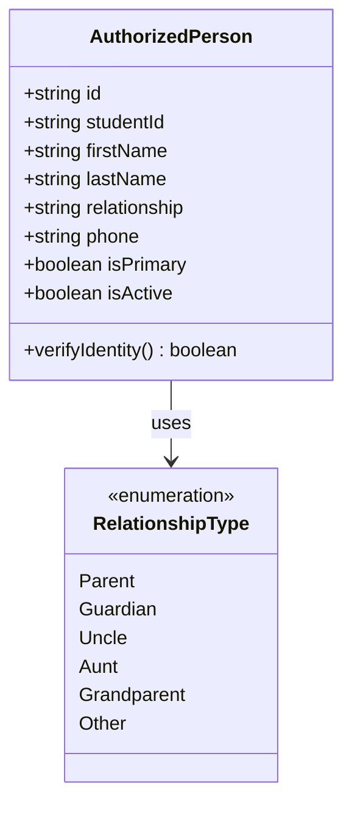

**Diagram sources**
- [types.ts:35-51](file://src/modules/administration/data/pickup/types.ts#L35-L51)

#### Student Authorizations Collection
Establishes relationships between students and their authorized persons:

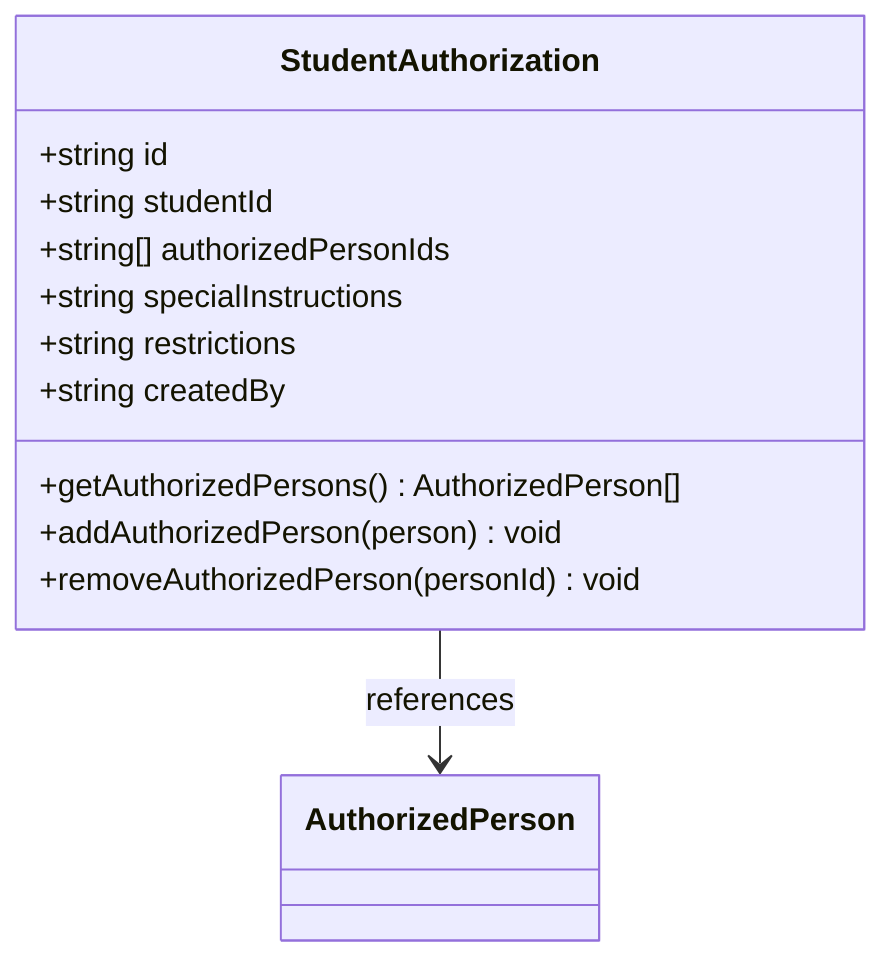

**Diagram sources**
- [types.ts:55-70](file://src/modules/administration/data/pickup/types.ts#L55-L70)

#### Pickup Logs Collection
Maintains comprehensive audit trails of all pickup activities:

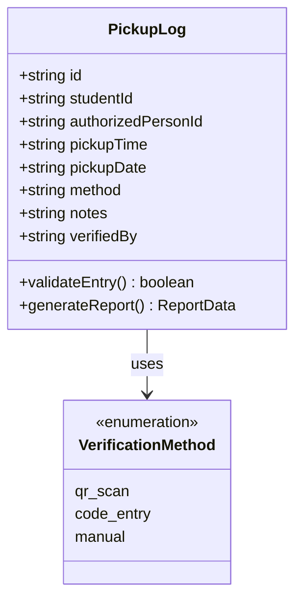

**Diagram sources**
- [types.ts:74-91](file://src/modules/administration/data/pickup/types.ts#L74-L91)

**Section sources**
- [schema.ts:10-101](file://src/modules/administration/data/pickup/schema.ts#L10-L101)
- [collections.ts:6-19](file://src/modules/administration/data/pickup/collections.ts#L6-L19)

### Data Management Hook

The `usePickupData` hook serves as the central data management component, providing comprehensive CRUD operations and state management:

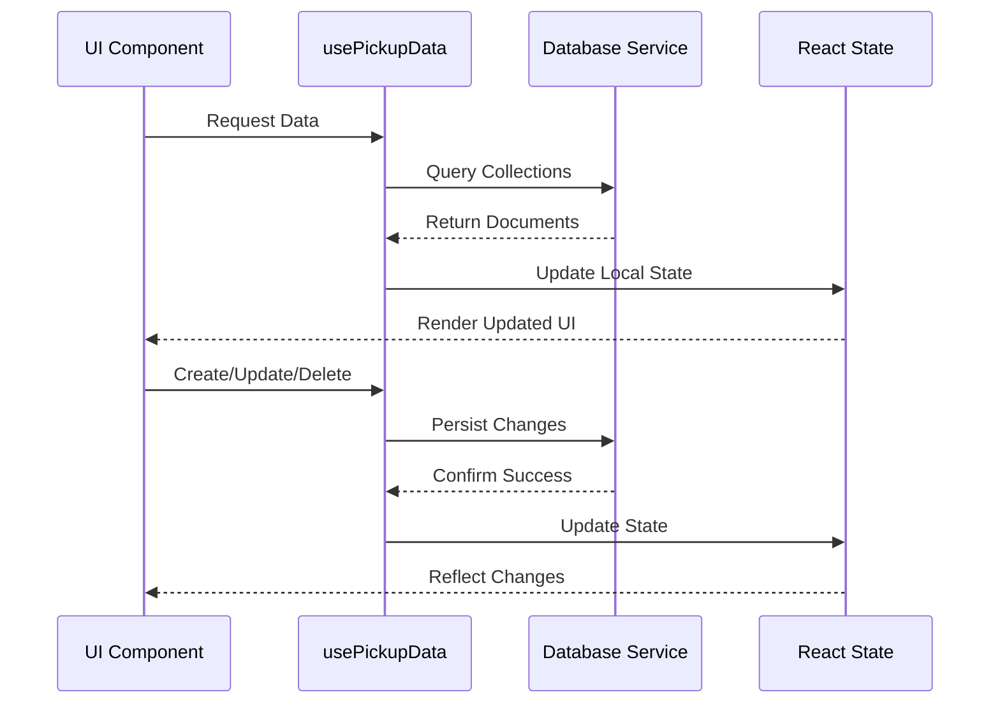

**Diagram sources**
- [usePickupData.ts:34-48](file://src/modules/administration/data/pickup/usePickupData.ts#L34-L48)
- [usePickupData.ts:182-205](file://src/modules/administration/data/pickup/usePickupData.ts#L182-L205)

Key functionalities include:
- **Data Loading**: Asynchronous loading of all collection data
- **CRUD Operations**: Full create, read, update, delete capabilities
- **Real-time Updates**: Automatic state synchronization
- **Error Handling**: Graceful fallback to mock data on failures
- **Business Logic**: Code verification, authorization checks, and validation

**Section sources**
- [usePickupData.ts:17-255](file://src/modules/administration/data/pickup/usePickupData.ts#L17-L255)

### User Interface Components

#### Dashboard Component
Provides real-time monitoring and overview capabilities:

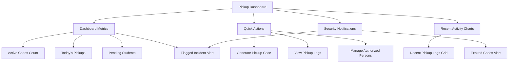

**Diagram sources**
- [PickupDashboardPage.tsx:43-110](file://src/modules/administration/pages/pickup/PickupDashboardPage.tsx#L43-L110)

#### Authorized Persons Management
Features comprehensive CRUD operations with filtering and validation:

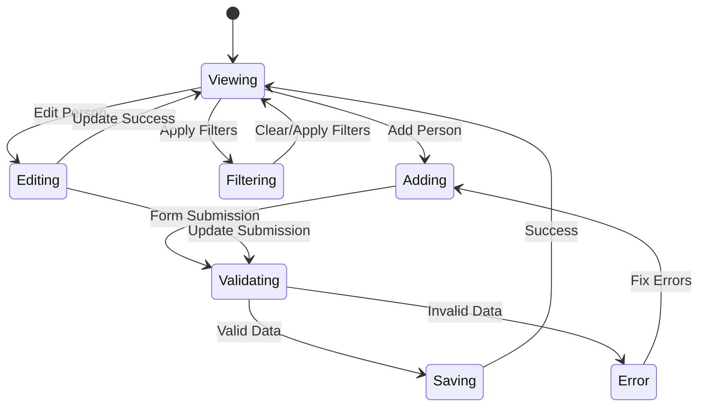

**Diagram sources**
- [PickupAuthorizedPersonsPage.tsx:124-172](file://src/modules/administration/pages/pickup/PickupAuthorizedPersonsPage.tsx#L124-L172)

#### Pickup Codes Management
Provides secure code generation with expiration controls and QR data:

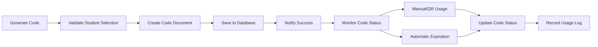

**Diagram sources**
- [PickupCodesPage.tsx:102-122](file://src/modules/administration/pages/pickup/PickupCodesPage.tsx#L102-L122)

**Section sources**
- [PickupDashboardPage.tsx:24-178](file://src/modules/administration/pages/pickup/PickupDashboardPage.tsx#L24-L178)
- [PickupAuthorizedPersonsPage.tsx:36-546](file://src/modules/administration/pages/pickup/PickupAuthorizedPersonsPage.tsx#L36-L546)
- [PickupCodesPage.tsx:38-428](file://src/modules/administration/pages/pickup/PickupCodesPage.tsx#L38-L428)

## Data Management

### Database Schema Design

The module implements a comprehensive database schema design that ensures data integrity and efficient querying:

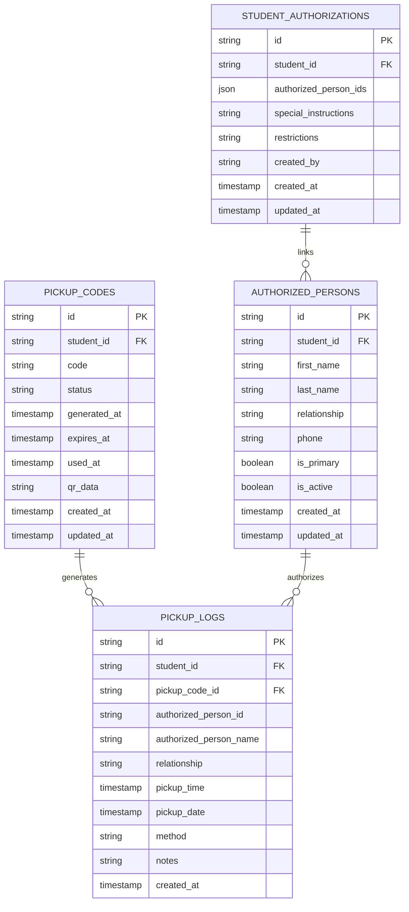

**Diagram sources**
- [schema.ts:10-101](file://src/modules/administration/data/pickup/schema.ts#L10-L101)

### Data Validation and Constraints

The schema definitions enforce strict data validation and business rule compliance:

- **Primary Keys**: All collections use UUID-based identifiers for uniqueness
- **Foreign Key Relationships**: Proper referential integrity maintained
- **Required Fields**: Critical fields enforced at schema level
- **Indexing Strategy**: Optimized indexes for common query patterns
- **Data Types**: Specific types ensure data consistency and validation

### Mock Data Implementation

The module includes comprehensive mock data for development and testing:

- **Seed Data**: Realistic sample data for all collection types
- **Variety of Scenarios**: Different statuses, relationships, and conditions
- **Testing Coverage**: Data covering edge cases and error scenarios
- **Development Efficiency**: Pre-populated data eliminates setup overhead

**Section sources**
- [schema.ts:10-101](file://src/modules/administration/data/pickup/schema.ts#L10-L101)
- [mockData.ts:6-584](file://src/modules/administration/data/pickup/mockData.ts#L6-L584)

## User Interface Components

### Dashboard Analytics

The dashboard provides comprehensive real-time analytics and monitoring:

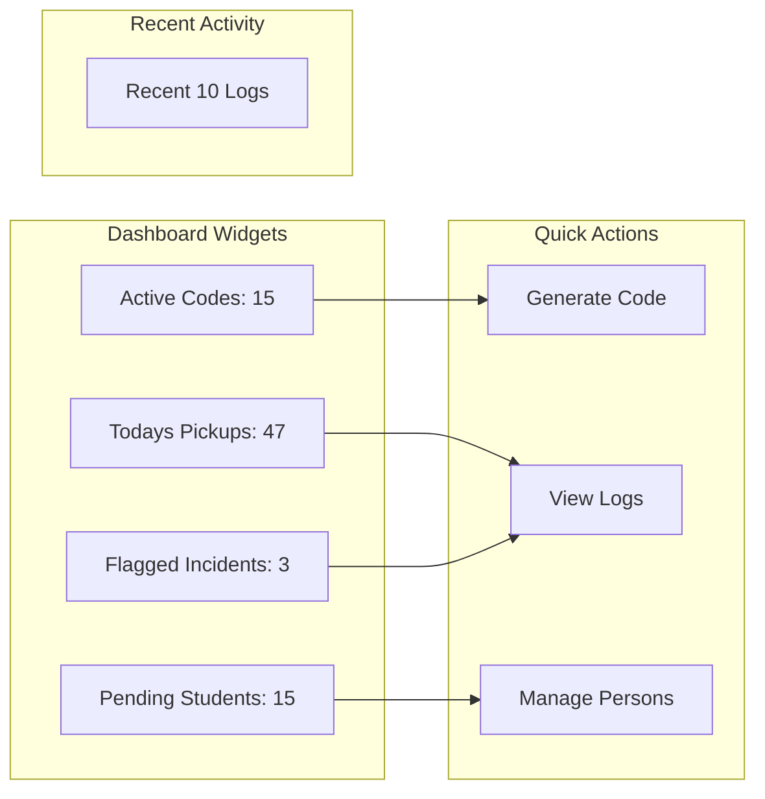

**Diagram sources**
- [PickupDashboardPage.tsx:43-110](file://src/modules/administration/pages/pickup/PickupDashboardPage.tsx#L43-L110)

### Data Grid Components

All data management pages utilize sophisticated data grid components with advanced filtering and sorting capabilities:

#### Authorized Persons Grid Features
- **Column Filtering**: Individual column filtering for each field
- **Sorting**: Multi-column sorting capabilities
- **Pagination**: Efficient handling of large datasets
- **Styling**: Visual indicators for primary contacts and active status
- **Action Buttons**: Inline edit and delete operations

#### Pickup Codes Grid Features
- **Status Indicators**: Color-coded status badges
- **Action Buttons**: Copy code and revoke functionality
- **Search Integration**: Real-time filtering across all columns
- **Responsive Design**: Mobile-friendly column layouts

#### Pickup Logs Grid Features
- **Flag Detection**: Automatic flag highlighting for suspicious activities
- **Method Classification**: Visual indicators for verification methods
- **Timestamp Sorting**: Chronological ordering of events
- **Export Capability**: CSV export for external analysis

**Section sources**
- [PickupAuthorizedPersonsPage.tsx:174-281](file://src/modules/administration/pages/pickup/PickupAuthorizedPersonsPage.tsx#L174-L281)
- [PickupCodesPage.tsx:146-233](file://src/modules/administration/pages/pickup/PickupCodesPage.tsx#L146-L233)
- [PickupLogsPage.tsx:200-281](file://src/modules/administration/pages/pickup/PickupLogsPage.tsx#L200-L281)

### Form Components

The module includes comprehensive form components with built-in validation and user experience enhancements:

#### Authorized Person Form
- **Personal Information**: Name, relationship, contact details
- **Student Assignment**: Optional student association
- **Identification**: Document type and number fields
- **Primary Contact**: Boolean flag for primary guardian designation
- **Validation**: Real-time field validation and error messaging

#### Pickup Code Generation Form
- **Student Selection**: Dropdown for student assignment
- **Expiration Control**: Configurable expiration duration
- **Validation**: Input sanitization and format checking
- **Confirmation**: Double-check mechanism for generation

#### Manual Pickup Logging
- **Student Selection**: Required student identification
- **Person Selection**: Authorized person verification
- **Timestamp Entry**: Date and time selection
- **Notes Field**: Optional incident documentation
- **Method Selection**: Verification method classification

**Section sources**
- [PickupAuthorizedPersonsPage.tsx:412-510](file://src/modules/administration/pages/pickup/PickupAuthorizedPersonsPage.tsx#L412-L510)
- [PickupCodesPage.tsx:363-390](file://src/modules/administration/pages/pickup/PickupCodesPage.tsx#L363-L390)
- [PickupLogsPage.tsx:407-489](file://src/modules/administration/pages/pickup/PickupLogsPage.tsx#L407-L489)

## Database Integration

### Collection Registration

The module integrates seamlessly with the central database service through collection registration:

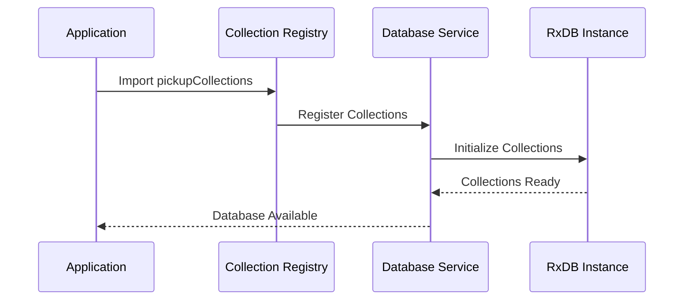

**Diagram sources**
- [collections.ts:6-19](file://src/modules/administration/data/pickup/collections.ts#L6-L19)

### Schema Integration

The schema definitions provide database-agnostic specifications that work across different storage backends:

- **Schema Helpers**: Consistent field definition patterns
- **Type Safety**: Compile-time validation of data structures
- **Index Optimization**: Strategic indexing for query performance
- **Reference Integrity**: Foreign key constraint simulation
- **Computed Fields**: Automatic field population for denormalized data

### Data Migration Strategy

The module supports flexible data migration and versioning:

- **Schema Evolution**: Backward-compatible schema changes
- **Data Transformation**: Automated data migration during upgrades
- **Validation Layers**: Multi-stage data validation pipeline
- **Rollback Support**: Safe rollback mechanisms for failed migrations

**Section sources**
- [collections.ts:1-22](file://src/modules/administration/data/pickup/collections.ts#L1-L22)
- [schema.ts:1-101](file://src/modules/administration/data/pickup/schema.ts#L1-L101)

## Security and Verification

### Multi-Factor Verification System

The module implements a comprehensive verification system with multiple security layers:

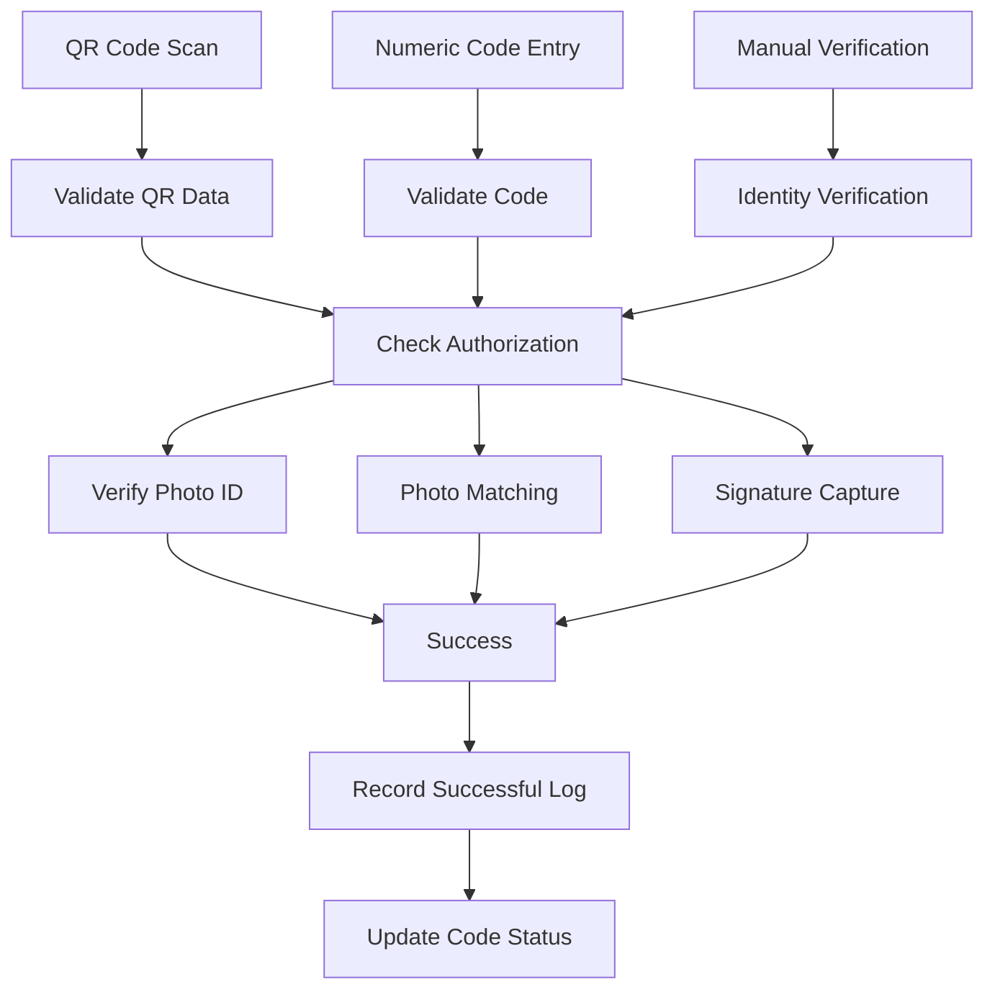

**Diagram sources**
- [usePickupData.ts:207-214](file://src/modules/administration/data/pickup/usePickupData.ts#L207-L214)

### Code Lifecycle Management

The system manages pickup code lifecycle with automatic expiration and status tracking:

- **Generation**: Random code generation with security considerations
- **Assignment**: Optional student assignment for targeted codes
- **Activation**: Immediate activation upon creation
- **Usage Tracking**: Automatic status updates on successful verification
- **Expiration**: Automatic status change after configured timeout
- **Revocation**: Manual code invalidation capability

### Authorization Management

The module enforces strict authorization controls:

- **Student-Person Relationships**: Explicit authorization establishment
- **Permission Matrix**: Fine-grained permission control per student
- **Restriction Enforcements**: Special pickup restrictions and conditions
- **Active Status Monitoring**: Automatic deactivation of inactive persons
- **Audit Trail**: Complete history of authorization changes

**Section sources**
- [usePickupData.ts:50-93](file://src/modules/administration/data/pickup/usePickupData.ts#L50-L93)
- [usePickupData.ts:216-230](file://src/modules/administration/data/pickup/usePickupData.ts#L216-L230)

## Performance Considerations

### Data Loading Strategies

The module implements efficient data loading and caching mechanisms:

- **Lazy Loading**: Data loaded only when needed
- **Batch Operations**: Grouped database operations for efficiency
- **Local Caching**: React state caching for immediate UI responsiveness
- **Error Recovery**: Fallback to mock data on database failures
- **Loading States**: Proper user feedback during data operations

### Query Optimization

Database queries are optimized for common use cases:

- **Indexed Fields**: Strategic indexing on frequently queried fields
- **Query Limiting**: Pagination and result limiting for large datasets
- **Sort Optimization**: Efficient sorting on indexed fields
- **Filter Performance**: Optimized filtering for grid components

### Memory Management

The system handles memory efficiently:

- **State Cleanup**: Proper cleanup of React component state
- **Event Listeners**: Automatic removal of event listeners
- **Resource Release**: Database connection management
- **Performance Monitoring**: Built-in performance metrics

## Troubleshooting Guide

### Common Issues and Solutions

#### Database Connection Problems
- **Symptom**: Data not loading, mock data fallback
- **Solution**: Check database service availability and network connectivity
- **Prevention**: Implement proper error handling and retry mechanisms

#### Code Generation Failures
- **Symptom**: Unable to generate pickup codes
- **Solution**: Verify database connectivity and schema validation
- **Prevention**: Implement input validation and error boundaries

#### Authorization Issues
- **Symptom**: Authorized persons not appearing in selection lists
- **Solution**: Check authorization relationships and active status
- **Prevention**: Implement proper authorization validation

#### Performance Issues
- **Symptom**: Slow data loading or UI responsiveness
- **Solution**: Optimize queries, implement pagination, and caching
- **Prevention**: Monitor performance metrics and optimize regularly

### Debugging Tools

The module includes comprehensive debugging capabilities:

- **Console Logging**: Detailed operation logging
- **Error Boundaries**: Graceful error handling and reporting
- **State Inspection**: React DevTools integration for state debugging
- **Network Monitoring**: Database operation tracking
- **Performance Profiling**: Built-in performance measurement tools

**Section sources**
- [usePickupData.ts:42-47](file://src/modules/administration/data/pickup/usePickupData.ts#L42-L47)
- [usePickupData.ts:102-106](file://src/modules/administration/data/pickup/usePickupData.ts#L102-L106)

## Conclusion

The Pickup Module represents a comprehensive solution for secure student pickup management, implementing industry-best practices in security, usability, and maintainability. The module's layered architecture ensures scalability and flexibility while maintaining robust security controls.

Key strengths of the implementation include:

- **Security Focus**: Multi-layered verification system with comprehensive audit trails
- **User Experience**: Intuitive interfaces with real-time feedback and responsive design
- **Data Integrity**: Robust schema design with validation and error handling
- **Extensibility**: Modular architecture supporting future feature additions
- **Performance**: Optimized data management and query performance

The module successfully balances security requirements with operational efficiency, providing schools with a reliable system for managing student pickup procedures while maintaining comprehensive oversight and reporting capabilities.

**Updated** Enhanced with QR code generation system and comprehensive reporting dashboard

Future enhancements could include biometric verification integration, enhanced reporting dashboards, and mobile application support for field verification scenarios.