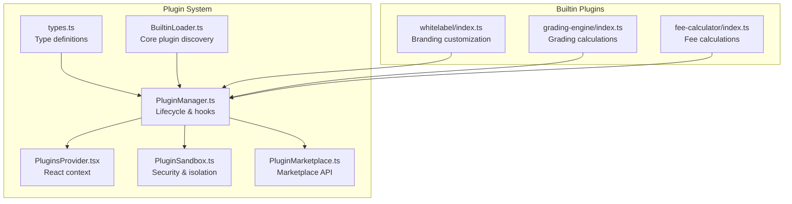
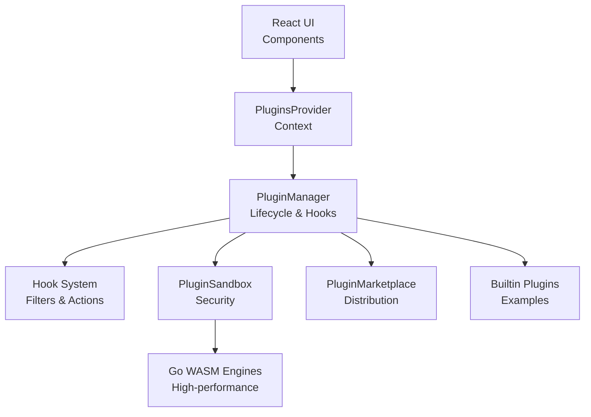
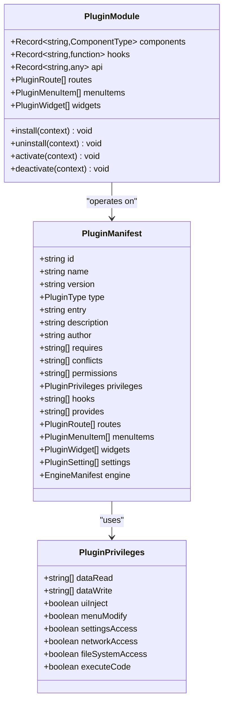
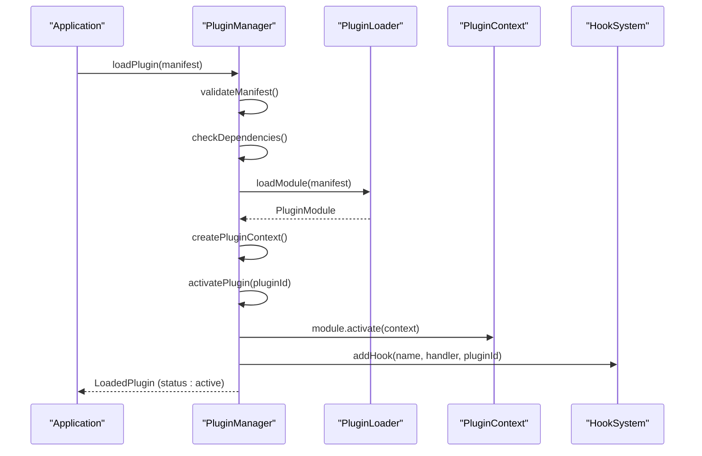
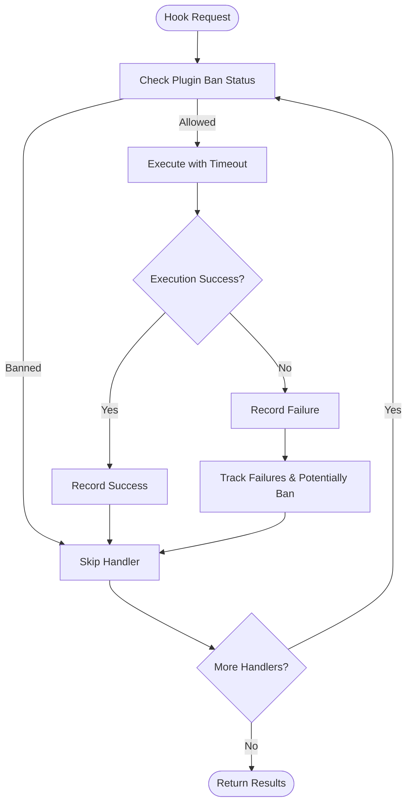
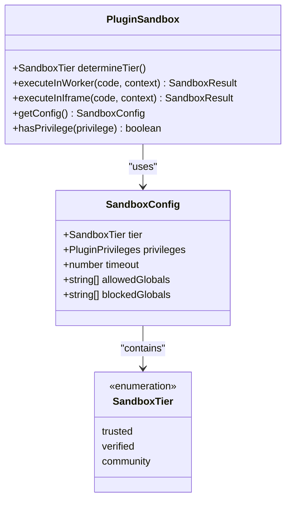
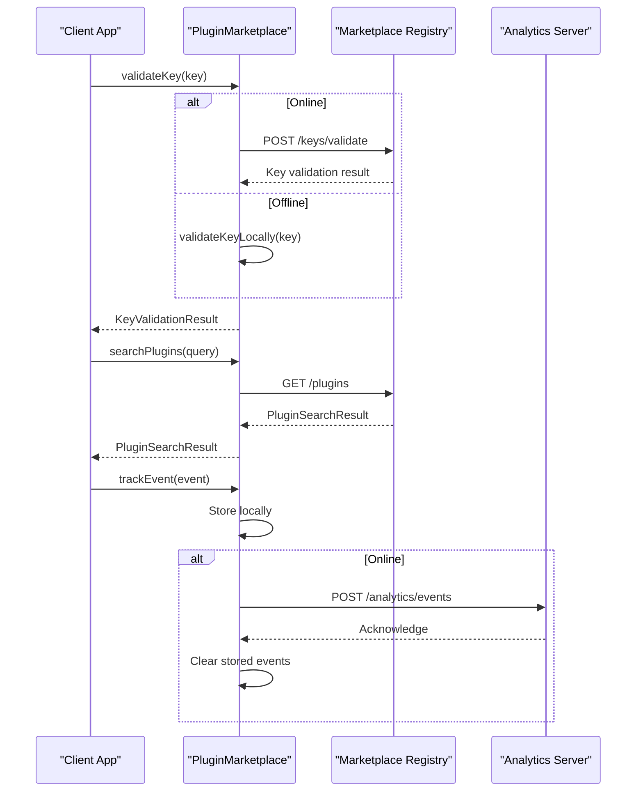
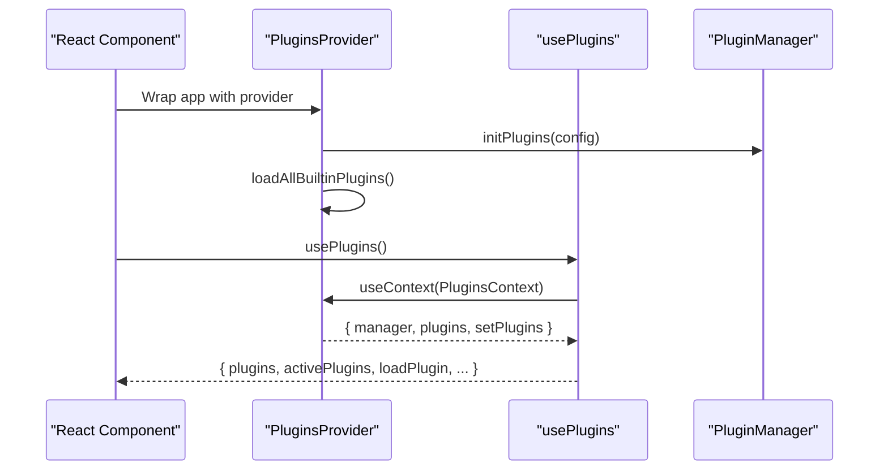
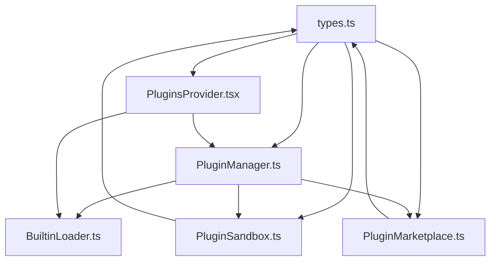

# Plugin Development Manual

<cite>
**Referenced Files in This Document**
- [index.ts](file://src/plugins/index.ts)
- [types.ts](file://src/plugins/types.ts)
- [PluginManager.ts](file://src/plugins/PluginManager.ts)
- [PluginsProvider.tsx](file://src/plugins/PluginsProvider.tsx)
- [usePlugins.ts](file://src/plugins/usePlugins.ts)
- [BuiltinLoader.ts](file://src/plugins/BuiltinLoader.ts)
- [PluginSandbox.ts](file://src/utils/PluginSandbox.ts)
- [PluginMarketplace.ts](file://src/services/PluginMarketplace.ts)
- [whitelabel/index.ts](file://src/plugins/builtin/whitelabel/index.ts)
- [grading-engine/index.ts](file://src/plugins/builtin/grading-engine/index.ts)
- [fee-calculator/index.ts](file://src/plugins/builtin/fee-calculator/index.ts)
- [PLUGIN_DEVELOPMENT_MANUAL.md](file://docs/guides/PLUGIN_DEVELOPMENT_MANUAL.md)
- [PLUGIN_ARCHITECTURE_SPEC.md](file://docs/architecture/PLUGIN_ARCHITECTURE_SPEC.md)
- [plugin-dev-guide.md](file://docs/guides/plugin-dev-guide.md)
</cite>

## Table of Contents
1. [Introduction](#introduction)
2. [Project Structure](#project-structure)
3. [Core Components](#core-components)
4. [Architecture Overview](#architecture-overview)
5. [Detailed Component Analysis](#detailed-component-analysis)
6. [Dependency Analysis](#dependency-analysis)
7. [Performance Considerations](#performance-considerations)
8. [Troubleshooting Guide](#troubleshooting-guide)
9. [Conclusion](#conclusion)
10. [Appendices](#appendices)

## Introduction
This Plugin Development Manual provides comprehensive guidance for building extensions that integrate with SchoolPilot3's plugin system. The system supports multiple plugin types (modules, themes, integrations, reports, widgets, whitelabel, and engines), a robust hook-based extension mechanism, marketplace integration, and strong security through sandboxing and privilege management. The manual covers plugin structure, lifecycle, API usage, UI integration, data access, settings configuration, testing, publishing, and advanced topics like Go WASM integration.

## Project Structure
The plugin system is organized around several core modules:
- Plugin types and interfaces define the contract for plugins
- PluginManager orchestrates loading, activation, and lifecycle
- PluginsProvider exposes the plugin ecosystem to React components
- BuiltinLoader discovers and registers core plugins
- PluginSandbox enforces security via sandbox tiers
- PluginMarketplace handles marketplace connectivity and distribution
- Builtin plugins demonstrate practical implementations

**Diagram sources**
- [types.ts:1-453](file://src/plugins/types.ts#L1-L453)
- [PluginManager.ts:1-765](file://src/plugins/PluginManager.ts#L1-L765)
- [PluginsProvider.tsx:1-88](file://src/plugins/PluginsProvider.tsx#L1-L88)
- [BuiltinLoader.ts:1-83](file://src/plugins/BuiltinLoader.ts#L1-L83)
- [PluginSandbox.ts:1-502](file://src/utils/PluginSandbox.ts#L1-L502)
- [PluginMarketplace.ts:1-762](file://src/services/PluginMarketplace.ts#L1-L762)
- [whitelabel/index.ts:1-353](file://src/plugins/builtin/whitelabel/index.ts#L1-L353)
- [grading-engine/index.ts:1-412](file://src/plugins/builtin/grading-engine/index.ts#L1-L412)
- [fee-calculator/index.ts:1-535](file://src/plugins/builtin/fee-calculator/index.ts#L1-L535)

**Section sources**
- [index.ts:1-52](file://src/plugins/index.ts#L1-L52)
- [types.ts:1-453](file://src/plugins/types.ts#L1-L453)
- [PluginManager.ts:1-765](file://src/plugins/PluginManager.ts#L1-L765)
- [PluginsProvider.tsx:1-88](file://src/plugins/PluginsProvider.tsx#L1-L88)
- [BuiltinLoader.ts:1-83](file://src/plugins/BuiltinLoader.ts#L1-L83)
- [PluginSandbox.ts:1-502](file://src/utils/PluginSandbox.ts#L1-L502)
- [PluginMarketplace.ts:1-762](file://src/services/PluginMarketplace.ts#L1-L762)
- [whitelabel/index.ts:1-353](file://src/plugins/builtin/whitelabel/index.ts#L1-L353)
- [grading-engine/index.ts:1-412](file://src/plugins/builtin/grading-engine/index.ts#L1-L412)
- [fee-calculator/index.ts:1-535](file://src/plugins/builtin/fee-calculator/index.ts#L1-L535)

## Core Components
This section outlines the fundamental building blocks of the plugin system.

- Plugin Types and Interfaces: Defines plugin categories, privileges, manifests, hooks, and lifecycle events. See [types.ts:1-453](file://src/plugins/types.ts#L1-L453).
- Plugin Manager: Central orchestrator for loading, activating, deactivating, and unloading plugins; manages hooks and settings. See [PluginManager.ts:1-765](file://src/plugins/PluginManager.ts#L1-L765).
- Plugins Provider: React context provider exposing plugin state and manager to components. See [PluginsProvider.tsx:1-88](file://src/plugins/PluginsProvider.tsx#L1-L88).
- usePlugins Hook: React hook for accessing plugin management functions. See [usePlugins.ts:1-99](file://src/plugins/usePlugins.ts#L1-L99).
- Builtin Loader: Discovers and registers core plugins from the builtin directory. See [BuiltinLoader.ts:1-83](file://src/plugins/BuiltinLoader.ts#L1-L83).
- Plugin Sandbox: Enforces security via tiered sandboxing and privilege enforcement. See [PluginSandbox.ts:1-502](file://src/utils/PluginSandbox.ts#L1-L502).
- Plugin Marketplace: Handles marketplace connectivity, key validation, plugin discovery, and analytics. See [PluginMarketplace.ts:1-762](file://src/services/PluginMarketplace.ts#L1-L762).

**Section sources**
- [types.ts:1-453](file://src/plugins/types.ts#L1-L453)
- [PluginManager.ts:1-765](file://src/plugins/PluginManager.ts#L1-L765)
- [PluginsProvider.tsx:1-88](file://src/plugins/PluginsProvider.tsx#L1-L88)
- [usePlugins.ts:1-99](file://src/plugins/usePlugins.ts#L1-L99)
- [BuiltinLoader.ts:1-83](file://src/plugins/BuiltinLoader.ts#L1-L83)
- [PluginSandbox.ts:1-502](file://src/utils/PluginSandbox.ts#L1-L502)
- [PluginMarketplace.ts:1-762](file://src/services/PluginMarketplace.ts#L1-L762)

## Architecture Overview
The plugin architecture follows a layered design:
- Core Layer: Plugin types, manager, and provider
- Extension Layer: Hooks and plugin modules
- Security Layer: Sandbox and privilege enforcement
- Distribution Layer: Marketplace integration
- Implementation Layer: Builtin plugins demonstrating patterns

**Diagram sources**
- [PluginsProvider.tsx:1-88](file://src/plugins/PluginsProvider.tsx#L1-L88)
- [PluginManager.ts:1-765](file://src/plugins/PluginManager.ts#L1-L765)
- [PluginSandbox.ts:1-502](file://src/utils/PluginSandbox.ts#L1-L502)
- [PluginMarketplace.ts:1-762](file://src/services/PluginMarketplace.ts#L1-L762)
- [whitelabel/index.ts:1-353](file://src/plugins/builtin/whitelabel/index.ts#L1-L353)
- [grading-engine/index.ts:1-412](file://src/plugins/builtin/grading-engine/index.ts#L1-L412)
- [fee-calculator/index.ts:1-535](file://src/plugins/builtin/fee-calculator/index.ts#L1-L535)

**Section sources**
- [PLUGIN_ARCHITECTURE_SPEC.md:1-800](file://docs/architecture/PLUGIN_ARCHITECTURE_SPEC.md#L1-L800)
- [PLUGIN_DEVELOPMENT_MANUAL.md:1-800](file://docs/guides/PLUGIN_DEVELOPMENT_MANUAL.md#L1-L800)

## Detailed Component Analysis

### Plugin Types and Manifest System
The type system defines plugin categories, privileges, and lifecycle events. Key aspects include:
- Plugin categories: builtin, verified, community, private, engine
- Plugin privileges: data access, UI injection, network access, file system access, code execution
- Manifest fields: identity, metadata, compatibility, capabilities, UI integration, engine specifics, marketplace metadata
- Hook definitions: action, filter, async types with priority ordering

**Diagram sources**
- [types.ts:60-111](file://src/plugins/types.ts#L60-L111)
- [types.ts:38-52](file://src/plugins/types.ts#L38-L52)
- [types.ts:287-298](file://src/plugins/types.ts#L287-L298)

**Section sources**
- [types.ts:1-453](file://src/plugins/types.ts#L1-L453)

### Plugin Lifecycle Management
The PluginManager coordinates plugin lifecycle with robust validation and dependency resolution:
- Loading: Validates manifest, checks dependencies, loads module, auto-activates if configured
- Activation: Creates plugin context, executes activate hook, registers hooks, sets status to active
- Deactivation: Executes deactivate hook, removes hooks, sets status to inactive
- Unloading: Deactivates and removes plugin from registry

**Diagram sources**
- [PluginManager.ts:248-387](file://src/plugins/PluginManager.ts#L248-L387)
- [PluginManager.ts:332-353](file://src/plugins/PluginManager.ts#L332-L353)
- [PluginManager.ts:365-378](file://src/plugins/PluginManager.ts#L365-L378)

**Section sources**
- [PluginManager.ts:248-387](file://src/plugins/PluginManager.ts#L248-L387)

### Hook System and Extension Points
The hook system enables plugins to intercept and modify application behavior:
- Hook types: action (side effects), filter (data transformation), apply (first non-null result)
- Priority-based execution with timeout protection and circuit breaker
- Security measures: execution timeouts, failure tracking, temporary bans

**Diagram sources**
- [PluginManager.ts:429-501](file://src/plugins/PluginManager.ts#L429-L501)
- [PluginManager.ts:523-533](file://src/plugins/PluginManager.ts#L523-L533)

**Section sources**
- [PluginManager.ts:396-501](file://src/plugins/PluginManager.ts#L396-L501)

### Security Model and Sandboxing
The system implements a tiered sandbox architecture:
- Trusted tier: builtin plugins with direct execution and full privileges
- Verified tier: marketplace plugins with iframe sandbox and restricted globals
- Community tier: heavy computations in Web Workers with strict global restrictions
- Privilege presets: strict, balanced, permissive with configurable permissions

**Diagram sources**
- [PluginSandbox.ts:113-160](file://src/utils/PluginSandbox.ts#L113-L160)
- [PluginSandbox.ts:14-22](file://src/utils/PluginSandbox.ts#L14-L22)
- [PluginSandbox.ts:14-22](file://src/utils/PluginSandbox.ts#L14-L22)

**Section sources**
- [PluginSandbox.ts:1-502](file://src/utils/PluginSandbox.ts#L1-L502)

### Marketplace Integration
The marketplace service provides:
- Key validation with online/offline fallback
- Plugin discovery, categories, and reviews
- Installation tracking and analytics
- Package signature verification

**Diagram sources**
- [PluginMarketplace.ts:107-152](file://src/services/PluginMarketplace.ts#L107-L152)
- [PluginMarketplace.ts:239-284](file://src/services/PluginMarketplace.ts#L239-L284)
- [PluginMarketplace.ts:528-567](file://src/services/PluginMarketplace.ts#L528-L567)

**Section sources**
- [PluginMarketplace.ts:1-762](file://src/services/PluginMarketplace.ts#L1-L762)

### Builtin Plugins: Practical Examples
The repository includes three builtin plugins demonstrating different capabilities:

#### Whitelabel Plugin
- Customizes application branding, logos, colors, and UI labels
- Implements entitlement checks and tier-based feature availability
- Registers branding and menu hooks for runtime customization

#### Grading Engine Plugin
- Demonstrates Go WASM integration for high-performance calculations
- Provides fallback to JavaScript implementation
- Implements hook-based pre/post-processing of grading data

#### Fee Calculator Plugin
- Shows financial calculation engine with WASM support
- Manages discount logic, tax calculations, and payment schedules
- Integrates with marketplace pricing and settings

**Section sources**
- [whitelabel/index.ts:1-353](file://src/plugins/builtin/whitelabel/index.ts#L1-L353)
- [grading-engine/index.ts:1-412](file://src/plugins/builtin/grading-engine/index.ts#L1-L412)
- [fee-calculator/index.ts:1-535](file://src/plugins/builtin/fee-calculator/index.ts#L1-L535)

### React Integration and Hooks
The plugin system integrates seamlessly with React:
- PluginsProvider creates and manages the plugin context
- usePlugins hook provides convenient access to plugin management functions
- Components can query plugin state and trigger actions

**Diagram sources**
- [PluginsProvider.tsx:36-85](file://src/plugins/PluginsProvider.tsx#L36-L85)
- [usePlugins.ts:40-96](file://src/plugins/usePlugins.ts#L40-L96)

**Section sources**
- [PluginsProvider.tsx:1-88](file://src/plugins/PluginsProvider.tsx#L1-L88)
- [usePlugins.ts:1-99](file://src/plugins/usePlugins.ts#L1-L99)

## Dependency Analysis
The plugin system exhibits clear separation of concerns with well-defined dependencies:

**Diagram sources**
- [types.ts:1-453](file://src/plugins/types.ts#L1-L453)
- [PluginManager.ts:1-765](file://src/plugins/PluginManager.ts#L1-L765)
- [PluginsProvider.tsx:1-88](file://src/plugins/PluginsProvider.tsx#L1-L88)
- [BuiltinLoader.ts:1-83](file://src/plugins/BuiltinLoader.ts#L1-L83)
- [PluginSandbox.ts:1-502](file://src/utils/PluginSandbox.ts#L1-L502)
- [PluginMarketplace.ts:1-762](file://src/services/PluginMarketplace.ts#L1-L762)

**Section sources**
- [index.ts:1-52](file://src/plugins/index.ts#L1-L52)
- [types.ts:1-453](file://src/plugins/types.ts#L1-L453)
- [PluginManager.ts:1-765](file://src/plugins/PluginManager.ts#L1-L765)

## Performance Considerations
- Hook execution timeouts prevent blocking operations
- Circuit breaker prevents cascading failures from problematic plugins
- Web Worker and iframe sandboxes isolate heavy computations
- Caching reduces repeated marketplace API calls
- Priority-based hook execution minimizes unnecessary processing

## Troubleshooting Guide
Common issues and resolutions:
- Plugin fails to activate: Check dependencies and conflicts in manifest
- Hook timeouts: Review plugin logic for infinite loops or heavy operations
- Sandbox violations: Verify plugin privileges and tier assignment
- Marketplace connectivity: Validate key format and network access
- Memory leaks: Ensure proper cleanup in deactivate/uninstall hooks

**Section sources**
- [PluginManager.ts:523-533](file://src/plugins/PluginManager.ts#L523-L533)
- [PluginSandbox.ts:426-440](file://src/utils/PluginSandbox.ts#L426-L440)
- [PluginMarketplace.ts:157-230](file://src/services/PluginMarketplace.ts#L157-L230)

## Conclusion
SchoolPilot3's plugin system provides a robust, secure, and extensible framework for building custom functionality. With comprehensive type safety, sandboxed execution, marketplace integration, and extensive hook points, developers can create powerful extensions while maintaining system stability and security.

## Appendices

### Plugin Development Checklist
- Define clear plugin manifest with required fields
- Implement proper lifecycle hooks (install, activate, deactivate, uninstall)
- Design secure plugin architecture with appropriate privileges
- Test thoroughly with unit and integration tests
- Document usage and configuration options
- Prepare for marketplace submission with signing and packaging

### API Reference Summary
- Plugin types and interfaces: [types.ts:1-453](file://src/plugins/types.ts#L1-L453)
- Plugin lifecycle management: [PluginManager.ts:1-765](file://src/plugins/PluginManager.ts#L1-L765)
- React integration: [PluginsProvider.tsx:1-88](file://src/plugins/PluginsProvider.tsx#L1-L88), [usePlugins.ts:1-99](file://src/plugins/usePlugins.ts#L1-L99)
- Security and sandboxing: [PluginSandbox.ts:1-502](file://src/utils/PluginSandbox.ts#L1-L502)
- Marketplace integration: [PluginMarketplace.ts:1-762](file://src/services/PluginMarketplace.ts#L1-L762)

**Section sources**
- [PLUGIN_DEVELOPMENT_MANUAL.md:1-800](file://docs/guides/PLUGIN_DEVELOPMENT_MANUAL.md#L1-L800)
- [plugin-dev-guide.md:1-42](file://docs/guides/plugin-dev-guide.md#L1-L42)