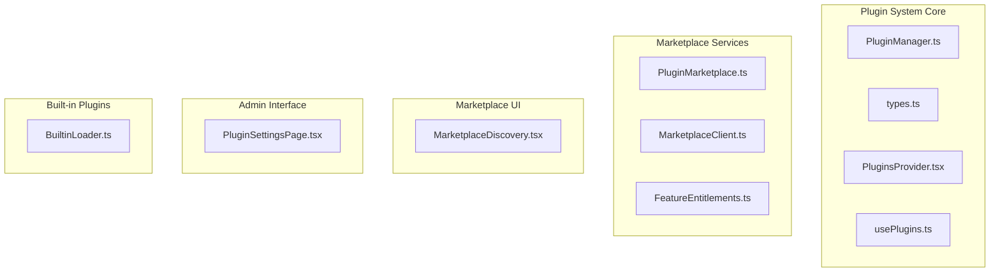
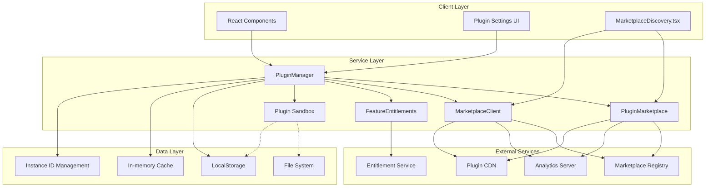
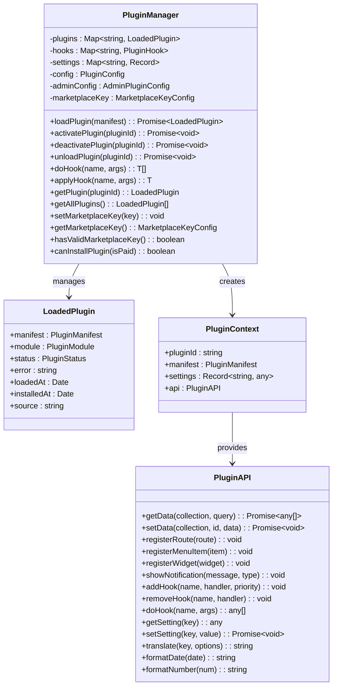
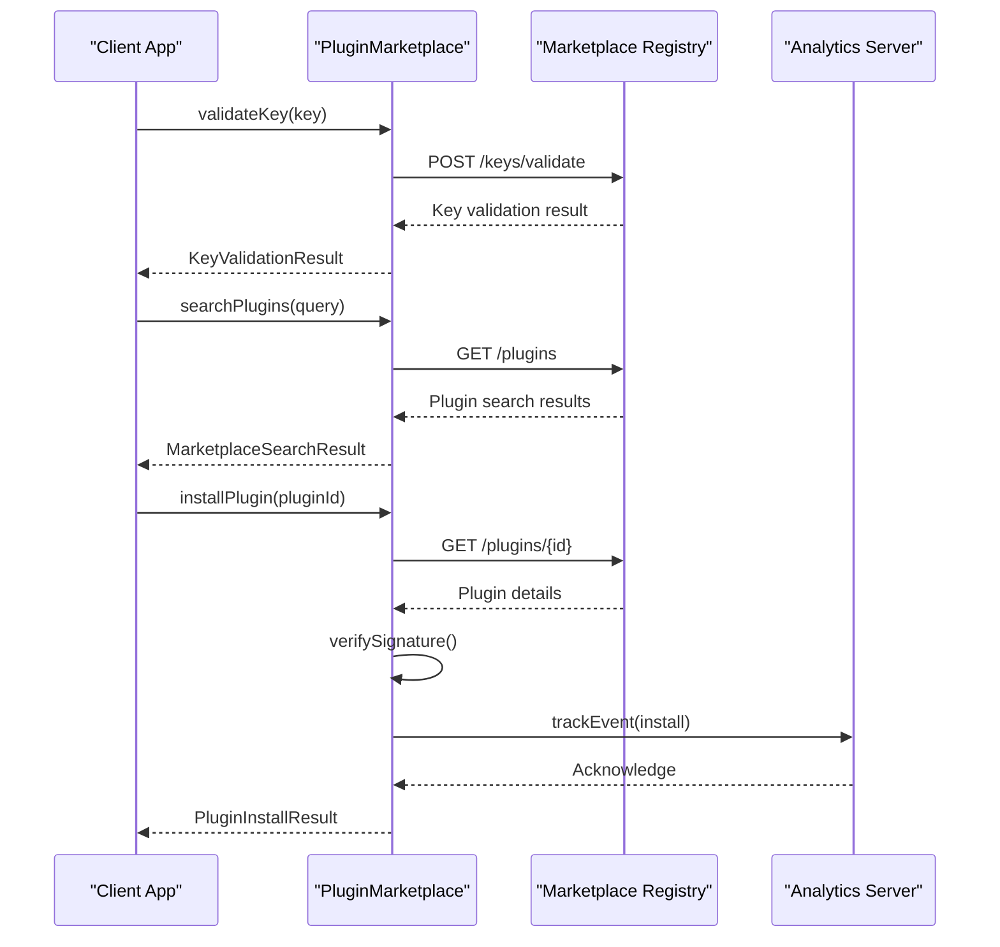
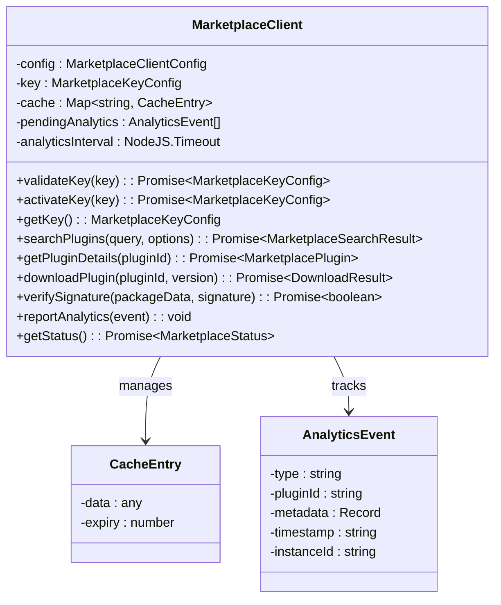
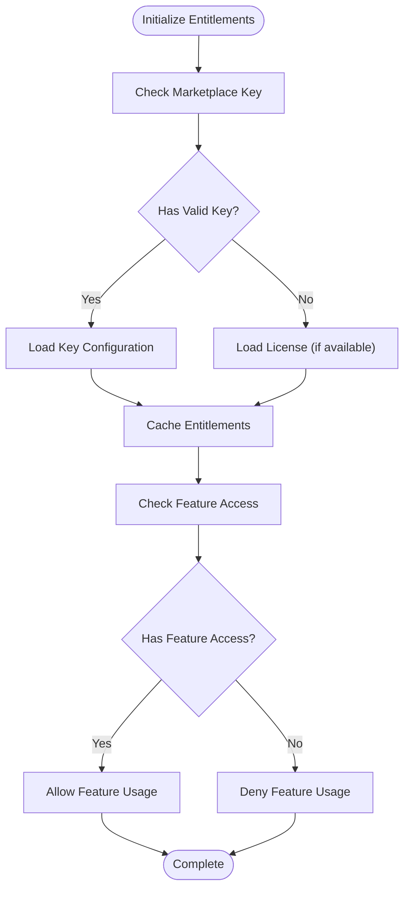
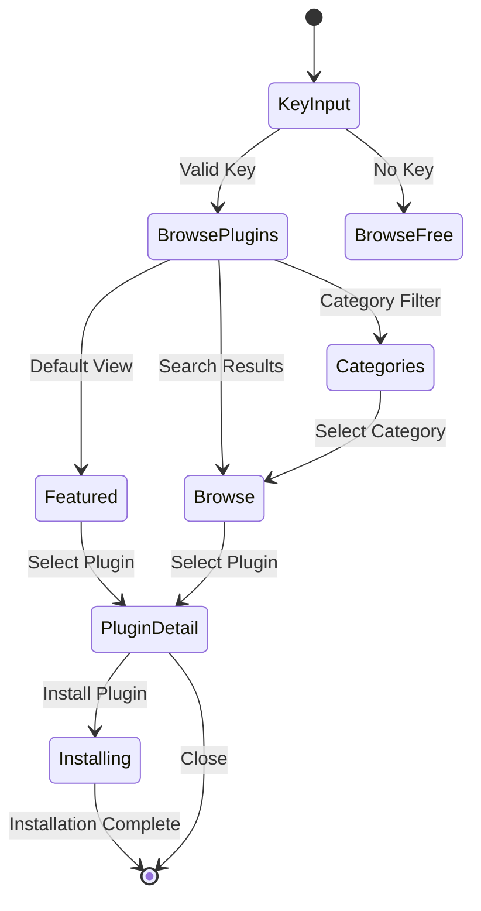
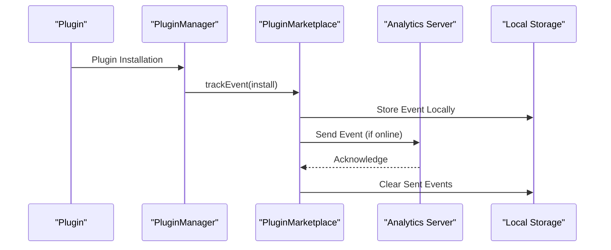
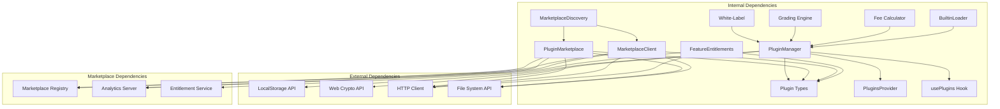

# Plugin Marketplace Service

<cite>
**Referenced Files in This Document**
- [PluginMarketplace.ts](file://src/services/PluginMarketplace.ts)
- [MarketplaceClient.ts](file://src/services/marketplace/MarketplaceClient.ts)
- [PluginManager.ts](file://src/plugins/PluginManager.ts)
- [types.ts](file://src/plugins/types.ts)
- [usePlugins.ts](file://src/plugins/usePlugins.ts)
- [PluginsProvider.tsx](file://src/plugins/PluginsProvider.tsx)
- [FeatureEntitlements.ts](file://src/services/FeatureEntitlements.ts)
- [MarketplaceDiscovery.tsx](file://src/components/MarketplaceDiscovery.tsx)
- [PluginSettingsPage.tsx](file://src/modules/settings/pages/PluginSettingsPage.tsx)
- [BuiltinLoader.ts](file://src/plugins/BuiltinLoader.ts)
</cite>

## Update Summary
**Changes Made**
- Enhanced dual service architecture with PluginMarketplace and MarketplaceClient integration
- Implemented comprehensive marketplace key validation with online/offline fallback
- Added plugin entitlement tracking and analytics reporting system
- Integrated detailed installation analytics with offline event persistence
- Enhanced marketplace integration with comprehensive plugin lifecycle management

## Table of Contents
1. [Introduction](#introduction)
2. [Project Structure](#project-structure)
3. [Core Components](#core-components)
4. [Architecture Overview](#architecture-overview)
5. [Detailed Component Analysis](#detailed-component-analysis)
6. [Marketplace Integration](#marketplace-integration)
7. [Plugin Entitlement System](#plugin-entitlement-system)
8. [Installation Analytics](#installation-analytics)
9. [Dependency Analysis](#dependency-analysis)
10. [Performance Considerations](#performance-considerations)
11. [Troubleshooting Guide](#troubleshooting-guide)
12. [Conclusion](#conclusion)

## Introduction
The Plugin Marketplace Service is a comprehensive system that enables extensibility, customization, and integration within the SchoolPilot3 educational platform. This service provides a complete plugin architecture with marketplace integration, admin controls, security model, and Go WASM integration capabilities. The system supports multiple plugin types including modules, themes, integrations, reports, widgets, white-labeling, and computational engines.

The marketplace service facilitates plugin discovery, installation, validation, and management while maintaining strict security boundaries and performance monitoring. It integrates seamlessly with the core application through a well-defined plugin lifecycle and hook system. The system now features a dual-service architecture with comprehensive marketplace key validation, plugin entitlement tracking, and detailed installation analytics.

## Project Structure
The plugin marketplace service is organized into several key directories and files with enhanced marketplace integration:

**Diagram sources**
- [PluginManager.ts:1-765](file://src/plugins/PluginManager.ts#L1-765)
- [PluginMarketplace.ts:1-762](file://src/services/PluginMarketplace.ts#L1-762)
- [MarketplaceClient.ts:1-592](file://src/services/marketplace/MarketplaceClient.ts#L1-592)
- [FeatureEntitlements.ts:1-247](file://src/services/FeatureEntitlements.ts#L1-247)
- [MarketplaceDiscovery.tsx:1-865](file://src/components/MarketplaceDiscovery.tsx#L1-865)

**Section sources**
- [PluginManager.ts:1-765](file://src/plugins/PluginManager.ts#L1-765)
- [PluginMarketplace.ts:1-762](file://src/services/PluginMarketplace.ts#L1-762)
- [MarketplaceClient.ts:1-592](file://src/services/marketplace/MarketplaceClient.ts#L1-592)
- [types.ts:1-453](file://src/plugins/types.ts#L1-453)

## Core Components

### Plugin Manager
The Plugin Manager serves as the central orchestrator for all plugin operations, handling lifecycle management, hook registration, and security enforcement. It maintains plugin state, manages dependencies, and provides the foundation for plugin communication. The manager now integrates with both marketplace services for comprehensive plugin management.

### Plugin Marketplace Service
The Plugin Marketplace Service handles external plugin discovery, validation, and installation. It manages marketplace connectivity, key validation, plugin signatures, and analytics tracking for usage monitoring. This service provides comprehensive marketplace functionality with offline fallback capabilities.

### Marketplace Client Service
The Marketplace Client Service offers an alternative marketplace interaction layer with enhanced analytics and update management capabilities. It provides detailed plugin download management, signature verification, and comprehensive analytics reporting.

### Feature Entitlement System
A comprehensive entitlement system tracks plugin usage, validates marketplace keys, and manages feature access based on licensing tiers. This system integrates with both marketplace services to enforce usage limits and feature availability.

### Built-in Plugin Loader
The system includes a comprehensive built-in plugin loader that discovers and registers core plugins including white-labeling, grading engines, and fee calculators with Go WASM integration.

**Section sources**
- [PluginManager.ts:25-765](file://src/plugins/PluginManager.ts#L25-765)
- [PluginMarketplace.ts:70-762](file://src/services/PluginMarketplace.ts#L70-762)
- [MarketplaceClient.ts:56-592](file://src/services/marketplace/MarketplaceClient.ts#L56-592)
- [FeatureEntitlements.ts:101-247](file://src/services/FeatureEntitlements.ts#L101-247)
- [types.ts:14-453](file://src/plugins/types.ts#L14-453)
- [BuiltinLoader.ts:1-83](file://src/plugins/BuiltinLoader.ts#L1-83)

## Architecture Overview

The plugin marketplace service follows a layered architecture with clear separation of concerns and dual marketplace service integration:

**Diagram sources**
- [PluginManager.ts:25-765](file://src/plugins/PluginManager.ts#L25-765)
- [PluginMarketplace.ts:70-762](file://src/services/PluginMarketplace.ts#L70-762)
- [MarketplaceClient.ts:56-592](file://src/services/marketplace/MarketplaceClient.ts#L56-592)
- [FeatureEntitlements.ts:101-247](file://src/services/FeatureEntitlements.ts#L101-247)

### Key Architectural Principles

1. **Dual Marketplace Services**: Two complementary services for different use cases and integration scenarios
2. **Security-First Design**: All plugins execute within sandboxed environments with strict privilege controls
3. **Extensibility**: Modular architecture allows easy addition of new plugin types and capabilities
4. **Performance Monitoring**: Built-in timeout mechanisms and circuit breakers prevent plugin failures from affecting the core system
5. **Marketplace Integration**: Seamless connection to external plugin registries with offline fallback capabilities
6. **Entitlement Management**: Comprehensive licensing and feature access control system
7. **Analytics Integration**: Detailed installation tracking and usage analytics
8. **Admin Control**: Comprehensive administrative controls for plugin management and security policy enforcement

## Detailed Component Analysis

### Plugin Manager Analysis

The Plugin Manager implements a sophisticated plugin lifecycle system with comprehensive error handling and security enforcement, now enhanced with marketplace integration:

**Diagram sources**
- [PluginManager.ts:25-765](file://src/plugins/PluginManager.ts#L25-765)
- [types.ts:211-261](file://src/plugins/types.ts#L211-261)

#### Security Implementation
The Plugin Manager implements multiple layers of security with enhanced marketplace integration:

- **Hook Security**: Timeout protection (200ms) with circuit breaker mechanism
- **Plugin Isolation**: Tiered sandbox architecture based on plugin trust level
- **Permission Management**: Granular privilege controls for data access and system operations
- **Signature Verification**: Cryptographic verification for plugin authenticity
- **Marketplace Key Validation**: Integrated key validation for paid plugin access control

**Section sources**
- [PluginManager.ts:36-520](file://src/plugins/PluginManager.ts#L36-520)
- [PluginManager.ts:182-225](file://src/plugins/PluginManager.ts#L182-225)
- [types.ts:38-54](file://src/plugins/types.ts#L38-54)

### Plugin Marketplace Service

The Plugin Marketplace Service provides comprehensive marketplace functionality with enhanced key validation and analytics:

**Diagram sources**
- [PluginMarketplace.ts:107-473](file://src/services/PluginMarketplace.ts#L107-473)

#### Key Features
- **Enhanced Key Validation**: Multi-tier validation with online/offline fallback and comprehensive permission checking
- **Plugin Discovery**: Comprehensive search and filtering capabilities with caching
- **Installation Tracking**: Detailed analytics for plugin usage and adoption with offline event persistence
- **Signature Verification**: Cryptographic verification for plugin authenticity with expiration checking
- **Offline Support**: Graceful degradation when marketplace is unavailable with local event persistence
- **Instance Management**: Unique instance ID generation and tracking for usage analytics

**Section sources**
- [PluginMarketplace.ts:70-762](file://src/services/PluginMarketplace.ts#L70-762)

### Marketplace Client Service

The Marketplace Client Service offers an alternative marketplace interaction layer with enhanced capabilities:

**Diagram sources**
- [MarketplaceClient.ts:56-592](file://src/services/marketplace/MarketplaceClient.ts#L56-592)

#### Key Features
- **Dual Service Architecture**: Alternative service for different integration scenarios
- **Enhanced Analytics**: Comprehensive analytics reporting with batch processing
- **Update Management**: Plugin update checking and management capabilities
- **Signature Verification**: Advanced signature verification with expiration checking
- **Periodic Analytics**: Automated analytics flushing with configurable intervals
- **Status Monitoring**: Comprehensive marketplace connection and key status monitoring

**Section sources**
- [MarketplaceClient.ts:56-592](file://src/services/marketplace/MarketplaceClient.ts#L56-592)

### Feature Entitlement System

The Feature Entitlement System provides comprehensive licensing and feature access control:

**Diagram sources**
- [FeatureEntitlements.ts:101-247](file://src/services/FeatureEntitlements.ts#L101-247)

#### Key Features
- **Multi-Tier Licensing**: Support for multiple pricing tiers with feature differentiation
- **Feature Tracking**: Comprehensive feature entitlement tracking and validation
- **License Validation**: Cryptographic license validation with expiration checking
- **Instance Binding**: License binding to specific instances for security
- **Limit Management**: Usage limits and quotas based on licensing tiers
- **Upgrade Suggestions**: Intelligent upgrade recommendations based on feature needs

**Section sources**
- [FeatureEntitlements.ts:101-247](file://src/services/FeatureEntitlements.ts#L101-247)

## Marketplace Integration

### Dual Service Architecture
The system now features two complementary marketplace services designed for different use cases:

#### PluginMarketplace Service
- **Primary Service**: Direct integration with PluginManager for seamless plugin lifecycle management
- **Enhanced Analytics**: Comprehensive installation tracking with offline event persistence
- **Key Validation**: Multi-tier validation with online/offline fallback capabilities
- **Instance Management**: Unique instance ID generation and tracking for analytics

#### MarketplaceClient Service
- **Alternative Service**: Standalone marketplace interaction with enhanced analytics capabilities
- **Batch Processing**: Automated analytics flushing with configurable intervals
- **Update Management**: Comprehensive plugin update checking and management
- **Signature Verification**: Advanced cryptographic signature verification

### Marketplace Discovery Component
The MarketplaceDiscovery component provides a comprehensive UI for marketplace interaction:

**Diagram sources**
- [MarketplaceDiscovery.tsx:1-865](file://src/components/MarketplaceDiscovery.tsx#L1-865)

#### Key Features
- **Multi-View Interface**: Featured, browse, categories, and installed updates views
- **Real-time Search**: Instant plugin search with debounced input handling
- **Key Management**: Secure key input with validation and persistence
- **Installation Flow**: Guided plugin installation process with progress tracking
- **Permission Checking**: Real-time permission validation for plugin installation
- **Error Handling**: Comprehensive error handling and user feedback

**Section sources**
- [MarketplaceDiscovery.tsx:1-865](file://src/components/MarketplaceDiscovery.tsx#L1-865)

## Plugin Entitlement System

### Entitlement Management
The system provides comprehensive entitlement tracking and validation:

#### Feature Tiers
| Tier | Monthly Price | Annual Price | Features | Limits |
|------|---------------|--------------|----------|--------|
| Free | $0 | $0 | Basic plugin access | 5 plugins |
| Starter | $29 | $290 | Advanced reporting, bulk operations | 15 plugins |
| Professional | $79 | $790 | Whitelabel basic, API access, custom themes | 50 plugins |
| Enterprise | $199 | $1990 | Full whitelabel, priority support | Unlimited |
| Reseller | $499 | $4990 | White-label reseller capabilities | 10 instances |

#### Entitlement Validation
The system validates entitlements through multiple channels:
- **Marketplace Key Validation**: Real-time key validation with permission checking
- **License Validation**: Cryptographic license validation with expiration checking
- **Instance Binding**: License binding to specific instances for security
- **Feature Access Control**: Granular feature access based on entitlement tiers

**Section sources**
- [FeatureEntitlements.ts:54-95](file://src/services/FeatureEntitlements.ts#L54-95)
- [FeatureEntitlements.ts:101-247](file://src/services/FeatureEntitlements.ts#L101-247)

## Installation Analytics

### Analytics Architecture
The system provides comprehensive installation analytics and usage tracking:

**Diagram sources**
- [PluginMarketplace.ts:528-567](file://src/services/PluginMarketplace.ts#L528-567)

### Analytics Events
The system tracks various installation and usage events:

#### Installation Events
- **Install**: Plugin installation successful
- **Uninstall**: Plugin removal
- **Activate**: Plugin activation
- **Deactivate**: Plugin deactivation
- **Update**: Plugin update completion

#### Usage Events
- **Search**: Plugin search queries
- **View**: Plugin detail views
- **Download**: Plugin download attempts
- **Error**: Installation errors and failures

#### Analytics Data
The system collects comprehensive analytics data:
- **Plugin Metadata**: Version, type, category, price
- **User Context**: Instance ID, plan tier, permissions
- **Timing Data**: Installation duration, error timestamps
- **Geographic Data**: Instance location (optional)
- **Usage Patterns**: Frequency, duration, feature utilization

**Section sources**
- [PluginMarketplace.ts:42-49](file://src/services/PluginMarketplace.ts#L42-49)
- [PluginMarketplace.ts:528-597](file://src/services/PluginMarketplace.ts#L528-597)

## Dependency Analysis

The plugin marketplace service has well-defined dependencies and relationships with enhanced marketplace integration:

**Diagram sources**
- [PluginManager.ts:9-20](file://src/plugins/PluginManager.ts#L9-20)
- [PluginMarketplace.ts:8-15](file://src/services/PluginMarketplace.ts#L8-15)
- [MarketplaceClient.ts:8-14](file://src/services/marketplace/MarketplaceClient.ts#L8-14)
- [FeatureEntitlements.ts:8](file://src/services/FeatureEntitlements.ts#L8)

### Security Dependencies
The system relies on several security-critical dependencies with enhanced marketplace security:

- **Web Crypto API**: For cryptographic operations and signature verification
- **WebAssembly**: For secure execution of Go-based engines
- **Content Security Policy**: For sandbox isolation
- **Local Storage**: For persistent state management and offline analytics
- **Marketplace Authentication**: Secure key-based authentication for marketplace access

### Performance Dependencies
- **In-Memory Caching**: For marketplace data caching with expiration
- **Web Workers**: For heavy computation offloading
- **Lazy Loading**: For plugin module loading
- **Request Batching**: For marketplace API optimization
- **Analytics Flushing**: For offline analytics synchronization

**Section sources**
- [PluginManager.ts:36-41](file://src/plugins/PluginManager.ts#L36-41)
- [PluginMarketplace.ts:63-83](file://src/services/PluginMarketplace.ts#L63-83)
- [MarketplaceClient.ts:537-574](file://src/services/marketplace/MarketplaceClient.ts#L537-574)

## Performance Considerations

### Plugin Execution Performance
The system implements several performance optimization strategies with enhanced marketplace integration:

1. **Hook Execution Limits**: 200ms timeout per hook with circuit breaker protection
2. **Plugin Caching**: In-memory caching for frequently accessed plugins with expiration
3. **Lazy Loading**: Plugins loaded only when needed with marketplace-aware loading
4. **Resource Pooling**: Efficient resource management for plugin instances
5. **Marketplace Caching**: Comprehensive caching for marketplace data with intelligent expiration
6. **Analytics Optimization**: Batch processing and offline analytics storage

### Marketplace Performance
- **Response Time**: Optimized API calls with intelligent caching and fallback mechanisms
- **Bandwidth Optimization**: Compressed responses and efficient data transfer
- **Concurrent Operations**: Parallel processing for multiple plugin operations
- **Offline Fallback**: Graceful degradation when marketplace is unavailable
- **Analytics Synchronization**: Efficient offline analytics synchronization

### Memory Management
- **Weak References**: For plugin references to prevent memory leaks
- **Garbage Collection**: Automatic cleanup of inactive plugins
- **Resource Limits**: Memory caps for plugin execution environments
- **Cache Management**: Intelligent cache eviction with LRU algorithms
- **Analytics Cleanup**: Automatic cleanup of processed analytics events

## Troubleshooting Guide

### Common Plugin Issues

#### Plugin Loading Failures
**Symptoms**: Plugin fails to load with error messages
**Causes**: 
- Invalid plugin manifest
- Missing dependencies
- Security violations
- Network connectivity issues
- Marketplace key validation failures

**Solutions**:
1. Verify plugin manifest completeness
2. Check dependency resolution
3. Review security permissions
4. Test network connectivity
5. Validate marketplace key
6. Check plugin signature verification

#### Hook Execution Problems
**Symptoms**: Hooks causing system slowdown or crashes
**Solutions**:
1. Implement proper error handling in hooks
2. Use timeout mechanisms
3. Monitor hook execution times
4. Apply circuit breaker patterns
5. Check marketplace service availability

#### Marketplace Connectivity Issues
**Symptoms**: Marketplace unavailable or slow responses
**Solutions**:
1. Check network connectivity
2. Verify marketplace key validity
3. Review offline fallback mechanisms
4. Monitor API rate limits
5. Check analytics synchronization
6. Validate entitlement system status

#### Analytics Issues
**Symptoms**: Analytics events not being tracked or synchronized
**Solutions**:
1. Check local storage availability
2. Verify analytics service connectivity
3. Review event queue status
4. Check marketplace key permissions
5. Validate instance ID generation

### Debugging Tools
The system provides comprehensive debugging capabilities with enhanced marketplace insights:

- **Plugin State Inspection**: Real-time plugin status monitoring
- **Hook Execution Logs**: Detailed hook call tracking
- **Performance Metrics**: Execution time and resource usage tracking
- **Security Auditing**: Plugin permission and access logs
- **Marketplace Diagnostics**: Connection status and key validation logs
- **Analytics Monitoring**: Event tracking and synchronization status
- **Entitlement Validation**: Feature access and license validation logs

**Section sources**
- [PluginManager.ts:492-519](file://src/plugins/PluginManager.ts#L492-519)
- [PluginMarketplace.ts:528-567](file://src/services/PluginMarketplace.ts#L528-567)
- [MarketplaceClient.ts:447-467](file://src/services/marketplace/MarketplaceClient.ts#L447-467)

## Conclusion

The Plugin Marketplace Service represents a sophisticated and comprehensive solution for extensible educational platform development. The system successfully balances flexibility, security, and performance while providing a robust foundation for plugin-based extensibility.

Key strengths of the implementation include:

1. **Dual Marketplace Services**: Two complementary services for different integration scenarios and use cases
2. **Comprehensive Security Model**: Multi-layered sandboxing with granular privilege controls and enhanced marketplace security
3. **Advanced Performance Optimization**: Intelligent caching, lazy loading, and resource management with marketplace-aware optimizations
4. **Rich Plugin Ecosystem**: Support for diverse plugin types with specialized capabilities and comprehensive marketplace integration
5. **Marketplace Integration**: Seamless external plugin discovery and management with offline fallback capabilities
6. **Entitlement Management**: Comprehensive licensing and feature access control system with real-time validation
7. **Analytics Integration**: Detailed installation tracking and usage analytics with offline synchronization
8. **Developer-Friendly Architecture**: Well-documented APIs and extensive developer tools with enhanced marketplace debugging capabilities

The system's modular design and extensive documentation make it an excellent foundation for continued development and expansion of the SchoolPilot3 platform's plugin ecosystem. The integration of Go WASM engines demonstrates forward-thinking approaches to performance-critical calculations while maintaining security and reliability.

The enhanced marketplace system with dual service architecture, comprehensive key validation, entitlement tracking, and analytics provides a robust foundation for commercial plugin distribution and usage monitoring. The integration of marketplace services with the core plugin management system ensures seamless plugin lifecycle management while maintaining security and performance standards.

Future enhancements could include expanded marketplace capabilities, additional plugin types, enhanced analytics features, improved offline synchronization, and further performance optimizations as the system continues to evolve and mature.