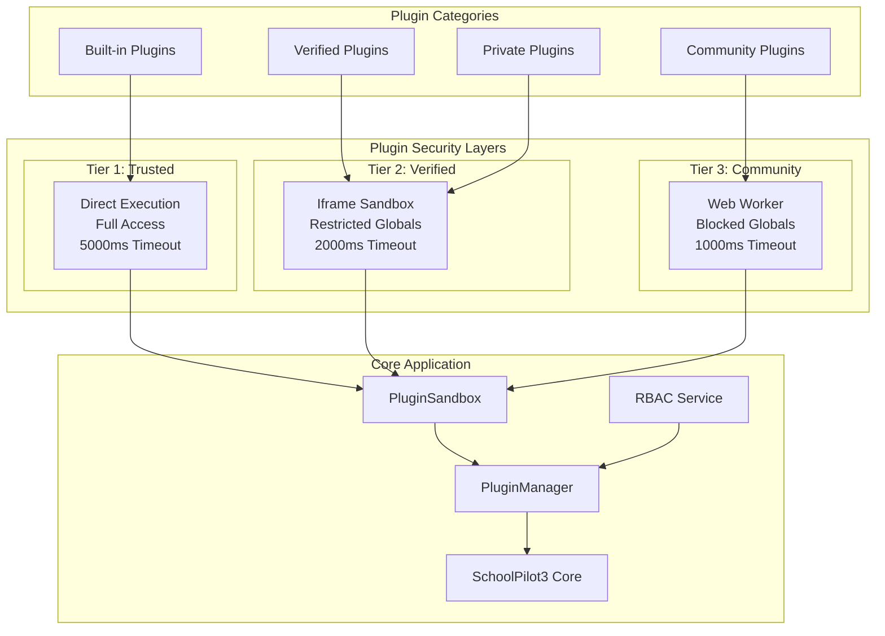
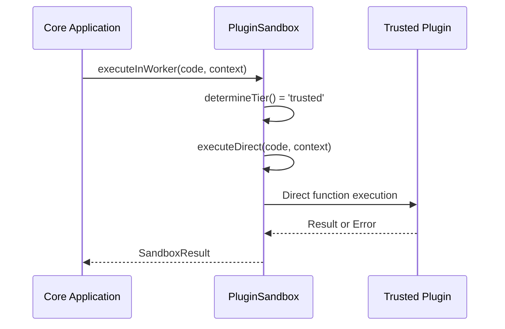
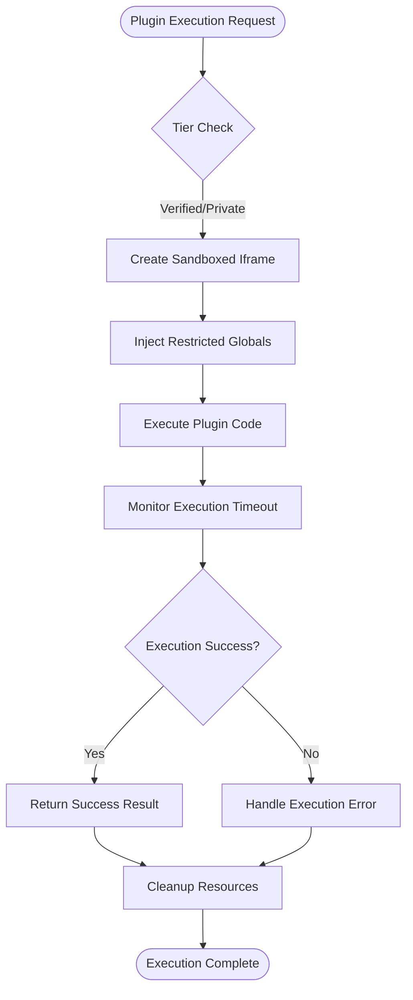
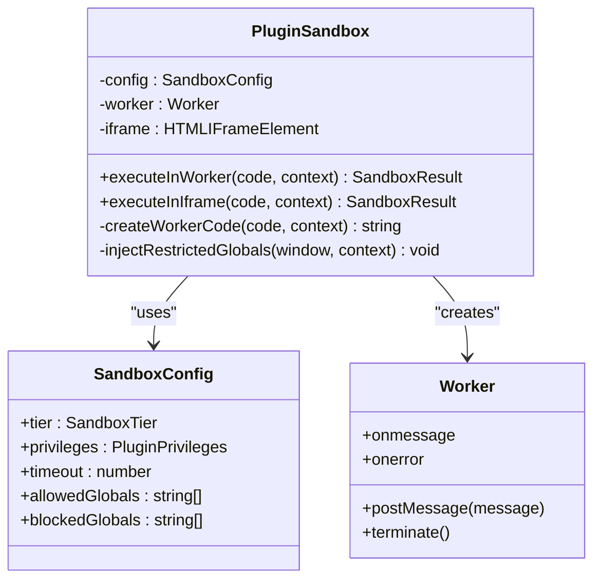
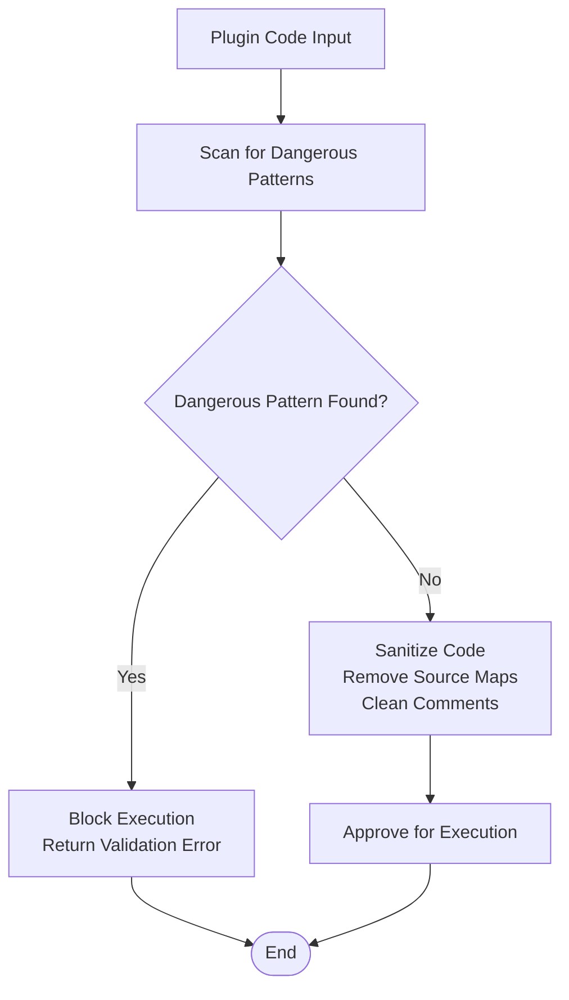
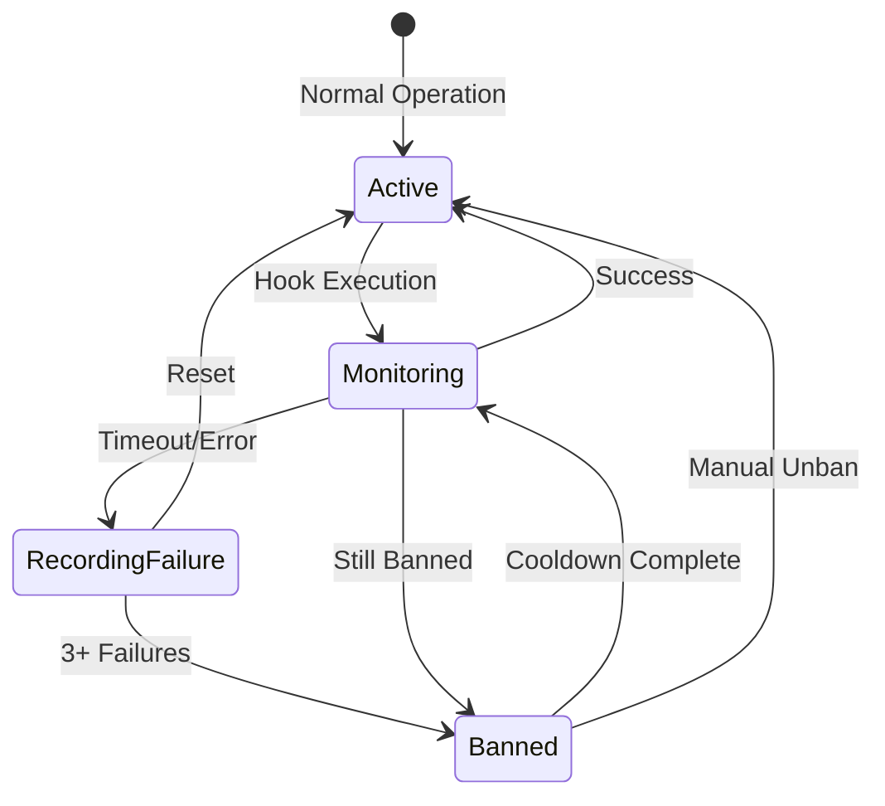
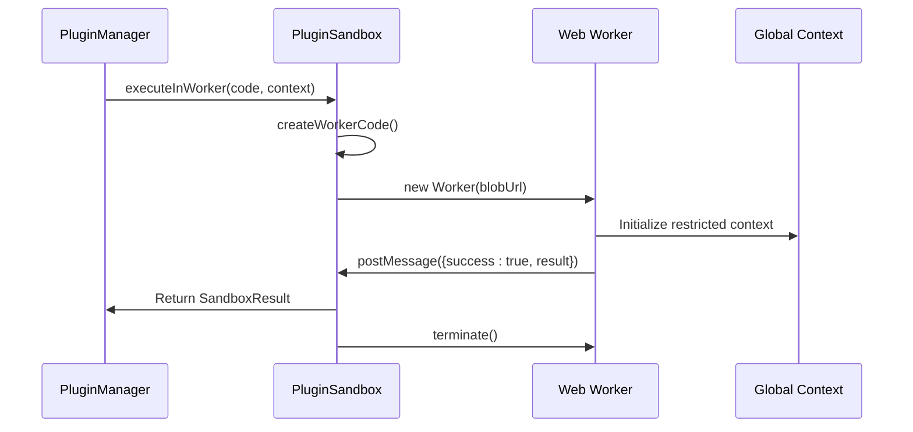

# Plugin Sandbox Security

<cite>
**Referenced Files in This Document**
- [PluginSandbox.ts](file://src/utils/PluginSandbox.ts)
- [PluginManager.ts](file://src/plugins/PluginManager.ts)
- [types.ts](file://src/plugins/types.ts)
- [PluginsProvider.tsx](file://src/plugins/PluginsProvider.tsx)
- [usePlugins.ts](file://src/plugins/usePlugins.ts)
- [BuiltinLoader.ts](file://src/plugins/BuiltinLoader.ts)
- [PLUGIN_ARCHITECTURE_SPEC.md](file://docs/architecture/PLUGIN_ARCHITECTURE_SPEC.md)
- [plugin-dev-guide.md](file://docs/guides/plugin-dev-guide.md)
- [RBAC_IMPLEMENTATION_GUIDE.md](file://docs/guides/RBAC_IMPLEMENTATION_GUIDE.md)
</cite>

## Update Summary
**Changes Made**
- Enhanced security model documentation with comprehensive PluginSandbox utility implementation
- Updated sandbox tier system documentation with trusted/verified/community classifications
- Added execution timeout protection and circuit breaker mechanisms
- Documented new privilege-based security model with three-tier configuration
- Updated architecture diagrams to reflect the new tiered sandbox approach
- Added comprehensive code validation and sanitization processes
- Enhanced hook security mechanisms with circuit breaker protection

## Table of Contents
1. [Introduction](#introduction)
2. [Security Architecture Overview](#security-architecture-overview)
3. [Sandbox Tier System](#sandbox-tier-system)
4. [Code Validation and Sanitization](#code-validation-and-sanitization)
5. [Hook Security Mechanisms](#hook-security-mechanisms)
6. [Plugin Privileges Model](#plugin-privileges-model)
7. [Execution Environment Security](#execution-environment-security)
8. [Administrative Controls](#administrative-controls)
9. [Security Best Practices](#security-best-practices)
10. [Troubleshooting Security Issues](#troubleshooting-security-issues)
11. [Conclusion](#conclusion)

## Introduction

The SchoolPilot3 plugin sandbox security system implements a comprehensive multi-layered security architecture designed to safely execute third-party plugins while maintaining system stability and protecting user data. This system provides isolation boundaries, privilege management, and monitoring mechanisms to prevent malicious or poorly written plugins from compromising the core application.

The security model is built around three fundamental principles: **isolation**, **privilege limitation**, and **monitoring and containment**. These principles work together to create a robust security framework that allows for extensibility while maintaining strict security boundaries.

**Updated** Enhanced with the new PluginSandbox utility providing tiered sandbox environments with comprehensive security controls, execution timeout protection, and privilege-based security model.

## Security Architecture Overview

The plugin sandbox security system employs a tiered approach to plugin execution, with different security levels based on plugin trustworthiness and source. The architecture consists of three primary security tiers, each providing different levels of isolation and capability restrictions.

**Diagram sources**
- [PluginSandbox.ts:135-153](file://src/utils/PluginSandbox.ts#L135-L153)
- [PluginManager.ts:36-40](file://src/plugins/PluginManager.ts#L36-L40)

The security architecture provides multiple layers of protection:

- **Trust-based Classification**: Plugins are automatically classified based on their source and category
- **Dynamic Isolation**: Different execution environments provide appropriate isolation levels
- **Privilege Management**: Granular control over plugin capabilities through privilege systems
- **Monitoring and Containment**: Real-time monitoring with automatic fail-safe mechanisms
- **Code Validation**: Comprehensive pattern detection and sanitization before execution

**Updated** The architecture now includes comprehensive code validation, sanitization, execution timeout protection, and circuit breaker mechanisms across all tiers.

## Sandbox Tier System

The sandbox tier system implements a hierarchical security model with three distinct execution environments, each providing different levels of isolation and capability access.

### Trusted Tier (Built-in Plugins)

The trusted tier provides the highest level of access with minimal restrictions, designed specifically for plugins that ship with the core application.

**Security Characteristics:**
- Direct execution without isolation barriers
- Full access to all browser APIs and system resources
- Extended timeout allowance (5000ms)
- No global restrictions applied
- Suitable for core application functionality

**Execution Flow:**

**Diagram sources**
- [PluginSandbox.ts:175-215](file://src/utils/PluginSandbox.ts#L175-L215)
- [PluginSandbox.ts:309-331](file://src/utils/PluginSandbox.ts#L309-L331)

### Verified Tier (Verified/Private Plugins)

The verified tier provides sandboxed execution with controlled access to browser APIs, designed for plugins that have been reviewed and approved by the SchoolPilot team.

**Security Characteristics:**
- Execution in sandboxed iframe with `allow-scripts allow-same-origin`
- Restricted global variables (localStorage, fetch, document, etc.)
- Controlled timeout (2000ms)
- Proxy-based context injection
- Suitable for community and private plugins

**Global Restrictions:**
- Blocked: localStorage, sessionStorage, indexedDB, caches
- Blocked: fetch, XMLHttpRequest, WebSocket
- Blocked: document, window, globalThis, self
- Allowed: console, Promise, Array, Object, String, Number, Boolean, Date, JSON, Math, Error, Map, Set

**Execution Flow:**

**Diagram sources**
- [PluginSandbox.ts:220-304](file://src/utils/PluginSandbox.ts#L220-L304)
- [PluginSandbox.ts:404-421](file://src/utils/PluginSandbox.ts#L404-L421)

### Community Tier (Third-party Plugins)

The community tier provides the most restrictive execution environment, designed for unverified third-party plugins with minimal capabilities.

**Security Characteristics:**
- Execution in Web Worker with complete isolation
- Comprehensive global variable blocking
- Shortest timeout (1000ms)
- Blob-based code injection
- Suitable for untrusted third-party plugins

**Global Restrictions:**
- Blocked: All storage APIs (localStorage, sessionStorage, indexedDB, caches)
- Blocked: All network APIs (fetch, XMLHttpRequest, WebSocket)
- Blocked: DOM APIs (document, window, globalThis, self)
- Blocked: Code execution APIs (eval, Function, Proxy, Reflect)
- Allowed: Minimal core JavaScript APIs only

**Execution Flow:**

**Diagram sources**
- [PluginSandbox.ts:113-130](file://src/utils/PluginSandbox.ts#L113-L130)
- [PluginSandbox.ts:16-22](file://src/utils/PluginSandbox.ts#L16-L22)
- [PluginSandbox.ts:115-116](file://src/utils/PluginSandbox.ts#L115-L116)

**Section sources**
- [PluginSandbox.ts:72-107](file://src/utils/PluginSandbox.ts#L72-L107)
- [PluginSandbox.ts:135-153](file://src/utils/PluginSandbox.ts#L135-L153)

## Code Validation and Sanitization

The plugin sandbox implements comprehensive code validation and sanitization mechanisms to detect and prevent potentially dangerous operations before execution.

### Dangerous Pattern Detection

The validation system scans plugin code for patterns that could compromise security:

**Detection Patterns:**
- `eval()` and `Function` constructor calls
- Direct cookie manipulation attempts
- Local storage access without permission
- Network API usage without explicit permission
- Dynamic import statements
- Code execution bypass attempts

**Validation Process:**

**Diagram sources**
- [PluginSandbox.ts:460-486](file://src/utils/PluginSandbox.ts#L460-L486)
- [PluginSandbox.ts:491-499](file://src/utils/PluginSandbox.ts#L491-L499)

### Code Sanitization

The sanitization process removes potentially harmful elements while preserving functional code:

**Sanitization Steps:**
1. Remove inline source maps to prevent debugging bypass
2. Strip comments that might hide malicious code
3. Clean whitespace and formatting
4. Validate encoding and character sets

**Section sources**
- [PluginSandbox.ts:460-499](file://src/utils/PluginSandbox.ts#L460-L499)

## Hook Security Mechanisms

The hook system implements comprehensive security measures to prevent malicious or problematic plugins from disrupting system operation.

### Circuit Breaker Protection

The hook security system employs a circuit breaker mechanism that automatically isolates problematic plugins:

**Security Constants:**
- `HOOK_TIMEOUT_MS = 200`: Maximum execution time per hook
- `MAX_HOOK_FAILURES = 3`: Failure threshold before temporary ban
- `HOOK_BAN_DURATION_MS = 60000`: 1-minute temporary ban period

**Failure Tracking:**

**Diagram sources**
- [PluginManager.ts:492-519](file://src/plugins/PluginManager.ts#L492-L519)

### Hook Execution Flow

The hook execution system provides multiple security layers:

**Execution Pipeline:**
1. **Ban Status Check**: Verify plugin is not temporarily banned
2. **Timeout Protection**: Execute with strict time limits
3. **Failure Monitoring**: Track and record execution failures
4. **Automatic Recovery**: Graceful handling of timeouts and errors

**Section sources**
- [PluginManager.ts:416-487](file://src/plugins/PluginManager.ts#L416-L487)
- [PluginManager.ts:492-519](file://src/plugins/PluginManager.ts#L492-L519)

## Plugin Privileges Model

The plugin privileges system provides granular control over plugin capabilities through a comprehensive permission model.

### Privilege Categories

The privilege system organizes plugin capabilities into logical categories:

**Data Access Privileges:**
- `dataRead`: Collections plugin can read
- `dataWrite`: Collections plugin can write

**UI Integration Privileges:**
- `uiInject`: Can inject UI components
- `menuModify`: Can modify navigation menu
- `settingsAccess`: Can access settings

**System Access Privileges:**
- `networkAccess`: Can make external HTTP requests
- `fileSystemAccess`: Can read/write files (limited)
- `executeCode`: Can execute dynamic code (WASM/scripts)

### Permission Presets

The system provides three predefined permission presets for different security scenarios:

**Strict Preset:**
- Read-only data access
- No network capabilities
- No UI injection
- No system modifications

**Balanced Preset:**
- Selective data read/write access
- Whitelisted network access
- UI injection capabilities
- Limited system access

**Permissive Preset:**
- Full data access
- Unlimited network access
- Full UI capabilities
- Complete system access

**Section sources**
- [types.ts:38-52](file://src/plugins/types.ts#L38-L52)
- [PluginSandbox.ts:35-66](file://src/utils/PluginSandbox.ts#L35-L66)

## Execution Environment Security

The execution environment security system provides multiple layers of isolation and protection for plugin code execution.

### Web Worker Security

The community tier uses Web Workers for complete execution isolation:

**Security Features:**
- Complete separation from main thread
- Blocked global variables and APIs
- Memory isolation and limits
- Automatic cleanup on termination
- Message-based communication only

**Worker Initialization:**

**Diagram sources**
- [PluginSandbox.ts:175-215](file://src/utils/PluginSandbox.ts#L175-L215)
- [PluginSandbox.ts:336-364](file://src/utils/PluginSandbox.ts#L336-L364)

### Iframe Sandbox Security

The verified tier uses sandboxed iframes with controlled access:

**Sandbox Attributes:**
- `allow-scripts`: Enable script execution
- `allow-same-origin`: Allow same-origin access
- Hidden display to prevent visual injection
- Automatic cleanup on completion

**Global Restriction Implementation:**
The iframe security system overrides dangerous global variables:

**Section sources**
- [PluginSandbox.ts:232-235](file://src/utils/PluginSandbox.ts#L232-L235)
- [PluginSandbox.ts:409-415](file://src/utils/PluginSandbox.ts#L409-L415)

## Administrative Controls

The administrative controls system provides centralized management of plugin security policies and configurations.

### Admin Configuration Schema

The system provides comprehensive administrative controls through the `AdminPluginConfig` structure:

**Master Controls:**
- `pluginsEnabled`: Global plugin enable/disable switch
- `sandboxEnabled`: Enable/disable sandbox execution
- `networkWhitelist`: Allowed network domains
- `permissionsPreset`: Default permission level

**Security Policies:**
- `maxInstalledPlugins`: Maximum plugin count limit
- `allowedTypes`: Permitted plugin types
- `requireApprovalForInstall`: Approval requirement for installations

**Plugin Overrides:**
- Individual plugin permission overrides
- Custom security policies per plugin
- Emergency disable capabilities

### Marketplace Security

The marketplace integration includes several security features:

**Key Validation:**
- Online/offline key validation
- Permission caching for offline use
- Expiration date enforcement
- Plan-based feature limitations

**Plugin Signing:**
- Digital signature verification
- Public key infrastructure
- Tamper detection mechanisms
- Certificate chain validation

**Section sources**
- [types.ts:304-337](file://src/plugins/types.ts#L304-L337)
- [PLUGIN_ARCHITECTURE_SPEC.md:348-381](file://docs/architecture/PLUGIN_ARCHITECTURE_SPEC.md#L348-L381)

## Security Best Practices

### Plugin Development Guidelines

When developing plugins for SchoolPilot3, follow these security best practices:

**Code Security:**
- Avoid using eval() or Function constructor
- Minimize global variable usage
- Implement proper error handling
- Use asynchronous operations for long-running tasks
- Validate all user inputs and external data

**Resource Management:**
- Implement proper cleanup procedures
- Use efficient data structures
- Avoid memory leaks
- Handle timeouts gracefully
- Release resources promptly

**Communication Security:**
- Validate all API endpoints
- Use HTTPS for external communications
- Implement proper authentication
- Sanitize all data before transmission
- Handle network errors gracefully

### Deployment Security

**Production Deployment:**
- Use verified plugin categories for production
- Implement strict permission policies
- Monitor plugin performance and behavior
- Regular security audits and updates
- Maintain up-to-date security patches

**Development Security:**
- Test plugins in isolated environments
- Implement comprehensive logging
- Use automated security scanning
- Validate plugin signatures
- Monitor for suspicious activities

## Troubleshooting Security Issues

### Common Security Problems

**Plugin Execution Failures:**
- **Symptom**: Plugin fails to load or execute
- **Cause**: Violation of sandbox restrictions
- **Solution**: Review plugin privileges and adjust permissions

**Timeout Issues:**
- **Symptom**: Plugin execution times out
- **Cause**: Long-running operations or infinite loops
- **Solution**: Optimize code performance or increase timeout limits

**Permission Denied Errors:**
- **Symptom**: Plugin cannot access required resources
- **Cause**: Insufficient privileges or blocked APIs
- **Solution**: Request appropriate permissions or redesign functionality

### Diagnostic Tools

**Logging and Monitoring:**
- Enable detailed plugin execution logs
- Monitor hook execution performance
- Track plugin resource usage
- Audit security events and violations
- Monitor network activity and API calls

**Debugging Techniques:**
- Use browser developer tools for sandbox inspection
- Implement plugin-specific logging
- Monitor memory usage and leaks
- Test with minimal privilege levels
- Validate code against security patterns

### Security Incident Response

**Incident Classification:**
- **Low Severity**: Minor performance issues
- **Medium Severity**: Permission violations or timeouts
- **High Severity**: Security breaches or system instability

**Response Procedures:**
1. Isolate affected plugins immediately
2. Collect diagnostic information and logs
3. Notify affected users and stakeholders
4. Implement temporary workarounds
5. Develop permanent solutions
6. Conduct security review and improvement

**Section sources**
- [PluginManager.ts:492-519](file://src/plugins/PluginManager.ts#L492-L519)
- [PluginSandbox.ts:393-399](file://src/utils/PluginSandbox.ts#L393-L399)

## Conclusion

The SchoolPilot3 plugin sandbox security system provides a comprehensive and layered approach to plugin security, implementing multiple isolation mechanisms, privilege controls, and monitoring systems. The tiered sandbox architecture ensures that plugins receive appropriate security protections based on their trust level and source, while the comprehensive validation and sanitization processes help prevent malicious code from reaching execution.

The system's emphasis on isolation, privilege limitation, and continuous monitoring creates a robust security framework that maintains system stability while enabling the flexibility and extensibility required for a modern educational platform. Through careful implementation of these security measures and adherence to best practices, SchoolPilot3 can safely support a diverse ecosystem of plugins while maintaining the highest standards of security and reliability.

The combination of technical security measures with administrative controls and monitoring systems ensures that the plugin ecosystem remains both powerful and secure, providing developers with the tools they need while protecting the integrity of the core application and user data.

**Updated** The enhanced security model with the new PluginSandbox utility provides comprehensive protection through tiered sandbox environments, execution timeout protection, circuit breaker mechanisms, and privilege-based security controls, creating a robust foundation for plugin security in the SchoolPilot3 ecosystem.