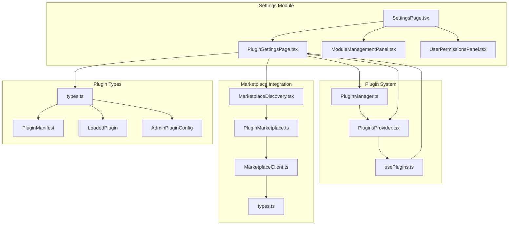
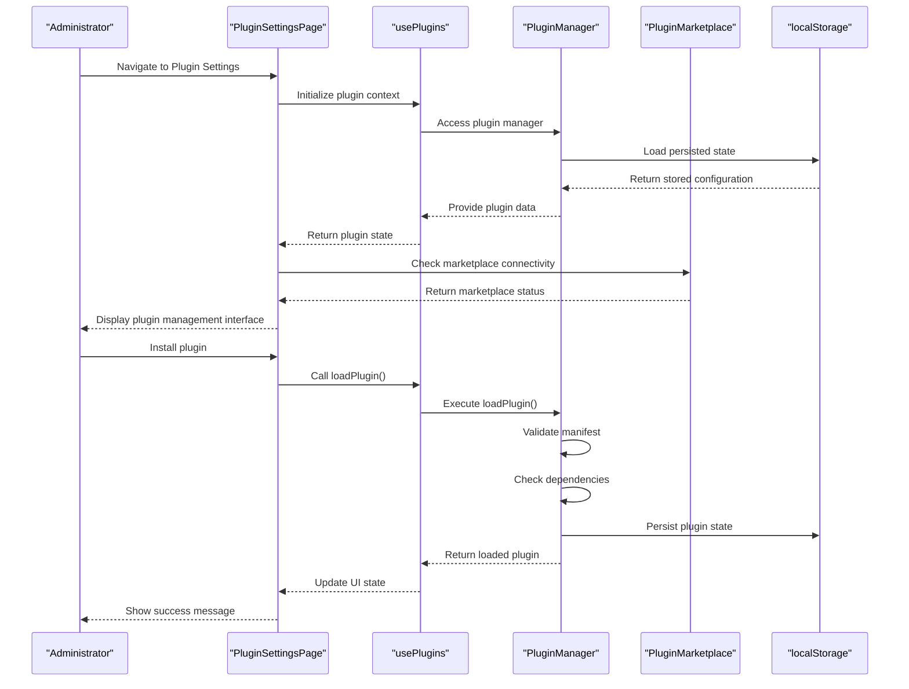
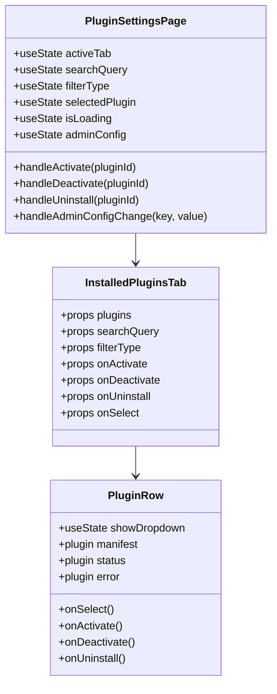
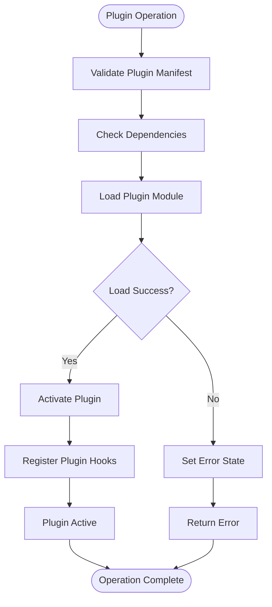
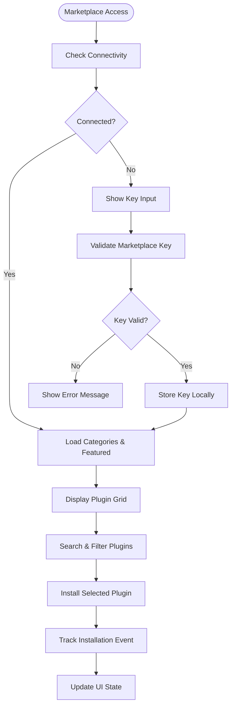

# Plugin Settings Page

<cite>
**Referenced Files in This Document**
- [PluginSettingsPage.tsx](file://src/modules/settings/pages/PluginSettingsPage.tsx)
- [PluginManager.ts](file://src/plugins/PluginManager.ts)
- [PluginsProvider.tsx](file://src/plugins/PluginsProvider.tsx)
- [usePlugins.ts](file://src/plugins/usePlugins.ts)
- [types.ts](file://src/plugins/types.ts)
- [moduleDefinition.tsx](file://src/modules/settings/moduleDefinition.tsx)
- [SettingsPage.tsx](file://src/modules/settings/pages/SettingsPage.tsx)
- [MarketplaceDiscovery.tsx](file://src/components/MarketplaceDiscovery.tsx)
- [PluginMarketplace.ts](file://src/services/PluginMarketplace.ts)
- [MarketplaceClient.ts](file://src/services/marketplace/MarketplaceClient.ts)
</cite>

## Update Summary
**Changes Made**
- Updated to reflect comprehensive marketplace integration with full plugin discovery, installation, and management capabilities
- Added detailed administrative configuration controls for plugin system management
- Enhanced plugin installation workflows with marketplace connectivity and security validation
- Expanded plugin management interface with advanced filtering, search, and status monitoring
- Integrated marketplace UI components with key validation, plugin categorization, and installation tracking

## Table of Contents
1. [Introduction](#introduction)
2. [Project Structure](#project-structure)
3. [Core Components](#core-components)
4. [Architecture Overview](#architecture-overview)
5. [Detailed Component Analysis](#detailed-component-analysis)
6. [Plugin System Integration](#plugin-system-integration)
7. [User Interface Components](#user-interface-components)
8. [Security and Administration](#security-and-administration)
9. [Performance Considerations](#performance-considerations)
10. [Troubleshooting Guide](#troubleshooting-guide)
11. [Conclusion](#conclusion)

## Introduction

The Plugin Settings Page is a comprehensive administrative interface within the SchoolPilot3 system that provides centralized management of plugins, extensions, and third-party integrations. This page serves as the primary control center for administrators to discover, install, configure, and manage plugins that extend the core functionality of the educational management platform.

The plugin system is designed with security, modularity, and extensibility in mind, supporting various plugin types including modules, themes, integrations, reports, widgets, white-label solutions, and computational engines. The interface provides intuitive controls for plugin lifecycle management, security configuration, and marketplace integration.

**Updated** Enhanced with comprehensive marketplace integration, plugin installation workflows, and administrative controls for complete plugin ecosystem management.

## Project Structure

The Plugin Settings Page is organized within the settings module structure, following the established modular architecture of SchoolPilot3:

**Diagram sources**
- [PluginSettingsPage.tsx:1-1104](file://src/modules/settings/pages/PluginSettingsPage.tsx#L1-L1104)
- [moduleDefinition.tsx:14-61](file://src/modules/settings/moduleDefinition.tsx#L14-L61)
- [MarketplaceDiscovery.tsx:1-865](file://src/components/MarketplaceDiscovery.tsx#L1-L865)
- [PluginMarketplace.ts:70-762](file://src/services/PluginMarketplace.ts#L70-L762)

**Section sources**
- [moduleDefinition.tsx:14-61](file://src/modules/settings/moduleDefinition.tsx#L14-L61)
- [SettingsPage.tsx:17-221](file://src/modules/settings/pages/SettingsPage.tsx#L17-L221)

## Core Components

The Plugin Settings Page consists of several interconnected components that work together to provide comprehensive plugin management functionality:

### Main Plugin Settings Component
The primary `PluginSettingsPage` component serves as the root container that orchestrates all plugin-related operations, including installation, activation, deactivation, and configuration management.

### Plugin Manager System
The `PluginManager` class provides the core functionality for plugin lifecycle management, including loading, activation, deactivation, and unloading of plugins. It maintains plugin state, handles security policies, and manages plugin dependencies.

### Plugin Provider and Hooks
The `PluginsProvider` component establishes the React context for plugin management, while the `usePlugins` hook provides convenient access to plugin functionality throughout the application.

### Administrative Configuration
The system supports granular administrative controls through the `AdminPluginConfig` interface, allowing administrators to control plugin installation, security settings, and marketplace access.

### Marketplace Integration
The `MarketplaceDiscovery` component provides comprehensive marketplace functionality including plugin discovery, key validation, installation workflows, and analytics tracking.

**Section sources**
- [PluginSettingsPage.tsx:44-232](file://src/modules/settings/pages/PluginSettingsPage.tsx#L44-L232)
- [PluginManager.ts:25-751](file://src/plugins/PluginManager.ts#L25-L751)
- [PluginsProvider.tsx:35-68](file://src/plugins/PluginsProvider.tsx#L35-L68)
- [MarketplaceDiscovery.tsx:53-371](file://src/components/MarketplaceDiscovery.tsx#L53-L371)

## Architecture Overview

The plugin settings architecture follows a layered approach with clear separation of concerns:

**Diagram sources**
- [PluginSettingsPage.tsx:73-106](file://src/modules/settings/pages/PluginSettingsPage.tsx#L73-L106)
- [usePlugins.ts:49-85](file://src/plugins/usePlugins.ts#L49-L85)
- [PluginManager.ts:234-274](file://src/plugins/PluginManager.ts#L234-L274)
- [PluginMarketplace.ts:613-624](file://src/services/PluginMarketplace.ts#L613-L624)

The architecture ensures loose coupling between components while maintaining strong type safety and comprehensive error handling throughout the plugin lifecycle.

## Detailed Component Analysis

### Plugin Settings Page Component

The `PluginSettingsPage` component serves as the primary interface for plugin management, featuring three main tabs:

#### Installed Plugins Tab
This tab displays all currently installed plugins with comprehensive management controls including activation/deactivation, uninstallation, and detailed information viewing.

**Diagram sources**
- [PluginSettingsPage.tsx:274-522](file://src/modules/settings/pages/PluginSettingsPage.tsx#L274-L522)

#### Marketplace Integration Tab
This tab provides access to the plugin marketplace for discovering and installing new plugins, with connection management and search functionality.

#### Settings Configuration Tab
This administrative tab allows configuration of plugin system settings including security policies, installation restrictions, and marketplace access controls.

**Section sources**
- [PluginSettingsPage.tsx:195-227](file://src/modules/settings/pages/PluginSettingsPage.tsx#L195-L227)
- [PluginSettingsPage.tsx:524-571](file://src/modules/settings/pages/PluginSettingsPage.tsx#L524-L571)
- [PluginSettingsPage.tsx:573-662](file://src/modules/settings/pages/PluginSettingsPage.tsx#L573-L662)

### Plugin Manager Implementation

The `PluginManager` class implements comprehensive plugin lifecycle management with robust error handling and security measures:

**Diagram sources**
- [PluginManager.ts:234-274](file://src/plugins/PluginManager.ts#L234-L274)
- [PluginManager.ts:303-339](file://src/plugins/PluginManager.ts#L303-L339)

The manager supports automatic activation, dependency validation, hook registration, and comprehensive error tracking with temporary plugin banning mechanisms.

**Section sources**
- [PluginManager.ts:25-751](file://src/plugins/PluginManager.ts#L25-L751)
- [usePlugins.ts:40-99](file://src/plugins/usePlugins.ts#L40-L99)

### Marketplace Integration Component

The `MarketplaceDiscovery` component provides comprehensive marketplace functionality:

**Diagram sources**
- [MarketplaceDiscovery.tsx:86-112](file://src/components/MarketplaceDiscovery.tsx#L86-L112)
- [MarketplaceDiscovery.tsx:114-154](file://src/components/MarketplaceDiscovery.tsx#L114-L154)
- [PluginMarketplace.ts:401-473](file://src/services/PluginMarketplace.ts#L401-L473)

**Section sources**
- [MarketplaceDiscovery.tsx:53-371](file://src/components/MarketplaceDiscovery.tsx#L53-L371)
- [PluginMarketplace.ts:70-762](file://src/services/PluginMarketplace.ts#L70-L762)

## Plugin System Integration

The plugin settings page integrates seamlessly with the broader SchoolPilot3 ecosystem through several key integration points:

### Module Registration
Plugins can register themselves as modules, extending the core functionality of specific domains within the educational management system.

### Hook System Integration
The plugin system leverages a sophisticated hook mechanism that allows plugins to extend functionality across the application without direct coupling.

### Security Integration
Plugin security is integrated with the RBAC (Role-Based Access Control) system, ensuring that plugins operate within appropriate security boundaries.

### Data Layer Integration
Plugins can integrate with the data layer to access and modify application data according to their designated permissions and privileges.

### Marketplace Integration
The system integrates with the marketplace service for plugin discovery, installation, and analytics tracking.

**Section sources**
- [types.ts:267-298](file://src/plugins/types.ts#L267-L298)
- [types.ts:304-337](file://src/plugins/types.ts#L304-L337)
- [moduleDefinition.tsx:113-135](file://src/modules/settings/moduleDefinition.tsx#L113-L135)

## User Interface Components

The plugin settings page employs a comprehensive set of UI components designed for both usability and administrative functionality:

### Tabbed Interface
The page uses a tabbed interface to organize different aspects of plugin management, providing clear navigation between installed plugins, marketplace integration, and administrative settings.

### Plugin Cards
Each plugin is displayed in a card format showing essential information including name, description, type, status, and available actions.

### Interactive Controls
The interface provides interactive controls for plugin management including toggle switches for activation status, dropdown menus for additional actions, and modal dialogs for detailed configuration.

### Search and Filtering
Advanced search and filtering capabilities allow administrators to quickly locate specific plugins based on name, description, or type.

### Status Indicators
Visual indicators provide immediate feedback on plugin status including active/inactive states, error conditions, and loading states.

### Marketplace UI
The marketplace tab provides a comprehensive plugin discovery interface with categories, search, ratings, and installation workflows.

**Section sources**
- [PluginSettingsPage.tsx:238-272](file://src/modules/settings/pages/PluginSettingsPage.tsx#L238-L272)
- [PluginSettingsPage.tsx:354-522](file://src/modules/settings/pages/PluginSettingsPage.tsx#L354-L522)
- [MarketplaceDiscovery.tsx:231-371](file://src/components/MarketplaceDiscovery.tsx#L231-L371)

## Security and Administration

The plugin system implements comprehensive security measures and administrative controls:

### Administrative Configuration
The `AdminPluginConfig` interface provides granular control over plugin system behavior including master switches, marketplace access, security policies, and installation restrictions.

### Security Policies
Built-in security measures include plugin sandboxing, network whitelisting, permission presets, and automatic plugin banning for problematic plugins.

### Marketplace Security
Marketplace integration includes key validation, signature verification, and approval workflows for plugin installations.

### Audit and Monitoring
The system tracks plugin operations, errors, and performance metrics to support troubleshooting and monitoring activities.

### Plugin Installation Controls
Administrators can control which plugin types are allowed, maximum plugin limits, and whether unsigned plugins can be installed.

**Section sources**
- [types.ts:304-337](file://src/plugins/types.ts#L304-L337)
- [PluginManager.ts:36-41](file://src/plugins/PluginManager.ts#L36-L41)
- [PluginManager.ts:409-447](file://src/plugins/PluginManager.ts#L409-L447)
- [PluginMarketplace.ts:107-230](file://src/services/PluginMarketplace.ts#L107-L230)

## Performance Considerations

The plugin system is designed with performance optimization in mind:

### Lazy Loading
Plugins are loaded lazily to minimize initial application startup time and reduce memory footprint.

### Caching Strategies
The system implements caching for plugin metadata, marketplace data, and configuration settings to improve response times.

### Concurrency Management
Plugin operations are managed with proper concurrency controls to prevent conflicts and ensure system stability.

### Resource Management
Memory and CPU resources are carefully managed to prevent plugin-related performance degradation.

### Marketplace Caching
The marketplace service implements intelligent caching for categories, featured plugins, and search results to minimize network requests.

**Section sources**
- [PluginMarketplace.ts:71-725](file://src/services/PluginMarketplace.ts#L71-L725)
- [MarketplaceClient.ts:540-557](file://src/services/marketplace/MarketplaceClient.ts#L540-L557)

## Troubleshooting Guide

Common issues and their resolutions:

### Plugin Loading Failures
- **Symptoms**: Plugins fail to load with error messages
- **Causes**: Missing dependencies, invalid manifests, or security violations
- **Solutions**: Check dependency requirements, validate plugin manifest, review security policies

### Activation Issues
- **Symptoms**: Plugins cannot be activated despite successful loading
- **Causes**: Hook execution timeouts, dependency conflicts, or insufficient permissions
- **Solutions**: Review plugin dependencies, check hook compatibility, adjust security settings

### Performance Problems
- **Symptoms**: Slow plugin operations or application slowdown
- **Causes**: Plugin hook timeouts, excessive resource usage, or memory leaks
- **Solutions**: Monitor plugin performance, implement proper resource cleanup, adjust timeout settings

### Security Concerns
- **Symptoms**: Suspicious plugin behavior or unauthorized access attempts
- **Causes**: Insufficient security configuration or malicious plugin code
- **Solutions**: Enable sandboxing, review network policies, implement strict permission controls

### Marketplace Connection Issues
- **Symptoms**: Cannot connect to marketplace or plugin installation fails
- **Causes**: Invalid marketplace key, network connectivity issues, or server downtime
- **Solutions**: Validate marketplace key, check network connectivity, verify marketplace service status

**Section sources**
- [PluginManager.ts:409-447](file://src/plugins/PluginManager.ts#L409-L447)
- [PluginManager.ts:509-519](file://src/plugins/PluginManager.ts#L509-L519)
- [PluginMarketplace.ts:613-624](file://src/services/PluginMarketplace.ts#L613-L624)

## Conclusion

The Plugin Settings Page represents a sophisticated and comprehensive solution for plugin management within the SchoolPilot3 educational management system. Through its modular architecture, robust security measures, and intuitive user interface, it provides administrators with complete control over the plugin ecosystem while maintaining system stability and security.

The implementation demonstrates best practices in modern web application development, including proper separation of concerns, comprehensive error handling, and extensive configurability. The plugin system's design supports future extensibility and adaptation to evolving educational technology requirements.

Key strengths of the implementation include its security-first approach, comprehensive administrative controls, performance optimizations, and seamless integration with the broader SchoolPilot3 ecosystem. The addition of comprehensive marketplace integration, plugin installation workflows, and administrative configuration controls makes this a complete solution for plugin management in educational environments.

The system's architecture supports both local plugin management and marketplace integration, providing flexibility for different deployment scenarios while maintaining consistent security and administrative controls across all plugin types and sources.