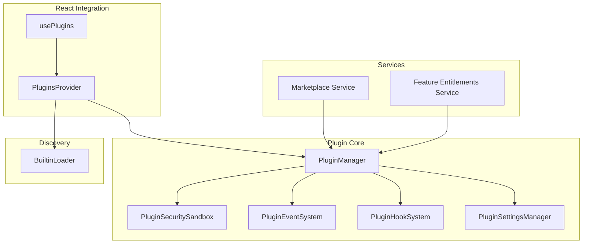
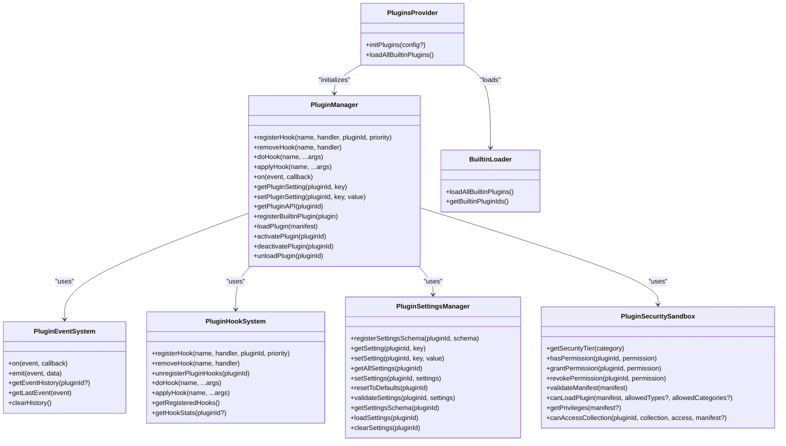
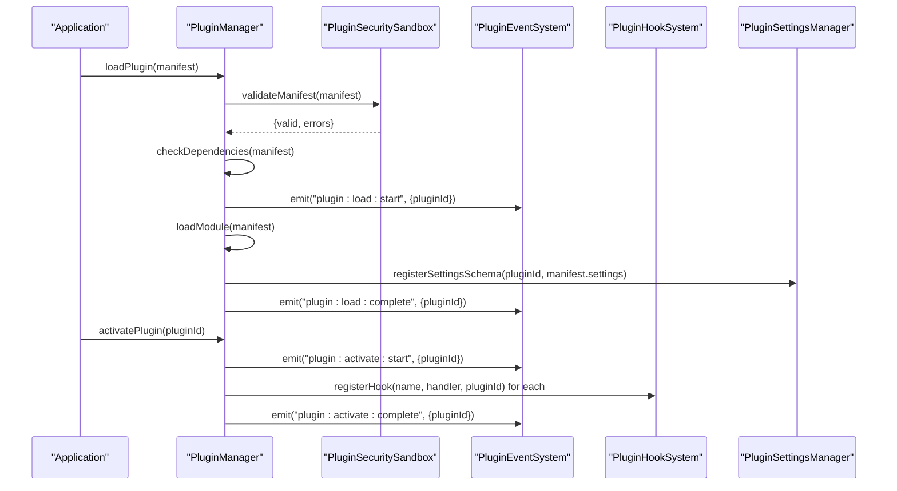
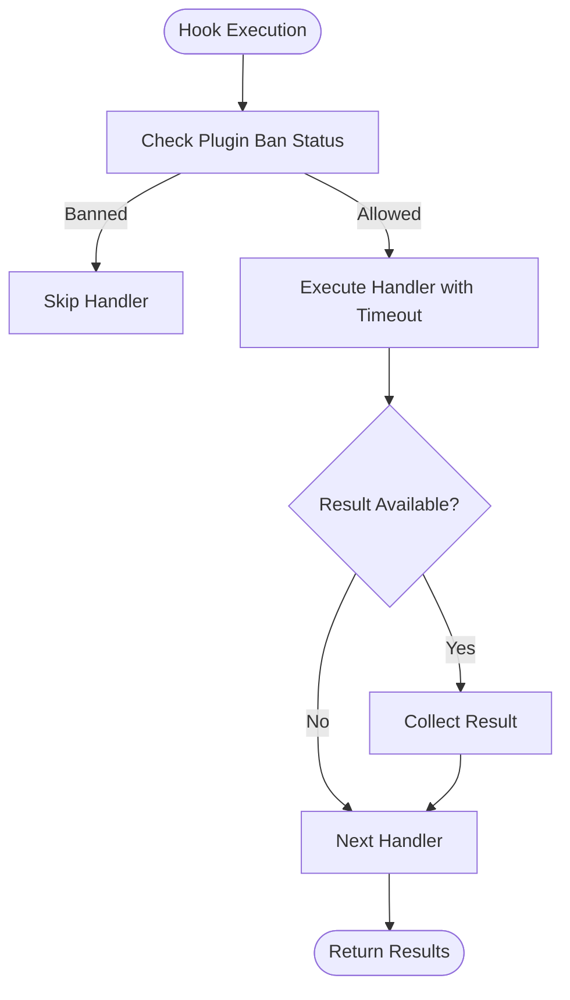
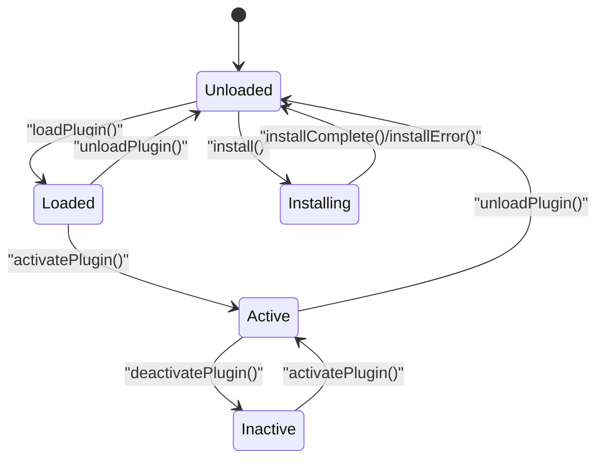
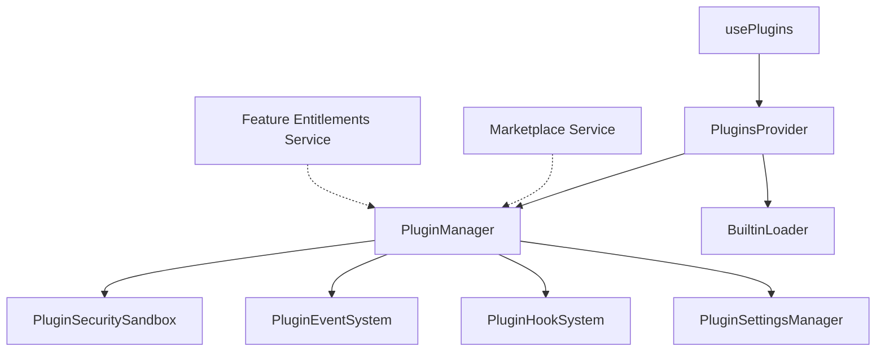

# Plugin System

<cite>
**Referenced Files in This Document**
- [index.ts](file://src/plugins/index.ts)
- [types.ts](file://src/plugins/types.ts)
- [PluginManager.ts](file://src/plugins/PluginManager.ts)
- [PluginEventSystem.ts](file://src/plugins/PluginEventSystem.ts)
- [PluginHookSystem.ts](file://src/plugins/PluginHookSystem.ts)
- [PluginSettingsManager.ts](file://src/plugins/PluginSettingsManager.ts)
- [PluginSecuritySandbox.ts](file://src/plugins/PluginSecuritySandbox.ts)
- [BuiltinLoader.ts](file://src/plugins/BuiltinLoader.ts)
- [PluginsProvider.tsx](file://src/plugins/PluginsProvider.tsx)
- [usePlugins.ts](file://src/plugins/usePlugins.ts)
- [index.ts](file://src/services/plugin/index.ts)
</cite>

## Table of Contents
1. [Introduction](#introduction)
2. [Project Structure](#project-structure)
3. [Core Components](#core-components)
4. [Architecture Overview](#architecture-overview)
5. [Detailed Component Analysis](#detailed-component-analysis)
6. [Dependency Analysis](#dependency-analysis)
7. [Performance Considerations](#performance-considerations)
8. [Troubleshooting Guide](#troubleshooting-guide)
9. [Conclusion](#conclusion)
10. [Appendices](#appendices)

## Introduction
SchoolPilot3 implements an extensible plugin architecture that enables modular feature extension, marketplace integration, and secure runtime management. The system supports built-in plugins for whitelabel theming, analytics, grading, payments, and SMS, alongside a robust plugin lifecycle, hook-based extension points, event-driven orchestration, and granular security controls. This document explains the plugin system design, configuration, and development workflow, and provides practical guidance for installing, configuring, and building custom plugins.

## Project Structure
The plugin system is organized around a central PluginManager coordinating specialized subsystems:
- Core API and type definitions
- Lifecycle and event management
- Hook system for inter-plugin communication
- Settings management for persistent configuration
- Security sandbox for privilege enforcement
- Built-in plugin discovery and loading
- React provider and hooks for UI integration

**Diagram sources**
- [PluginManager.ts:28-57](file://src/plugins/PluginManager.ts#L28-L57)
- [PluginSecuritySandbox.ts:45-310](file://src/plugins/PluginSecuritySandbox.ts#L45-L310)
- [PluginEventSystem.ts:23-193](file://src/plugins/PluginEventSystem.ts#L23-L193)
- [PluginHookSystem.ts:16-215](file://src/plugins/PluginHookSystem.ts#L16-L215)
- [PluginSettingsManager.ts:16-238](file://src/plugins/PluginSettingsManager.ts#L16-L238)
- [BuiltinLoader.ts:11-113](file://src/plugins/BuiltinLoader.ts#L11-L113)
- [PluginsProvider.tsx:37-88](file://src/plugins/PluginsProvider.tsx#L37-L88)
- [usePlugins.ts:40-98](file://src/plugins/usePlugins.ts#L40-L98)
- [index.ts:1-13](file://src/services/plugin/index.ts#L1-L13)

**Section sources**
- [index.ts:29-61](file://src/plugins/index.ts#L29-L61)
- [types.ts:14-562](file://src/plugins/types.ts#L14-L562)

## Core Components
- PluginManager: Central orchestrator for lifecycle, permissions, settings, events, and hook registration. Provides public APIs for loading, activating, deactivating, and unloading plugins.
- PluginEventSystem: Publish-subscribe mechanism for lifecycle events with history, filtering, and persistence.
- PluginHookSystem: Priority-based hook registration and execution with timeouts and circuit-breaker protections.
- PluginSettingsManager: Schema-driven settings storage with validation, defaults, and persistence.
- PluginSecuritySandbox: Enforces security tiers, permissions, and manifest validation.
- BuiltinLoader: Discovers and loads built-in plugins from the builtin directory.
- PluginsProvider and usePlugins: React context and hooks for UI integration and state updates.

**Section sources**
- [PluginManager.ts:28-592](file://src/plugins/PluginManager.ts#L28-L592)
- [PluginEventSystem.ts:23-193](file://src/plugins/PluginEventSystem.ts#L23-L193)
- [PluginHookSystem.ts:16-215](file://src/plugins/PluginHookSystem.ts#L16-L215)
- [PluginSettingsManager.ts:16-238](file://src/plugins/PluginSettingsManager.ts#L16-L238)
- [PluginSecuritySandbox.ts:45-310](file://src/plugins/PluginSecuritySandbox.ts#L45-L310)
- [BuiltinLoader.ts:35-113](file://src/plugins/BuiltinLoader.ts#L35-L113)
- [PluginsProvider.tsx:37-88](file://src/plugins/PluginsProvider.tsx#L37-L88)
- [usePlugins.ts:40-98](file://src/plugins/usePlugins.ts#L40-L98)

## Architecture Overview
The plugin system follows a modular, layered design:
- PluginManager delegates responsibilities to dedicated subsystems.
- Security is enforced via PluginSecuritySandbox during manifest validation and runtime permission checks.
- Hooks enable decoupled inter-plugin communication and core extension points.
- Events track lifecycle and operational telemetry.
- Settings are validated against declared schemas and persisted per plugin.
- Built-in plugins are auto-discovered and registered at startup.

**Diagram sources**
- [PluginManager.ts:28-592](file://src/plugins/PluginManager.ts#L28-L592)
- [PluginEventSystem.ts:23-193](file://src/plugins/PluginEventSystem.ts#L23-L193)
- [PluginHookSystem.ts:16-215](file://src/plugins/PluginHookSystem.ts#L16-L215)
- [PluginSettingsManager.ts:16-238](file://src/plugins/PluginSettingsManager.ts#L16-L238)
- [PluginSecuritySandbox.ts:45-310](file://src/plugins/PluginSecuritySandbox.ts#L45-L310)
- [BuiltinLoader.ts:35-113](file://src/plugins/BuiltinLoader.ts#L35-L113)
- [PluginsProvider.tsx:37-88](file://src/plugins/PluginsProvider.tsx#L37-L88)

## Detailed Component Analysis

### PluginManager
Responsibilities:
- Orchestrates plugin lifecycle: load, activate, deactivate, unload.
- Validates manifests and enforces security constraints.
- Manages dependencies and conflict detection.
- Creates plugin contexts with restricted API surface.
- Exposes subsystem accessors for advanced integrations.

Key behaviors:
- Manifest validation and type/category checks.
- Dependency sorting to ensure correct load order.
- Hook registration during activation and removal during deactivation.
- Event emission for lifecycle stages.
- Settings schema registration and persistence.

**Diagram sources**
- [PluginManager.ts:137-202](file://src/plugins/PluginManager.ts#L137-L202)
- [PluginManager.ts:227-267](file://src/plugins/PluginManager.ts#L227-L267)
- [PluginSecuritySandbox.ts:239-310](file://src/plugins/PluginSecuritySandbox.ts#L239-L310)
- [PluginEventSystem.ts:60-87](file://src/plugins/PluginEventSystem.ts#L60-L87)
- [PluginHookSystem.ts:28-52](file://src/plugins/PluginHookSystem.ts#L28-L52)
- [PluginSettingsManager.ts:23-37](file://src/plugins/PluginSettingsManager.ts#L23-L37)

**Section sources**
- [PluginManager.ts:28-592](file://src/plugins/PluginManager.ts#L28-L592)

### PluginEventSystem
Responsibilities:
- Subscribe/unsubscribe to lifecycle events.
- Emit events to listeners with error isolation.
- Maintain bounded event history with filtering and export capabilities.

Operational highlights:
- Listener management with unsubscribe support.
- History trimming to prevent unbounded growth.
- Time-range queries and recent-event retrieval.

**Section sources**
- [PluginEventSystem.ts:23-193](file://src/plugins/PluginEventSystem.ts#L23-L193)

### PluginHookSystem
Responsibilities:
- Register and execute hooks with priority ordering.
- Circuit breaker protection against slow or failing hooks.
- Timeout enforcement and failure tracking.

**Diagram sources**
- [PluginHookSystem.ts:77-136](file://src/plugins/PluginHookSystem.ts#L77-L136)
- [PluginHookSystem.ts:141-171](file://src/plugins/PluginHookSystem.ts#L141-L171)

**Section sources**
- [PluginHookSystem.ts:16-215](file://src/plugins/PluginHookSystem.ts#L16-L215)

### PluginSettingsManager
Responsibilities:
- Register and validate settings against declared schemas.
- Persist settings per plugin using local storage.
- Provide default values and reset-to-defaults behavior.

Validation rules:
- Type checks for primitives and structured values.
- Numeric bounds and string length constraints.
- Pattern validation for strings.
- Options validation for select/multiselect.

**Section sources**
- [PluginSettingsManager.ts:16-238](file://src/plugins/PluginSettingsManager.ts#L16-L238)

### PluginSecuritySandbox
Responsibilities:
- Determine security tier by plugin category.
- Enforce permissions and privilege checks.
- Validate manifests and enforce type/category restrictions.

Security model:
- Three tiers: trusted, verified, community.
- Different timeouts and sandbox enforcement per tier.
- Granular privilege checks for data access, UI injection, network, filesystem, and code execution.

**Section sources**
- [PluginSecuritySandbox.ts:45-310](file://src/plugins/PluginSecuritySandbox.ts#L45-L310)

### BuiltinLoader
Responsibilities:
- Auto-discover built-in plugins from the builtin directory.
- Dynamically import plugin modules and extract manifest/module pairs.
- Provide a curated list of builtin plugin IDs.

**Section sources**
- [BuiltinLoader.ts:35-113](file://src/plugins/BuiltinLoader.ts#L35-L113)

### PluginsProvider and usePlugins
Responsibilities:
- Initialize PluginManager and load built-in plugins at startup.
- Provide React context for plugin state and actions.
- Expose usePlugins hook for declarative plugin management in components.

**Section sources**
- [PluginsProvider.tsx:37-88](file://src/plugins/PluginsProvider.tsx#L37-L88)
- [usePlugins.ts:40-98](file://src/plugins/usePlugins.ts#L40-L98)

### Built-in Plugins Overview
The system ships with several built-in plugin categories:
- Whitelabel: Branding and label customization.
- Grading engine: Computation engine (WASM).
- Fee calculator: Financial computation.
- Analytics mock: Placeholder for analytics engine.
- Payment mock: Placeholder for payment processing.
- SMS mock: Placeholder for SMS services.

These are auto-discovered and registered by BuiltinLoader and PluginManager.

**Section sources**
- [BuiltinLoader.ts:23-30](file://src/plugins/BuiltinLoader.ts#L23-L30)
- [PluginManager.ts:110-132](file://src/plugins/PluginManager.ts#L110-L132)

### Plugin Types and Configuration Schema
The plugin system defines a comprehensive manifest schema supporting:
- Identity and metadata (id, name, version, type, entry).
- Compatibility constraints (min/max app version, dependencies, conflicts).
- Capabilities (permissions, privileges, hooks).
- UI integration (routes, menu items, widgets, settings).
- Engine specifics (WASM binary, exports, fallback behavior).
- Marketplace metadata (price, ratings, downloads).
- Whitelabel and engine manifest extensions.

External service interfaces:
- PaymentPlugin: Initiate payments, verify transactions, handle callbacks, enumerate supported methods.
- SMSPlugin: Send single/multiple messages, send templated messages, query delivery status.
- AnalyticsEnginePlugin: Compute teacher/class/subject metrics, trends, and export reports.

**Section sources**
- [types.ts:60-111](file://src/plugins/types.ts#L60-L111)
- [types.ts:117-149](file://src/plugins/types.ts#L117-L149)
- [types.ts:155-163](file://src/plugins/types.ts#L155-L163)
- [types.ts:165-193](file://src/plugins/types.ts#L165-L193)
- [types.ts:195-209](file://src/plugins/types.ts#L195-L209)
- [types.ts:211-228](file://src/plugins/types.ts#L211-L228)
- [types.ts:237-261](file://src/plugins/types.ts#L237-L261)
- [types.ts:267-298](file://src/plugins/types.ts#L267-L298)
- [types.ts:304-337](file://src/plugins/types.ts#L304-L337)
- [types.ts:361-387](file://src/plugins/types.ts#L361-L387)
- [types.ts:458-483](file://src/plugins/types.ts#L458-L483)
- [types.ts:501-506](file://src/plugins/types.ts#L501-L506)
- [types.ts:555-561](file://src/plugins/types.ts#L555-L561)

### Plugin Lifecycle Management
Phases:
- Discovery: Built-in plugins are auto-discovered and registered.
- Load: Manifest validated, dependencies checked, module loaded, settings schema registered.
- Activate: Context created, hooks registered, status set to active.
- Deactivate: Hooks unregistered, status set to inactive.
- Unload: Deactivation performed, plugin removed, settings cleared.

**Diagram sources**
- [PluginManager.ts:107-132](file://src/plugins/PluginManager.ts#L107-L132)
- [PluginManager.ts:137-202](file://src/plugins/PluginManager.ts#L137-L202)
- [PluginManager.ts:227-295](file://src/plugins/PluginManager.ts#L227-L295)
- [PluginManager.ts:299-309](file://src/plugins/PluginManager.ts#L299-L309)

**Section sources**
- [PluginManager.ts:107-309](file://src/plugins/PluginManager.ts#L107-L309)

### Plugin Event System
Events:
- Discovery and lifecycle: plugin:discovered, plugin:load:start, plugin:load:complete, plugin:load:error, plugin:activate:start, plugin:activate:complete, plugin:activate:error, plugin:deactivate:start, plugin:deactivate:complete, plugin:uninstall:start, plugin:uninstall:complete.
- Validation and installation: plugin:validate:start, plugin:validate:success, plugin:validate:error, plugin:install:start, plugin:install:complete.

Usage:
- Subscribe via on(event, callback) or subscribe(event, callback).
- Emit via emit(event, data) or dispatch(event, data).
- Inspect history with getEventHistory(pluginId?), getLastEvent(event), getRecentEvents(count).

**Section sources**
- [types.ts:267-285](file://src/plugins/types.ts#L267-L285)
- [PluginEventSystem.ts:31-87](file://src/plugins/PluginEventSystem.ts#L31-L87)
- [PluginEventSystem.ts:92-193](file://src/plugins/PluginEventSystem.ts#L92-L193)

### Hook System for Inter-Plugin Communication
Capabilities:
- Register hooks with priority ordering.
- Execute hooks to collect all results or apply filters to get the first non-null result.
- Circuit breaker and timeout protection.
- Unregister hooks for a plugin or remove individual handlers.

Patterns:
- Actions: fire-and-forget notifications.
- Filters: transform or override values.
- Async: handle asynchronous operations safely.

**Section sources**
- [PluginHookSystem.ts:28-136](file://src/plugins/PluginHookSystem.ts#L28-L136)
- [PluginHookSystem.ts:193-215](file://src/plugins/PluginHookSystem.ts#L193-L215)
- [types.ts:413-430](file://src/plugins/types.ts#L413-L430)

### Plugin Settings Management
Features:
- Schema registration with defaults.
- Validation against declared types and constraints.
- Persistence to local storage with per-plugin keys.
- Reset to defaults and bulk updates.

**Section sources**
- [PluginSettingsManager.ts:23-93](file://src/plugins/PluginSettingsManager.ts#L23-L93)
- [PluginSettingsManager.ts:98-180](file://src/plugins/PluginSettingsManager.ts#L98-L180)
- [PluginSettingsManager.ts:192-230](file://src/plugins/PluginSettingsManager.ts#L192-L230)

### Plugin Security Sandboxing
Mechanisms:
- Security tiers mapped to categories (trusted, verified, community).
- Permission grants and revocations.
- Manifest validation (required fields, ID format, version format).
- Collection-level access checks for data read/write.
- Operation validation for UI injection, menu modification, settings access, network, filesystem, and code execution.

**Section sources**
- [PluginSecuritySandbox.ts:70-82](file://src/plugins/PluginSecuritySandbox.ts#L70-L82)
- [PluginSecuritySandbox.ts:108-149](file://src/plugins/PluginSecuritySandbox.ts#L108-L149)
- [PluginSecuritySandbox.ts:239-310](file://src/plugins/PluginSecuritySandbox.ts#L239-L310)
- [PluginSecuritySandbox.ts:203-220](file://src/plugins/PluginSecuritySandbox.ts#L203-L220)

### Plugin Marketplace Integration and Feature Entitlements
Services:
- Marketplace service for browsing, downloading, and installing plugins.
- Feature entitlements service for controlling access based on licensing and plans.

Note: The service entry points are exported from the plugin services index.

**Section sources**
- [index.ts:1-13](file://src/services/plugin/index.ts#L1-L13)

## Dependency Analysis
The PluginManager coordinates multiple subsystems, each with distinct responsibilities. Coupling is minimized through delegation and clear interfaces. External dependencies include:
- Local storage for settings persistence.
- Logging utilities for diagnostics.
- React context for UI integration.

**Diagram sources**
- [PluginManager.ts:28-592](file://src/plugins/PluginManager.ts#L28-L592)
- [PluginsProvider.tsx:37-88](file://src/plugins/PluginsProvider.tsx#L37-L88)
- [BuiltinLoader.ts:35-113](file://src/plugins/BuiltinLoader.ts#L35-L113)
- [usePlugins.ts:40-98](file://src/plugins/usePlugins.ts#L40-L98)
- [index.ts:1-13](file://src/services/plugin/index.ts#L1-L13)

**Section sources**
- [PluginManager.ts:28-592](file://src/plugins/PluginManager.ts#L28-L592)

## Performance Considerations
- Hook execution includes timeout protection and circuit breaker logic to prevent cascading failures.
- Event history is capped to avoid memory bloat.
- Settings persistence uses asynchronous writes with error logging.
- Dependency sorting prevents redundant work and ensures correct load order.
- Security validations occur early to fail fast on invalid manifests.

[No sources needed since this section provides general guidance]

## Troubleshooting Guide
Common issues and resolutions:
- Plugin fails to load due to invalid manifest: Verify required fields, ID format, and version format.
- Activation error: Check hook handlers for timeouts or exceptions; review event history for plugin:activate:error.
- Permission denied: Confirm privileges and security tier; adjust permissions via security sandbox.
- Settings validation errors: Review schema constraints and provide valid values.
- Dependency conflicts: Ensure required plugins are active and conflicting plugins are deactivated.

Diagnostic utilities:
- Event history inspection for lifecycle events.
- Hook statistics for failure tracking.
- Settings validation results for misconfigurations.

**Section sources**
- [PluginEventSystem.ts:92-130](file://src/plugins/PluginEventSystem.ts#L92-L130)
- [PluginHookSystem.ts:160-171](file://src/plugins/PluginHookSystem.ts#L160-L171)
- [PluginSettingsManager.ts:98-180](file://src/plugins/PluginSettingsManager.ts#L98-L180)
- [PluginSecuritySandbox.ts:239-310](file://src/plugins/PluginSecuritySandbox.ts#L239-L310)

## Conclusion
SchoolPilot3’s plugin system offers a secure, extensible, and maintainable architecture for modular feature development. With explicit lifecycle management, robust eventing, priority-based hooks, schema-driven settings, and layered security, developers can build powerful integrations while maintaining system stability. The built-in plugins and marketplace-ready services provide a strong foundation for rapid feature delivery.

[No sources needed since this section summarizes without analyzing specific files]

## Appendices

### Practical Examples

- Install and activate a plugin programmatically:
  - Use the manager to load a manifest, then activate it. The manager emits lifecycle events and registers hooks automatically.
  - Reference: [PluginManager.ts:137-202](file://src/plugins/PluginManager.ts#L137-L202), [PluginManager.ts:227-267](file://src/plugins/PluginManager.ts#L227-L267)

- Configure plugin settings:
  - Register a settings schema during plugin load; then set values via the settings manager. Validation ensures correctness.
  - Reference: [PluginSettingsManager.ts:23-93](file://src/plugins/PluginSettingsManager.ts#L23-L93), [PluginSettingsManager.ts:98-180](file://src/plugins/PluginSettingsManager.ts#L98-L180)

- Develop a custom plugin:
  - Define a manifest with id, name, version, type, entry, and optional capabilities (routes, menuItems, widgets, settings).
  - Implement lifecycle hooks (install, activate, deactivate, uninstall) and optional API exports.
  - Reference: [types.ts:60-111](file://src/plugins/types.ts#L60-L111), [types.ts:287-298](file://src/plugins/types.ts#L287-L298)

- Integrate with the UI:
  - Wrap your app with PluginsProvider and use usePlugins to manage plugins and access active plugin data.
  - Reference: [PluginsProvider.tsx:37-88](file://src/plugins/PluginsProvider.tsx#L37-L88), [usePlugins.ts:40-98](file://src/plugins/usePlugins.ts#L40-L98)

- Marketplace and entitlements:
  - Use the exported service entry points to integrate marketplace and entitlements workflows.
  - Reference: [index.ts:1-13](file://src/services/plugin/index.ts#L1-L13)