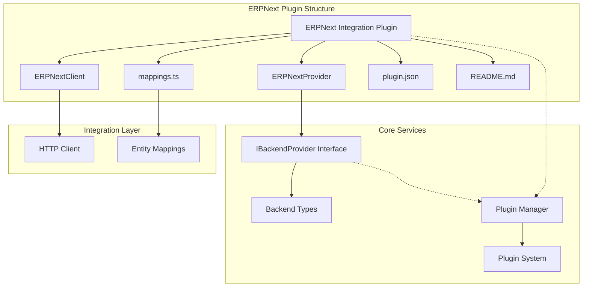
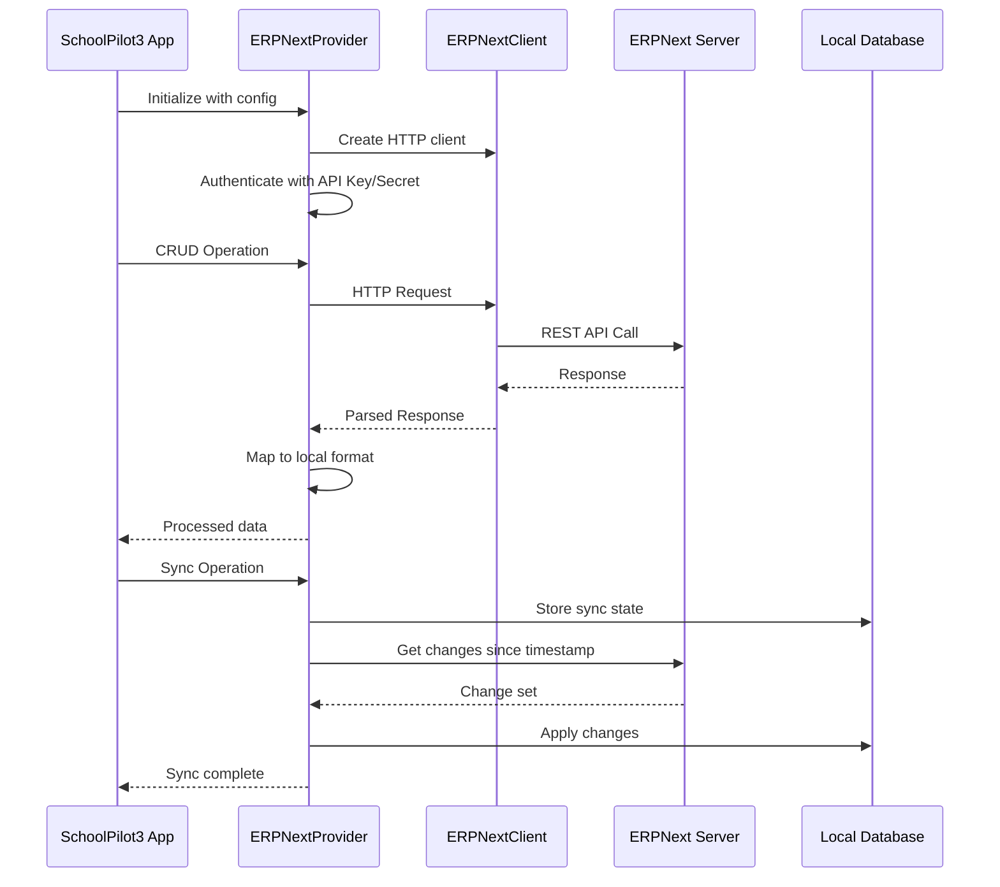
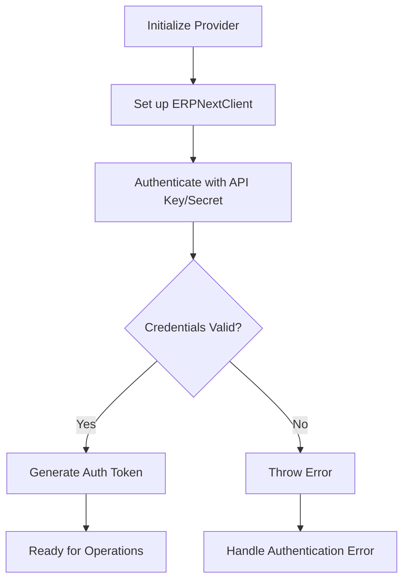
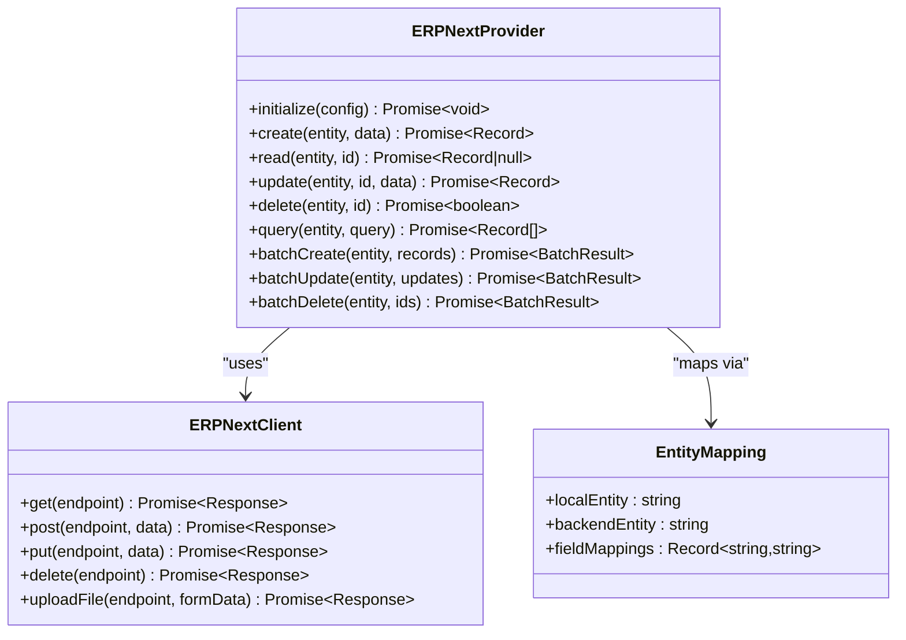
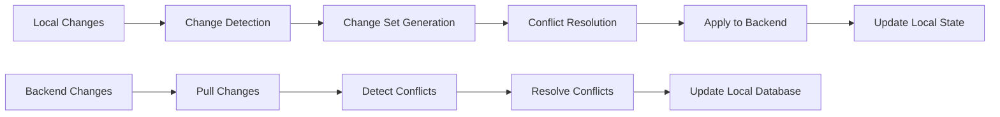
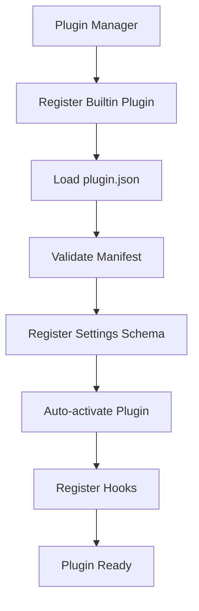
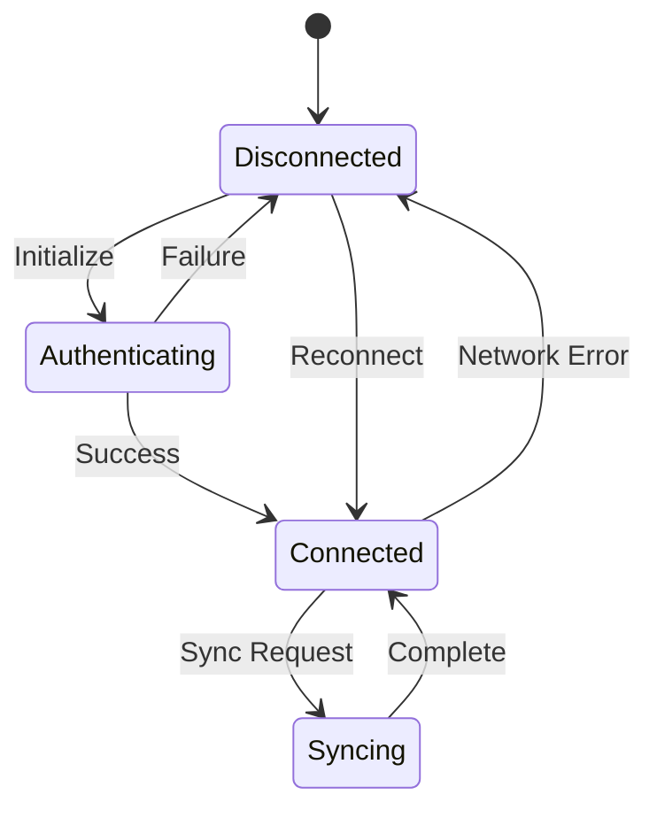
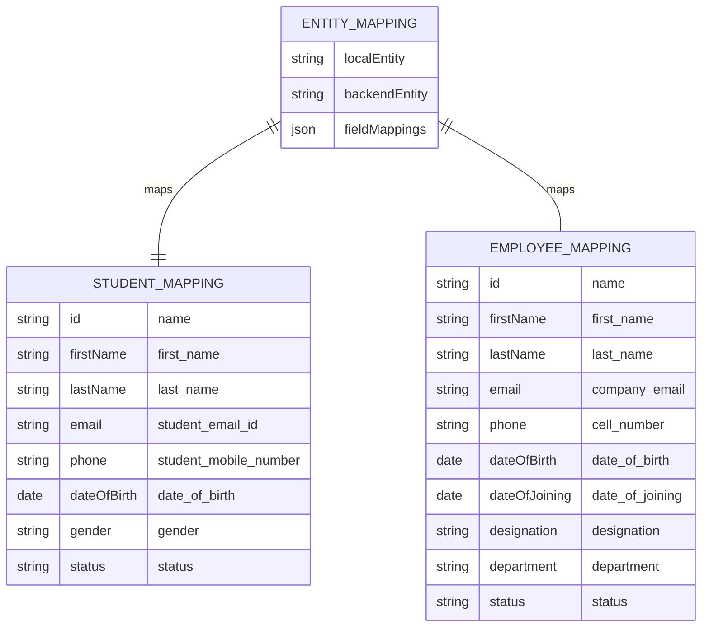

# ERPNext Integration Plugin

<cite>
**Referenced Files in This Document**
- [README.md](file://src/plugins/builtin/erpnext-integration/README.md)
- [ERPNextProvider.ts](file://src/plugins/builtin/erpnext-integration/ERPNextProvider.ts)
- [ERPNextClient.ts](file://src/plugins/builtin/erpnext-integration/ERPNextClient.ts)
- [mappings.ts](file://src/plugins/builtin/erpnext-integration/mappings.ts)
- [plugin.json](file://src/plugins/builtin/erpnext-integration/plugin.json)
- [types.ts](file://src/services/erpnext/types.ts)
- [IBackendProvider.ts](file://src/services/backend/IBackendProvider.ts)
- [types.ts](file://src/services/backend/types.ts)
- [PluginManager.ts](file://src/plugins/PluginManager.ts)
- [index.ts](file://src/services/erpnext/index.ts)
</cite>

## Table of Contents
1. [Introduction](#introduction)
2. [Project Structure](#project-structure)
3. [Core Components](#core-components)
4. [Architecture Overview](#architecture-overview)
5. [Detailed Component Analysis](#detailed-component-analysis)
6. [Integration with Backend System](#integration-with-backend-system)
7. [Configuration and Setup](#configuration-and-setup)
8. [Data Synchronization](#data-synchronization)
9. [Entity Mapping System](#entity-mapping-system)
10. [Error Handling and Troubleshooting](#error-handling-and-troubleshooting)
11. [Performance Considerations](#performance-considerations)
12. [Conclusion](#conclusion)

## Introduction

The ERPNext Integration Plugin is a comprehensive backend integration solution that connects SchoolPilot3 with ERPNext, enabling bidirectional data synchronization for educational institutions. This plugin serves as a bridge between SchoolPilot3's modern frontend interface and ERPNext's robust backend ERP system, providing seamless data exchange for students, employees, courses, fees, attendance, and other educational entities.

The plugin implements the IBackendProvider interface, making it compatible with SchoolPilot3's modular backend architecture. It supports advanced features including real-time conflict resolution, batch operations, file uploads/downloads, and webhook-based real-time updates.

## Project Structure

The ERPNext Integration Plugin follows a well-organized structure within the SchoolPilot3 ecosystem:

**Diagram sources**
- [ERPNextProvider.ts:1-547](file://src/plugins/builtin/erpnext-integration/ERPNextProvider.ts#L1-L547)
- [IBackendProvider.ts:1-298](file://src/services/backend/IBackendProvider.ts#L1-L298)
- [PluginManager.ts:1-592](file://src/plugins/PluginManager.ts#L1-L592)

**Section sources**
- [README.md:1-419](file://src/plugins/builtin/erpnext-integration/README.md#L1-L419)
- [plugin.json:1-236](file://src/plugins/builtin/erpnext-integration/plugin.json#L1-L236)

## Core Components

### ERPNextProvider Class

The ERPNextProvider is the main component responsible for implementing the IBackendProvider interface. It handles all communication with ERPNext, including authentication, CRUD operations, synchronization, and file management.

Key responsibilities include:
- **Authentication Management**: API Key/Secret authentication with ERPNext
- **CRUD Operations**: Full Create, Read, Update, Delete functionality
- **Batch Operations**: Efficient bulk data processing
- **Sync Engine Integration**: Bidirectional synchronization with conflict resolution
- **File Operations**: Upload and download capabilities
- **Entity Mapping**: Translation between SchoolPilot3 and ERPNext data formats

### ERPNextClient Class

The ERPNextClient provides low-level HTTP communication with the ERPNext REST API. It handles:
- **HTTP Requests**: GET, POST, PUT, DELETE operations
- **Authentication Headers**: Token-based authentication
- **Timeout Management**: Configurable request timeouts
- **File Uploads**: Multipart form data handling

### Entity Mappings System

The plugin includes comprehensive entity mappings that translate between SchoolPilot3's internal data structures and ERPNext's DocType formats. Supported entities include:
- Students (Student DocType)
- Employees (Employee DocType)
- Courses (Course DocType)
- Programs (Program DocType)
- Fees (Fees DocType)
- Attendance (Student Attendance DocType)
- Assessments (Assessment Result DocType)
- Student Groups (Student Group DocType)
- Fee Structures (Fee Structure DocType)

**Section sources**
- [ERPNextProvider.ts:26-547](file://src/plugins/builtin/erpnext-integration/ERPNextProvider.ts#L26-L547)
- [ERPNextClient.ts:7-95](file://src/plugins/builtin/erpnext-integration/ERPNextClient.ts#L7-L95)
- [mappings.ts:13-170](file://src/plugins/builtin/erpnext-integration/mappings.ts#L13-L170)

## Architecture Overview

The ERPNext Integration Plugin follows a layered architecture that integrates seamlessly with SchoolPilot3's backend system:

**Diagram sources**
- [ERPNextProvider.ts:40-92](file://src/plugins/builtin/erpnext-integration/ERPNextProvider.ts#L40-L92)
- [ERPNextClient.ts:36-76](file://src/plugins/builtin/erpnext-integration/ERPNextClient.ts#L36-L76)

The architecture ensures loose coupling between the frontend application and the ERPNext backend through the provider pattern, allowing for easy switching between different backend providers.

**Section sources**
- [README.md:14-38](file://src/plugins/builtin/erpnext-integration/README.md#L14-L38)
- [types.ts:14-32](file://src/services/erpnext/types.ts#L14-L32)

## Detailed Component Analysis

### Authentication System

The plugin implements API Key/Secret authentication as required by ERPNext:

**Diagram sources**
- [ERPNextProvider.ts:98-117](file://src/plugins/builtin/erpnext-integration/ERPNextProvider.ts#L98-L117)

The authentication system supports automatic token refresh and maintains authentication state throughout the provider lifecycle.

### CRUD Operations Implementation

The provider implements full CRUD functionality with proper error handling and data mapping:

**Diagram sources**
- [ERPNextProvider.ts:136-213](file://src/plugins/builtin/erpnext-integration/ERPNextProvider.ts#L136-L213)
- [ERPNextClient.ts:36-93](file://src/plugins/builtin/erpnext-integration/ERPNextClient.ts#L36-L93)
- [mappings.ts:7-11](file://src/plugins/builtin/erpnext-integration/mappings.ts#L7-L11)

**Section sources**
- [ERPNextProvider.ts:136-315](file://src/plugins/builtin/erpnext-integration/ERPNextProvider.ts#L136-L315)
- [ERPNextClient.ts:36-93](file://src/plugins/builtin/erpnext-integration/ERPNextClient.ts#L36-L93)

### Synchronization Engine

The plugin integrates with SchoolPilot3's synchronization framework:

**Diagram sources**
- [ERPNextProvider.ts:321-394](file://src/plugins/builtin/erpnext-integration/ERPNextProvider.ts#L321-L394)

The synchronization engine supports multiple conflict resolution strategies including timestamp-based resolution and manual intervention.

**Section sources**
- [ERPNextProvider.ts:321-409](file://src/plugins/builtin/erpnext-integration/ERPNextProvider.ts#L321-L409)

## Integration with Backend System

### Plugin Registration

The ERPNext Integration Plugin is registered as a built-in plugin with the SchoolPilot3 plugin system:

**Diagram sources**
- [PluginManager.ts:107-132](file://src/plugins/PluginManager.ts#L107-L132)
- [plugin.json:13-112](file://src/plugins/builtin/erpnext-integration/plugin.json#L13-L112)

### Backend Provider Interface Compliance

The plugin implements the complete IBackendProvider interface, ensuring compatibility with SchoolPilot3's backend abstraction layer:

| Interface Method | Implementation Status | Description |
|------------------|----------------------|-------------|
| initialize | ✅ Complete | Sets up client and authentication |
| authenticate | ✅ Complete | API Key/Secret authentication |
| create/read/update/delete | ✅ Complete | Full CRUD operations |
| query | ✅ Complete | Advanced filtering and pagination |
| batch operations | ✅ Complete | Bulk data processing |
| sync operations | ✅ Complete | Bidirectional synchronization |
| file operations | ✅ Complete | Upload/download functionality |
| capabilities | ✅ Complete | Entity and feature support |

**Section sources**
- [IBackendProvider.ts:47-271](file://src/services/backend/IBackendProvider.ts#L47-L271)
- [PluginManager.ts:107-202](file://src/plugins/PluginManager.ts#L107-L202)

## Configuration and Setup

### Installation Process

The ERPNext Integration Plugin is built-in and requires minimal setup:

1. **Prerequisites**: ERPNext server (v13+) and API credentials
2. **Activation**: Enable in Settings > Plugins
3. **Configuration**: Set server URL, API key, and secret
4. **Testing**: Verify connection and perform initial sync

### Configuration Options

The plugin supports extensive configuration through the plugin manifest:

| Configuration Category | Options | Default Values |
|-----------------------|---------|----------------|
| Basic Settings | Base URL, API Key, API Secret, Domain | Required fields |
| Sync Settings | Sync Interval, Direction, Conflict Resolution, Batch Size | 300s, Bidirectional, Timestamp Wins |
| Advanced Settings | Webhooks, Request Timeout | Disabled, 30000ms |
| Security | SSL Verification, Certificate Management | Enabled, Self-signed support |

### Connection Management

The plugin implements robust connection management with health checks and automatic reconnection:

**Diagram sources**
- [ERPNextProvider.ts:56-92](file://src/plugins/builtin/erpnext-integration/ERPNextProvider.ts#L56-L92)

**Section sources**
- [README.md:47-85](file://src/plugins/builtin/erpnext-integration/README.md#L47-L85)
- [plugin.json:114-222](file://src/plugins/builtin/erpnext-integration/plugin.json#L114-L222)

## Data Synchronization

### Sync Architecture

The synchronization system supports three modes of operation:

1. **Bidirectional Sync**: Changes propagate in both directions
2. **To Backend Only**: Local changes sent to ERPNext only
3. **From Backend Only**: Backend changes pulled to local system

### Conflict Resolution Strategies

The plugin implements multiple conflict resolution strategies:

| Strategy | Mechanism | Use Case |
|----------|-----------|----------|
| Remote Wins | ERPNext data takes precedence | ERPNext as source of truth |
| Local Wins | SchoolPilot3 data takes precedence | Local system as source of truth |
| Timestamp Wins | Most recent modification wins | Automatic resolution |
| Manual Resolution | User intervention required | Critical data requiring review |

### Batch Processing

The plugin supports efficient batch processing for large datasets:

- **Batch Size Configuration**: 10-500 records per batch
- **Parallel Processing**: Concurrent batch operations
- **Error Isolation**: Individual record failure handling
- **Progress Tracking**: Real-time batch progress monitoring

**Section sources**
- [ERPNextProvider.ts:219-315](file://src/plugins/builtin/erpnext-integration/ERPNextProvider.ts#L219-L315)
- [types.ts:91-96](file://src/services/backend/types.ts#L91-L96)

## Entity Mapping System

### Field Mapping Architecture

The entity mapping system provides flexible translation between SchoolPilot3 and ERPNext data formats:

**Diagram sources**
- [mappings.ts:13-170](file://src/plugins/builtin/erpnext-integration/mappings.ts#L13-L170)

### Supported Entities

The plugin supports comprehensive entity mapping for educational institutions:

| SchoolPilot Entity | ERPNext DocType | Sync Direction |
|-------------------|-----------------|----------------|
| Students | Student | Bidirectional |
| Employees | Employee | Bidirectional |
| Courses | Course | Bidirectional |
| Programs | Program | Bidirectional |
| Fees | Fees | Bidirectional |
| Attendance | Student Attendance | Bidirectional |
| Assessments | Assessment Result | Bidirectional |
| Student Groups | Student Group | Bidirectional |
| Fee Structures | Fee Structure | From ERPNext |

**Section sources**
- [README.md:25-38](file://src/plugins/builtin/erpnext-integration/README.md#L25-L38)
- [mappings.ts:13-170](file://src/plugins/builtin/erpnext-integration/mappings.ts#L13-L170)

## Error Handling and Troubleshooting

### Common Issues and Solutions

The plugin includes comprehensive error handling and troubleshooting capabilities:

#### Connection Issues
- **Problem**: Cannot connect to ERPNext server
- **Solutions**: Verify server URL, check API credentials, ensure CORS configuration, review network/firewall settings

#### Sync Failures
- **Problem**: Sync operations fail
- **Solutions**: Check ERPNext server availability, verify API credentials validity, review sync logs, adjust batch sizes for timeout issues

#### Conflict Resolution
- **Problem**: Excessive conflicts detected
- **Solutions**: Review conflict resolution strategy, increase sync frequency, designate single source of truth, implement custom resolution logic

#### Performance Issues
- **Problem**: Slow sync operations
- **Solutions**: Increase batch size (up to 500), reduce sync frequency, use selective entity sync, enable webhooks for real-time updates

### Monitoring and Diagnostics

The plugin provides comprehensive monitoring capabilities:

- **Health Checks**: Automated connectivity and authentication verification
- **Performance Metrics**: Latency tracking and operation timing
- **Error Logging**: Detailed error reporting and stack traces
- **Sync Status**: Real-time sync progress and conflict tracking

**Section sources**
- [README.md:267-308](file://src/plugins/builtin/erpnext-integration/README.md#L267-L308)
- [ERPNextProvider.ts:56-92](file://src/plugins/builtin/erpnext-integration/ERPNextProvider.ts#L56-L92)

## Performance Considerations

### Optimization Strategies

The ERPNext Integration Plugin implements several performance optimization strategies:

1. **Connection Pooling**: Reuse HTTP connections for improved throughput
2. **Batch Processing**: Efficient bulk operations for large datasets
3. **Caching**: Local caching of frequently accessed data
4. **Compression**: HTTP compression for reduced bandwidth usage
5. **Timeout Management**: Configurable timeouts for responsive user experience

### Scalability Features

- **Horizontal Scaling**: Support for multiple ERPNext instances
- **Load Balancing**: Automatic distribution of requests
- **Rate Limiting**: Protection against API rate limits
- **Retry Logic**: Intelligent retry mechanisms for transient failures

### Memory Management

The plugin implements efficient memory management:
- **Streaming Responses**: Large dataset processing without memory overflow
- **Garbage Collection**: Automatic cleanup of unused resources
- **Resource Limits**: Configurable memory usage thresholds

## Conclusion

The ERPNext Integration Plugin represents a comprehensive solution for connecting SchoolPilot3 with ERPNext's enterprise-grade ERP system. Through its robust architecture, extensive feature set, and seamless integration with SchoolPilot3's backend abstraction layer, it enables educational institutions to leverage ERPNext's powerful backend capabilities while maintaining SchoolPilot3's modern, user-friendly interface.

Key strengths of the plugin include its comprehensive entity mapping system, flexible conflict resolution strategies, efficient batch processing capabilities, and robust error handling mechanisms. The plugin's adherence to the IBackendProvider interface ensures future extensibility and compatibility with potential future backend providers.

For educational institutions seeking to integrate ERPNext with SchoolPilot3, this plugin provides a reliable, scalable, and maintainable solution that supports both current operational needs and future growth requirements.