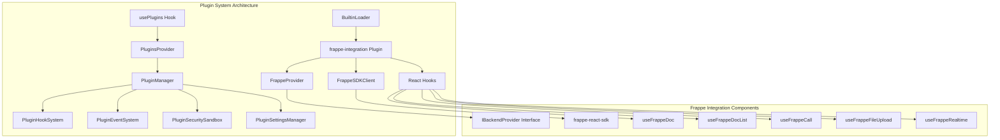
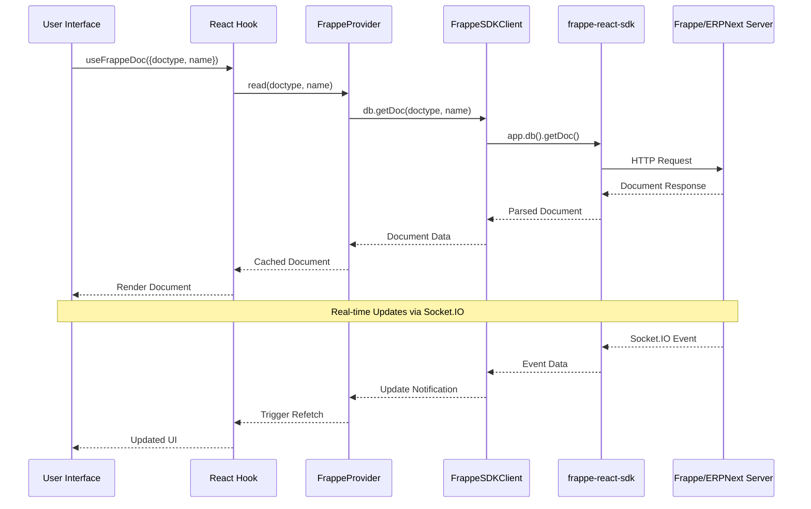
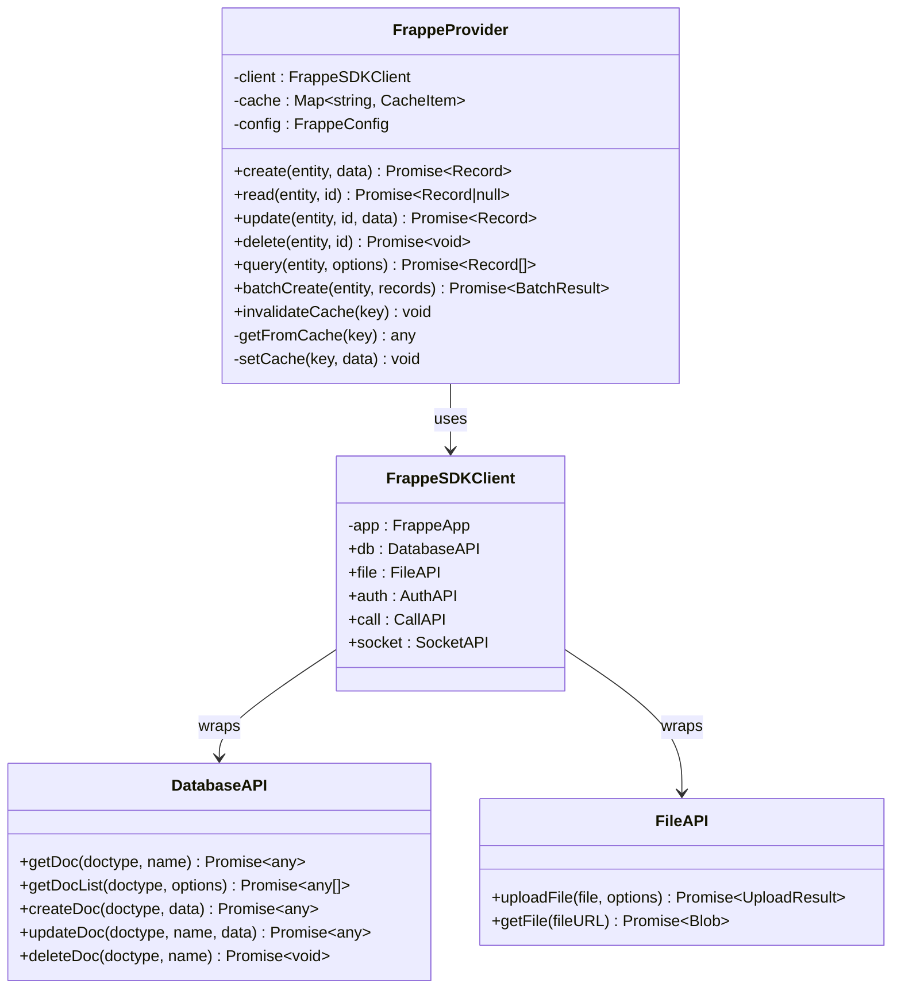
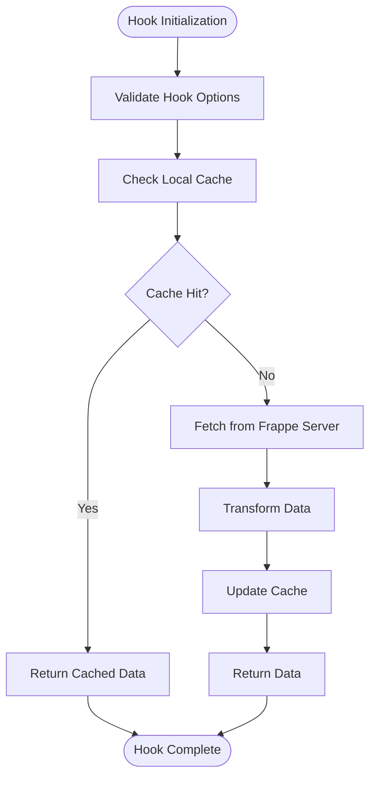
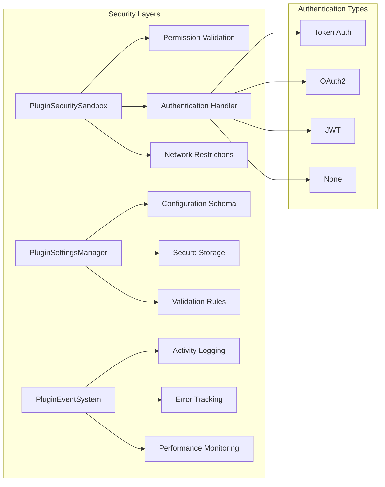
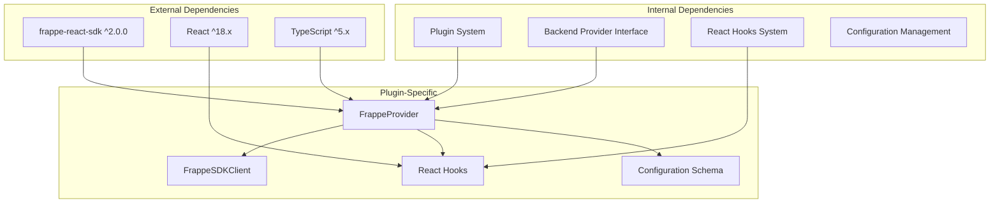

# Frappe Integration Plugin

<cite>
**Referenced Files in This Document**
- [index.ts](file://src/plugins/index.ts)
- [types.ts](file://src/plugins/types.ts)
- [PluginManager.ts](file://src/plugins/PluginManager.ts)
- [PluginHookSystem.ts](file://src/plugins/PluginHookSystem.ts)
- [PluginEventSystem.ts](file://src/plugins/PluginEventSystem.ts)
- [PluginSecuritySandbox.ts](file://src/plugins/PluginSecuritySandbox.ts)
- [PluginSettingsManager.ts](file://src/plugins/PluginSettingsManager.ts)
- [PluginsProvider.tsx](file://src/plugins/PluginsProvider.tsx)
- [usePlugins.ts](file://src/plugins/usePlugins.ts)
- [BuiltinLoader.ts](file://src/plugins/BuiltinLoader.ts)
- [FRAPPE_PLUGIN_SUMMARY.md](file://docs/FRAPPE_PLUGIN_SUMMARY.md)
- [BACKEND_PLUGIN_IMPLEMENTATION_COMPLETE.md](file://docs/BACKEND_PLUGIN_IMPLEMENTATION_COMPLETE.md)
- [FRAPPE_PLUGIN_IMPLEMENTATION.md](file://docs/architecture/FRAPPE_PLUGIN_IMPLEMENTATION.md)
</cite>

## Table of Contents
1. [Introduction](#introduction)
2. [Project Structure](#project-structure)
3. [Core Components](#core-components)
4. [Architecture Overview](#architecture-overview)
5. [Detailed Component Analysis](#detailed-component-analysis)
6. [Dependency Analysis](#dependency-analysis)
7. [Performance Considerations](#performance-considerations)
8. [Troubleshooting Guide](#troubleshooting-guide)
9. [Conclusion](#conclusion)

## Introduction

The Frappe Integration Plugin represents a sophisticated backend integration solution for SchoolPilot3, providing seamless connectivity to Frappe Framework and ERPNext systems. This plugin leverages the official frappe-react-sdk to deliver real-time capabilities, optimized React hooks, and comprehensive data synchronization features.

The plugin architecture follows modern React patterns with a focus on type safety, performance optimization, and extensibility. It serves as a bridge between SchoolPilot3's frontend ecosystem and external backend systems, enabling organizations to integrate with various educational management platforms without compromising code quality or maintainability.

## Project Structure

The Frappe Integration Plugin is structured within SchoolPilot3's comprehensive plugin system, utilizing a modular architecture that promotes separation of concerns and maintainability.

**Diagram sources**
- [PluginManager.ts:1-592](file://src/plugins/PluginManager.ts#L1-L592)
- [BuiltinLoader.ts:1-119](file://src/plugins/BuiltinLoader.ts#L1-L119)

The plugin integrates seamlessly with SchoolPilot3's existing plugin infrastructure, utilizing the same type definitions, lifecycle management, and security frameworks employed by other backend integrations.

**Section sources**
- [index.ts:1-61](file://src/plugins/index.ts#L1-L61)
- [types.ts:1-562](file://src/plugins/types.ts#L1-L562)
- [BuiltinLoader.ts:23-35](file://src/plugins/BuiltinLoader.ts#L23-L35)

## Core Components

The Frappe Integration Plugin consists of several interconnected components that work together to provide comprehensive backend integration capabilities.

### Plugin Manifest and Registration

The plugin utilizes a standardized manifest system that defines its capabilities, dependencies, and configuration options. The manifest includes metadata such as plugin ID, version, type, and entry point, along with detailed configuration schemas for authentication, real-time connectivity, and performance tuning.

### Provider Architecture

The core integration is built around the IBackendProvider interface, which establishes a contract for backend communication. The FrappeProvider implementation handles all database operations, file management, authentication, and real-time updates through the frappe-react-sdk wrapper.

### React Hook System

The plugin provides six specialized React hooks designed for common Frappe operations:
- `useFrappeDoc`: Manages individual document fetching and updates
- `useFrappeDocList`: Handles paginated document lists with filtering
- `useFrappeCall`: Executes server-side methods
- `useFrappeFileUpload`: Manages file uploads with progress tracking
- `useFrappeRealtime`: Subscribes to real-time document updates
- `useFrappeProvider`: Provides access to the underlying provider and client

**Section sources**
- [types.ts:60-111](file://src/plugins/types.ts#L60-L111)
- [types.ts:287-298](file://src/plugins/types.ts#L287-L298)
- [FRAPPE_PLUGIN_IMPLEMENTATION.md:118-151](file://docs/architecture/FRAPPE_PLUGIN_IMPLEMENTATION.md#L118-L151)

## Architecture Overview

The Frappe Integration Plugin follows a layered architecture that separates concerns between presentation, business logic, and data access layers.

**Diagram sources**
- [FRAPPE_PLUGIN_IMPLEMENTATION.md:68-90](file://docs/architecture/FRAPPE_PLUGIN_IMPLEMENTATION.md#L68-L90)
- [FRAPPE_PLUGIN_IMPLEMENTATION.md:96-116](file://docs/architecture/FRAPPE_PLUGIN_IMPLEMENTATION.md#L96-L116)

The architecture emphasizes real-time capabilities, intelligent caching, and efficient resource utilization. The frappe-react-sdk provides robust foundation for database operations, file management, authentication, and real-time communication.

**Section sources**
- [FRAPPE_PLUGIN_IMPLEMENTATION.md:15-59](file://docs/architecture/FRAPPE_PLUGIN_IMPLEMENTATION.md#L15-L59)
- [FRAPPE_PLUGIN_SUMMARY.md:9-26](file://docs/FRAPPE_PLUGIN_SUMMARY.md#L9-L26)

## Detailed Component Analysis

### FrappeProvider Implementation

The FrappeProvider serves as the central orchestrator for all backend operations, implementing the IBackendProvider interface while leveraging the frappe-react-sdk for optimal performance and reliability.

**Diagram sources**
- [FRAPPE_PLUGIN_IMPLEMENTATION.md:68-90](file://docs/architecture/FRAPPE_PLUGIN_IMPLEMENTATION.md#L68-L90)
- [FRAPPE_PLUGIN_IMPLEMENTATION.md:96-116](file://docs/architecture/FRAPPE_PLUGIN_IMPLEMENTATION.md#L96-L116)

The provider implements intelligent caching with configurable TTL, automatic cache invalidation on mutations, and support for batch operations to optimize network usage and improve performance.

### React Hook System

The React hook system provides developers with intuitive, type-safe interfaces for common Frappe operations, following React best practices and offering comprehensive error handling and loading states.

**Diagram sources**
- [FRAPPE_PLUGIN_IMPLEMENTATION.md:124-151](file://docs/architecture/FRAPPE_PLUGIN_IMPLEMENTATION.md#L124-L151)

Each hook manages its own state, loading indicators, and error handling, providing a consistent developer experience across different types of operations.

**Section sources**
- [FRAPPE_PLUGIN_IMPLEMENTATION.md:118-151](file://docs/architecture/FRAPPE_PLUGIN_IMPLEMENTATION.md#L118-L151)
- [FRAPPE_PLUGIN_SUMMARY.md:27-84](file://docs/FRAPPE_PLUGIN_SUMMARY.md#L27-L84)

### Security and Configuration Management

The plugin implements comprehensive security measures including permission-based access controls, secure credential storage, and configurable authentication mechanisms supporting multiple authentication types including token-based, OAuth2, and JWT authentication.

**Diagram sources**
- [PluginSecuritySandbox.ts:45-311](file://src/plugins/PluginSecuritySandbox.ts#L45-L311)
- [PluginSettingsManager.ts:16-239](file://src/plugins/PluginSettingsManager.ts#L16-L239)

**Section sources**
- [PluginSecuritySandbox.ts:18-43](file://src/plugins/PluginSecuritySandbox.ts#L18-L43)
- [PluginSettingsManager.ts:22-37](file://src/plugins/PluginSettingsManager.ts#L22-L37)

## Dependency Analysis

The Frappe Integration Plugin maintains loose coupling with the broader SchoolPilot3 ecosystem while establishing clear dependencies on external libraries and internal systems.

**Diagram sources**
- [FRAPPE_PLUGIN_SUMMARY.md:436-439](file://docs/FRAPPE_PLUGIN_SUMMARY.md#L436-L439)
- [BuiltinLoader.ts:23-35](file://src/plugins/BuiltinLoader.ts#L23-L35)

The plugin's dependency management ensures compatibility with SchoolPilot3's core architecture while maintaining flexibility for future enhancements and modifications.

**Section sources**
- [FRAPPE_PLUGIN_SUMMARY.md:262-268](file://docs/FRAPPE_PLUGIN_SUMMARY.md#L262-L268)
- [FRAPPE_PLUGIN_SUMMARY.md:436-439](file://docs/FRAPPE_PLUGIN_SUMMARY.md#L436-L439)

## Performance Considerations

The Frappe Integration Plugin incorporates several performance optimization strategies to ensure efficient operation in production environments.

### Caching Strategy

The plugin implements a multi-tier caching system with configurable TTL, automatic cache invalidation, and support for selective field loading to minimize bandwidth usage and improve response times.

### Real-time Optimization

Socket.IO integration provides efficient real-time updates with automatic reconnection, event deduplication, and configurable update frequencies to balance responsiveness with resource usage.

### Batch Operations

The provider supports batch operations for bulk data manipulation, reducing the number of network requests and improving overall system throughput during data synchronization tasks.

## Troubleshooting Guide

Common issues and their solutions when working with the Frappe Integration Plugin:

### Authentication Issues

**Problem**: Authentication failures when connecting to Frappe server
**Solution**: Verify API credentials, check user permissions, ensure token format is correct, and confirm the authentication type matches the server configuration.

### Real-time Connection Problems

**Problem**: Socket.IO not connecting or maintaining connection
**Solution**: Check Frappe server Socket.IO configuration, verify network/firewall settings, ensure correct socket port configuration, and monitor browser console for connection errors.

### Performance Degradation

**Problem**: Slow performance with large datasets
**Solution**: Enable caching with appropriate TTL, implement pagination, use selective field loading, reduce batch sizes, and leverage real-time updates instead of polling.

### Configuration Errors

**Problem**: Plugin fails to load or initialize
**Solution**: Validate plugin manifest, check configuration schema compliance, verify required dependencies, and ensure proper plugin registration in BuiltinLoader.

**Section sources**
- [FRAPPE_PLUGIN_IMPLEMENTATION.md:495-517](file://docs/architecture/FRAPPE_PLUGIN_IMPLEMENTATION.md#L495-L517)
- [FRAPPE_PLUGIN_SUMMARY.md:380-398](file://docs/FRAPPE_PLUGIN_SUMMARY.md#L380-L398)

## Conclusion

The Frappe Integration Plugin represents a comprehensive solution for connecting SchoolPilot3 to Frappe Framework and ERPNext systems. Its architecture demonstrates best practices in plugin development, including proper separation of concerns, robust error handling, and extensive configuration options.

The plugin's real-time capabilities, optimized React hooks, and comprehensive caching system position it as a superior choice for organizations requiring live data synchronization and modern user experiences. The implementation follows established patterns within the SchoolPilot3 ecosystem while providing the flexibility needed for diverse integration scenarios.

Future enhancements may include advanced offline support, enhanced conflict resolution UI, and expanded real-time capabilities, building upon the solid foundation established by this implementation.