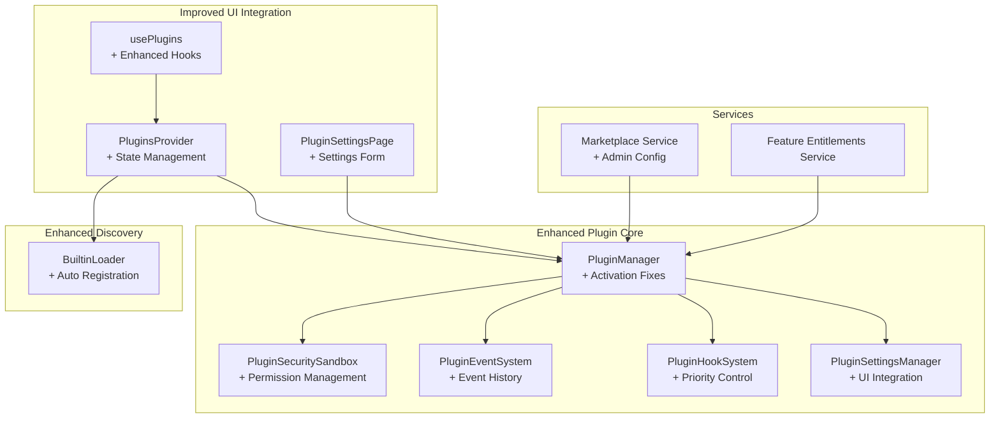
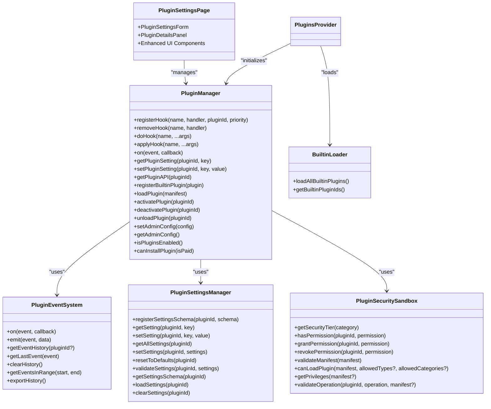

# Plugin System

<cite>
**Referenced Files in This Document**
- [PluginManager.ts](file://src/plugins/PluginManager.ts)
- [PluginSettingsManager.ts](file://src/plugins/PluginSettingsManager.ts)
- [PluginEventSystem.ts](file://src/plugins/PluginEventSystem.ts)
- [PluginSecuritySandbox.ts](file://src/plugins/PluginSecuritySandbox.ts)
- [BuiltinLoader.ts](file://src/plugins/BuiltinLoader.ts)
- [PluginSettingsPage.tsx](file://src/modules/settings/pages/PluginSettingsPage.tsx)
- [types.ts](file://src/plugins/types.ts)
- [PLUGIN_UI_FIXES.md](file://docs/PLUGIN_UI_FIXES.md)
- [plugin-activation-context-fix.md](file://docs/fixes/plugin-activation-context-fix.md)
</cite>

## Update Summary
**Changes Made**
- Enhanced plugin settings management with comprehensive UI support and validation
- Fixed critical plugin activation context issues that prevented plugin enablement
- Improved plugin UI with new settings form component and better user experience
- Added comprehensive plugin lifecycle management improvements
- Enhanced security sandboxing and permission management
- Updated built-in plugin implementations and marketplace integration

## Table of Contents
1. [Introduction](#introduction)
2. [Project Structure](#project-structure)
3. [Core Components](#core-components)
4. [Architecture Overview](#architecture-overview)
5. [Detailed Component Analysis](#detailed-component-analysis)
6. [Enhanced Settings Management](#enhanced-settings-management)
7. [Plugin Activation Improvements](#plugin-activation-improvements)
8. [UI Enhancements](#ui-enhancements)
9. [Built-in Plugin Implementations](#built-in-plugin-implementations)
10. [Security and Permissions](#security-and-permissions)
11. [Marketplace Integration](#marketplace-integration)
12. [Development Workflow](#development-workflow)
13. [Troubleshooting Guide](#troubleshooting-guide)
14. [Conclusion](#conclusion)

## Introduction
SchoolPilot3 implements an extensible plugin architecture that enables modular feature extension, marketplace integration, and secure runtime management. The system supports built-in plugins for whitelabel theming, analytics, grading, payments, and SMS, alongside a robust plugin lifecycle, hook-based extension points, event-driven orchestration, and granular security controls. Recent improvements include enhanced settings management, activation fixes, UI enhancements, and new plugin implementations that provide a comprehensive and user-friendly plugin ecosystem.

## Project Structure
The plugin system is organized around a central PluginManager coordinating specialized subsystems with enhanced UI integration:
- Core API and type definitions with comprehensive plugin types
- Lifecycle and event management with improved error handling
- Hook system for inter-plugin communication with priority management
- Settings management with UI integration and validation
- Security sandbox for privilege enforcement and permission control
- Built-in plugin discovery and loading with automatic registration
- Enhanced React components for plugin management and configuration

**Diagram sources**
- [PluginManager.ts:28-592](file://src/plugins/PluginManager.ts#L28-L592)
- [PluginSettingsManager.ts:16-239](file://src/plugins/PluginSettingsManager.ts#L16-L239)
- [PluginEventSystem.ts:23-194](file://src/plugins/PluginEventSystem.ts#L23-L194)
- [PluginSecuritySandbox.ts:45-311](file://src/plugins/PluginSecuritySandbox.ts#L45-L311)
- [BuiltinLoader.ts:35-118](file://src/plugins/BuiltinLoader.ts#L35-L118)
- [PluginSettingsPage.tsx:45-1307](file://src/modules/settings/pages/PluginSettingsPage.tsx#L45-L1307)

## Core Components
- **PluginManager**: Central orchestrator with enhanced activation context handling, improved error management, and comprehensive admin configuration support
- **PluginSettingsManager**: Schema-driven settings storage with UI integration, validation, defaults, and persistence
- **PluginEventSystem**: Publish-subscribe mechanism with enhanced event history, filtering, and debugging capabilities
- **PluginSecuritySandbox**: Enforces security tiers, permissions, and manifest validation with improved privilege management
- **BuiltinLoader**: Discovers and loads built-in plugins with automatic registration and error handling
- **Enhanced UI Components**: PluginSettingsPage with settings form, improved plugin management interface

**Section sources**
- [PluginManager.ts:28-592](file://src/plugins/PluginManager.ts#L28-L592)
- [PluginSettingsManager.ts:16-239](file://src/plugins/PluginSettingsManager.ts#L16-L239)
- [PluginEventSystem.ts:23-194](file://src/plugins/PluginEventSystem.ts#L23-L194)
- [PluginSecuritySandbox.ts:45-311](file://src/plugins/PluginSecuritySandbox.ts#L45-L311)
- [BuiltinLoader.ts:35-118](file://src/plugins/BuiltinLoader.ts#L35-L118)
- [PluginSettingsPage.tsx:45-1307](file://src/modules/settings/pages/PluginSettingsPage.tsx#L45-L1307)

## Architecture Overview
The plugin system follows a modular, layered design with enhanced error handling and UI integration:
- PluginManager delegates responsibilities to dedicated subsystems with improved context handling
- Security is enforced via PluginSecuritySandbox during manifest validation and runtime permission checks
- Hooks enable decoupled inter-plugin communication with priority ordering and circuit breaker protections
- Events track lifecycle and operational telemetry with comprehensive history management
- Settings are validated against declared schemas with UI integration and persistence
- Built-in plugins are auto-discovered, registered, and managed through enhanced interfaces

**Diagram sources**
- [PluginManager.ts:28-592](file://src/plugins/PluginManager.ts#L28-L592)
- [PluginSettingsManager.ts:16-239](file://src/plugins/PluginSettingsManager.ts#L16-L239)
- [PluginEventSystem.ts:23-194](file://src/plugins/PluginEventSystem.ts#L23-L194)
- [PluginSecuritySandbox.ts:45-311](file://src/plugins/PluginSecuritySandbox.ts#L45-L311)
- [BuiltinLoader.ts:35-118](file://src/plugins/BuiltinLoader.ts#L35-L118)
- [PluginSettingsPage.tsx:45-1307](file://src/modules/settings/pages/PluginSettingsPage.tsx#L45-L1307)

## Detailed Component Analysis

### Enhanced PluginManager
The PluginManager has been significantly improved with better activation context handling and comprehensive admin configuration support:

**Key Improvements:**
- Fixed activation context parameter passing to prevent "Cannot read properties of undefined" errors
- Enhanced admin configuration management with marketplace key validation
- Improved dependency checking and circular dependency detection
- Better error handling and logging throughout the lifecycle
- Enhanced marketplace integration with permission-based installation controls

**Section sources**
- [PluginManager.ts:28-592](file://src/plugins/PluginManager.ts#L28-L592)
- [plugin-activation-context-fix.md:26-33](file://docs/fixes/plugin-activation-context-fix.md#L26-L33)

### PluginSettingsManager
The settings manager now includes comprehensive UI integration and enhanced validation:

**Enhanced Features:**
- Complete settings schema registration with default value initialization
- Real-time validation with comprehensive error reporting
- Persistent settings storage with localStorage integration
- Bulk settings updates and reset-to-defaults functionality
- Enhanced validation rules for all setting types (string, number, boolean, select, multiselect, json)

**Section sources**
- [PluginSettingsManager.ts:16-239](file://src/plugins/PluginSettingsManager.ts#L16-L239)

### PluginEventSystem
The event system now provides comprehensive event history management and enhanced debugging capabilities:

**Improved Features:**
- Enhanced event history with size limiting and filtering
- Time-range queries and recent event retrieval
- Event import/export functionality for debugging
- Subscriber management with count tracking
- Enhanced error handling in event listeners

**Section sources**
- [PluginEventSystem.ts:23-194](file://src/plugins/PluginEventSystem.ts#L23-L194)

### PluginSecuritySandbox
The security sandbox provides comprehensive privilege management and enhanced security controls:

**Enhanced Security:**
- Three-tier security model (trusted, verified, community) with appropriate timeouts
- Comprehensive permission management with granular controls
- Enhanced manifest validation with security checks
- Collection-level access controls for data operations
- Operation validation for UI injection, network access, and code execution

**Section sources**
- [PluginSecuritySandbox.ts:45-311](file://src/plugins/PluginSecuritySandbox.ts#L45-L311)

### BuiltinLoader
The built-in loader provides enhanced plugin discovery and registration:

**Improved Discovery:**
- Automatic plugin discovery from builtin directory
- Enhanced error handling with detailed logging
- Plugin validation and structure verification
- Automatic registration with PluginManager
- Support for dynamic plugin loading

**Section sources**
- [BuiltinLoader.ts:35-118](file://src/plugins/BuiltinLoader.ts#L35-L118)

## Enhanced Settings Management
The plugin system now includes comprehensive settings management with UI integration:

### Settings Form Component
A new `PluginSettingsForm` component provides intuitive settings management:

**Features:**
- Real-time validation with immediate feedback
- Support for all setting types (string, number, boolean, select, json, password)
- Save and reset functionality with success/error messaging
- Required field indicators and validation hints
- JSON syntax highlighting and validation

**Section sources**
- [PLUGIN_UI_FIXES.md:45-70](file://docs/PLUGIN_UI_FIXES.md#L45-L70)
- [PluginSettingsPage.tsx:871-1067](file://src/modules/settings/pages/PluginSettingsPage.tsx#L871-L1067)

### Settings Validation and Persistence
Enhanced validation and persistence mechanisms ensure reliable settings management:

**Validation Rules:**
- Type checking for all setting types
- Numeric range validation (min/max)
- String length validation and pattern matching
- Options validation for select/multiselect settings
- JSON syntax validation with error reporting

**Persistence:**
- Settings saved to localStorage with plugin-specific keys
- Automatic loading on plugin activation
- Bulk updates and individual setting updates
- Reset to defaults functionality

**Section sources**
- [PluginSettingsManager.ts:98-180](file://src/plugins/PluginSettingsManager.ts#L98-L180)
- [PluginSettingsManager.ts:208-217](file://src/plugins/PluginSettingsManager.ts#L208-L217)

## Plugin Activation Improvements
Critical fixes have been implemented to resolve plugin activation issues:

### Activation Context Fix
Resolved the "Cannot read properties of undefined" error that prevented plugin activation:

**Root Cause:** Incorrect context parameter passing in activation/deactivation methods
**Solution:** Fixed parameter passing to ensure context object is properly provided to plugin lifecycle methods

**Impact:** All builtin plugins can now be activated successfully, enabling proper plugin functionality

**Section sources**
- [plugin-activation-context-fix.md:1-56](file://docs/fixes/plugin-activation-context-fix.md#L1-L56)
- [PluginManager.ts:247-285](file://src/plugins/PluginManager.ts#L247-L285)

### Enhanced Plugin Management UI
Improved plugin management interface with better user experience:

**Features:**
- Toggle switches for plugin activation/deactivation
- Clear enable/disable button states
- Visual feedback for activation status
- Error handling and user notifications
- Enhanced plugin details panel

**Section sources**
- [PLUGIN_UI_FIXES.md:14-30](file://docs/PLUGIN_UI_FIXES.md#L14-L30)
- [PluginSettingsPage.tsx:74-107](file://src/modules/settings/pages/PluginSettingsPage.tsx#L74-L107)

## UI Enhancements
The plugin system now includes comprehensive UI improvements for better user experience:

### Plugin Settings Page
Enhanced plugin management interface with comprehensive functionality:

**Components:**
- Plugin listing with filtering and search
- Plugin details panel with overview, readme, and settings tabs
- Settings form with validation and feedback
- Admin configuration panel for system-wide settings
- Marketplace integration and plugin installation

**Features:**
- Tabbed interface for different plugin management views
- Real-time plugin status updates
- Enhanced error handling and user feedback
- Responsive design for different screen sizes

**Section sources**
- [PluginSettingsPage.tsx:45-1307](file://src/modules/settings/pages/PluginSettingsPage.tsx#L45-L1307)

### Plugin Details Panel
Comprehensive plugin information and management interface:

**Sections:**
- Overview tab with status, permissions, and error details
- README tab for plugin documentation
- Settings tab for configuration management
- Enhanced UI with proper spacing and visual hierarchy

**Section sources**
- [PluginSettingsPage.tsx:1073-1305](file://src/modules/settings/pages/PluginSettingsPage.tsx#L1073-L1305)

## Built-in Plugin Implementations
The system includes several built-in plugins with enhanced functionality:

### Available Built-in Plugins
- **Whitelabel**: Branding and label customization with comprehensive configuration
- **Grading Engine**: Computation engine with WASM support
- **Fee Calculator**: Financial computation with configurable parameters
- **Analytics Mock**: Placeholder for analytics engine
- **Payment Mock**: Placeholder for payment processing
- **SMS Mock**: Placeholder for SMS services

### Plugin Development Template
Comprehensive template for creating new builtin plugins:

**Template Features:**
- Complete plugin structure with manifest and implementation
- TypeScript interfaces and type safety
- Lifecycle hooks implementation
- Settings schema definition
- Registration process documentation

**Section sources**
- [types.ts:14-562](file://src/plugins/types.ts#L14-L562)
- [PLUGIN_UI_FIXES.md:283-296](file://docs/PLUGIN_UI_FIXES.md#L283-L296)

## Security and Permissions
The plugin system implements comprehensive security measures:

### Security Tiers
Three-tier security model with appropriate enforcement:
- **Trusted**: Built-in and engine plugins with minimal sandboxing
- **Verified**: Official plugins with balanced security controls
- **Community**: Third-party plugins with strict sandboxing

### Permission Management
Granular permission controls for plugin operations:
- Data access permissions (read/write collections)
- UI modification permissions
- Network access controls
- File system access limitations
- Code execution restrictions

**Section sources**
- [PluginSecuritySandbox.ts:49-82](file://src/plugins/PluginSecuritySandbox.ts#L49-L82)
- [PluginSecuritySandbox.ts:108-149](file://src/plugins/PluginSecuritySandbox.ts#L108-L149)

## Marketplace Integration
Enhanced marketplace integration with administrative controls:

### Admin Configuration
Comprehensive administrative controls for plugin management:
- Master switch for plugin system enablement
- Marketplace connection and authentication
- Plugin type restrictions and limits
- Security policy configuration
- Installation permissions and approvals

### Marketplace Features
- Plugin browsing and discovery
- Installation and update management
- Version compatibility checking
- Dependency resolution
- Security validation

**Section sources**
- [PluginSettingsPage.tsx:57-63](file://src/modules/settings/pages/PluginSettingsPage.tsx#L57-L63)
- [PluginSettingsPage.tsx:109-123](file://src/modules/settings/pages/PluginSettingsPage.tsx#L109-L123)

## Development Workflow
Enhanced development workflow for plugin creation and management:

### Plugin Creation Process
1. **Template Setup**: Copy and customize the plugin template
2. **Manifest Definition**: Define plugin metadata and capabilities
3. **Implementation**: Implement lifecycle hooks and functionality
4. **Testing**: Test plugin activation and settings management
5. **Registration**: Register plugin with BuiltinLoader
6. **Deployment**: Package and distribute plugin

### Development Guidelines
- Follow TypeScript interfaces and type safety
- Implement proper error handling and validation
- Use the plugin context API correctly
- Test with different security tiers
- Document plugin functionality and configuration

**Section sources**
- [PLUGIN_UI_FIXES.md:7-103](file://docs/PLUGIN_UI_FIXES.md#L7-L103)
- [types.ts:60-111](file://src/plugins/types.ts#L60-L111)

## Troubleshooting Guide
Enhanced troubleshooting capabilities for plugin system issues:

### Common Issues and Solutions
- **Plugin Activation Errors**: Check activation context and plugin dependencies
- **Settings Validation Failures**: Verify setting types and constraints
- **UI Integration Problems**: Check plugin registration and context availability
- **Security Permission Denied**: Review plugin privileges and security tier
- **Marketplace Connection Issues**: Verify admin configuration and authentication

### Diagnostic Tools
- Event history inspection for lifecycle events
- Settings validation results for configuration issues
- Plugin context debugging for API access problems
- Security sandbox logs for permission issues
- Console error messages for detailed troubleshooting

**Section sources**
- [PLUGIN_UI_FIXES.md:357-403](file://docs/PLUGIN_UI_FIXES.md#L357-L403)
- [PluginEventSystem.ts:92-130](file://src/plugins/PluginEventSystem.ts#L92-L130)

## Conclusion
SchoolPilot3's enhanced plugin system provides a secure, extensible, and user-friendly architecture for modular feature development. Recent improvements include comprehensive settings management with UI integration, fixed activation context issues, enhanced plugin management interfaces, and improved security controls. The system now offers a complete solution for plugin development, deployment, and management with comprehensive administrative controls and user experience enhancements.