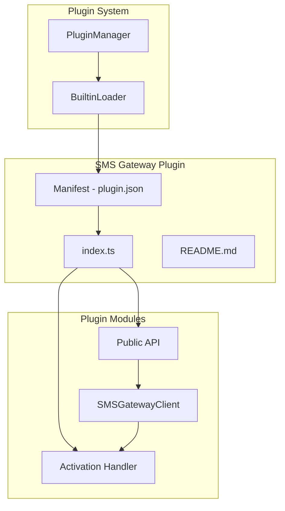
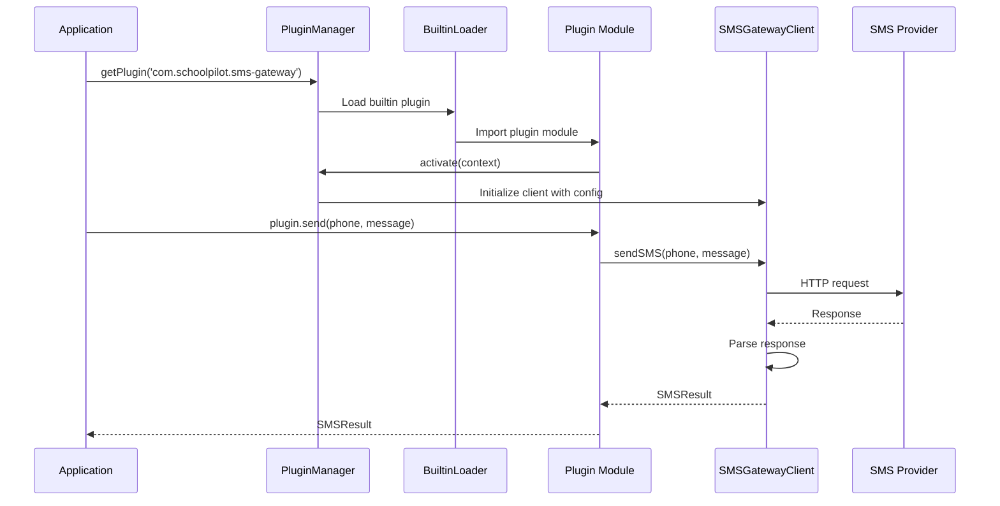
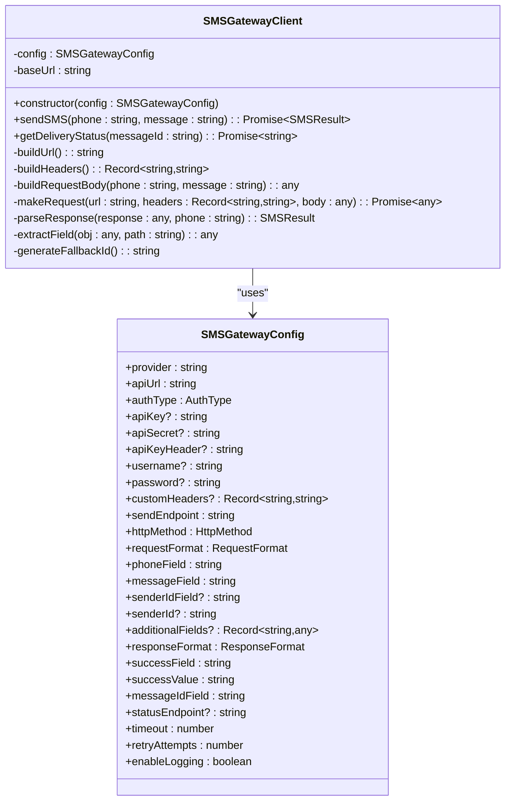
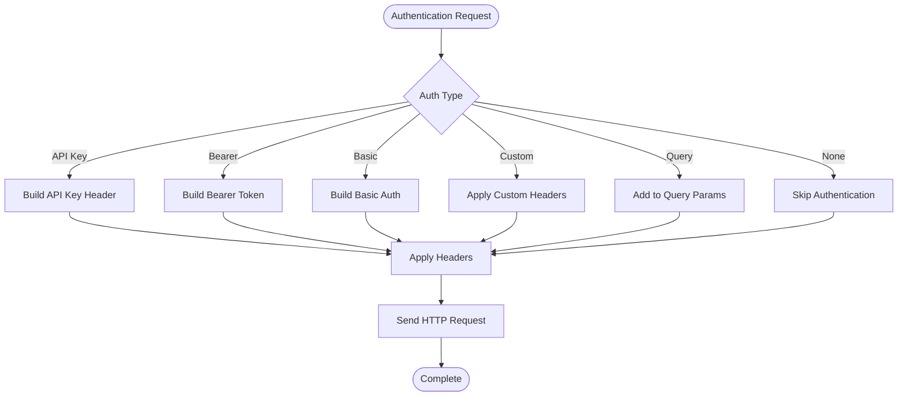
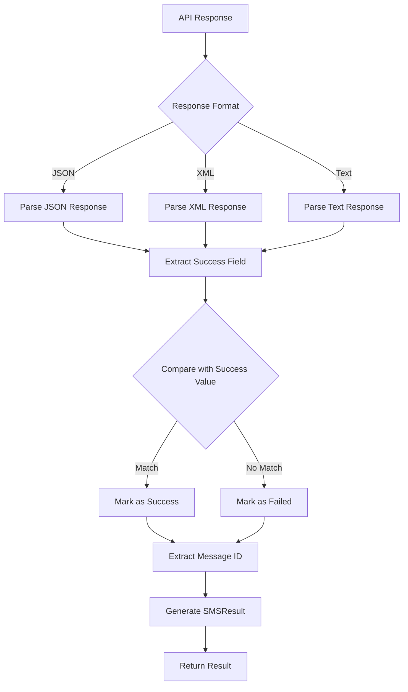
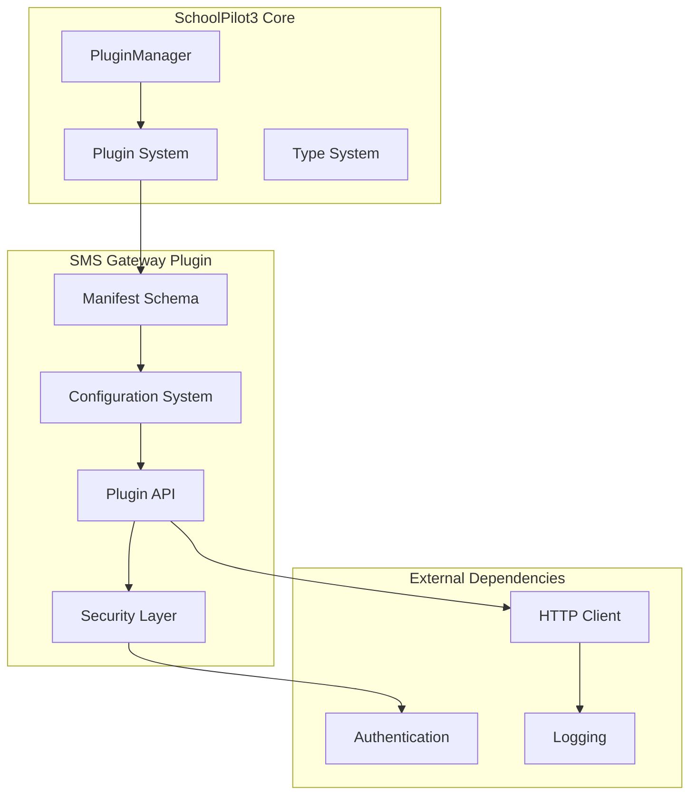

# SMS Gateway Plugin

<cite>
**Referenced Files in This Document**
- [index.ts](file://src/plugins/builtin/sms-gateway/index.ts)
- [plugin.json](file://src/plugins/builtin/sms-gateway/plugin.json)
- [README.md](file://src/plugins/builtin/sms-gateway/README.md)
- [PluginManager.ts](file://src/plugins/PluginManager.ts)
- [BuiltinLoader.ts](file://src/plugins/BuiltinLoader.ts)
- [SMS_GATEWAY_PLUGIN.md](file://docs/SMS_GATEWAY_PLUGIN.md)
</cite>

## Table of Contents
1. [Introduction](#introduction)
2. [Project Structure](#project-structure)
3. [Core Components](#core-components)
4. [Architecture Overview](#architecture-overview)
5. [Detailed Component Analysis](#detailed-component-analysis)
6. [Dependency Analysis](#dependency-analysis)
7. [Performance Considerations](#performance-considerations)
8. [Troubleshooting Guide](#troubleshooting-guide)
9. [Conclusion](#conclusion)

## Introduction
The Generic SMS Gateway Plugin provides a flexible, universal SMS integration for SchoolPilot3 that works with virtually any HTTP-based SMS API provider. It supports multiple authentication methods, configurable request/response formats, and includes pre-configured presets for popular providers like Twilio, Nexmo/Vonage, Africa's Talking, MessageBird, Plivo, and Clickatell. The plugin offers reliability features such as automatic retry with exponential backoff, configurable timeouts, request logging, and delivery status tracking capabilities.

## Project Structure
The SMS Gateway Plugin is organized as a builtin plugin within the SchoolPilot3 plugin system:

**Diagram sources**
- [PluginManager.ts:1-592](file://src/plugins/PluginManager.ts#L1-L592)
- [BuiltinLoader.ts:1-119](file://src/plugins/BuiltinLoader.ts#L1-L119)
- [index.ts:561-576](file://src/plugins/builtin/sms-gateway/index.ts#L561-L576)

**Section sources**
- [index.ts:1-576](file://src/plugins/builtin/sms-gateway/index.ts#L1-L576)
- [plugin.json:1-242](file://src/plugins/builtin/sms-gateway/plugin.json#L1-L242)
- [BuiltinLoader.ts:23-35](file://src/plugins/BuiltinLoader.ts#L23-L35)

## Core Components
The SMS Gateway Plugin consists of several key components working together to provide universal SMS functionality:

### Plugin Manifest and Configuration
The plugin manifest defines the plugin's metadata, provides, settings schema, and privileges. It includes 25+ configuration options covering authentication, request formatting, response parsing, and advanced settings.

### SMSGatewayClient
The core client class handles all HTTP communication with SMS providers. It manages:
- URL construction with endpoint templating
- Authentication header building
- Request body formatting (JSON, form data, query parameters)
- Response parsing with nested field extraction
- Retry logic with exponential backoff
- Timeout handling

### Plugin API
The public API exposes four main methods:
- `send(phone, message)` - Single SMS delivery
- `bulkSend(recipients, message)` - Bulk SMS delivery with progress tracking
- `sendTemplate(phone, templateId, params)` - Template-based messaging
- `getDeliveryStatus(messageId)` - Delivery status checking

### Provider Presets
Built-in configurations for seven major SMS providers with optimized defaults for each platform's API requirements.

**Section sources**
- [plugin.json:18-242](file://src/plugins/builtin/sms-gateway/plugin.json#L18-L242)
- [index.ts:30-56](file://src/plugins/builtin/sms-gateway/index.ts#L30-L56)
- [index.ts:150-440](file://src/plugins/builtin/sms-gateway/index.ts#L150-L440)

## Architecture Overview
The plugin follows SchoolPilot3's modular plugin architecture with clear separation of concerns:

**Diagram sources**
- [PluginManager.ts:137-202](file://src/plugins/PluginManager.ts#L137-L202)
- [BuiltinLoader.ts:40-90](file://src/plugins/BuiltinLoader.ts#L40-L90)
- [index.ts:508-555](file://src/plugins/builtin/sms-gateway/index.ts#L508-L555)

The architecture ensures loose coupling between the plugin system and the SMS gateway implementation, allowing for easy extension and modification of provider configurations.

## Detailed Component Analysis

### SMSGatewayClient Implementation
The client encapsulates all SMS API communication logic with robust error handling and retry mechanisms:

**Diagram sources**
- [index.ts:150-440](file://src/plugins/builtin/sms-gateway/index.ts#L150-L440)
- [index.ts:30-56](file://src/plugins/builtin/sms-gateway/index.ts#L30-L56)

### Authentication System
The plugin supports six different authentication methods through a unified interface:

**Diagram sources**
- [index.ts:221-257](file://src/plugins/builtin/sms-gateway/index.ts#L221-L257)

### Response Parsing Engine
The response parsing system handles complex nested structures and various response formats:

**Diagram sources**
- [index.ts:358-401](file://src/plugins/builtin/sms-gateway/index.ts#L358-L401)

**Section sources**
- [index.ts:150-440](file://src/plugins/builtin/sms-gateway/index.ts#L150-L440)
- [index.ts:221-257](file://src/plugins/builtin/sms-gateway/index.ts#L221-L257)
- [index.ts:358-401](file://src/plugins/builtin/sms-gateway/index.ts#L358-L401)

### Provider Configuration Management
The plugin uses a preset-based configuration system that merges provider defaults with user customizations:

| Provider Category | Providers | Authentication | Request Format |
|-------------------|-----------|----------------|----------------|
| Enterprise | Twilio | Basic Auth | Form Data |
| Global | Nexmo/Vonage | Query Parameters | JSON |
| Regional | Africa's Talking | API Key | Form Data |
| Multi-channel | MessageBird | API Key | JSON |
| Cloud | Plivo | Basic Auth | JSON |
| High-volume | Clickatell | API Key | JSON |

**Section sources**
- [index.ts:62-144](file://src/plugins/builtin/sms-gateway/index.ts#L62-L144)
- [plugin.json:24-35](file://src/plugins/builtin/sms-gateway/plugin.json#L24-L35)

## Dependency Analysis
The plugin integrates with the broader SchoolPilot3 ecosystem through well-defined interfaces:

**Diagram sources**
- [PluginManager.ts:28-57](file://src/plugins/PluginManager.ts#L28-L57)
- [index.ts:561-576](file://src/plugins/builtin/sms-gateway/index.ts#L561-L576)

The plugin maintains loose coupling with external systems while providing comprehensive error handling and logging capabilities.

**Section sources**
- [PluginManager.ts:1-592](file://src/plugins/PluginManager.ts#L1-L592)
- [BuiltinLoader.ts:1-119](file://src/plugins/BuiltinLoader.ts#L1-L119)

## Performance Considerations
The plugin implements several performance optimization strategies:

### Retry Logic with Exponential Backoff
Automatic retry mechanism reduces failure impact from transient network issues or API throttling. The backoff pattern increases wait time between attempts to minimize server load.

### Request Timeout Management
Configurable timeout settings prevent hanging requests and allow for graceful degradation when providers experience delays.

### Rate Limiting Protection
The bulk send functionality includes built-in delays between messages to prevent rate limiting violations and maintain compliance with provider policies.

### Memory Management
The client uses efficient request/response handling with proper cleanup of AbortController instances and timeout management.

## Troubleshooting Guide

### Common Configuration Issues
**Authentication Failures (401/403)**
- Verify API credentials are correct and not expired
- Ensure authentication type matches provider requirements
- Check API key header names for custom providers
- Test credentials with external tools like curl or Postman

**Connection Problems**
- Verify API URL is accessible and properly formatted
- Check network connectivity and firewall settings
- Ensure SSL certificates are valid for HTTPS endpoints
- Test provider availability during maintenance windows

**Response Parsing Errors**
- Enable debug logging to inspect actual API responses
- Verify response format matches configuration settings
- Check field paths using dot notation for nested structures
- Validate success value comparisons against actual API responses

### Performance and Reliability
**Rate Limiting Issues**
- Reduce bulk send batch sizes for high-volume operations
- Implement appropriate delays between message sends
- Monitor provider-specific rate limit documentation
- Consider upgrading to higher-tier plans for increased capacity

**Delivery Status Tracking**
- Verify status endpoint configuration for providers supporting delivery reports
- Implement proper error handling for unavailable status endpoints
- Cache frequently accessed status information to reduce API calls
- Monitor delivery rates and investigate persistent failures

**Section sources**
- [README.md:471-522](file://src/plugins/builtin/sms-gateway/README.md#L471-L522)
- [SMS_GATEWAY_PLUGIN.md:488-531](file://docs/SMS_GATEWAY_PLUGIN.md#L488-L531)

## Conclusion
The Generic SMS Gateway Plugin represents a comprehensive solution for integrating diverse SMS providers into the SchoolPilot3 ecosystem. Its modular architecture, extensive configuration options, and robust error handling make it suitable for both development and production environments. The plugin's support for multiple authentication methods, flexible request/response formats, and pre-configured provider presets ensures broad compatibility with existing and emerging SMS platforms.

The implementation demonstrates strong software engineering practices through proper separation of concerns, comprehensive error handling, and extensible design patterns. The plugin is ready for production use and provides a solid foundation for educational institutions requiring reliable SMS communication capabilities.

Future enhancements could include template management interfaces, provider setup wizards, delivery report dashboards, webhook receivers, and SMS scheduling capabilities, as outlined in the roadmap documentation.