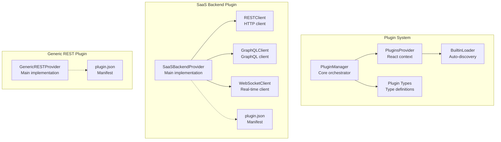
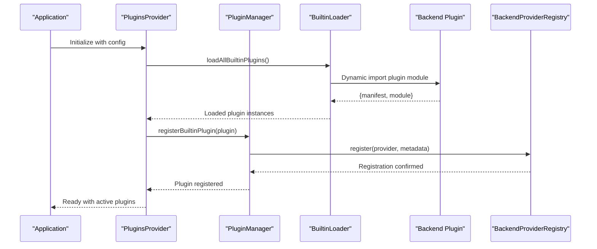
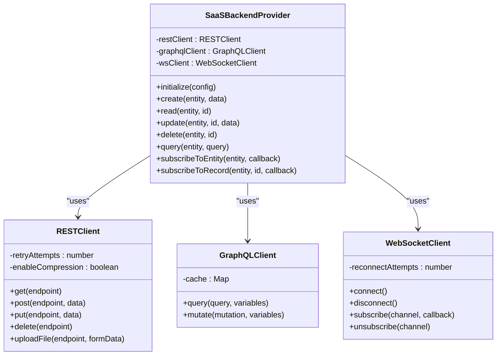
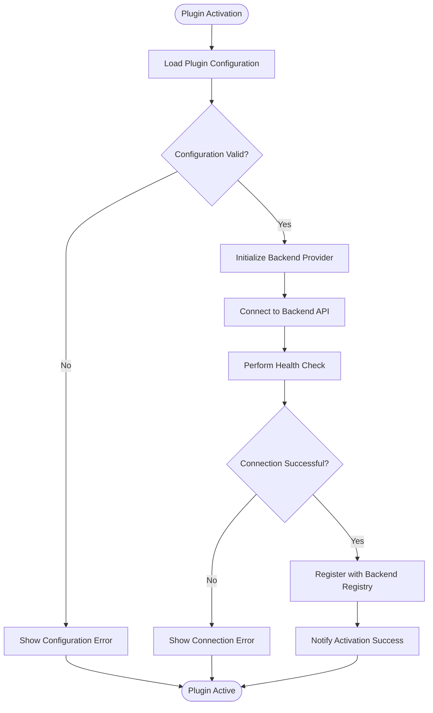
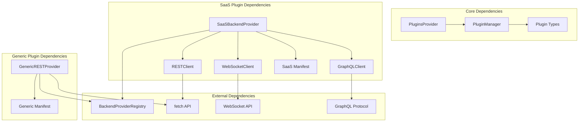

# SaaS and Generic REST Plugins

<cite>
**Referenced Files in This Document**
- [SAAS_AND_GENERIC_REST_PLUGINS.md](file://docs/SAAS_AND_GENERIC_REST_PLUGINS.md)
- [PluginManager.ts](file://src/plugins/PluginManager.ts)
- [types.ts](file://src/plugins/types.ts)
- [usePlugins.ts](file://src/plugins/usePlugins.ts)
- [BuiltinLoader.ts](file://src/plugins/BuiltinLoader.ts)
- [PluginsProvider.tsx](file://src/plugins/PluginsProvider.tsx)
- [SaaSBackendProvider.ts](file://src/plugins/builtin/saas-backend/SaaSBackendProvider.ts)
- [plugin.json](file://src/plugins/builtin/saas-backend/plugin.json)
- [GenericRESTProvider.ts](file://src/plugins/builtin/generic-rest/GenericRESTProvider.ts)
- [plugin.json](file://src/plugins/builtin/generic-rest/plugin.json)
</cite>

## Table of Contents
1. [Introduction](#introduction)
2. [Project Structure](#project-structure)
3. [Core Components](#core-components)
4. [Architecture Overview](#architecture-overview)
5. [Detailed Component Analysis](#detailed-component-analysis)
6. [Dependency Analysis](#dependency-analysis)
7. [Performance Considerations](#performance-considerations)
8. [Troubleshooting Guide](#troubleshooting-guide)
9. [Conclusion](#conclusion)

## Introduction
This document provides comprehensive technical documentation for the SaaS Backend and Generic REST plugins that extend SchoolPilot3's backend integration capabilities. These plugins enable seamless connectivity to both SchoolPilot's custom Go SaaS backend (with REST, GraphQL, and WebSocket support) and any external REST API with full configurability.

The implementation follows SchoolPilot3's modular plugin architecture, ensuring secure, maintainable, and extensible backend integrations. Both plugins support robust authentication, caching, retry logic, and real-time updates where applicable.

## Project Structure
The plugin system is organized around a central PluginManager that orchestrates plugin lifecycle, settings, hooks, and security. The SaaS and Generic REST plugins are implemented as builtin plugins that are auto-discovered and registered during application initialization.



**Diagram sources**
- [PluginManager.ts:1-592](file://src/plugins/PluginManager.ts#L1-L592)
- [PluginsProvider.tsx:1-96](file://src/plugins/PluginsProvider.tsx#L1-L96)
- [BuiltinLoader.ts:1-119](file://src/plugins/BuiltinLoader.ts#L1-L119)
- [types.ts:1-562](file://src/plugins/types.ts#L1-L562)
- [SaaSBackendProvider.ts:1-742](file://src/plugins/builtin/saas-backend/SaaSBackendProvider.ts#L1-L742)
- [plugin.json:1-223](file://src/plugins/builtin/saas-backend/plugin.json#L1-L223)
- [GenericRESTProvider.ts:1-745](file://src/plugins/builtin/generic-rest/GenericRESTProvider.ts#L1-L745)
- [plugin.json:1-226](file://src/plugins/builtin/generic-rest/plugin.json#L1-L226)

**Section sources**
- [PluginManager.ts:1-592](file://src/plugins/PluginManager.ts#L1-L592)
- [PluginsProvider.tsx:1-96](file://src/plugins/PluginsProvider.tsx#L1-L96)
- [BuiltinLoader.ts:1-119](file://src/plugins/BuiltinLoader.ts#L1-L119)
- [types.ts:1-562](file://src/plugins/types.ts#L1-L562)

## Core Components
This section covers the essential components that enable backend integration in SchoolPilot3.

### Plugin Management System
The PluginManager serves as the central orchestrator for all plugins, handling lifecycle management, settings persistence, hook registration, and security enforcement. It delegates specific responsibilities to specialized subsystems:

- **PluginHookSystem**: Manages hook registration and execution
- **PluginSettingsManager**: Handles configuration storage and validation
- **PluginEventSystem**: Tracks plugin lifecycle events
- **PluginSecuritySandbox**: Enforces permissions and security policies

### Plugin Types and Interfaces
The type system defines standardized interfaces for plugin manifests, lifecycle events, and configuration schemas. Key interfaces include:
- PluginManifest: Defines plugin metadata, capabilities, and settings
- PluginContext: Provides runtime context for plugin execution
- PluginAPI: Exposes core system functions to plugins
- BackendProvider interfaces: Define backend integration contracts

### Built-in Plugin Discovery
The BuiltinLoader automatically discovers and loads plugins from the `/src/plugins/builtin/` directory using Vite's import.meta.glob. It maintains a registry of available plugins and handles dynamic imports with proper error handling.

**Section sources**
- [PluginManager.ts:28-574](file://src/plugins/PluginManager.ts#L28-L574)
- [types.ts:60-261](file://src/plugins/types.ts#L60-L261)
- [BuiltinLoader.ts:23-119](file://src/plugins/BuiltinLoader.ts#L23-L119)

## Architecture Overview
The plugin architecture follows a layered design pattern with clear separation of concerns:



**Diagram sources**
- [PluginsProvider.tsx:46-75](file://src/plugins/PluginsProvider.tsx#L46-L75)
- [BuiltinLoader.ts:96-111](file://src/plugins/BuiltinLoader.ts#L96-L111)
- [PluginManager.ts:110-132](file://src/plugins/PluginManager.ts#L110-L132)

The architecture ensures:
- **Modularity**: Each plugin operates independently with well-defined interfaces
- **Security**: All plugins run in a sandboxed environment with permission controls
- **Extensibility**: New plugins can be added without modifying core system
- **Maintainability**: Clear separation between plugin logic and system orchestration

## Detailed Component Analysis

### SaaS Backend Plugin

#### Provider Implementation
The SaaSBackendProvider implements the IBackendProvider interface to connect to SchoolPilot's custom Go backend. It provides comprehensive functionality including:

**Core Features:**
- **Dual API Support**: Seamless switching between REST and GraphQL
- **Real-time Updates**: WebSocket integration for live data synchronization
- **Multi-tenant Architecture**: Tenant isolation with dedicated endpoints
- **Advanced Caching**: Client-side caching with configurable TTL
- **Batch Operations**: Efficient bulk data operations
- **Automatic Retry**: Exponential backoff for failed requests
- **Compression Support**: gzip compression for optimized bandwidth usage

**Authentication Methods:**
- JWT authentication with automatic token refresh
- OAuth2 support for enterprise integrations
- Tenant-aware authentication headers

**Supported Entities:**
The plugin supports a comprehensive range of educational entities:
- Students, Employees, Courses, Programs
- Classes, Subjects, Fees, Payments
- Attendance, Grades, Assignments, Exams
- Timetables, Announcements, Events

#### Client Components
The provider utilizes specialized client components for different communication protocols:



**Diagram sources**
- [SaaSBackendProvider.ts:42-742](file://src/plugins/builtin/saas-backend/SaaSBackendProvider.ts#L42-L742)
- [SaaSBackendProvider.ts:23-25](file://src/plugins/builtin/saas-backend/SaaSBackendProvider.ts#L23-L25)

#### Configuration Schema
The plugin manifest defines extensive configuration options:

**Essential Configuration:**
- API URLs (REST, GraphQL, WebSocket)
- Authentication credentials (Client ID/Secret)
- Tenant identification
- API version selection
- Feature toggles (GraphQL, WebSocket, Cache)

**Advanced Options:**
- Sync interval configuration
- Conflict resolution strategies
- Batch operation settings
- Timeout and retry parameters
- Compression and caching preferences

**Section sources**
- [SaaSBackendProvider.ts:59-95](file://src/plugins/builtin/saas-backend/SaaSBackendProvider.ts#L59-L95)
- [plugin.json:48-208](file://src/plugins/builtin/saas-backend/plugin.json#L48-L208)

### Generic REST Plugin

#### Provider Implementation
The GenericRESTProvider offers maximum flexibility for connecting to any REST API through extensive configuration options:

**Key Features:**
- **Fully Configurable Endpoints**: Custom endpoints per entity
- **Flexible Authentication**: Support for multiple auth types
- **Field Mapping**: Bidirectional field mapping between local and API formats
- **Pagination Support**: Multiple pagination styles (Offset, Page, Cursor)
- **Filter Strategies**: Query parameters or JSON body filtering
- **Response Parsing**: Configurable data extraction from nested responses
- **Retry Logic**: Automatic retry with exponential backoff
- **Client-side Caching**: Optional caching with configurable timeouts

#### Configuration Flexibility
The plugin provides granular control over every aspect of API integration:

**Endpoint Configuration:**
- Base path definition per entity
- Method override for each CRUD operation
- Parameter substitution for dynamic endpoints

**Authentication Options:**
- API Key with custom header names
- Bearer token authentication
- Basic authentication
- Custom header injection
- OAuth2 support

**Data Mapping:**
- Local-to-API field mapping
- API-to-local field mapping
- Automatic field inclusion for unmapped properties

**Pagination and Filtering:**
- Configurable parameter names
- Multiple pagination styles
- Flexible filter strategies
- Custom response data extraction paths

#### Usage Patterns
The Generic REST plugin supports various integration scenarios:

**Simple Integration:**
```typescript
// Basic API connection with default endpoints
const provider = new GenericRESTProvider();
await provider.initialize({
  baseUrl: 'https://api.example.com',
  auth: { type: 'apikey', apiKey: 'your-key' }
});
```

**Advanced Configuration:**
```typescript
// Complex setup with custom mappings and pagination
const provider = new GenericRESTProvider();
await provider.initialize({
  baseUrl: 'https://api.example.com/v2',
  auth: { type: 'bearer', token: 'your-token' },
  generic: {
    entityEndpoints: {
      students: {
        basePath: '/api/students',
        methods: {
          list: 'GET /api/students',
          get: 'GET /api/students/:id',
          create: 'POST /api/students',
          update: 'PATCH /api/students/:id',
          delete: 'DELETE /api/students/:id'
        }
      }
    },
    fieldMappings: {
      students: {
        id: 'student_id',
        firstName: 'first_name',
        lastName: 'last_name',
        email: 'email'
      }
    },
    paginationStyle: 'page',
    paginationParams: {
      page: 'page',
      perPage: 'per_page'
    }
  }
});
```

**Section sources**
- [GenericRESTProvider.ts:71-80](file://src/plugins/builtin/generic-rest/GenericRESTProvider.ts#L71-L80)
- [plugin.json:37-214](file://src/plugins/builtin/generic-rest/plugin.json#L37-L214)

### Plugin Lifecycle Management

#### Activation Process
Both plugins follow a standardized activation process:



**Diagram sources**
- [SaaSBackendProvider.ts:36-109](file://src/plugins/builtin/saas-backend/SaaSBackendProvider.ts#L36-L109)
- [GenericRESTProvider.ts:14-95](file://src/plugins/builtin/generic-rest/GenericRESTProvider.ts#L14-L95)

#### Deactivation and Cleanup
The deactivation process ensures proper resource cleanup and state restoration:

**Cleanup Operations:**
- Disconnect from backend services
- Clear authentication tokens
- Invalidate caches
- Unregister from provider registries
- Release memory resources

**Section sources**
- [SaaSBackendProvider.ts:97-108](file://src/plugins/builtin/saas-backend/SaaSBackendProvider.ts#L97-L108)
- [GenericRESTProvider.ts:82-86](file://src/plugins/builtin/generic-rest/GenericRESTProvider.ts#L82-L86)

## Dependency Analysis
The plugin system exhibits excellent modularity with clear dependency relationships:



**Diagram sources**
- [PluginManager.ts:22-26](file://src/plugins/PluginManager.ts#L22-L26)
- [SaaSBackendProvider.ts:23-25](file://src/plugins/builtin/saas-backend/SaaSBackendProvider.ts#L23-L25)
- [GenericRESTProvider.ts:8-22](file://src/plugins/builtin/generic-rest/GenericRESTProvider.ts#L8-L22)

**Key Observations:**
- **Low Coupling**: Plugins depend only on core interfaces, not concrete implementations
- **High Cohesion**: Each plugin encapsulates related functionality
- **Clear Contracts**: Well-defined interfaces minimize cross-plugin dependencies
- **External API Independence**: Plugins use standard web APIs for external communication

**Section sources**
- [PluginManager.ts:110-132](file://src/plugins/PluginManager.ts#L110-L132)
- [types.ts:287-298](file://src/plugins/types.ts#L287-L298)

## Performance Considerations
Both plugins implement several performance optimization strategies:

### Caching Strategy
- **Client-side Caching**: Configurable TTL for reduced API calls
- **Selective Invalidation**: Targeted cache clearing for modified entities
- **Memory Management**: Automatic cleanup of expired cache entries

### Connection Optimization
- **Connection Pooling**: Reuse of HTTP connections where applicable
- **Compression**: gzip compression for reduced bandwidth usage
- **Batch Operations**: Efficient bulk operations for improved throughput

### Real-time Performance
- **Efficient Subscriptions**: Minimal overhead for WebSocket connections
- **Message Filtering**: Client-side filtering to reduce processing load
- **Connection Resilience**: Automatic reconnection with backoff strategies

### Monitoring and Metrics
- **Health Checks**: Regular connectivity verification
- **Latency Tracking**: Performance measurement for optimization
- **Error Rate Monitoring**: Quality assurance through metrics collection

## Troubleshooting Guide

### SaaS Backend Plugin Issues

**Connection Problems:**
- Verify API URLs are correct and accessible
- Check network connectivity to SchoolPilot infrastructure
- Validate tenant ID format and permissions
- Ensure proper SSL certificate configuration

**Authentication Failures:**
- Confirm client credentials are valid and not expired
- Verify tenant-level permissions for requested operations
- Check JWT token generation and refresh mechanisms
- Validate OAuth2 flow if using enterprise authentication

**GraphQL Query Issues:**
- Verify GraphQL endpoint availability
- Check query syntax and variable binding
- Validate entity permissions for requested fields
- Monitor GraphQL schema compatibility

**WebSocket Connectivity:**
- Verify WebSocket URL configuration
- Check firewall and proxy settings for WebSocket support
- Validate authentication for WebSocket channels
- Monitor connection state and automatic reconnection

### Generic REST Plugin Issues

**Configuration Errors:**
- Validate JSON configuration syntax for endpoints and mappings
- Check API endpoint accessibility and response formats
- Verify authentication credentials match API requirements
- Confirm field mappings align with API data structures

**Endpoint Mapping Problems:**
- Verify entity endpoint configurations are correct
- Check parameter substitution for dynamic endpoints
- Validate HTTP method assignments for each operation
- Ensure ID field configuration matches API conventions

**Pagination and Filtering:**
- Confirm pagination parameter names match API expectations
- Verify filter syntax and supported filter types
- Check response data path configuration for nested responses
- Validate sorting parameter formats

**Performance Issues:**
- Adjust cache timeout settings for optimal performance
- Configure appropriate retry attempts for unreliable networks
- Monitor API rate limits and adjust request frequency
- Implement proper error handling for transient failures

### General Troubleshooting Steps

**Diagnostic Commands:**
1. Check plugin activation status in Settings > Plugins
2. Review plugin logs for detailed error information
3. Verify network connectivity to configured endpoints
4. Test individual API endpoints with curl or Postman
5. Monitor browser developer tools for network errors

**Common Solutions:**
- Restart the application after configuration changes
- Clear browser cache and cookies for authentication issues
- Verify firewall and proxy settings for outbound connections
- Check API documentation for endpoint and parameter requirements
- Validate SSL certificates for HTTPS endpoints

**Section sources**
- [SaaSBackendProvider.ts:110-146](file://src/plugins/builtin/saas-backend/SaaSBackendProvider.ts#L110-L146)
- [GenericRESTProvider.ts:88-123](file://src/plugins/builtin/generic-rest/GenericRESTProvider.ts#L88-L123)
- [SAAS_AND_GENERIC_REST_PLUGINS.md:514-544](file://docs/SAAS_AND_GENERIC_REST_PLUGINS.md#L514-L544)

## Conclusion
The SaaS Backend and Generic REST plugins represent a sophisticated backend integration solution for SchoolPilot3. They provide:

**Technical Excellence:**
- Robust plugin architecture with clear separation of concerns
- Comprehensive error handling and retry mechanisms
- Flexible configuration options for diverse integration scenarios
- Performance optimizations including caching and compression

**Operational Benefits:**
- Seamless integration with SchoolPilot's custom SaaS backend
- Universal compatibility with any REST API through configuration
- Real-time capabilities for live data synchronization
- Enterprise-grade security and authentication support

**Future Extensibility:**
- Modular design enables easy addition of new backend providers
- Well-defined interfaces support custom plugin development
- Comprehensive testing framework facilitates reliable updates
- Clear documentation supports community contributions

These plugins establish a solid foundation for SchoolPilot3's backend integration ecosystem, supporting both current requirements and future expansion needs.