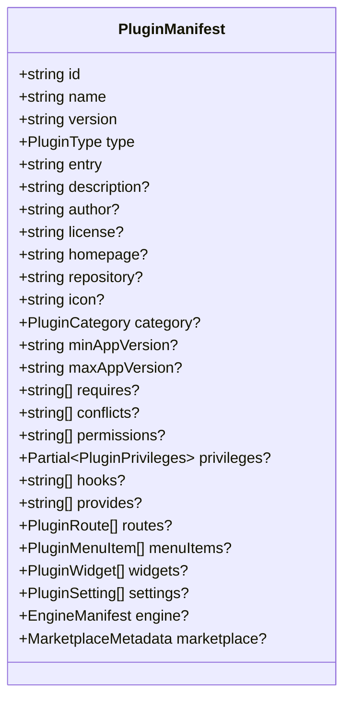
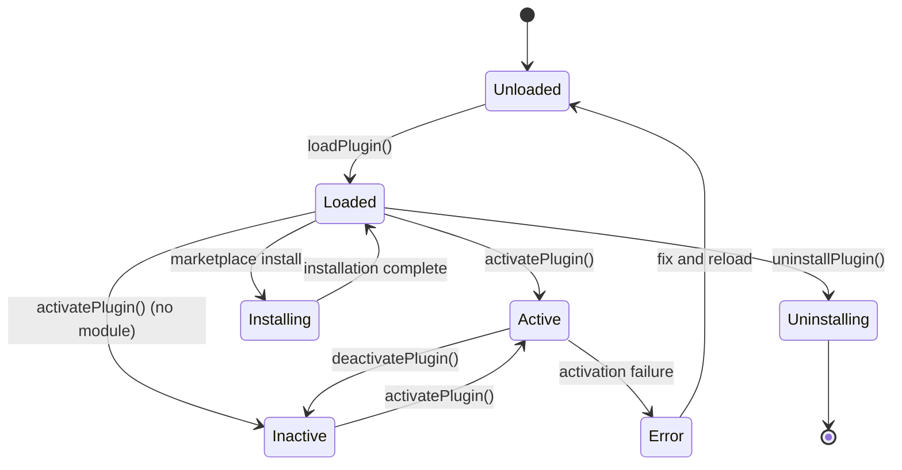
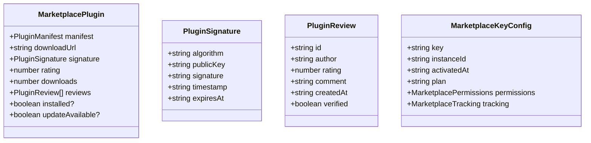
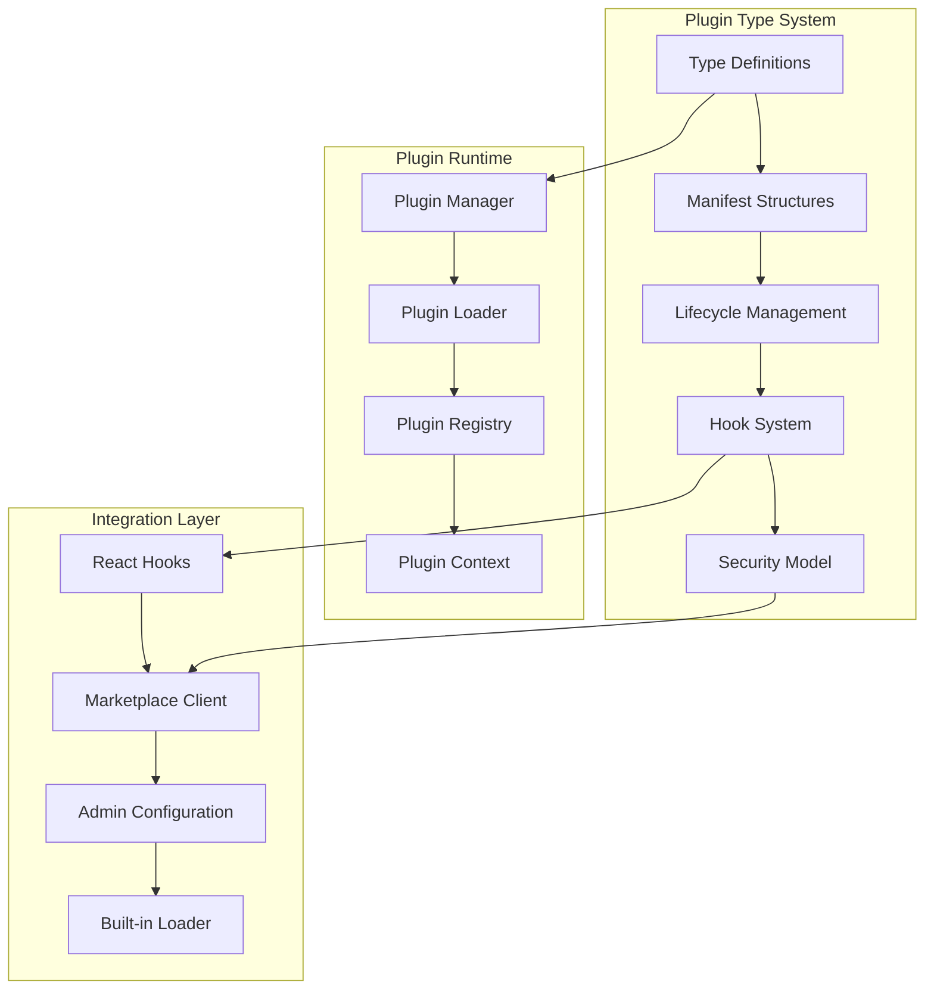

# Plugin Types Definitions

<cite>
**Referenced Files in This Document**
- [types.ts](file://src/plugins/types.ts)
- [PluginManager.ts](file://src/plugins/PluginManager.ts)
- [PluginsProvider.tsx](file://src/plugins/PluginsProvider.tsx)
- [usePlugins.ts](file://src/plugins/usePlugins.ts)
- [BuiltinLoader.ts](file://src/plugins/BuiltinLoader.ts)
- [PLUGIN_ARCHITECTURE_SPEC.md](file://docs/architecture/PLUGIN_ARCHITECTURE_SPEC.md)
- [PLUGIN_DEVELOPMENT_MANUAL.md](file://docs/guides/PLUGIN_DEVELOPMENT_MANUAL.md)
- [PluginMarketplace.ts](file://src/services/PluginMarketplace.ts)
- [FeatureEntitlements.ts](file://src/services/FeatureEntitlements.ts)
- [whitelabel/index.ts](file://src/plugins/builtin/whitelabel/index.ts)
- [grading-engine/index.ts](file://src/plugins/builtin/grading-engine/index.ts)
- [fee-calculator/index.ts](file://src/plugins/builtin/fee-calculator/index.ts)
</cite>

## Update Summary
**Changes Made**
- Updated plugin type system with comprehensive privilege model and security enhancements
- Added detailed marketplace integration types and configuration structures
- Enhanced hook system documentation with security features and execution patterns
- Expanded plugin categories to include engine type for WASM-based computation
- Updated plugin lifecycle management with enhanced event system and security measures
- Added comprehensive TypeScript integration patterns and React hooks support
- Integrated advanced engine plugin support with Go WASM compilation
- Enhanced marketplace client with key validation and analytics tracking
- Added feature entitlement system for premium plugin access control

## Table of Contents
1. [Introduction](#introduction)
2. [Plugin Type System](#plugin-type-system)
3. [Core Plugin Types](#core-plugin-types)
4. [Plugin Categories](#plugin-categories)
5. [Plugin Manifest Structure](#plugin-manifest-structure)
6. [Plugin Lifecycle Types](#plugin-lifecycle-types)
7. [Hook System Types](#hook-system-types)
8. [Security and Privileges](#security-and-privileges)
9. [Marketplace Integration Types](#marketplace-integration-types)
10. [Built-in Plugin Examples](#built-in-plugin-examples)
11. [TypeScript Integration](#typescript-integration)
12. [Architecture Overview](#architecture-overview)

## Introduction

The SchoolPilot3 plugin system provides a comprehensive framework for extending the educational management platform with custom functionality. This documentation focuses specifically on the plugin type definitions that form the foundation of the entire plugin architecture.

The plugin type system defines the fundamental building blocks that enable developers to create various types of extensions, from simple UI modifications to complex computational engines. These types ensure type safety, provide clear contracts between the core system and plugins, and establish consistent patterns for plugin development and integration.

**Updated** Enhanced with comprehensive privilege system, marketplace integration types, and advanced security model.

## Plugin Type System

The plugin type system is built around several core type definitions that establish the foundation for all plugin functionality in SchoolPilot3.

### Type Definition Foundation

The system begins with fundamental type aliases that define the basic categories and classifications for plugins:

```mermaid
classDiagram
class PluginType {
<<enumeration>>
"module"
"theme"
"integration"
"report"
"widget"
"whitelabel"
"engine"
}
class PluginCategory {
<<enumeration>>
"builtin"
"verified"
"community"
"private"
"engine"
}
class HookType {
<<enumeration>>
"action"
"filter"
"async"
}
class NotificationType {
<<enumeration>>
"success"
"error"
"warning"
"info"
}
```

**Diagram sources**
- [types.ts:14-32](file://src/plugins/types.ts#L14-L32)

These type definitions serve as the cornerstone for all plugin-related functionality, ensuring consistency across the entire system and providing clear boundaries for different plugin capabilities.

**Section sources**
- [types.ts:14-32](file://src/plugins/types.ts#L14-L32)

## Core Plugin Types

The core plugin types represent the primary categories of functionality that plugins can provide within the SchoolPilot3 ecosystem.

### Module Plugins

Module plugins represent complete feature modules that extend the core functionality of SchoolPilot3. These plugins can add entire functional areas to the system, including new routes, navigation items, data schemas, and comprehensive feature sets.

**Capabilities:**
- Full feature module implementation
- Route registration and navigation integration
- Data schema definition and collection management
- Core event hook integration
- UI component registration

### Theme Plugins

Theme plugins focus on visual customization and styling modifications. They enable schools to modify the appearance of the application without altering core functionality.

**Capabilities:**
- CSS variable override support
- Custom component injection
- Layout structure modification
- Color scheme customization
- Typography and font family changes

### Integration Plugins

Integration plugins facilitate connections with external services and systems. These plugins enable SchoolPilot3 to communicate with third-party services and synchronize data across platforms.

**Capabilities:**
- External API connectivity
- Authentication flow implementation
- Data synchronization with external systems
- Payment gateway integration
- Communication protocol support

### Engine Plugins

Engine plugins represent high-performance computational engines written in Go and compiled to WebAssembly. These plugins provide shared computation capabilities between the SaaS platform and client installations.

**Capabilities:**
- Go-compiled WASM binary execution
- High-performance mathematical calculations
- Shared codebase between SaaS and client
- Fallback behavior configuration
- Memory management and limits

**Section sources**
- [types.ts:83-91](file://src/plugins/types.ts#L83-L91)
- [PLUGIN_ARCHITECTURE_SPEC.md:128-132](file://docs/architecture/PLUGIN_ARCHITECTURE_SPEC.md#L128-L132)

## Plugin Categories

Plugin categories classify plugins based on their origin, trust level, and distribution method within the SchoolPilot3 ecosystem.

### Built-in Plugins

Built-in plugins are shipped with the core SchoolPilot3 application and represent trusted, verified functionality that is automatically available to all instances.

**Characteristics:**
- Automatically loaded during application startup
- Highest security trust level
- No marketplace dependency
- Core system integration

### Verified Plugins

Verified plugins undergo review and approval by the SchoolPilot3 team, ensuring quality and security standards are met before distribution.

**Characteristics:**
- Review and approval process
- Quality assurance testing
- Security validation
- Official marketplace distribution

### Community Plugins

Community plugins are developed by third-party contributors and represent the broader plugin ecosystem available to SchoolPilot3 users.

**Characteristics:**
- Third-party development
- Community-driven innovation
- Variable quality standards
- Marketplace availability

### Private Plugins

Private plugins are custom-developed for specific school districts or organizations and remain internal to those institutions.

**Characteristics:**
- Custom development per institution
- Internal distribution only
- Tailored functionality
- Limited to specific user base

### Engine Plugins

Engine plugins represent specialized computational engines that provide shared functionality across the SchoolPilot3 ecosystem.

**Characteristics:**
- Go WASM binary distribution
- High-performance computation
- Shared codebase architecture
- Memory and performance constraints

**Section sources**
- [types.ts:23-28](file://src/plugins/types.ts#L23-L28)
- [PLUGIN_ARCHITECTURE_SPEC.md:95-102](file://docs/architecture/PLUGIN_ARCHITECTURE_SPEC.md#L95-L102)

## Plugin Manifest Structure

The plugin manifest serves as the complete specification for each plugin, defining its identity, requirements, capabilities, and integration points within the SchoolPilot3 system.

### Required Manifest Fields

Every plugin manifest must include essential identifying information that establishes the plugin's unique characteristics and compatibility requirements.



**Diagram sources**
- [types.ts:60-111](file://src/plugins/types.ts#L60-L111)

### Type-Specific Manifest Extensions

Different plugin types may require specialized manifest configurations to support their specific functionality and integration requirements.

**Engine Manifest Extension:**
The engine manifest adds WASM-specific configuration for computational plugins, including binary file references, export function specifications, and memory management capabilities.

**Section sources**
- [types.ts:155-163](file://src/plugins/types.ts#L155-L163)

## Plugin Lifecycle Types

The plugin lifecycle encompasses the complete journey of a plugin from discovery to removal, with well-defined states and transitions managed through the PluginManager.

### Plugin Status States

The plugin lifecycle is tracked through distinct status states that indicate the current condition and readiness of each plugin.



**Diagram sources**
- [types.ts:436-436](file://src/plugins/types.ts#L436-L436)

### Lifecycle Events

The plugin system generates comprehensive events throughout the lifecycle to enable monitoring and integration with external systems.

**Event Categories:**
- Discovery and validation events
- Download and installation events  
- Activation and deactivation events
- Error and failure events

**Section sources**
- [types.ts:267-285](file://src/plugins/types.ts#L267-L285)
- [PluginManager.ts:98-127](file://src/plugins/PluginManager.ts#L98-L127)

## Hook System Types

The hook system provides a sophisticated mechanism for plugins to extend and modify application behavior through well-defined extension points.

### Hook Types and Behaviors

The hook system supports three distinct hook types, each serving different purposes in the plugin extension architecture.

```mermaid
classDiagram
class HookDefinition {
+string name
+HookType type
+string description
+string[] parameters
+string returnType?
}
class PluginHookHandler {
+string pluginId
+number priority
+function handler
}
class PluginHook {
+string name
+PluginHookHandler[] handlers
}
class HookType {
<<enumeration>>
"action" // Execute side effects
"filter" // Transform data
"async" // Asynchronous operations
}
```

**Diagram sources**
- [types.ts:413-430](file://src/plugins/types.ts#L413-L430)

### Hook Execution Patterns

The hook system implements sophisticated execution patterns to ensure reliable and predictable plugin behavior while maintaining system stability.

**Execution Strategies:**
- Priority-based execution ordering
- Timeout protection mechanisms
- Circuit breaker failure handling
- Async operation support

**Section sources**
- [types.ts:413-430](file://src/plugins/types.ts#L413-L430)
- [PluginManager.ts:429-501](file://src/plugins/PluginManager.ts#L429-L501)

## Security and Privileges

The plugin security model implements a comprehensive privilege system that controls plugin access to system resources and functionality.

### Plugin Privileges Structure

The privilege system provides granular control over plugin capabilities through a structured permissions model.

```mermaid
classDiagram
class PluginPrivileges {
// Data access privileges
+string[] dataRead
+string[] dataWrite
// UI access privileges
+boolean uiInject
+boolean menuModify
+boolean settingsAccess
// System access privileges
+boolean networkAccess
+boolean fileSystemAccess
+boolean executeCode
}
class PermissionsPreset {
<<enumeration>>
"strict"
"balanced"
"permissive"
}
```

**Diagram sources**
- [types.ts:38-54](file://src/plugins/types.ts#L38-L54)

### Security Implementation

The security model implements multiple layers of protection to ensure safe plugin execution while maintaining necessary functionality.

**Security Features:**
- Sandbox environment isolation
- Network access control
- File system restrictions
- Code execution limitations
- Resource usage monitoring

**Section sources**
- [types.ts:38-54](file://src/plugins/types.ts#L38-L54)
- [PLUGIN_ARCHITECTURE_SPEC.md:438-456](file://docs/architecture/PLUGIN_ARCHITECTURE_SPEC.md#L438-L456)

## Marketplace Integration Types

The marketplace integration system provides comprehensive support for plugin distribution, installation, and management through a secure and controlled environment.

### Marketplace Data Structures

The marketplace system utilizes specialized data structures to manage plugin distribution, licensing, and user interactions.



**Diagram sources**
- [types.ts:361-394](file://src/plugins/types.ts#L361-L394)

### Marketplace Client Configuration

The marketplace client configuration enables flexible marketplace integration with customizable settings for different deployment scenarios.

**Configuration Options:**
- Registry URL customization
- Key-based authentication
- Instance identification
- Caching and performance tuning

**Section sources**
- [types.ts:361-394](file://src/plugins/types.ts#L361-L394)

## Built-in Plugin Examples

The SchoolPilot3 system includes several built-in plugins that demonstrate the capabilities and implementation patterns for different plugin types.

### White-Label Plugin

The white-label plugin provides comprehensive branding customization capabilities, allowing schools to fully customize the application appearance and behavior.

**Key Features:**
- Application name and title customization
- Logo replacement and favicon support
- Color scheme customization
- UI label overrides
- Feature visibility controls
- Footer customization

### Grading Engine Plugin

The grading engine plugin demonstrates advanced computational functionality through WASM-based processing for high-performance calculations.

**Capabilities:**
- Grading strategy calculation
- Performance optimization through WASM
- Fallback behavior configuration
- Strategy validation and selection
- Real-time calculation support

### Fee Calculator Plugin

The fee calculator plugin showcases specialized computational functionality for financial calculations within the educational management system.

**Features:**
- Fee structure calculation
- Discount and penalty application
- Currency support and conversion
- Performance optimization
- Validation and error handling

**Section sources**
- [BuiltinLoader.ts:19-23](file://src/plugins/BuiltinLoader.ts#L19-L23)

## TypeScript Integration

The plugin system provides comprehensive TypeScript integration that ensures type safety and developer productivity throughout the plugin development lifecycle.

### Type Exports and Imports

The plugin system exposes a comprehensive set of TypeScript types through organized export structures that enable seamless integration with plugin development projects.

**Core Type Exports:**
- Plugin type definitions and interfaces
- Manifest and configuration structures
- Lifecycle and event types
- Security and privilege models
- Marketplace integration types

### React Integration

The plugin system integrates seamlessly with React applications through dedicated hooks and context providers that enable reactive plugin management and UI integration.

**React Integration Features:**
- Plugin context provider for React applications
- Custom hooks for plugin state management
- Automatic plugin lifecycle management
- Reactive UI updates based on plugin status

**Section sources**
- [PluginsProvider.tsx:12-18](file://src/plugins/PluginsProvider.tsx#L12-L18)
- [usePlugins.ts:11-19](file://src/plugins/usePlugins.ts#L11-L19)

## Architecture Overview

The plugin type system architecture represents a sophisticated foundation that enables extensible and maintainable plugin functionality within the SchoolPilot3 ecosystem.

### System Architecture Components

The plugin architecture consists of several interconnected components that work together to provide a robust plugin management system.



**Diagram sources**
- [types.ts:1-453](file://src/plugins/types.ts#L1-L453)
- [PluginManager.ts:25-765](file://src/plugins/PluginManager.ts#L25-L765)

### Integration Points

The plugin type system provides well-defined integration points that enable seamless interaction with the broader SchoolPilot3 ecosystem.

**Integration Areas:**
- Core application lifecycle integration
- Data layer integration and access
- UI component integration and rendering
- Security and permission management
- Administrative configuration and control

**Section sources**
- [PLUGIN_ARCHITECTURE_SPEC.md:21-782](file://docs/architecture/PLUGIN_ARCHITECTURE_SPEC.md#L21-L782)