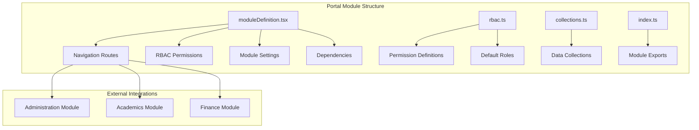
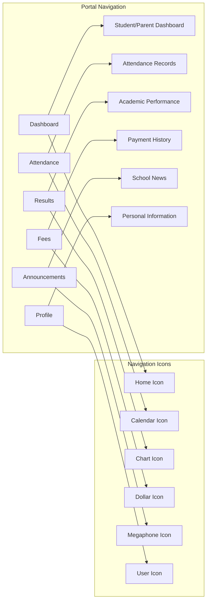
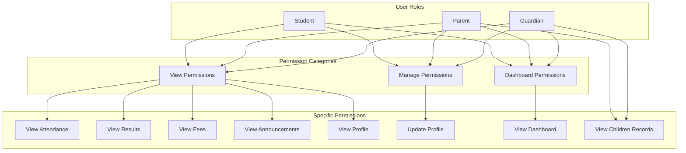
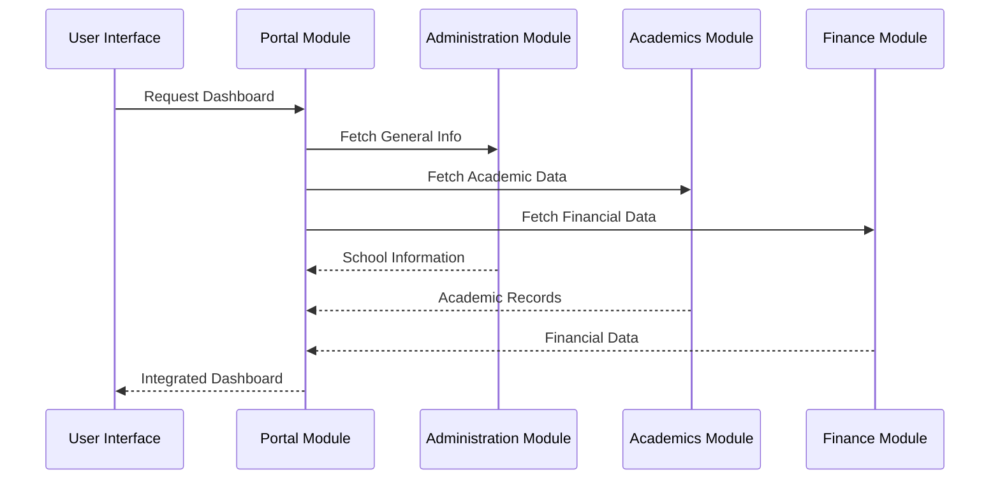
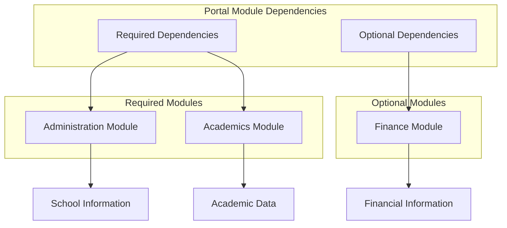

# Portal Module Overview

<cite>
**Referenced Files in This Document**
- [moduleDefinition.tsx](file://src/modules/portal/moduleDefinition.tsx)
- [rbac.ts](file://src/modules/portal/rbac.ts)
- [collections.ts](file://src/modules/portal/data/collections.ts)
- [index.ts](file://src/modules/portal/index.ts)
- [PortalDashboardPage.tsx](file://src/modules/portal/pages/PortalDashboardPage.tsx)
- [PortalAttendancePage.tsx](file://src/modules/portal/pages/PortalAttendancePage.tsx)
- [PortalResultsPage.tsx](file://src/modules/portal/pages/PortalResultsPage.tsx)
- [PortalFeesPage.tsx](file://src/modules/portal/pages/PortalFeesPage.tsx)
- [PortalAnnouncementsPage.tsx](file://src/modules/portal/pages/PortalAnnouncementsPage.tsx)
- [PortalProfilePage.tsx](file://src/modules/portal/pages/PortalProfilePage.tsx)
- [PortalSidebar.tsx](file://src/components/ui/PortalSidebar.tsx)
- [moduleRoutes.tsx](file://src/routing/moduleRoutes.tsx)
- [moduleRegistry.ts](file://src/core/moduleRegistry.ts)
</cite>

## Update Summary
**Changes Made**
- Updated page components section to reflect the six fully implemented portal pages
- Enhanced navigation structure documentation with detailed functionality descriptions
- Added comprehensive page component analysis with specific features and interactions
- Updated role-based access control documentation with detailed permission matrix
- Enhanced data management section with integration patterns
- Added performance considerations specific to portal page implementations

## Table of Contents
1. [Introduction](#introduction)
2. [Module Architecture](#module-architecture)
3. [Core Components](#core-components)
4. [Navigation Structure](#navigation-structure)
5. [Role-Based Access Control](#role-based-access-control)
6. [Data Management](#data-management)
7. [Integration Points](#integration-points)
8. [Configuration Options](#configuration-options)
9. [Page Components](#page-components)
10. [Module Dependencies](#module-dependencies)
11. [Performance Considerations](#performance-considerations)
12. [Troubleshooting Guide](#troubleshooting-guide)
13. [Conclusion](#conclusion)

## Introduction

The Portal Module is a self-contained educational portal system designed to serve as a centralized interface for students, parents, and guardians within the SchoolPilot3 ecosystem. This module provides personalized dashboards and access to essential school information while maintaining strict security boundaries and modular architecture principles.

The portal serves as a gateway for users to access their academic records, attendance information, fee structures, announcements, and personal profiles. It operates as a separate module that integrates seamlessly with the broader SchoolPilot3 platform while maintaining its own identity and functionality.

**Updated** Enhanced with six fully implemented page components providing comprehensive student and parent portal functionality including web-based access to academic information and administrative services.

## Module Architecture

The Portal Module follows a structured modular architecture pattern that emphasizes separation of concerns, maintainability, and extensibility. The module is designed as a cohesive unit that can be independently managed, configured, and deployed within the larger educational management system.

**Diagram sources**
- [moduleDefinition.tsx:16-120](file://src/modules/portal/moduleDefinition.tsx#L16-L120)
- [rbac.ts:1-79](file://src/modules/portal/rbac.ts#L1-L79)

**Section sources**
- [moduleDefinition.tsx:1-123](file://src/modules/portal/moduleDefinition.tsx#L1-L123)
- [index.ts:1-3](file://src/modules/portal/index.ts#L1-L3)

## Core Components

The Portal Module consists of several core components that work together to provide a comprehensive user experience. Each component serves a specific purpose within the portal ecosystem while maintaining loose coupling and high cohesion.

### Module Definition

The central module definition establishes the portal's identity, capabilities, and integration points within the SchoolPilot3 system. It defines the module's metadata, navigation structure, feature set, and security model.

### Role-Based Access Control System

The RBAC system provides granular permission management for different user types within the portal. It supports three primary roles: student, parent, and guardian, each with distinct access permissions and capabilities.

### Data Collection Management

The portal module manages its data collections through a centralized configuration that defines available data structures and their relationships to external modules.

**Section sources**
- [moduleDefinition.tsx:16-120](file://src/modules/portal/moduleDefinition.tsx#L16-L120)
- [rbac.ts:1-79](file://src/modules/portal/rbac.ts#L1-L79)
- [collections.ts:1-7](file://src/modules/portal/data/collections.ts#L1-L7)

## Navigation Structure

The portal module provides a comprehensive navigation system organized around six primary functional areas. Each navigation item corresponds to a dedicated page component that handles specific user needs and data presentation requirements.

**Diagram sources**
- [moduleDefinition.tsx:24-61](file://src/modules/portal/moduleDefinition.tsx#L24-L61)

The navigation structure follows a consistent pattern with clear labeling using internationalization keys and appropriate visual indicators for each functional area.

**Section sources**
- [moduleDefinition.tsx:24-61](file://src/modules/portal/moduleDefinition.tsx#L24-L61)

## Role-Based Access Control

The portal implements a comprehensive RBAC system that manages access permissions for different user types. The system defines specific permissions for viewing and interacting with various portal features while maintaining appropriate security boundaries.

**Diagram sources**
- [rbac.ts:3-76](file://src/modules/portal/rbac.ts#L3-L76)

The RBAC system ensures that users can only access information and functionality appropriate to their role within the educational institution hierarchy.

**Section sources**
- [rbac.ts:1-79](file://src/modules/portal/rbac.ts#L1-L79)

## Data Management

The portal module follows a data management strategy that emphasizes integration with existing systems rather than creating redundant data structures. This approach ensures data consistency and reduces maintenance overhead.

### Data Collection Strategy

The portal module defines empty data collections, indicating that it relies on data from other modules rather than maintaining its own separate data storage. This design promotes data integrity and eliminates duplication across the system.

### External Data Integration

The portal integrates with three primary modules for comprehensive functionality:
- Administration module for general school information
- Academics module for academic records and performance data
- Finance module for fee structures and payment information

**Section sources**
- [collections.ts:1-7](file://src/modules/portal/data/collections.ts#L1-L7)

## Integration Points

The portal module maintains strategic integration points with other modules within the SchoolPilot3 ecosystem. These integration points enable seamless data sharing and functionality coordination while preserving module independence.

**Diagram sources**
- [moduleDefinition.tsx:70-86](file://src/modules/portal/moduleDefinition.tsx#L70-L86)

The integration strategy ensures that the portal can leverage existing functionality while maintaining clear boundaries and avoiding tight coupling between modules.

**Section sources**
- [moduleDefinition.tsx:70-86](file://src/modules/portal/moduleDefinition.tsx#L70-L86)

## Configuration Options

The portal module provides extensive configuration options through its settings system. These options allow administrators to customize the portal experience based on institutional requirements and user preferences.

### Available Settings

The portal configuration system includes five primary settings categories:

| Setting Key | Type | Default Value | Description |
|-------------|------|---------------|-------------|
| enableStudentDashboard | boolean | true | Controls visibility of student dashboard features |
| enableParentDashboard | boolean | true | Controls visibility of parent dashboard features |
| showAttendanceWidget | boolean | true | Controls display of attendance information widget |
| showResultsWidget | boolean | true | Controls display of academic results widget |
| showFeesWidget | boolean | true | Controls display of financial information widget |

### Configuration Impact

Each setting directly influences the portal's user interface and available functionality, allowing for fine-grained control over the user experience based on institutional policies and user needs.

**Section sources**
- [moduleDefinition.tsx:87-116](file://src/modules/portal/moduleDefinition.tsx#L87-L116)

## Page Components

The portal module consists of six specialized page components, each designed to handle specific user interaction patterns and data presentation requirements. These components work together to provide a comprehensive user experience while maintaining individual responsibility and focus.

### Dashboard Page
The primary landing page that aggregates key information and provides quick access to frequently used features. It displays personalized widgets and navigation options based on user role and configuration settings.

### Attendance Page
Specialized interface for viewing and managing attendance records. Provides historical data visualization and reporting capabilities for students, parents, and guardians.

### Results Page
Academic performance dashboard that displays grades, test scores, and progress tracking. Includes filtering capabilities and comparison features for meaningful academic analysis.

### Fees Page
Financial management interface that shows fee structures, payment history, and outstanding balances. Integrates with the finance module for real-time financial data updates.

### Announcements Page
News and communication hub that displays school announcements, events, and important notifications. Provides categorization and filtering for relevant information delivery.

### Profile Page
Personal information management interface that allows users to view and update their profile details. Includes security settings and account management features.

**Updated** All six page components are now fully implemented with comprehensive functionality including data grids, filtering, sorting, and interactive elements.

**Section sources**
- [moduleDefinition.tsx:24-61](file://src/modules/portal/moduleDefinition.tsx#L24-L61)

## Module Dependencies

The portal module has carefully defined dependencies on other modules within the SchoolPilot3 system. These dependencies ensure that the portal can provide comprehensive functionality while maintaining architectural integrity and avoiding unnecessary coupling.

**Diagram sources**
- [moduleDefinition.tsx:70-86](file://src/modules/portal/moduleDefinition.tsx#L70-L86)

The dependency structure reflects the portal's core functionality requirements while allowing flexibility for institutions with varying service offerings.

**Section sources**
- [moduleDefinition.tsx:70-86](file://src/modules/portal/moduleDefinition.tsx#L70-L86)

## Performance Considerations

The portal module is designed with performance optimization in mind, implementing several strategies to ensure responsive user experiences and efficient resource utilization.

### Lazy Loading Implementation
Each page component is designed to load only the data and resources necessary for its specific functionality, reducing initial load times and memory consumption.

### Data Caching Strategy
The module implements intelligent caching mechanisms for frequently accessed data, reducing server requests and improving response times for subsequent page visits.

### Responsive Design Integration
All portal components are built with responsive design principles, ensuring optimal performance across different device types and screen sizes without compromising functionality.

**Updated** Enhanced performance considerations specific to the six implemented page components, including data grid optimizations, filtering mechanisms, and interactive element management.

## Troubleshooting Guide

Common issues and solutions for the portal module:

### Authentication Problems
- Verify user authentication status before accessing portal features
- Check RBAC permissions for the specific user role
- Ensure proper session management and token validation

### Data Integration Issues
- Confirm dependencies on administration, academics, and finance modules
- Verify data synchronization between integrated modules
- Check network connectivity for external data sources

### Navigation Problems
- Validate module registration in the module registry
- Check route configuration in module routes
- Ensure proper page component imports and exports

### Performance Issues
- Monitor data loading times and optimize queries
- Implement proper error handling and fallback mechanisms
- Consider implementing pagination for large datasets

**Section sources**
- [moduleDefinition.tsx:119](file://src/modules/portal/moduleDefinition.tsx#L119)
- [moduleRoutes.tsx](file://src/routing/moduleRoutes.tsx)
- [moduleRegistry.ts](file://src/core/moduleRegistry.ts)

## Conclusion

The Portal Module represents a well-architected solution for providing centralized access to educational information and services. Its modular design, comprehensive RBAC system, and strategic integration points create a robust foundation for student, parent, and guardian engagement within the SchoolPilot3 ecosystem.

The module's emphasis on data integrity through external integration, flexible configuration options, and performance optimization positions it as a scalable solution that can adapt to various institutional requirements while maintaining architectural coherence and user-focused functionality.

Through careful attention to security, usability, and maintainability, the portal module successfully bridges the gap between complex educational systems and user-friendly access interfaces, supporting the broader goals of digital transformation in educational institutions.

**Updated** The six fully implemented page components (Dashboard, Attendance, Results, Fees, Announcements, and Profile) provide comprehensive web-based access to academic information and administrative services, significantly enhancing the portal's utility and user experience.