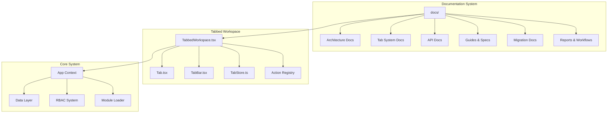
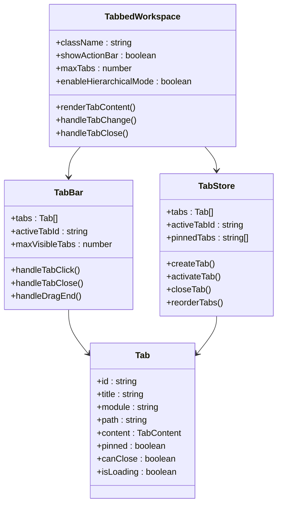
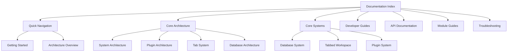
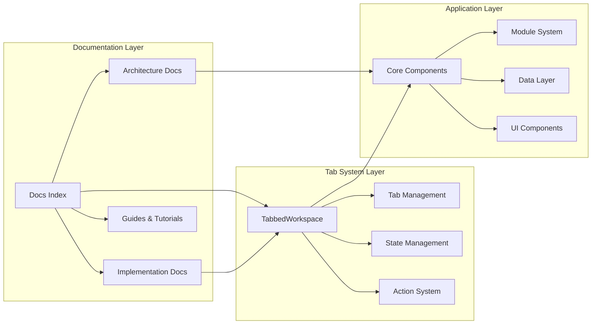
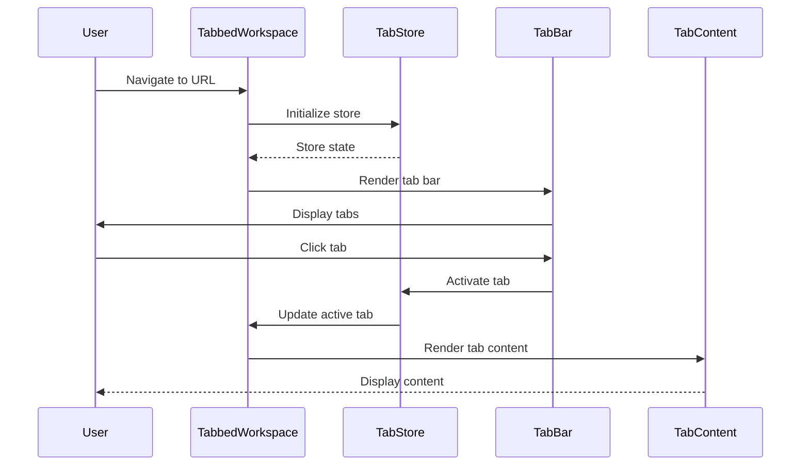
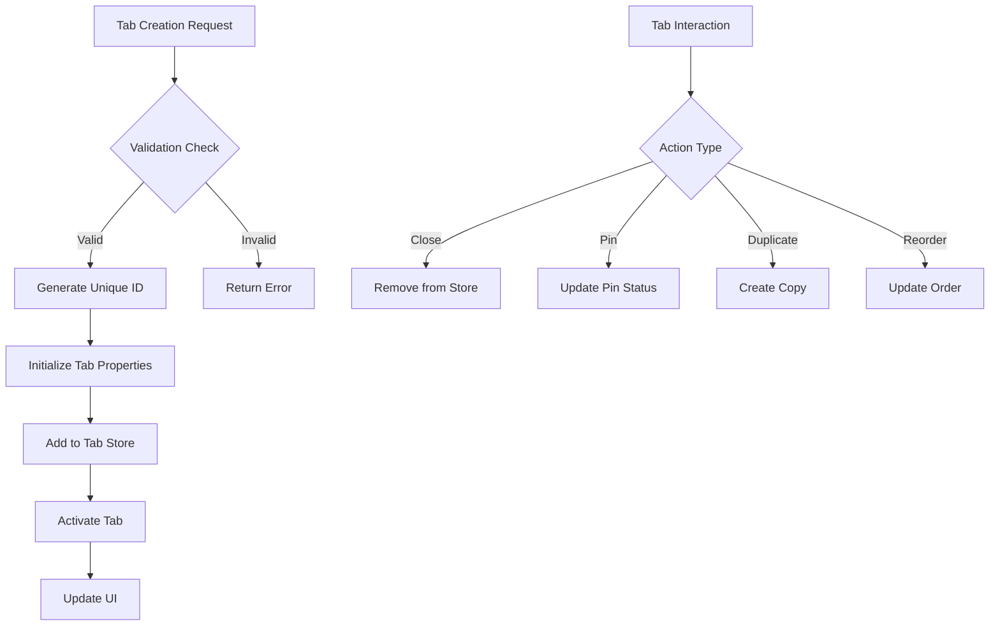
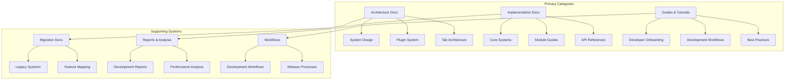
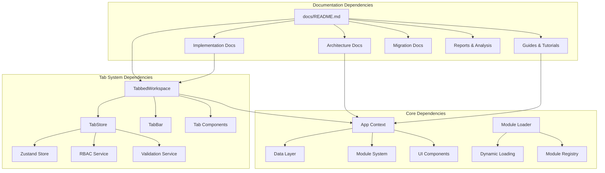

# Documentation Index System

<cite>
**Referenced Files in This Document**
- [README.md](file://README.md)
- [package.json](file://package.json)
- [docs/README.md](file://docs/README.md)
- [docs/tabs/TAB_SYSTEMS_ANALYSIS.md](file://docs/tabs/TAB_SYSTEMS_ANALYSIS.md)
- [docs/tabs/TAB_SYSTEM_ENHANCEMENTS.md](file://docs/tabs/TAB_SYSTEM_ENHANCEMENTS.md)
- [docs/tabs/TAB_SYSTEM_IMPROVEMENTS_DESIGN.md](file://docs/tabs/TAB_SYSTEM_IMPROVEMENTS_DESIGN.md)
- [docs/tabs/SYSTEM_OVERVIEW.md](file://docs/tabs/SYSTEM_OVERVIEW.md)
- [src/components/tabbedWorkspace/index.ts](file://src/components/tabbedWorkspace/index.ts)
- [src/components/tabbedWorkspace/TabbedWorkspace.tsx](file://src/components/tabbedWorkspace/TabbedWorkspace.tsx)
- [src/components/tabbedWorkspace/Tab.tsx](file://src/components/tabbedWorkspace/Tab.tsx)
- [src/components/tabbedWorkspace/TabBar.tsx](file://src/components/tabbedWorkspace/TabBar.tsx)
- [src/stores/tabStore.ts](file://src/stores/tabStore.ts)
</cite>

## Table of Contents
1. [Introduction](#introduction)
2. [Project Structure](#project-structure)
3. [Core Components](#core-components)
4. [Architecture Overview](#architecture-overview)
5. [Detailed Component Analysis](#detailed-component-analysis)
6. [Dependency Analysis](#dependency-analysis)
7. [Performance Considerations](#performance-considerations)
8. [Troubleshooting Guide](#troubleshooting-guide)
9. [Conclusion](#conclusion)

## Introduction

The Documentation Index System for SchoolPilot3 represents a comprehensive approach to organizing and accessing the extensive documentation ecosystem. This system encompasses not only traditional documentation but also serves as a unified index for the tabbed workspace functionality, which provides a browser-like multi-tasking interface within the application.

The system is built around three primary pillars: the tabbed workspace architecture, the comprehensive documentation structure, and the unified configuration management. The tabbed workspace system allows users to manage multiple open entities across different modules without losing context, while the documentation system provides structured access to architectural decisions, implementation details, and operational guidelines.

## Project Structure

The documentation index system is organized within the broader SchoolPilot3 project structure, with documentation files strategically placed to maximize discoverability and maintainability.

**Diagram sources**
- [docs/README.md:94-125](file://docs/README.md#L94-L125)
- [src/components/tabbedWorkspace/index.ts:1-44](file://src/components/tabbedWorkspace/index.ts#L1-L44)

The documentation system follows a hierarchical organization pattern that mirrors the application's modular architecture. Each major component area has dedicated documentation sections that provide both high-level overviews and detailed implementation guides.

**Section sources**
- [docs/README.md:1-162](file://docs/README.md#L1-L162)
- [README.md:77-122](file://README.md#L77-L122)

## Core Components

The documentation index system comprises several interconnected components that work together to provide comprehensive access to information about the tabbed workspace and related systems.

### Tabbed Workspace Architecture

The tabbed workspace system serves as the primary interface for multi-tasking within the application, providing a URL-driven approach to managing multiple open entities across different modules.

**Diagram sources**
- [src/components/tabbedWorkspace/TabbedWorkspace.tsx:16-549](file://src/components/tabbedWorkspace/TabbedWorkspace.tsx#L16-L549)
- [src/components/tabbedWorkspace/Tab.tsx:269-612](file://src/components/tabbedWorkspace/Tab.tsx#L269-L612)
- [src/components/tabbedWorkspace/TabBar.tsx:40-521](file://src/components/tabbedWorkspace/TabBar.tsx#L40-L521)
- [src/stores/tabStore.ts:139-800](file://src/stores/tabStore.ts#L139-L800)

### Documentation Index Structure

The documentation system provides multiple entry points and navigation pathways to accommodate different user needs and technical expertise levels.

**Diagram sources**
- [docs/README.md:5-93](file://docs/README.md#L5-L93)

**Section sources**
- [src/components/tabbedWorkspace/index.ts:1-44](file://src/components/tabbedWorkspace/index.ts#L1-L44)
- [docs/README.md:1-162](file://docs/README.md#L1-L162)

## Architecture Overview

The documentation index system integrates seamlessly with the broader SchoolPilot3 architecture, providing structured access to information while supporting the tabbed workspace functionality that enables multi-tasking within the application.

**Diagram sources**
- [docs/tabs/SYSTEM_OVERVIEW.md:1-53](file://docs/tabs/SYSTEM_OVERVIEW.md#L1-L53)
- [docs/tabs/TAB_SYSTEMS_ANALYSIS.md:1-512](file://docs/tabs/TAB_SYSTEMS_ANALYSIS.md#L1-L512)

The architecture emphasizes modularity and maintainability, with clear separation between documentation organization and functional implementation. The tabbed workspace system provides the foundation for multi-tasking capabilities, while the documentation system ensures comprehensive coverage of all aspects of the implementation.

**Section sources**
- [docs/tabs/SYSTEM_OVERVIEW.md:1-53](file://docs/tabs/SYSTEM_OVERVIEW.md#L1-L53)
- [docs/tabs/TAB_SYSTEMS_ANALYSIS.md:1-512](file://docs/tabs/TAB_SYSTEMS_ANALYSIS.md#L1-L512)

## Detailed Component Analysis

### TabbedWorkspace Component

The TabbedWorkspace component serves as the primary interface for managing multiple tabs within the application, implementing sophisticated state management and user interaction patterns.

**Diagram sources**
- [src/components/tabbedWorkspace/TabbedWorkspace.tsx:108-200](file://src/components/tabbedWorkspace/TabbedWorkspace.tsx#L108-L200)
- [src/stores/tabStore.ts:163-244](file://src/stores/tabStore.ts#L163-L244)

The component implements comprehensive error handling, performance optimization, and user experience considerations. It manages the lifecycle of tabs, handles user interactions, and coordinates with the underlying store system.

### Tab Management System

The tab management system provides sophisticated functionality for creating, organizing, and controlling individual tabs within the workspace.

**Diagram sources**
- [src/stores/tabStore.ts:258-335](file://src/stores/tabStore.ts#L258-L335)
- [src/components/tabbedWorkspace/Tab.tsx:374-410](file://src/components/tabbedWorkspace/Tab.tsx#L374-L410)

The system includes robust validation mechanisms, permission checking, and state persistence to ensure reliable operation across different scenarios.

### Documentation Index Organization

The documentation system employs a hierarchical organization strategy that facilitates both broad exploration and deep technical diving.

**Diagram sources**
- [docs/README.md:94-125](file://docs/README.md#L94-L125)

**Section sources**
- [src/components/tabbedWorkspace/TabbedWorkspace.tsx:16-549](file://src/components/tabbedWorkspace/TabbedWorkspace.tsx#L16-L549)
- [src/components/tabbedWorkspace/Tab.tsx:269-612](file://src/components/tabbedWorkspace/Tab.tsx#L269-L612)
- [src/components/tabbedWorkspace/TabBar.tsx:40-521](file://src/components/tabbedWorkspace/TabBar.tsx#L40-L521)
- [src/stores/tabStore.ts:139-800](file://src/stores/tabStore.ts#L139-L800)

## Dependency Analysis

The documentation index system exhibits clear dependency relationships that support maintainability and scalability across the application ecosystem.

**Diagram sources**
- [docs/README.md:94-125](file://docs/README.md#L94-L125)
- [src/stores/tabStore.ts:14-16](file://src/stores/tabStore.ts#L14-L16)
- [src/components/tabbedWorkspace/index.ts:25-41](file://src/components/tabbedWorkspace/index.ts#L25-L41)

The dependency analysis reveals a well-structured system where documentation serves as both a consumer and maintainer of architectural decisions, while the tab system depends on core infrastructure components for proper operation.

**Section sources**
- [docs/README.md:94-125](file://docs/README.md#L94-L125)
- [src/stores/tabStore.ts:14-16](file://src/stores/tabStore.ts#L14-L16)
- [src/components/tabbedWorkspace/index.ts:25-41](file://src/components/tabbedWorkspace/index.ts#L25-L41)

## Performance Considerations

The documentation index system incorporates several performance optimization strategies to ensure efficient access to information and smooth user experience.

### Tab System Performance

The tabbed workspace system implements various optimization techniques to maintain responsiveness even with multiple tabs open:

- **Memoization Strategies**: Extensive use of React.memo and useMemo to prevent unnecessary re-renders
- **Lazy Loading**: Content is loaded on-demand rather than all at once
- **State Optimization**: Efficient state management to minimize memory usage
- **Drag-and-Drop Optimization**: Smooth reordering operations without blocking the UI

### Documentation System Efficiency

The documentation system employs strategies to maintain performance across large documentation sets:

- **Hierarchical Organization**: Logical grouping reduces cognitive load and improves navigation speed
- **Search Optimization**: Structured metadata enables fast content discovery
- **Progressive Disclosure**: Information revealed incrementally based on user needs
- **Caching Strategies**: Frequently accessed documentation cached for improved response times

**Section sources**
- [src/components/tabbedWorkspace/TabbedWorkspace.tsx:48-511](file://src/components/tabbedWorkspace/TabbedWorkspace.tsx#L48-L511)
- [docs/tabs/TAB_SYSTEM_ENHANCEMENTS.md:168-206](file://docs/tabs/TAB_SYSTEM_ENHANCEMENTS.md#L168-L206)

## Troubleshooting Guide

The documentation index system includes comprehensive troubleshooting resources to help users resolve common issues and optimize their experience.

### Common Issues and Solutions

**Tab Management Problems**:
- **Issue**: Tabs not responding to user interactions
- **Solution**: Check browser console for JavaScript errors and verify RBAC permissions
- **Prevention**: Regular cleanup of corrupted tab data through the validation system

**Performance Issues**:
- **Issue**: Slow tab switching or UI lag
- **Solution**: Monitor tab count and consider closing unnecessary tabs
- **Prevention**: Implement tab limits and automatic cleanup mechanisms

**Navigation Problems**:
- **Issue**: URL state not persisting correctly
- **Solution**: Verify browser compatibility and localStorage availability
- **Prevention**: Implement fallback mechanisms for browsers with limited storage

### Diagnostic Tools

The system provides built-in diagnostic capabilities:

- **Console Logging**: Development mode includes detailed logging for debugging
- **Error Boundaries**: Comprehensive error handling prevents application crashes
- **State Inspection**: Tools for examining tab state and identifying issues
- **Performance Monitoring**: Built-in metrics for tracking system performance

**Section sources**
- [docs/tabs/TAB_SYSTEM_ENHANCEMENTS.md:72-117](file://docs/tabs/TAB_SYSTEM_ENHANCEMENTS.md#L72-L117)
- [src/components/tabbedWorkspace/TabbedWorkspace.tsx:490-506](file://src/components/tabbedWorkspace/TabbedWorkspace.tsx#L490-L506)

## Conclusion

The Documentation Index System for SchoolPilot3 represents a sophisticated approach to organizing and accessing complex information about a multi-faceted educational management system. By combining comprehensive documentation with powerful tabbed workspace functionality, the system provides both breadth of coverage and depth of technical detail.

The system's strength lies in its modular architecture, which allows for independent development and maintenance of different documentation areas while maintaining cohesive integration. The tabbed workspace functionality extends this philosophy to user interaction, enabling efficient multi-tasking within the application context.

Future enhancements should focus on expanding the documentation coverage to match the evolving system complexity, improving search and discovery mechanisms, and enhancing the integration between documentation access and tab management functionality. The existing foundation provides excellent support for these improvements while maintaining the system's core strengths in organization, accessibility, and performance.