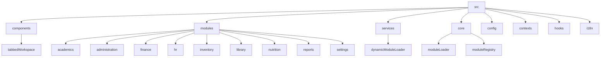
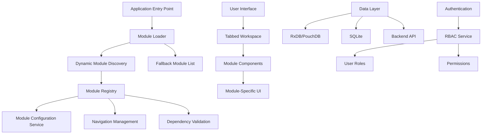
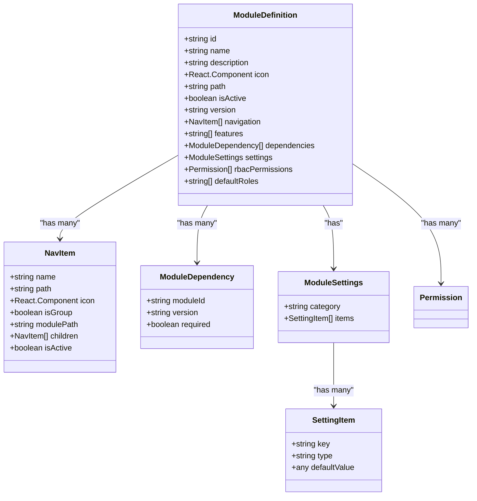
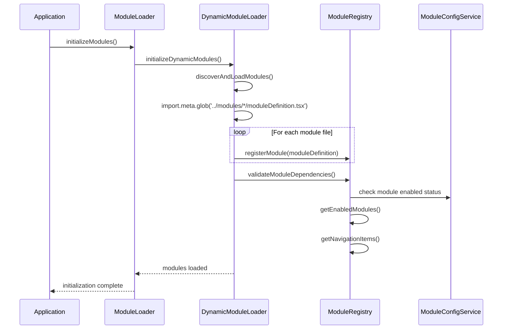
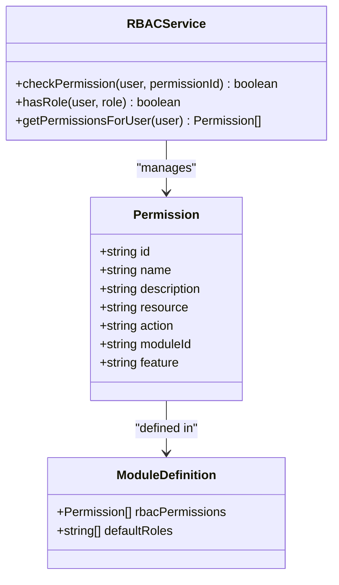
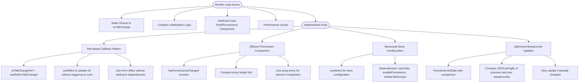
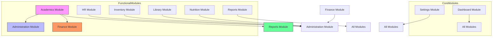

# Project Overview

<cite>
**Referenced Files in This Document**   
- [moduleDefinition.tsx](file://src/modules/academics/moduleDefinition.tsx)
- [rbac.ts](file://src/modules/academics/rbac.ts)
- [moduleLoader.ts](file://src/core/moduleLoader.ts)
- [dynamicModuleLoader.ts](file://src/services/dynamicModuleLoader.ts)
- [moduleRegistry.ts](file://src/core/moduleRegistry.ts)
- [OPTIMIZATION_GUIDE.md](file://src/components/tabbedWorkspace/OPTIMIZATION_GUIDE.md)
- [RENDER_LOOP_FIX_DOCUMENTATION.md](file://src/components/tabbedWorkspace/RENDER_LOOP_FIX_DOCUMENTATION.md)
- [tabbedWorkspace.tsx](file://src/components/tabbedWorkspace/TabbedWorkspace.tsx)
</cite>

## Table of Contents
1. [Introduction](#introduction)
2. [Project Structure](#project-structure)
3. [Core Components](#core-components)
4. [Architecture Overview](#architecture-overview)
5. [Detailed Component Analysis](#detailed-component-analysis)
6. [Dependency Analysis](#dependency-analysis)
7. [Performance Considerations](#performance-considerations)
8. [Troubleshooting Guide](#troubleshooting-guide)
9. [Conclusion](#conclusion)

## Introduction
The schoolpilot3 system is a modular, full-featured educational administration platform designed to support comprehensive school management. This document provides a detailed analysis of its architecture, focusing on dynamic module loading, offline-first data capabilities, multi-tenant internationalization, and key user interface features. The system supports critical educational functions including academics, finance, HR, inventory, library, nutrition, and reporting. The documentation covers both conceptual overviews for new developers and technical context for experienced contributors, with practical examples of real-world use cases such as student enrollment workflows and exam result processing.

## Project Structure
The schoolpilot3 system follows a modular architecture with a clear separation of concerns. The project is organized into several key directories: `src` contains the main application code, `scripts` contains various utility and maintenance scripts, and the root directory contains configuration files and documentation. The `src` directory is further organized into components, modules, services, and other functional areas.

**Diagram sources**
- [src/modules/academics/moduleDefinition.tsx](file://src/modules/academics/moduleDefinition.tsx)
- [src/services/dynamicModuleLoader.ts](file://src/services/dynamicModuleLoader.ts)
- [src/core/moduleLoader.ts](file://src/core/moduleLoader.ts)

**Section sources**
- [src/modules/academics/moduleDefinition.tsx](file://src/modules/academics/moduleDefinition.tsx)
- [src/services/dynamicModuleLoader.ts](file://src/services/dynamicModuleLoader.ts)

## Core Components
The schoolpilot3 system is built around several core components that enable its modular architecture and dynamic functionality. The module system allows for independent development and deployment of functional areas such as academics, finance, and HR. Each module is self-contained with its own data, UI components, and business logic. The system uses a tabbed workspace interface that allows users to work with multiple modules simultaneously. Role-based access control (RBAC) ensures that users only have access to the functionality appropriate for their roles. The system also implements hybrid data strategies with offline-first capabilities using RxDB/PouchDB for local data storage and synchronization.

**Section sources**
- [moduleDefinition.tsx](file://src/modules/academics/moduleDefinition.tsx)
- [rbac.ts](file://src/modules/academics/rbac.ts)
- [tabbedWorkspace.tsx](file://src/components/tabbedWorkspace/TabbedWorkspace.tsx)

## Architecture Overview
The schoolpilot3 system employs a modular architecture with dynamic module loading capabilities. The architecture is designed to support a plugin-like system where modules can be independently developed, tested, and deployed. The system uses a registry pattern to manage module registration and discovery, with fallback mechanisms to ensure system stability even when module discovery fails.

**Diagram sources**
- [moduleLoader.ts](file://src/core/moduleLoader.ts)
- [dynamicModuleLoader.ts](file://src/services/dynamicModuleLoader.ts)
- [moduleRegistry.ts](file://src/core/moduleRegistry.ts)

## Detailed Component Analysis

### Module System Analysis
The module system in schoolpilot3 is designed to support dynamic loading and registration of functional modules. Each module is defined by a module definition file that specifies its metadata, navigation structure, dependencies, and permissions.

#### Module Definition Structure:

**Diagram sources**
- [moduleDefinition.tsx](file://src/modules/academics/moduleDefinition.tsx)
- [types.ts](file://src/core/types.ts)

#### Dynamic Module Loading Process:

**Diagram sources**
- [moduleLoader.ts](file://src/core/moduleLoader.ts)
- [dynamicModuleLoader.ts](file://src/services/dynamicModuleLoader.ts)
- [moduleRegistry.ts](file://src/core/moduleRegistry.ts)

### Role-Based Access Control (RBAC) Analysis
The RBAC system in schoolpilot3 provides fine-grained control over user permissions and access to system functionality.

#### RBAC Structure:

**Diagram sources**
- [rbac.ts](file://src/modules/academics/rbac.ts)
- [rbacService.ts](file://src/core/rbacService.ts)

### Tabbed Workspace Analysis
The tabbed workspace component provides a multi-tab interface that allows users to work with multiple modules and views simultaneously.

#### Performance Optimization Techniques:

```mermaid
flowchart TD
Start([TabbedWorkspace Component]) --> Memoization["Component Memoization with React.memo"]
Memoization --> TabBar["TabBar: Prevents unnecessary re-renders"]
Memoization --> ActionBar["ActionBar: Prevents unnecessary re-renders"]
Memoization --> Breadcrumb["BreadcrumbNavigation: Prevents unnecessary re-renders"]
Start --> CallbackMemo["Callback Memoization with useCallback"]
CallbackMemo --> TabCreate["handleTabCreate: Maintains referential equality"]
CallbackMemo --> TabClose["handleTabClose: Maintains referential equality"]
CallbackMemo --> BreadcrumbClick["handleBreadcrumbClick: Maintains referential equality"]
CallbackMemo --> SubTabChange["handleSubTabChange: Maintains referential equality"]
CallbackMemo --> RenderContent["renderTabContent: Maintains referential equality"]
Start --> ComputationMemo["Expensive Computation Memoization with useMemo"]
ComputationMemo --> ActiveTab["activeTab: Memoized active tab lookup"]
ComputationMemo --> SortedTabs["sortedTabs: Memoized filtered and sorted tabs"]
ComputationMemo --> ModuleStyles["moduleStyles: Memoized module style calculations"]
ComputationMemo --> BreadcrumbGen["generateBreadcrumbs: Memoized breadcrumb generation"]
Start --> PropsMemo["Props Memoization"]
PropsMemo --> ActionBarProps["actionBarProps: Memoized action bar props"]
PropsMemo --> TabBarProps["tabBarProps: Memoized tab bar props"]
Start --> KeyOptimization["Proper Key Props"]
KeyOptimization --> Draggable["Draggable elements: Stable, unique keys"]
KeyOptimization --> BreadcrumbItems["Breadcrumb items: Stable, unique keys"]
Start --> StateOptimization["Optimized State Updates"]
StateOptimization --> PermissionsHash["createPermissionsHash: Efficient permission comparison"]
StateOptimization --> ConditionalLogging["Conditional logging: Only in development mode"]
```

**Diagram sources**
- [OPTIMIZATION_GUIDE.md](file://src/components/tabbedWorkspace/OPTIMIZATION_GUIDE.md)

#### Render Loop Fix Implementation:

**Diagram sources**
- [RENDER_LOOP_FIX_DOCUMENTATION.md](file://src/components/tabbedWorkspace/RENDER_LOOP_FIX_DOCUMENTATION.md)

**Section sources**
- [OPTIMIZATION_GUIDE.md](file://src/components/tabbedWorkspace/OPTIMIZATION_GUIDE.md)
- [RENDER_LOOP_FIX_DOCUMENTATION.md](file://src/components/tabbedWorkspace/RENDER_LOOP_FIX_DOCUMENTATION.md)
- [TabbedWorkspace.tsx](file://src/components/tabbedWorkspace/TabbedWorkspace.tsx)

## Dependency Analysis
The schoolpilot3 system has a well-defined dependency structure that ensures modules can be developed and deployed independently while maintaining system integrity.

**Diagram sources**
- [moduleDefinition.tsx](file://src/modules/academics/moduleDefinition.tsx)
- [moduleDefinition.tsx](file://src/modules/finance/moduleDefinition.tsx)
- [moduleDefinition.tsx](file://src/modules/hr/moduleDefinition.tsx)

**Section sources**
- [moduleDefinition.tsx](file://src/modules/academics/moduleDefinition.tsx)
- [moduleRegistry.ts](file://src/core/moduleRegistry.ts)

## Performance Considerations
The schoolpilot3 system implements several performance optimization techniques to ensure a responsive user experience, particularly in the tabbed workspace component which is central to the user interface.

The system uses React.memo to prevent unnecessary re-renders of child components, useCallback to maintain referential equality of callbacks, and useMemo to memoize expensive computations. Props objects for child components are memoized to prevent new object creation on each render, and stable, unique keys are used for all mapped elements to help React efficiently update the DOM.

For state updates, the system uses efficient comparison techniques such as permission hash comparison to prevent unnecessary re-renders. Console logging is conditionally executed only in development mode to avoid performance overhead in production.

The render loop issues that were previously present in the tabbed workspace component have been resolved through the use of ref-based callback patterns, efficient permission comparison, memoized store configuration, and optimized breadcrumb updates. These fixes have resulted in single renders per meaningful change, smooth tab transitions, proper callback handling, and optimized memory usage.

## Troubleshooting Guide
When troubleshooting issues in the schoolpilot3 system, particularly related to module loading and the tabbed workspace, the following steps and considerations should be followed:

**Section sources**
- [RENDER_LOOP_FIX_DOCUMENTATION.md](file://src/components/tabbedWorkspace/RENDER_LOOP_FIX_DOCUMENTATION.md)
- [dynamicModuleLoader.ts](file://src/services/dynamicModuleLoader.ts)

### Module Loading Issues
1. **Check module discovery**: Verify that the dynamic module discovery is working by checking the console output for discovered module files.
2. **Verify module definitions**: Ensure that each module has a valid moduleDefinition.tsx file with the correct export structure.
3. **Check dependencies**: Validate that all required module dependencies are available and enabled.
4. **Fallback mechanism**: If module discovery fails, the system will use a predefined fallback list of modules. Check the console for warnings about using fallback modules.

### Tabbed Workspace Issues
1. **Render loop detection**: Use the RenderLoopDebugger component to detect rapid consecutive renders or excessive renders within a time window.
2. **Console warnings**: Monitor for warnings about rapid renders, which indicate potential issues.
3. **Visual flickering**: If there is visual flickering when interacting with tabs, check for stale closures in useEffect hooks.
4. **Performance profiler**: Use React DevTools to identify components that are re-rendering unnecessarily.

### Common Issues and Solutions
- **Issue**: Modules not appearing in navigation
  - **Solution**: Check that the module is properly registered in the module registry and that it is enabled in the module configuration service.
  
- **Issue**: Permission errors when accessing module functionality
  - **Solution**: Verify that the user's role has the required permissions defined in the module's RBAC configuration.
  
- **Issue**: Slow application startup
  - **Solution**: Check the module loading process and consider optimizing the number of modules loaded at startup.
  
- **Issue**: Memory leaks in long-running sessions
  - **Solution**: Verify that all event listeners and subscriptions are properly cleaned up when components are unmounted.

## Conclusion
The schoolpilot3 school management system is a sophisticated, modular platform that provides comprehensive educational administration capabilities. Its architecture emphasizes dynamic module loading, allowing for flexible and scalable development. The system's offline-first data capabilities via RxDB/PouchDB ensure reliable operation even in low-connectivity environments. The multi-tenant internationalization support enables deployment in diverse linguistic and cultural contexts.

Key features such as the tabbed workspace interface provide an efficient user experience, while role-based access control ensures appropriate security and data privacy. The hybrid data strategies combine local storage for offline access with backend synchronization for data consistency across devices.

The system demonstrates best practices in modern web application development, including proper state management, performance optimization, and modular design. The comprehensive documentation and optimization guides provide valuable resources for both new and experienced developers working with the system.

Future development could focus on further performance improvements, such as implementing virtual scrolling for large datasets, adding more comprehensive performance monitoring in production, and potentially migrating to a dedicated state management library for complex state scenarios.