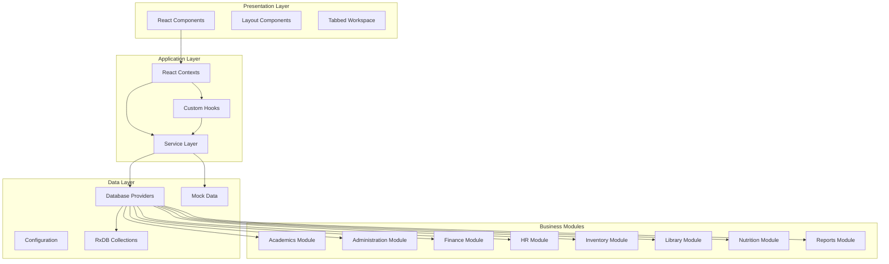
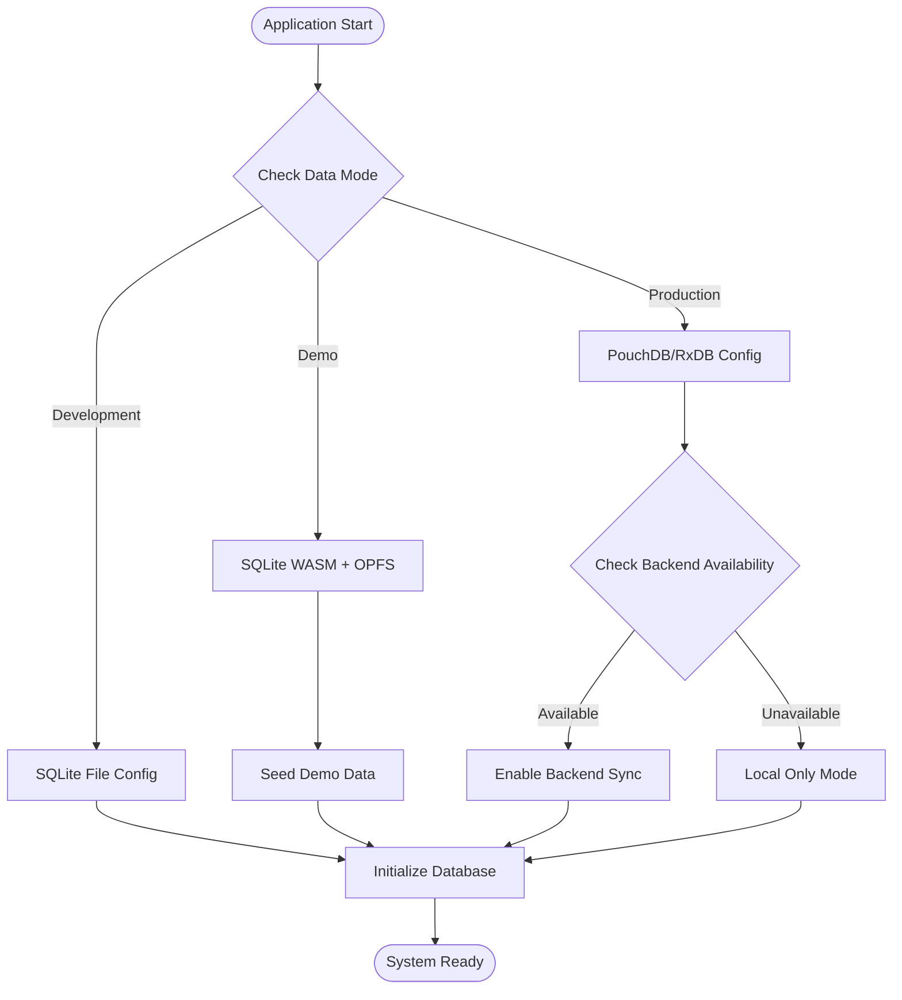
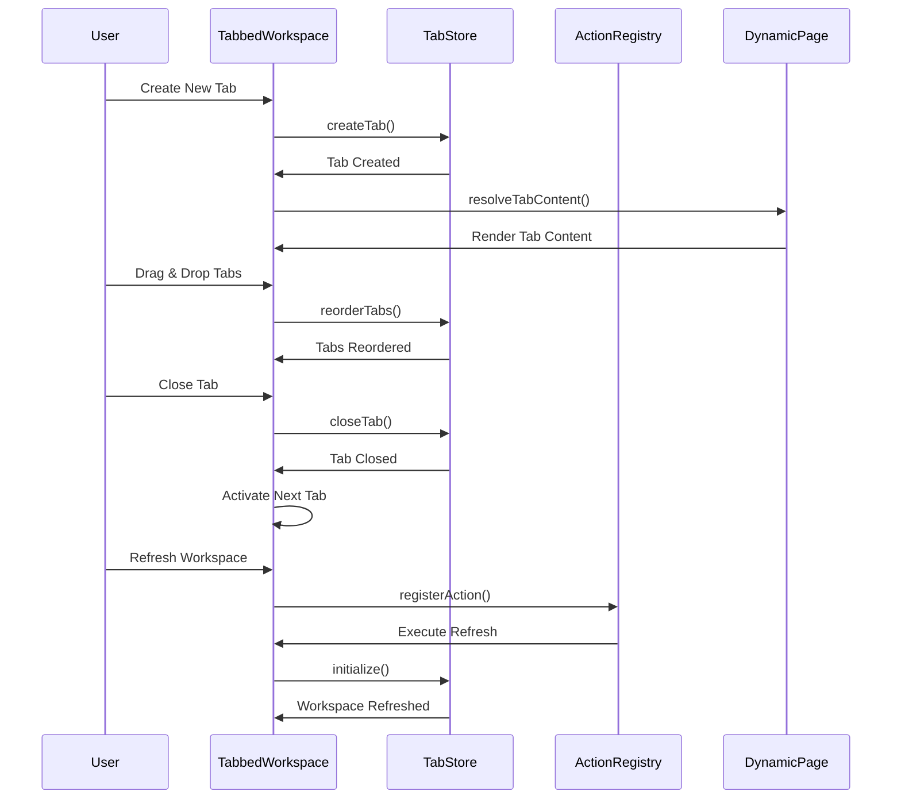
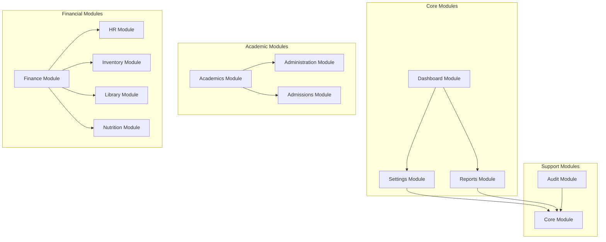
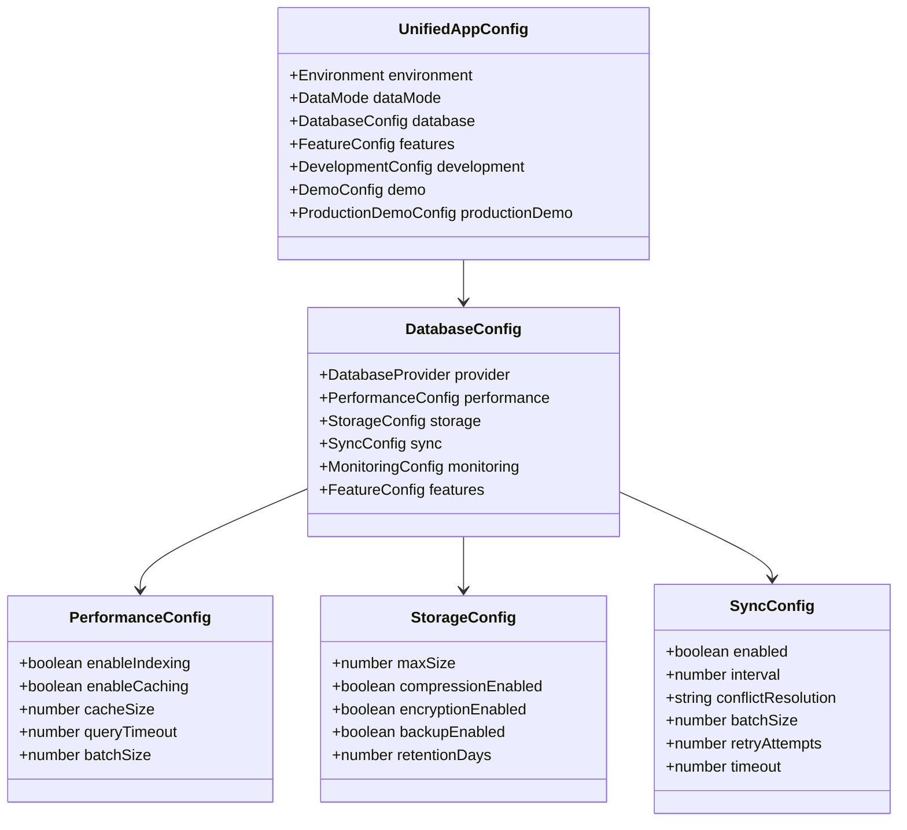

# Quick Reference Guide

<cite>
**Referenced Files in This Document**
- [README.md](file://README.md)
- [package.json](file://package.json)
- [src/config/dataLayerConfig.ts](file://src/config/dataLayerConfig.ts)
- [src/contexts/AppDataContext.tsx](file://src/contexts/AppDataContext.tsx)
- [src/services/rxdbService.ts](file://src/services/rxdbService.ts)
- [src/config/unifiedConfig.ts](file://src/config/unifiedConfig.ts)
- [src/App.tsx](file://src/App.tsx)
- [src/components/tabbedWorkspace/TabbedWorkspace.tsx](file://src/components/tabbedWorkspace/TabbedWorkspace.tsx)
- [src/hooks/useUnifiedConfig.ts](file://src/hooks/useUnifiedConfig.ts)
- [src/core/types.ts](file://src/core/types.ts)
- [src/modules/academics/data/types.ts](file://src/modules/academics/data/types.ts)
- [src/modules/finance/data/types.ts](file://src/modules/finance/data/types.ts)
</cite>

## Table of Contents
1. [Introduction](#introduction)
2. [Getting Started](#getting-started)
3. [Architecture Overview](#architecture-overview)
4. [Data Layer Configuration](#data-layer-configuration)
5. [Tabbed Workspace System](#tabbed-workspace-system)
6. [Module Structure](#module-structure)
7. [Configuration Management](#configuration-management)
8. [Development Commands](#development-commands)
9. [Troubleshooting](#troubleshooting)
10. [Best Practices](#best-practices)

## Introduction

SchoolPilot3 is an enterprise-grade education management system built with React, TypeScript, and Vite. The system features a sophisticated dual-mode architecture supporting both development (persistent SQLite database) and production (PouchDB/local database) environments. With 8 business modules covering academics, administration, finance, HR, inventory, library, nutrition, and reports, it provides comprehensive educational institution management capabilities.

The system emphasizes type safety with 1,400+ lines of centralized type definitions, reactive data architecture using RxDB, and a modular design pattern that ensures scalability and maintainability.

## Getting Started

### Prerequisites
- Node.js 16+
- Package manager (npm or pnpm)

### Installation
```bash
# Clone the repository
git clone [repository-url]
cd schoolpilot3

# Install dependencies
npm install
# or
pnpm install

# Set up environment variables
cp .env.example .env.local
# Edit .env.local and add GEMINI_API_KEY

# Run development server
npm run dev
```

### Access the Application
Open [http://localhost:5200](http://localhost:5200) in your browser

## Architecture Overview

The system follows a layered architecture with clear separation of concerns:



**Diagram sources**
- [src/App.tsx:1-200](file://src/App.tsx#L1-L200)
- [src/contexts/AppDataContext.tsx:1-800](file://src/contexts/AppDataContext.tsx#L1-L800)

## Data Layer Configuration

### Dual-Mode Data Architecture

The system supports three distinct data modes:

| Mode | Purpose | Storage | Features |
|------|---------|---------|----------|
| **Development** | Persistent development with SQLite file | SQLite file storage | Full CRUD, referential integrity, offline support |
| **Demo** | Production-like testing with SQLite WASM | SQLite WASM + OPFS | Demo data seeding, cross-tab persistence |
| **Production** | Live application with RxDB | IndexedDB | Real-time sync, conflict resolution |

### Configuration Options



**Diagram sources**
- [src/config/dataLayerConfig.ts:55-235](file://src/config/dataLayerConfig.ts#L55-L235)
- [src/contexts/AppDataContext.tsx:285-339](file://src/contexts/AppDataContext.tsx#L285-L339)

### Database Providers

The system supports multiple database providers with specific capabilities:

| Provider | Storage Type | Sync Support | Real-time Updates | Transactions |
|----------|-------------|--------------|-------------------|--------------|
| **SQLite File** | File-based | ❌ | ❌ | ✅ |
| **SQLite WASM** | WebAssembly | ✅ | ❌ | ✅ |
| **PouchDB** | IndexedDB | ✅ | ✅ | ❌ |
| **RxDB** | IndexedDB | ✅ | ✅ | ✅ |
| **LiveStore** | IndexedDB | ✅ | ✅ | ✅ |
| **Mock** | In-memory | ❌ | ❌ | ❌ |

**Section sources**
- [src/config/dataLayerConfig.ts:12-521](file://src/config/dataLayerConfig.ts#L12-L521)
- [src/services/rxdbService.ts:117-166](file://src/services/rxdbService.ts#L117-L166)

## Tabbed Workspace System

### Tab Management Architecture

The tabbed workspace system provides a modern multi-tab interface with advanced features:



**Diagram sources**
- [src/components/tabbedWorkspace/TabbedWorkspace.tsx:16-200](file://src/components/tabbedWorkspace/TabbedWorkspace.tsx#L16-L200)

### Tab Features

| Feature | Description | Status |
|---------|-------------|--------|
| **Tab Creation** | Create new tabs with custom content | ✅ |
| **Drag & Drop** | Reorder tabs using drag-and-drop | ✅ |
| **Tab Persistence** | Save tab state between sessions | ✅ |
| **Tab Groups** | Organize related tabs | ✅ |
| **Hierarchical Navigation** | Nested tab structures | ✅ |
| **Permission Control** | Role-based tab access | ✅ |
| **Error Boundaries** | Isolated tab error handling | ✅ |

**Section sources**
- [src/components/tabbedWorkspace/TabbedWorkspace.tsx:16-200](file://src/components/tabbedWorkspace/TabbedWorkspace.tsx#L16-L200)

## Module Structure

### Business Module Organization

The system follows a domain-driven design with 8 core modules:



**Diagram sources**
- [src/App.tsx:54-72](file://src/App.tsx#L54-L72)

### Module Data Types

Each module maintains its own type definitions while sharing common interfaces:

| Module | Core Types | Collections | Features |
|--------|------------|-------------|----------|
| **Academics** | Subjects, Exams, Timetable | 15+ collections | Grading, Results, Scheduling |
| **Administration** | Students, Staff, Departments | 20+ collections | HR, Attendance, Communications |
| **Finance** | Accounts, Invoices, Payments | 25+ collections | Fees, Expenses, Reporting |
| **HR** | Payroll, Benefits, Leaves | 12+ collections | Payroll Processing, Benefits |
| **Inventory** | Items, Suppliers, Stock | 18+ collections | Procurement, Stock Management |
| **Library** | Books, Members, Loans | 10+ collections | Catalog, Circulation |
| **Nutrition** | Meals, Menus, Wallets | 8+ collections | Meal Plans, Payments |
| **Reports** | Analytics, Dashboards | 30+ collections | Comprehensive Reporting |

**Section sources**
- [src/modules/academics/data/types.ts:1-200](file://src/modules/academics/data/types.ts#L1-L200)
- [src/modules/finance/data/types.ts:1-200](file://src/modules/finance/data/types.ts#L1-L200)

## Configuration Management

### Unified Configuration System

The system uses a comprehensive configuration management approach:



**Diagram sources**
- [src/config/unifiedConfig.ts:215-416](file://src/config/unifiedConfig.ts#L215-L416)

### Configuration Presets

The system provides predefined configuration presets:

| Preset | Purpose | Key Features |
|--------|---------|--------------|
| **Demo** | Development and testing | Enhanced data layer, offline mode disabled |
| **Enhanced** | Production-ready | All advanced features enabled |
| **Development** | Local development | Debug mode, mock data, performance monitoring |

**Section sources**
- [src/config/unifiedConfig.ts:462-540](file://src/config/unifiedConfig.ts#L462-L540)
- [src/config/unifiedConfig.ts:624-621](file://src/config/unifiedConfig.ts#L624-L621)

## Development Commands

### Available Scripts

The project includes comprehensive development scripts:

```bash
# Development Scripts
npm run dev                    # Start development server
npm run build                  # Build for production
npm run preview                # Preview production build

# Testing Scripts
npm run test                   # Run all tests
npm run test:run              # Run tests in CI mode
npm run test:ui               # Run tests with UI

# Translation Scripts
npm run check-translations    # Check translation completeness
npm run analyze-translations  # Analyze translation usage
npm run fix-translation-keys  # Fix translation keys
npm run fix-hardcoded-strings # Fix hardcoded strings

# Database Scripts
npm run migrate-mock-data     # Migrate mock data to SQLite
npm run export-database       # Export database
npm run debug-mock-data       # Debug mock data
npm run explore-database      # Explore database structure

# Migration Scripts
npm run migration:extract     # Extract legacy data
npm run migration:transform   # Transform data format
npm run migration:load        # Load transformed data
npm run migration:verify      # Verify migration
npm run migration:full        # Run complete migration
```

**Section sources**
- [package.json:6-61](file://package.json#L6-L61)

## Troubleshooting

### Common Issues and Solutions

| Issue | Symptoms | Solution |
|-------|----------|----------|
| **Database Initialization Failed** | Application shows demo mode notification | Check browser IndexedDB support, verify database permissions |
| **Missing Translations** | Text shows as keys instead of translated text | Add missing keys to appropriate locale files |
| **Type Errors After Changes** | TypeScript compilation errors | Update central type definitions in core/types.ts |
| **Performance Issues** | Slow page loads, memory leaks | Check production mode usage, monitor bundle size |
| **Tab Navigation Problems** | Tabs not opening, navigation broken | Verify tab permissions, check action registry |

### Debug Information

Enable debug mode for development:
- Set `DEBUG_TABS=true` environment variable
- Use browser developer tools console
- Check application logs in network tab

**Section sources**
- [README.md:452-481](file://README.md#L452-L481)

## Best Practices

### Development Guidelines

1. **Module-First Approach**: Add new features within appropriate modules
2. **Type Safety**: Maintain comprehensive TypeScript coverage
3. **Mock Data**: Include realistic mock data for new features
4. **Internationalization**: Add translation keys for all user-facing text
5. **Responsive Design**: Ensure mobile compatibility
6. **Documentation**: Update relevant documentation files

### Performance Optimization

- Use lazy loading for large components
- Implement proper error boundaries
- Monitor memory usage with performance tools
- Optimize database queries with proper indexing
- Leverage caching strategies for frequently accessed data

### Security Considerations

- Validate all user inputs
- Implement proper authentication and authorization
- Sanitize external content
- Regular security audits
- Secure API endpoint access

### Testing Strategy

- Write unit tests for critical components
- Implement integration tests for database operations
- Test error handling scenarios
- Validate internationalization support
- Performance testing with realistic data volumes