# Role-Based Access Control

<cite>
**Referenced Files in This Document**
- [RBACEngine.ts](file://src/rbac/RBACEngine.ts)
- [RBACProvider.tsx](file://src/rbac/RBACProvider.tsx)
- [useRBAC.tsx](file://src/rbac/useRBAC.tsx)
- [types.ts](file://src/rbac/types.ts)
- [ProtectedRoute.tsx](file://src/components/ProtectedRoute.tsx)
- [useRBAC.ts](file://src/hooks/useRBAC.ts)
- [rbacService.ts](file://src/core/rbacService.ts)
- [rbac.ts](file://src/core/rbac.ts)
- [AuthContext.tsx](file://src/contexts/AuthContext.tsx)
- [authService.ts](file://src/services/auth/authService.ts)
- [UserPermissionsPanel.tsx](file://src/components/settings/UserPermissionsPanel.tsx)
- [SecurityAuditLogger.ts](file://src/services/database/SecurityAuditLogger.ts)
</cite>

## Table of Contents
1. [Introduction](#introduction)
2. [Project Structure](#project-structure)
3. [Core Components](#core-components)
4. [Architecture Overview](#architecture-overview)
5. [Detailed Component Analysis](#detailed-component-analysis)
6. [Dependency Analysis](#dependency-analysis)
7. [Performance Considerations](#performance-considerations)
8. [Troubleshooting Guide](#troubleshooting-guide)
9. [Conclusion](#conclusion)
10. [Appendices](#appendices)

## Introduction
This document explains SchoolPilot3’s role-based access control (RBAC) system with a focus on two complementary engines:
- A lightweight, in-memory RBAC engine for runtime permission evaluation and attribute-based conditions.
- A modular RBAC service for persistent role/permission definitions, user role assignment, and module-level access control.

It covers permission evaluation logic, role hierarchy management, route-level protection, component-level restrictions, user permissions service, permission caching strategies, real-time updates, debugging tools, audit logging, and security best practices. Practical examples show how to define custom permissions, protect routes and components, and manage user roles and permissions.

## Project Structure
The RBAC system spans three main areas:
- Runtime RBAC engine and React integration for immediate permission checks.
- Persistent RBAC service for long-term role/permission definitions and user assignments.
- Authentication integration and route-level protection.

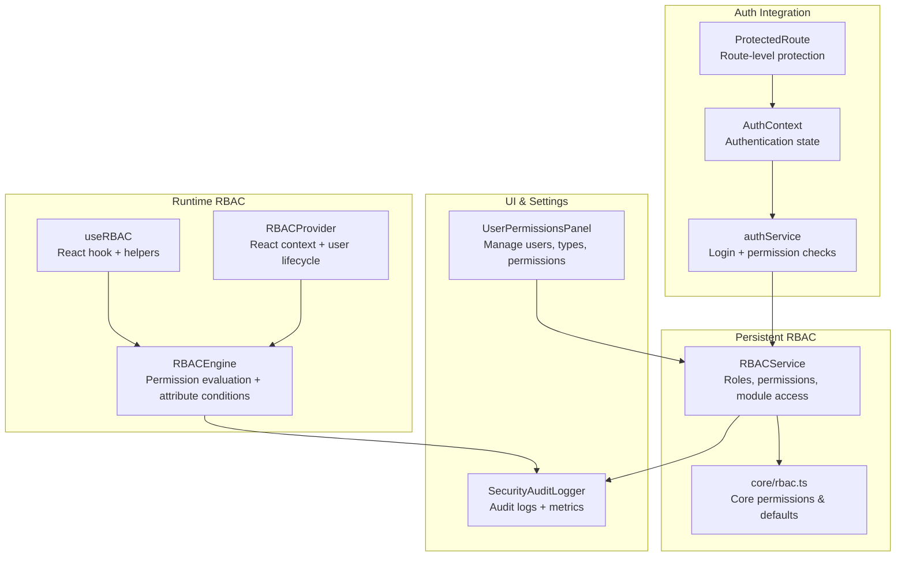

**Diagram sources**
- [RBACEngine.ts:20-431](file://src/rbac/RBACEngine.ts#L20-L431)
- [RBACProvider.tsx:36-70](file://src/rbac/RBACProvider.tsx#L36-L70)
- [useRBAC.tsx:51-132](file://src/rbac/useRBAC.tsx#L51-L132)
- [rbacService.ts:70-405](file://src/core/rbacService.ts#L70-L405)
- [rbac.ts:1-59](file://src/core/rbac.ts#L1-L59)
- [AuthContext.tsx:28-158](file://src/contexts/AuthContext.tsx#L28-L158)
- [authService.ts:56-674](file://src/services/auth/authService.ts#L56-L674)
- [ProtectedRoute.tsx:16-129](file://src/components/ProtectedRoute.tsx#L16-L129)
- [UserPermissionsPanel.tsx:48-396](file://src/components/settings/UserPermissionsPanel.tsx#L48-L396)
- [SecurityAuditLogger.ts:97-468](file://src/services/database/SecurityAuditLogger.ts#L97-L468)

**Section sources**
- [RBACEngine.ts:20-431](file://src/rbac/RBACEngine.ts#L20-L431)
- [RBACProvider.tsx:36-70](file://src/rbac/RBACProvider.tsx#L36-L70)
- [useRBAC.tsx:51-132](file://src/rbac/useRBAC.tsx#L51-L132)
- [rbacService.ts:70-405](file://src/core/rbacService.ts#L70-L405)
- [rbac.ts:1-59](file://src/core/rbac.ts#L1-L59)
- [AuthContext.tsx:28-158](file://src/contexts/AuthContext.tsx#L28-L158)
- [authService.ts:56-674](file://src/services/auth/authService.ts#L56-L674)
- [ProtectedRoute.tsx:16-129](file://src/components/ProtectedRoute.tsx#L16-L129)
- [UserPermissionsPanel.tsx:48-396](file://src/components/settings/UserPermissionsPanel.tsx#L48-L396)
- [SecurityAuditLogger.ts:97-468](file://src/services/database/SecurityAuditLogger.ts#L97-L468)

## Core Components
- RBACEngine: In-memory engine that evaluates permissions against roles, supports attribute-based conditions, and aggregates effective permissions per user.
- RBACProvider + useRBAC: React context/provider and hook exposing permission checks, role checks, and user permissions for UI rendering.
- RBACService: Persistent service managing roles, permissions, module access, and user-role assignments.
- AuthContext + authService: Authentication state and permission checks integrated with RBAC.
- ProtectedRoute: Route-level guard combining authentication, module access, and permission checks.
- UserPermissionsPanel: Administrative UI for managing users, user types, and permissions.
- SecurityAuditLogger: Centralized audit logging for authentication, authorization, and data access events.

**Section sources**
- [RBACEngine.ts:20-431](file://src/rbac/RBACEngine.ts#L20-L431)
- [RBACProvider.tsx:36-70](file://src/rbac/RBACProvider.tsx#L36-L70)
- [useRBAC.tsx:51-132](file://src/rbac/useRBAC.tsx#L51-L132)
- [rbacService.ts:70-405](file://src/core/rbacService.ts#L70-L405)
- [AuthContext.tsx:28-158](file://src/contexts/AuthContext.tsx#L28-L158)
- [authService.ts:56-674](file://src/services/auth/authService.ts#L56-L674)
- [ProtectedRoute.tsx:16-129](file://src/components/ProtectedRoute.tsx#L16-L129)
- [UserPermissionsPanel.tsx:48-396](file://src/components/settings/UserPermissionsPanel.tsx#L48-L396)
- [SecurityAuditLogger.ts:97-468](file://src/services/database/SecurityAuditLogger.ts#L97-L468)

## Architecture Overview
The system separates concerns:
- Runtime engine performs fast permission checks for UI and component rendering.
- Persistent service manages definitions and assignments, enabling long-term policy enforcement.
- Authentication integrates both engines to gate routes and enforce module-level access.
- Audit logging captures security-relevant events for monitoring and compliance.

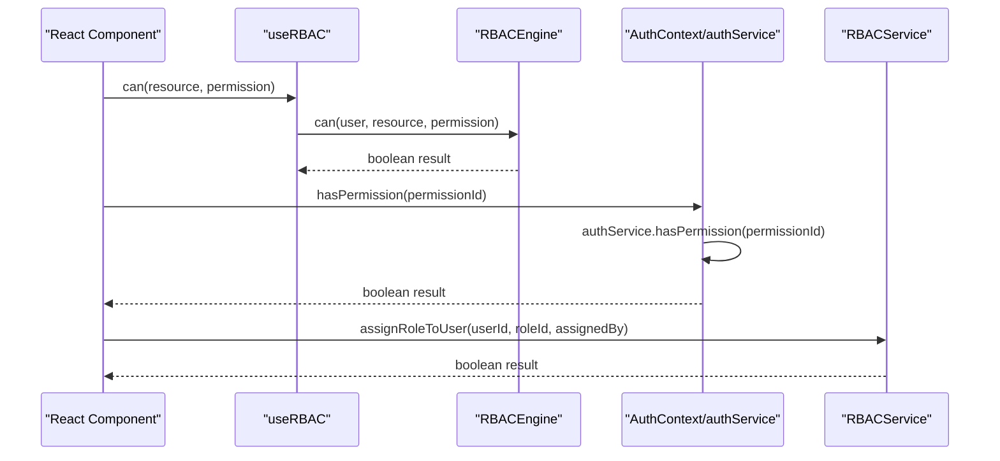

**Diagram sources**
- [useRBAC.tsx:61-93](file://src/rbac/useRBAC.tsx#L61-L93)
- [RBACEngine.ts:188-190](file://src/rbac/RBACEngine.ts#L188-L190)
- [AuthContext.tsx:133-140](file://src/contexts/AuthContext.tsx#L133-L140)
- [authService.ts:637-647](file://src/services/auth/authService.ts#L637-L647)
- [rbacService.ts:200-219](file://src/core/rbacService.ts#L200-L219)

## Detailed Component Analysis

### RBAC Engine
The engine provides:
- Role registration and inheritance expansion.
- User role assignment and effective permission aggregation.
- Permission evaluation with support for attribute-based conditions.
- Super admin override and rule applicability across direct and role-based permissions.

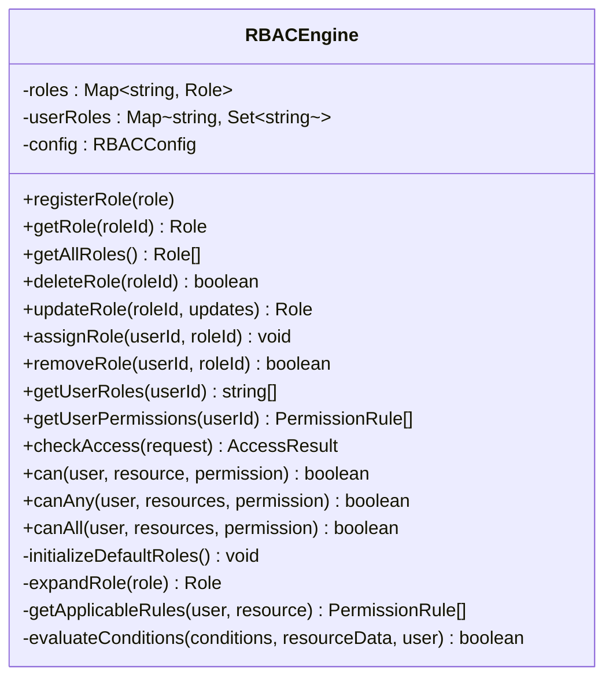

**Diagram sources**
- [RBACEngine.ts:20-431](file://src/rbac/RBACEngine.ts#L20-L431)

Key behaviors:
- Attribute-based conditions support templated user fields (e.g., user.id).
- Super admin role bypasses rule evaluation.
- Effective permissions combine direct user permissions and role permissions.

**Section sources**
- [RBACEngine.ts:20-431](file://src/rbac/RBACEngine.ts#L20-L431)
- [types.ts:35-83](file://src/rbac/types.ts#L35-L83)

### RBAC Provider and Hook
- RBACProvider initializes the engine, loads current user via a callback, and exposes context values.
- useRBAC provides permission checks, role checks, and computed user permissions.

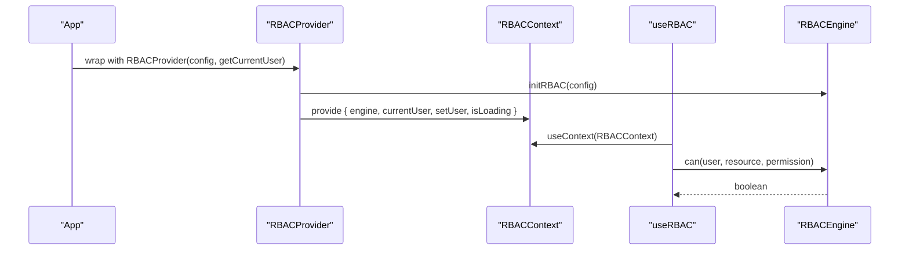

**Diagram sources**
- [RBACProvider.tsx:36-70](file://src/rbac/RBACProvider.tsx#L36-L70)
- [useRBAC.tsx:51-132](file://src/rbac/useRBAC.tsx#L51-L132)
- [RBACEngine.ts:188-190](file://src/rbac/RBACEngine.ts#L188-L190)

**Section sources**
- [RBACProvider.tsx:36-70](file://src/rbac/RBACProvider.tsx#L36-L70)
- [useRBAC.tsx:51-132](file://src/rbac/useRBAC.tsx#L51-L132)

### RBAC Service (Persistent)
The service manages:
- Roles, permissions, module access, and user-role assignments.
- Initialization of system roles and module-level access.
- Filtering navigation items and features based on permissions.
- Utility methods for module access checks and permission retrieval.

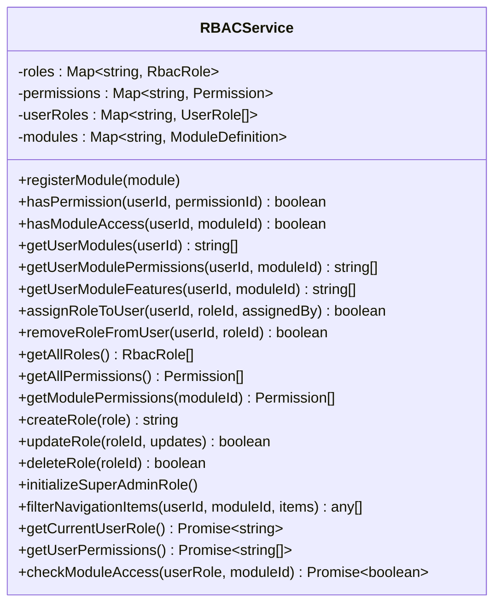

**Diagram sources**
- [rbacService.ts:70-405](file://src/core/rbacService.ts#L70-L405)

**Section sources**
- [rbacService.ts:70-405](file://src/core/rbacService.ts#L70-L405)
- [rbac.ts:1-59](file://src/core/rbac.ts#L1-L59)

### Authentication Integration
- AuthContext provides authentication state and permission checks.
- authService integrates with RBACService for production mode and with RBACProvider for demo mode.
- ProtectedRoute combines authentication, module access, and permission checks for route protection.

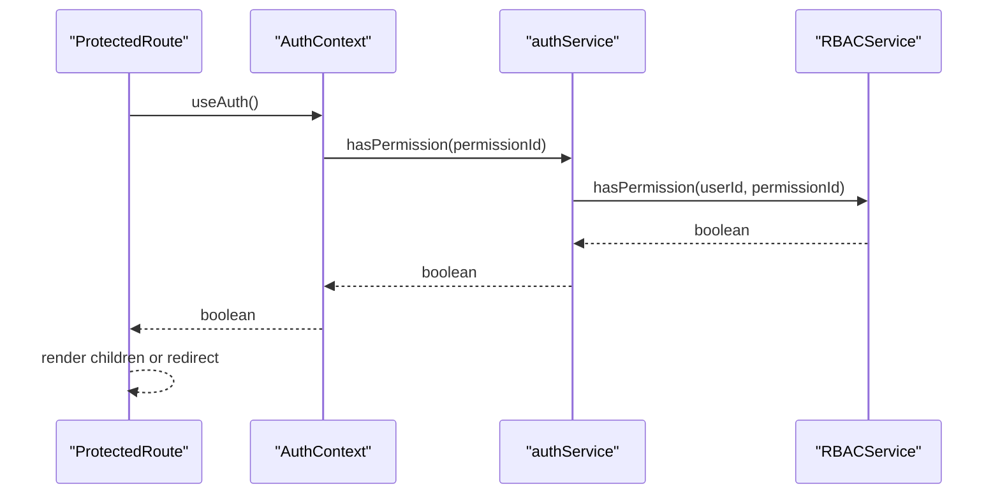

**Diagram sources**
- [ProtectedRoute.tsx:22-82](file://src/components/ProtectedRoute.tsx#L22-L82)
- [AuthContext.tsx:133-140](file://src/contexts/AuthContext.tsx#L133-L140)
- [authService.ts:637-647](file://src/services/auth/authService.ts#L637-L647)
- [rbacService.ts:138-150](file://src/core/rbacService.ts#L138-L150)

**Section sources**
- [AuthContext.tsx:28-158](file://src/contexts/AuthContext.tsx#L28-L158)
- [authService.ts:56-674](file://src/services/auth/authService.ts#L56-L674)
- [ProtectedRoute.tsx:16-129](file://src/components/ProtectedRoute.tsx#L16-L129)

### Permission Evaluation Logic
The engine evaluates access requests by:
- Checking for super admin override.
- Collecting applicable rules from direct user permissions and assigned roles.
- Matching requested permission and evaluating optional attribute-based conditions against resource data and user attributes.

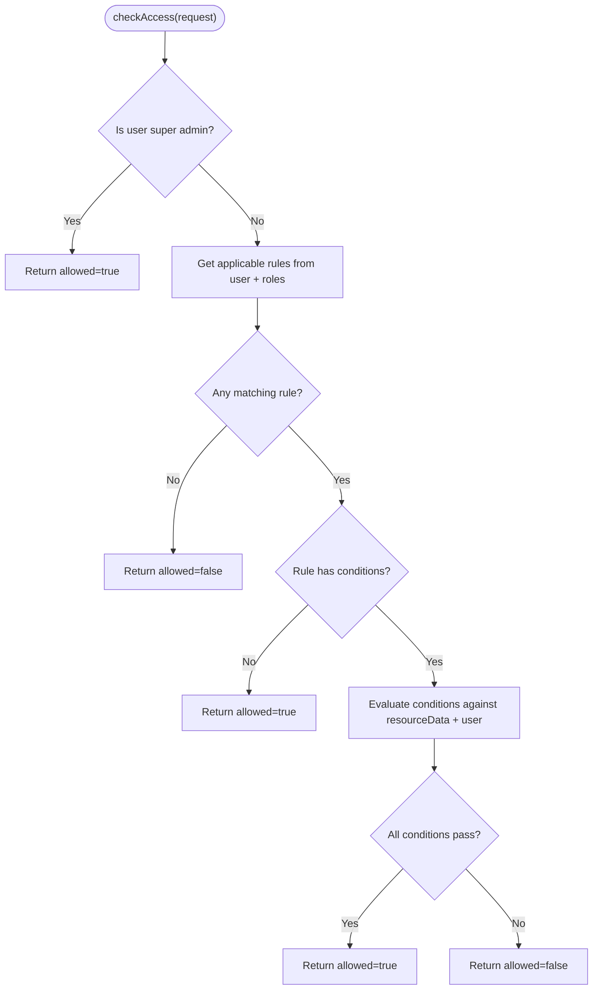

**Diagram sources**
- [RBACEngine.ts:157-183](file://src/rbac/RBACEngine.ts#L157-L183)
- [RBACEngine.ts:344-365](file://src/rbac/RBACEngine.ts#L344-L365)
- [RBACEngine.ts:367-412](file://src/rbac/RBACEngine.ts#L367-L412)

**Section sources**
- [RBACEngine.ts:157-183](file://src/rbac/RBACEngine.ts#L157-L183)
- [RBACEngine.ts:344-412](file://src/rbac/RBACEngine.ts#L344-L412)

### Role Hierarchy Management
- Roles can declare inherited parents; the engine expands permissions from parent roles.
- System roles are protected from deletion and grant broad permissions by default.
- User-role assignments are stored per user; multiple roles can be allowed depending on configuration.

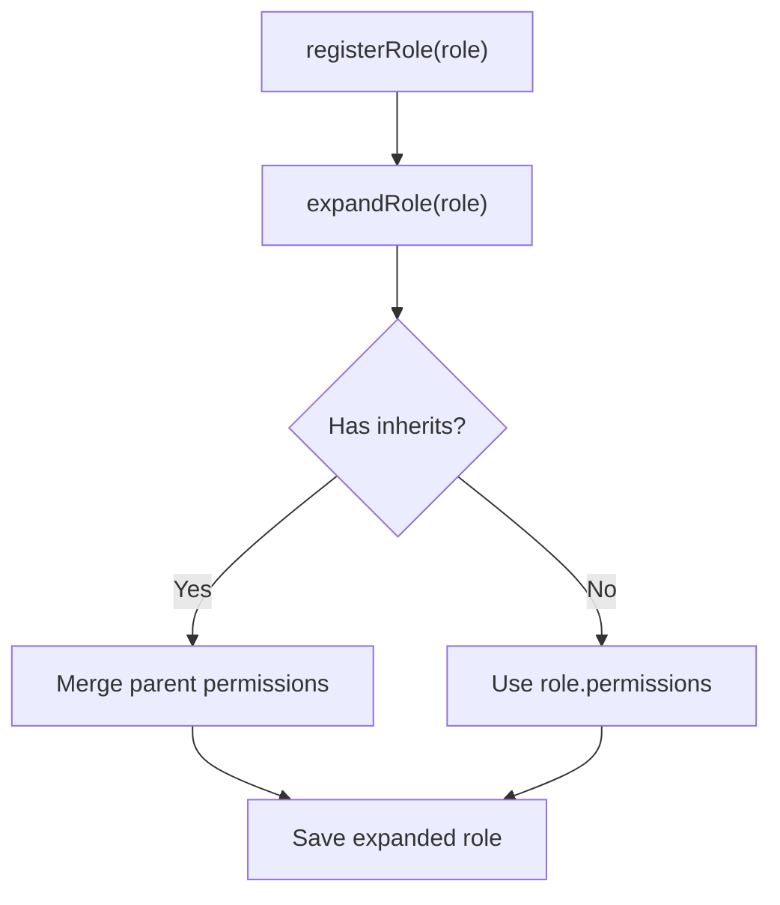

**Diagram sources**
- [RBACEngine.ts:43-47](file://src/rbac/RBACEngine.ts#L43-L47)
- [RBACEngine.ts:324-342](file://src/rbac/RBACEngine.ts#L324-L342)

**Section sources**
- [RBACEngine.ts:43-47](file://src/rbac/RBACEngine.ts#L43-L47)
- [RBACEngine.ts:324-342](file://src/rbac/RBACEngine.ts#L324-L342)

### Route-Level Protection (ProtectedRoute)
ProtectedRoute enforces:
- Authentication readiness and loading states.
- Optional module access checks via hasModuleAccess.
- Optional permission checks via hasPermission.
- Conditional rendering with access-denied UI and fallback redirection.

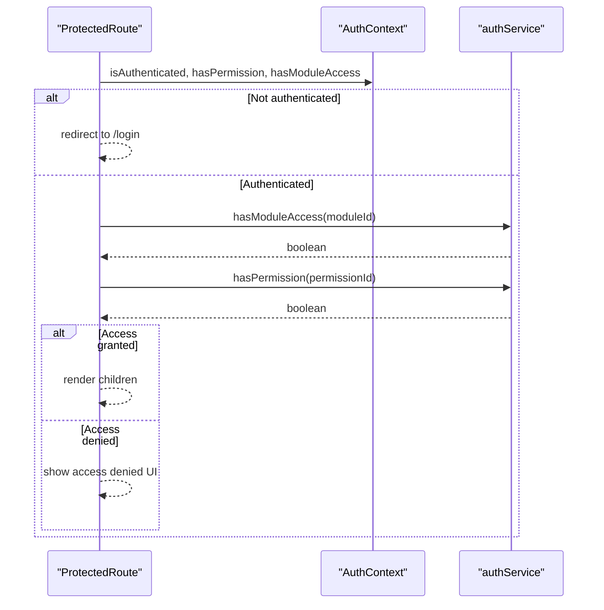

**Diagram sources**
- [ProtectedRoute.tsx:22-82](file://src/components/ProtectedRoute.tsx#L22-L82)
- [AuthContext.tsx:133-140](file://src/contexts/AuthContext.tsx#L133-L140)
- [authService.ts:649-659](file://src/services/auth/authService.ts#L649-L659)

**Section sources**
- [ProtectedRoute.tsx:16-129](file://src/components/ProtectedRoute.tsx#L16-L129)
- [AuthContext.tsx:133-140](file://src/contexts/AuthContext.tsx#L133-L140)
- [authService.ts:649-659](file://src/services/auth/authService.ts#L649-L659)

### Component-Level Restrictions (useRBAC Hook)
The hook exposes:
- can, canAny, canAll for resource-permission checks.
- checkAccess for detailed results including matched rule.
- hasRole for role membership checks.
- permissions computed from effective rules.

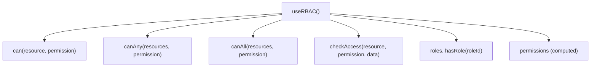

**Diagram sources**
- [useRBAC.tsx:61-131](file://src/rbac/useRBAC.tsx#L61-L131)

**Section sources**
- [useRBAC.tsx:51-132](file://src/rbac/useRBAC.tsx#L51-L132)

### User Permissions Service (Administrative Panel)
The panel allows:
- Managing users and assigning custom permissions.
- Defining permissions per module with actions (create/read/update/delete/admin).
- Generating dynamic permissions based on registered modules.

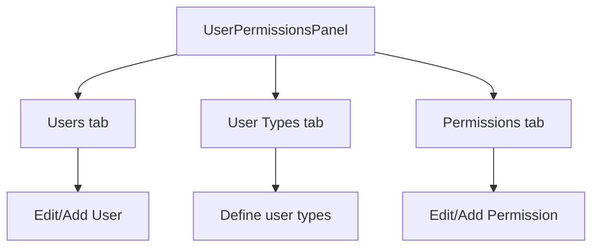

**Diagram sources**
- [UserPermissionsPanel.tsx:48-396](file://src/components/settings/UserPermissionsPanel.tsx#L48-L396)

**Section sources**
- [UserPermissionsPanel.tsx:48-396](file://src/components/settings/UserPermissionsPanel.tsx#L48-L396)

## Dependency Analysis
- RBACProvider depends on RBACEngine initialization and a user loader callback.
- useRBAC depends on RBACContext and delegates to RBACEngine.
- AuthContext depends on authService for permission checks; authService uses RBACService in production.
- RBACService depends on module registry and core permissions definitions.
- SecurityAuditLogger is used by RBAC engines and services to log authorization and data access events.

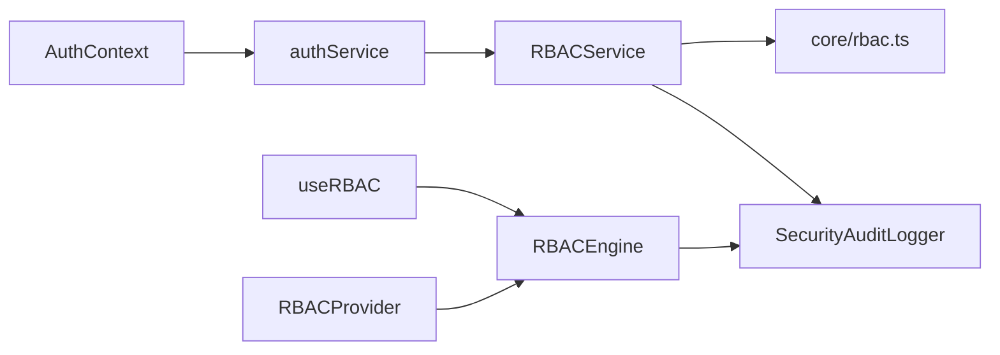

**Diagram sources**
- [RBACProvider.tsx:41-42](file://src/rbac/RBACProvider.tsx#L41-L42)
- [useRBAC.tsx:58-67](file://src/rbac/useRBAC.tsx#L58-L67)
- [AuthContext.tsx:133-140](file://src/contexts/AuthContext.tsx#L133-L140)
- [authService.ts:637-647](file://src/services/auth/authService.ts#L637-L647)
- [rbacService.ts:70-136](file://src/core/rbacService.ts#L70-L136)
- [rbac.ts:1-59](file://src/core/rbac.ts#L1-L59)
- [SecurityAuditLogger.ts:97-180](file://src/services/database/SecurityAuditLogger.ts#L97-L180)

**Section sources**
- [RBACProvider.tsx:36-70](file://src/rbac/RBACProvider.tsx#L36-L70)
- [useRBAC.tsx:51-132](file://src/rbac/useRBAC.tsx#L51-L132)
- [AuthContext.tsx:28-158](file://src/contexts/AuthContext.tsx#L28-L158)
- [authService.ts:56-674](file://src/services/auth/authService.ts#L56-L674)
- [rbacService.ts:70-405](file://src/core/rbacService.ts#L70-L405)
- [rbac.ts:1-59](file://src/core/rbac.ts#L1-L59)
- [SecurityAuditLogger.ts:97-180](file://src/services/database/SecurityAuditLogger.ts#L97-L180)

## Performance Considerations
- RBACEngine uses in-memory maps for roles and user roles, enabling O(1) lookups and efficient permission aggregation.
- Attribute-based condition evaluation runs per applicable rule; keep conditions minimal and targeted.
- RBACService stores roles, permissions, and user-role mappings in memory; consider pagination or lazy loading for very large datasets.
- Use canAny/canAll judiciously to avoid redundant evaluations when checking multiple resources.

[No sources needed since this section provides general guidance]

## Troubleshooting Guide
Common issues and resolutions:
- Permission denied unexpectedly:
  - Verify user roles and effective permissions via computed permissions from useRBAC.
  - Confirm attribute-based conditions match resource data and user attributes.
- Super admin not overriding:
  - Ensure the configured super admin role matches the user’s role.
- Route not loading:
  - Check ProtectedRoute loading states and error logs; confirm authentication readiness and module access.
- Audit anomalies:
  - Review SecurityAuditLogger events for authorization failures and security violations.

**Section sources**
- [useRBAC.tsx:104-120](file://src/rbac/useRBAC.tsx#L104-L120)
- [RBACEngine.ts:160-183](file://src/rbac/RBACEngine.ts#L160-L183)
- [ProtectedRoute.tsx:85-129](file://src/components/ProtectedRoute.tsx#L85-L129)
- [SecurityAuditLogger.ts:129-180](file://src/services/database/SecurityAuditLogger.ts#L129-L180)

## Conclusion
SchoolPilot3’s RBAC system combines a fast, flexible runtime engine with a robust persistent service to deliver secure, maintainable access control. It supports role hierarchies, attribute-based conditions, route-level protection, and comprehensive audit logging. Administrators can manage users, types, and permissions via the settings panel, while developers integrate permission checks at both route and component levels.

[No sources needed since this section summarizes without analyzing specific files]

## Appendices

### Permission Definition System
- Define permissions with resource/action/module/feature metadata.
- Use core/rbac.ts for core permissions and default roles.
- RBACService exposes APIs to add/update/delete permissions and roles.

**Section sources**
- [rbac.ts:1-59](file://src/core/rbac.ts#L1-L59)
- [rbacService.ts:84-95](file://src/core/rbacService.ts#L84-L95)
- [rbacService.ts:249-260](file://src/core/rbacService.ts#L249-L260)

### Role Assignment Mechanisms
- Assign roles to users via RBACService.assignRoleToUser.
- In demo mode, useRBAC hook auto-assigns roles based on user type.
- RBACProvider can set current user via a loader callback.

**Section sources**
- [rbacService.ts:200-219](file://src/core/rbacService.ts#L200-L219)
- [useRBAC.ts:66-72](file://src/hooks/useRBAC.ts#L66-L72)
- [RBACProvider.tsx:41-63](file://src/rbac/RBACProvider.tsx#L41-L63)

### Permission Inheritance Patterns
- Roles can inherit permissions from parent roles; engine expands permissions during registration.
- System roles are protected and cannot be deleted.

**Section sources**
- [RBACEngine.ts:324-342](file://src/rbac/RBACEngine.ts#L324-L342)
- [RBACEngine.ts:67-72](file://src/rbac/RBACEngine.ts#L67-L72)

### Integration with Authentication System
- AuthContext exposes hasPermission and hasModuleAccess.
- authService integrates with RBACService in production and RBACProvider in demo mode.

**Section sources**
- [AuthContext.tsx:133-140](file://src/contexts/AuthContext.tsx#L133-L140)
- [authService.ts:637-659](file://src/services/auth/authService.ts#L637-L659)

### Permission Caching Strategies
- RBACEngine caches roles and user roles in memory for fast evaluation.
- RBACService maintains in-memory maps for roles, permissions, and user-role associations.
- Consider persisting RBACService state to the unified database for cross-session caching.

**Section sources**
- [RBACEngine.ts:21-23](file://src/rbac/RBACEngine.ts#L21-L23)
- [rbacService.ts:71-74](file://src/core/rbacService.ts#L71-L74)

### Real-Time Permission Updates
- Update user roles via RBACService.assignRoleToUser/removeRoleFromUser.
- For UI updates, recompute effective permissions and refresh context state.
- In demo mode, useRBAC hook auto-applies role assignments.

**Section sources**
- [rbacService.ts:200-232](file://src/core/rbacService.ts#L200-L232)
- [useRBAC.ts:66-72](file://src/hooks/useRBAC.ts#L66-L72)

### Permission Debugging Tools
- useRBAC exposes permissions computed from effective rules for inspection.
- RBACEngine.checkAccess returns detailed AccessResult including matchedRule.
- ProtectedRoute logs access checks to the console.

**Section sources**
- [useRBAC.tsx:104-120](file://src/rbac/useRBAC.tsx#L104-L120)
- [RBACEngine.ts:78-88](file://src/rbac/RBACEngine.ts#L78-L88)
- [ProtectedRoute.tsx:32-75](file://src/components/ProtectedRoute.tsx#L32-L75)

### Audit Logging for Access Attempts
- SecurityAuditLogger provides methods to log authentication, authorization, data access, and configuration changes.
- Capture permission checks, module access, and sensitive operations with risk scoring and compliance modes.

**Section sources**
- [SecurityAuditLogger.ts:129-180](file://src/services/database/SecurityAuditLogger.ts#L129-L180)
- [SecurityAuditLogger.ts:213-237](file://src/services/database/SecurityAuditLogger.ts#L213-L237)
- [SecurityAuditLogger.ts:242-298](file://src/services/database/SecurityAuditLogger.ts#L242-L298)

### Security Best Practices
- Prefer least privilege: assign minimal roles and permissions.
- Use attribute-based conditions to restrict access to specific records.
- Enable audit logging for all authorization and sensitive operations.
- Regularly review and prune unused roles and permissions.
- In demo mode, avoid exposing sensitive data; restrict permissions accordingly.

[No sources needed since this section provides general guidance]

### Examples

- Implementing custom permissions:
  - Define permission entries with resource/action/module/feature in core/rbac.ts or via RBACService.addPermission.
  - Assign permissions to roles or users and verify via useRBAC.permissions.

- Protecting routes:
  - Wrap route components with ProtectedRoute and specify requiredPermission and/or requiredModule.

- Protecting components:
  - Use useRBAC().can to conditionally render UI elements or entire sections.

- Managing user roles and permissions:
  - Use RBACService.assignRoleToUser/removeRoleFromUser and RBACService.createRole/updateRole/deleteRole.
  - Use UserPermissionsPanel for administrative management.

**Section sources**
- [rbac.ts:1-59](file://src/core/rbac.ts#L1-L59)
- [rbacService.ts:84-95](file://src/core/rbacService.ts#L84-L95)
- [rbacService.ts:200-232](file://src/core/rbacService.ts#L200-L232)
- [ProtectedRoute.tsx:16-21](file://src/components/ProtectedRoute.tsx#L16-L21)
- [useRBAC.tsx:61-93](file://src/rbac/useRBAC.tsx#L61-L93)
- [UserPermissionsPanel.tsx:48-396](file://src/components/settings/UserPermissionsPanel.tsx#L48-L396)