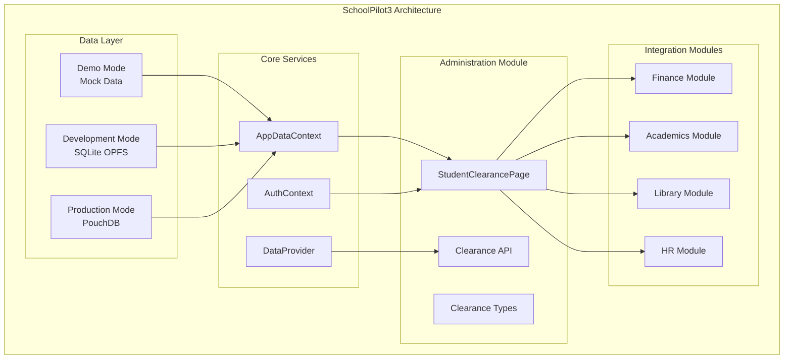
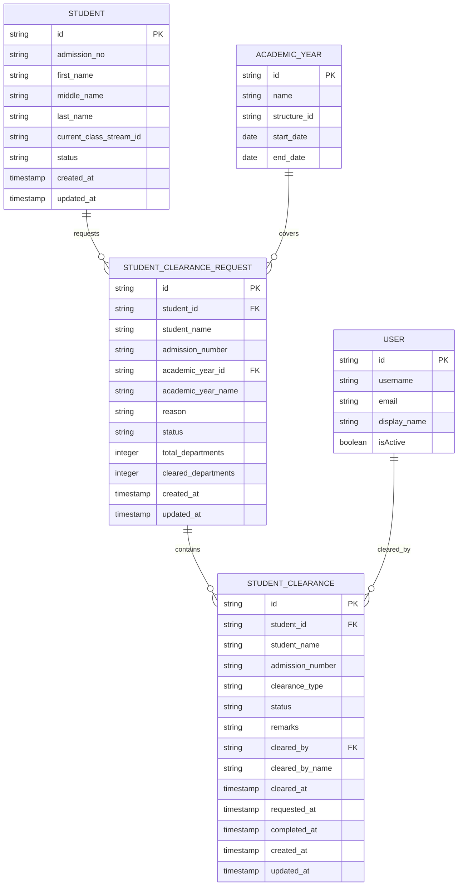
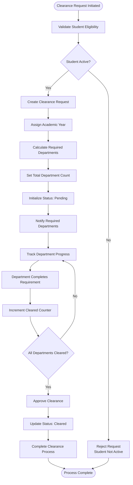
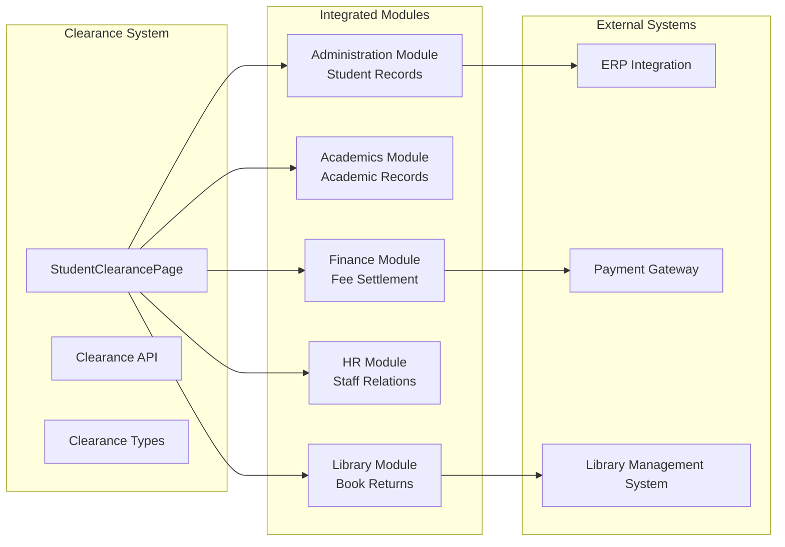

# Student Clearance System

<cite>
**Referenced Files in This Document**
- [README.md](file://README.md)
- [students.ts](file://src/api/students.ts)
- [api.ts](file://src/utils/api.ts)
- [types.ts](file://src/core/types.ts)
- [schema.ts](file://src/modules/administration/data/schema.ts)
- [types.ts](file://src/modules/administration/data/types.ts)
- [StudentClearancePage.tsx](file://src/modules/administration/pages/StudentClearancePage.tsx)
- [akademiko_to_schoolpilot3_feature_mapping.md](file://docs/migration/akademico_to_schoolpilot3_feature_mapping.md)
- [Akademiko_Admissions_Migration_Specification.md](file://docs/migration/admissions-migration/Akademiko_Admissions_Migration_Specification.md)
</cite>

## Table of Contents
1. [Introduction](#introduction)
2. [System Architecture](#system-architecture)
3. [Core Components](#core-components)
4. [Student Clearance Module](#student-clearance-module)
5. [Data Model](#data-model)
6. [User Interface Components](#user-interface-components)
7. [Business Logic](#business-logic)
8. [Integration Points](#integration-points)
9. [Migration and Legacy Support](#migration-and-legacy-support)
10. [Performance Considerations](#performance-considerations)
11. [Troubleshooting Guide](#troubleshooting-guide)
12. [Conclusion](#conclusion)

## Introduction

The Student Clearance System is a comprehensive feature within the SchoolPilot3 education management platform designed to streamline the student exit process. This system manages the clearance workflow for students transitioning out of the institution, whether through graduation, transfer, or other departure scenarios. The system integrates with multiple institutional departments to ensure all obligations are fulfilled before student records are finalized.

The clearance process encompasses various departmental requirements including library book returns, financial settlements, academic record closures, dormitory checkouts, sports equipment returns, discipline compliance, laboratory access permissions, and general administrative requirements. The system provides automated tracking, approval workflows, and comprehensive audit trails for all clearance activities.

## System Architecture

The Student Clearance System is built as part of the broader SchoolPilot3 modular architecture, leveraging the application's dual-mode data layer and reactive programming patterns. The system operates within the Administration module while integrating with other modules including Finance, Academics, Library, and others as required by specific clearance requirements.

**Diagram sources**
- [README.md](file://README.md)
- [StudentClearancePage.tsx](file://src/modules/administration/pages/StudentClearancePage.tsx)

The architecture supports three operational modes: demo mode for development and testing, development mode with persistent SQLite storage, and production mode with PouchDB for offline-capable applications. The dual-mode data layer ensures seamless operation across different environments while maintaining consistent APIs.

**Section sources**
- [README.md](file://README.md)
- [StudentClearancePage.tsx](file://src/modules/administration/pages/StudentClearancePage.tsx)

## Core Components

The Student Clearance System consists of several interconnected components that work together to provide a comprehensive clearance management solution:

### Data Access Layer
The system utilizes the centralized AppDataContext for unified data access across all modules. The data access layer provides filtered student data specifically for exam entry and class stream management, ensuring only eligible students participate in clearance processes.

### Business Logic Layer
The business logic implements clearance type categorization, status tracking, and workflow management. The system supports multiple clearance types including Library, Finance, Dormitory, Academics, Sports, Discipline, Laboratory, ICT, and General clearance requirements.

### User Interface Layer
The interface provides intuitive forms for clearance request creation, status tracking dashboards, and approval workflows. The system supports modal-based interactions and real-time status updates through reactive data binding.

**Section sources**
- [students.ts](file://src/api/students.ts)
- [api.ts](file://src/utils/api.ts)
- [types.ts](file://src/core/types.ts)

## Student Clearance Module

The Student Clearance Module is implemented within the Administration module and provides comprehensive clearance management capabilities. The module supports both individual student clearance and batch clearance operations, with configurable approval workflows and audit trail capabilities.

### Module Structure
The module follows the established SchoolPilot3 pattern with separate concerns for data schemas, types, API endpoints, and user interface components. The module integrates seamlessly with the existing application architecture while providing specialized clearance functionality.

### Clearance Types and Statuses
The system defines comprehensive clearance categories and status tracking mechanisms. Each clearance type represents different institutional requirements that must be fulfilled before student records can be considered cleared.

**Section sources**
- [schema.ts](file://src/modules/administration/data/schema.ts)
- [types.ts](file://src/modules/administration/data/types.ts)
- [StudentClearancePage.tsx](file://src/modules/administration/pages/StudentClearancePage.tsx)

## Data Model

The Student Clearance System employs a robust data model designed to track clearance requests, individual clearance items, and their completion status across multiple departments and academic periods.

### Core Entities

**Diagram sources**
- [schema.ts](file://src/modules/administration/data/schema.ts)
- [types.ts](file://src/modules/administration/data/types.ts)

### Clearance Type Enumerations
The system defines comprehensive clearance types that correspond to different institutional departments and requirements:

- **Library**: Book returns and library resource accountability
- **Finance**: Fee settlement and financial obligation fulfillment
- **Dormitory**: Accommodation checkout and facility returns
- **Academics**: Academic record closure and transcript processing
- **Sports**: Equipment returns and sports facility access revocation
- **Discipline**: Behavioral compliance and conduct records
- **Laboratory**: Equipment returns and lab access permissions
- **ICT**: Technology equipment returns and digital access revocation
- **General**: Miscellaneous institutional requirements

### Status Tracking
The clearance system implements a comprehensive status tracking mechanism with four primary states:
- **Pending**: Clearance request initiated but not yet processed
- **Cleared**: All requirements fulfilled and clearance approved
- **Not Cleared**: Requirements not met, clearance denied
- **Waived**: Requirements waived due to special circumstances

**Section sources**
- [schema.ts](file://src/modules/administration/data/schema.ts)
- [types.ts](file://src/modules/administration/data/types.ts)

## User Interface Components

The Student Clearance System provides a comprehensive user interface designed for efficient clearance management and approval workflows.

### Main Clearance Page
The primary interface component is the StudentClearancePage, which serves as the central hub for clearance operations. The page provides:

- **Clearance Request Creation**: Forms for initiating new clearance requests with student selection, academic year assignment, and reason documentation
- **Status Dashboard**: Real-time visualization of clearance statuses across all departments
- **Approval Workflows**: Interactive approval processes with audit trail documentation
- **Search and Filter**: Advanced search capabilities for locating specific clearance requests

### Modal-Based Interactions
The system extensively uses modal dialogs for data entry and approval processes, providing focused user experiences without disrupting the main workflow. Modals support:

- **Request Creation**: Streamlined forms for new clearance requests
- **Approval Processes**: Step-by-step approval workflows with documentation
- **Status Updates**: Real-time status modification and tracking

### Responsive Design Integration
The clearance interface maintains consistency with the broader SchoolPilot3 design system, ensuring mobile compatibility and cross-platform usability. The interface adapts to different screen sizes while maintaining full functionality.

**Section sources**
- [StudentClearancePage.tsx](file://src/modules/administration/pages/StudentClearancePage.tsx)

## Business Logic

The Student Clearance System implements sophisticated business logic to manage complex clearance workflows across multiple departments and institutional requirements.

### Clearance Request Processing

**Diagram sources**
- [StudentClearancePage.tsx](file://src/modules/administration/pages/StudentClearancePage.tsx)

### Department Integration Logic
The system implements intelligent department integration logic that automatically identifies required departments based on student profile and clearance type. The integration process considers:

- **Student Classification**: Academic level, program enrollment, and behavioral status
- **Clearance Type Requirements**: Specific departmental requirements for each clearance category
- **Academic Period Context**: Current academic year and term for proper integration timing

### Approval Workflow Management
The approval system supports multi-level approval processes with configurable authority levels and escalation procedures. The workflow includes:

- **Automated Notifications**: Real-time alerts to responsible parties
- **Deadline Management**: Automated reminders for pending approvals
- **Audit Trail**: Comprehensive documentation of all approval actions

**Section sources**
- [StudentClearancePage.tsx](file://src/modules/administration/pages/StudentClearancePage.tsx)

## Integration Points

The Student Clearance System integrates with multiple modules within the SchoolPilot3 platform to provide comprehensive clearance management capabilities.

### Core Module Integrations

**Diagram sources**
- [StudentClearancePage.tsx](file://src/modules/administration/pages/StudentClearancePage.tsx)

### Data Synchronization
The system maintains real-time synchronization with integrated modules through reactive data streams. Changes in one module automatically propagate to clearance status, ensuring accurate and up-to-date clearance information across all departments.

### API Communication
The clearance system exposes standardized APIs for external system integration, supporting:

- **Real-time Status Updates**: Live clearance status synchronization
- **Batch Processing**: Automated clearance processing for multiple students
- **Audit Integration**: Comprehensive audit trail export capabilities

**Section sources**
- [StudentClearancePage.tsx](file://src/modules/administration/pages/StudentClearancePage.tsx)

## Migration and Legacy Support

The Student Clearance System incorporates comprehensive migration capabilities to support legacy system transitions and maintain continuity during system upgrades.

### Legacy System Mapping
The system includes detailed mapping of legacy clearance processes from the original WinForms application, ensuring complete functional parity with existing workflows while leveraging modern technology advantages.

### Migration Planning
The migration process follows a structured approach:

1. **Legacy Analysis**: Comprehensive documentation of existing clearance workflows
2. **Requirement Definition**: Identification of functional and technical requirements
3. **System Design**: Architecture definition for the new clearance system
4. **Data Migration**: Structured transfer of historical clearance data
5. **Testing and Validation**: Comprehensive testing of migrated functionality
6. **Go-Live Support**: Production support during system transition

### Backward Compatibility
The system maintains backward compatibility with existing data formats and processes, allowing for gradual migration without disrupting current operations.

**Section sources**
- [akademiko_to_schoolpilot3_feature_mapping.md](file://docs/migration/akademico_to_schoolpilot3_feature_mapping.md)
- [Akademiko_Admissions_Migration_Specification.md](file://docs/migration/admissions-migration/Akademiko_Admissions_Migration_Specification.md)

## Performance Considerations

The Student Clearance System is designed with performance optimization as a core consideration, implementing several strategies to ensure efficient operation under various load conditions.

### Data Layer Optimization
The system leverages the SchoolPilot3 dual-mode data layer architecture to optimize performance across different environments:

- **Development Mode**: SQLite OPFS provides persistent storage with excellent development performance
- **Production Mode**: PouchDB with IndexedDB persistence ensures optimal offline performance
- **Demo Mode**: Rich mock data system enables rapid prototyping without database overhead

### Reactive Data Management
The clearance system utilizes reactive programming patterns to minimize unnecessary computations and optimize UI updates. Data changes trigger targeted updates rather than full page reloads.

### Caching Strategies
Intelligent caching mechanisms reduce database load and improve response times for frequently accessed clearance data. The system caches clearance templates, department configurations, and commonly referenced student information.

### Scalability Considerations
The modular architecture supports horizontal scaling through load balancing and distributed processing capabilities. The system can accommodate growing numbers of students and clearance requests through optimized database indexing and query patterns.

## Troubleshooting Guide

Common issues and their resolutions for the Student Clearance System:

### Database Initialization Issues
**Problem**: Clearance data not loading or displaying incorrectly
**Solution**: Verify database initialization status and check for RxDB connection errors. The system automatically falls back to mock data if initialization fails.

### Clearance Status Synchronization Problems
**Problem**: Clearance status not updating across departments
**Solution**: Check reactive data subscriptions and verify integration with target modules. Ensure proper event propagation between clearance components.

### Performance Degradation
**Problem**: Slow clearance request processing or status updates
**Solution**: Review database query performance and optimize indexes. Check for excessive reactive subscriptions that might cause unnecessary re-renders.

### Integration Failures
**Problem**: Clearance requirements not properly tracked in integrated modules
**Solution**: Verify API connectivity to integrated modules and check for proper data synchronization. Review audit logs for integration errors.

**Section sources**
- [README.md](file://README.md)

## Conclusion

The Student Clearance System represents a comprehensive solution for managing student exit processes within educational institutions. By leveraging the modular architecture of SchoolPilot3, the system provides robust clearance management capabilities while maintaining integration with existing institutional workflows and requirements.

The system's design emphasizes flexibility, scalability, and maintainability, supporting both current operational needs and future enhancement requirements. The comprehensive integration with multiple institutional departments ensures that all student obligations are properly tracked and managed during the clearance process.

Through careful attention to performance optimization, user experience design, and system reliability, the Student Clearance System provides a solid foundation for efficient student transition management while supporting the broader educational administration goals of the institution.