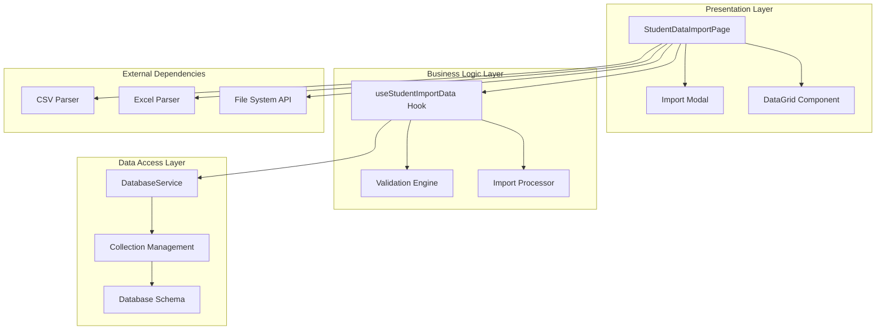
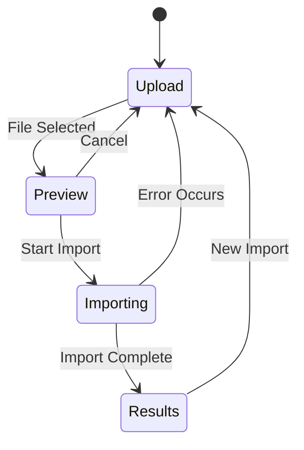
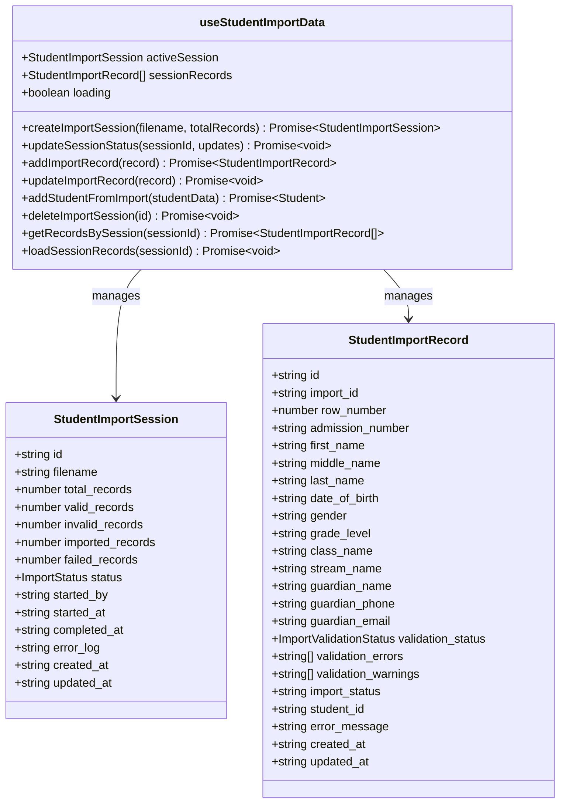
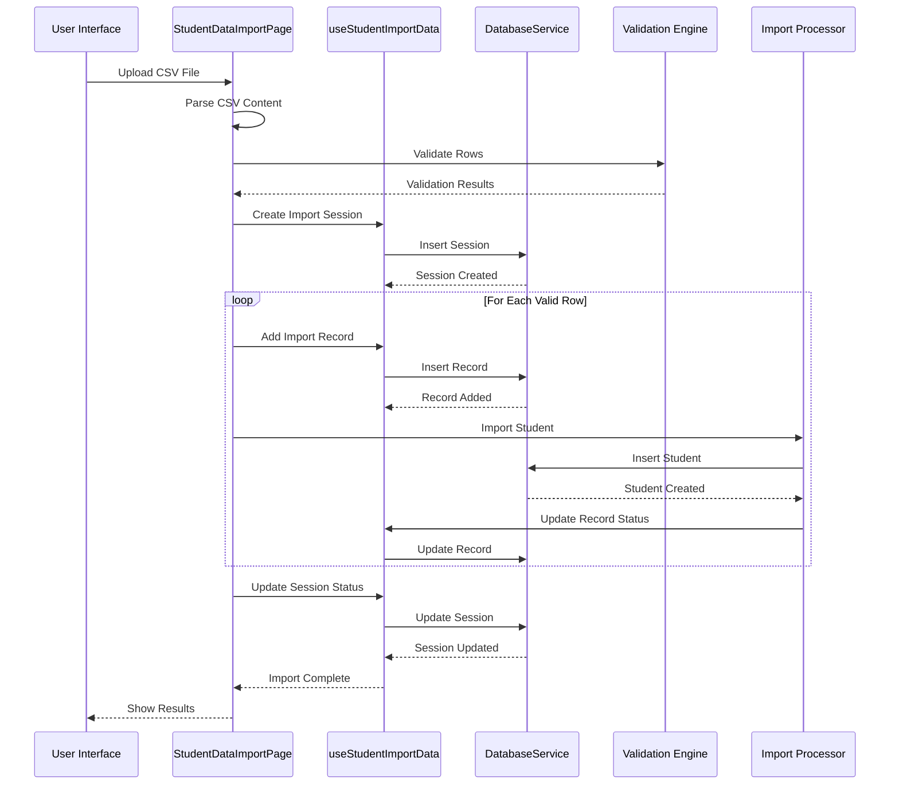
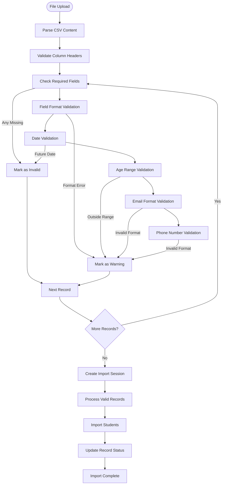
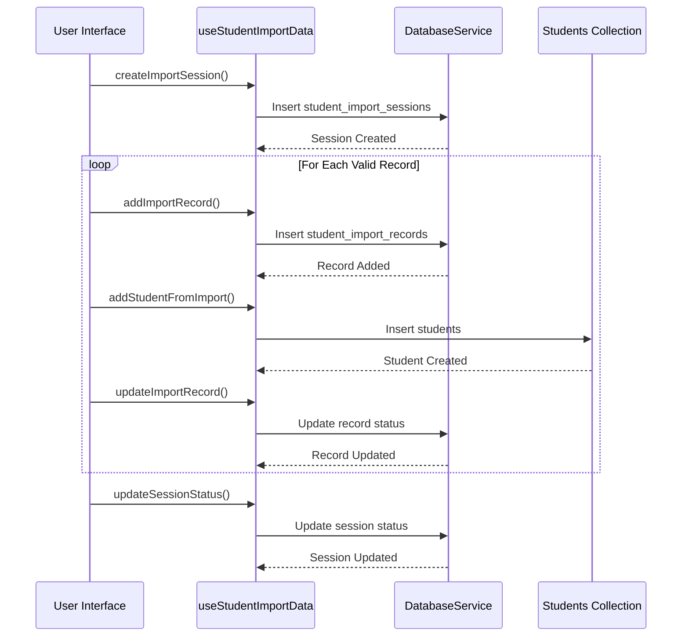
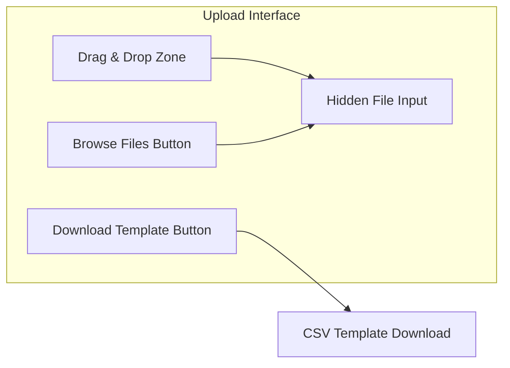
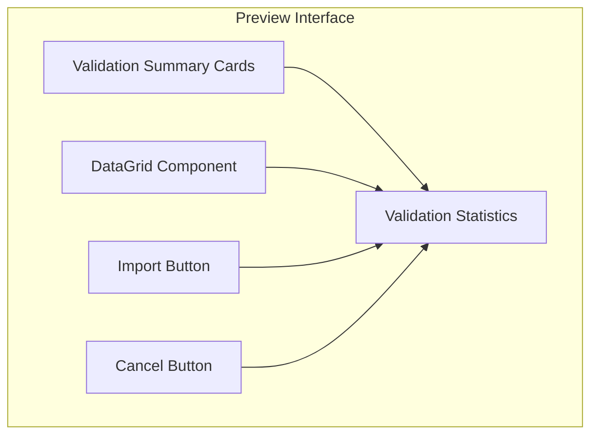
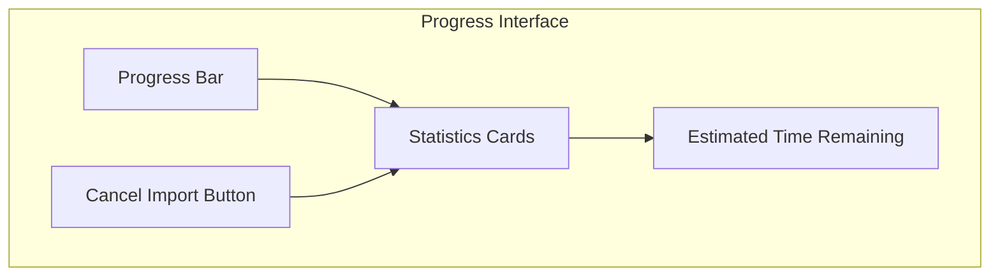

# Student Data Import

<cite>
**Referenced Files in This Document**
- [StudentDataImportPage.tsx](file://src/modules/administration/pages/StudentDataImportPage.tsx)
- [useStudentImportData.ts](file://src/modules/administration/data/useStudentImportData.ts)
- [types.ts](file://src/modules/administration/data/types.ts)
- [databaseService.ts](file://src/services/databaseService.ts)
- [schema.ts](file://src/modules/administration/data/schema.ts)
- [students.ts](file://src/api/students.ts)
</cite>

## Table of Contents
1. [Introduction](#introduction)
2. [System Architecture](#system-architecture)
3. [Core Components](#core-components)
4. [Data Flow Analysis](#data-flow-analysis)
5. [Database Schema](#database-schema)
6. [Validation Logic](#validation-logic)
7. [Import Process](#import-process)
8. [User Interface Components](#user-interface-components)
9. [Error Handling](#error-handling)
10. [Performance Considerations](#performance-considerations)
11. [Troubleshooting Guide](#troubleshooting-guide)
12. [Conclusion](#conclusion)

## Introduction

The Student Data Import system is a comprehensive feature within the SchoolPilot3 educational management platform that enables administrators to efficiently import student records from CSV files. This system provides a robust framework for data validation, transformation, and database persistence while maintaining data integrity and offering real-time progress tracking.

The import functionality supports batch processing of student information including admission numbers, personal details, guardian information, and academic classifications. It features sophisticated validation mechanisms, error reporting, and comprehensive audit trails to ensure data quality and compliance with institutional standards.

## System Architecture

The Student Data Import system follows a modular architecture pattern with clear separation of concerns across multiple layers:

**Diagram sources**
- [StudentDataImportPage.tsx:1-816](file://src/modules/administration/pages/StudentDataImportPage.tsx#L1-L816)
- [useStudentImportData.ts:1-142](file://src/modules/administration/data/useStudentImportData.ts#L1-L142)
- [databaseService.ts:1-358](file://src/services/databaseService.ts#L1-L358)

The architecture implements a reactive pattern where the UI components communicate with business logic through React hooks, while the database layer abstracts data persistence concerns through a unified service interface.

## Core Components

### StudentDataImportPage Component

The main page component serves as the primary interface for the import functionality, implementing a multi-step wizard approach:

**Diagram sources**
- [StudentDataImportPage.tsx:23-816](file://src/modules/administration/pages/StudentDataImportPage.tsx#L23-L816)

The component manages four distinct states:
- **Upload**: File selection and drag-and-drop interface
- **Preview**: Data validation and summary display
- **Importing**: Real-time progress monitoring
- **Results**: Final import outcomes and statistics

### useStudentImportData Hook

This custom React hook encapsulates all data management logic for the import process:

**Diagram sources**
- [useStudentImportData.ts:9-142](file://src/modules/administration/data/useStudentImportData.ts#L9-L142)
- [types.ts:556-598](file://src/modules/administration/data/types.ts#L556-L598)

**Section sources**
- [StudentDataImportPage.tsx:41-816](file://src/modules/administration/pages/StudentDataImportPage.tsx#L41-L816)
- [useStudentImportData.ts:9-142](file://src/modules/administration/data/useStudentImportData.ts#L9-L142)

## Data Flow Analysis

The import process follows a structured data flow pattern that ensures data integrity and provides comprehensive error handling:

**Diagram sources**
- [StudentDataImportPage.tsx:164-344](file://src/modules/administration/pages/StudentDataImportPage.tsx#L164-L344)
- [useStudentImportData.ts:14-103](file://src/modules/administration/data/useStudentImportData.ts#L14-L103)

The data flow ensures that:
1. **File Processing**: CSV files are parsed and validated before any database operations
2. **Session Management**: Import sessions are created and tracked throughout the process
3. **Record Tracking**: Individual records maintain their validation and import status
4. **Transaction Safety**: Database operations are wrapped in transaction-like patterns
5. **Audit Trail**: All operations are logged for compliance and debugging

**Section sources**
- [StudentDataImportPage.tsx:164-344](file://src/modules/administration/pages/StudentDataImportPage.tsx#L164-L344)

## Database Schema

The system utilizes a comprehensive database schema designed for efficient storage and retrieval of import-related data:

```mermaid
erDiagram
STUDENT_IMPORT_SESSIONS {
string id PK
string filename
integer total_records
integer valid_records
integer invalid_records
integer imported_records
integer failed_records
string status
string started_by
datetime started_at
datetime completed_at
string error_log
datetime created_at
datetime updated_at
}
STUDENT_IMPORT_RECORDS {
string id PK
string import_id FK
integer row_number
string admission_number
string first_name
string middle_name
string last_name
string date_of_birth
string gender
string grade_level
string class_name
string stream_name
string guardian_name
string guardian_phone
string guardian_email
string validation_status
string[] validation_errors
string[] validation_warnings
string import_status
string student_id
string error_message
datetime created_at
datetime updated_at
}
STUDENTS {
string id PK
string admission_number
string first_name
string middle_name
string last_name
string date_of_birth
string gender
string grade_level
string class_name
string stream_name
string guardian_name
string guardian_phone
string guardian_email
string status
datetime created_at
datetime updated_at
}
USERS {
string id PK
string username
string email
string role
boolean is_active
}
STUDENT_IMPORT_SESSIONS ||--o{ STUDENT_IMPORT_RECORDS : contains
USERS ||--o{ STUDENT_IMPORT_SESSIONS : starts
STUDENT_IMPORT_RECORDS ||--|| STUDENTS : creates
```

**Diagram sources**
- [schema.ts:487-545](file://src/modules/administration/data/schema.ts#L487-L545)
- [types.ts:556-598](file://src/modules/administration/data/types.ts#L556-L598)

The schema design incorporates several key features:
- **Foreign Key Relationships**: Proper referential integrity between sessions, records, and students
- **Index Optimization**: Strategic indexing for frequently queried fields
- **Denormalization**: Performance-optimized denormalized fields for reporting
- **Audit Fields**: Comprehensive timestamp tracking for all records

**Section sources**
- [schema.ts:487-545](file://src/modules/administration/data/schema.ts#L487-L545)
- [types.ts:556-598](file://src/modules/administration/data/types.ts#L556-L598)

## Validation Logic

The validation system implements comprehensive data quality checks to ensure imported records meet institutional standards:

**Diagram sources**
- [StudentDataImportPage.tsx:95-161](file://src/modules/administration/pages/StudentDataImportPage.tsx#L95-L161)

The validation system categorizes issues into three levels:
- **Invalid Records**: Complete data failures requiring manual correction
- **Warning Records**: Potentially problematic data with suggested corrections
- **Valid Records**: Data meeting all validation criteria

**Section sources**
- [StudentDataImportPage.tsx:95-161](file://src/modules/administration/pages/StudentDataImportPage.tsx#L95-L161)

## Import Process

The import process is designed for reliability and provides comprehensive progress tracking:

**Diagram sources**
- [StudentDataImportPage.tsx:226-344](file://src/modules/administration/pages/StudentDataImportPage.tsx#L226-L344)
- [useStudentImportData.ts:14-80](file://src/modules/administration/data/useStudentImportData.ts#L14-L80)

The process includes several safety mechanisms:
- **Atomic Operations**: Each student creation is wrapped in individual database operations
- **Progress Tracking**: Real-time progress updates with success/failure counts
- **Error Recovery**: Failed records are isolated and documented separately
- **Session Persistence**: Import sessions maintain state across browser refreshes

**Section sources**
- [StudentDataImportPage.tsx:226-344](file://src/modules/administration/pages/StudentDataImportPage.tsx#L226-L344)

## User Interface Components

The user interface provides an intuitive multi-step wizard experience:

### Upload Interface
The initial upload interface supports both drag-and-drop and traditional file selection:

**Diagram sources**
- [StudentDataImportPage.tsx:612-656](file://src/modules/administration/pages/StudentDataImportPage.tsx#L612-L656)

### Preview Interface
The preview interface displays validation results with color-coded status indicators:

**Diagram sources**
- [StudentDataImportPage.tsx:658-714](file://src/modules/administration/pages/StudentDataImportPage.tsx#L658-L714)

### Progress Interface
The progress interface provides real-time feedback during import operations:

**Diagram sources**
- [StudentDataImportPage.tsx:716-757](file://src/modules/administration/pages/StudentDataImportPage.tsx#L716-L757)

**Section sources**
- [StudentDataImportPage.tsx:612-816](file://src/modules/administration/pages/StudentDataImportPage.tsx#L612-L816)

## Error Handling

The system implements comprehensive error handling at multiple levels:

### File Processing Errors
- **Unsupported Formats**: Graceful handling of non-CSV files with clear error messages
- **Parsing Failures**: Robust CSV parsing with detailed error reporting
- **Empty Files**: Detection and handling of empty or malformed CSV files

### Validation Errors
- **Field Validation**: Specific error messages for missing or incorrectly formatted fields
- **Business Rule Violations**: Custom validation for age limits, date ranges, and data consistency
- **Duplicate Detection**: Prevention of duplicate admission numbers and other unique identifiers

### Import Errors
- **Database Failures**: Transaction rollback and error recovery mechanisms
- **Network Issues**: Retry logic and offline capability support
- **Timeout Handling**: Graceful degradation and progress preservation

### User Experience Enhancements
- **Real-time Feedback**: Immediate validation feedback during data entry
- **Error Summaries**: Consolidated error reporting for batch operations
- **Recovery Options**: Ability to fix and reprocess failed records

**Section sources**
- [StudentDataImportPage.tsx:164-194](file://src/modules/administration/pages/StudentDataImportPage.tsx#L164-L194)
- [StudentDataImportPage.tsx:340-344](file://src/modules/administration/pages/StudentDataImportPage.tsx#L340-L344)

## Performance Considerations

The system is optimized for performance across multiple dimensions:

### Database Optimization
- **Batch Operations**: Minimizes database round trips through strategic batching
- **Index Utilization**: Strategic indexing on frequently queried fields
- **Connection Pooling**: Efficient database connection management
- **Query Optimization**: Optimized queries for large dataset processing

### Memory Management
- **Streaming Processing**: Processes large files without loading entire datasets into memory
- **Progressive Loading**: DataGrid components use virtual scrolling for large datasets
- **Cleanup Mechanisms**: Automatic cleanup of temporary data and resources

### Network Efficiency
- **Lazy Loading**: Non-critical resources are loaded on-demand
- **Compression**: Data transmission optimization for large imports
- **Caching Strategies**: Intelligent caching of frequently accessed data

### Scalability Features
- **Horizontal Scaling**: Database schema supports distributed processing
- **Load Balancing**: Import operations can be distributed across multiple workers
- **Resource Monitoring**: Built-in monitoring for performance optimization

## Troubleshooting Guide

### Common Issues and Solutions

#### File Upload Problems
**Issue**: CSV files not being recognized
**Solution**: Ensure files have .csv extension and proper CSV formatting

**Issue**: Large file upload failures
**Solution**: Split files into smaller chunks (under 10,000 records per file)

#### Validation Errors
**Issue**: Unexpected validation failures
**Solution**: Check CSV formatting and ensure required fields are present

**Issue**: Date format errors
**Solution**: Use YYYY-MM-DD format for all date fields

#### Import Failures
**Issue**: Students not appearing after import
**Solution**: Check database connectivity and verify import session status

### Diagnostic Tools
- **Import Logs**: Detailed logs of all import operations
- **Validation Reports**: Comprehensive reports of validation results
- **Database Queries**: Direct database access for troubleshooting

### Performance Issues
**Slow Imports**: Check network connectivity and database performance
**Memory Issues**: Monitor system resources during large imports
**Timeout Errors**: Adjust timeout settings and optimize database queries

**Section sources**
- [StudentDataImportPage.tsx:164-194](file://src/modules/administration/pages/StudentDataImportPage.tsx#L164-L194)
- [useStudentImportData.ts:82-103](file://src/modules/administration/data/useStudentImportData.ts#L82-L103)

## Conclusion

The Student Data Import system represents a comprehensive solution for educational institutions seeking to efficiently manage student enrollment data. The system's architecture emphasizes reliability, scalability, and user experience while maintaining strict data validation and audit capabilities.

Key strengths of the system include:
- **Robust Validation**: Multi-level validation ensuring data quality
- **User-Friendly Interface**: Intuitive wizard-style interface for complex operations
- **Comprehensive Error Handling**: Graceful error recovery and user guidance
- **Performance Optimization**: Efficient processing of large datasets
- **Audit Trail**: Complete tracking of all import operations

The system provides a solid foundation for educational data management and can be extended to support additional data types and integration scenarios as institutional needs evolve.