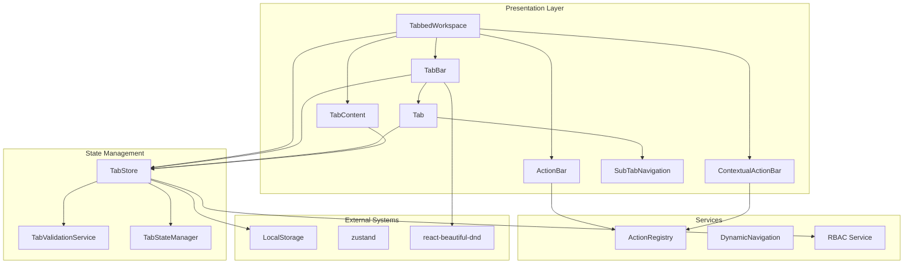
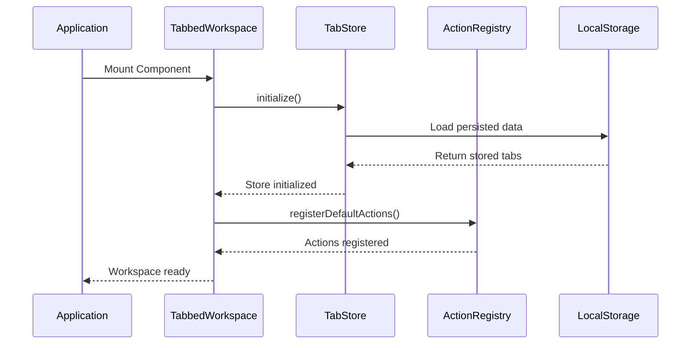
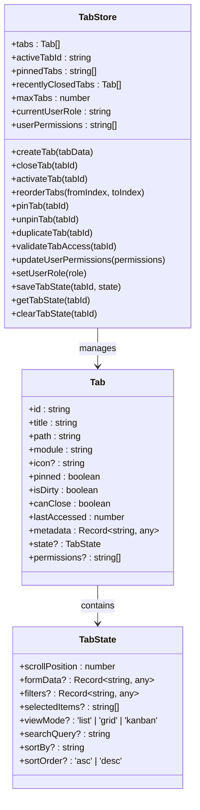
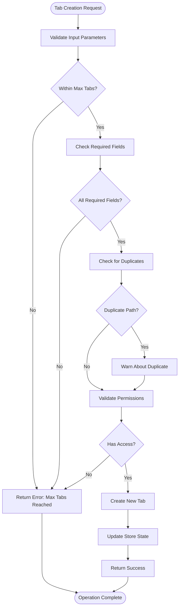
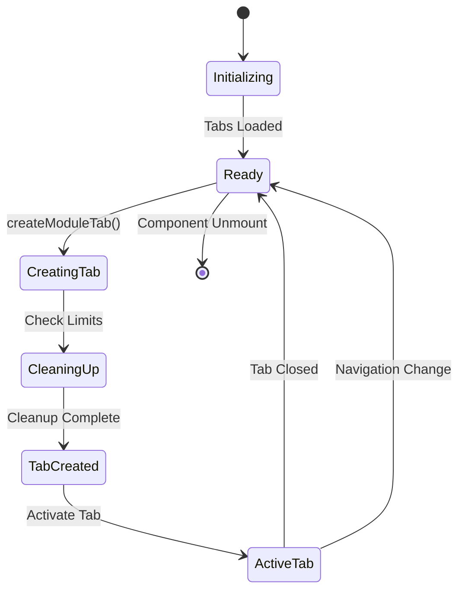
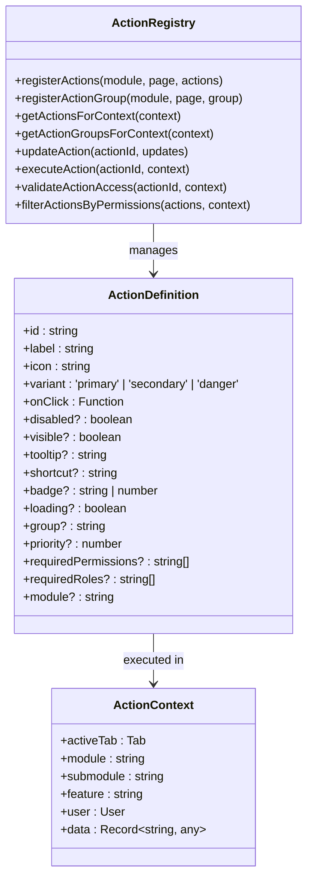
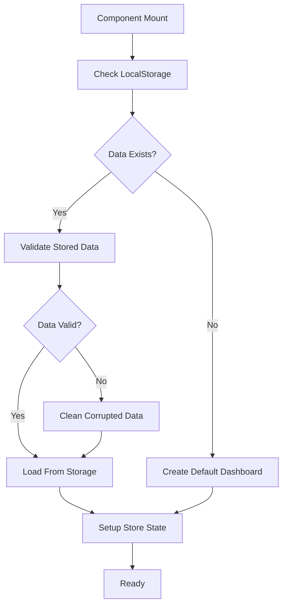
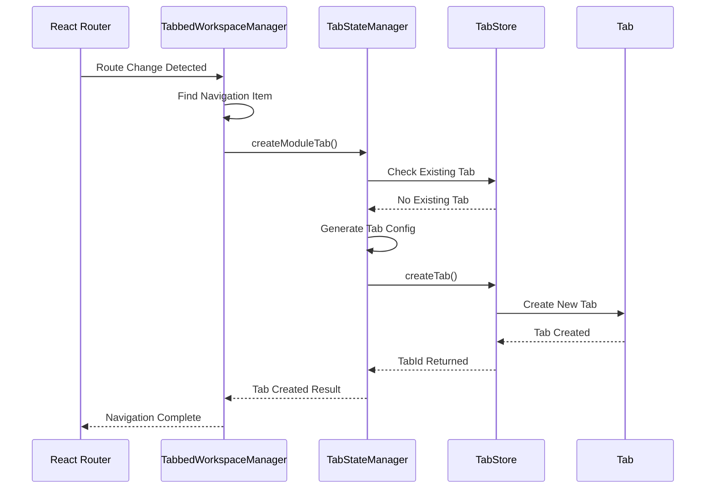

# Tab System Documentation

<cite>
**Referenced Files in This Document**
- [TabbedWorkspace.tsx](file://src/components/tabbedWorkspace/TabbedWorkspace.tsx)
- [Tab.tsx](file://src/components/tabbedWorkspace/Tab.tsx)
- [TabBar.tsx](file://src/components/tabbedWorkspace/TabBar.tsx)
- [TabContent.tsx](file://src/components/tabbedWorkspace/TabContent.tsx)
- [ActionBar.tsx](file://src/components/tabbedWorkspace/ActionBar.tsx)
- [ContextualActionBar.tsx](file://src/components/tabbedWorkspace/ContextualActionBar.tsx)
- [SubTabNavigation.tsx](file://src/components/tabbedWorkspace/SubTabNavigation.tsx)
- [TabbedWorkspaceManager.tsx](file://src/components/tabbedWorkspace/TabbedWorkspaceManager.tsx)
- [index.ts](file://src/components/tabbedWorkspace/index.ts)
- [tabStore.ts](file://src/stores/tabStore.ts)
- [TabStateManager.ts](file://src/services/TabStateManager.ts)
- [TabValidationService.ts](file://src/services/tabs/TabValidationService.ts)
- [useTabNavigation.ts](file://src/hooks/useTabNavigation.ts)
- [tabbedWorkspace.ts](file://src/types/tabbedWorkspace.ts)
</cite>

## Table of Contents
1. [Introduction](#introduction)
2. [System Architecture](#system-architecture)
3. [Core Components](#core-components)
4. [Tab Management System](#tab-management-system)
5. [Hierarchical Navigation](#hierarchical-navigation)
6. [Action System](#action-system)
7. [State Management](#state-management)
8. [Performance Optimization](#performance-optimization)
9. [Integration Patterns](#integration-patterns)
10. [Troubleshooting Guide](#troubleshooting-guide)

## Introduction

The Tab System is a comprehensive tabbed workspace implementation for the SchoolPilot3 educational management platform. It provides a modern, feature-rich tabbed interface that supports multiple tabs, hierarchical navigation, action management, and robust state persistence. The system is designed to handle complex educational workflows while maintaining excellent performance and user experience.

The tab system integrates seamlessly with the broader SchoolPilot3 architecture, providing tabbed navigation for modules, dashboards, and specialized pages throughout the application. It supports advanced features like tab persistence, RBAC integration, hierarchical navigation, and customizable action bars.

## System Architecture

The Tab System follows a modular architecture with clear separation of concerns:

**Diagram sources**
- [TabbedWorkspace.tsx:16-549](file://src/components/tabbedWorkspace/TabbedWorkspace.tsx#L16-L549)
- [tabStore.ts:139-800](file://src/stores/tabStore.ts#L139-L800)

The architecture consists of several key layers:

- **Presentation Layer**: UI components that render the tabbed interface
- **State Management**: Centralized state management using Zustand with persistence
- **Validation Layer**: Tab validation and RBAC integration
- **Service Layer**: Action registry and tab state management
- **Integration Layer**: External systems like localStorage and third-party libraries

**Section sources**
- [TabbedWorkspace.tsx:16-549](file://src/components/tabbedWorkspace/TabbedWorkspace.tsx#L16-L549)
- [tabStore.ts:139-800](file://src/stores/tabStore.ts#L139-L800)

## Core Components

### TabbedWorkspace Component

The `TabbedWorkspace` serves as the main container component that orchestrates the entire tabbed interface. It manages the overall layout, handles initialization, and coordinates between all child components.

Key features include:
- **Initialization Management**: Handles workspace initialization with proper error handling
- **Configuration Support**: Supports theme customization, tab persistence, and hierarchical mode
- **Error Boundary Integration**: Wraps the entire workspace in an error boundary
- **Performance Optimization**: Uses memoization and ref patterns to prevent unnecessary re-renders

**Diagram sources**
- [TabbedWorkspace.tsx:108-184](file://src/components/tabbedWorkspace/TabbedWorkspace.tsx#L108-L184)
- [tabStore.ts:163-244](file://src/stores/tabStore.ts#L163-L244)

**Section sources**
- [TabbedWorkspace.tsx:16-549](file://src/components/tabbedWorkspace/TabbedWorkspace.tsx#L16-L549)

### TabBar Component

The `TabBar` component provides the horizontal navigation interface for tabs. It supports drag-and-drop reordering, overflow handling, and responsive design.

Key capabilities:
- **Drag-and-Drop Support**: Built with react-beautiful-dnd for intuitive tab reordering
- **Overflow Management**: Automatically handles tabs that exceed visible space
- **Scroll Integration**: Provides smooth scrolling for large numbers of tabs
- **Responsive Design**: Adapts to different screen sizes and orientations

**Section sources**
- [TabBar.tsx:40-521](file://src/components/tabbedWorkspace/TabBar.tsx#L40-L521)

### Tab Component

The individual `Tab` component renders each tab with comprehensive styling and interaction support. It handles tab states, context menus, and various user interactions.

Features include:
- **Dual Mode Support**: Supports both legacy and modern tab styling
- **Context Menu Integration**: Rich context menu with multiple actions
- **Status Indicators**: Visual indicators for loading, errors, and unsaved changes
- **Keyboard Navigation**: Full keyboard accessibility support

**Section sources**
- [Tab.tsx:269-612](file://src/components/tabbedWorkspace/Tab.tsx#L269-L612)

## Tab Management System

### State Management Architecture

The tab system uses a sophisticated state management approach built on Zustand with Immer middleware for immutable updates and persistence for data retention.

**Diagram sources**
- [tabStore.ts:18-107](file://src/stores/tabStore.ts#L18-L107)
- [tabbedWorkspace.ts:19-49](file://src/types/tabbedWorkspace.ts#L19-L49)

### Tab Creation and Validation

The system implements comprehensive tab validation through the `TabValidationService` which ensures data integrity and RBAC compliance.

**Diagram sources**
- [TabValidationService.ts:177-224](file://src/services/tabs/TabValidationService.ts#L177-L224)
- [tabStore.ts:258-335](file://src/stores/tabStore.ts#L258-L335)

**Section sources**
- [tabStore.ts:139-800](file://src/stores/tabStore.ts#L139-L800)
- [TabValidationService.ts:83-570](file://src/services/tabs/TabValidationService.ts#L83-L570)

## Hierarchical Navigation

### Hierarchical Tab Support

The tab system supports hierarchical navigation through the `HierarchicalTab` interface and associated components. This enables complex navigation structures within individual tabs.

Key features:
- **Sub-tab Navigation**: Secondary navigation within main tabs
- **Breadcrumb Integration**: Automatic breadcrumb generation for hierarchical paths
- **Nested Content**: Support for nested content structures
- **Flexible Styling**: Different styling approaches for hierarchical vs flat navigation

**Section sources**
- [Tab.tsx:555-564](file://src/components/tabbedWorkspace/Tab.tsx#L555-L564)
- [TabBar.tsx:89-97](file://src/components/tabbedWorkspace/TabBar.tsx#L89-L97)

### TabStateManager

The `TabStateManager` provides intelligent tab lifecycle management with platform awareness and automatic cleanup capabilities.

**Diagram sources**
- [TabStateManager.ts:75-142](file://src/services/TabStateManager.ts#L75-L142)

**Section sources**
- [TabStateManager.ts:33-375](file://src/services/TabStateManager.ts#L33-L375)

## Action System

### Action Registry Architecture

The action system provides a flexible framework for tab-specific actions with RBAC integration and context awareness.

**Diagram sources**
- [tabbedWorkspace.ts:110-150](file://src/types/tabbedWorkspace.ts#L110-L150)

### ActionBar Components

The system provides two complementary action bar components:

- **ActionBar**: Global action bar with search and filtering capabilities
- **ContextualActionBar**: Tab-specific action bar with contextual actions

Both components support:
- **Grouping**: Actions organized into logical groups
- **Search**: Dynamic filtering of available actions
- **Overflow Management**: Handling large numbers of actions
- **RBAC Integration**: Permission-based visibility and execution

**Section sources**
- [ActionBar.tsx:216-527](file://src/components/tabbedWorkspace/ActionBar.tsx#L216-L527)
- [ContextualActionBar.tsx:118-446](file://src/components/tabbedWorkspace/ContextualActionBar.tsx#L118-L446)

## State Management

### Persistence Strategy

The tab system implements a robust persistence strategy using localStorage with comprehensive data validation and cleanup mechanisms.

**Diagram sources**
- [tabStore.ts:163-244](file://src/stores/tabStore.ts#L163-L244)

### Performance Optimizations

The system implements several performance optimization strategies:

- **Memoization**: Extensive use of React.memo and useMemo for component optimization
- **Ref Patterns**: Strategic use of refs to avoid unnecessary re-renders
- **Lazy Loading**: Conditional loading of tab content
- **Efficient Updates**: Batched state updates using Immer middleware

**Section sources**
- [tabStore.ts:139-800](file://src/stores/tabStore.ts#L139-L800)

## Performance Optimization

### Rendering Performance

The tab system employs several strategies to maintain optimal performance:

- **Component Memoization**: All major components use React.memo with custom comparison functions
- **State Partitioning**: Separate concerns between tab state, action state, and UI state
- **Conditional Rendering**: Content rendered only when tabs are active
- **Efficient List Rendering**: Virtualized lists for large numbers of tabs

### Memory Management

The system includes comprehensive memory management:
- **Automatic Cleanup**: Proper cleanup of event listeners and timers
- **State Pruning**: Regular pruning of old tab states and metadata
- **Resource Management**: Efficient handling of external resources and connections

**Section sources**
- [TabbedWorkspace.tsx:48-511](file://src/components/tabbedWorkspace/TabbedWorkspace.tsx#L48-L511)
- [tabStore.ts:789-800](file://src/stores/tabStore.ts#L789-L800)

## Integration Patterns

### Route Integration

The `TabbedWorkspaceManager` provides seamless integration with React Router for automatic tab creation based on route changes.

**Diagram sources**
- [TabbedWorkspaceManager.tsx:68-106](file://src/components/tabbedWorkspace/TabbedWorkspaceManager.tsx#L68-L106)

### Hook Integration

The `useTabNavigation` hook provides a comprehensive API for programmatic tab management:

- **Navigation Methods**: Programmatic tab creation and activation
- **Bulk Operations**: Support for bulk tab operations
- **State Management**: Integration with the central tab store
- **Error Handling**: Comprehensive error handling and user feedback

**Section sources**
- [TabbedWorkspaceManager.tsx:16-126](file://src/components/tabbedWorkspace/TabbedWorkspaceManager.tsx#L16-L126)
- [useTabNavigation.ts:107-630](file://src/hooks/useTabNavigation.ts#L107-L630)

## Troubleshooting Guide

### Common Issues and Solutions

**Tab Creation Failures**
- **Symptom**: Tabs fail to create with validation errors
- **Cause**: Exceeded maximum tab limit or invalid tab data
- **Solution**: Check tab limits and validate tab data structure

**Performance Issues**
- **Symptom**: Slow tab switching or rendering delays
- **Cause**: Large numbers of tabs or complex tab content
- **Solution**: Implement tab cleanup strategies and optimize content rendering

**State Corruption**
- **Symptom**: Tabs disappearing or showing incorrect data
- **Cause**: Corrupted localStorage data
- **Solution**: Use the built-in data cleanup functionality

**RBAC Access Problems**
- **Symptom**: Users cannot access certain tabs despite having permissions
- **Cause**: Incorrect role configuration or permission validation
- **Solution**: Verify role configurations and permission mappings

### Debugging Tools

The system includes comprehensive debugging capabilities:
- **Development Logging**: Extensive logging during development
- **State Inspection**: Tools for inspecting tab state and configuration
- **Performance Monitoring**: Built-in performance metrics and monitoring
- **Error Boundaries**: Comprehensive error handling and reporting

**Section sources**
- [TabbedWorkspace.tsx:43-45](file://src/components/tabbedWorkspace/TabbedWorkspace.tsx#L43-L45)
- [tabStore.ts:789-800](file://src/stores/tabStore.ts#L789-L800)