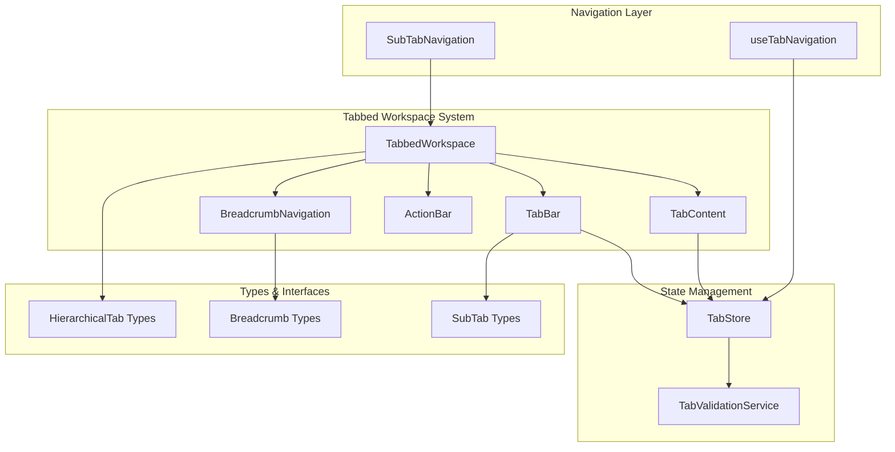
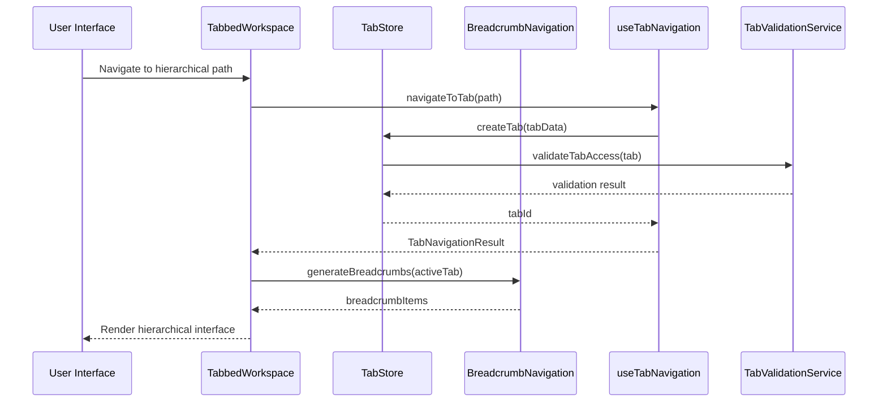
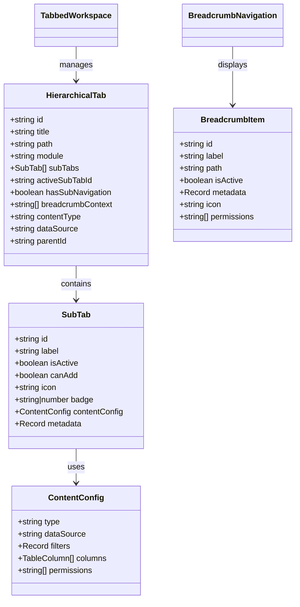
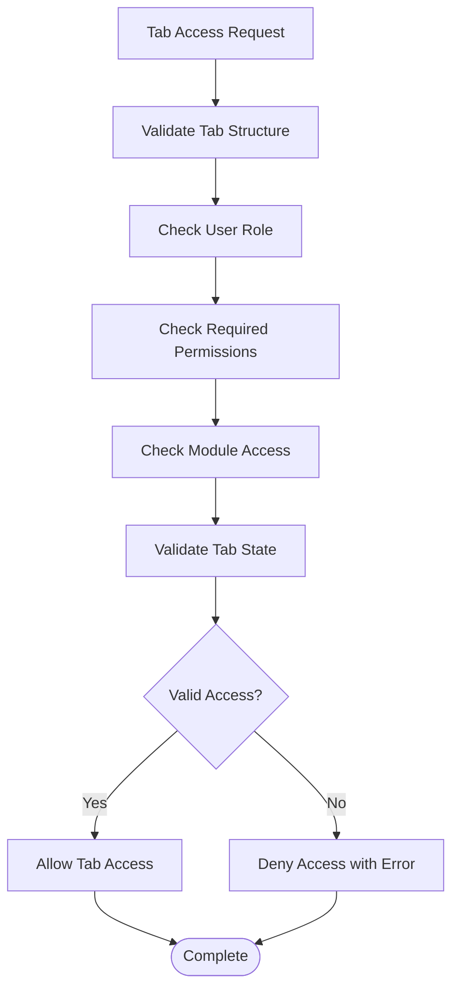
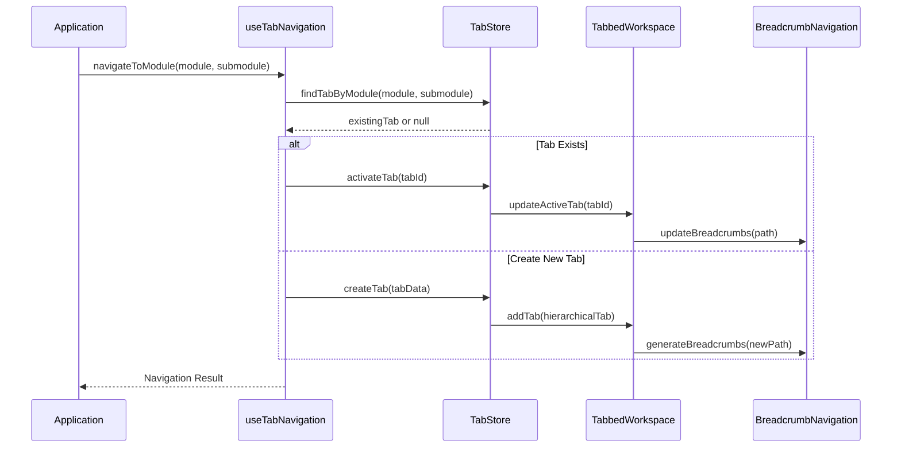
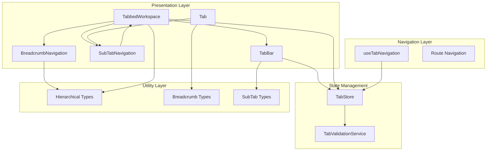

# Hierarchical Tabs & Navigation

<cite>
**Referenced Files in This Document**
- [TabbedWorkspace.tsx](file://src/components/tabbedWorkspace/TabbedWorkspace.tsx)
- [TabBar.tsx](file://src/components/tabbedWorkspace/TabBar.tsx)
- [Tab.tsx](file://src/components/tabbedWorkspace/Tab.tsx)
- [SubTabNavigation.tsx](file://src/components/tabbedWorkspace/SubTabNavigation.tsx)
- [BreadcrumbNavigation.tsx](file://src/components/BreadcrumbNavigation.tsx)
- [useTabNavigation.ts](file://src/hooks/useTabNavigation.ts)
- [tabStore.ts](file://src/stores/tabStore.ts)
- [hierarchical.ts](file://src/types/hierarchical.ts)
- [TabValidationService.ts](file://src/services/tabs/TabValidationService.ts)
- [TAB_SYSTEMS_ANALYSIS.md](file://docs/tabs/TAB_SYSTEMS_ANALYSIS.md)
- [UNIFIED_TAB_ARCHITECTURE.md](file://docs/architecture/UNIFIED_TAB_ARCHITECTURE.md)
- [TAB_SYSTEM_ENHANCEMENTS.md](file://docs/tabs/TAB_SYSTEM_ENHANCEMENTS.md)
</cite>

## Table of Contents
1. [Introduction](#introduction)
2. [Project Structure](#project-structure)
3. [Core Components](#core-components)
4. [Architecture Overview](#architecture-overview)
5. [Detailed Component Analysis](#detailed-component-analysis)
6. [Dependency Analysis](#dependency-analysis)
7. [Performance Considerations](#performance-considerations)
8. [Troubleshooting Guide](#troubleshooting-guide)
9. [Conclusion](#conclusion)

## Introduction

SchoolPilot3's hierarchical tabbed workspace system represents a sophisticated navigation architecture designed to handle complex multi-level workflows while maintaining intuitive user experience. This system extends traditional tab navigation by introducing nested tab structures, sub-tab navigation, and integrated breadcrumb trails that work together to create a comprehensive navigation ecosystem.

The hierarchical tab system addresses the challenge of managing complex educational institution workflows where users need to navigate through multiple levels of information hierarchies. From academic modules down to specific course sections, from administrative functions to detailed report views, the system provides structured pathways that maintain context awareness throughout the navigation journey.

## Project Structure

The hierarchical tab system is built around a modular architecture that separates concerns between tab management, content rendering, and navigation integration. The system leverages React's component composition patterns while implementing sophisticated state management through Zustand stores.



**Diagram sources**
- [TabbedWorkspace.tsx:16-546](file://src/components/tabbedWorkspace/TabbedWorkspace.tsx#L16-L546)
- [tabStore.ts:139-800](file://src/stores/tabStore.ts#L139-L800)

**Section sources**
- [TabbedWorkspace.tsx:1-549](file://src/components/tabbedWorkspace/TabbedWorkspace.tsx#L1-L549)
- [tabStore.ts:1-917](file://src/stores/tabStore.ts#L1-L917)

## Core Components

### TabbedWorkspace: Main Container Component

The TabbedWorkspace serves as the primary orchestrator for the entire tabbed navigation system. It manages the lifecycle of tabs, coordinates between different navigation components, and provides the foundational infrastructure for hierarchical navigation.

Key responsibilities include:
- **Tab Lifecycle Management**: Creating, activating, closing, and reordering tabs
- **Hierarchical Mode Coordination**: Managing nested tab structures and sub-tab navigation
- **Breadcrumb Integration**: Generating and displaying breadcrumb trails for hierarchical paths
- **State Persistence**: Maintaining tab state across browser sessions
- **Permission Validation**: Enforcing access controls for tab content

The component implements sophisticated performance optimizations including memoization strategies, drag-and-drop reordering, and conditional rendering to ensure smooth user experience even with complex navigation hierarchies.

### TabBar: Navigation Interface

The TabBar component provides the visual interface for tab navigation, supporting both traditional tab switching and advanced features like drag-and-drop reordering, overflow handling, and contextual actions.

Advanced features include:
- **Responsive Design**: Adaptive tab width calculation and overflow management
- **Drag-and-Drop Support**: Intuitive tab reordering through mouse and touch interactions
- **Overflow Menu**: Handling large numbers of tabs with intelligent truncation
- **Visual Feedback**: Loading states, error indicators, and active tab highlighting

### SubTabNavigation: Secondary Navigation

The SubTabNavigation component handles secondary navigation within individual tabs, particularly useful for complex workflows requiring multiple sub-levels of navigation.

Key capabilities:
- **Dynamic Sub-tab Creation**: Runtime sub-tab generation based on content requirements
- **Contextual Navigation**: Different sub-tab sets for different tab contexts
- **Visual Hierarchy**: Clear indication of primary and secondary navigation levels
- **Integration Points**: Seamless integration with main tab navigation system

**Section sources**
- [TabbedWorkspace.tsx:16-546](file://src/components/tabbedWorkspace/TabbedWorkspace.tsx#L16-L546)
- [TabBar.tsx:40-521](file://src/components/tabbedWorkspace/TabBar.tsx#L40-L521)
- [SubTabNavigation.tsx:8-94](file://src/components/tabbedWorkspace/SubTabNavigation.tsx#L8-L94)

## Architecture Overview

The hierarchical tab system follows a layered architecture pattern that separates concerns between presentation, state management, and business logic. This design enables scalability and maintainability while supporting complex navigation workflows.



**Diagram sources**
- [TabbedWorkspace.tsx:242-275](file://src/components/tabbedWorkspace/TabbedWorkspace.tsx#L242-L275)
- [useTabNavigation.ts:339-386](file://src/hooks/useTabNavigation.ts#L339-L386)
- [tabStore.ts:258-335](file://src/stores/tabStore.ts#L258-L335)

The architecture emphasizes loose coupling between components while maintaining clear data flow patterns. Each component has well-defined responsibilities and communicates through established interfaces, enabling independent development and testing.

**Section sources**
- [TabbedWorkspace.tsx:16-546](file://src/components/tabbedWorkspace/TabbedWorkspace.tsx#L16-L546)
- [useTabNavigation.ts:107-627](file://src/hooks/useTabNavigation.ts#L107-L627)

## Detailed Component Analysis

### Hierarchical Tab Data Model

The hierarchical tab system introduces a sophisticated data model that extends basic tab functionality to support nested navigation structures.



**Diagram sources**
- [hierarchical.ts:46-118](file://src/types/hierarchical.ts#L46-L118)
- [hierarchical.ts:28-44](file://src/types/hierarchical.ts#L28-L44)
- [hierarchical.ts:8-16](file://src/types/hierarchical.ts#L8-L16)

The data model supports complex navigation scenarios through properties like `parentId` for establishing hierarchical relationships, `breadcrumbContext` for maintaining navigation history, and `contentType` for differentiating between various content types.

### Breadcrumb Generation System

The breadcrumb system automatically generates navigation trails based on tab paths, providing users with clear context about their current location within the application hierarchy.

```mermaid
flowchart TD
Start([Tab Activation]) --> CheckPath{Has Path?}
CheckPath --> |No| EmptyBreadcrumbs[Empty Breadcrumbs]
CheckPath --> |Yes| SplitPath[Split Path by "/"]
SplitPath --> FilterSegments[Filter Empty Segments]
FilterSegments --> GenerateItems[Generate Breadcrumb Items]
GenerateItems --> MapSegments[Map to BreadcrumbItems]
MapSegments --> SetActive[Mark Last Item Active]
SetActive --> RenderBreadcrumbs[Render Breadcrumbs]
EmptyBreadcrumbs --> End([Complete])
RenderBreadcrumbs --> End
```

**Diagram sources**
- [TabbedWorkspace.tsx:242-252](file://src/components/tabbedWorkspace/TabbedWorkspace.tsx#L242-L252)
- [tabStore.ts:768-786](file://src/stores/tabStore.ts#L768-L786)

The breadcrumb generation process transforms URL-like paths into human-readable navigation trails, with each segment representing a navigable level in the hierarchy.

### Tab Validation and Access Control

The system implements comprehensive validation and access control mechanisms to ensure secure and appropriate tab access across different user roles and permissions.



**Diagram sources**
- [TabValidationService.ts:120-166](file://src/services/tabs/TabValidationService.ts#L120-L166)
- [tabStore.ts:664-670](file://src/stores/tabStore.ts#L664-L670)

The validation system evaluates multiple factors including tab structure integrity, user role permissions, required permissions, and module access rights to determine appropriate tab access.

**Section sources**
- [hierarchical.ts:1-240](file://src/types/hierarchical.ts#L1-L240)
- [TabValidationService.ts:1-570](file://src/services/tabs/TabValidationService.ts#L1-L570)

### Navigation Integration Patterns

The tab system integrates seamlessly with the broader application navigation framework, supporting both programmatic and user-driven navigation patterns.



**Diagram sources**
- [useTabNavigation.ts:388-392](file://src/hooks/useTabNavigation.ts#L388-L392)
- [tabStore.ts:730-759](file://src/stores/tabStore.ts#L730-L759)

**Section sources**
- [useTabNavigation.ts:107-627](file://src/hooks/useTabNavigation.ts#L107-L627)
- [tabStore.ts:139-800](file://src/stores/tabStore.ts#L139-L800)

## Dependency Analysis

The hierarchical tab system exhibits well-managed dependencies that support maintainability and extensibility while avoiding circular dependencies.



**Diagram sources**
- [TabbedWorkspace.tsx:1-549](file://src/components/tabbedWorkspace/TabbedWorkspace.tsx#L1-L549)
- [tabStore.ts:1-917](file://src/stores/tabStore.ts#L1-L917)

The dependency graph reveals a clean separation of concerns where presentation components depend on state management, navigation utilities depend on state management, and type definitions provide shared interfaces across the system.

**Section sources**
- [TabbedWorkspace.tsx:1-549](file://src/components/tabbedWorkspace/TabbedWorkspace.tsx#L1-L549)
- [tabStore.ts:1-917](file://src/stores/tabStore.ts#L1-L917)

## Performance Considerations

The hierarchical tab system implements several performance optimization strategies to handle complex navigation scenarios efficiently:

### Memory Management
- **Tab State Cleanup**: Automatic cleanup of inactive tab states to prevent memory leaks
- **Content Virtualization**: Lazy loading of tab content to reduce initial memory footprint
- **State Persistence**: Intelligent persistence strategies that balance performance with user experience

### Rendering Optimization
- **Memoization Strategies**: Extensive use of React.memo and useMemo to prevent unnecessary re-renders
- **Conditional Rendering**: Dynamic rendering based on tab activation state
- **Component Splitting**: Separate components for different tab types to optimize rendering paths

### Navigation Performance
- **Path-Based Navigation**: Efficient path resolution without full tree traversal
- **Caching Mechanisms**: Breadcrumb and navigation item caching for improved responsiveness
- **Debounced Operations**: Debounced breadcrumb updates to prevent excessive re-renders

### Scalability Considerations
- **Hierarchical Limits**: Configurable limits on tab depth and breadth for performance control
- **Background Processing**: Asynchronous operations for heavy computations
- **Resource Management**: Proper cleanup of event listeners and subscriptions

**Section sources**
- [TAB_SYSTEMS_ANALYSIS.md:139-162](file://docs/tabs/TAB_SYSTEMS_ANALYSIS.md#L139-L162)
- [TAB_SYSTEM_ENHANCEMENTS.md:168-206](file://docs/tabs/TAB_SYSTEM_ENHANCEMENTS.md#L168-L206)

## Troubleshooting Guide

### Common Issues and Solutions

**Tab Creation Failures**
- **Symptoms**: Tabs not appearing or creation throwing errors
- **Causes**: Permission validation failures, tab limits exceeded, corrupted tab data
- **Solutions**: Check user permissions, verify tab count limits, use `clearCorruptedData()` method

**Breadcrumb Navigation Problems**
- **Symptoms**: Breadcrumbs not updating or showing incorrect paths
- **Causes**: Path parsing errors, missing tab data, state synchronization issues
- **Solutions**: Verify tab path format, check breadcrumb generation logic, ensure proper state updates

**Performance Degradation**
- **Symptoms**: Slow tab switching, memory leaks, excessive re-renders
- **Causes**: Missing memoization, excessive state updates, inefficient component rendering
- **Solutions**: Implement proper memoization, optimize component rendering, monitor memory usage

### Debugging Strategies

**State Inspection**
- Use browser developer tools to inspect tab store state
- Monitor breadcrumb generation and update cycles
- Track tab lifecycle events and state transitions

**Performance Profiling**
- Monitor component render times using React DevTools Profiler
- Track memory usage patterns during navigation
- Analyze network requests for tab content loading

**Error Tracking**
- Implement comprehensive error boundaries for tab content
- Monitor validation service errors and warnings
- Track user interaction patterns for navigation issues

**Section sources**
- [TAB_SYSTEMS_ANALYSIS.md:65-172](file://docs/tabs/TAB_SYSTEMS_ANALYSIS.md#L65-L172)
- [TAB_SYSTEM_ENHANCEMENTS.md:72-118](file://docs/tabs/TAB_SYSTEM_ENHANCEMENTS.md#L72-L118)

## Conclusion

SchoolPilot3's hierarchical tabbed workspace system represents a comprehensive solution for complex navigation requirements in educational applications. The system successfully balances sophisticated functionality with maintainable architecture, providing users with intuitive navigation while developers benefit from clear separation of concerns and robust performance characteristics.

The implementation demonstrates several key strengths:
- **Scalable Architecture**: Well-designed component hierarchy that supports complex navigation scenarios
- **Performance Optimization**: Thoughtful implementation of memoization, lazy loading, and state management
- **Accessibility Compliance**: Comprehensive approach to accessibility and user experience
- **Extensibility**: Flexible design that accommodates future enhancements and requirements

The system's ability to handle deeply nested tab hierarchies while maintaining responsive performance makes it suitable for complex institutional applications. The integration between main tabs, sub-tabs, and breadcrumb trails creates a cohesive navigation experience that enhances user productivity and reduces cognitive load.

Future enhancements should focus on completing accessibility compliance, implementing comprehensive error handling, and establishing robust testing strategies to ensure continued reliability and maintainability as the system evolves to meet growing institutional needs.