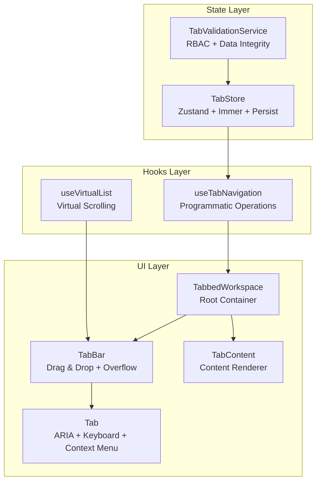
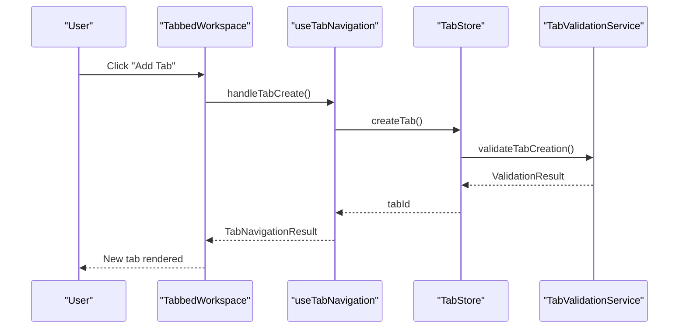
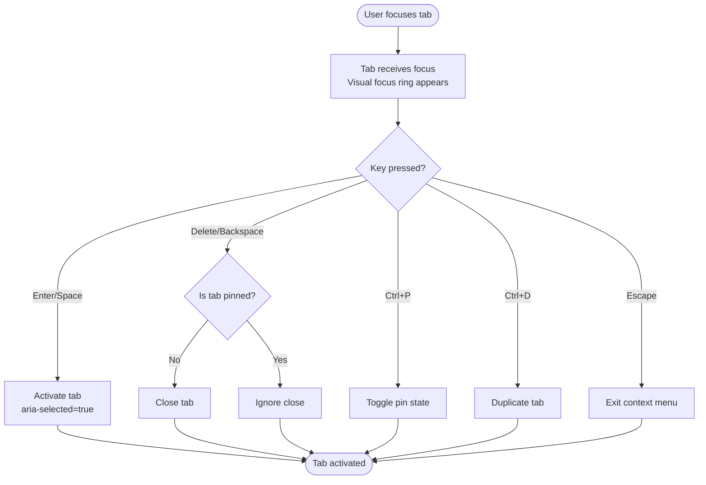
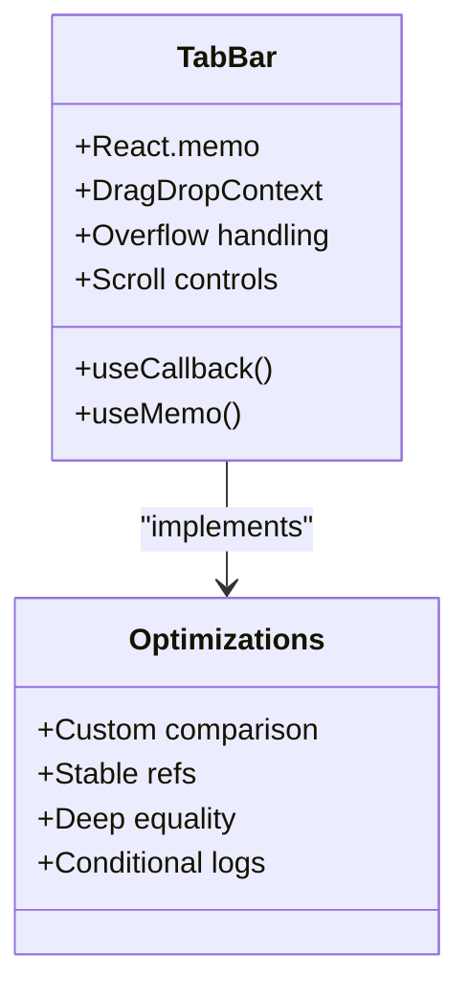
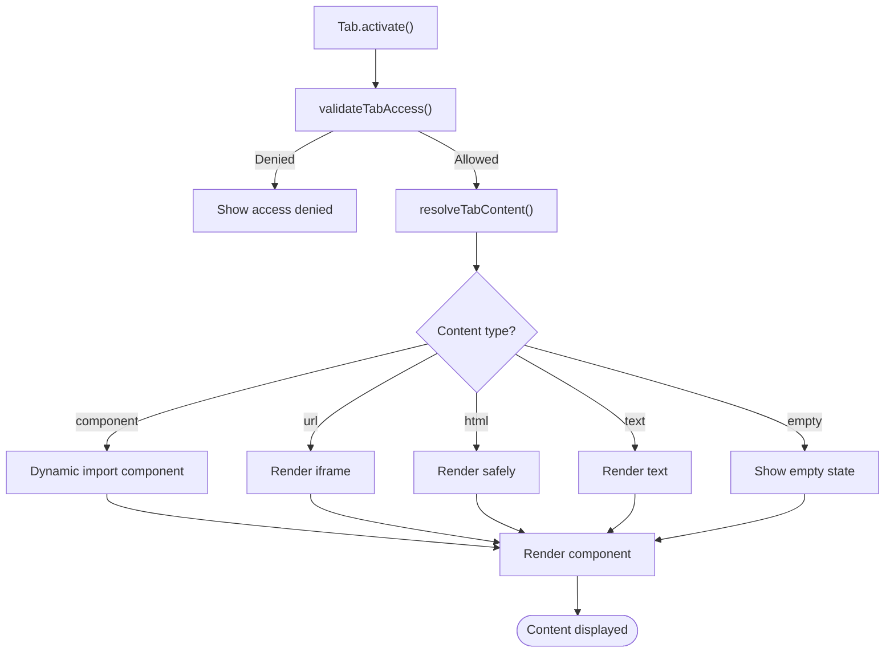
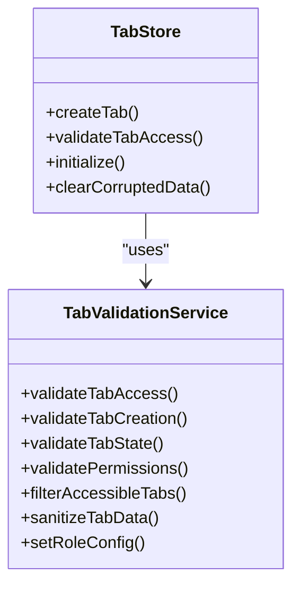
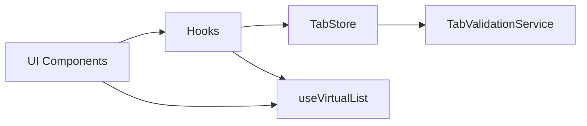

# Tab Accessibility & Performance

<cite>
**Referenced Files in This Document**
- [tabStore.ts](file://src/stores/tabStore.ts)
- [useTabNavigation.ts](file://src/hooks/useTabNavigation.ts)
- [Tab.tsx](file://src/components/tabbedWorkspace/Tab.tsx)
- [TabBar.tsx](file://src/components/tabbedWorkspace/TabBar.tsx)
- [TabContent.tsx](file://src/components/tabbedWorkspace/TabContent.tsx)
- [TabbedWorkspace.tsx](file://src/components/tabbedWorkspace/TabbedWorkspace.tsx)
- [TabValidationService.ts](file://src/services/tabs/TabValidationService.ts)
- [resolveTabContent.tsx](file://src/components/tabbedWorkspace/resolveTabContent.tsx)
- [useVirtualList.ts](file://src/hooks/useVirtualList.ts)
- [tabbedWorkspace.ts](file://src/types/tabbedWorkspace.ts)
- [OPTIMIZATION_GUIDE.md](file://docs/tabs/OPTIMIZATION_GUIDE.md)
- [TAB_SYSTEMS_ANALYSIS.md](file://docs/tabs/TAB_SYSTEMS_ANALYSIS.md)
</cite>

## Table of Contents
1. [Introduction](#introduction)
2. [Project Structure](#project-structure)
3. [Core Components](#core-components)
4. [Architecture Overview](#architecture-overview)
5. [Detailed Component Analysis](#detailed-component-analysis)
6. [Dependency Analysis](#dependency-analysis)
7. [Performance Considerations](#performance-considerations)
8. [Troubleshooting Guide](#troubleshooting-guide)
9. [Conclusion](#conclusion)
10. [Appendices](#appendices)

## Introduction
This document provides comprehensive guidance for tab accessibility and performance management in SchoolPilot3's tabbed workspace system. It explains the tab accessibility manager implementation with ARIA compliance, keyboard navigation, and screen reader support. It also documents performance monitoring for tabs, including render optimization, memory usage tracking, and lazy loading strategies, along with tab virtualization techniques, content caching, and resource management. Finally, it covers accessibility features such as focus management, keyboard shortcuts, and assistive technology compatibility, and provides performance benchmarks, optimization techniques, and monitoring tools for tab-heavy applications.

## Project Structure
The tabbed workspace system is composed of:
- A central Zustand store for state management and persistence
- A navigation hook for programmatic tab operations
- UI components for tab rendering, tab bar, and content display
- A validation service for access control and data integrity
- Utility hooks for virtualization and performance optimization

**Diagram sources**
- [tabStore.ts:138-244](file://src/stores/tabStore.ts#L138-L244)
- [useTabNavigation.ts:107-627](file://src/hooks/useTabNavigation.ts#L107-L627)
- [TabbedWorkspace.tsx:16-549](file://src/components/tabbedWorkspace/TabbedWorkspace.tsx#L16-L549)
- [TabBar.tsx:40-521](file://src/components/tabbedWorkspace/TabBar.tsx#L40-L521)
- [Tab.tsx:269-612](file://src/components/tabbedWorkspace/Tab.tsx#L269-L612)
- [TabContent.tsx:21-255](file://src/components/tabbedWorkspace/TabContent.tsx#L21-L255)
- [TabValidationService.ts:83-570](file://src/services/tabs/TabValidationService.ts#L83-L570)
- [useVirtualList.ts:51-211](file://src/hooks/useVirtualList.ts#L51-L211)

**Section sources**
- [tabStore.ts:138-244](file://src/stores/tabStore.ts#L138-L244)
- [useTabNavigation.ts:107-627](file://src/hooks/useTabNavigation.ts#L107-L627)
- [TabbedWorkspace.tsx:16-549](file://src/components/tabbedWorkspace/TabbedWorkspace.tsx#L16-L549)
- [TabBar.tsx:40-521](file://src/components/tabbedWorkspace/TabBar.tsx#L40-L521)
- [Tab.tsx:269-612](file://src/components/tabbedWorkspace/Tab.tsx#L269-L612)
- [TabContent.tsx:21-255](file://src/components/tabbedWorkspace/TabContent.tsx#L21-L255)
- [TabValidationService.ts:83-570](file://src/services/tabs/TabValidationService.ts#L83-L570)
- [useVirtualList.ts:51-211](file://src/hooks/useVirtualList.ts#L51-L211)

## Core Components
- TabStore: Centralized state with persistence, RBAC integration, and hierarchical tab support. Implements tab lifecycle operations, validation, and corruption cleanup.
- useTabNavigation: Programmatic tab operations including creation, activation, closing, duplication, and bulk operations with intelligent tab reuse and replacement logic.
- Tab: Individual tab UI with ARIA roles, keyboard navigation, context menu, and status indicators.
- TabBar: Tab container with drag-and-drop reordering, overflow handling, and scroll controls.
- TabContent: Content renderer supporting multiple content types with access control and loading states.
- TabValidationService: Centralized validation for permissions, access control, state integrity, and data sanitization.
- useVirtualList: Virtual scrolling utility for efficient rendering of large lists.

**Section sources**
- [tabStore.ts:18-78](file://src/stores/tabStore.ts#L18-L78)
- [useTabNavigation.ts:107-627](file://src/hooks/useTabNavigation.ts#L107-L627)
- [Tab.tsx:269-612](file://src/components/tabbedWorkspace/Tab.tsx#L269-L612)
- [TabBar.tsx:40-521](file://src/components/tabbedWorkspace/TabBar.tsx#L40-L521)
- [TabContent.tsx:21-255](file://src/components/tabbedWorkspace/TabContent.tsx#L21-L255)
- [TabValidationService.ts:83-570](file://src/services/tabs/TabValidationService.ts#L83-L570)
- [useVirtualList.ts:51-211](file://src/hooks/useVirtualList.ts#L51-L211)

## Architecture Overview
The system follows a layered architecture:
- State management via Zustand with persistence and middleware for immutability
- Access control enforced by TabValidationService integrated into store and UI
- UI components built with React.memo and useCallback for performance
- Navigation controlled by useTabNavigation hook coordinating store operations
- Content resolution decoupled from rendering for flexibility

**Diagram sources**
- [TabbedWorkspace.tsx:289-313](file://src/components/tabbedWorkspace/TabbedWorkspace.tsx#L289-L313)
- [useTabNavigation.ts:186-336](file://src/hooks/useTabNavigation.ts#L186-L336)
- [tabStore.ts:258-335](file://src/stores/tabStore.ts#L258-L335)
- [TabValidationService.ts:177-224](file://src/services/tabs/TabValidationService.ts#L177-L224)

**Section sources**
- [TabbedWorkspace.tsx:289-313](file://src/components/tabbedWorkspace/TabbedWorkspace.tsx#L289-L313)
- [useTabNavigation.ts:186-336](file://src/hooks/useTabNavigation.ts#L186-L336)
- [tabStore.ts:258-335](file://src/stores/tabStore.ts#L258-L335)
- [TabValidationService.ts:177-224](file://src/services/tabs/TabValidationService.ts#L177-L224)

## Detailed Component Analysis

### Tab Accessibility Manager
The accessibility manager combines ARIA attributes, keyboard navigation, and focus management:
- ARIA roles and labels: Tabs use role="tab", aria-selected, and aria-label for screen readers
- Keyboard navigation: Enter/Space to activate, Delete/Backspace to close non-pinned tabs, Ctrl+P to pin, Ctrl+D to duplicate
- Focus management: Tab components are focusable (tabIndex=0), with visual focus indicators
- Context menu accessibility: Menu items use role="menuitem" and keyboard navigation within the menu
- Screen reader support: Dynamic aria-labels reflect tab state (pinned, dirty, loading)

**Diagram sources**
- [Tab.tsx:342-371](file://src/components/tabbedWorkspace/Tab.tsx#L342-L371)
- [Tab.tsx:476-480](file://src/components/tabbedWorkspace/Tab.tsx#L476-L480)
- [Tab.tsx:531-551](file://src/components/tabbedWorkspace/Tab.tsx#L531-L551)

**Section sources**
- [Tab.tsx:269-612](file://src/components/tabbedWorkspace/Tab.tsx#L269-L612)

### TabBar Performance Optimizations
The TabBar implements extensive performance optimizations:
- React.memo with custom comparison for deep equality checks
- useCallback for all event handlers to maintain referential equality
- useMemo for expensive computations (sorted tabs, styles, breadcrumbs)
- Stable keys for mapped elements
- Conditional rendering and logging controls

**Diagram sources**
- [TabBar.tsx:488-521](file://src/components/tabbedWorkspace/TabBar.tsx#L488-L521)
- [OPTIMIZATION_GUIDE.md:8-225](file://docs/tabs/OPTIMIZATION_GUIDE.md#L8-L225)

**Section sources**
- [TabBar.tsx:488-521](file://src/components/tabbedWorkspace/TabBar.tsx#L488-L521)
- [OPTIMIZATION_GUIDE.md:8-225](file://docs/tabs/OPTIMIZATION_GUIDE.md#L8-L225)

### Content Resolution and Lazy Loading
TabContent supports multiple content types with lazy loading strategies:
- Component-based content with dynamic imports for heavy components
- URL-based content using iframe sandboxing for external resources
- HTML/text content with safe rendering
- Empty/default content with graceful placeholders
- Access control enforcement before rendering

**Diagram sources**
- [TabContent.tsx:68-159](file://src/components/tabbedWorkspace/TabContent.tsx#L68-L159)
- [resolveTabContent.tsx:4-35](file://src/components/tabbedWorkspace/resolveTabContent.tsx#L4-L35)
- [tabStore.ts:371-394](file://src/stores/tabStore.ts#L371-L394)

**Section sources**
- [TabContent.tsx:21-255](file://src/components/tabbedWorkspace/TabContent.tsx#L21-L255)
- [resolveTabContent.tsx:4-35](file://src/components/tabbedWorkspace/resolveTabContent.tsx#L4-L35)
- [tabStore.ts:371-394](file://src/stores/tabStore.ts#L371-L394)

### RBAC Integration and Data Integrity
The system enforces role-based access control and maintains data integrity:
- Centralized validation service with role configurations
- Tab creation validation with duplicate detection and limit enforcement
- State validation with sanitization and default value assignment
- Corruption cleanup for persisted data
- Permission-based filtering of accessible tabs

**Diagram sources**
- [TabValidationService.ts:83-570](file://src/services/tabs/TabValidationService.ts#L83-L570)
- [tabStore.ts:53-76](file://src/stores/tabStore.ts#L53-L76)

**Section sources**
- [TabValidationService.ts:83-570](file://src/services/tabs/TabValidationService.ts#L83-L570)
- [tabStore.ts:53-76](file://src/stores/tabStore.ts#L53-L76)

### Virtualization Techniques
The system leverages virtualization for large datasets:
- useVirtualList hook for efficient rendering of long lists
- Dynamic height calculation for variable-height items
- Overscan for smooth scrolling experience
- Intersection observer patterns for height estimation
- Scroll synchronization across virtualized components

**Section sources**
- [useVirtualList.ts:51-211](file://src/hooks/useVirtualList.ts#L51-L211)

## Dependency Analysis
The tabbed workspace system exhibits strong cohesion within its layers and clear separation of concerns:
- UI components depend on hooks and store for state
- Hooks coordinate with store operations
- Validation service is centrally consumed by store and UI
- Virtualization utilities are reusable across components

**Diagram sources**
- [TabbedWorkspace.tsx:46-62](file://src/components/tabbedWorkspace/TabbedWorkspace.tsx#L46-L62)
- [useTabNavigation.ts:107-135](file://src/hooks/useTabNavigation.ts#L107-L135)
- [tabStore.ts:138-140](file://src/stores/tabStore.ts#L138-L140)

**Section sources**
- [TabbedWorkspace.tsx:46-62](file://src/components/tabbedWorkspace/TabbedWorkspace.tsx#L46-L62)
- [useTabNavigation.ts:107-135](file://src/hooks/useTabNavigation.ts#L107-L135)
- [tabStore.ts:138-140](file://src/stores/tabStore.ts#L138-L140)

## Performance Considerations
The system implements comprehensive performance optimizations:
- Component memoization with custom comparison functions
- Callback memoization to maintain referential equality
- Expensive computation memoization for derived state
- Stable prop objects to prevent unnecessary re-renders
- Conditional logging and development-only features
- Permission hash comparison for efficient updates
- Drag-and-drop optimization with react-beautiful-dnd

Performance monitoring recommendations:
- Use React DevTools Profiler to measure render times
- Monitor component re-render frequency during rapid user actions
- Test with large datasets (many tabs, complex breadcrumbs)
- Check for memory leaks in long-running sessions
- Profile initialization and hydration costs

**Section sources**
- [OPTIMIZATION_GUIDE.md:8-225](file://docs/tabs/OPTIMIZATION_GUIDE.md#L8-L225)
- [TAB_SYSTEMS_ANALYSIS.md:139-162](file://docs/tabs/TAB_SYSTEMS_ANALYSIS.md#L139-L162)

## Troubleshooting Guide
Common issues and resolutions:
- Tab creation failures: Check validation service results and user permissions
- Access denied errors: Verify role configurations and required permissions
- Performance degradation: Review memoization patterns and component dependencies
- Memory leaks: Ensure proper cleanup of event listeners and observers
- Corrupted data: Use store's corruption cleanup function
- Navigation conflicts: Review tab reuse logic and path uniqueness

Diagnostic steps:
1. Enable debug logging in development mode
2. Use React DevTools to inspect component trees and props
3. Monitor console warnings from validation service
4. Test with minimal tab sets to isolate performance issues
5. Verify accessibility attributes with browser developer tools

**Section sources**
- [tabStore.ts:78-136](file://src/stores/tabStore.ts#L78-L136)
- [TabValidationService.ts:120-166](file://src/services/tabs/TabValidationService.ts#L120-L166)
- [OPTIMIZATION_GUIDE.md:207-225](file://docs/tabs/OPTIMIZATION_GUIDE.md#L207-L225)

## Conclusion
SchoolPilot3's tabbed workspace system demonstrates robust accessibility implementation with ARIA compliance, comprehensive keyboard navigation, and screen reader support. The performance optimization strategies, including extensive memoization, virtualization, and efficient state management, provide a solid foundation for tab-heavy applications. The centralized validation service ensures data integrity and RBAC compliance, while the modular architecture enables maintainability and future enhancements.

## Appendices

### Accessibility Testing Checklist
- Verify ARIA roles and labels are present and accurate
- Test keyboard navigation across all interactive elements
- Confirm focus indicators are visible and logical
- Validate screen reader announcements for state changes
- Test context menu accessibility and keyboard navigation
- Check color contrast and visual indicators for status states

### Performance Profiling Guidelines
- Measure initial render time with varying numbers of tabs
- Profile memory usage during extended sessions
- Test drag-and-drop performance with large tab sets
- Monitor network requests for lazy-loaded components
- Evaluate scroll performance with virtualized content

### Optimization Techniques Reference
- Implement React.memo with custom comparison for complex props
- Use useCallback for all event handlers passed to children
- Apply useMemo for expensive computations and derived state
- Maintain stable keys for mapped elements
- Use permission hash comparison for efficient updates
- Leverage virtualization for large lists and tab bars