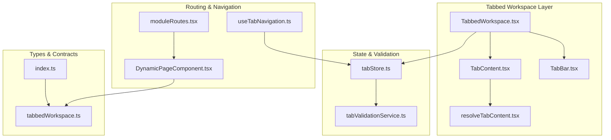
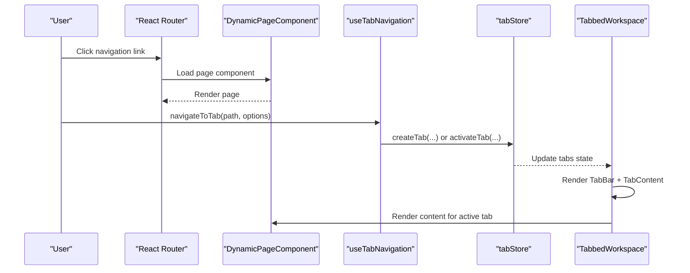
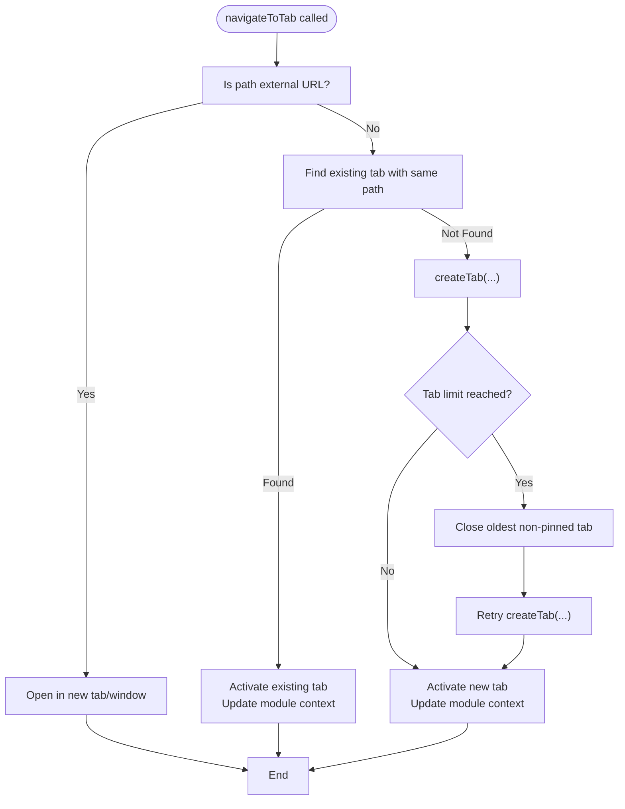
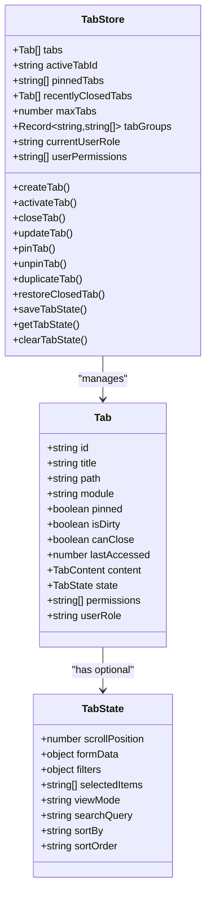
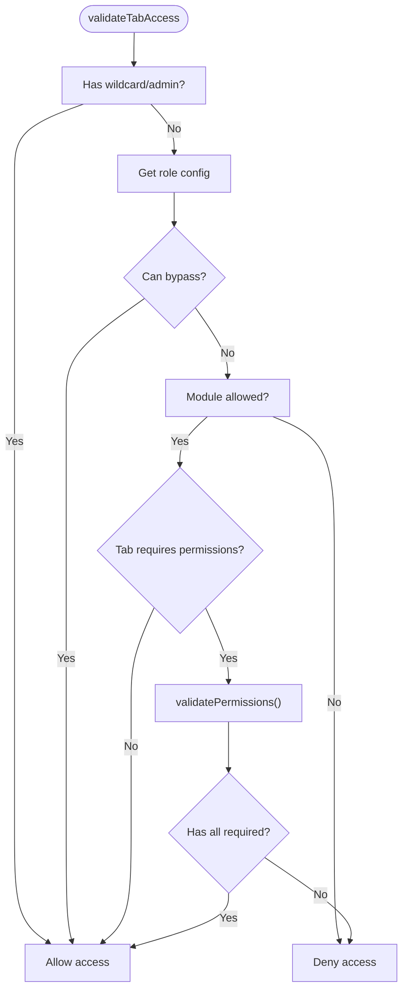
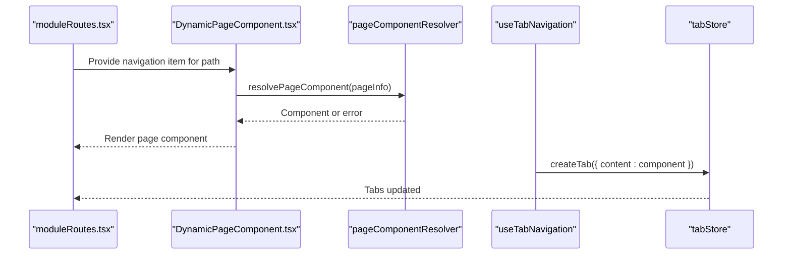
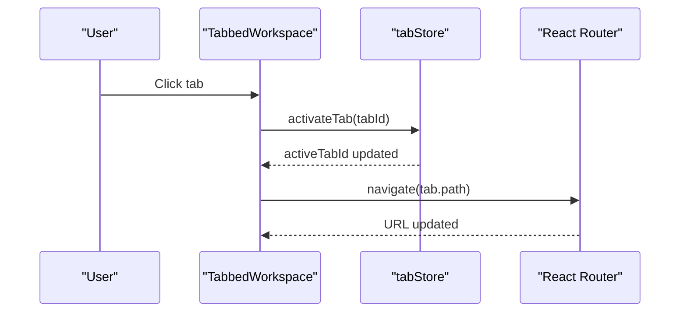
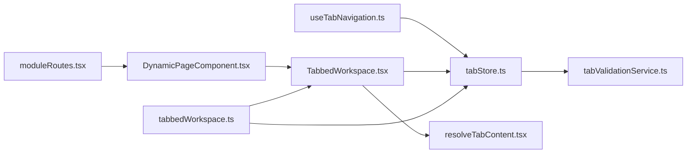

# Tab Integration Patterns

<cite>
**Referenced Files in This Document**
- [index.ts](file://src/components/tabbedWorkspace/index.ts)
- [tabStore.ts](file://src/stores/tabStore.ts)
- [useTabNavigation.ts](file://src/hooks/useTabNavigation.ts)
- [tabValidationService.ts](file://src/services/tabs/tabValidationService.ts)
- [tabbedWorkspace.tsx](file://src/components/tabbedWorkspace/TabbedWorkspace.tsx)
- [resolveTabContent.tsx](file://src/components/tabbedWorkspace/resolveTabContent.tsx)
- [tabbedWorkspace.ts](file://src/types/tabbedWorkspace.ts)
- [moduleRoutes.tsx](file://src/routing/moduleRoutes.tsx)
- [DynamicPageComponent.tsx](file://src/components/DynamicPageComponent.tsx)
- [UNIFIED_TAB_ARCHITECTURE.md](file://docs/architecture/UNIFIED_TAB_ARCHITECTURE.md)
- [TAB_SYSTEMS_ANALYSIS.md](file://docs/tabs/TAB_SYSTEMS_ANALYSIS.md)
- [INTEGRATION_GUIDE.md](file://docs/tabs/INTEGRATION_GUIDE.md)
</cite>

## Table of Contents
1. [Introduction](#introduction)
2. [Project Structure](#project-structure)
3. [Core Components](#core-components)
4. [Architecture Overview](#architecture-overview)
5. [Detailed Component Analysis](#detailed-component-analysis)
6. [Dependency Analysis](#dependency-analysis)
7. [Performance Considerations](#performance-considerations)
8. [Troubleshooting Guide](#troubleshooting-guide)
9. [Conclusion](#conclusion)
10. [Appendices](#appendices)

## Introduction
This document explains tab integration patterns in SchoolPilot3’s tabbed workspace system. It covers:
- Route-to-tab mapper for seamless navigation integration
- URL tab synchronization engine for browser history management
- Tab state derivation for reactive updates
- Tab validation services for permission checking, access control, and lifecycle validation
- Integration with routing systems, module loading, and dynamic content resolution
- URL synchronization mechanisms, browser tab management, and deep linking support
- Examples of custom tab integrations, third-party service connections, and external system synchronization
- Error handling, fallback mechanisms, and graceful degradation strategies

## Project Structure
The tabbed workspace system centers around a unified set of components, a Zustand-backed store, and a validation service. It integrates with the application’s routing system and dynamic page resolution.

**Diagram sources**
- [tabbedWorkspace.tsx:16-549](file://src/components/tabbedWorkspace/TabbedWorkspace.tsx#L16-L549)
- [resolveTabContent.tsx:4-35](file://src/components/tabbedWorkspace/resolveTabContent.tsx#L4-L35)
- [tabStore.ts:138-800](file://src/stores/tabStore.ts#L138-L800)
- [tabValidationService.ts:83-570](file://src/services/tabs/tabValidationService.ts#L83-L570)
- [moduleRoutes.tsx:78-297](file://src/routing/moduleRoutes.tsx#L78-L297)
- [DynamicPageComponent.tsx:16-182](file://src/components/DynamicPageComponent.tsx#L16-L182)
- [useTabNavigation.ts:107-630](file://src/hooks/useTabNavigation.ts#L107-L630)
- [tabbedWorkspace.ts:19-221](file://src/types/tabbedWorkspace.ts#L19-L221)
- [index.ts:1-44](file://src/components/tabbedWorkspace/index.ts#L1-L44)

**Section sources**
- [index.ts:1-44](file://src/components/tabbedWorkspace/index.ts#L1-L44)
- [tabbedWorkspace.tsx:16-549](file://src/components/tabbedWorkspace/TabbedWorkspace.tsx#L16-L549)
- [tabStore.ts:138-800](file://src/stores/tabStore.ts#L138-L800)
- [useTabNavigation.ts:107-630](file://src/hooks/useTabNavigation.ts#L107-L630)
- [tabValidationService.ts:83-570](file://src/services/tabs/tabValidationService.ts#L83-L570)
- [moduleRoutes.tsx:78-297](file://src/routing/moduleRoutes.tsx#L78-L297)
- [DynamicPageComponent.tsx:16-182](file://src/components/DynamicPageComponent.tsx#L16-L182)
- [tabbedWorkspace.ts:19-221](file://src/types/tabbedWorkspace.ts#L19-L221)

## Core Components
- TabbedWorkspace: Orchestrates the tabbed workspace UI, initializes the store, manages breadcrumbs, and renders tab content.
- TabBar and TabContent: Render the tab strip and active tab content respectively.
- resolveTabContent: Renders tab content based on content type (component, URL iframe, HTML, text, empty).
- useTabNavigation: Programmatic tab navigation and management with options for creation, activation, closing, duplication, pinning, and bulk operations.
- tabStore: Centralized Zustand store managing tabs, active tab, pinned tabs, recent tabs, hierarchical navigation, and persistence.
- tabValidationService: Centralized validation for permissions, access control, state integrity, and lifecycle validation.
- DynamicPageComponent: Resolves and renders page components dynamically based on route and navigation metadata.
- moduleRoutes: Defines application routes, including module dashboards, custom routes, and navigation-driven routes.

**Section sources**
- [tabbedWorkspace.tsx:16-549](file://src/components/tabbedWorkspace/TabbedWorkspace.tsx#L16-L549)
- [resolveTabContent.tsx:4-35](file://src/components/tabbedWorkspace/resolveTabContent.tsx#L4-L35)
- [useTabNavigation.ts:107-630](file://src/hooks/useTabNavigation.ts#L107-L630)
- [tabStore.ts:138-800](file://src/stores/tabStore.ts#L138-L800)
- [tabValidationService.ts:83-570](file://src/services/tabs/tabValidationService.ts#L83-L570)
- [DynamicPageComponent.tsx:16-182](file://src/components/DynamicPageComponent.tsx#L16-L182)
- [moduleRoutes.tsx:78-297](file://src/routing/moduleRoutes.tsx#L78-L297)

## Architecture Overview
The tabbed workspace integrates tightly with routing and module loading. When a user navigates:
- The router loads the appropriate page component.
- The tab system can optionally open the same content in a tab via the navigation hook.
- The store persists tab state and enforces access control and lifecycle rules.
- Dynamic page resolution ensures content consistency across tabs and routes.

**Diagram sources**
- [moduleRoutes.tsx:264-290](file://src/routing/moduleRoutes.tsx#L264-L290)
- [DynamicPageComponent.tsx:63-117](file://src/components/DynamicPageComponent.tsx#L63-L117)
- [useTabNavigation.ts:338-386](file://src/hooks/useTabNavigation.ts#L338-L386)
- [tabStore.ts:257-335](file://src/stores/tabStore.ts#L257-L335)
- [tabbedWorkspace.tsx:392-407](file://src/components/tabbedWorkspace/TabbedWorkspace.tsx#L392-L407)

## Detailed Component Analysis

### Route-to-Tab Mapper and URL Synchronization Engine
- Programmatic navigation: The navigation hook exposes methods to create, activate, close, and organize tabs. It supports replacing the current tab, inserting after the current tab, and activating immediately.
- URL synchronization: When activating a tab, the system updates the URL to match the tab’s path if they differ, ensuring the browser address bar stays in sync with the active tab.
- Tab limit handling: When the maximum tab limit is reached, the system identifies the oldest non-pinned, closable tab and closes it to make room for the new tab, then retries creation and notifies the user.

**Diagram sources**
- [useTabNavigation.ts:338-386](file://src/hooks/useTabNavigation.ts#L338-L386)
- [useTabNavigation.ts:186-336](file://src/hooks/useTabNavigation.ts#L186-L336)
- [useTabNavigation.ts:418-433](file://src/hooks/useTabNavigation.ts#L418-L433)

**Section sources**
- [useTabNavigation.ts:107-630](file://src/hooks/useTabNavigation.ts#L107-L630)
- [tabStore.ts:257-335](file://src/stores/tabStore.ts#L257-L335)

### Tab State Derivation and Reactive Updates
- State structure: The tab and tab state types define content types, metadata, permissions, and state fields for scroll position, filters, selection, view mode, and sorting.
- Store state: The store maintains tabs, active tab, pinned tabs, recently closed tabs, max tabs, tab groups, and user role/permissions. It also supports hierarchical navigation and breadcrumb generation.
- Validation integration: Creation, activation, and access checks delegate to the validation service, which enforces role-based access, permission arrays, and state integrity.

**Diagram sources**
- [tabbedWorkspace.ts:19-107](file://src/types/tabbedWorkspace.ts#L19-L107)
- [tabStore.ts:18-707](file://src/stores/tabStore.ts#L18-L707)

**Section sources**
- [tabbedWorkspace.ts:19-107](file://src/types/tabbedWorkspace.ts#L19-L107)
- [tabStore.ts:18-707](file://src/stores/tabStore.ts#L18-L707)

### Tab Validation Services (Permissions, Access Control, Lifecycle)
- Role-based access control: The validation service defines role configurations with allowed modules, maximum tabs, and permission bypass capabilities.
- Permission enforcement: Validates tab access based on user role, permissions, and tab-level required permissions. Filters accessible tabs and sanitizes tab data for storage.
- Lifecycle validation: Validates tab creation requests, enforces limits, checks for duplicates, and ensures required fields. Also validates tab state integrity and sanitizes state data.

**Diagram sources**
- [tabValidationService.ts:120-166](file://src/services/tabs/tabValidationService.ts#L120-L166)
- [tabValidationService.ts:310-325](file://src/services/tabs/tabValidationService.ts#L310-L325)

**Section sources**
- [tabValidationService.ts:43-70](file://src/services/tabs/tabValidationService.ts#L43-L70)
- [tabValidationService.ts:120-166](file://src/services/tabs/tabValidationService.ts#L120-L166)
- [tabValidationService.ts:310-325](file://src/services/tabs/tabValidationService.ts#L310-L325)
- [tabStore.ts:53-76](file://src/stores/tabStore.ts#L53-L76)

### Integration with Routing Systems, Module Loading, and Dynamic Content Resolution
- Dynamic routes: The routing system generates routes for module dashboards, custom module routes, and navigation-driven pages. It protects routes with RBAC and uses lazy loading.
- Dynamic page resolution: The dynamic page component resolves page components based on navigation metadata, supporting both module dashboards and regular pages.
- Tab content rendering: The workspace renders content either via the dynamic page component for route-based tabs or via the resolver for other content types.

**Diagram sources**
- [moduleRoutes.tsx:220-290](file://src/routing/moduleRoutes.tsx#L220-L290)
- [DynamicPageComponent.tsx:63-117](file://src/components/DynamicPageComponent.tsx#L63-L117)
- [useTabNavigation.ts:186-336](file://src/hooks/useTabNavigation.ts#L186-L336)
- [tabStore.ts:257-335](file://src/stores/tabStore.ts#L257-L335)

**Section sources**
- [moduleRoutes.tsx:78-297](file://src/routing/moduleRoutes.tsx#L78-L297)
- [DynamicPageComponent.tsx:16-182](file://src/components/DynamicPageComponent.tsx#L16-L182)
- [tabbedWorkspace.tsx:392-407](file://src/components/tabbedWorkspace/TabbedWorkspace.tsx#L392-L407)

### URL Synchronization Mechanisms, Browser Tab Management, and Deep Linking Support
- URL sync on activation: When a tab is activated, the system navigates the browser to the tab’s path if it differs from the current URL, keeping the URL bar synchronized with the active tab.
- Deep linking: The workspace initializes and clears corrupted data, ensuring a clean state for deep links and session restoration.
- Breadcrumb navigation: Hierarchical mode enables breadcrumb generation from the active tab’s path, improving navigation for nested routes.

**Diagram sources**
- [tabbedWorkspace.tsx:254-275](file://src/components/tabbedWorkspace/TabbedWorkspace.tsx#L254-L275)
- [useTabNavigation.ts:418-433](file://src/hooks/useTabNavigation.ts#L418-L433)

**Section sources**
- [tabbedWorkspace.tsx:254-275](file://src/components/tabbedWorkspace/TabbedWorkspace.tsx#L254-L275)
- [tabStore.ts:709-786](file://src/stores/tabStore.ts#L709-L786)

### Examples and Integration Patterns
- Custom tab integrations: Use the navigation hook to programmatically open tabs with custom content types (component, URL, HTML, text) and metadata. Options include pinning, duplication, and group assignment.
- Third-party service connections: Open external URLs in tabs using the URL content type, enabling integration with external services without leaving the workspace.
- External system synchronization: The validation service and store enforce access control and lifecycle rules, ensuring tabs opened from external systems respect user permissions and system limits.

**Section sources**
- [useTabNavigation.ts:107-630](file://src/hooks/useTabNavigation.ts#L107-L630)
- [tabStore.ts:257-335](file://src/stores/tabStore.ts#L257-L335)
- [tabValidationService.ts:120-166](file://src/services/tabs/tabValidationService.ts#L120-L166)

## Dependency Analysis
The tabbed workspace system exhibits clear separation of concerns:
- Components depend on the store for state and on the navigation hook for programmatic operations.
- The store depends on the validation service for access control and integrity checks.
- Routing and dynamic page resolution feed into the workspace via navigation and content resolution.

**Diagram sources**
- [useTabNavigation.ts:107-630](file://src/hooks/useTabNavigation.ts#L107-L630)
- [tabStore.ts:138-800](file://src/stores/tabStore.ts#L138-L800)
- [tabValidationService.ts:83-570](file://src/services/tabs/tabValidationService.ts#L83-L570)
- [tabbedWorkspace.tsx:16-549](file://src/components/tabbedWorkspace/TabbedWorkspace.tsx#L16-L549)
- [resolveTabContent.tsx:4-35](file://src/components/tabbedWorkspace/resolveTabContent.tsx#L4-L35)
- [moduleRoutes.tsx:78-297](file://src/routing/moduleRoutes.tsx#L78-L297)
- [DynamicPageComponent.tsx:16-182](file://src/components/DynamicPageComponent.tsx#L16-L182)
- [tabbedWorkspace.ts:19-221](file://src/types/tabbedWorkspace.ts#L19-L221)

**Section sources**
- [useTabNavigation.ts:107-630](file://src/hooks/useTabNavigation.ts#L107-L630)
- [tabStore.ts:138-800](file://src/stores/tabStore.ts#L138-L800)
- [tabValidationService.ts:83-570](file://src/services/tabs/tabValidationService.ts#L83-L570)
- [tabbedWorkspace.tsx:16-549](file://src/components/tabbedWorkspace/TabbedWorkspace.tsx#L16-L549)
- [resolveTabContent.tsx:4-35](file://src/components/tabbedWorkspace/resolveTabContent.tsx#L4-L35)
- [moduleRoutes.tsx:78-297](file://src/routing/moduleRoutes.tsx#L78-L297)
- [DynamicPageComponent.tsx:16-182](file://src/components/DynamicPageComponent.tsx#L16-L182)
- [tabbedWorkspace.ts:19-221](file://src/types/tabbedWorkspace.ts#L19-L221)

## Performance Considerations
- Minimize re-renders: The workspace uses memoization for tab lists, breadcrumbs, and action bar props to prevent unnecessary re-renders.
- Lazy loading: Dynamic page components and route pages are lazily loaded to reduce initial bundle size.
- Memory management: The store supports clearing tab state on unmount and limits tab counts to manage memory usage.
- Validation caching: Role configurations are cached and sanitized to avoid repeated computation.

[No sources needed since this section provides general guidance]

## Troubleshooting Guide
- Initialization failures: The workspace initializes the store and clears corrupted data. Errors during initialization are captured and surfaced to the error boundary.
- Permission denials: When accessing a tab fails permission checks, the workspace displays an access denied message. Validation service logs warnings and errors for debugging.
- Tab limit exceeded: The navigation hook attempts to close the oldest non-pinned tab to make room for a new tab and notifies the user.
- Corrupted data: The store includes a cleanup routine to remove corrupted tabs and pinned/recently closed references that no longer exist.

**Section sources**
- [tabbedWorkspace.tsx:107-200](file://src/components/tabbedWorkspace/TabbedWorkspace.tsx#L107-L200)
- [tabStore.ts:788-800](file://src/stores/tabStore.ts#L788-L800)
- [useTabNavigation.ts:257-335](file://src/hooks/useTabNavigation.ts#L257-L335)
- [tabValidationService.ts:120-166](file://src/services/tabs/tabValidationService.ts#L120-L166)

## Conclusion
SchoolPilot3’s tabbed workspace system provides a robust, validated, and integrated solution for multi-tab navigation. It synchronizes with the routing system, supports dynamic content resolution, and enforces access control and lifecycle validation. The unified architecture simplifies development, improves performance, and ensures consistent user experiences across platforms.

[No sources needed since this section summarizes without analyzing specific files]

## Appendices

### Unified Architecture Reference
The unified tab architecture aims to consolidate three distinct tab systems into a single, platform-aware implementation with simplified APIs and consistent UX.

**Section sources**
- [UNIFIED_TAB_ARCHITECTURE.md:13-382](file://docs/architecture/UNIFIED_TAB_ARCHITECTURE.md#L13-L382)

### Tab Systems Analysis and Migration Guidance
This analysis documents the current state of three tab systems, identifies issues, and proposes a migration path toward a unified system.

**Section sources**
- [TAB_SYSTEMS_ANALYSIS.md:9-512](file://docs/tabs/TAB_SYSTEMS_ANALYSIS.md#L9-L512)

### Integration & Development Guide
Practical guidance for opening tabs, adding icons, customizing titles, and best practices for tab management.

**Section sources**
- [INTEGRATION_GUIDE.md:1-85](file://docs/tabs/INTEGRATION_GUIDE.md#L1-L85)