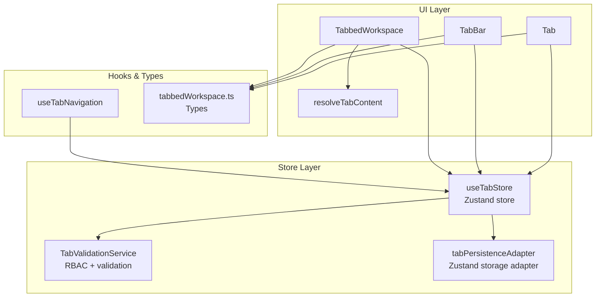
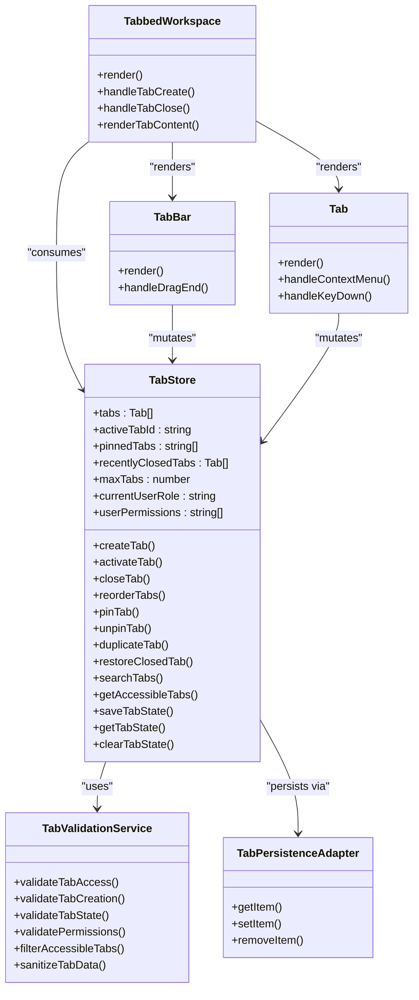
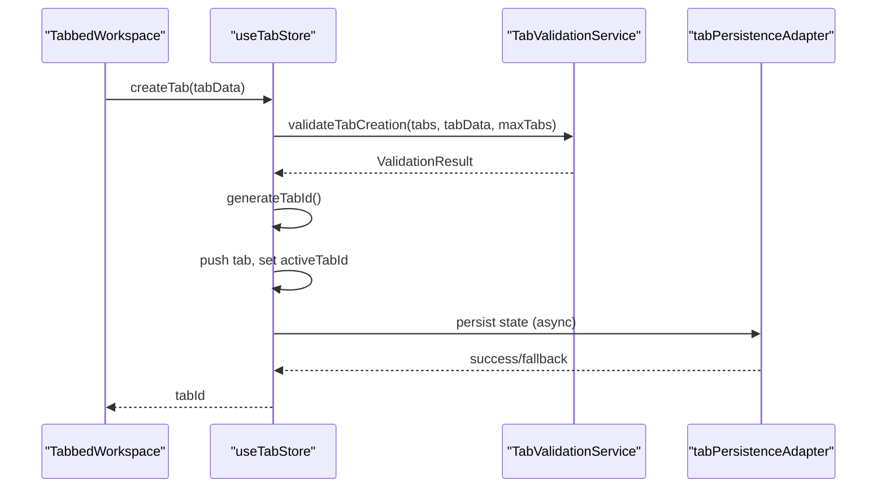
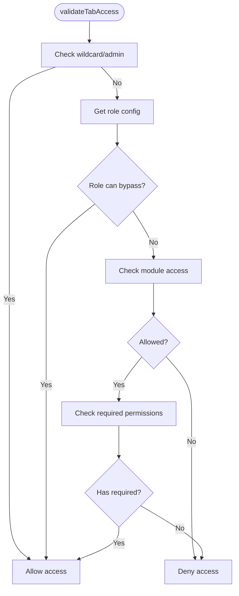
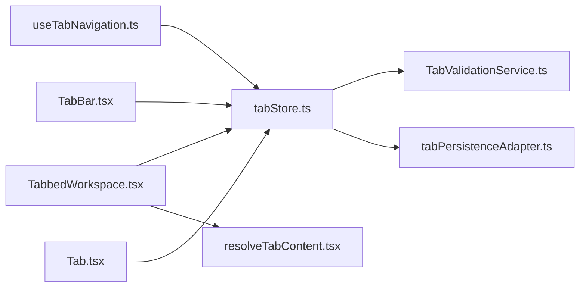
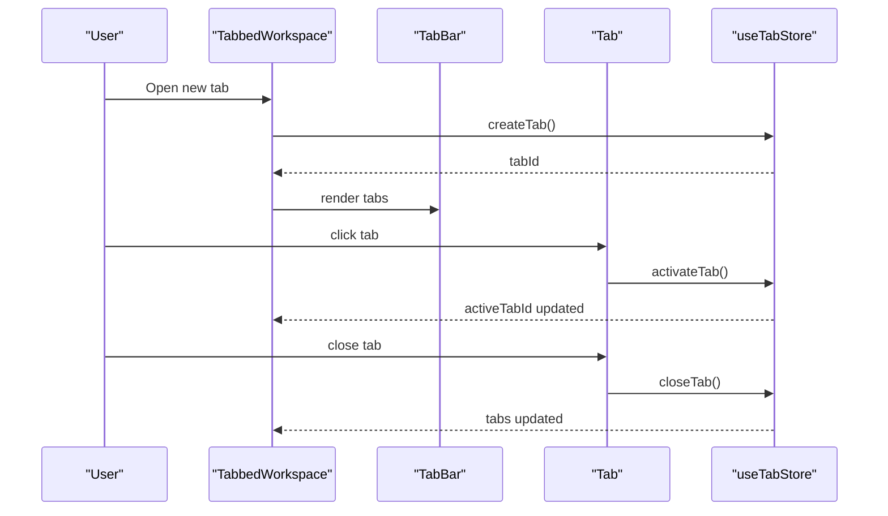

# Tab Management

<cite>
**Referenced Files in This Document**
- [tabStore.ts](file://src/stores/tabStore.ts)
- [tabbedWorkspace.ts](file://src/types/tabbedWorkspace.ts)
- [useTabNavigation.ts](file://src/hooks/useTabNavigation.ts)
- [Tab.tsx](file://src/components/tabbedWorkspace/Tab.tsx)
- [TabBar.tsx](file://src/components/tabbedWorkspace/TabBar.tsx)
- [TabbedWorkspace.tsx](file://src/components/tabbedWorkspace/TabbedWorkspace.tsx)
- [resolveTabContent.tsx](file://src/components/tabbedWorkspace/resolveTabContent.tsx)
- [TabValidationService.ts](file://src/services/tabs/TabValidationService.ts)
- [tabPersistenceAdapter.ts](file://src/stores/adapters/tabPersistenceAdapter.ts)
</cite>

## Table of Contents
1. [Introduction](#introduction)
2. [Project Structure](#project-structure)
3. [Core Components](#core-components)
4. [Architecture Overview](#architecture-overview)
5. [Detailed Component Analysis](#detailed-component-analysis)
6. [Dependency Analysis](#dependency-analysis)
7. [Performance Considerations](#performance-considerations)
8. [Troubleshooting Guide](#troubleshooting-guide)
9. [Conclusion](#conclusion)
10. [Appendices](#appendices)

## Introduction
This document explains the tab management system in SchoolPilot3’s tabbed workspace. It covers the Tab component architecture, lifecycle management, state handling, creation/activation/closing/duplication, ordering, pinning/unpinning, validation for access control, the tab store implementation with persistence and performance optimizations, tab content resolution, dynamic loading, error boundaries, configuration examples, custom tab types, routing integration, and accessibility features.

## Project Structure
The tabbed workspace spans three layers:
- Store and Services: Zustand-backed store with persistence, validation, and RBAC integration
- UI Components: Tab, TabBar, TabbedWorkspace, and content resolution
- Hooks and Types: Programmatic navigation and shared type definitions

**Diagram sources**
- [tabStore.ts:139-800](file://src/stores/tabStore.ts#L139-L800)
- [TabValidationService.ts:83-570](file://src/services/tabs/TabValidationService.ts#L83-L570)
- [tabPersistenceAdapter.ts:49-153](file://src/stores/adapters/tabPersistenceAdapter.ts#L49-L153)
- [TabbedWorkspace.tsx:16-549](file://src/components/tabbedWorkspace/TabbedWorkspace.tsx#L16-L549)
- [TabBar.tsx:40-521](file://src/components/tabbedWorkspace/TabBar.tsx#L40-L521)
- [Tab.tsx:269-612](file://src/components/tabbedWorkspace/Tab.tsx#L269-L612)
- [resolveTabContent.tsx:4-35](file://src/components/tabbedWorkspace/resolveTabContent.tsx#L4-L35)
- [useTabNavigation.ts:107-630](file://src/hooks/useTabNavigation.ts#L107-L630)
- [tabbedWorkspace.ts:61-107](file://src/types/tabbedWorkspace.ts#L61-L107)

**Section sources**
- [tabStore.ts:139-800](file://src/stores/tabStore.ts#L139-L800)
- [tabbedWorkspace.ts:61-107](file://src/types/tabbedWorkspace.ts#L61-L107)
- [useTabNavigation.ts:107-630](file://src/hooks/useTabNavigation.ts#L107-L630)
- [TabbedWorkspace.tsx:16-549](file://src/components/tabbedWorkspace/TabbedWorkspace.tsx#L16-L549)
- [TabBar.tsx:40-521](file://src/components/tabbedWorkspace/TabBar.tsx#L40-L521)
- [Tab.tsx:269-612](file://src/components/tabbedWorkspace/Tab.tsx#L269-L612)
- [resolveTabContent.tsx:4-35](file://src/components/tabbedWorkspace/resolveTabContent.tsx#L4-L35)
- [tabPersistenceAdapter.ts:49-153](file://src/stores/adapters/tabPersistenceAdapter.ts#L49-L153)
- [TabValidationService.ts:83-570](file://src/services/tabs/TabValidationService.ts#L83-L570)

## Core Components
- Tab store (Zustand): Manages tabs, active tab, pinned tabs, recent history, and persistence
- Validation service (RBAC): Enforces access control and validates tab state/data
- Persistence adapter: Bridges Zustand persist middleware with a persistence service
- UI components: Tab, TabBar, TabbedWorkspace, and content resolver
- Navigation hook: Programmatic tab creation, activation, closing, and organization

Key responsibilities:
- Lifecycle: create, activate, reorder, pin/unpin, duplicate, close, restore
- State: per-tab state, dirty flags, loading states, breadcrumbs, hierarchical tabs
- Access control: role-based validation and filtering
- Persistence: IndexedDB/localStorage fallback with corruption cleanup
- Accessibility: keyboard navigation, ARIA roles, focus management

**Section sources**
- [tabStore.ts:139-800](file://src/stores/tabStore.ts#L139-L800)
- [TabValidationService.ts:83-570](file://src/services/tabs/TabValidationService.ts#L83-L570)
- [tabPersistenceAdapter.ts:49-153](file://src/stores/adapters/tabPersistenceAdapter.ts#L49-L153)
- [TabbedWorkspace.tsx:16-549](file://src/components/tabbedWorkspace/TabbedWorkspace.tsx#L16-L549)
- [TabBar.tsx:40-521](file://src/components/tabbedWorkspace/TabBar.tsx#L40-L521)
- [Tab.tsx:269-612](file://src/components/tabbedWorkspace/Tab.tsx#L269-L612)
- [resolveTabContent.tsx:4-35](file://src/components/tabbedWorkspace/resolveTabContent.tsx#L4-L35)
- [useTabNavigation.ts:107-630](file://src/hooks/useTabNavigation.ts#L107-L630)
- [tabbedWorkspace.ts:61-107](file://src/types/tabbedWorkspace.ts#L61-L107)

## Architecture Overview
The system uses a layered architecture:
- Store layer: Zustand store with persistence and validation
- Service layer: Validation and persistence services
- UI layer: React components for tab rendering and interaction
- Hook layer: Programmatic navigation APIs

**Diagram sources**
- [tabStore.ts:139-800](file://src/stores/tabStore.ts#L139-L800)
- [TabValidationService.ts:83-570](file://src/services/tabs/TabValidationService.ts#L83-L570)
- [tabPersistenceAdapter.ts:49-153](file://src/stores/adapters/tabPersistenceAdapter.ts#L49-L153)
- [TabbedWorkspace.tsx:16-549](file://src/components/tabbedWorkspace/TabbedWorkspace.tsx#L16-L549)
- [TabBar.tsx:40-521](file://src/components/tabbedWorkspace/TabBar.tsx#L40-L521)
- [Tab.tsx:269-612](file://src/components/tabbedWorkspace/Tab.tsx#L269-L612)

## Detailed Component Analysis

### Tab Store (Zustand)
Responsibilities:
- Core state: tabs, active tab, pinned tabs, recent history, max tabs, user role/permissions
- Operations: create, activate, close, reorder, pin/unpin, duplicate, restore, bulk close
- Validation: integrates TabValidationService for access control and data/state validation
- Persistence: uses Zustand persist with a custom storage adapter
- Hierarchical mode: breadcrumbs, current path, hierarchical tabs
- State management: per-tab state persistence and retrieval

Key behaviors:
- Initialization loads persisted data, cleans corrupted entries, and sets user context
- Tab creation validates permissions and state, generates unique IDs, and activates newly created tabs
- Access validation occurs on activation and tab access checks
- Persistence adapter coordinates IndexedDB/localStorage fallback and schema separation

**Diagram sources**
- [tabStore.ts:258-335](file://src/stores/tabStore.ts#L258-L335)
- [TabValidationService.ts:177-224](file://src/services/tabs/TabValidationService.ts#L177-L224)
- [tabPersistenceAdapter.ts:101-128](file://src/stores/adapters/tabPersistenceAdapter.ts#L101-L128)

**Section sources**
- [tabStore.ts:139-800](file://src/stores/tabStore.ts#L139-L800)
- [tabStore.ts:163-244](file://src/stores/tabStore.ts#L163-L244)
- [tabStore.ts:258-335](file://src/stores/tabStore.ts#L258-L335)
- [tabStore.ts:337-394](file://src/stores/tabStore.ts#L337-L394)
- [tabStore.ts:405-410](file://src/stores/tabStore.ts#L405-L410)
- [tabStore.ts:413-449](file://src/stores/tabStore.ts#L413-L449)
- [tabStore.ts:451-467](file://src/stores/tabStore.ts#L451-L467)
- [tabStore.ts:479-595](file://src/stores/tabStore.ts#L479-L595)
- [tabStore.ts:628-682](file://src/stores/tabStore.ts#L628-L682)
- [tabStore.ts:685-707](file://src/stores/tabStore.ts#L685-L707)
- [tabStore.ts:709-786](file://src/stores/tabStore.ts#L709-L786)
- [tabStore.ts:789-800](file://src/stores/tabStore.ts#L789-L800)

### Tab Validation Service (RBAC)
Responsibilities:
- Validate tab access based on user role and permissions
- Validate tab creation and state integrity
- Filter accessible tabs for UI rendering
- Sanitize tab data and state for persistence

Highlights:
- Role-based access control with configurable role configs
- Permission validation and wildcard support
- State validation with warnings for missing/invalid fields
- Sanitization to ensure consistent data types

**Diagram sources**
- [TabValidationService.ts:120-166](file://src/services/tabs/TabValidationService.ts#L120-L166)

**Section sources**
- [TabValidationService.ts:83-570](file://src/services/tabs/TabValidationService.ts#L83-L570)

### Persistence Adapter
Responsibilities:
- Bridge Zustand persist middleware with a persistence service
- Separate tabs from additional state (pinned, closed, groups)
- IndexedDB fallback to localStorage with robust error handling

Behavior:
- Load combines tabs from persistence service with additional state from localStorage
- Save persists tabs via service and additional state via localStorage
- Clear removes both tabs and additional state

**Section sources**
- [tabPersistenceAdapter.ts:49-153](file://src/stores/adapters/tabPersistenceAdapter.ts#L49-L153)

### Tab Component
Responsibilities:
- Render a single tab with icon, title, status indicators, and close button
- Handle context menu, keyboard shortcuts, and drag states
- Support hierarchical sub-tabs and modern/legacy styling modes

Features:
- Context menu with pin, favorite, duplicate, close actions
- Keyboard navigation (Enter, Space, Delete/Backspace, Ctrl+P/D)
- Status indicators for loading, error, and dirty states
- Focus-visible ring and ARIA attributes for accessibility

**Section sources**
- [Tab.tsx:269-612](file://src/components/tabbedWorkspace/Tab.tsx#L269-L612)

### TabBar Component
Responsibilities:
- Render a scrollable, reorderable row of tabs with overflow menu
- Handle drag-and-drop reordering and tab interactions
- Support hierarchical mode and modern/legacy styles

Features:
- Scroll indicators and smooth horizontal scrolling
- Overflow dropdown for hidden tabs
- Optional add button and hierarchical sub-tab navigation

**Section sources**
- [TabBar.tsx:40-521](file://src/components/tabbedWorkspace/TabBar.tsx#L40-L521)

### TabbedWorkspace Component
Responsibilities:
- Orchestrate the entire tabbed workspace UI
- Initialize store and persistence, manage breadcrumbs, and render content
- Provide action bar integration and error boundaries

Highlights:
- Parallel initialization of store and persistence
- Memoized handlers and props to reduce re-renders
- Conditional content rendering based on active tab and access validation
- Error boundary wrapping for robustness

**Section sources**
- [TabbedWorkspace.tsx:16-549](file://src/components/tabbedWorkspace/TabbedWorkspace.tsx#L16-L549)

### Content Resolution and Dynamic Loading
Responsibilities:
- Resolve tab content based on tab.content.type
- Render components, iframes, HTML, text, or empty state
- Integrate with DynamicPageComponent for route-based content

**Section sources**
- [resolveTabContent.tsx:4-35](file://src/components/tabbedWorkspace/resolveTabContent.tsx#L4-L35)
- [TabbedWorkspace.tsx:392-407](file://src/components/tabbedWorkspace/TabbedWorkspace.tsx#L392-L407)

### Programmatic Navigation Hook
Responsibilities:
- Provide convenient methods for creating, switching, closing, and organizing tabs
- Handle tab limit exceeded scenarios with automatic cleanup
- Integrate with routing and module context

Highlights:
- Navigation options for content type, module, metadata, and behavior
- Automatic replacement or insertion of tabs
- Bulk operations and refresh utilities

**Section sources**
- [useTabNavigation.ts:107-630](file://src/hooks/useTabNavigation.ts#L107-L630)

## Dependency Analysis
Key dependencies and relationships:
- UI components depend on the store for state and mutations
- Validation service is invoked by the store for access control
- Persistence adapter depends on a persistence service for tabs and localStorage for additional state
- Navigation hook encapsulates store usage for higher-level operations

**Diagram sources**
- [useTabNavigation.ts:107-630](file://src/hooks/useTabNavigation.ts#L107-L630)
- [tabStore.ts:139-800](file://src/stores/tabStore.ts#L139-L800)
- [TabbedWorkspace.tsx:16-549](file://src/components/tabbedWorkspace/TabbedWorkspace.tsx#L16-L549)
- [TabBar.tsx:40-521](file://src/components/tabbedWorkspace/TabBar.tsx#L40-L521)
- [Tab.tsx:269-612](file://src/components/tabbedWorkspace/Tab.tsx#L269-L612)
- [resolveTabContent.tsx:4-35](file://src/components/tabbedWorkspace/resolveTabContent.tsx#L4-L35)
- [TabValidationService.ts:83-570](file://src/services/tabs/TabValidationService.ts#L83-L570)
- [tabPersistenceAdapter.ts:49-153](file://src/stores/adapters/tabPersistenceAdapter.ts#L49-L153)

**Section sources**
- [tabStore.ts:139-800](file://src/stores/tabStore.ts#L139-L800)
- [TabValidationService.ts:83-570](file://src/services/tabs/TabValidationService.ts#L83-L570)
- [tabPersistenceAdapter.ts:49-153](file://src/stores/adapters/tabPersistenceAdapter.ts#L49-L153)
- [TabbedWorkspace.tsx:16-549](file://src/components/tabbedWorkspace/TabbedWorkspace.tsx#L16-L549)
- [TabBar.tsx:40-521](file://src/components/tabbedWorkspace/TabBar.tsx#L40-L521)
- [Tab.tsx:269-612](file://src/components/tabbedWorkspace/Tab.tsx#L269-L612)
- [resolveTabContent.tsx:4-35](file://src/components/tabbedWorkspace/resolveTabContent.tsx#L4-L35)
- [useTabNavigation.ts:107-630](file://src/hooks/useTabNavigation.ts#L107-L630)

## Performance Considerations
- Memoization: Components and handlers use useMemo/useCallback to minimize re-renders
- Lazy initialization: Store initialization runs once and parallelizes tasks
- Scroll optimization: TabBar implements smooth horizontal scrolling and overflow handling
- State partitioning: Additional state stored separately to reduce persistence overhead
- Access control short-circuit: Validation checks occur early to avoid unnecessary work
- Error boundaries: Prevent cascading failures and improve resilience

[No sources needed since this section provides general guidance]

## Troubleshooting Guide
Common issues and resolutions:
- Corrupted data: The store automatically detects and cleans corrupted tabs and pinned/recently closed lists
- Initialization failures: The workspace logs errors and exposes an error state with reload option
- Permission denials: Access validation prevents rendering unauthorized tabs; check user role and permissions
- Persistence failures: IndexedDB fallback to localStorage; adapter logs and continues operation
- Tab limit exceeded: Navigation hook attempts to close the oldest non-pinned tab to make room

**Section sources**
- [tabStore.ts:79-136](file://src/stores/tabStore.ts#L79-L136)
- [tabStore.ts:163-244](file://src/stores/tabStore.ts#L163-L244)
- [TabValidationService.ts:120-166](file://src/services/tabs/TabValidationService.ts#L120-L166)
- [tabPersistenceAdapter.ts:89-128](file://src/stores/adapters/tabPersistenceAdapter.ts#L89-L128)
- [useTabNavigation.ts:257-335](file://src/hooks/useTabNavigation.ts#L257-L335)

## Conclusion
SchoolPilot3’s tabbed workspace system provides a robust, accessible, and performant solution for managing multiple tabs with strong RBAC integration, persistent state, and flexible content resolution. The architecture cleanly separates concerns across store, service, UI, and hook layers, enabling extensibility and maintainability while ensuring reliability through validation, error boundaries, and persistence fallbacks.

[No sources needed since this section summarizes without analyzing specific files]

## Appendices

### Tab Lifecycle Sequence

**Diagram sources**
- [TabbedWorkspace.tsx:289-313](file://src/components/tabbedWorkspace/TabbedWorkspace.tsx#L289-L313)
- [TabBar.tsx:157-167](file://src/components/tabbedWorkspace/TabBar.tsx#L157-L167)
- [Tab.tsx:342-371](file://src/components/tabbedWorkspace/Tab.tsx#L342-L371)
- [tabStore.ts:258-335](file://src/stores/tabStore.ts#L258-L335)
- [tabStore.ts:337-394](file://src/stores/tabStore.ts#L337-L394)

### Tab Types and Configuration
- Tab: Core tab interface with title, path, module, icon, badge, pinned, isDirty, canClose, lastAccessed, metadata, state, permissions, userRole, content
- TabContent: Supports component, url, html, text, empty types with optional props
- TabState: Scroll position, form data, filters, selected items, view mode, search query, sort parameters
- TabStore: Complete interface for store operations and state management

**Section sources**
- [tabbedWorkspace.ts:19-49](file://src/types/tabbedWorkspace.ts#L19-L49)
- [tabbedWorkspace.ts:9-17](file://src/types/tabbedWorkspace.ts#L9-L17)
- [tabbedWorkspace.ts:61-107](file://src/types/tabbedWorkspace.ts#L61-L107)

### Routing Integration
- useTabNavigation provides programmatic navigation methods that integrate with React Router
- External URLs open in new windows; internal navigation uses the tab system
- Module context updates when activating tabs to keep routing and UI in sync

**Section sources**
- [useTabNavigation.ts:339-386](file://src/hooks/useTabNavigation.ts#L339-L386)
- [useTabNavigation.ts:419-433](file://src/hooks/useTabNavigation.ts#L419-L433)

### Accessibility and Keyboard Navigation
- Tabs are focusable with keyboard navigation (Enter/Space to activate, Delete/Backspace to close non-pinned)
- Context menu supports keyboard (Escape to dismiss)
- ARIA roles and labels applied for screen readers
- Focus-visible indicators and proper semantic markup

**Section sources**
- [Tab.tsx:342-371](file://src/components/tabbedWorkspace/Tab.tsx#L342-L371)
- [Tab.tsx:132-146](file://src/components/tabbedWorkspace/Tab.tsx#L132-L146)
- [Tab.tsx:476-480](file://src/components/tabbedWorkspace/Tab.tsx#L476-L480)