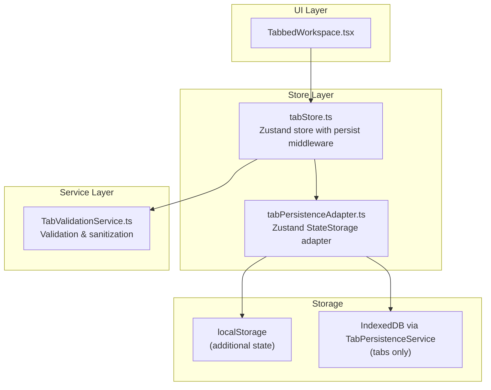
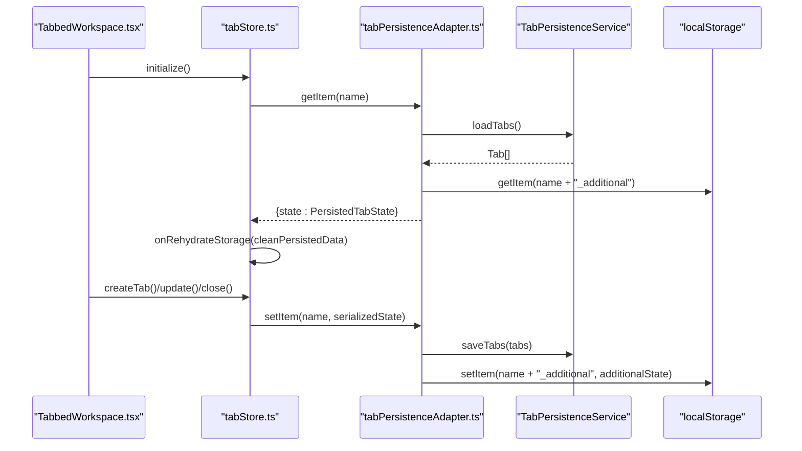
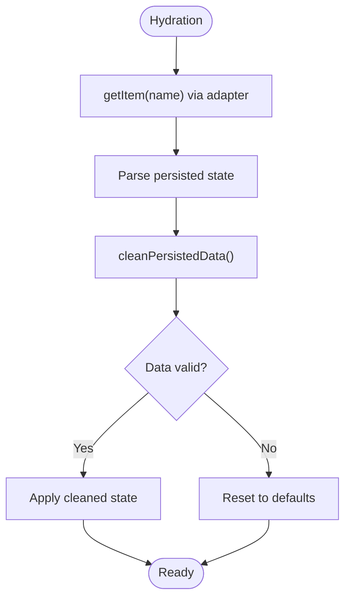
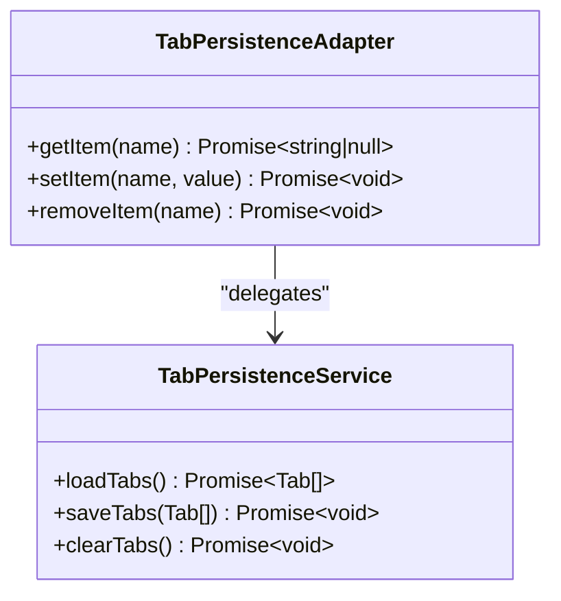
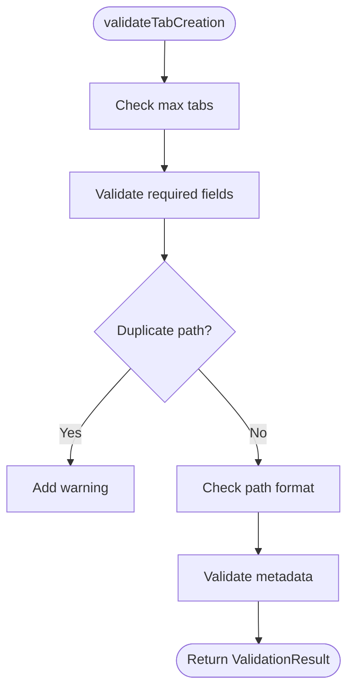
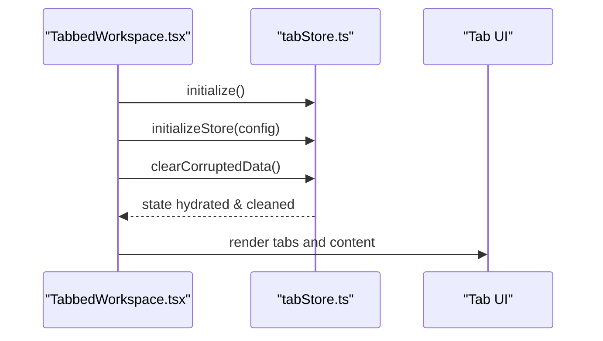
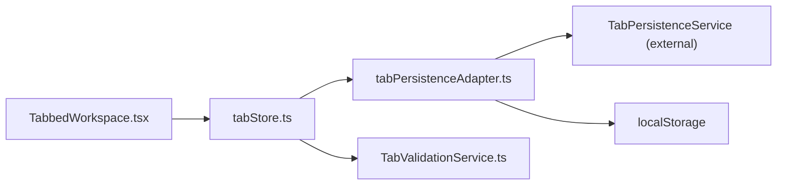

# Tab State Persistence

<cite>
**Referenced Files in This Document**
- [tabStore.ts](file://src/stores/tabStore.ts)
- [tabPersistenceAdapter.ts](file://src/stores/adapterstabPersistenceAdapter.ts)
- [TabValidationService.ts](file://src/services/tabs/TabValidationService.ts)
- [tabbedWorkspace.tsx](file://src/components/tabbedWorkspace/TabbedWorkspace.tsx)
- [tabbedWorkspace.ts](file://src/types/tabbedWorkspace.ts)
</cite>

## Table of Contents
1. [Introduction](#introduction)
2. [Project Structure](#project-structure)
3. [Core Components](#core-components)
4. [Architecture Overview](#architecture-overview)
5. [Detailed Component Analysis](#detailed-component-analysis)
6. [Dependency Analysis](#dependency-analysis)
7. [Performance Considerations](#performance-considerations)
8. [Troubleshooting Guide](#troubleshooting-guide)
9. [Conclusion](#conclusion)

## Introduction
This document explains the tab state persistence architecture in SchoolPilot3’s tabbed workspace system. It covers the persistence adapter design, serialization and storage strategies, and the lifecycle of saving, loading, and restoring tab state. It also documents the tab persistence service implementation, conflict resolution, data integrity checks, and practical guidance for debugging and migration.

## Project Structure
The tab persistence system spans three primary areas:
- Store layer: Zustand-backed tab store with persistence middleware
- Adapter layer: Custom Zustand storage adapter bridging to a persistence service
- Validation layer: Centralized validation and sanitization service

**Diagram sources**
- [tabStore.ts:139-897](file://src/stores/tabStore.ts#L139-L897)
- [tabPersistenceAdapter.ts:49-152](file://src/stores/adapterstabPersistenceAdapter.ts#L49-L152)
- [TabValidationService.ts:83-570](file://src/services/tabs/TabValidationService.ts#L83-L570)

**Section sources**
- [tabStore.ts:139-897](file://src/stores/tabStore.ts#L139-L897)
- [tabPersistenceAdapter.ts:49-152](file://src/stores/adapterstabPersistenceAdapter.ts#L49-L152)
- [TabValidationService.ts:83-570](file://src/services/tabs/TabValidationService.ts#L83-L570)

## Core Components
- Tab store: Maintains tab collections, active tab, pinned tabs, recently closed tabs, and user context. Integrates persistence via Zustand’s persist middleware and a custom storage adapter.
- Persistence adapter: Bridges Zustand persist middleware to a persistence service and localStorage for additional state fields.
- Validation service: Centralized validator for tab creation, access control, and state integrity.

Key responsibilities:
- Save/load tabs to/from IndexedDB with localStorage fallback
- Serialize only core tab arrays; persist additional state (pinned/recently closed/maxTabs/tabGroups) to localStorage
- Validate and sanitize tab data during hydration and operations
- Provide robust error handling and recovery

**Section sources**
- [tabStore.ts:139-897](file://src/stores/tabStore.ts#L139-L897)
- [tabPersistenceAdapter.ts:49-152](file://src/stores/adapterstabPersistenceAdapter.ts#L49-L152)
- [TabValidationService.ts:177-301](file://src/services/tabs/TabValidationService.ts#L177-L301)

## Architecture Overview
The persistence pipeline integrates Zustand’s persist middleware with a custom adapter that delegates to a persistence service for tabs and uses localStorage for additional state fields.

**Diagram sources**
- [tabStore.ts:863-895](file://src/stores/tabStore.ts#L863-L895)
- [tabPersistenceAdapter.ts:56-120](file://src/stores/adapterstabPersistenceAdapter.ts#L56-L120)

**Section sources**
- [tabStore.ts:853-897](file://src/stores/tabStore.ts#L853-L897)
- [tabPersistenceAdapter.ts:49-152](file://src/stores/adapterstabPersistenceAdapter.ts#L49-L152)

## Detailed Component Analysis

### Tab Store (Zustand with Persistence)
- Uses Zustand persist middleware with a custom storage adapter and selective partialization of state fields.
- Implements comprehensive data integrity checks during hydration and runtime.
- Exposes operations for tab lifecycle, RBAC validation, and hierarchical navigation.

Key behaviors:
- Partialize only essential fields for persistence to reduce payload size.
- onRehydrateStorage cleans corrupted persisted data and resets to defaults if necessary.
- Provides helpers to clear corrupted data and reset the store.

**Diagram sources**
- [tabStore.ts:863-895](file://src/stores/tabStore.ts#L863-L895)
- [tabStore.ts:79-136](file://src/stores/tabStore.ts#L79-L136)

**Section sources**
- [tabStore.ts:139-897](file://src/stores/tabStore.ts#L139-L897)
- [tabStore.ts:79-136](file://src/stores/tabStore.ts#L79-L136)

### Persistence Adapter (Zustand StateStorage)
- getItem: Loads tabs from the persistence service and merges with additional state from localStorage.
- setItem: Saves tabs via the persistence service and writes additional state to localStorage.
- removeItem: Clears tabs from the persistence service and removes additional state.

Design highlights:
- Separates persisted data into two layers: IndexedDB-backed tabs and localStorage-backed additional state.
- Provides graceful fallback and error handling without failing the application.

**Diagram sources**
- [tabPersistenceAdapter.ts:49-152](file://src/stores/adapterstabPersistenceAdapter.ts#L49-L152)

**Section sources**
- [tabPersistenceAdapter.ts:49-152](file://src/stores/adapterstabPersistenceAdapter.ts#L49-L152)

### Validation and Integrity (TabValidationService)
- Validates tab creation requests, access control, and state integrity.
- Sanitizes tab and tab-state data to ensure consistent types and defaults.
- Supports role-based access control with configurable role configs.

**Diagram sources**
- [TabValidationService.ts:177-224](file://src/services/tabs/TabValidationService.ts#L177-L224)

**Section sources**
- [TabValidationService.ts:177-301](file://src/services/tabs/TabValidationService.ts#L177-L301)
- [TabValidationService.ts:391-444](file://src/services/tabs/TabValidationService.ts#L391-L444)

### UI Integration (TabbedWorkspace)
- Initializes the store and clears corrupted data on mount.
- Registers workspace actions and manages user role/permission updates.
- Renders tab content and breadcrumbs, with access control checks.

**Diagram sources**
- [tabbedWorkspace.tsx:108-184](file://src/components/tabbedWorkspace/TabbedWorkspace.tsx#L108-L184)

**Section sources**
- [tabbedWorkspace.tsx:108-184](file://src/components/tabbedWorkspace/TabbedWorkspace.tsx#L108-L184)

## Dependency Analysis
- tabStore.ts depends on:
  - tabPersistenceAdapter.ts for storage integration
  - TabValidationService.ts for validation and sanitization
  - RBAC service for user context (referenced in comments)
- tabPersistenceAdapter.ts depends on:
  - TabPersistenceService (external service imported via alias)
  - localStorage for additional state fields
- TabbedWorkspace.tsx depends on:
  - tabStore.ts for state and actions
  - TabValidationService indirectly via store validation

**Diagram sources**
- [tabStore.ts:16-16](file://src/stores/tabStore.ts#L16-L16)
- [tabStore.ts:855-855](file://src/stores/tabStore.ts#L855-L855)
- [tabPersistenceAdapter.ts:5-5](file://src/stores/adapterstabPersistenceAdapter.ts#L5-L5)

**Section sources**
- [tabStore.ts:16-16](file://src/stores/tabStore.ts#L16-L16)
- [tabPersistenceAdapter.ts:5-5](file://src/stores/adapterstabPersistenceAdapter.ts#L5-L5)

## Performance Considerations
- Partialization: Only essential fields are persisted to reduce storage overhead and improve hydration speed.
- Hydration cleanup: Corrupted data is removed during hydration to prevent degraded performance.
- UI-level optimizations: Memoization and refs minimize re-renders and effect churn in the workspace component.
- Storage separation: Keeping large tab arrays in IndexedDB and small additional state in localStorage balances performance and reliability.

Recommendations:
- Limit maxTabs to a reasonable value to control memory footprint.
- Avoid storing large transient objects in tab.state; prefer lightweight primitives.
- Periodically prune recentlyClosedTabs and pinnedTabs lists.

**Section sources**
- [tabStore.ts:856-862](file://src/stores/tabStore.ts#L856-L862)
- [tabStore.ts:79-136](file://src/stores/tabStore.ts#L79-L136)
- [tabbedWorkspace.tsx:242-275](file://src/components/tabbedWorkspace/TabbedWorkspace.tsx#L242-L275)

## Troubleshooting Guide
Common issues and resolutions:
- Corrupted data after hydration:
  - Use the store’s built-in cleanup routine to remove invalid entries and reset to defaults.
  - Trigger manual cleanup via the store’s clearCorruptedData method.
- Access denied errors:
  - Verify user role and permissions are set correctly; the store updates these on changes.
  - Confirm TabValidationService role configs align with your environment.
- Persistence failures:
  - The adapter logs errors and continues; check browser storage quotas and IndexedDB availability.
  - Ensure localStorage is writable and not blocked by browser policies.
- Large tab histories:
  - Reduce maxTabs or periodically close inactive tabs to maintain responsiveness.
  - Consider migrating older tabs to a separate archive if needed.

Debugging steps:
- Enable development logs around the adapter and store hydration.
- Inspect localStorage keys for additional state and the IndexedDB-backed tabs.
- Use the store’s resetStore method to force a clean slate during testing.

**Section sources**
- [tabStore.ts:863-895](file://src/stores/tabStore.ts#L863-L895)
- [tabStore.ts:79-136](file://src/stores/tabStore.ts#L79-L136)
- [tabStore.ts:825-851](file://src/stores/tabStore.ts#L825-L851)

## Conclusion
SchoolPilot3’s tab state persistence combines a robust Zustand store with a custom adapter that leverages IndexedDB for tabs and localStorage for additional state. Centralized validation ensures data integrity and access control, while hydration-time cleanup and resilient error handling provide reliable session recovery. The architecture supports customization for storage backends and validation rules, with clear pathways for migration and performance tuning.