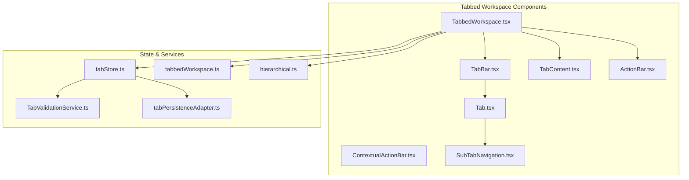
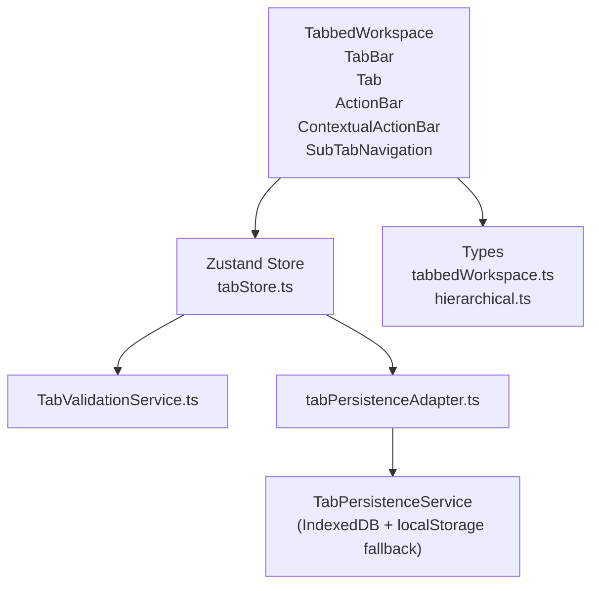
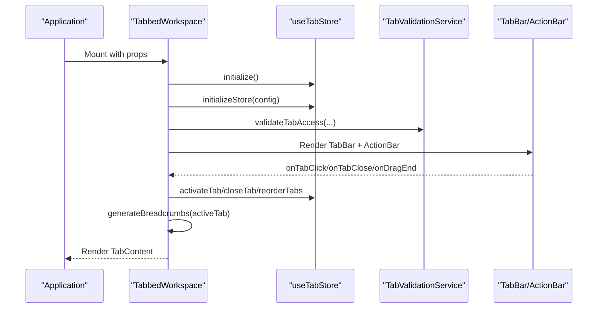
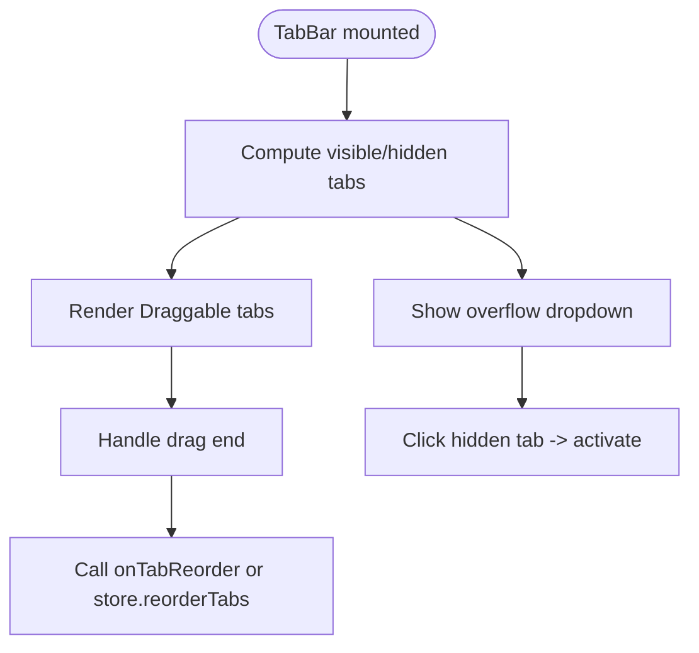
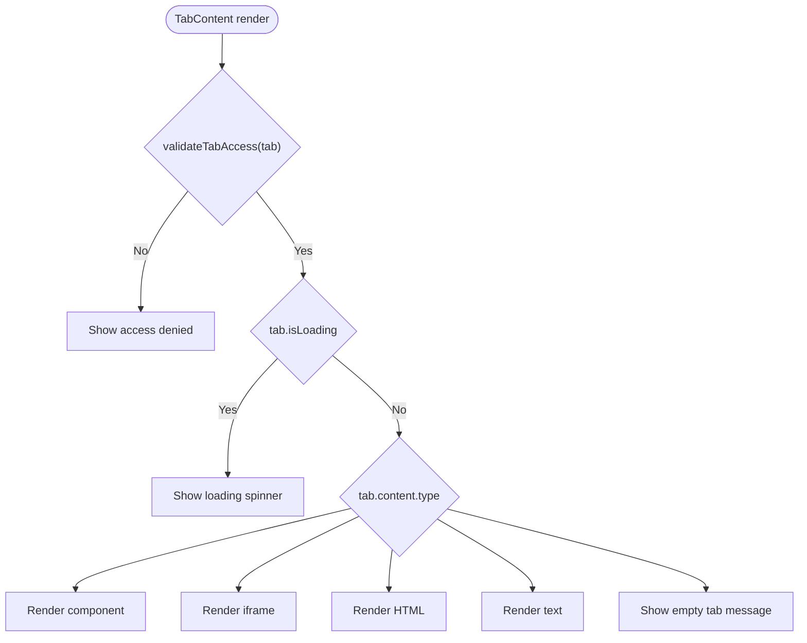
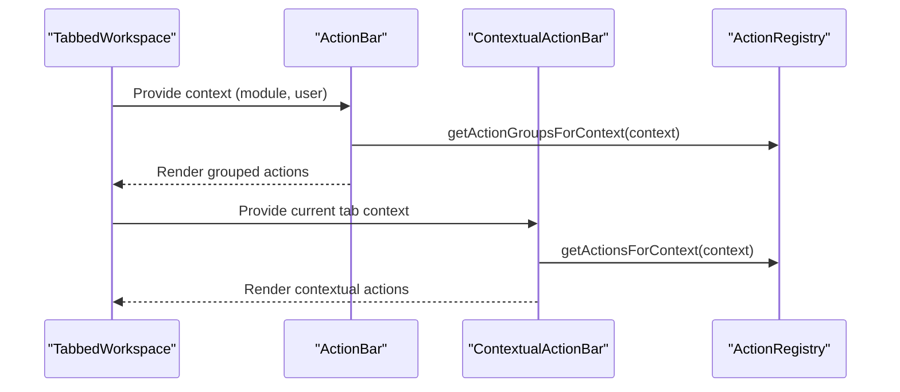
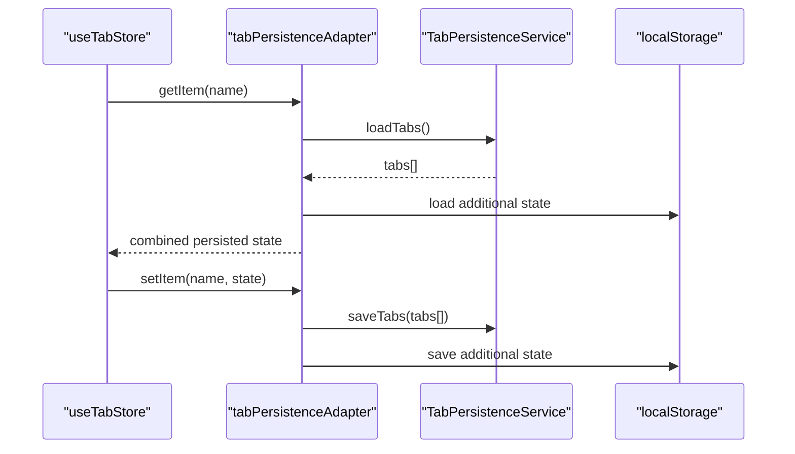
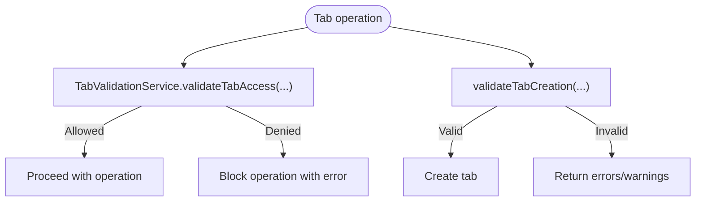
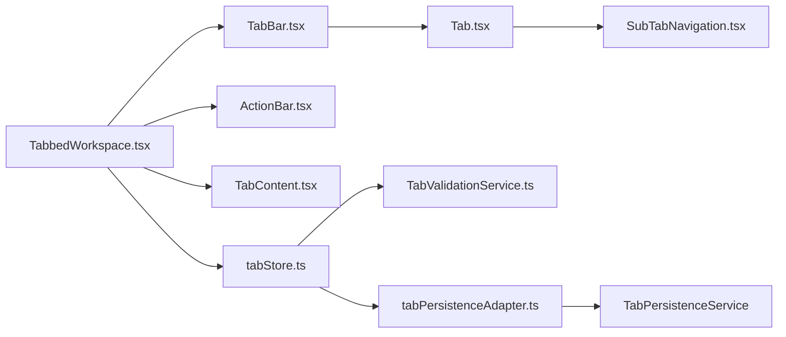

# Tabbed Workspace

<cite>
**Referenced Files in This Document**
- [TabbedWorkspace.tsx](file://src/components/tabbedWorkspace/TabbedWorkspace.tsx)
- [TabBar.tsx](file://src/components/tabbedWorkspace/TabBar.tsx)
- [Tab.tsx](file://src/components/tabbedWorkspace/Tab.tsx)
- [TabContent.tsx](file://src/components/tabbedWorkspace/TabContent.tsx)
- [ActionBar.tsx](file://src/components/tabbedWorkspace/ActionBar.tsx)
- [ContextualActionBar.tsx](file://src/components/tabbedWorkspace/ContextualActionBar.tsx)
- [SubTabNavigation.tsx](file://src/components/tabbedWorkspace/SubTabNavigation.tsx)
- [tabStore.ts](file://src/stores/tabStore.ts)
- [TabValidationService.ts](file://src/services/tabs/TabValidationService.ts)
- [tabPersistenceAdapter.ts](file://src/stores/adapters/tabPersistenceAdapter.ts)
- [tabbedWorkspace.ts](file://src/types/tabbedWorkspace.ts)
- [hierarchical.ts](file://src/types/hierarchical.ts)
- [index.ts](file://src/components/tabbedWorkspace/index.ts)
- [TABBED_WORKSPACE_COMPONENT_GUIDE.md](file://docs/tabs/TABBED_WORKSPACE_COMPONENT_GUIDE.md)
</cite>

## Table of Contents
1. [Introduction](#introduction)
2. [Project Structure](#project-structure)
3. [Core Components](#core-components)
4. [Architecture Overview](#architecture-overview)
5. [Detailed Component Analysis](#detailed-component-analysis)
6. [Dependency Analysis](#dependency-analysis)
7. [Performance Considerations](#performance-considerations)
8. [Troubleshooting Guide](#troubleshooting-guide)
9. [Conclusion](#conclusion)
10. [Appendices](#appendices)

## Introduction
This document explains SchoolPilot3’s advanced multi-tab interface system. It covers the TabbedWorkspace orchestration layer, tab lifecycle and state management, RBAC-driven validation, persistence adapters, hierarchical tabs and sub-tabs, contextual action bars, and integration with routing and content rendering. It also documents performance monitoring hooks and provides practical examples for creating and managing tabs within the routing system.

## Project Structure
The tabbed workspace is implemented as a cohesive set of React components and supporting services under src/components/tabbedWorkspace, backed by a Zustand store and validation/persistence services.



**Diagram sources**
- [TabbedWorkspace.tsx:16-549](file://src/components/tabbedWorkspace/TabbedWorkspace.tsx#L16-L549)
- [TabBar.tsx:40-521](file://src/components/tabbedWorkspace/TabBar.tsx#L40-L521)
- [Tab.tsx:269-612](file://src/components/tabbedWorkspace/Tab.tsx#L269-L612)
- [TabContent.tsx:21-255](file://src/components/tabbedWorkspace/TabContent.tsx#L21-L255)
- [ActionBar.tsx:216-527](file://src/components/tabbedWorkspace/ActionBar.tsx#L216-L527)
- [ContextualActionBar.tsx:118-446](file://src/components/tabbedWorkspace/ContextualActionBar.tsx#L118-L446)
- [SubTabNavigation.tsx:8-94](file://src/components/tabbedWorkspace/SubTabNavigation.tsx#L8-L94)
- [tabStore.ts:139-917](file://src/stores/tabStore.ts#L139-L917)
- [TabValidationService.ts:83-570](file://src/services/tabs/TabValidationService.ts#L83-L570)
- [tabPersistenceAdapter.ts:49-153](file://src/stores/adapters/tabPersistenceAdapter.ts#L49-L153)
- [tabbedWorkspace.ts:19-221](file://src/types/tabbedWorkspace.ts#L19-L221)
- [hierarchical.ts:46-240](file://src/types/hierarchical.ts#L46-L240)

**Section sources**
- [index.ts:1-44](file://src/components/tabbedWorkspace/index.ts#L1-L44)
- [TABBED_WORKSPACE_COMPONENT_GUIDE.md:1-503](file://docs/tabs/TABBED_WORKSPACE_COMPONENT_GUIDE.md#L1-L503)

## Core Components
- TabbedWorkspace: Orchestrates the entire workspace, integrates with Zustand, manages initialization, error boundaries, drag-and-drop, breadcrumbs, and action bar.
- TabBar: Renders the horizontal tab bar with drag-and-drop reordering, overflow handling, and context menus.
- Tab: Individual tab with interactive features, context menu, favorites, and optional hierarchical sub-tabs.
- TabContent: Renders tab content based on type (component, URL iframe, HTML, text, empty) with RBAC checks.
- ActionBar: Dynamic action bar with grouped actions, search/filter, and overflow handling.
- ContextualActionBar: Tab-specific contextual actions with integrated search and overflow.
- SubTabNavigation: Secondary navigation within a tab for hierarchical views.

**Section sources**
- [TabbedWorkspace.tsx:16-549](file://src/components/tabbedWorkspace/TabbedWorkspace.tsx#L16-L549)
- [TabBar.tsx:40-521](file://src/components/tabbedWorkspace/TabBar.tsx#L40-L521)
- [Tab.tsx:269-612](file://src/components/tabbedWorkspace/Tab.tsx#L269-L612)
- [TabContent.tsx:21-255](file://src/components/tabbedWorkspace/TabContent.tsx#L21-L255)
- [ActionBar.tsx:216-527](file://src/components/tabbedWorkspace/ActionBar.tsx#L216-L527)
- [ContextualActionBar.tsx:118-446](file://src/components/tabbedWorkspace/ContextualActionBar.tsx#L118-L446)
- [SubTabNavigation.tsx:8-94](file://src/components/tabbedWorkspace/SubTabNavigation.tsx#L8-L94)

## Architecture Overview
The system follows a layered architecture:
- Presentation Layer: Components render UI and manage user interactions.
- State Layer: Zustand store manages tab collections, active tab, pinned tabs, and recent closures.
- Validation Layer: Centralized service validates permissions, access, and state integrity.
- Persistence Layer: Adapter bridges Zustand persist middleware with a persistence service for robust storage.



**Diagram sources**
- [TabbedWorkspace.tsx:16-549](file://src/components/tabbedWorkspace/TabbedWorkspace.tsx#L16-L549)
- [tabStore.ts:139-917](file://src/stores/tabStore.ts#L139-L917)
- [TabValidationService.ts:83-570](file://src/services/tabs/TabValidationService.ts#L83-L570)
- [tabPersistenceAdapter.ts:49-153](file://src/stores/adapters/tabPersistenceAdapter.ts#L49-L153)
- [tabbedWorkspace.ts:19-221](file://src/types/tabbedWorkspace.ts#L19-L221)
- [hierarchical.ts:46-240](file://src/types/hierarchical.ts#L46-L240)

## Detailed Component Analysis

### TabbedWorkspace Orchestration
Responsibilities:
- Initializes store and registers workspace actions.
- Manages loading/error states and user role/permission updates.
- Generates breadcrumbs for hierarchical tabs.
- Renders TabBar, ActionBar, and Tab content area.
- Handles drag-and-drop reordering and tab creation/close callbacks.

Key behaviors:
- Parallel initialization of store and workspace.
- Memoized handlers and props to minimize re-renders.
- Conditional rendering of breadcrumbs and action bar.
- Error boundary wrapping for isolated tab failures.



**Diagram sources**
- [TabbedWorkspace.tsx:108-275](file://src/components/tabbedWorkspace/TabbedWorkspace.tsx#L108-L275)
- [tabStore.ts:163-244](file://src/stores/tabStore.ts#L163-L244)
- [TabValidationService.ts:120-166](file://src/services/tabs/TabValidationService.ts#L120-L166)

**Section sources**
- [TabbedWorkspace.tsx:16-549](file://src/components/tabbedWorkspace/TabbedWorkspace.tsx#L16-L549)
- [tabStore.ts:139-244](file://src/stores/tabStore.ts#L139-L244)

### TabBar and Drag-and-Drop
Responsibilities:
- Renders visible tabs with overflow dropdown.
- Implements react-beautiful-dnd for reordering.
- Handles pin/unpin, duplicate, and close actions.
- Supports hierarchical sub-tab selection.

Optimizations:
- Custom equality check for React.memo to prevent re-renders.
- Scroll indicators and smooth horizontal scrolling.



**Diagram sources**
- [TabBar.tsx:142-155](file://src/components/tabbedWorkspace/TabBar.tsx#L142-L155)
- [TabBar.tsx:226-230](file://src/components/tabbedWorkspace/TabBar.tsx#L226-L230)

**Section sources**
- [TabBar.tsx:40-521](file://src/components/tabbedWorkspace/TabBar.tsx#L40-L521)

### Tab Component and Context Menu
Responsibilities:
- Renders tab with icon, title, status indicators, and close button.
- Context menu supports pin/unpin, duplicate, close actions, and favorites.
- Keyboard shortcuts for common actions.
- Optional hierarchical sub-tabs rendered below active tab.

```mermaid
classDiagram
class Tab {
+props : TabProps
+onClick()
+onClose(event)
+onContextMenu(event)
+onPin()
+onDuplicate()
}
class ContextMenu {
+isVisible : boolean
+position : {x,y}
+handleAction(action)
}
Tab --> ContextMenu : "renders"
```

**Diagram sources**
- [Tab.tsx:269-612](file://src/components/tabbedWorkspace/Tab.tsx#L269-L612)

**Section sources**
- [Tab.tsx:269-612](file://src/components/tabbedWorkspace/Tab.tsx#L269-L612)

### Tab Content Rendering
Responsibilities:
- Validates access via RBAC.
- Supports multiple content types: component, URL iframe, HTML, text, empty.
- Shows loading and access-denied states.
- Respects full-page mode and responsive padding.



**Diagram sources**
- [TabContent.tsx:33-159](file://src/components/tabbedWorkspace/TabContent.tsx#L33-L159)

**Section sources**
- [TabContent.tsx:21-255](file://src/components/tabbedWorkspace/TabContent.tsx#L21-L255)

### Action Bars
- ActionBar: Dynamic, grouped actions with search/filter and overflow menu. Integrates with action registry and context.
- ContextualActionBar: Tab-specific actions with integrated search and overflow, plus built-in actions (refresh/save/share/etc.).



**Diagram sources**
- [ActionBar.tsx:216-527](file://src/components/tabbedWorkspace/ActionBar.tsx#L216-L527)
- [ContextualActionBar.tsx:118-446](file://src/components/tabbedWorkspace/ContextualActionBar.tsx#L118-L446)

**Section sources**
- [ActionBar.tsx:216-527](file://src/components/tabbedWorkspace/ActionBar.tsx#L216-L527)
- [ContextualActionBar.tsx:118-446](file://src/components/tabbedWorkspace/ContextualActionBar.tsx#L118-L446)

### Sub-tab Navigation
- Renders secondary navigation within a tab.
- Supports adding new sub-tabs and highlighting active sub-tab.
- Integrates with hierarchical tab model.

**Section sources**
- [SubTabNavigation.tsx:8-94](file://src/components/tabbedWorkspace/SubTabNavigation.tsx#L8-L94)
- [hierarchical.ts:28-65](file://src/types/hierarchical.ts#L28-L65)

### State Management and Persistence
- Zustand store encapsulates:
  - Core tab operations (create, activate, close, reorder, pin/unpin, duplicate).
  - Bulk operations (close all, close others, close to sides).
  - RBAC operations (validate access, update user role/permissions).
  - State persistence adapter integration.
  - Hierarchical tab support (breadcrumbs, navigation history).
- Persistence adapter:
  - Bridges Zustand persist middleware with a persistence service.
  - Falls back to localStorage when IndexedDB is unavailable.
  - Separates tab array from additional state (pinned, closed, groups).



**Diagram sources**
- [tabStore.ts:139-244](file://src/stores/tabStore.ts#L139-L244)
- [tabPersistenceAdapter.ts:49-153](file://src/stores/adapters/tabPersistenceAdapter.ts#L49-L153)

**Section sources**
- [tabStore.ts:139-917](file://src/stores/tabStore.ts#L139-L917)
- [tabPersistenceAdapter.ts:49-153](file://src/stores/adapters/tabPersistenceAdapter.ts#L49-L153)

### Validation and Access Control
- Centralized validation service:
  - Role-based access control with configurable role configs.
  - Permission checks and module-level access validation.
  - Tab creation validation (limits, duplicates, required fields).
  - State integrity validation and sanitization.
- Integration:
  - Store delegates tab creation/access checks to validation service.
  - Store cleans corrupted persisted data.



**Diagram sources**
- [TabValidationService.ts:120-166](file://src/services/tabs/TabValidationService.ts#L120-L166)
- [TabValidationService.ts:177-224](file://src/services/tabs/TabValidationService.ts#L177-L224)
- [tabStore.ts:258-335](file://src/stores/tabStore.ts#L258-L335)

**Section sources**
- [TabValidationService.ts:83-570](file://src/services/tabs/TabValidationService.ts#L83-L570)
- [tabStore.ts:53-76](file://src/stores/tabStore.ts#L53-L76)

### Types and Interfaces
- Core types define tab content, state, groups, and store contracts.
- Hierarchical types extend base types with sub-tabs, breadcrumbs, and navigation context.

**Section sources**
- [tabbedWorkspace.ts:19-221](file://src/types/tabbedWorkspace.ts#L19-L221)
- [hierarchical.ts:46-240](file://src/types/hierarchical.ts#L46-L240)

## Dependency Analysis
- Component coupling:
  - TabbedWorkspace depends on TabBar, ActionBar, TabContent, and error boundary.
  - TabBar depends on Tab and SubTabNavigation.
  - TabContent depends on Tab and validation service.
- Store dependencies:
  - useTabStore integrates validation and persistence services.
  - Adapter depends on persistence service and localStorage.
- External libraries:
  - react-beautiful-dnd for drag-and-drop.
  - Zustand with persist and immer middleware.
  - Icons from lucide-react and heroicons.



**Diagram sources**
- [TabbedWorkspace.tsx:1-549](file://src/components/tabbedWorkspace/TabbedWorkspace.tsx#L1-L549)
- [TabBar.tsx:1-521](file://src/components/tabbedWorkspace/TabBar.tsx#L1-L521)
- [Tab.tsx:1-612](file://src/components/tabbedWorkspace/Tab.tsx#L1-L612)
- [TabContent.tsx:1-255](file://src/components/tabbedWorkspace/TabContent.tsx#L1-L255)
- [ActionBar.tsx:1-527](file://src/components/tabbedWorkspace/ActionBar.tsx#L1-L527)
- [SubTabNavigation.tsx:1-94](file://src/components/tabbedWorkspace/SubTabNavigation.tsx#L1-L94)
- [tabStore.ts:1-917](file://src/stores/tabStore.ts#L1-L917)
- [TabValidationService.ts:1-570](file://src/services/tabs/TabValidationService.ts#L1-L570)
- [tabPersistenceAdapter.ts:1-153](file://src/stores/adapters/tabPersistenceAdapter.ts#L1-L153)

**Section sources**
- [index.ts:1-44](file://src/components/tabbedWorkspace/index.ts#L1-L44)

## Performance Considerations
- Memoization:
  - TabBar and ActionBar use React.memo with custom equality checks to reduce re-renders.
  - TabbedWorkspace memoizes handlers, props, breadcrumbs, and tab sorting.
- Lazy loading:
  - Prefer lazy-loaded components for heavy tab content.
- Drag-and-drop:
  - react-beautiful-dnd is efficient for reordering; avoid unnecessary re-renders by keeping payload minimal.
- Persistence:
  - Adapter separates large arrays from small additional state to optimize storage and retrieval.
- Accessibility:
  - Proper ARIA attributes and keyboard navigation are implemented in tabs and action bars.

[No sources needed since this section provides general guidance]

## Troubleshooting Guide
Common issues and resolutions:
- Initialization failures:
  - The workspace displays an error state and offers a reload button. Check RBAC service availability and console logs.
- Corrupted data:
  - Store automatically cleans corrupted tabs and pinned/recently closed lists on load.
- Permission denials:
  - Use validateTabAccess to confirm access. Review role configs and required permissions.
- Persistence errors:
  - Adapter falls back to localStorage when IndexedDB fails. Verify browser support and quota.

**Section sources**
- [TabbedWorkspace.tsx:479-506](file://src/components/tabbedWorkspace/TabbedWorkspace.tsx#L479-L506)
- [tabStore.ts:789-800](file://src/stores/tabStore.ts#L789-L800)
- [TabValidationService.ts:120-166](file://src/services/tabs/TabValidationService.ts#L120-L166)
- [tabPersistenceAdapter.ts:89-93](file://src/stores/adapters/tabPersistenceAdapter.ts#L89-L93)

## Conclusion
SchoolPilot3’s tabbed workspace provides a robust, extensible, and accessible multi-tab environment. Its architecture cleanly separates concerns across presentation, state, validation, and persistence layers, while offering powerful features like hierarchical tabs, contextual actions, and resilient persistence. The included validation and persistence services ensure secure and reliable tab operations.

[No sources needed since this section summarizes without analyzing specific files]

## Appendices

### Examples: Creating and Managing Tabs
- Create a new tab programmatically:
  - Use the store’s createTab method with tab data (title, path, module, content).
  - The store validates permissions and enforces limits.
- Close a tab:
  - Use closeTab with the tab ID; pinned tabs are protected.
- Reorder tabs:
  - Use reorderTabs with source and destination indices.
- Duplicate a tab:
  - Use duplicateTab to create a copy with a modified title.

**Section sources**
- [tabStore.ts:258-335](file://src/stores/tabStore.ts#L258-L335)
- [tabStore.ts:337-369](file://src/stores/tabStore.ts#L337-L369)
- [tabStore.ts:405-410](file://src/stores/tabStore.ts#L405-L410)
- [tabStore.ts:435-449](file://src/stores/tabStore.ts#L435-L449)

### Routing Integration
- Route-based tabs:
  - Set tab.content.type to component and use DynamicPageComponent for route rendering.
  - Use path-based navigation to drive breadcrumbs and hierarchical tabs.
- URL synchronization:
  - Update currentPath and breadcrumbs in the store to reflect route changes.
  - Use generateBreadcrumbsFromPath to derive breadcrumb items from a given path.

**Section sources**
- [TabbedWorkspace.tsx:394-406](file://src/components/tabbedWorkspace/TabbedWorkspace.tsx#L394-L406)
- [tabStore.ts:761-786](file://src/stores/tabStore.ts#L761-L786)

### Tab Accessibility Manager
- Keyboard navigation:
  - Tabs support Enter/Space activation and Delete/Backspace close (when not pinned).
- Focus management:
  - Proper focus rings and ARIA attributes for screen readers.
- Status indicators:
  - Loading, error, and unsaved-change indicators improve accessibility cues.

**Section sources**
- [Tab.tsx:342-371](file://src/components/tabbedWorkspace/Tab.tsx#L342-L371)
- [Tab.tsx:476-481](file://src/components/tabbedWorkspace/Tab.tsx#L476-L481)

### Performance Monitoring for Tabs
- Built-in loading states and error boundaries isolate tab performance issues.
- Use performance monitoring hooks to track tab rendering and content load times.
- Consider debouncing expensive operations and leveraging React.memo for stable props.

[No sources needed since this section provides general guidance]

### Tab Persistence Adapter
- IndexedDB with localStorage fallback ensures reliability.
- Separates tab arrays from additional state to optimize storage.
- Handles schema versioning and migration scenarios.

**Section sources**
- [tabPersistenceAdapter.ts:49-153](file://src/stores/adapters/tabPersistenceAdapter.ts#L49-L153)

### Tab Integration Patterns
- Tabbed forms:
  - Use TabContent to render form components within tabs.
- Slideout forms:
  - Integrate slideout modals within tab content areas.
- Modal integration:
  - Use modal components inside tab content with proper z-index and focus management.

[No sources needed since this section provides general guidance]

### Tab State Derivation and URL Synchronization
- Derive tab state from URL path segments for breadcrumbs.
- Maintain navigation history and enable back/forward navigation.
- Update active sub-tab within hierarchical tabs.

**Section sources**
- [tabStore.ts:761-786](file://src/stores/tabStore.ts#L761-L786)
- [Tab.tsx:555-564](file://src/components/tabbedWorkspace/Tab.tsx#L555-L564)