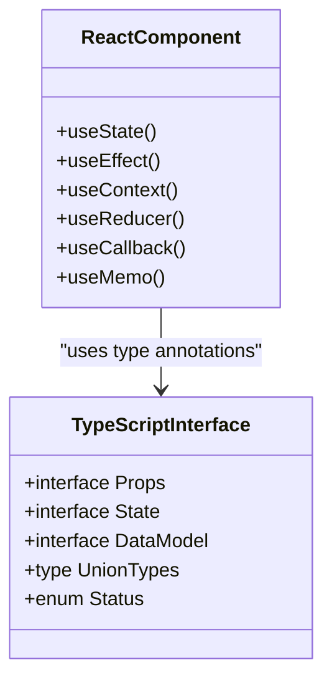
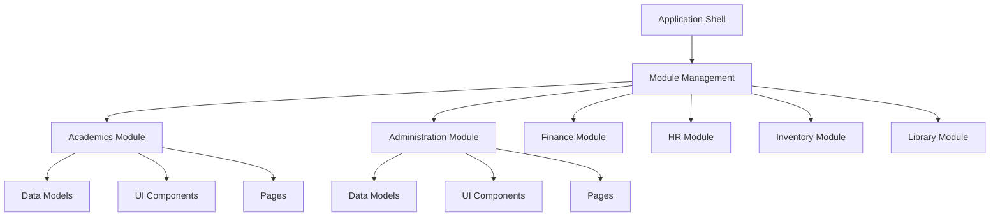
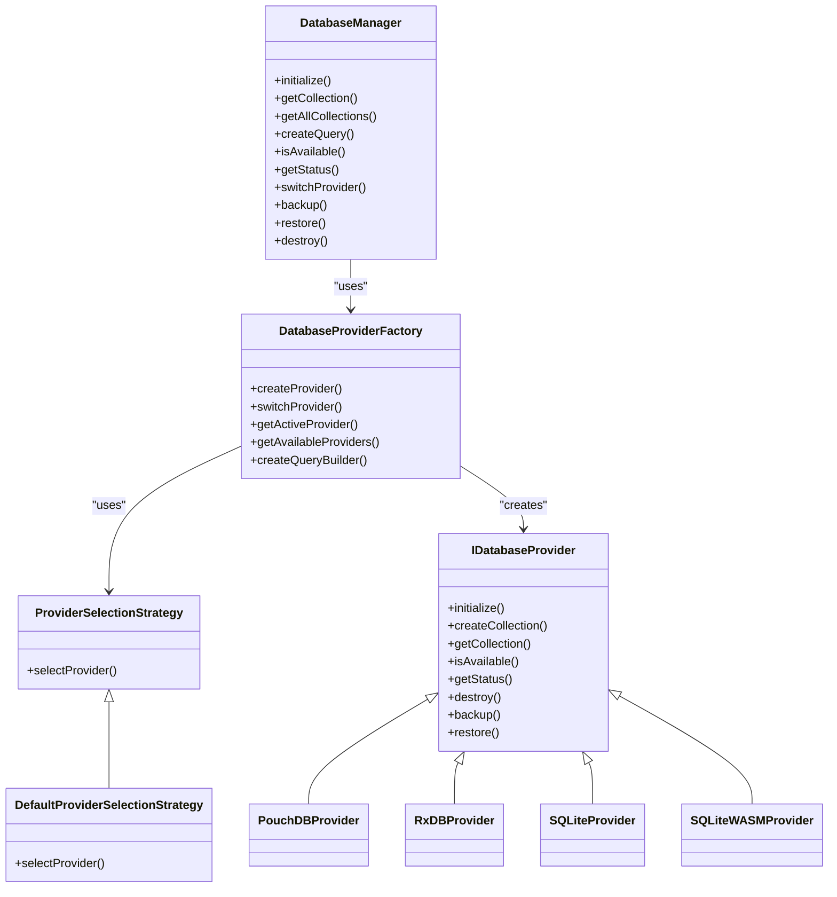
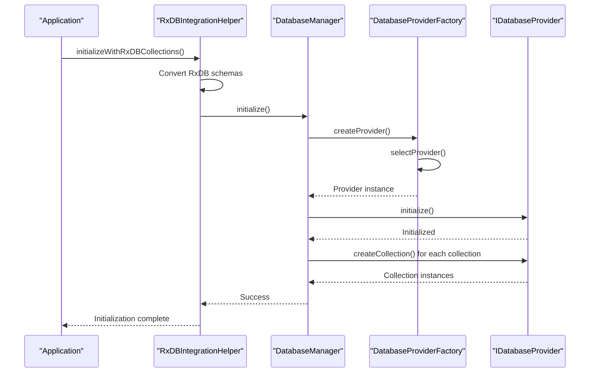
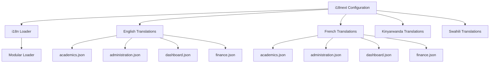

# Technology Stack & Dependencies

<cite>
**Referenced Files in This Document**   
- [vite.config.ts](file://vite.config.ts)
- [package.json](file://package.json)
- [tsconfig.json](file://tsconfig.json)
- [tailwind.config.js](file://tailwind.config.js)
- [src/services/database/ProviderSelector.ts](file://src/services/database/ProviderSelector.ts)
- [src/services/database/DatabaseProviderFactory.ts](file://src/services/database/DatabaseProviderFactory.ts)
- [src/services/database/interfaces.ts](file://src/services/database/interfaces.ts)
- [src/i18n/i18n.ts](file://src/i18n/i18n.ts)
- [src/utils/cn.ts](file://src/utils/cn.ts)
- [src/hooks/useRxDBData.ts](file://src/hooks/useRxDBData.ts)
- [src/config/unifiedConfig.ts](file://src/config/unifiedConfig.ts)
- [vitest.config.ts](file://vitest.config.ts)
</cite>

## Table of Contents
1. [Introduction](#introduction)
2. [Core Technology Stack](#core-technology-stack)
3. [Frontend Architecture](#frontend-architecture)
4. [Data Persistence & Offline Capabilities](#data-persistence--offline-capabilities)
5. [Reactive Programming with RxJS](#reactive-programming-with-rxjs)
6. [Internationalization with i18next](#internationalization-with-i18next)
7. [Component Styling & Variants](#component-styling--variants)
8. [Testing Strategy](#testing-strategy)
9. [Build System & Module Federation](#build-system--module-federation)
10. [Performance Considerations](#performance-considerations)
11. [Dependency Management](#dependency-management)
12. [Conclusion](#conclusion)

## Introduction
The schoolpilot3 application is a comprehensive educational management system built with a modern, robust technology stack designed for scalability, offline-first capabilities, and internationalization. This document details the core technologies that form the foundation of the application, explaining their integration, benefits, and implementation rationale. The stack combines React 18 with TypeScript for type-safe UI development, Vite for rapid builds, Tailwind CSS for utility-first styling, and a sophisticated dual-database architecture for reliable data persistence.

**Section sources**
- [package.json](file://package.json#L1-L50)
- [vite.config.ts](file://vite.config.ts#L1-L20)

## Core Technology Stack

### React 18 with TypeScript
The application leverages React 18 as its primary frontend framework, utilizing concurrent rendering features such as automatic batching and the new root API for improved performance. TypeScript provides static typing across the entire codebase, enhancing code quality, maintainability, and developer experience through intelligent code completion and compile-time error detection.

TypeScript configuration is managed through `tsconfig.json`, which enforces strict type checking, enables ES2020 features, and supports JSX compilation for React. The combination of React 18 and TypeScript allows for the creation of type-safe components, hooks, and data structures, reducing runtime errors and improving code documentation.



**Diagram sources**
- [tsconfig.json](file://tsconfig.json#L1-L30)
- [src/types.ts](file://src/types.ts#L1-L50)

### Vite as Build Tool
Vite serves as the build tool and development server, providing lightning-fast hot module replacement (HMR) and an optimized production build pipeline. Configured in `vite.config.ts`, Vite leverages native ES modules in development, eliminating the need for bundling during development and significantly reducing startup time.

The Vite configuration includes:
- React plugin for JSX compilation
- TypeScript support
- CSS preprocessing with PostCSS
- Environment variable handling
- Optimization for production builds

Vite's architecture enables near-instantaneous server start times and rapid updates, dramatically improving developer productivity. In production, Vite generates highly optimized bundles with code splitting, tree-shaking, and asset optimization.

**Section sources**
- [vite.config.ts](file://vite.config.ts#L1-L100)
- [package.json](file://package.json#L20-L30)

### Tailwind CSS for Styling
Tailwind CSS is implemented as the utility-first CSS framework, configured through `tailwind.config.js`. This approach enables rapid UI development by composing styles directly in markup using atomic classes, while maintaining design consistency through a defined design system.

The configuration extends the default theme with custom colors, spacing, and typography that align with the application's design requirements. Tailwind's JIT (Just-In-Time) mode generates styles on-demand, resulting in smaller CSS bundles and faster build times.

```javascript
// tailwind.config.js
module.exports = {
  content: [
    "./index.html",
    "./src/**/*.{js,ts,jsx,tsx}",
    "./src/components/**/*.{js,ts,jsx,tsx}"
  ],
  theme: {
    extend: {
      colors: {
        primary: '#0066cc',
        secondary: '#666666',
        success: '#28a745',
        danger: '#dc3545'
      },
      spacing: {
        '96': '24rem',
        '128': '32rem'
      }
    }
  },
  plugins: []
}
```

**Section sources**
- [tailwind.config.js](file://tailwind.config.js#L1-L50)
- [src/styles/design-system.css](file://src/styles/design-system.css#L1-L20)

## Frontend Architecture

### Component Structure and Organization
The application follows a feature-based organization structure, with components organized by domain functionality within the `src/components` and `src/modules` directories. This modular approach enhances maintainability and enables independent development of different application areas.

UI components are categorized into:
- **Layout components**: PageContainer, PageHeader, Sidebar
- **Data components**: DataCard, DataGrid, DataTable, KanbanBoard
- **Feedback components**: LoadingStates, Toast, Tooltip
- **Form components**: DatePicker, FormField, SlideoutForm

This categorization promotes reusability and consistency across the application. Each component is implemented as a TypeScript React component with proper type definitions for props and state.

### Module System and Dynamic Loading
The application implements a sophisticated module system that supports dynamic loading and runtime module management. Modules such as academics, administration, finance, and hr are organized as self-contained units with their own components, data models, and routing.

The module system enables:
- Lazy loading of modules to reduce initial bundle size
- Independent development and testing of modules
- Runtime module activation/deactivation
- Permission-based module access control



**Diagram sources**
- [src/modules/academics/moduleDefinition.tsx](file://src/modules/academics/moduleDefinition.tsx#L1-L20)
- [src/modules/administration/moduleDefinition.tsx](file://src/modules/administration/moduleDefinition.tsx#L1-L20)

## Data Persistence & Offline Capabilities

### Dual-Database Architecture
The application implements a sophisticated dual-database architecture that supports multiple database providers through a factory pattern and provider selection strategy. This architecture ensures flexibility, reliability, and optimal performance across different environments and use cases.

The system supports four primary database providers:
- **PouchDB**: For offline-first applications using IndexedDB
- **RxDB**: For reactive data access with real-time updates
- **SQLite**: For development environments with persistent storage
- **LiveStore (SQLite WASM)**: For production environments with advanced features



**Diagram sources**
- [src/services/database/ProviderSelector.ts](file://src/services/database/ProviderSelector.ts#L1-L50)
- [src/services/database/DatabaseProviderFactory.ts](file://src/services/database/DatabaseProviderFactory.ts#L1-L50)

### Provider Selection Strategy
The `DefaultProviderSelectionStrategy` determines the appropriate database provider based on application requirements and environment conditions. The selection logic considers factors such as:
- Development vs. production environment
- Offline capability requirements
- Synchronization needs
- Performance requirements
- Data volume

The strategy prioritizes SQLite for development environments to ensure persistent storage, while favoring PouchDB for general offline-first scenarios. LiveStore (SQLite WASM) is selected for production environments requiring advanced features and high performance.

```typescript
// DefaultProviderSelectionStrategy implementation
selectProvider(requirements: CollectionRequirements): ProviderType {
    const isDevelopment = typeof process !== 'undefined' && process.env?.NODE_ENV === 'development';
    if (isDevelopment && requirements.requiresOffline) {
        return 'sqlite';
    }
    
    if (requirements.requiresSync && requirements.performanceLevel === 'high') {
        return 'livestore';
    }
    
    if (requirements.requiresOffline || requirements.requiresSync) {
        return 'pouchdb';
    }
    
    if (requirements.requiresReactivity && requirements.performanceLevel === 'high') {
        return 'rxdb';
    }
    
    return 'pouchdb';
}
```

**Section sources**
- [src/services/database/DatabaseProviderFactory.ts](file://src/services/database/DatabaseProviderFactory.ts#L150-L200)

### RxDB and PouchDB Integration
RxDB serves as the primary reactive database layer, built on top of PouchDB, providing real-time data synchronization and reactivity. This combination enables the application to function reliably in offline scenarios while maintaining data consistency when connectivity is restored.

The integration is managed through the `RxDBIntegrationHelper` class, which converts RxDB schema definitions to the application's interface format and initializes the database manager with all required collections. This abstraction layer ensures compatibility between the reactive data layer and the rest of the application.



**Diagram sources**
- [src/services/database/ProviderSelector.ts](file://src/services/database/ProviderSelector.ts#L300-L400)

## Reactive Programming with RxJS

### RxJS in Application Architecture
RxJS is deeply integrated into the application's data layer, providing a powerful reactive programming model for handling asynchronous data streams. The library is used extensively for:
- State management and data flow
- Real-time updates from the database
- User interface event handling
- API request/response management
- Error handling and retry logic

The `DatabaseManager` class uses RxJS BehaviorSubject to expose provider status changes, allowing components to react to database availability and connection state.

```typescript
private statusSubject = new BehaviorSubject<ProviderStatus | null>(null);

subscribeToStatus(): Observable<ProviderStatus | null> {
    return this.statusSubject.asObservable();
}

private updateStatus(): void {
    const status = this.getStatus();
    this.statusSubject.next(status);
}
```

### Query Builder Implementation
The application includes a sophisticated QueryBuilder class that provides a fluent interface for constructing database queries. Built on RxJS principles, the QueryBuilder enables reactive data access patterns and supports complex query operations with method chaining.

The QueryBuilder supports:
- Field selection with `where()` and logical operators
- Sorting with `sort()`
- Pagination with `limit()` and `skip()`
- Field projection with `select()`
- Reactive subscriptions with `subscribe()`

```typescript
const query = new QueryBuilder<Student>('students')
    .where('grade', '=', '10')
    .where('status', '=', 'active')
    .sort('lastName', 'asc')
    .limit(50)
    .build();

const results = await collection.find(query);
```

**Section sources**
- [src/services/database/DatabaseProviderFactory.ts](file://src/services/database/DatabaseProviderFactory.ts#L50-L150)

## Internationalization with i18next

### i18next Implementation
The application implements comprehensive internationalization using i18next, supporting multiple languages including English (en), French (fr), Kinyarwanda (rw), and Swahili (sw). The i18next configuration is managed in `src/i18n/i18n.ts`, which initializes the library with the supported languages and loads translation resources.

Translation files are organized by module and language in the `src/i18n/locales` directory, with separate JSON files for different functional areas such as academics, administration, finance, and navigation.



**Diagram sources**
- [src/i18n/i18n.ts](file://src/i18n/i18n.ts#L1-L30)
- [src/i18n/locales/en/academics.json](file://src/i18n/locales/en/academics.json#L1-L10)

### Language Switching and Context
The application provides a LanguageSwitcher component that allows users to change the interface language at runtime. The current language selection is managed through React context, ensuring that all components receive updates when the language changes.

The i18next integration supports:
- Dynamic language switching without page reload
- Fallback languages for missing translations
- Pluralization and formatting rules specific to each language
- Namespaces for organizing translation keys by module

```typescript
// Example usage in components
import { useTranslation } from 'react-i18next';

function StudentDashboard() {
    const { t } = useTranslation('academics');
    
    return (
        <div>
            <h1>{t('student_management')}</h1>
            <p>{t('total_students', { count: 150 })}</p>
        </div>
    );
}
```

**Section sources**
- [src/components/ui/LanguageSwitcher.tsx](file://src/components/ui/LanguageSwitcher.tsx#L1-L20)
- [src/i18n/i18n.ts](file://src/i18n/i18n.ts#L30-L60)

## Component Styling & Variants

### class-variance-authority for Component Variants
The application uses class-variance-authority (cva) to manage component variants and styling patterns in a type-safe manner. This utility is implemented in `src/utils/cn.ts`, which combines cva with Tailwind CSS classes to create consistent, reusable component variants.

The cva pattern enables:
- Type-safe variant definitions
- Automatic TypeScript IntelliSense for available variants
- Consistent styling across components
- Easy maintenance of design system tokens

```typescript
// src/utils/cn.ts
import { cva } from 'class-variance-authority';

export const buttonVariants = cva(
  'inline-flex items-center justify-center rounded-md text-sm font-medium transition-colors',
  {
    variants: {
      variant: {
        primary:
          'bg-primary text-primary-foreground hover:bg-primary/90',
        secondary:
          'bg-secondary text-secondary-foreground hover:bg-secondary/80',
        outline:
          'border border-input bg-background hover:bg-accent hover:text-accent-foreground',
        ghost: 'hover:bg-accent hover:text-accent-foreground',
      },
      size: {
        sm: 'h-8 px-3 text-xs',
        default: 'h-9 px-4',
        lg: 'h-10 px-8',
      },
    },
    defaultVariants: {
      variant: 'primary',
      size: 'default',
    },
  }
);
```

### Design System Implementation
The application implements a comprehensive design system using utility classes and component variants. The design system ensures visual consistency across the application while providing flexibility for different use cases.

Key aspects of the design system include:
- Consistent color palette defined in Tailwind configuration
- Standardized spacing and sizing scales
- Typography hierarchy with defined font sizes and weights
- Component variants for different visual treatments
- Responsive design patterns

**Section sources**
- [src/utils/cn.ts](file://src/utils/cn.ts#L1-L50)
- [tailwind.config.js](file://tailwind.config.js#L1-L50)

## Testing Strategy

### Vitest and Testing Library
The application uses Vitest as the primary testing framework, configured in `vitest.config.ts`. Vitest provides a fast, modern testing environment with excellent TypeScript support and a familiar Jest-like API.

Testing is implemented using @testing-library/react for component testing, enabling:
- Unit testing of individual components
- Integration testing of component interactions
- User interaction simulation
- Accessibility testing

The test suite includes:
- Component tests in `src/tests` and `src/components/**/__tests__`
- Integration tests in `tests/integration`
- Performance tests in `tests/performance`
- Utility function tests in `src/tests/utils`

```mermaid
graph TB
TestRunner[Vitest Test Runner] --> Config[vitest.config.ts]
TestRunner --> ComponentTests[Component Tests]
TestRunner --> IntegrationTests[Integration Tests]
TestRunner --> PerformanceTests[Performance Tests]
ComponentTests --> RTL[@testing-library/react]
ComponentTests --> UserEvents[user-event]
ComponentTests --> JestDOM[@testing-library/jest-dom]
IntegrationTests --> MockAPI[Mock API Services]
IntegrationTests --> TestDB[Test Database]
PerformanceTests --> Memory[Memory Tests]
PerformanceTests --> Render[Render Performance]
```

**Diagram sources**
- [vitest.config.ts](file://vitest.config.ts#L1-L30)
- [src/tests/Button.test.tsx](file://src/tests/Button.test.tsx#L1-L20)

### Test Organization and Coverage
Tests are organized to mirror the application structure, with component tests located alongside their corresponding components in `__tests__` directories. This co-location improves maintainability and ensures tests are easily discoverable.

The testing strategy emphasizes:
- High test coverage for critical functionality
- Mocking of external dependencies like database and API calls
- Testing of edge cases and error conditions
- Performance benchmarking for critical components
- Accessibility testing for inclusive design

**Section sources**
- [vitest.config.ts](file://vitest.config.ts#L1-L50)
- [src/tests/setup.ts](file://src/tests/setup.ts#L1-L20)

## Build System & Module Federation

### Vite Configuration and Optimization
The Vite build configuration in `vite.config.ts` is optimized for both development and production environments. The configuration includes plugins for React, TypeScript, and PostCSS, along with optimization settings for production builds.

Key build optimizations include:
- Code splitting for lazy-loaded modules
- Tree-shaking to eliminate unused code
- Minification of JavaScript and CSS
- Asset compression and optimization
- Preload and prefetch hints for critical resources

### Module Federation Capabilities
While not explicitly implemented in the current configuration, the Vite build system provides the foundation for module federation, enabling dynamic loading of modules from remote sources. This capability could be leveraged to:
- Load modules on-demand from different servers
- Implement micro-frontend architecture
- Enable independent deployment of application modules
- Support plugin architecture for extensibility

The modular architecture of the application, with clearly defined module boundaries and dependency management, makes it well-suited for future implementation of module federation patterns.

**Section sources**
- [vite.config.ts](file://vite.config.ts#L50-L100)
- [src/core/moduleLoader.ts](file://src/core/moduleLoader.ts#L1-L30)

## Performance Considerations

### Development Experience Benefits
The selected technology stack provides significant benefits for developer experience and productivity:
- **Vite**: Near-instantaneous development server startup and hot module replacement
- **TypeScript**: Enhanced code intelligence, refactoring support, and early error detection
- **Tailwind CSS**: Rapid UI development with utility classes and design system consistency
- **React 18**: Improved rendering performance with concurrent features

These tools work together to create a development environment where feedback loops are minimized, enabling rapid iteration and reducing context switching.

### Runtime Performance Implications
The technology choices have important implications for runtime performance:
- **Bundle size**: Vite's tree-shaking and code splitting minimize initial load time
- **Rendering performance**: React 18's concurrent rendering improves UI responsiveness
- **Memory usage**: RxDB with PouchDB provides efficient data storage and retrieval
- **Offline capability**: Local database storage ensures functionality without network connectivity

The dual-database architecture allows the application to optimize performance based on the environment, using SQLite for development persistence and PouchDB for production offline capabilities.

### Optimization Opportunities
The application includes several built-in optimization features:
- Database compaction to reduce storage footprint
- Query optimization through the QueryBuilder
- Component lazy loading to reduce initial bundle size
- Memory management through proper cleanup of subscriptions
- Efficient state management with React hooks

Additional optimization opportunities include:
- Implementing more aggressive code splitting
- Adding server-side rendering for improved initial load performance
- Optimizing database indexes for frequently queried fields
- Implementing caching strategies for API responses

**Section sources**
- [src/services/database/ProviderSelector.ts](file://src/services/database/ProviderSelector.ts#L200-L250)
- [src/hooks/useMemoryManagement.ts](file://src/hooks/useMemoryManagement.ts#L1-L20)

## Dependency Management

### Version Compatibility
The application maintains careful attention to version compatibility across its dependencies. The `package.json` file specifies compatible versions of key dependencies:
- React 18 with corresponding React DOM version
- TypeScript version compatible with the codebase configuration
- Vite and related plugins with aligned versions
- Testing libraries with consistent APIs

The use of `package-lock.json` ensures reproducible builds by locking dependency versions.

### Dependency Resolution Strategies
The application employs several strategies for effective dependency management:
- Using a monorepo-like structure with shared utilities
- Implementing abstraction layers for database providers to minimize direct dependencies
- Using feature flags to manage the introduction of new dependencies
- Regular dependency updates and security patching

The modular architecture isolates dependencies within specific modules when possible, reducing the impact of dependency changes on the entire application.

**Section sources**
- [package.json](file://package.json#L50-L100)
- [package-lock.json](file://package-lock.json#L1-L20)

## Conclusion
The schoolpilot3 application is built on a robust, modern technology stack that balances developer productivity with runtime performance and reliability. The combination of React 18, TypeScript, Vite, and Tailwind CSS provides a solid foundation for UI development, while the sophisticated dual-database architecture ensures reliable data persistence and offline capabilities.

The integration of RxJS enables reactive programming patterns throughout the application, and i18next provides comprehensive internationalization support. The use of class-variance-authority creates a consistent, type-safe approach to component styling, and the testing strategy with Vitest ensures code quality and reliability.

This technology stack is well-suited for an educational management system that requires high reliability, offline functionality, and support for multiple languages and user roles. The modular architecture allows for scalable development and future extensibility, making it a strong foundation for the application's continued evolution.