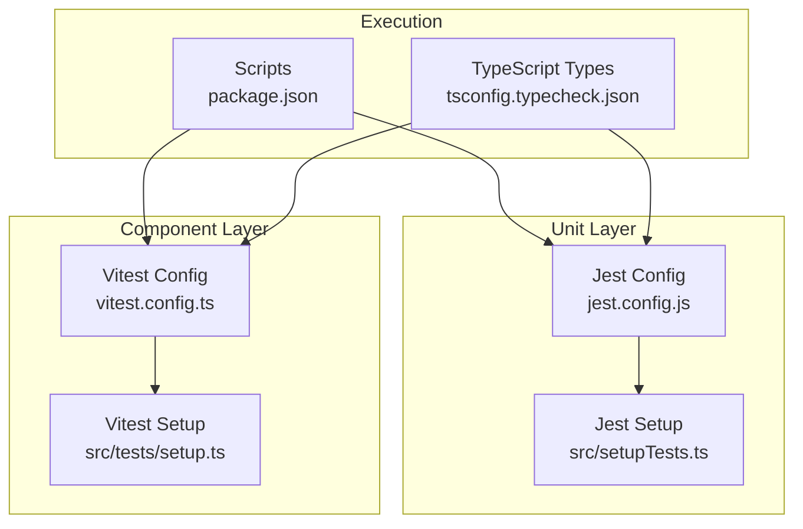
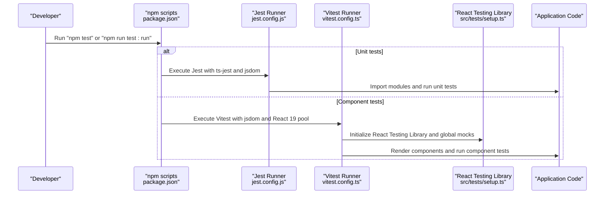
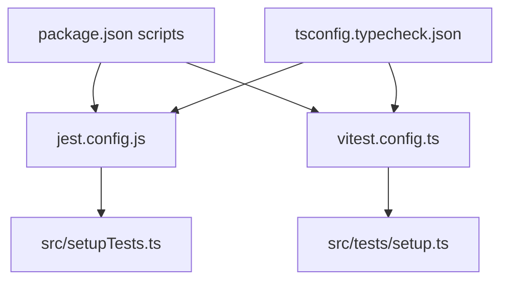

# Testing Strategy

<cite>
**Referenced Files in This Document**
- [jest.config.js](file://jest.config.js)
- [vitest.config.ts](file://vitest.config.ts)
- [src/setupTests.ts](file://src/setupTests.ts)
- [src/tests/setup.ts](file://src/tests/setup.ts)
- [package.json](file://package.json)
- [src/tests/MemoryAndPerformance.test.tsx](file://src/tests/MemoryAndPerformance.test.tsx)
- [src/tests/TabCrossPlatform.test.ts](file://src/tests/TabCrossPlatform.test.ts)
- [src/tests/UserFlowIntegration.test.tsx](file://src/tests/UserFlowIntegration.test.tsx)
- [tsconfig.typecheck.json](file://tsconfig.typecheck.json)
</cite>

## Table of Contents
1. [Introduction](#introduction)
2. [Project Structure](#project-structure)
3. [Core Components](#core-components)
4. [Architecture Overview](#architecture-overview)
5. [Detailed Component Analysis](#detailed-component-analysis)
6. [Dependency Analysis](#dependency-analysis)
7. [Performance Considerations](#performance-considerations)
8. [Troubleshooting Guide](#troubleshooting-guide)
9. [Conclusion](#conclusion)
10. [Appendices](#appendices)

## Introduction
This document defines SchoolPilot3’s multi-layered testing approach. The project leverages:
- Jest for unit tests and legacy compatibility
- Vitest for component tests and modern React 19 environments
- Integration and cross-platform tests for user flows and platform-specific behavior

It documents configuration, setup, utilities, patterns for React components and hooks, service-layer testing strategies, mocking approaches for databases, APIs, and external dependencies, performance and memory testing, cross-platform compatibility testing, CI testing pipeline expectations, coverage requirements, and quality assurance processes. It also provides practical examples of writing effective tests for modules, components, and services.

## Project Structure
SchoolPilot3 organizes tests across three layers:
- Unit tests: Jest-based, primarily for pure functions, services, and utilities
- Component tests: Vitest-based with React Testing Library, focusing on UI components and hooks
- Integration and cross-platform tests: Vitest-based, covering user flows, platform adaptations, and performance/memory behavior

Key configuration and setup files:
- Jest configuration for unit tests
- Vitest configuration for component tests and React 19 compatibility
- Global setup files for Jest and Vitest environments
- Scripts for running tests and generating coverage

**Diagram sources**
- [jest.config.js:1-24](file://jest.config.js#L1-L24)
- [vitest.config.ts:1-33](file://vitest.config.ts#L1-L33)
- [src/setupTests.ts:1-67](file://src/setupTests.ts#L1-L67)
- [src/tests/setup.ts:1-184](file://src/tests/setup.ts#L1-L184)
- [package.json:1-161](file://package.json#L1-L161)
- [tsconfig.typecheck.json:1-22](file://tsconfig.typecheck.json#L1-L22)

**Section sources**
- [jest.config.js:1-24](file://jest.config.js#L1-L24)
- [vitest.config.ts:1-33](file://vitest.config.ts#L1-L33)
- [src/setupTests.ts:1-67](file://src/setupTests.ts#L1-L67)
- [src/tests/setup.ts:1-184](file://src/tests/setup.ts#L1-L184)
- [package.json:1-161](file://package.json#L1-L161)
- [tsconfig.typecheck.json:1-22](file://tsconfig.typecheck.json#L1-L22)

## Core Components
- Jest configuration supports TypeScript transforms, jsdom environment, and coverage reporting. It defines test match patterns and coverage collection from source files.
- Vitest configuration enables jsdom, global test APIs, React 19 compatibility via forked pool, and a dedicated setup file for React Testing Library and global mocks.
- Global setup files initialize DOM APIs, browser APIs, console behavior, and date/time for deterministic tests.

Key capabilities:
- Coverage collection for unit tests
- React 19-compatible component testing with React Testing Library
- Global mocks for localStorage, sessionStorage, fetch, URL, Blob, navigator, and process.env
- Deterministic time control and cleanup routines

**Section sources**
- [jest.config.js:1-24](file://jest.config.js#L1-L24)
- [vitest.config.ts:1-33](file://vitest.config.ts#L1-L33)
- [src/setupTests.ts:1-67](file://src/setupTests.ts#L1-L67)
- [src/tests/setup.ts:1-184](file://src/tests/setup.ts#L1-L184)

## Architecture Overview
The testing architecture separates concerns across layers and environments:

**Diagram sources**
- [package.json:6-65](file://package.json#L6-L65)
- [jest.config.js:1-24](file://jest.config.js#L1-L24)
- [vitest.config.ts:1-33](file://vitest.config.ts#L1-L33)
- [src/tests/setup.ts:1-184](file://src/tests/setup.ts#L1-L184)

## Detailed Component Analysis

### Jest Unit Testing Layer
Purpose:
- Run unit tests for pure functions, services, and utilities
- Provide legacy compatibility and coverage reporting

Configuration highlights:
- Transform TypeScript with ts-jest
- jsdom environment for DOM APIs
- Test match patterns for __tests__ and *.test.* files
- Coverage collection from src/**/*.(ts|tsx), excluding declaration files and specific entry files

Global setup:
- Mock localStorage, sessionStorage, URL, Blob, fetch, navigator, and process.env
- Reduce console noise by stubbing log/warn/error

Coverage:
- CoverageDirectory: coverage
- Reporters: text, lcov, html

**Section sources**
- [jest.config.js:1-24](file://jest.config.js#L1-L24)
- [src/setupTests.ts:1-67](file://src/setupTests.ts#L1-L67)

### Vitest Component Testing Layer
Purpose:
- Test React components and hooks with React 19 compatibility
- Provide React Testing Library integration and global mocks

Configuration highlights:
- Environment: jsdom
- Setup file: src/tests/setup.ts
- React 19 compatibility: pool forks with singleFork and jsdom resources usable
- Aliasing: @ -> src

Global setup:
- Configure React Testing Library with testIdAttribute and async timeout
- Provide global act for React 19
- Mock matchMedia, console methods, Date.now, navigator.onLine, and URL APIs
- Export reusable mock factories for domain entities

**Section sources**
- [vitest.config.ts:1-33](file://vitest.config.ts#L1-L33)
- [src/tests/setup.ts:1-184](file://src/tests/setup.ts#L1-L184)

### Integration and Cross-Platform Testing
Purpose:
- Validate end-to-end user flows and platform-specific adaptations
- Ensure memory stability and performance across environments

Examples:
- UserFlowIntegration tests cover login, navigation, tab persistence, and error recovery
- Cross-platform tests validate tab behavior across mobile, desktop, web, and Tauri environments
- Memory and Performance tests validate render counts, memory usage, event listener cleanup, animation frame cleanup, and efficient prop updates

**Section sources**
- [src/tests/UserFlowIntegration.test.tsx:1-280](file://src/tests/UserFlowIntegration.test.tsx#L1-L280)
- [src/tests/TabCrossPlatform.test.ts:1-614](file://src/tests/TabCrossPlatform.test.ts#L1-L614)
- [src/tests/MemoryAndPerformance.test.tsx:1-239](file://src/tests/MemoryAndPerformance.test.tsx#L1-L239)

### Testing Utilities and Patterns
Patterns demonstrated in the test suite:
- Component rendering and interaction with React Testing Library
- Context providers for AuthContext and TabContext
- Controlled user interactions (form input, clicks)
- Asynchronous assertions and retries
- Mocked localStorage for persistence simulation
- Deterministic timers and fake timers for time-dependent logic
- Cleanup routines to restore mocks and clear timers

Mock factories:
- createMockStudent, createMockStaff, createMockFinancialYear, createMockInvoice
- createMockDataContext for composite data scenarios

**Section sources**
- [src/tests/setup.ts:106-184](file://src/tests/setup.ts#L106-L184)
- [src/tests/UserFlowIntegration.test.tsx:29-56](file://src/tests/UserFlowIntegration.test.tsx#L29-L56)

### Service Layer Testing Strategies
Approach:
- Isolate service functions and inject dependencies via dependency inversion
- Mock external dependencies (database, API) using Jest spies and mocks
- Use deterministic time and environment variables for reproducibility
- Validate side effects through assertions on mocks and state

Coverage:
- Collect coverage from src/**/*.(ts|tsx) excluding declarations and entry files

**Section sources**
- [jest.config.js:16-21](file://jest.config.js#L16-L21)
- [src/setupTests.ts:63-67](file://src/setupTests.ts#L63-L67)

### Mocking Strategies
Database operations:
- Mock database provider environment variable to sqlite-wasm for deterministic behavior
- Use mock factories to simulate data layer responses

API calls:
- Mock fetch globally
- Mock URL.createObjectURL and URL.revokeObjectURL for file download scenarios
- Mock navigator.onLine for network state tests

External dependencies:
- Mock localStorage/sessionStorage for persistence tests
- Mock console methods to suppress noise
- Mock Date.now and global time controls for time-sensitive logic

**Section sources**
- [src/setupTests.ts:6-38](file://src/setupTests.ts#L6-L38)
- [src/setupTests.ts:53-60](file://src/setupTests.ts#L53-L60)
- [src/setupTests.ts:62-67](file://src/setupTests.ts#L62-L67)
- [src/tests/setup.ts:90-99](file://src/tests/setup.ts#L90-L99)
- [src/tests/setup.ts:101-103](file://src/tests/setup.ts#L101-L103)

### Performance Testing Approach
Focus areas:
- Render count validation to prevent excessive re-renders
- Memory usage tracking during tab operations and large datasets
- Event listener cleanup and animation frame cancellation
- Efficient prop updates with React.memo and stable references
- Context updates that avoid unnecessary child renders

Tools and techniques:
- Fake timers to advance time deterministically
- Memory usage snapshots and comparisons
- Event listener counters before/after mount/unmount
- Animation frame callbacks verification

**Section sources**
- [src/tests/MemoryAndPerformance.test.tsx:17-42](file://src/tests/MemoryAndPerformance.test.tsx#L17-L42)
- [src/tests/MemoryAndPerformance.test.tsx:44-80](file://src/tests/MemoryAndPerformance.test.tsx#L44-L80)
- [src/tests/MemoryAndPerformance.test.tsx:82-104](file://src/tests/MemoryAndPerformance.test.tsx#L82-L104)
- [src/tests/MemoryAndPerformance.test.tsx:106-127](file://src/tests/MemoryAndPerformance.test.tsx#L106-L127)
- [src/tests/MemoryAndPerformance.test.tsx:129-171](file://src/tests/MemoryAndPerformance.test.tsx#L129-L171)
- [src/tests/MemoryAndPerformance.test.tsx:173-190](file://src/tests/MemoryAndPerformance.test.tsx#L173-L190)
- [src/tests/MemoryAndPerformance.test.tsx:192-237](file://src/tests/MemoryAndPerformance.test.tsx#L192-L237)

### Cross-Platform Compatibility Testing
Scope:
- Mobile, desktop, web, and Tauri platform adaptations
- Touch targets, keyboard shortcuts, lazy loading, preloading, and GPU acceleration
- Dynamic platform switching and screen size changes
- Accessibility standards across platforms

Techniques:
- Platform-specific mock configurations for user agent, screen size, and touch capability
- Environment property mocks for innerWidth/innerHeight and navigator.userAgent
- Validation of ARIA attributes and accessibility features

**Section sources**
- [src/tests/TabCrossPlatform.test.ts:64-84](file://src/tests/TabCrossPlatform.test.ts#L64-L84)
- [src/tests/TabCrossPlatform.test.ts:102-119](file://src/tests/TabCrossPlatform.test.ts#L102-L119)
- [src/tests/TabCrossPlatform.test.ts:168-174](file://src/tests/TabCrossPlatform.test.ts#L168-L174)
- [src/tests/TabCrossPlatform.test.ts:196-233](file://src/tests/TabCrossPlatform.test.ts#L196-L233)
- [src/tests/TabCrossPlatform.test.ts:246-251](file://src/tests/TabCrossPlatform.test.ts#L246-L251)
- [src/tests/TabCrossPlatform.test.ts:286-292](file://src/tests/TabCrossPlatform.test.ts#L286-L292)
- [src/tests/TabCrossPlatform.test.ts:343-374](file://src/tests/TabCrossPlatform.test.ts#L343-L374)
- [src/tests/TabCrossPlatform.test.ts:407-459](file://src/tests/TabCrossPlatform.test.ts#L407-L459)

### Continuous Integration Testing Pipeline
Expectations:
- Unit tests executed via Jest
- Component tests executed via Vitest
- Coverage thresholds enforced at the CI level (configured via coverage settings)
- Scripts for running tests and UI modes provided in package.json

Recommended CI steps:
- Install dependencies
- Run unit tests with Jest
- Run component tests with Vitest
- Collect coverage and enforce thresholds
- Publish coverage artifacts

**Section sources**
- [package.json:6-65](file://package.json#L6-L65)
- [jest.config.js:22-24](file://jest.config.js#L22-L24)
- [vitest.config.ts:25-31](file://vitest.config.ts#L25-L31)

### Writing Effective Tests
Guidelines:
- Prefer small, focused tests that assert a single behavior
- Use React Testing Library for component tests; rely on setup.ts for global mocks
- Mock external dependencies and environment APIs early in setup
- Use deterministic time controls for time-dependent logic
- Validate accessibility and cross-platform behavior where applicable
- Keep tests readable by using mock factories and helper utilities

Examples to reference:
- Integration tests for user flows and persistence
- Cross-platform tests for adaptive behavior
- Memory/performance tests for render and memory stability

**Section sources**
- [src/tests/UserFlowIntegration.test.tsx:58-104](file://src/tests/UserFlowIntegration.test.tsx#L58-L104)
- [src/tests/TabCrossPlatform.test.ts:483-502](file://src/tests/TabCrossPlatform.test.ts#L483-L502)
- [src/tests/MemoryAndPerformance.test.tsx:17-42](file://src/tests/MemoryAndPerformance.test.tsx#L17-L42)

## Dependency Analysis
Testing dependencies and relationships:
- Jest and Vitest share the same jsdom environment for DOM APIs
- React Testing Library is configured globally in Vitest setup
- TypeScript types for Vitest are included via tsconfig.typecheck.json
- Scripts orchestrate test execution and coverage reporting

**Diagram sources**
- [package.json:6-65](file://package.json#L6-L65)
- [jest.config.js:1-24](file://jest.config.js#L1-L24)
- [vitest.config.ts:1-33](file://vitest.config.ts#L1-L33)
- [src/setupTests.ts:1-67](file://src/setupTests.ts#L1-L67)
- [src/tests/setup.ts:1-184](file://src/tests/setup.ts#L1-L184)
- [tsconfig.typecheck.json:1-22](file://tsconfig.typecheck.json#L1-L22)

**Section sources**
- [package.json:6-65](file://package.json#L6-L65)
- [jest.config.js:1-24](file://jest.config.js#L1-L24)
- [vitest.config.ts:1-33](file://vitest.config.ts#L1-L33)
- [src/setupTests.ts:1-67](file://src/setupTests.ts#L1-L67)
- [src/tests/setup.ts:1-184](file://src/tests/setup.ts#L1-L184)
- [tsconfig.typecheck.json:1-22](file://tsconfig.typecheck.json#L1-L22)

## Performance Considerations
- Use fake timers to control time-dependent logic deterministically
- Track memory usage during component lifecycle and large dataset operations
- Validate event listener and animation frame cleanup to prevent leaks
- Optimize rendering with React.memo and stable references
- Adjust platform-specific performance settings (lazy loading, preloading, GPU acceleration) for different environments

[No sources needed since this section provides general guidance]

## Troubleshooting Guide
Common issues and resolutions:
- React 19 compatibility errors: Ensure jsdom resources are usable and pool configuration is set to forks with singleFork
- Missing DOM APIs: Confirm global mocks for URL, Blob, localStorage, and sessionStorage are applied in setup
- Console noise in tests: Verify console methods are mocked in setup files
- Coverage gaps: Review collectCoverageFrom patterns and exclude patterns in Jest config
- Time-dependent flakiness: Use fake timers and set deterministic Date.now in setup

**Section sources**
- [vitest.config.ts:17-31](file://vitest.config.ts#L17-L31)
- [src/setupTests.ts:24-67](file://src/setupTests.ts#L24-L67)
- [src/tests/setup.ts:51-65](file://src/tests/setup.ts#L51-L65)
- [jest.config.js:16-21](file://jest.config.js#L16-L21)

## Conclusion
SchoolPilot3 employs a robust, layered testing strategy:
- Jest for unit tests with comprehensive coverage
- Vitest for React 19-compatible component tests with React Testing Library
- Integration and cross-platform tests validating user flows and platform-specific behavior
- Extensive mocking for databases, APIs, and external dependencies
- Performance and memory-focused tests ensuring stability and efficiency
- CI-ready scripts and coverage configuration supporting quality assurance

This approach ensures reliable, maintainable, and high-quality code across modules, components, and services.

[No sources needed since this section summarizes without analyzing specific files]

## Appendices

### Test Coverage Requirements
- Coverage directory: coverage
- Reporters: text, lcov, html
- Collection patterns: src/**/*.(ts|tsx), excluding declarations and specific entry files

**Section sources**
- [jest.config.js:22-24](file://jest.config.js#L22-L24)
- [jest.config.js:16-21](file://jest.config.js#L16-L21)

### Example Test References
- Integration tests: [UserFlowIntegration.test.tsx:1-280](file://src/tests/UserFlowIntegration.test.tsx#L1-L280)
- Cross-platform tests: [TabCrossPlatform.test.ts:1-614](file://src/tests/TabCrossPlatform.test.ts#L1-L614)
- Memory/performance tests: [MemoryAndPerformance.test.tsx:1-239](file://src/tests/MemoryAndPerformance.test.tsx#L1-L239)

**Section sources**
- [src/tests/UserFlowIntegration.test.tsx:1-280](file://src/tests/UserFlowIntegration.test.tsx#L1-L280)
- [src/tests/TabCrossPlatform.test.ts:1-614](file://src/tests/TabCrossPlatform.test.ts#L1-L614)
- [src/tests/MemoryAndPerformance.test.tsx:1-239](file://src/tests/MemoryAndPerformance.test.tsx#L1-L239)